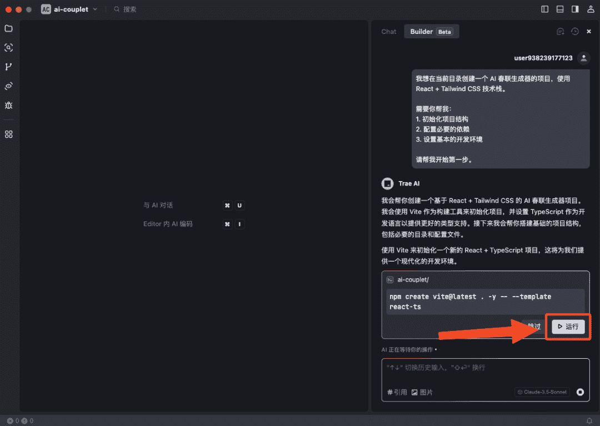
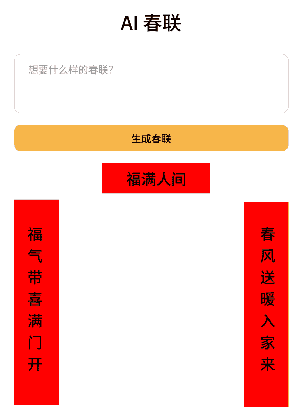
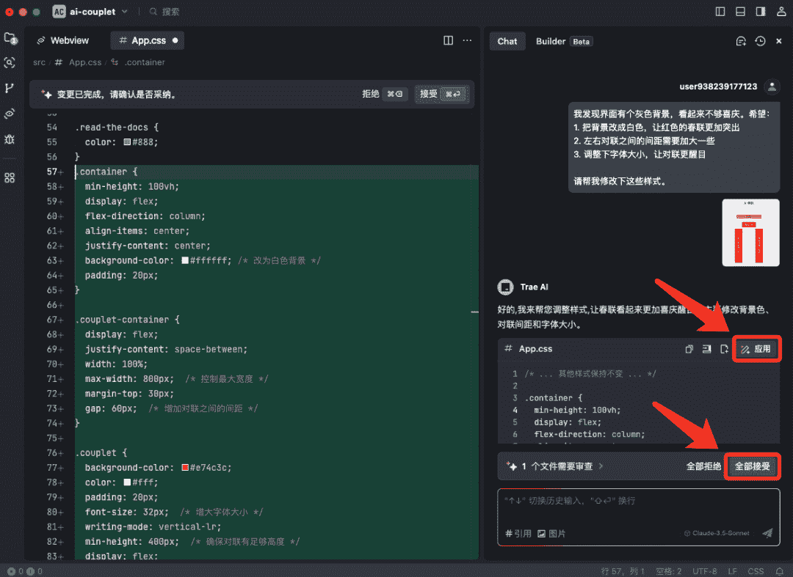
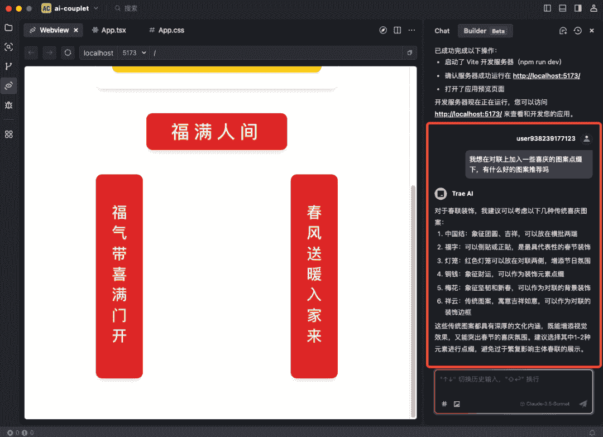
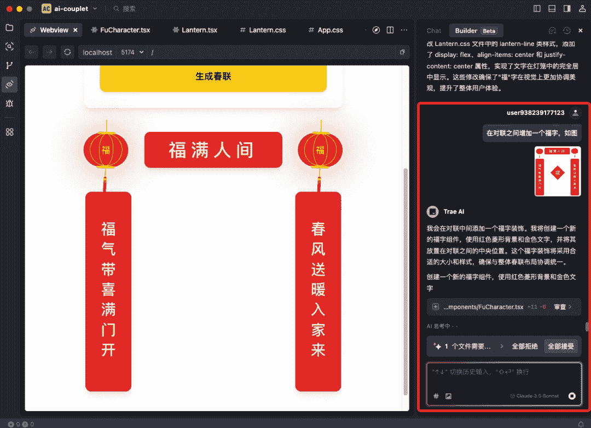

# 几分钟就能开发出网站？编程神器震撼登场啦！

> 来源：[https://agijuejin.feishu.cn/docx/IMqOdTQbyoro5fx0kSCcaSSpnBg](https://agijuejin.feishu.cn/docx/IMqOdTQbyoro5fx0kSCcaSSpnBg)

> 未来君 硅基生命Pro｜[阅读原文](https://mp.weixin.qq.com/s/5VEjWJi-vyuR3UGqvYeucA)，如有侵权，请联系删除。

> 转载请联系原作者取得授权

在软件开发的漫漫历程中，从起初简单的代码补全与错误修复，到如今只需直接对话便能轻松写出代码，AI 以超乎想象的速度，正在彻底重塑这一领域。

就在不久前的两天，字节跳动宛如一颗璀璨的新星，推出了全新的 AI 编程工具——Trae。

这款工具对中文开发者格外友好，其操作界面全部采用中文，让我们能够轻松上手。

更为重要的是，它为我们配备了两位得力的 AI 干将，在不同的模式下发挥着独特的作用。

在 Builder 模式下，一位全能助手，仿佛能读懂我们的每一个想法，从无到有地将产品开发并落地可用；

而在 Chat 模式下，一位全栈程序员，随叫随到，高效地为我们解决各种编程问题，助力完成开发任务。

同时，它们所使用的是强大的 Claude 3.5 sonnet 和 GPT-4o 模型，而且现在即可免费使用。

接下来，就让我们一同踏上这段从 0 到 1 开发产品的奇妙之旅吧。首先，我们需要访问 Trae 官网：https://www.trae.ai/ 。

进入官网后，展现在我们眼前的是一个全新的界面，只需点击中间的按钮「Download for macOS」，就能轻松下载安装包，开启我们的开发之旅。

请注意，当下的 Trae 仅能在 macOS 系统上运行，不过大家无需着急，Windows 版本正蓄势待发，不久后就将与大家见面，让我们一同满怀期待吧。

当安装工作顺利完成，首次打开 Trae 时，映入眼帘的便是默认的简体中文界面，这对于广大中文开发者来说，无疑是一大福音。

它仿佛是为我们量身定制的工具，让我们在熟悉的语言环境中，能够更加流畅地进行编程操作，尽情展现自己的技术才华。

无论是代码的编写、调试，还是项目的管理，都能在这简洁而友好的界面中轻松完成，为我们的开发工作带来极大的便利。

在 Trae 的使用流程中，接下来的一步便是引导我们进行一系列重要的设置。

首先，它会带领我们精心挑选主题，让我们在编程的世界里拥有属于自己的独特视觉风格。

随后，便捷地导入 IDE 配置，无需繁琐的重新设置，就能直接在 Trae 中继续之前的工作，节省了大量时间和精力。

接着，还能轻松添加命令行启动，为我们的开发提供更多的灵活性和便捷性。

经过这些步骤后，我们终于来到了登录界面，这意味着我们即将开启与 Trae 深度合作的新篇章，在这个界面中，我们可以用自己的账号登录，开始尽情享受 Trae 带来的各种便利和惊喜。

需要特别注意的是，只有完成登录操作，我们才能充分使用 Trae 的强大 AI 功能。这就仿佛需要一点神秘的魔法来开启这扇智慧的大门。

我们可以根据自己的喜好选择邮箱注册或者通过第三方登录的方式，轻松完成登录步骤，为后续的使用做好准备。

当登录成功之后，我们便顺利地进入到了 Trae 的工具界面。在这里，我们惊喜地发现支持的插件种类极其丰富。

这些插件就像是一个个神奇的工具，通过安装它们，能够极大地增强编辑器的编码能力。

无论是代码的自动补全、语法检查，还是各种高级的开发功能，都可以通过安装合适的插件来实现。

这为我们的开发工作提供了更多的可能性和便利，让我们能够更加高效地进行编程创作。

春节的脚步越来越近，在这喜庆的时刻，让我们借助 Trae 来打造一个独一无二的 AI 春联生成器。

在与 AI 聊天开发的过程中，我们既能体验到创新的乐趣，又能为自己和家人定制专属的新年祝福，这是多么美妙的事情啊。

整个项目被巧妙地拆分为四个清晰的步骤，分别是项目初始化、基础 UI 实现、春联生成逻辑和样式优化。

首先，我们进入到关键的项目初始化阶段。切换至 Builder 模式，创建一个名为“ai-couplet”的新项目，这就像是为我们的春联之旅搭建了一个坚实的基础。

接着，我们向 Trae AI 详细地描述了需求，将我们的期望和要求清晰地传达给它。

很快，Trae AI 以其高效的响应速度，给出了项目初始化的命令，只需轻轻点击“运行”按钮，神奇的项目初始化之旅便就此开启，让我们满怀期待地迎接接下来的每一个步骤。

在创建 AI 春联生成器项目的进程中，当完成项目初始化的关键步骤后，AI 便开始展现其强大的辅助能力。

它会有条不紊地帮我们配置一些至关重要的样式文件，这些样式文件就如同为春联生成器穿上了华丽的外衣，让其在视觉上更加吸引人。

在配置样式文件的过程中，AI 会极其细致地进行审查，确保每一处变更内容都符合我们的需求和预期。

它就像是一位严谨的工匠，不放过任何一个细节。当审查完毕，确认所有内容都无误时，我们只需轻轻点击“全部接受”按钮，这些精心配置的样式文件便会正式融入到我们的项目中，为后续的春联生成逻辑实现和样式优化奠定坚实的基础，让整个项目的发展更加顺畅和高效。

在开发 AI 春联生成器的道路上，一切都进行得如此顺利。仅仅通过动手点击几下鼠标，我们就轻松地完成了项目初始化这一重要环节，并且成功地启动了运行。这看似简单的操作背后，实则蕴含着 Trae 的高效与便捷。

而 Trae 更为贴心的设计是，它内置了一个便捷的 Web 预览功能，这对于前端项目来说简直是如虎添翼。

通过这个预览功能，我们能够直接查看界面的情况，仿佛拥有了一双透视眼，能够清晰地看到项目在浏览器中的呈现效果。

无论是布局的合理性，还是色彩的搭配，都能在第一时间得到直观的反馈，这大大方便了我们在前端项目开发过程中的调试工作，让我们能够更加快速地发现问题并进行修正，为项目的顺利推进提供了有力的保障。

在完成了关键的项目初始化之后，我们迈入了基础 UI 实现的阶段。此时，项目就如同一个等待着装扮的舞台，而春联生成器的界面部分便是这个舞台的重要装饰。

当我们展示出简单画就的界面原型后，Trae 便如同一位技艺精湛的设计师，开始全身心地投入到界面的实现工作中。

它仿佛能读懂我们心中对于界面的每一个构想，运用其强大的能力，将那些模糊的想法转化为清晰而美观的界面元素。

在这个过程中，我们仿佛能看到一个个界面组件逐渐在眼前搭建起来，仿佛能感受到整个界面正逐渐焕发出独特的魅力，为后续的春联生成功能的展现做好了充分的准备。

当我们发送那些简单的提示词，并同时附上精心绘制的原型图时，神奇的事情发生了。

Trae 就像一位极具灵性的伙伴，瞬间就精准地理解了我们的意图。它仿佛拥有着超能力，开始迅速而准确地自动编写代码。

在这个过程中，我们无需过度焦虑和担心，只需静静地审查着生成的文件。每一个代码片段都仿佛是它精心雕琢的作品，我们只需确认其是否符合我们的期望和需求。

当一切都审查完毕，确认无误后，只需轻轻点击“全部接受”按钮，这些由 AI 生成的代码便会正式融入到我们的项目中，为基础 UI 实现的下一步工作奠定坚实的基础，让我们切实感受到 AI 带来的高效与便捷。

当我们完成了那一系列与 AI 的交互操作后，一幅令人惊艳的春联生成界面展现在眼前。它就如同一件精美的艺术品，完美地呈现在我们的面前。

从设计元素来看，它与我们最初提供的原型图可谓是高度契合，每一个细节都精准无误。

然而，更令人惊喜的是，AI 还独具匠心地选取了更加美观的字体配色。这些字体和配色仿佛是为春联而生，它们相互搭配，相得益彰，让整个界面焕发出一种独特的韵味。

仿佛在这一刻，春联生成界面不再仅仅是一个工具，而是一件充满艺术气息的作品，带给我们无尽的视觉享受和创作灵感。

通过这一轮与 Trae 的对话，我们深刻地感受到了它那令人惊叹的能力。它不仅仅能够娴熟地读懂各种代码，还能够精准地理解我们所提供的图片内容。

整个过程就像是一场行云流水的舞蹈，流畅而自然，让原本繁琐复杂的传统界面开发工作瞬间变得轻松愉快起来。

当界面顺利搭建完成后，我们又开启了春联生成功能的实现之旅。这是整个项目的核心部分，需要获取用户输入的内容，并借助 Claude API 生成与之对应的春联。

我们满怀期待地让 Trae 为我们实现这一功能，它也迅速投入到工作中，完成了包括接口调用、错误处理等一系列逻辑的开发。

然而，在进行测试时，却出现了“生成春联失败”的情况，这让我们不禁有些担忧，但也更加激发了我们去探寻问题根源、解决问题的决心。

在开发过程中遇到“生成春联失败”这样的情况时，我们不必陷入惊慌与恐惧之中。因为我们知道，我们可以将所遇到的问题如实地反馈给 AI，让它来进行修复。

我们可以采取更加直观的方式，将遇到的问题以截图的形式呈现出来，同时附上一些简单明了的描述。

这样，AI 就能更加清晰地理解问题的所在，就像我们在它面前展开了一幅详细的“问题地图”。

通过这种方式，它能够更有针对性地去分析和解决问题，为我们的开发工作提供更有力的支持，让我们在前进的道路上更加从容和坚定。

历经数轮的精心优化与调整，我们终于达成了一个令人欣喜的成果——一个运行得极为流畅的春联生成功能。

如今，当我们输入“家”这个关键词时，仿佛开启了一扇通往新春世界的大门，AI 迅速生成了一副对仗工整、充满喜庆祥和氛围的春联；

当输入“春”时，同样能得到一幅契合春节氛围的佳作。无论是何种关键词，都能在瞬间获得满意的春联输出，这充分展现了这个功能的强大与高效。

它就像是一位才华横溢的春联创作大师，随时准备为我们带来新春的祝福与喜悦，让我们在春节的氛围中更加沉浸和享受。

在完成了春联生成功能的实现后，我们又迎来了样式优化的阶段。这是一个让春联展示效果更加完美的关键步骤。

当我们切换到 Chat 模式，就仿佛进入了一个与 AI 进行轻松交流的空间。我们以自然的聊天方式向它阐述我们对于样式的需求，同时附上界面截图，让它能更直观地理解我们的想法。

我们希望把原本灰色的背景改成白色，这样能让红色的春联更加醒目，仿佛给春联披上了一层喜庆的外衣；还希望加大左右对联之间的间距，让整个布局更加协调；并且调整字体大小，让对联在视觉上更加醒目，更能吸引人们的目光。

Trae AI 以其高效的响应速度，很快给出了具体修改的样式代码。我们仔细地审查这些代码，确保每一处修改都符合我们的期望。

然后点击“应用”按钮，系统会再次让我们查看变更内容，确认无误后点击“全部接受”，这些样式的修改就顺利完成了，春联的展示效果也得到了极大的提升，更加契合春节的喜庆氛围。

在进行界面细节优化的过程中，我们深知这是一个需要不断与 AI 进行对话沟通并反复调整的过程。我们只需将心中对于界面细节的想法清晰地描述出来即可。

例如，当我们觉得当前的对联显得过于单调且不够喜庆时，我们可以毫不犹豫地向 AI 提出疑问，询问它有哪些好的建议。

AI 就像是一位经验丰富的设计师，会根据我们的描述给出各种富有创意的想法和方案。

我们可以与它进行深入的交流，共同探讨如何让对联更加生动、更加富有节日的氛围，通过这样的反复沟通和调整，我们能够逐步打造出一个令人满意的界面细节，让整个春联生成器更加完美。

在追求界面细节的完美之路上，我萌生了一个新的想法。决定在横批的左右两侧增添两个小灯笼来进行装饰，希望能让整个春联生成器的界面更具节日氛围。

为了更准确地表达我的需求，我积极地在网上搜索到了一张精美的灯笼图片素材。

借助这张素材，我亲手绘制了一张简单的示意图，将想要添加的小灯笼的位置、形状等细节都清晰地呈现出来。

然后，我满怀期待地将这张示意图告知给 AI，让它凭借其强大的能力来帮助我实现这个小小的创意。

我相信，在 AI 的协助下，这个小小的装饰细节一定能为春联生成器的界面增添一抹独特的光彩。

当我将添加小灯笼装饰的想法告知 AI 后，它仿佛瞬间领悟了我的意图。只见它如同一位技艺娴熟的编程大师，手指在键盘上飞快地舞动，代码如泉水般汩汩流出。

没过多久，它就完成了代码的编写，那速度之快让我们惊叹不已。当我们看到界面上真的出现了那两个精致的小灯笼，并且它们还带有左右摇摆动效时，心中满是惊喜与满足。

AI 不仅准确地实现了我们想要的效果，还在其中融入了一丝灵动，仿佛让整个春联生成器都鲜活了起来，为我们带来了全新的视觉体验。

当那两个灯笼出现在界面上后，整个春联生成器仿佛增添了一丝浓郁的年味。然而，仔细观察后发现对联中间的空白区域稍显过大，这让我心中突然涌起一个灵感。

我迅速拿起笔，在纸上画了一个简单的“福”字示意图，它的形态简洁而富有韵味。

然后，我将这张示意图交给 AI，期待它能再次展现出神奇的力量。我相信，通过 AI 的协助，这个小小的“福”字将恰到好处地填充在对联中间的空白区域，让整个界面更加和谐、完美，进一步提升春联生成器的节日氛围。

当我们怀着期待的心情，一同聚焦于最终成品时，那呈现出的 AI 春联生成器的运行效果着实令人惊叹。

在整个“AI 春联”项目的开发过程中，Trae 宛如一位贴心的编程助理，始终与我们保持着一对一的聊天互动，凭借其强大的能力，帮助我们逐步构建起了一个完整且极具特色的项目。

然而，不可否认的是，对于一款刚刚崭露头角的新产品来说，Trae 仍存在着一些不足之处。就像在实现灯笼动画效果时，我们需要提供一些具体的示例给 AI，以便更好、更快地引导它完成开发工作。

而且，对于一些常用的规则，编辑器未能提供全局选项，这使得用户在使用过程中不得不重复进行设置，导致流程略显繁琐。

但即便如此，我们依然对它充满信心，相信随着更多开发者的加入，像 Trae 这样的 AI 编辑器会不断完善，工匠与工具之间将实现更加完美的相辅相成，编程效率也必将得到大幅提升。

有了 AI 的加持，编程的门槛得以进一步降低，更多的人将有机会上手编程，创造出更多实用的产品，未来或许真的将迎来一个互联网产品大爆发的时代。