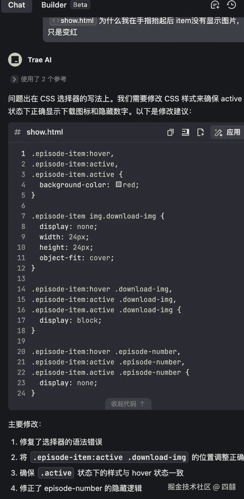
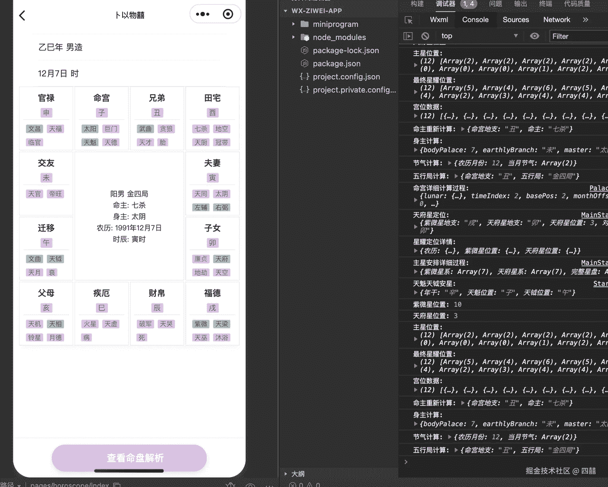
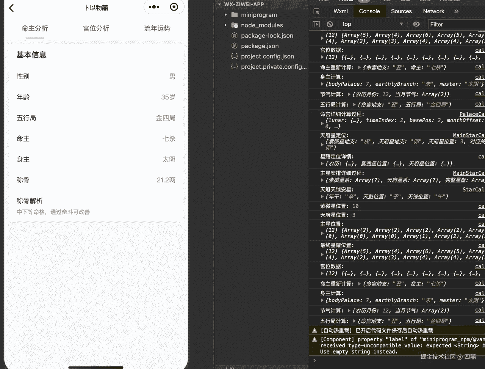
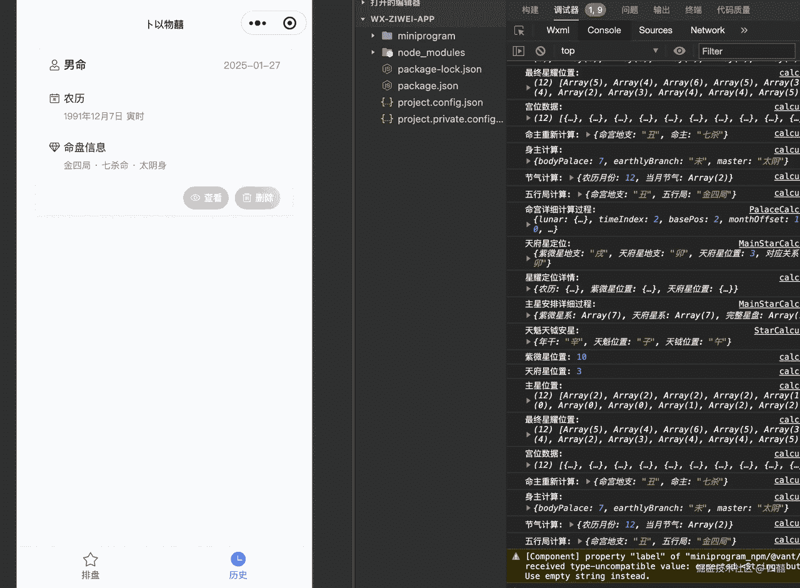
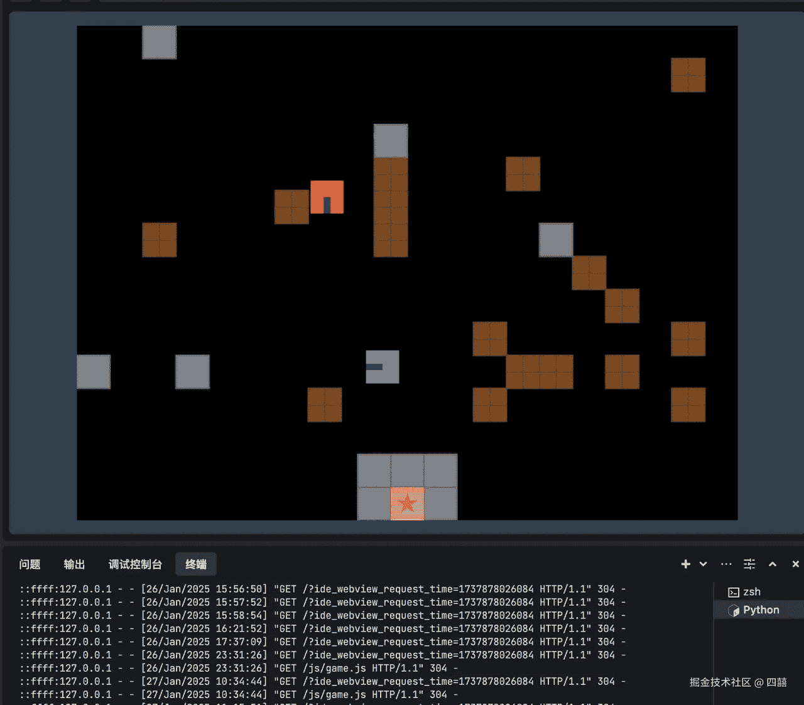
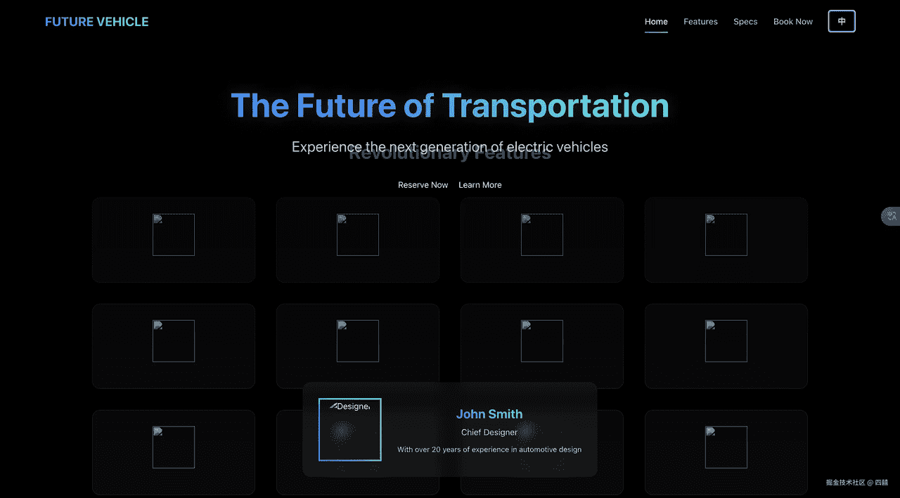

# Trae：不敲一行代码实现完整小程序/小游戏/官网 ！！！

> 来源：[https://agijuejin.feishu.cn/docx/W0X1dEgOXoiC7MxRHXYceLLPntf](https://agijuejin.feishu.cn/docx/W0X1dEgOXoiC7MxRHXYceLLPntf)

> 作者：四囍

> 链接：https://juejin.cn/post/7464190477329039401

> 来源：稀土掘金

> 著作权归作者所有。商业转载请联系作者获得授权，非商业转载请注明出处。

> 如有侵权，请联系删除。

**我正在参加Trae「超级体验官」创意实践征文， **本文所使用的 Trae 免费下载链接： www.trae.ai/?utm_source…

年**前最后一周趁着有空**试验了下字节最新编辑器 Trae，我是被其 不用翻墙使用 openAl 和支中文 吸引进来，不得不说这对于英文不友好的我来说是一个非常好的消息，我曾试验过很多的 vscode 辅助 Al 插件，也使用过 windsurf ，就使用下来的心得而言，Trae 确实是 国产区 相当强大的力量，当然也有一些不足，下面我会详细的指出这些方面。

首先需要声明，我在实验 Trae 的过程中没有手动敲过一行代码，最主要的工作量其实就是「正确」的表达诉求，以及贴上对应片段告诉编辑器有哪些报错，我需要怎样优化。我最开始完成的是一个紫薇斗数排盘的小程序，在 Trae中有两种辅助流程：

一种是 **chat **，即**对话模式，我们可**以一点**点的完整构**建整个应用，**并且在这种模式**中，我们的代码更迭，编辑器会给出修改意见，我们可以进行 code review，选择应用或者放弃，类似 git merge。而 Beta 版本的 Builder ,可以帮我从有到无实现一个完整的功能，不过实测下来会有很多缺陷，比如对于已有功能的忽略，若对于代码不太了解，会导致后续可生成有很多重复代码功能，就此而言，我建议不论是 chat 和 builder 模式，我们在每一次 bugfix或者要修改对应功能时，我们都要使用 #引用# 功能，给它 限定一个范围 ，我遇到过很多次没有限定范围，它不会考虑现有代码而是直接生成重复的功能代码导致 bug而并没有解决问题，在 chat 模式我们可能会仔细的对比，但是在build 模式下我们可能会不语，只是一味应用... ，导致现有的成功功能被破坏，又要重新修复和沟通功能，会对精力和时间有一点小小的考验（抓狂~）。

好了接下来我会给大家展示我这周实验的几个小 demo，首先是一个小程序：

我将主要的功**能模块全部**贴了出来，只是想为大家展示一下，Trae到底能做到什么。这个小程序大概花费了2-3天的时间，最主要的时间还是花在一个排盘的算法上，就界面的实现和整体业务流转，一天基本就可以完成，当然这个需要加上过程中的磨合和 bugfix是，首先 Trae 对于 bug 的处理就目前而言我的体验是非常准确和到位的，它的主要缺陷我理解还是对于大的模块把握不精准，比如在实现中多次为我生成重复的功能模块和代码，导致后续要花费精力去区分和梳理，这也是我为什么建议每次都要加上 #引用# 的原因。

然后就是经典的小游戏，坦克大战，这次我用到了 builder，和它沟通我想要实现一个经典的坦克大战小游戏，很快的，就帮我实现了一个初版，但是也不出意料的，只有一个敌方和我方，简陋的没眼看...之后我想了想小时候玩过的坦克大战，还有哪些元素和玩法，一点点的喂给 Trae 听，很开心，它听懂了，虽然页面还是有些简陋，但是我想要的功能和玩法上已经足够完备。

Ps: 实现这个貌似花了不到 1h，所以对于功能性代码和逻辑而言，Trae会实现的更精准一些。

最后我想要看看 Trae 的审美能力，说白了就是对于 ui 的审美，我让它帮我实现一个陆地飞行器的官网，设计参考小米 su7 和 小鹏飞天的官网设计。

我**没想到**这个官网是这几个项目**中最让我头疼的，其实就是**目前 Trae 对于逻辑性功能而言，实现的会更加精准，对于css审美而言，需要我们更加 精准 的去调教，它自身是 逻辑性更强而艺术性稍差 ，尤其对于一些排版布局，需要我们更加精准的去提出诉求，然后慢慢的调试，对于完全不懂代码的同学来说，我建议是直接喂图，然后抽奖生成。由于我没有 ui，所以更多的是口述，我对于最终的实现效果也很满意，不过其中 切换 tab页面滚动到对应的高度-页面滚动到对应的区域切换tab 这个联动效果还是调试了两天时间，因为还需要前置调试 css定位问题，在 js生成的功能而言是可以实现的，但是对于整体 css 的修改，对于 Trae来说会比较抽象吧。

好了这就是这周我的 Trae使用心得，整体感受下来，我是非常开心字节能够推出我们国人好用的编辑器工具，同时也为Al的能力第一次感到震撼，刚好昨天刷到了一篇推文，我开始会对未来的社会感到一丝‘恐惧’和期待。

**未来已经来了，不是么。**