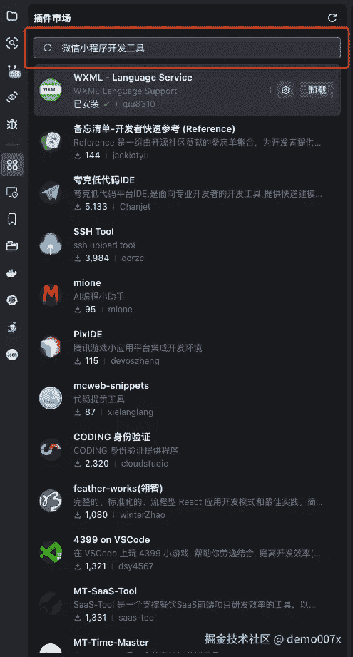
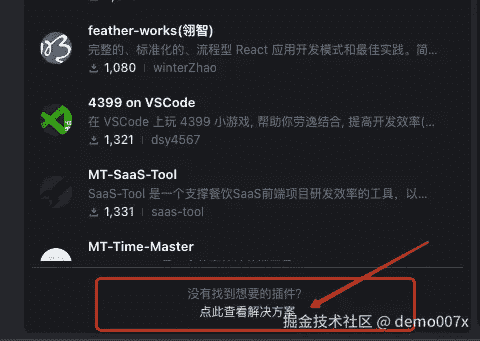
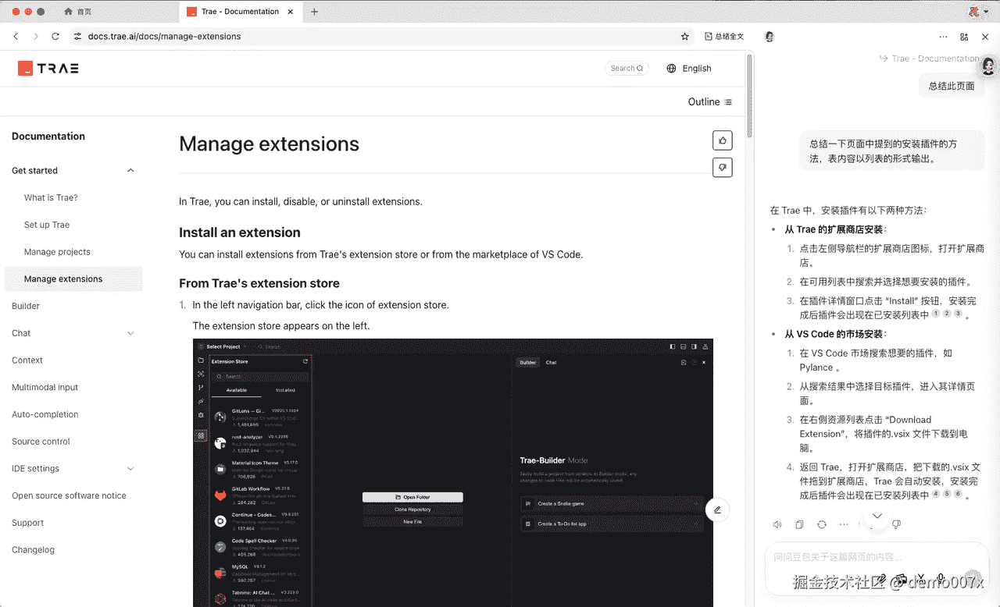
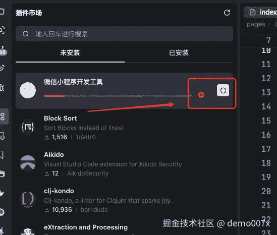
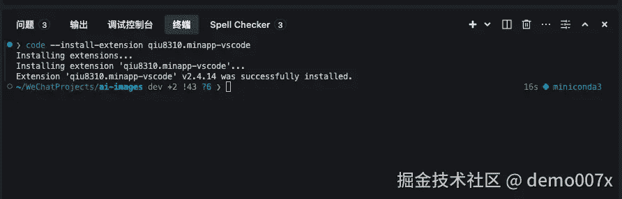
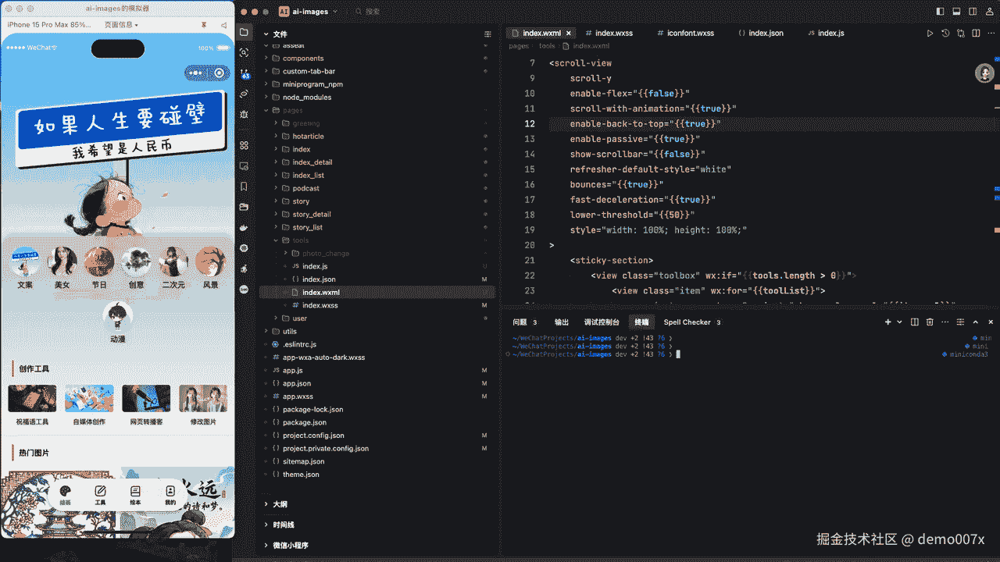
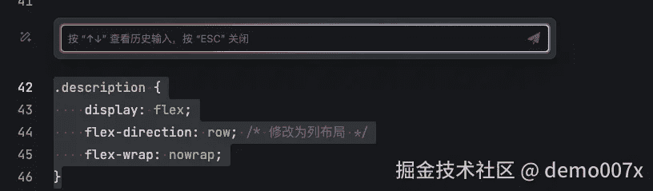
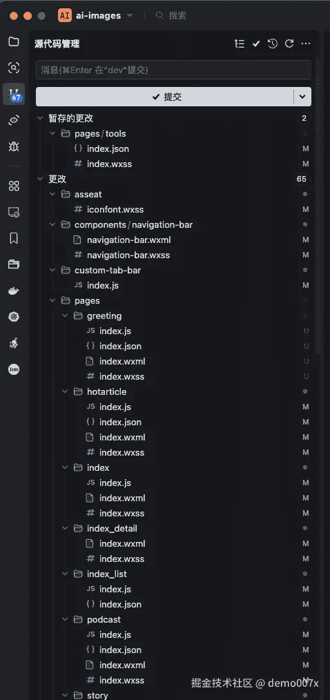
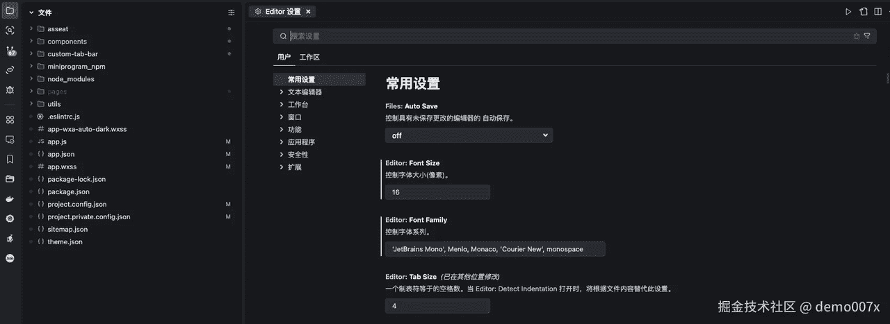

# trae 深度体验：使用trae完美开发🛰️小程序

> 来源：[https://agijuejin.feishu.cn/docx/Ol0HdFCLfoRsSqxtMWhc2taxnrc](https://agijuejin.feishu.cn/docx/Ol0HdFCLfoRsSqxtMWhc2taxnrc)

> 作者：demo007x

> 链接：https://juejin.cn/post/7462947628474171403

> 来源：稀土掘金

> 著作权归作者所有。商业转载请联系作者获得授权，非商业转载请注明出处。

> 如有侵权，请联系删除。

我正在参加Trae「超级体验官」创意实践征文， 本文所使用的 Trae 免费下载链接： www.trae.ai/?utm_source…

### 安装 trae

安装 trae 教程和使用文档大家可以参考官方文档，很详细。使用过 vscode 的用户几乎可以无缝切换过来。官方文档：docs.trae.ai/docs/what-i…

目前只支持 mac 系统，windows 预计 2 月份上线。

如果遇到下面的错误，请🪜解决；

### trae 项目实战：开发🛰️小程序

#### 插件安装

**要想在 **t**rae 中完美体验**小程序开发首先需要安装必要的两个插件WXML、🛰️小程序开发工具

**WXML**：🛰️小程序 .wxml 文件代码高亮，标签、属性的智能补全（同时支持原生小程序、mpvue 和 wepy 框架，并提供 code snippets）

**🛰️小程序开发工具**：提供小程序预览、打包上传、代码补全、语法高亮、项目模版等功能

##### 安装 “wxml”插件

按照 vscode、trae 的插件安装方式安装就可以顺利安装：


##### 安装 “🛰️小程序开发工具”插件

这个工具安装有一些曲折，按照 vscode 的使用习惯，首先在插件市场按名称搜索，结果大出意料，没有😄。



不知道是哪里出现了问题，按照官方文档指引去下载。



打开官方的网址 docs.trae.ai/docs/manage…， 全是英文，没关系，使用豆包 APP 打开网页，让豆包总结网页内容就行 😄：



文档中提到了两种方式：

+   **从 Trae 的插**件市场中安装（没搜索到🛰️小程序开发工具插件，此路不通😭）

+   把插件下载到本地，使用本地安装的方式。看下面动图：

右下角提示，直接安装失败！此路也不行。作为一个程序员折腾是我的本能，看看 trae 的 AI 能力能不能提供帮助。

**顺便遇到个 bug：**



插件安装失败后，图中的两个按钮点击了都没有任何反应，只能重启 trae 才能解决。

+   求助 trae 的 AI

+   使用快捷键 **command** + **U** 打开右侧边栏，输入要问的问题：


看到上图，这个插件我们已经安装，在 trae chat 中给到的建议是里面有 "小程序开发助手"插件，但是没有提到如何安装。

更换模型，在 chat 的对话框右侧点击切换模型，使用 gpt-4o，来解决插件安装的问题：

多次尝试后，回答还是一如既往的固执。

在AI 给到的回复当中有个插件的命令，不过这个命令适合 vscode。

点击运行按钮试试，此时 trae 会自动打开 terminal，直接执行命令



提示安装成功，但是给 vscode 安装了。继续提问：


嗯，还是 vscode 命令，不过也没关系，更换为 trae 就行了：

trae --install-extension /Users/oo7/Downloads/crazyurus.miniprogram-vscode-extension-1.5.1.vsix

等待命令执行完毕：

安装成功。

至此两个插件就安装完毕，可以做小程序的开发了。

##### 小结

在trae中安装用于🛰️小程序开发的“WXML”和“🛰️小程序开发工具”插件，过程各有不同：

+   **“WXML”插件**：按照vscode、trae常规的插件安装方式即可顺利安装。

+   **“🛰️小程序开发工具”插件**：在trae插件市场和vscode插件市场均搜索不到，通过从官方文档下载插件本地安装失败，求助trae的AI起初未得到有效解决，最终通过将适用于vscode的安装命令修改为适用于trae的命令trae --install-extension /xxxx/crazyurus.miniprogram-vscode-extension-1.5.1.vsix ，成功安装。

+   安装完成两个插件后，即可进行小程序开发。 同时，安装插件失败时存在点击重试和关闭按钮无反应的bug，需重启trae解决。

+   点击 chat 区域的 run 按钮一定要检测命令的安全性（不然遇到非法的命令直接运行结果很严重），同时也建议trae 只复制命令到终端即可。

#### 小程序项目开发

**在 trae **中开发小程序，还需要下载🛰️开发者工具，也许有人会问既然有了🛰️开发者工具为什么还要使用 trae？

+   🛰️开发者工具编写代码远远没有使用 trae 写代码快，bug 多，没有 AI。

+   trae 功能插件丰富、UI nice、拥有免费的 AI👍。

+   **🛰️开发者工具**不能少，🛰️开发者工具有实时渲染，代码检测、性能分析、一键上传代码等🛰️小程序必须的功能。

使用 **🛰️开发者工具**打开你的项目，并点击打开模拟器和分离窗口，如下图：


然后打开 trae 编辑器，在你的桌面布局中配置如下排列方式：



这样我们就可以实现一边写代码一边调试效果的目地。

#### 编写页面

##### 代码编写

我已经有这样一个页面，不过界面太难看了，使用 Trae 来调试他：


页面 wxml 代码 ：

```
ini
 代码解读
复制代码
 &lt;!--pages/tools/index.wxml--&gt; &lt;navigation-bar     title=&quot;{{pageTitle}}&quot;     back=&quot;{{false}}&quot; &gt; &lt;/navigation-bar&gt; &lt;scroll-view     type=&quot;custom&quot;     scroll-y     enable-flex=&quot;{{false}}&quot;     scroll-with-animation=&quot;{{true}}&quot;     enable-back-to-top=&quot;{{true}}&quot;     enable-passive=&quot;{{true}}&quot;     show-scrollbar=&quot;{{false}}&quot;     refresher-default-style=&quot;white&quot;     bounces=&quot;{{true}}&quot;     fast-deceleration=&quot;{{true}}&quot;     lower-threshold=&quot;{{50}}&quot;     style=&quot;width: 100%; height: 100%;&quot; &gt;     &lt;sticky-section&gt;         &lt;view class=&quot;toolbox&quot; wx:if=&quot;{{tools.length &gt; 0}}&quot;&gt;             &lt;view class=&quot;item&quot; wx:for=&quot;{{toolList}}&quot;&gt;                 &lt;navigator open-type=&quot;navigate&quot; hover-class url=&quot;{{item.url}}&quot;&gt;                     &lt;image src=&quot;{{item.imageUrl}}&quot; fade-in=&quot;{{true}}&quot; mode=&quot;widthFix&quot;&gt;&lt;/image&gt;                     &lt;text class=&quot;title&quot;&gt;{{item.title}}&lt;/text&gt;                     &lt;view  class=&quot;description&quot;&gt;                         &lt;text&gt;&lt;span class=&quot;iconfont  icon-Fire-fill-red&quot;&gt;&lt;/span&gt;{{100}}&lt;/text&gt;                         &lt;text class=&quot;description_right&quot;&gt;去创作 &lt;span class=&quot;iconfont icon-ChevronRight&quot; style=&quot;font-size: 12px;&quot;&gt;&lt;/span&gt;&lt;/text&gt;                     &lt;/view&gt;                 &lt;/navigator&gt;             &lt;/view&gt;         &lt;/view&gt;     &lt;/sticky-section&gt; &lt;/scroll-view&gt;
```

界面样式实在太丑了，对 .description 进行样式修改。在 inde**x.wxs**s 文件中，选中 .description 的样式，在悬浮工具条中点击添加到对话，然后我们在对话区域输入我们的修改要求，trae 进行回答。然后点击应用按钮，可以直接把新的代码插入到源文件对应的行。并且 trae 还很贴心的显示了新旧代码的区分。


最后完成页面的修改，看效果：


index.wxss

```
css
 代码解读
复制代码
 @import &#x27;../../asseat/iconfont.wxss&#x27;;  .toolbox {     display: flex;     flex-direction: row;     flex-wrap: wrap;     justify-content: space-around; }  .toolbox .item {     display: flex;     flex-direction: row;     flex-wrap: wrap;     justify-content: space-around;     width: 45%;     background-color: white;     margin-bottom: 20px;     box-shadow: 0 3px 5px rgba(0, 0, 0, 0.1); }  .toolbox .item image{     /* height: 50px;*/     /* max-width: 100px; */     width: 100%;      overflow: hidden;     /* border-radius: 5px; */     border-top-left-radius: 5px;     border-top-right-radius: 5px; }  .toolbox .item .title {     line-height: 40px;     font-size: 15px;     /* white-space: normal; */     align-items: center;     width: 100%;     padding-left: 10px;     font-weight: 400;     text-shadow: 1px 1px 3px rgba(0, 0, 0, 0.3) }  .description {     display: flex;     flex-direction: row; /* 修改为列布局 */     flex-wrap: nowrap; } .description .iconfont{     font-size: 12px; } .description text {     display: inline;     line-height: 20px;     font-size: 12px;     width: 100%;     padding-left: 10px;     font-weight: 400;     /* text-shadow: 1px 1px 3px rgba(0, 0, 0, 0.3) */  }  .description text:first-child{      color: red;  }  .description .description_right{     font-size: 12px;     text-align: right;     width: 95%;     display: inline-block;     margin-right: 5px;     color: #3cc51f; }
```

如果我们需要回溯代码的历史记录，我们可以选中代码，然后在工具条中选择编辑即可查看。



再来看动图，效果杠杠的🐂：


##### 使用设计图转换为小程序代码

首先我们准备一个页面的设计图


然后使用快捷键 **command+U**打开右侧的chat 区域，把设计图粘贴进去，并进行对话。输入对话内容：把上图的样式布局转换为🛰️小程序的代码。看下面动图：


这样会生成对应🛰️小程序的3个文件: index.wxml、index.wxss、index.js ，然后我们使用应用按钮，将代码插入到对应的文件即可。看最后的效果：


看着效果还行，如果在使用过程中效果不是很好，可以多尝试几次。

##### 小结

1、我们在编写代码过程中与AI 助手聊天,可以指定Trae中的内容(例如代码、文件、文件夹和工作区)作为AI助手阅读和理解的上下文。这 可确保AI助手的响应更符合您的需求。

大家在使用AI的过程中，普遍感觉就是AI不能代替程序员，写出来的代码基础就不能用，原因就是一般的 AI 无法理解用户的工程文件结构黑内容，更无法知道你文件之间、代码直接的关系。trae 做到了，通过项目、文件、代码直接的逻辑生成的答案更贴合实际情况，所以效果会更好些。

2、将图片直接转换为代码依赖强大的多模态模型，大大减低了程序员的工作量。不需要依赖任何内容，将生成的内容稍微修改就可以直接使用， good job 👍。

#### 代码管理

trae 无缝集成了 git 的代码管理功能，我们只需要点点按钮就可以了。可以通过下面的两种方式激活代码管理：

+   **如果当前打**开的文件夹没有 Git 仓库，请单击初始化仓库以为其初始化一个仓库。初始化完成后，源代码控制将被启用。

+   单击**发布到 GitHub**直接将此文件夹发布到 GitHub 仓库。发布后，可以访问源代码控制。



#### Trae配置

**熟悉 vscode** 的用户，对于配置 Trae 也很简单，使用快捷键 command+, 打开设置项：

根据自己的喜好配置即可。



### 总结

+   **安装 Trae**：可参考官方文档进行安装，使用过 VS Code 的用户能无缝切换。

+   **插件安装**

+   **WXML 插件**：按常规方式顺利安装，可实现代码高亮、智能补全等功能。

+   **🛰️小程序开发工具插件**：在市场搜索无果，本地安装失败。最终将适用于 VS Code 的命令修改后成功安装。安装失败时存在按钮无响应的 Bug，需重启 Trae 解决。

+   **Trae** 的插件市场有部分插件是无法搜索到（具体原因未知），遇到无法安装的插件建议使用离线安装的方式，使用命令安装，

+   **小程序项目开发**

+   **结合工具**：同时使用🛰️开发者工具和 Trae，🛰️开发者工具于实时渲染等，Trae用于高效代码编写和利用 AI 功能。

+   **代码编写**：可选中代码向 Trae 的 AI 提出修改要求，直接将新代码插入源文件，还能查看代码历史记录。

+   **设计图转换代码**：依赖多模态的能力，可以在 chat 区域，粘贴设计图并对话，可生成小程序代码文件，效果不佳时可多次尝试。

+   **代码管理**：无缝集成 Git 功能，可通过初始化仓库或发布到 GitHub 激活源代码控制。

+   **配置 Trae**：熟悉 VS Code 的用户可使用快捷键打开设置项进行个性化配置。