# 从零到一：使用Trae IDE开发AI ChatBot的实战指南

> 来源：[https://agijuejin.feishu.cn/docx/AJRBdiwTBocM96xC6N3cUik8nac](https://agijuejin.feishu.cn/docx/AJRBdiwTBocM96xC6N3cUik8nac)

> 作者：小Q_dream

> 链接：https://juejin.cn/post/7464467076495163427

> 来源：稀土掘金

> 著作权归作者所有。商业转载请联系作者获得授权，非商业转载请注明出处。

> 如有侵权，请联系删除。

**我正在参加Trae「超级体验官」创意实践征文， **本文所使用的 Trae 免费下载链接： www.trae.ai/?utm_source…

## 前言

**首先我们要先了解一下Trae是什么？如何安装及使用**？ 如果已经了解过可以直接跳到Trae实战小节，带你使用Trae从0开始开发一个ChatBot

## Trae是什么？

**Trae **是由字节跳动推出的一款免费的AI集成的开发环境，集成了Claude3.5与GPT-4o等主流AI模型，提供 AI问答、智能代码生成、智能代码补全，多模态输入 等功能。支持界面全中文化，为中文开发者提供了高效的开发体验，关键还免费

###### Trae安装

[点击进入Trae官网下载](https://www.trae.ai/)

不过现在 仅支持Mac用户，Windows预计节后上 ，Windows用户可以先看一下我这篇文章啦

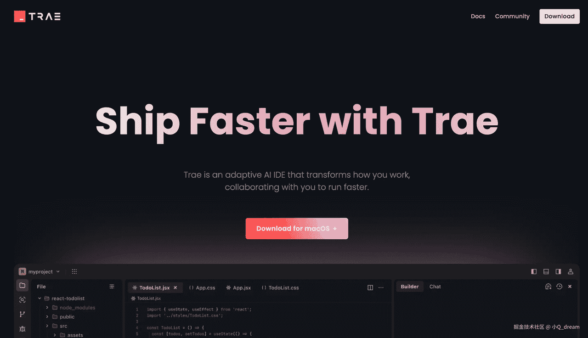

点击 **Download **即可进入下载


**进入安**装程序，它会让你选择主题以及语言，原生支持 中文 和英语，可以从其他IDE中导入数据如（VSCode），它会将你的插件以及设置等一键导入Trae，这样你就可以轻松切换到Trae


这步它会让你添加 trae 命令行，当你需要在命令行中使用 Trae 打开项目时

可以使用 trae 命令

```
trae .  # 打开命令行所在目录
trae /developers/app/xxx # 打开指定项目
```

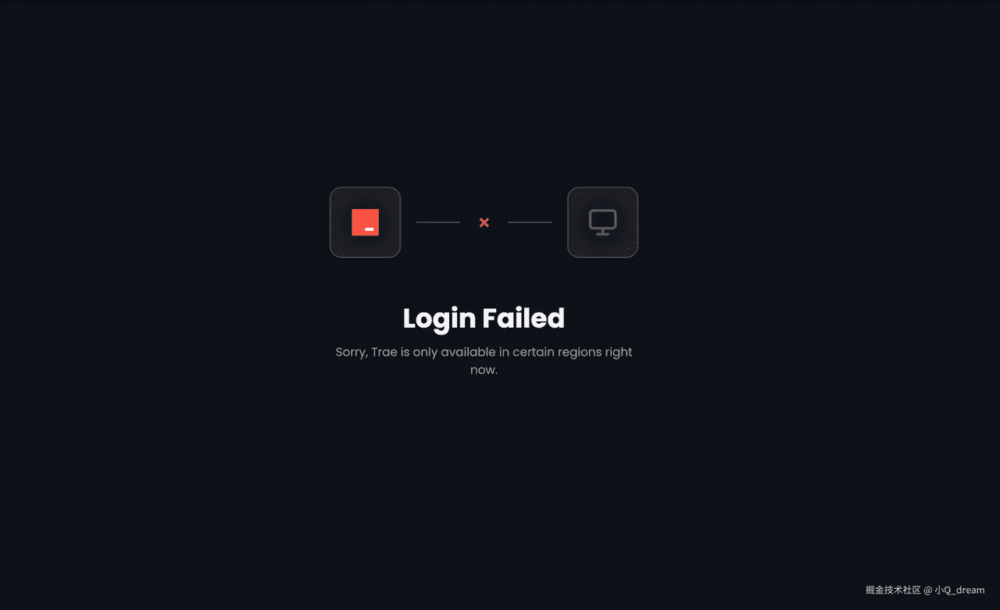

如果你授权登录的时候发生这种错误，那么就需要你🪜

## Trae核心功能

进入 Trae 就可以看得到，典型的布局，左侧文件导航区，中间代码编辑区，右侧是 AI 聊天交互区，不得不说，这个 UI 确实可以，看习惯了 VSCode 以及那些插件的主题，Trae 的 UI 界面很简洁、直观的设计，让人焕然一新

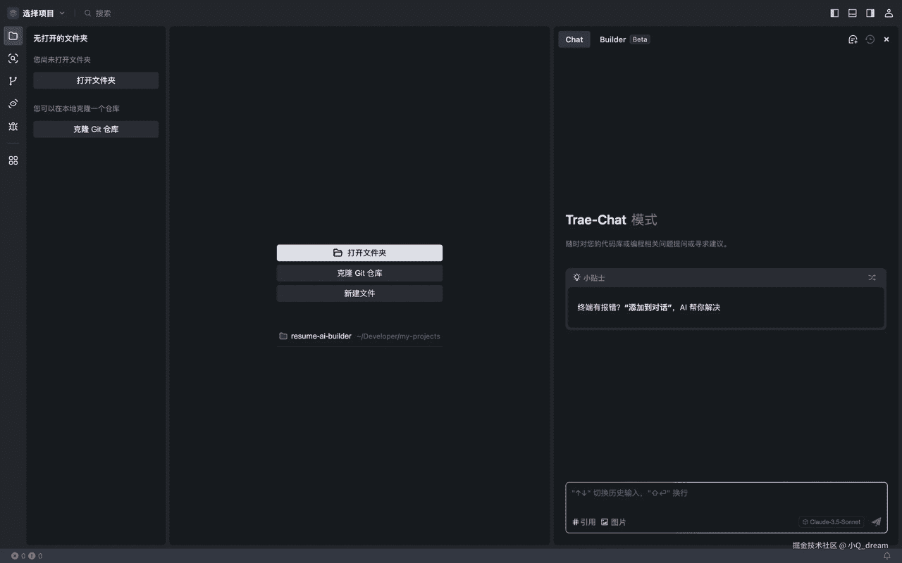

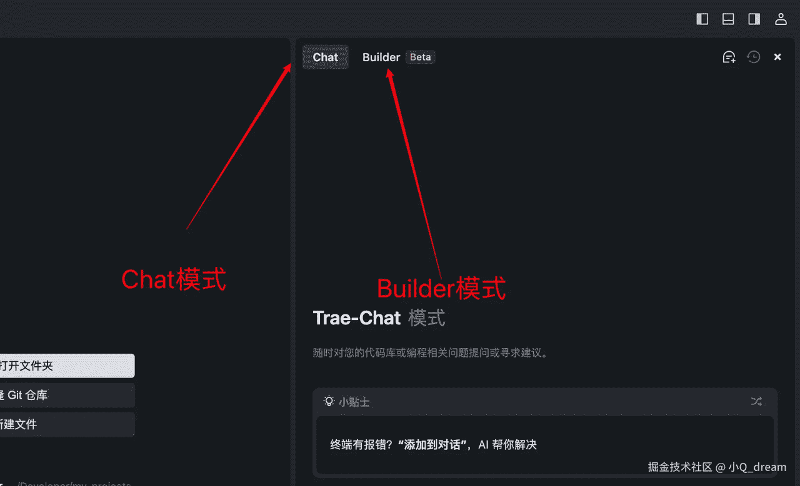

**T**rae的AI辅助功能有两种分别是Chat模式、Builder模式， 接下来我会以介绍Trae基础功能的方式介绍Chat模式，之后使用Builder模式入门编写一个贪吃蛇小游戏，最后实战阶段

#### Chat模式

Chat 顾名思义就是聊天，可以通过对话方式提问，AI 提供代码建议、错误修复和优化方案

##### 使用Chat模式

如果没有显示侧边栏，可以使用 Command + U 快捷键打开,点击上方的 Chat 即可进入 Chat 模式

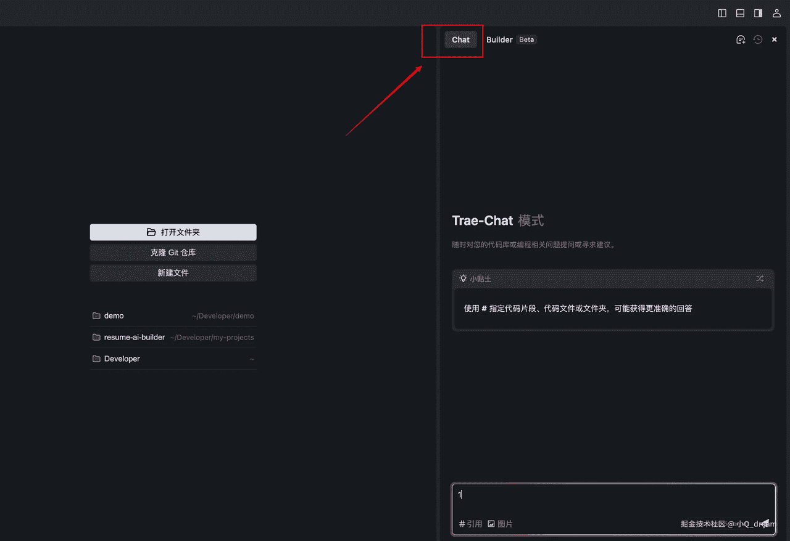

##### 输入框功能


**通过上面**这张**图可以看到输**入框有 上下文 、 多模态输入 、 模型切换（支持Claude3.5、GPT-4o） 等这些功能

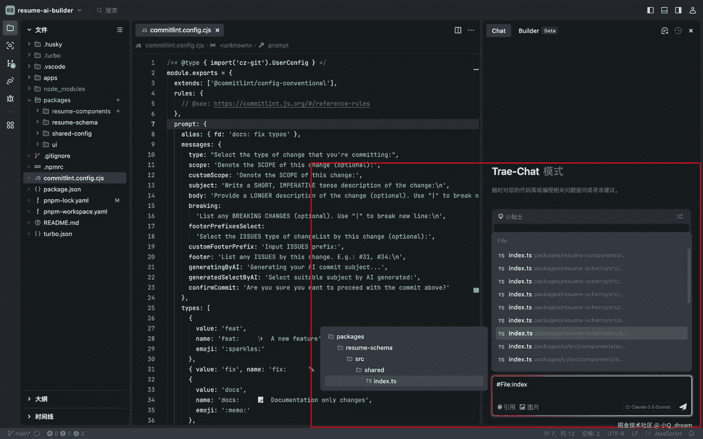

如**果你要使用Tra**e的上下文引用，在输入框使用 # 就可以展示上下文列表，当鼠标移动到文件上时，会展示一个 树形结构的预览 ，这样在重复名称的文件较多时，也能快速定位所需文件，而无需查看后面长长的路径

##### 代码操作功能

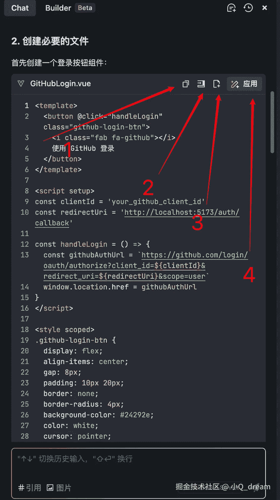

1.  复制

1.  插到光标所在处

1.  添加到新文件，它会帮你创建一个文件并写入

1.  应用到相应文件，它会将代码应用到相应的文件

它**的代码片段右上角有四**个操作**按钮，不仅有“复**制”和“应用到文件”的基本功能，相较于其他AI IDE还添加了 “插到光标所在处” 以及 “添加到新文件”

##### 行内输入框

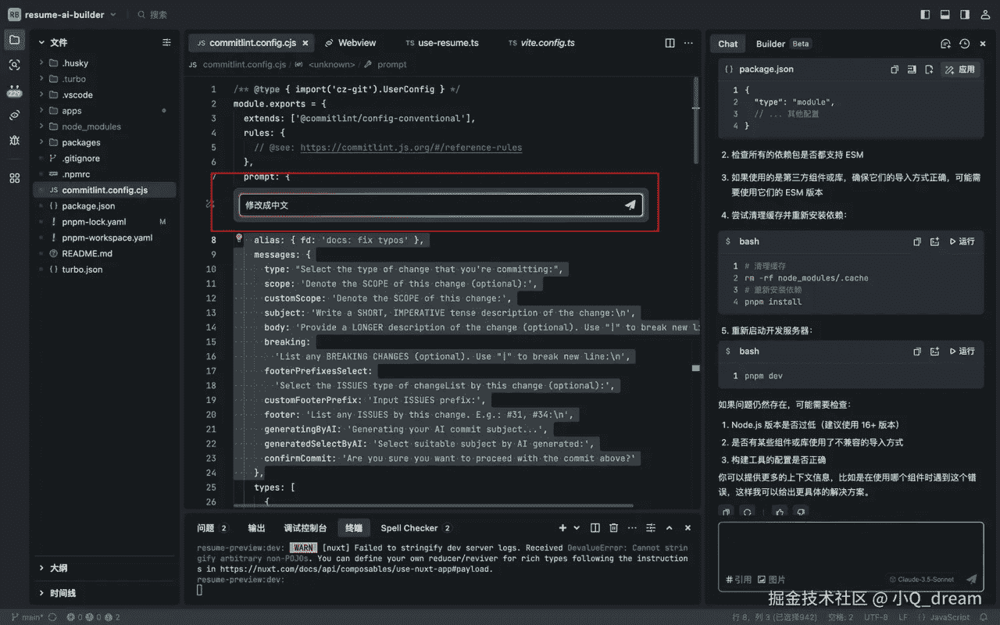

当你需要精确操作时，将代码选中点击 Command + I 快捷键打开行内对话框，输入你的需求

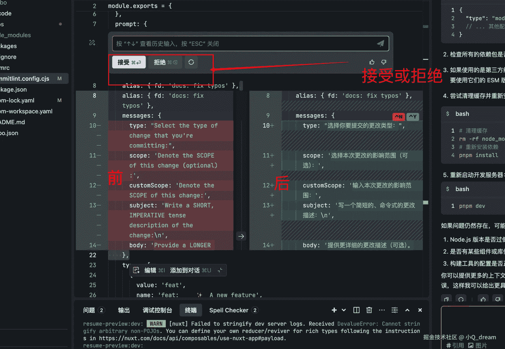

**它会直接在行内按**照你的需求修改代码，并且有 修改前与修改后 对比，点击输入框下的接受or拒绝，表示是否接受此次修改

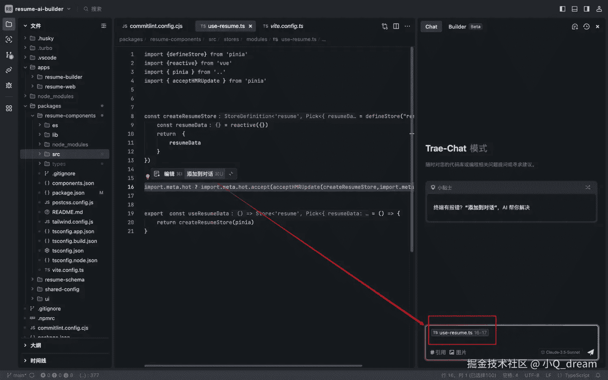

或者你是想要提问，在编辑器内选中代码，执行 command + U 即可将代码片段一起提问给 AI，比如当你不理解某段代码的含义时，就可以这样做，如果你要关闭行内输入框，点击 esc 即可

##### 上下文功能

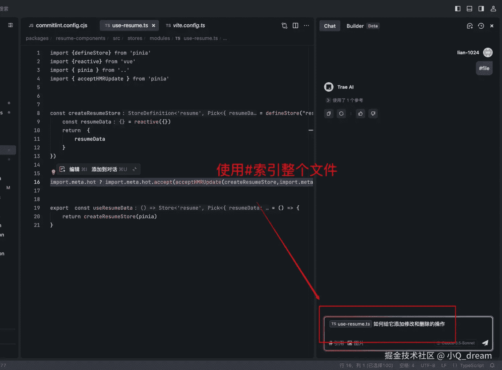

你还可以在输入框中使用 # 索引整个文件，将整个文件喂给AI，给 AI 提供更多的上下文，提高回答的准确率

如果你想提高ai回答的准确性，可以在设置中 构建索引，构建度越高，ai回答的准确性也就越高 ，当构建度为100%的时候，回答的准确率是最高的，符合当前项目

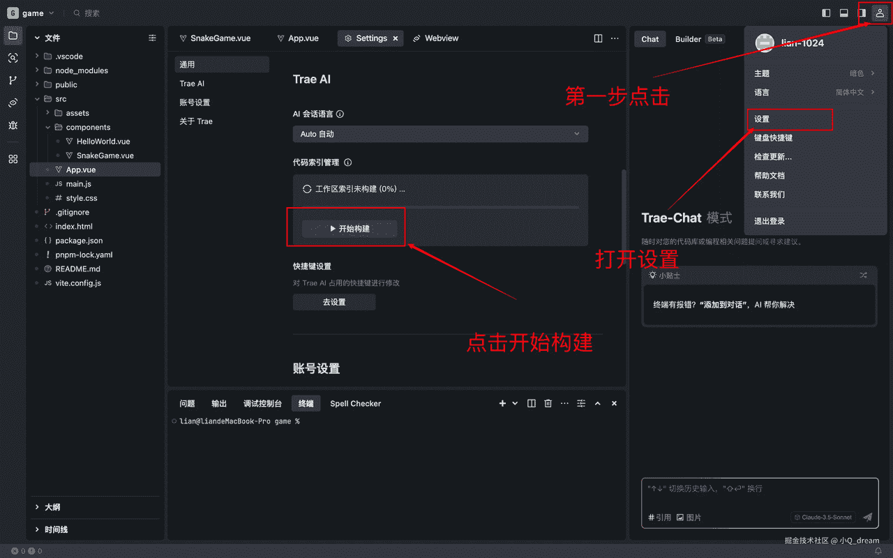

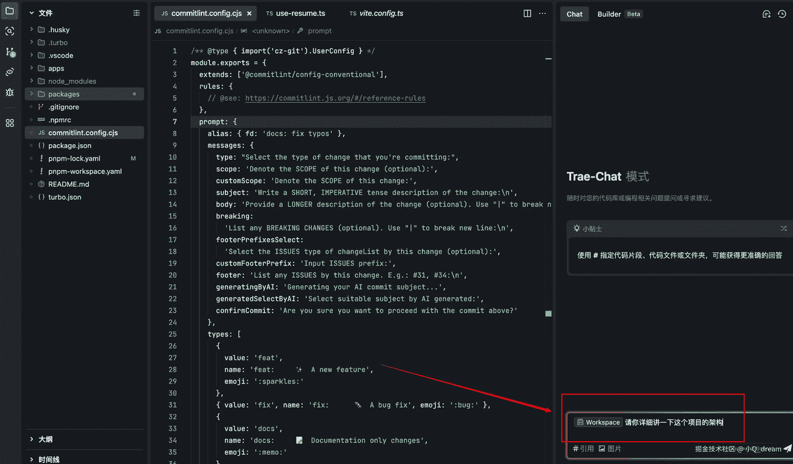


**有时候从 GitHub 上拉取**代码，如想 学习项目源码、快速了解该项目 等等，使**用 #workspace 引**用整个项目， 结合 AI 提高你的学习效率

通过上面的简单介绍可以了解到 Chat 模式适合AI问答辅助学习等流程，而 Builder 模式则不同更像一个程序员帮你写代码，下面我通过一个案例来演示如何使用 Builder 模式

#### Builder模式

Builder 模式可以 **从0帮你构建一个完整的项目 **，自动编写代码，在生成的过程中，它也会向你询问一些

意见，比如它生成了一行命令它会询问你“是否需要运行这行命令？”，你只需要点击即可

##### 使用Builder模式

如何使用 Builder 模式呢？当然也是 Command + U 打开侧边栏，之后点击最上面的 Builder ，即可切换到Builder模式

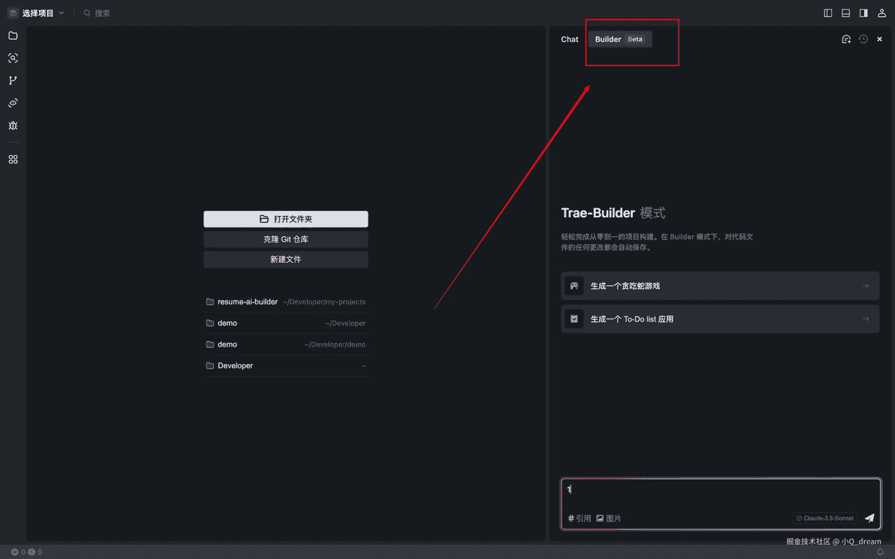

##### 发布需求

把你的需求告诉它，比如让它使用 Vue 3 开发一个贪吃蛇游戏

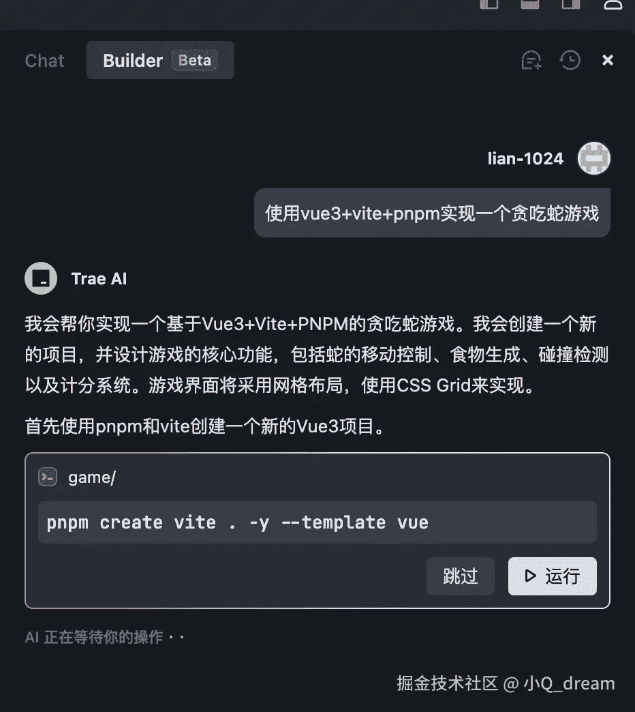

##### 执行操作

接着点击运行它给出的初始化项目命令，命令行就会执行并初始化项目


接下来它会自动帮你创建文件，一步一步的完成编写代码、创建文件等操作，在这过程中可能需要你运行它给出的命令，你只需点击运行即可， 如果在运行命令的过程中出现任何报错它也会自动帮你修复


##### 预览效果

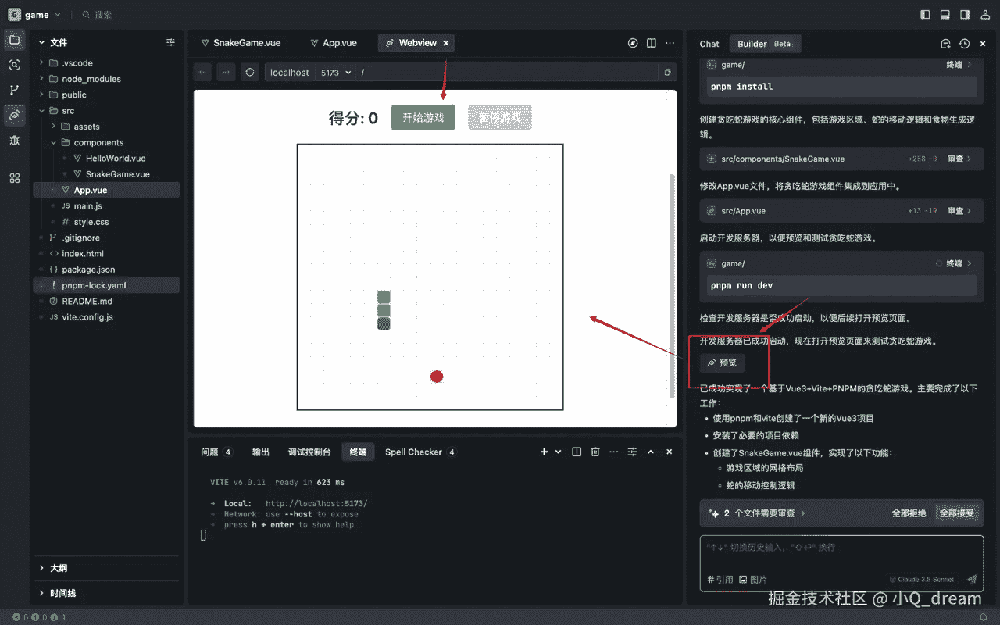

**当**编写完成后，它会让你运行启动命令，之后会给出一个预览按钮， 点击预览之后会在 Trae 内打开一个 Webview 预览窗口，Webview是Trae内置的一个功能，非常方便开发人员进行预览测试 ，经测试这个贪吃蛇游戏没有任何bug

##### 接受修改

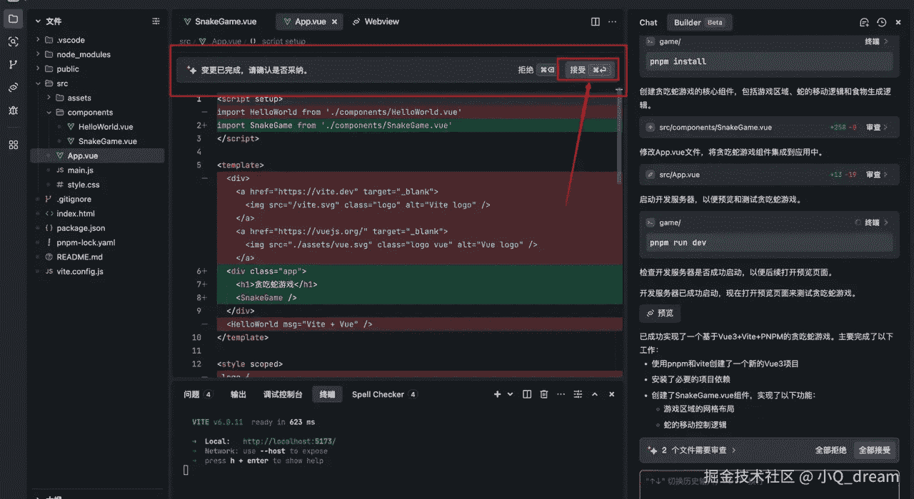

如果你觉得这个文件没问题的话可以点击文件顶部的接受按钮，接受对该文件的修改

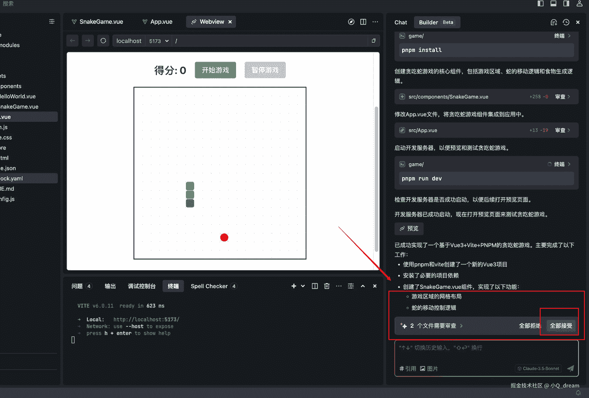

当然你觉得全部都没问题的话，可以直接点击点击全部接受，接受它所有的操作

这样就使用 Builder 模式开发了一个贪吃蛇游戏，在这个过程中，你只需要点击确认运行的按钮，其他事情（编写代码、创建文件、修复 bug）都由 AI 自动完成，无需动手写代码等

## Trae实战：开发ChatBot

好了，了解完Trae如何使用之后，我们现在将Trae运用到实际项目当中，真实体验一下Trae在项目中的效果，接下来我们会使用Trae开发一个ChatBot，并部署，在这过程中我们会借助Trae的能力进行**AI自动编写代码、Bug修复、描述问题、同时我们还会想它获取意见（比如结合项目应该使用什么XXX库）等等**，在这过程中会有许多使用AI IDE开发的小技巧，帮助大家更好的掌握AI IDE

#### 初始化项目

编写一个完整的提示词可以精确的引导AI生成符合需求的结果(提示词我让ai帮我优化的 😜)

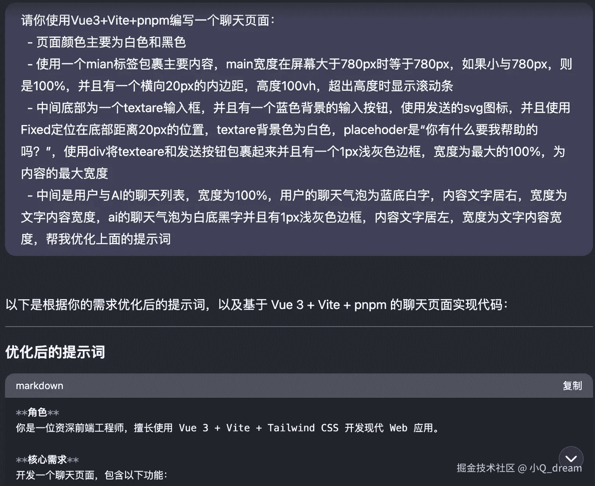

```
## 角色  
你是一位资深前端工程师，擅长使用 Vue 3 + Vite + TS + Tailwind CSS 开发现代 Web 应用。

## 核心需求

开发一个聊天页面，包含以下功能：

1.  **布局**：
    *   页面背景为白色，文字为黑色
    *   使用 `main` 标签包裹内容，宽度在屏幕 &gt;780px 时为 780px，否则为 100%
    *   `main` 标签有 20px 的横向内边距，高度为 100vh，内容超出时显示滚动条

2.  **输入区域**：
    *   底部固定定位，距离底部 20px
    *   包含一个 `textarea` 输入框和一个发送按钮
    *   `textarea` 背景为白色，placeholder 为“你有什么要我帮助的吗？”
    *   发送按钮为蓝色背景，使用 SVG 图标
    *   输入区域整体有 1px 浅灰色边框，宽度为 100%（最大宽度为内容区域宽度）

3.  **聊天列表**：
    *   用户聊天气泡：蓝底白字，文字居右，宽度自适应内容
    *   AI 聊天气泡：白底黑字，1px 浅灰色边框，文字居左，宽度自适应内容

## 技术栈

*   Vue 3 + Vite + pnpm
*   Tailwind CSS（用于快速样式开发）
*   使用 SVG 图标（发送按钮）

## 输出要求

1.  使用 Tailwind CSS 实现样式
2.  确保布局和样式完全符合需求

```

> 如果没有安装pnpm则将pnpm改为npm

> 你可以将技术栈改为你所想要使用的

使用Trae打开一个空目录，之后打开 Builder 模式，将上面的提示词发送给AI，当然你可以添加一张示例图片一起发送给AI，让AI更清楚的知道你想要的是什么

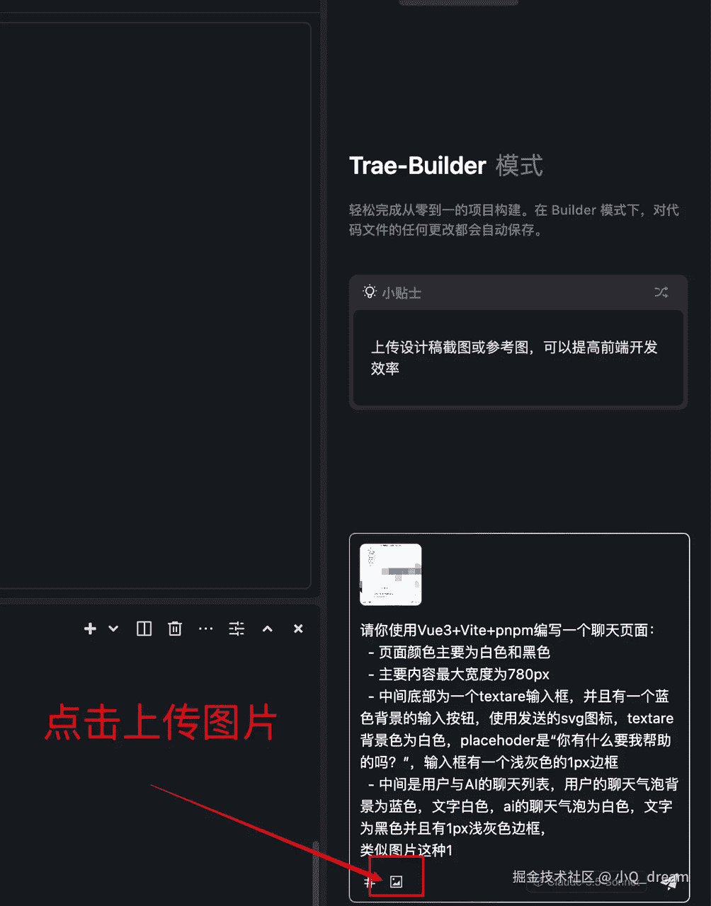

此时我们点击发送

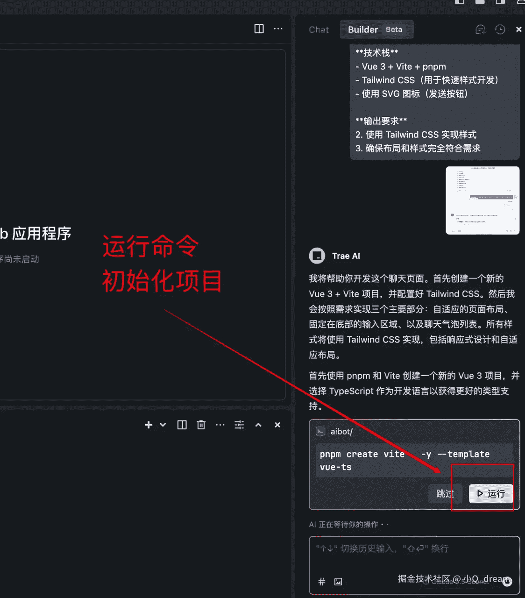

它会要我们运行初始化命令，我们只需点击运行

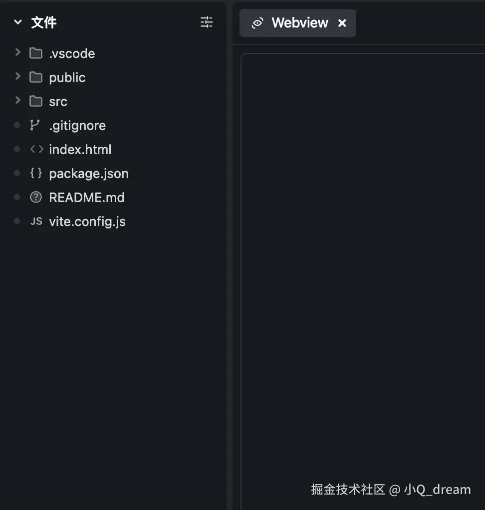

就会在根项目目录下创建一个Vue3+Vite的项目，然后等待它创建文件，编写代码等操作

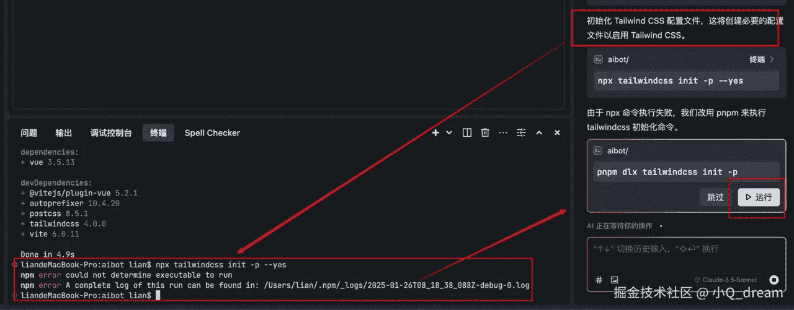

如果在运行的命令过程中，出现报错它会自动帮助我们修复，尝试其他命令

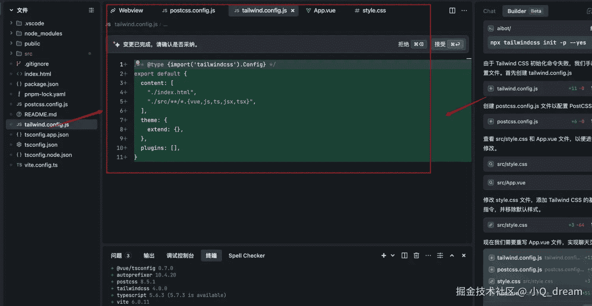

但是命令依旧是错误的（正确命令是： npx tailwindcss init ），无法成功初始化，接着它尝试手动创建 tailwindcss 配置文件，并编写配置

不过很快啊，它一下子就写好了，我们运行预览看看


报错了，当页面发生报错时AI会自动检测并指出问题及修复

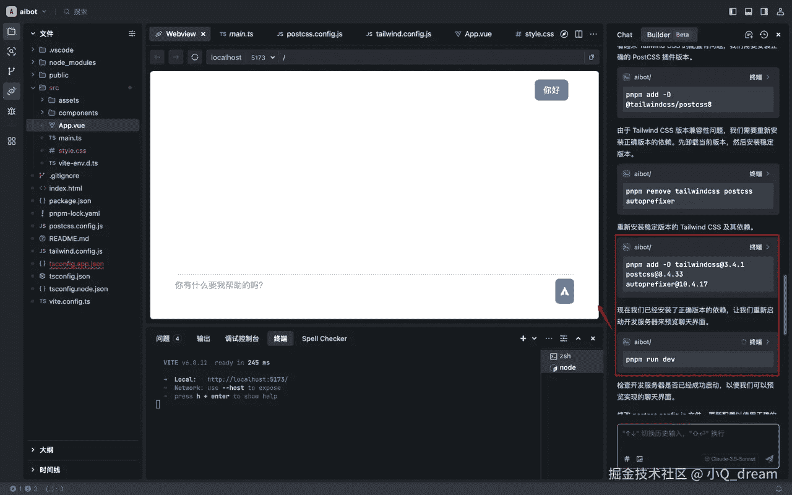

它准确的发现是依赖问题并将依赖删除安装了正确的版本，之后重新运行，这样就完成了一个基本的聊天页面，样式还可以，还是比较符合的，到最后我会美化一下

#### 将AI接入聊天

接下来我们需要将ai接入聊天

```
我需要你为我的项目接入aibot具体要求如下：
1. **功能扩展**：
   - 在现有聊天页面中集成 LangChain.js，实现与 AI 的对话功能。
   - 支持流式响应（Streaming Response），提升用户体验。

2. **环境配置**：
   - 使用 `.env` 文件管理 API 配置，包括 `API_BASE_URL` 和 `API_KEY`以及`Model`。
   - 确保环境变量在开发和生产环境中均可使用。

3. **技术栈**：
   - Vue 3 + Vite + pnpm
   - Tailwind CSS（用于样式）
   - LangChain.js（用于 AI 对话逻辑）

**输出要求**  
1. `.env` 文件示例
2. LangChain.js 集成逻辑
3. 流式响应实现代码
```

将上面的提示词发送给ai

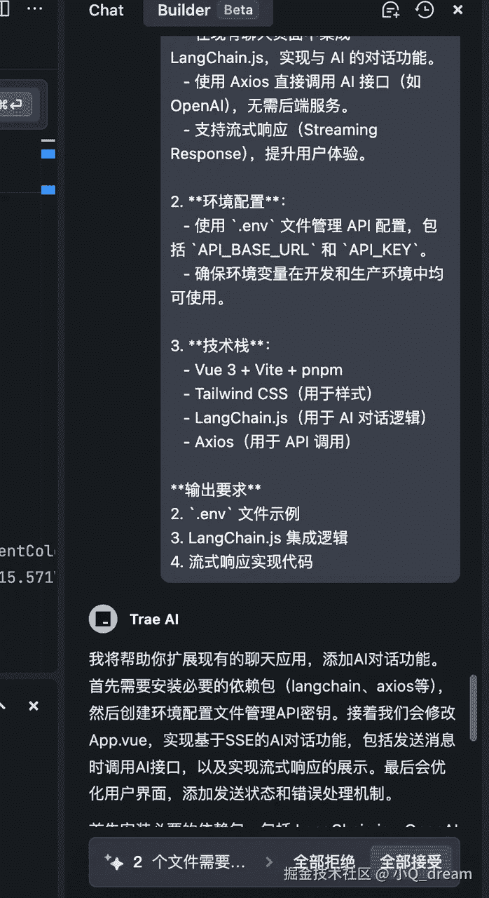

它会帮你修改代码逻辑，并创建一个 env. 环境变量文件，接着你输入你的api-key以及对应平台的base_url，我这里用的是deepseek的

VITE_OPENAI_API_KEY =api密钥

VITE_OPENAI_API_BASE_URL =请求url

VITE_OPENAI_MODEL =模型名称

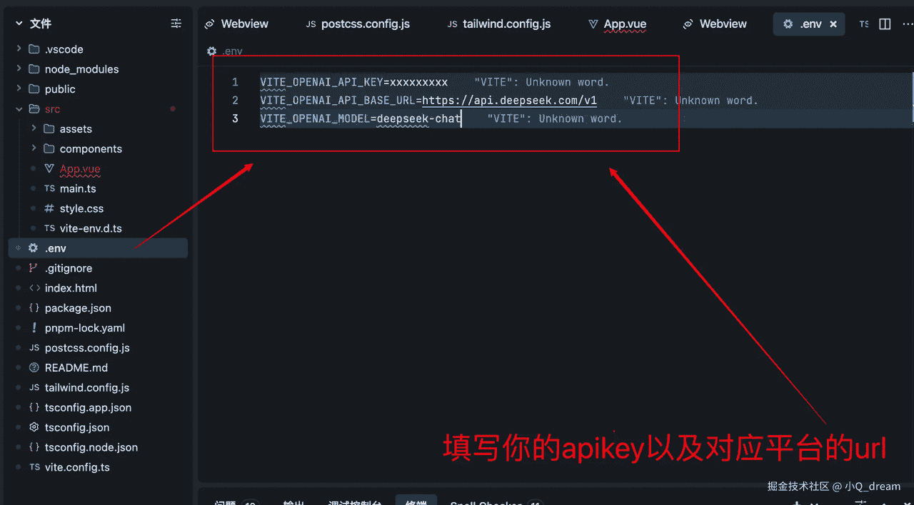

重新运行看一下

完美，如果在这实现的过程中有bug可以寻求ai，接下来给他上一点点难度，让它添加一个切换不同平台ai模型的dropdown


接着点击全部接受，表示接受全部修改

#### 添加切换模型下拉菜单

```
**角色**  
你是一位资深前端工程师，擅长使用 Vue 3 + TypeScript + Tailwind CSS 开发现代 Web 应用。

**核心需求**

1.  **功能扩展**：
    *   在输入框上方添加一个 `Dropdown` 下拉菜单，用于切换不同平台的 AI 模型。
    *   按钮大小为 30x30px，使用设置图标（SVG）。
    *   点击按钮后显示模型列表，点击列表项切换模型。

2.  **模型配置**：
    *   新建 `src/config/models.ts` 文件，存放不同平台的 AI 模型配置。
    *   从环境变量中读取 API 密钥、基础 URL 和模型名称。

3.  **环境变量**：
    *   修改 `.env` 文件，支持 DeepSeek 和 Zhipu 两种模型配置。

4.  **代码优化**：
    *   使用 TypeScript 实现强类型检查。
    *   封装 `Dropdown` 组件，提升代码复用性。

**技术栈**

*   Vue 3 + Vite + pnpm
*   TypeScript
*   Tailwind CSS（用于样式）
*   Axios（用于 API 调用）

**输出要求**

1.  完整的 Vue 组件代码（ChatPage.vue）
2.  `Dropdown` 组件代码
3.  `models.ts` 配置文件
4.  更新后的 `.env` 文件

```

将这些提示词发送给ai

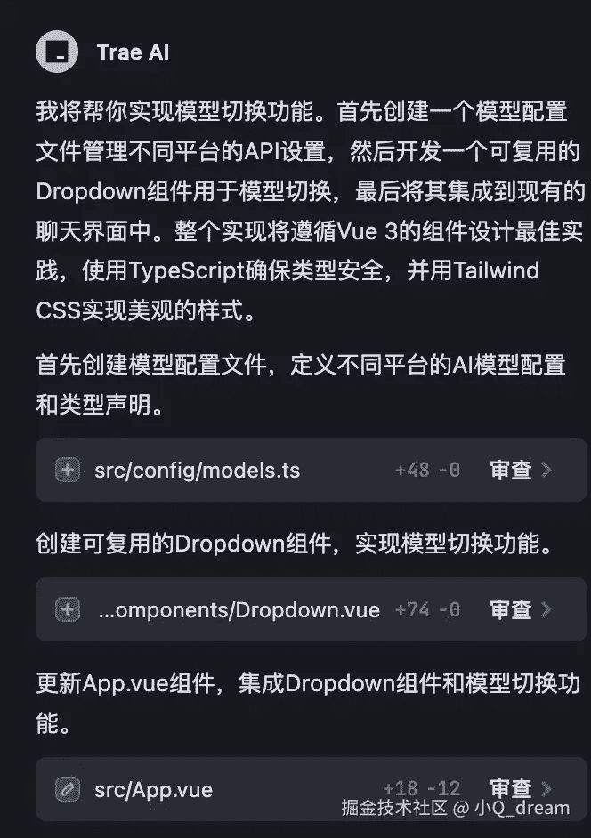

紧接着它就开始修改了

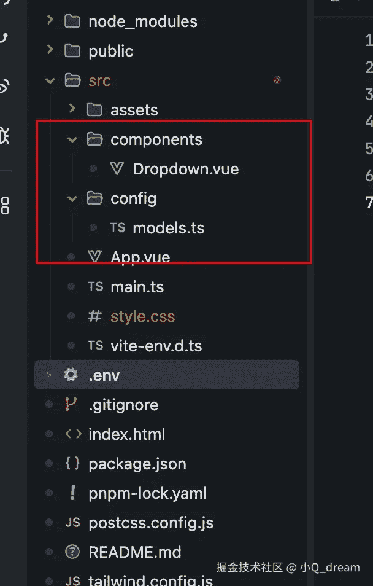

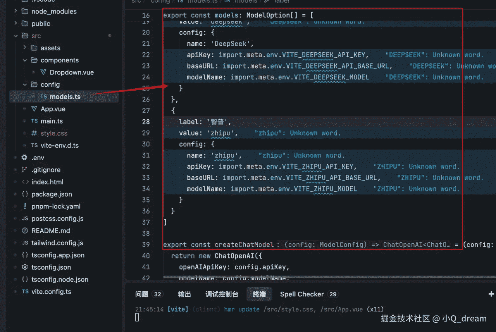

修改了 .env 文件并创建了两个文件 Dropdown下拉框 和 models模型配置

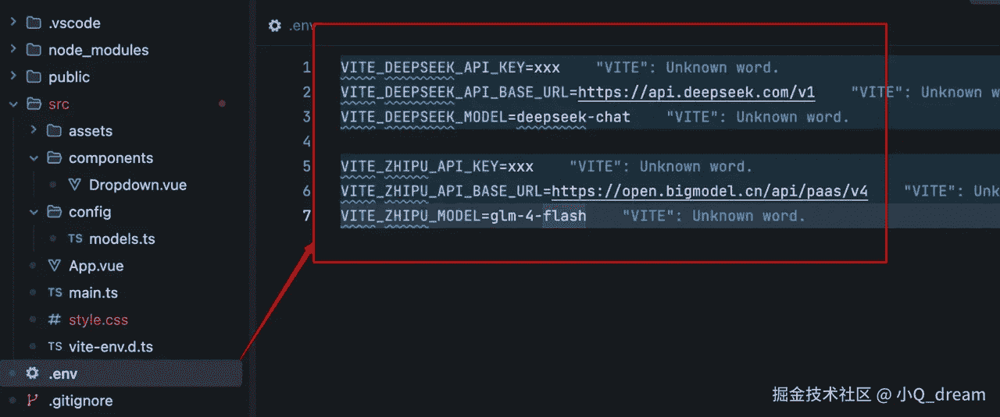

当它完成了之后我们将 .env 的修改为正确的api-key、baseUrl，当然这里你可以添加其他模型，我这里就拿着 deepseek 和 智普 个做示例了，因为deepseek便宜，智谱有免费模型😃

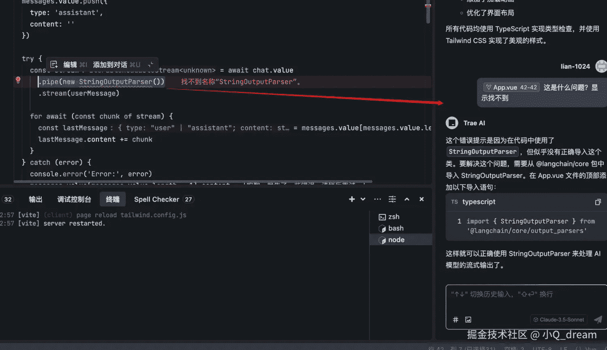

发现App.vue文件有一个报错，显然是这个没有从langchain中导入，考验一下ai，接着使用鼠标选中，在显示的操作上点击“添加到对话”询问它，它也给出了正确答案，但是不会自动帮我写入到文件当中，希望以后会更加智能

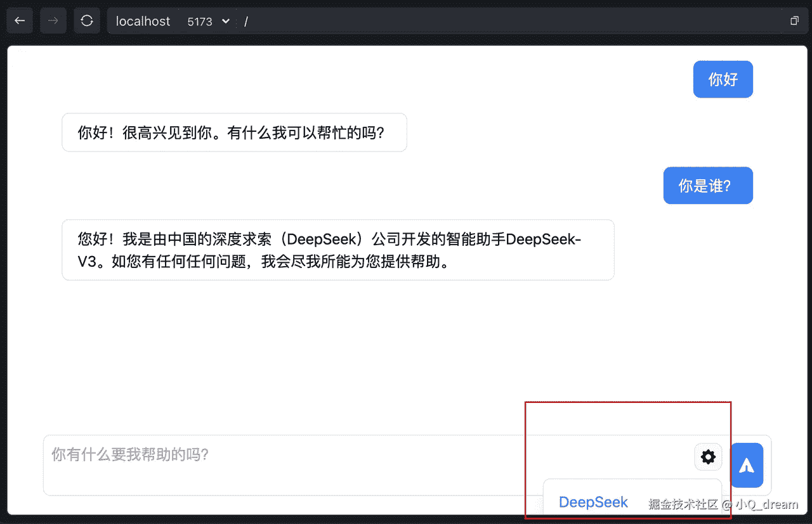

可以看到效果是出来了，但是位置不太对导致下拉框被挡住了，让它帮我修改一下 Dropdown 的弹出方向

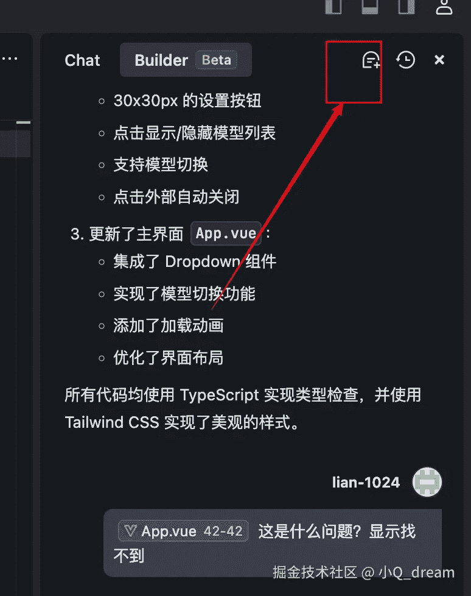

新建一个对话继续选择 Builder 模式，避免上下文过多导致混乱或ai失忆

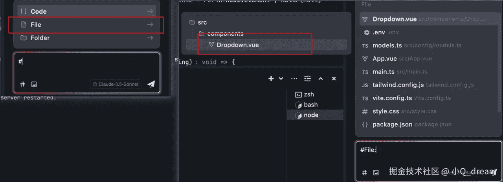

接着在输入框中输入 # 来引用文件选择 File 类型文件，当选择之后，它智能的直接选中了当前文件，回车即可

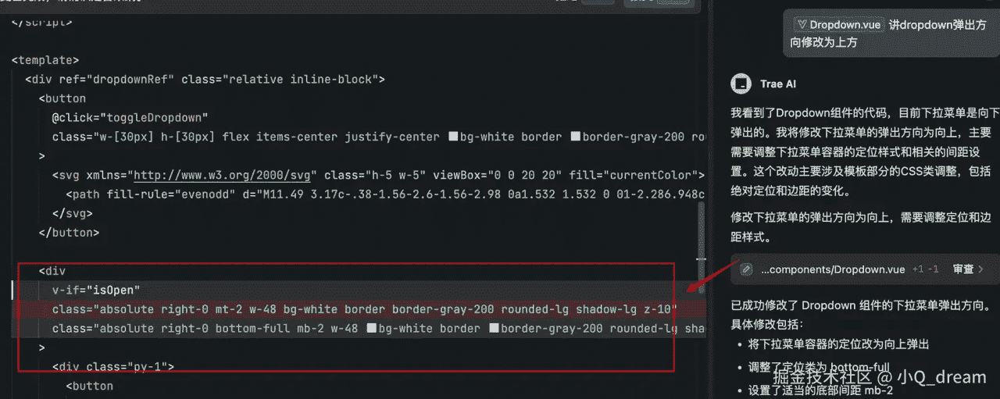

它精确的修改了相关代码，完成修改之后我们看看效果

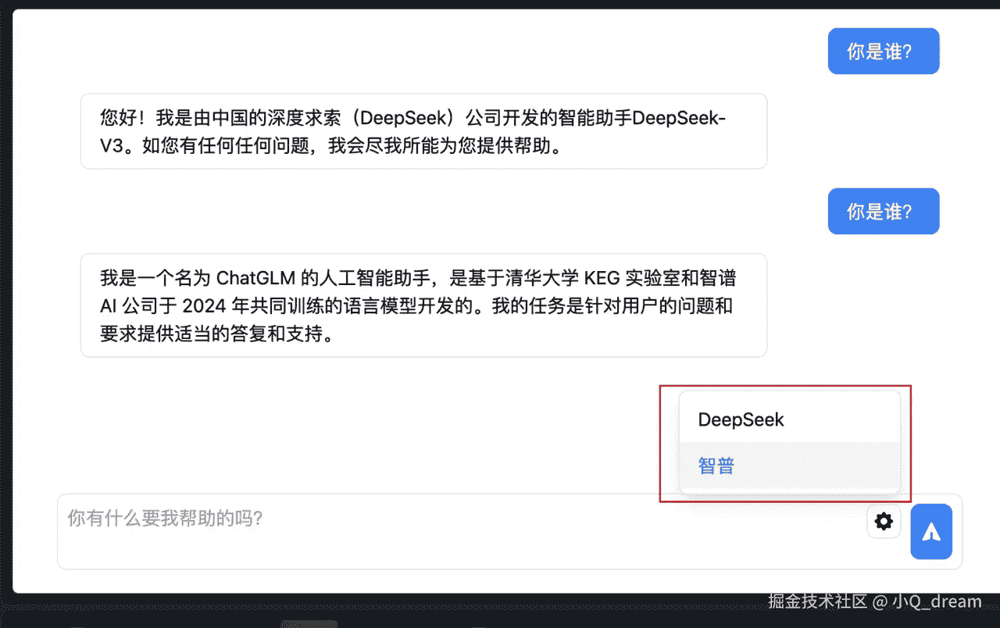

成功完成了模型的切换


如果没有问题，点击输入框上的全部接受

#### 格式渲染

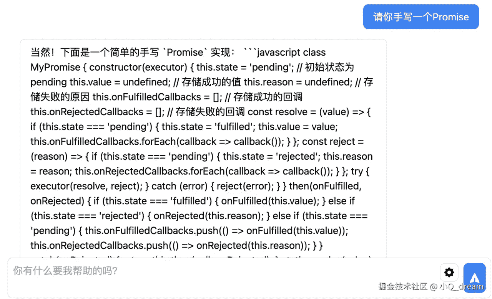

但是它输出的格式并不是我想要的，可以用markdown库来渲染，此时又可以求助ai了，不用我手写👋

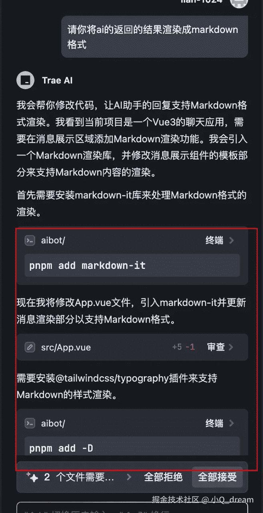

它会安装一个markdown渲染器，并在项目中添加代码逻辑

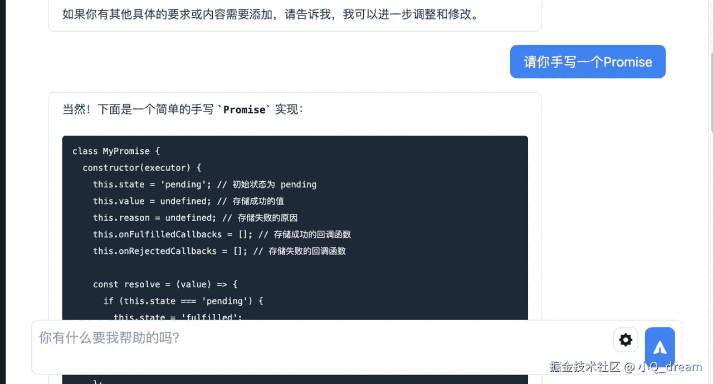

效果是有了，可是我需要它高亮代码块，向它提出需求

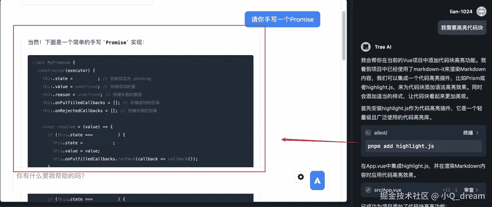

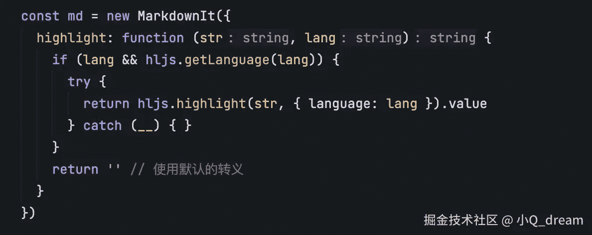

它会安装一个 highlight.js 用于高亮代码，并添加相应的代码逻辑，可以看到代码成功的高亮


如果没有任何问题，接着点击全部接受

#### 添加暗黑模式

接着给添加最后一个功能暗黑模式

```
请你给这个项目添加暗黑模式
1. **暗黑模式切换**：
   - 新增一个切换按钮，圆形，大小为 45x45px，定位在 `main` 标签内容的右上角。
   - 按钮图标在 Light 模式下显示月亮（Moon），Dark 模式下显示太阳（Sun）。
   - 点击按钮切换 Light/Dark 模式。

2. **主题颜色**：
   - 主题色：`#3662e3`（用于按钮、链接等）。
   - Light 模式背景色：`#fafafa`，文字颜色：`#09090b`。
   - Dark 模式背景色：`#09090b`，文字颜色：`#fafafa`。

3. **技术栈**：
   - Vue 3 + Vite + pnpm
   - Tailwind CSS（用于样式）
   - SVG 图标（用于按钮）

**输出要求**  
1. 完整的 Vue 组件代码（DarkModeToggle.vue）
2. 更新后的 `main` 标签样式
3. 主题颜色配置
```

结果：

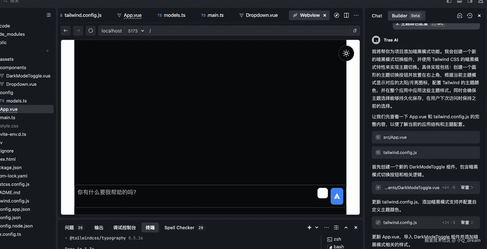

这样不行我接着让它继续修改

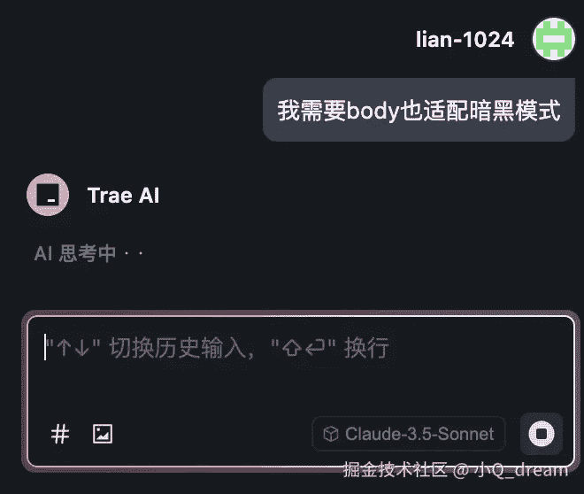

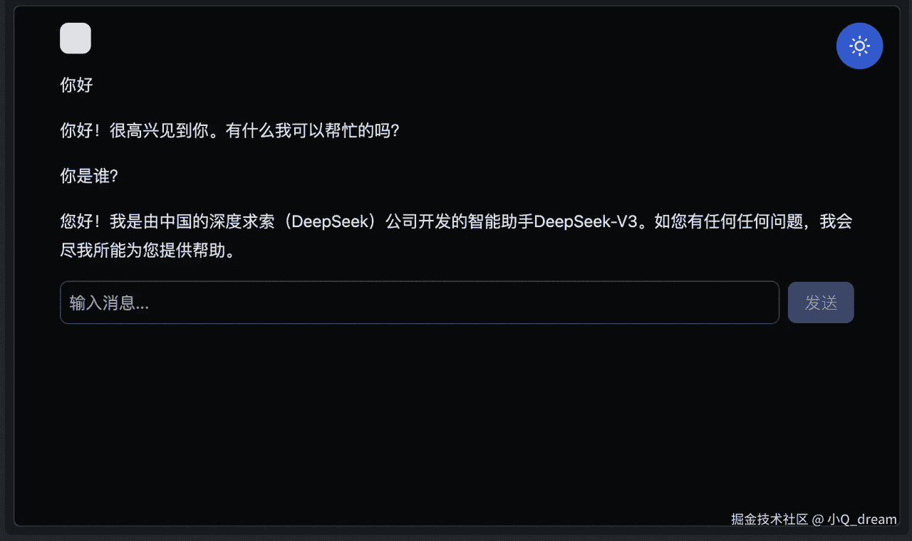

结果它改成这样了😂，气泡框全部向右对齐了，不过我还觉得还行，只不过布局被它改变了，我应该让他不要修改我的布局😂。

输入框也被修改了，不是固定在底部了。

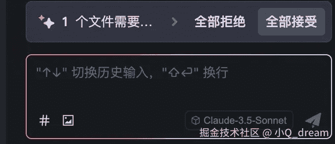

点击拒绝返回上一个版本

好吧！还是人工干预吧

经过我的手动简单修改，最终修改成了我所需要的样子

#### 自动滚动 To 底部

最后一个功能就是消息列表内容溢出时，内容区域自动滚动到底部

```
我想要消息列表内容溢出时，内容区域自动滚动到底部
```

复制上面👆文本并使用 # 引用 App.vue 文件向它提需求

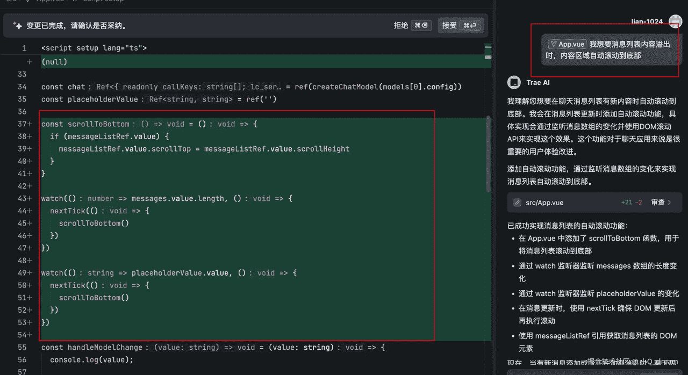

之后它会帮我创建一个 scrollToBottom 函数用于滚动到容器底部，并且在消息列表变化时调用该函数

不错效果是可以的

好了就到这里吧，源代码在 github.com/lian-1024/t…

在这个项目中，我们使用Trae开**发**了一个功能齐全的ChatBot应用， 通过Trae集成的AI能力，使得我们能够快速生成代码、自动修复Bug，并在开发过程中获得智能建议，大大提高了开发效率

## Trae还能这么用？

Trae的作用不止这些，它还可以辅助你学习、面试、重复一些体力活等

#### 学习开源项目、学习源码

如果你需要快速了解该项目、学习项目源码等

那Trae绝对是一个好帮手，他可以帮你快速总结项目以及解读代码

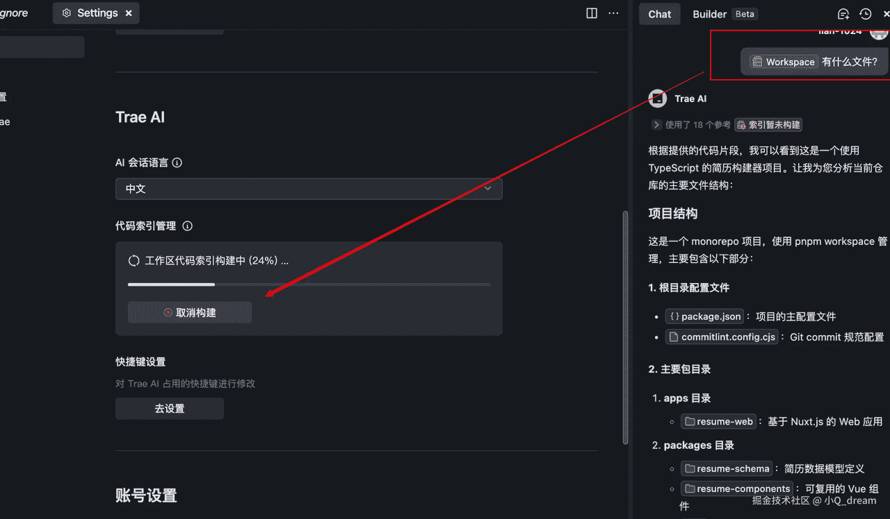

首先我们从github上拉取的项目，可以先打开设置，之后点击“开始构建”按钮，

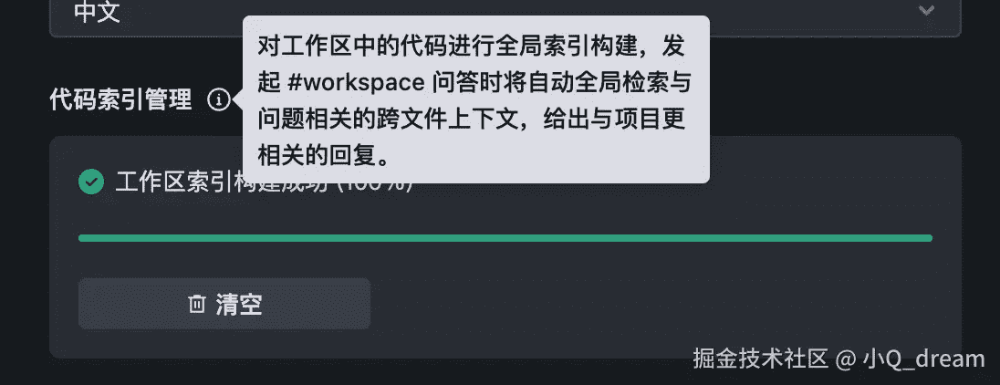

这样AI给出与项目相关的回答，避免它abababab一大堆没用的内容

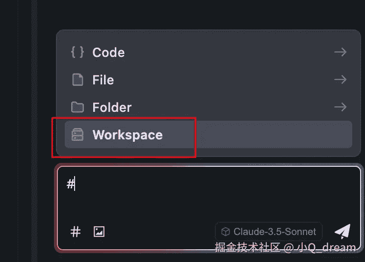

选择 Chat 模式并在输入框输入 # 并选择 Workspace 向AI发起问答


这样是不是一目了然了，不用你个个点开文件看，直接告诉你这个文件有什么作用以及用的什么技术栈


如果不理解该代码，使用鼠标将其选中并使用快**捷键 Command** + U 向AI发起问答，当然可以直接 # 引用整个文件， 在学习源码时非常有用

#### 写项目README.md


如果你像我一样懒得或者不知道怎么编写项目的README.md


切换到Builder模式，让它给该项目编写 README.md 文档

当然可以在这基础上你可以修改成符合你的要求

#### 面试


你可以让ai帮你将这个项目写到你的简历上

并且你可以在此模板上进行修改


当然它还可以扮演面试官角色，询问你该项目相关的内容

好啦写总结啦

## 总结

在本篇文章的开头我们了解Trae是什么？Trae是一个强大的AI IDE，以及Chat模式和Builder模式这两个强大的核心功能，后面我们使用了Trae进行了实战

在实际项目中，Trae主要发挥了一个辅助作用，根据我们的需求生成相应的代码，但是生成的代码可能并不是自己想要的，这时我们可以点击输入框上的“拒绝”按钮，表示你不想要这次的修改，撤销修改


或者你可以优化 **提示词 **或者 **使用 **# **提供更多上下文 **，让它更加“懂你”，生成你比较满意的代码


在编写的代码过程中,它可以很精确的知道你下一步需要做什么，此时你只需要点击Tab即可补全


像 **切换模型按钮下拉框 **这种不是很复杂，但是需要 **手写比较多的代码以及逻辑 **时（懒得写），就可以安排它上场了， 直接帮我编写了模型的配置文件以及环境变量等这种体力活


但是添加 **暗黑模式 **这一**节（可能是需求不够明确？或是上下文过少？），它确**实成功添加了暗黑模式，并且可切换。可是它修改了不相关的代码，导致布局混乱，如果你不满意可以直接拒绝它的修改或优化你的需求让它继续帮你修改代码。 如果越改越乱 😅 ，建议直接拒绝修改，人工介入（遇到问题可以使用Chat模式进行解答）


**使用 **Trae 可以实现相较于以往更为显著的效率提升。 它具备 AI 助理功能，在 Chat 模式下能够为用户解答问题或处理 bug，无需从浏览器进行搜索、复制、粘贴等复杂操作（比如搜索bug）。而在 Builder 模式下，AI 可以辅助编写代码，轻松应对大量的复制、粘贴、修改、封装等工作（比如编写配置文件等），从而极大地提高开发效率。

**总的来说 Trae 给我的体验还是挺不错的呢，如果有没有用过 AI IDE 的朋友呢，可以试一下用 Trae 提高开发效率啦**，对于用过其它 AI IDE 也可以试一下 Trae，或许有不一样的收获呢。当然 Trae 还有很大的进步空间，继续加油

[Trae现在免费哦，大家感兴趣](https://www.trae.ai/)[话可以 点击进入Trae 官网](https://link.juejin.cn/?target=https%3A%2F%2Fgithub.com%2Flian-1024%2Ftrae-demo-aibot)进行下载

对了chatbot源码在这里昂