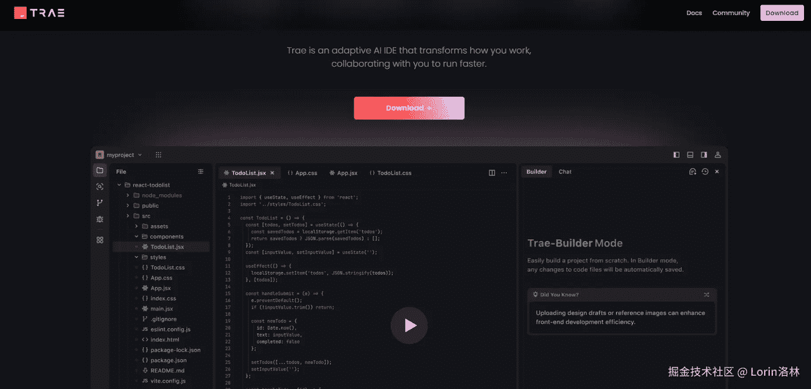
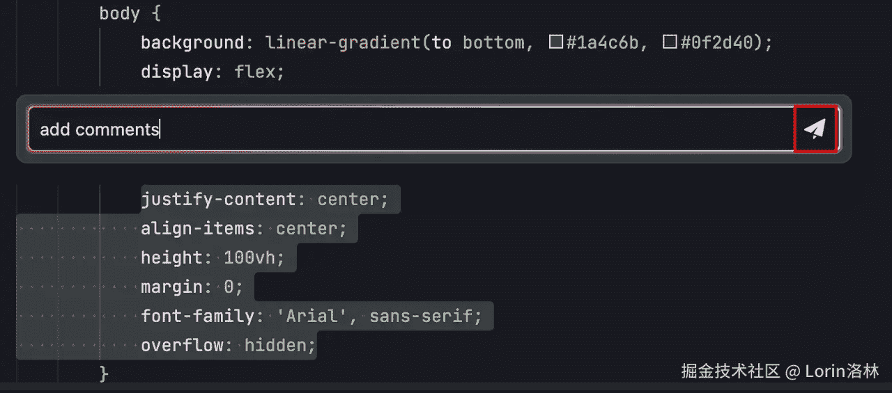
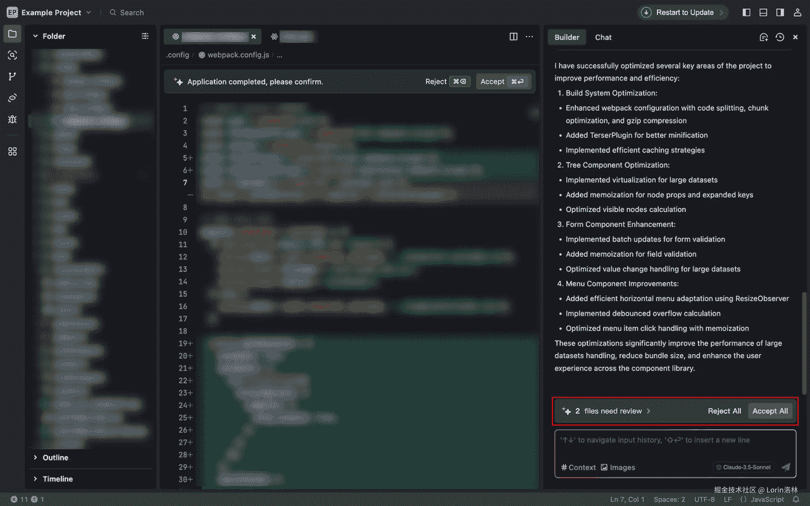
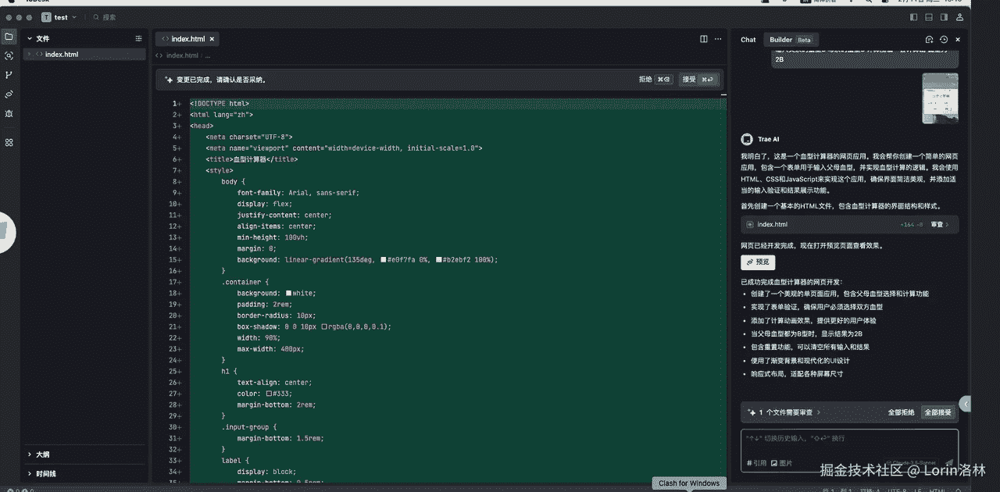
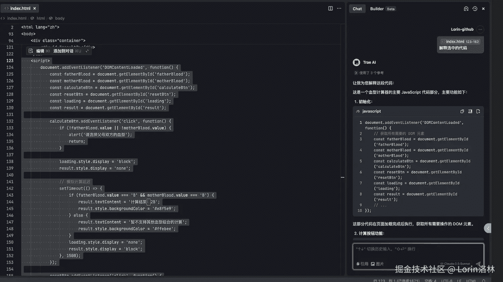
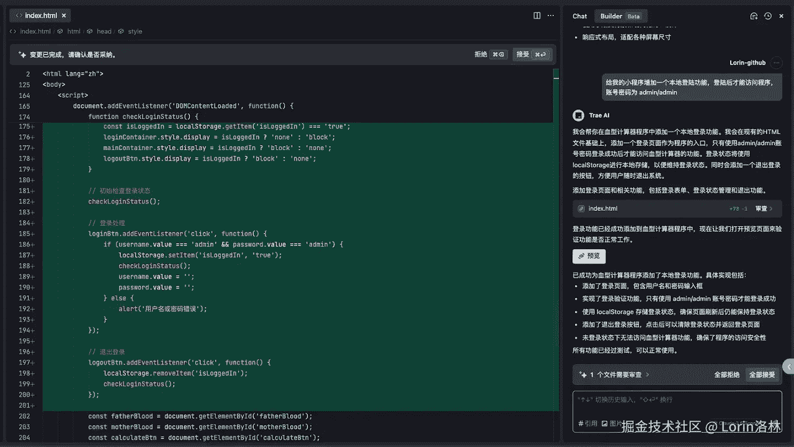

# 真不写一行代码 开发一个血型计算器

> 来源：[https://agijuejin.feishu.cn/docx/AKgmdNGJ8o4c7LxeSGec2BuqnOs](https://agijuejin.feishu.cn/docx/AKgmdNGJ8o4c7LxeSGec2BuqnOs)

> 作者：Lorin洛林

> 链接：https://juejin.cn/post/7469994189309902911

> 来源：稀土掘金

> 著作权归作者所有。商业转载请联系作者获得授权，非商业转载请注明出处。

> 如有侵权，请联系删除。

## 前言

+   Trae 是字节推出的一款强大的 AI 编程助手，集成了 AI 问答、代码自动补全、智能代理编程等功能，能够帮助开发者提升编程效率。本文将带你体验 Trae 的核心功能，探索如何借助 AI 更高效地开发项目。



+   官方地址： [www.trae.ai](https://www.trae.ai/?utm_source=juejin&utm_medium=juejin_trae&utm_campaign=AGI_article)

## 核心功能

### 基础 IDE 功能

Trae 作为一款现代 IDE，提供了完整的开发环境，包括：

+   代码编辑：支持多种编程语言，提供语法高亮、自动格式化等功能。

+   项目管理：便捷管理项目结构和文件。

+   扩展管理：可安装插件扩展 IDE 功能。

+   版本控制：内置 Git 支持，方便代码版本管理。

### 强大的 AI 助手

#### AI 问答功能

在编码过程中，你可以随时与 AI 助手交流，获取编程帮助，例如：

+   代码解释：询问某段代码的含义，AI 会提供详细解析。

+   代码注释：让 AI 自动为代码添加注释，提高可读性。

+   错误修复：当代码报错时，AI 可以帮助分析并提供修复方案。




#### 实时代码补全

Trae 的 AI 助手能够理解当前代码，并在编辑器中实时提供代码补全建议，减少手动输入，提高编程效率。

#### 代码片段生成

你可以使用自然语言描述需求，AI 将自动生成对应的代码片段，甚至能编写跨文件的完整代码结构。例如：

```
输入： &quot;实现一个 Python Web 服务器&quot;
输出： 生成 Flask 或 FastAPI 代码，并自动创建相关文件。
```

#### 从 0 到 1 生成项目

+   只需告诉 AI 你想开发什么类型的程序，它就会生成完整代码，甚至自动创建项目文件。例如：

```
输入： &quot;创建一个 Todo List 应用&quot;
输出： AI 生成前后端代码，并自动组织文件结构。
```



## 实战：使用 Trae 开发一个血型计算器

+   最近在小红书看到一个抽象软件开发博主开发了一个有意思的血型计算器，今天就让 Trae 来帮我复现这个程序。

### 使用 Builder 初始项目

+   Builder 模式可以帮助我们从头开始开发一个完整的项目，可以无缝地将其集成到项目开发过程中。当初始化项目时或者你希望将代码整合到项目中时，建议使用 Builder 模式。

+   下面我将我的需求告诉给 Trae ，等待 Trae 生成初始化项目：




+   经过一小段时间的等待，Trae 完成了代码编写，我们可以审阅 Trae 实现的代码并决定是否接受，经过简单的审阅我接受了 Trae 实现的代码。

+   让我感到惊喜的是项目直接运行成功了，整个过程十分流畅没有抛出异常：


### 代码片段解读

+   当我们对项目中的代码不理解时，我们可以让 Trae 帮我们解读代码，可以看到 Trae 按照功能帮我们拆分解读了整块代码，妈妈再也不用担心我们读不懂代码了。



### 功能进阶：实现一个登录功能

+   我并不想其它人可以简单的使用这个程序，我需要一个登录验证功能（将验证信息存储在本地），由于我需要将代码整合到我的项目中，我再次使用了 Trae 的 Builder 模式。



+   再次让我惊喜的是 Trae 不仅仅帮我实现了登录功能，同时也实现了登出功能，并一键成功运行了程序：


## 总结

+   本文体验了 Trae AI 编程助手，体验过程十分流畅，在整个过程中我甚至真的做到了不写一行代码开了一个简单的小程序，生成的 UI 也较为美观；当然上面体验实现的开发项目较为简单，还需要在后续真实复杂项目中进一步测验。