# Swift 零基础也能轻松开发！用 Trae 从 0 到 1 开发一个 Mac 剪贴板管理工具

> 来源：[https://agijuejin.feishu.cn/docx/YYwtd8XLBofdeZxxODDcWcWenGg](https://agijuejin.feishu.cn/docx/YYwtd8XLBofdeZxxODDcWcWenGg)

> 作者：陈明勇

> 链接：https://juejin.cn/post/7470791971987210292

> 来源：稀土掘金

> 著作权归作者所有。商业转载请联系作者获得授权，非商业转载请注明出处。

> 如有侵权，请联系删除。

## 前言

一个高效的剪贴板工具能大大提升日常工作效率，尤其对于写作和编码的人来说。如果需要频繁从笔记或代码文件中复制常用文字或代码模板到另一个地方，既繁琐又浪费时间。而在 Windows 系统中，内置的剪贴板管理工具可以方便地集中存储所有复制内容，需要的时候从中选择需要粘贴的内容即可，既高效又便捷。

然而，当我切换到 Mac 系统时，却发现其内置的剪贴板工具与 Windows 完全不同，且好用的第三方剪贴板工具则需要付费。

于是我在想，我对 Switft 一无所知，是否能通过 AI IDE ，零代码开发一个满足自己需求的 Mac 剪贴板管理工具呢？最终我选择尝试使用 Trae 来实现这个目标。结果真是出乎我的意料，作为一个完全的 Swift 零基础小白，我竟然能够通过零代码轻松开发出一款实用的 Mac 应用。

本文将详细介绍使用 Trae 零代码开发一个 Mac 剪贴板管理工具的全过程。

准备好了吗？准备一杯你最喜欢的咖啡或茶，随着本文一探究竟吧。


## Trae

Trae （ /treɪ/ ） 是一款全新的智能协作 AI IDE ，与 AI 深度集成，提供智能问答、代码自动补全以及基于 Agent 的 AI 自动编程能力。使用 Trae 开发项目时，你可以与 AI 灵活协作，提升开发效率。

### 完备的 IDE 功能

Trae 提供传统的 IDE 功能，包括代码编写、项目管理、插件管理、源代码管理等。

### 强大的 AI 助手

+   **智能问答**

+   在编写代码时，你可以随时与 AI 助手对话，获得代码解释、代码注释和错误修复等帮助。

+   **实时代码建议**

+   AI 助手能够理解当前代码并在编辑器中实时提供代码建议，提升编程效率。

+   **代码片段生成**

+   通过自然语言描述你的需求， AI 助手将生成相应的代码片段，甚至能够编写项目级或跨文件的代码。

+   **从 0 到 1 开发项目**

+   通过 Builder 模式 告诉 AI 助手你想开发的程序， AI 助手将根据你的描述提供相关代码或自动创建所需文件。

## 安装 Trae

访问 [Trae ](https://www.trae.ai/?utm_source=juejin&utm_medium=juejin_trae&utm_campaign=AGI_article)主页，下载并安装 Trae 应用。


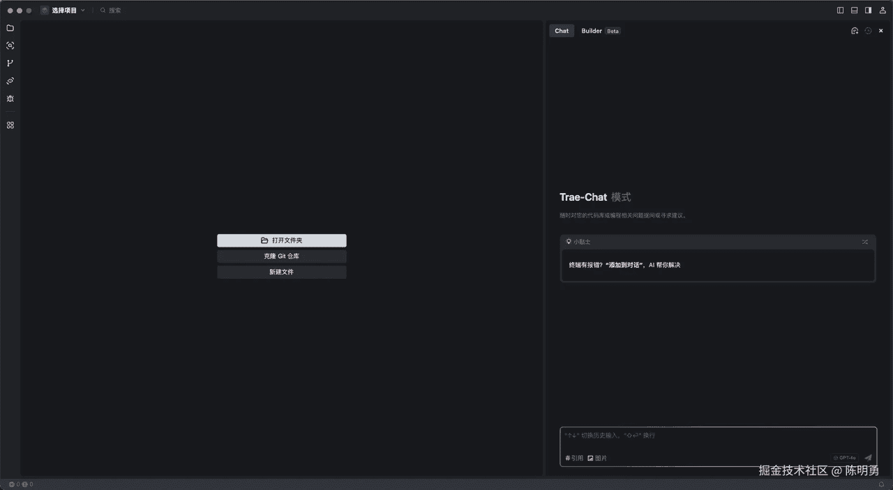

## 安装 XCode

Xcode 是苹果官方提供的集成开发环境 ( IDE )，几乎所有的 macOS 应用开发都使用 Xcode 。

+   **功能 **：包括代码编辑、界面设计（ Interface Builder ）、调试工具、性能分析、版本控制等。

+   **语言支持 **：

+   **Swift **：苹果推荐的现代编程语言，简洁且高效。

+   **Objective-C **：较旧的苹果开发语言，很多老旧项目还是使用 Objective-C。

+   **下载地址 **：可以从 App Store 免费下载 Xcode 。

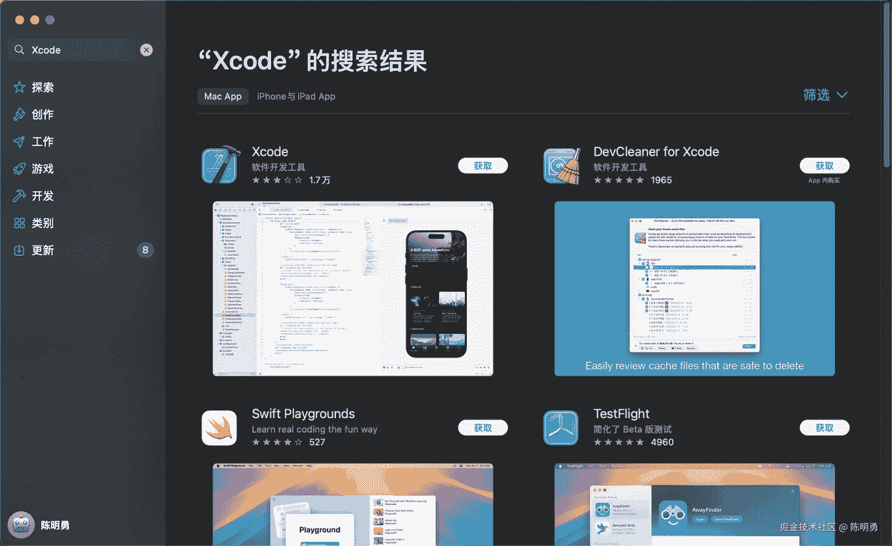

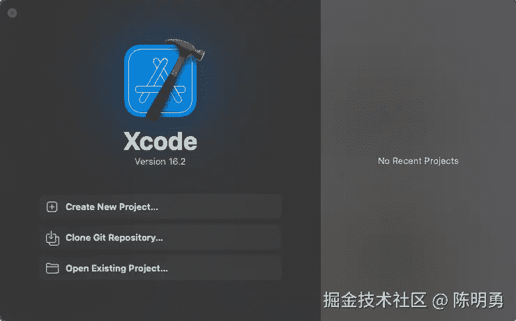

## 剪贴板管理工具开发

### 创建 Xcode 项目

1.  点击 Create New Project... 。

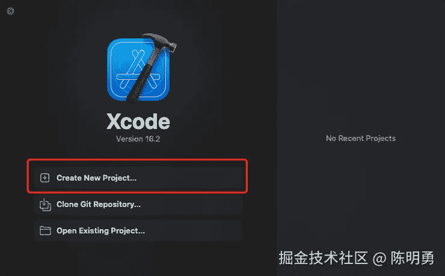

1.  选择 macOS-App 。

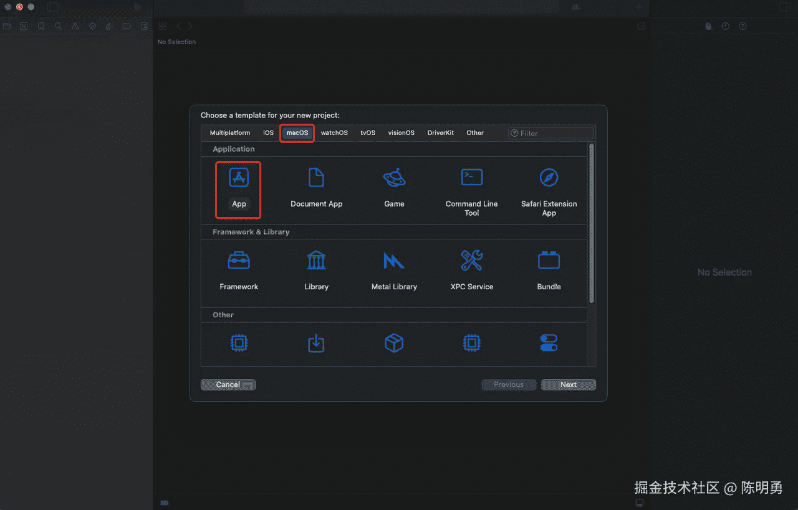

1.  输入 Project Name 和 Organization Identified ，然后点击 Next 。

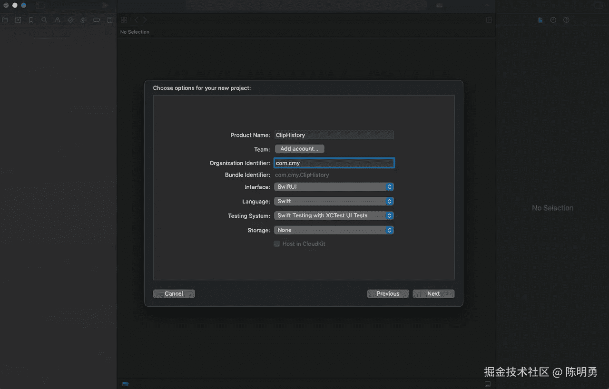

1.  选择项目存放的目录后完成创建。

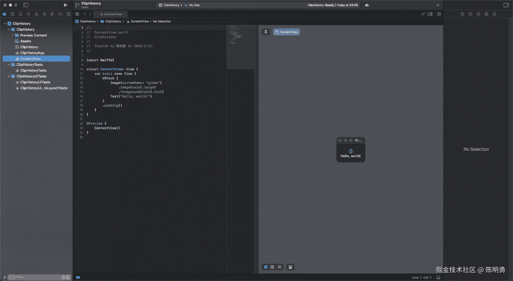

### 项目第一版

将应用的需求以文字的形式发给 Trae AI ，让它开发 **剪贴板管理工具 **应用。

+   打开刚才创建的 Xcode 项目

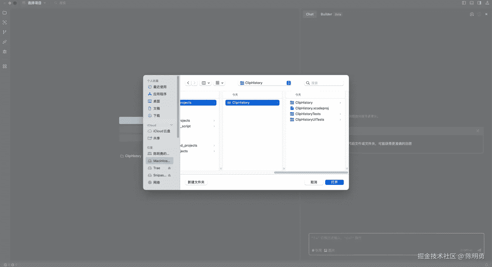

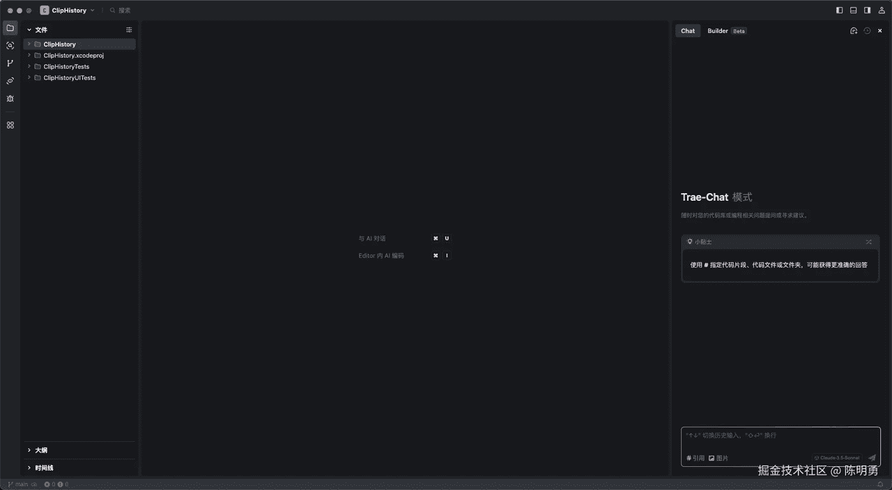

+   选择 Builder 模式，发送文字需求让 Trae AI 生成代码。

```
我使用的是 Xcode 工具管理项目，实现一个 Mac 系统的剪贴板历史工具。用户通过 `⇧Shift + ⌘Cmd + V` 快捷键打开剪贴板历史面板，面板位于屏幕下方，长度大约为系统界面的 1/3。面板展示最近复制的内容，用户可通过双击某个条目将其复制到剪贴板，并自动关闭面板。没有主界面，轻便快捷。
```

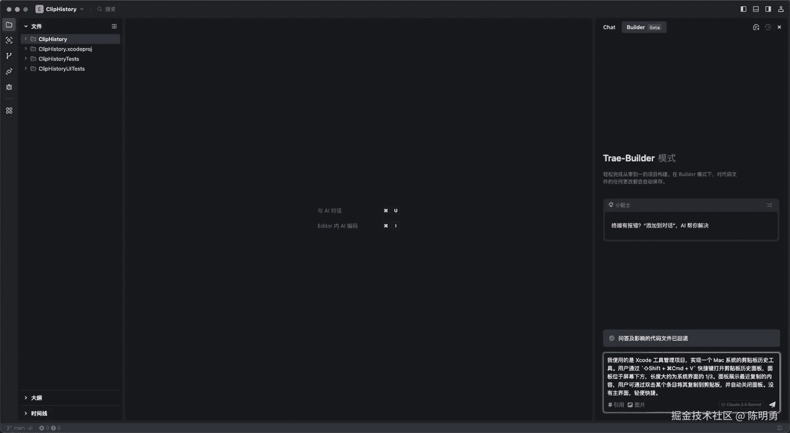

+   Trae AI** 会基于当**前项目帮我们创建合适的文件并填充代码，点击 全部接受 保存所有变更内容。

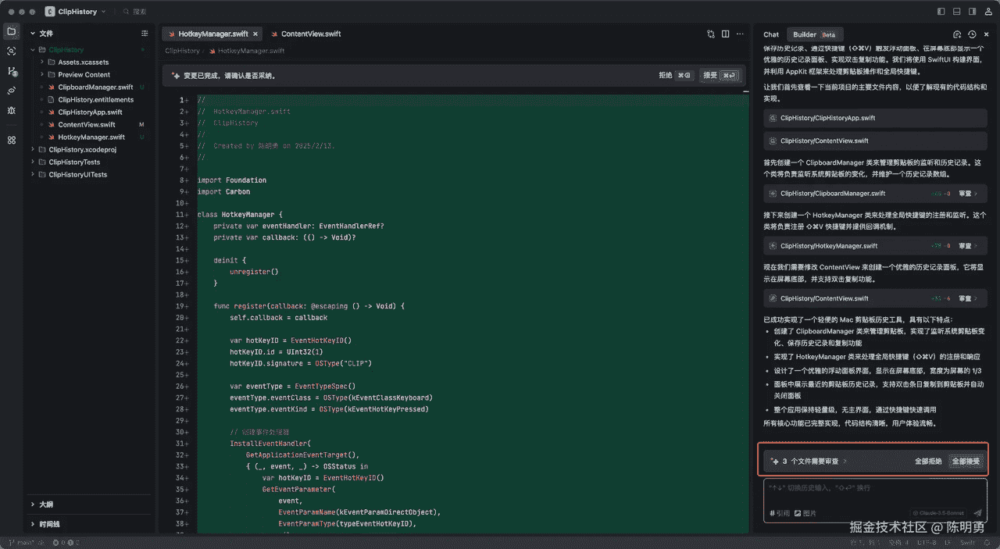

### BUG 修复

通过 Xcode IDE 运行 Swift 程序，发现生成后的代码，存在着许多 Bug 。好在 Trae AI 能帮忙解决这些 Bug 。下面是一些修复案例，通过发送图片，让 Trae AI 逐步帮我解决所有的 Bug 。

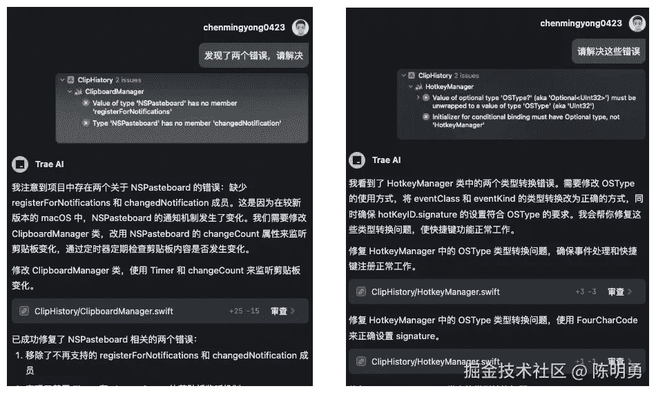

在解决所有的 Bug 之后，程序终于可以运行，下面是运行效果图。

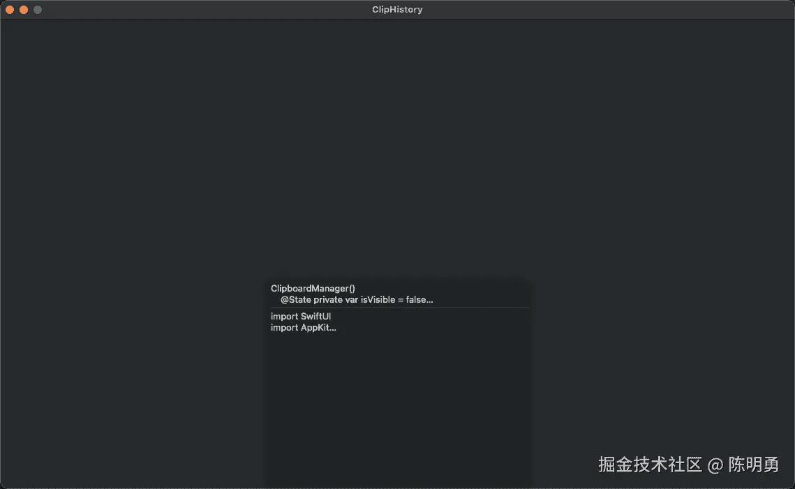

### 需求纠正

根据运行后的效果图可以发现， Trae AI 生成的应用和我所期待的效果有偏差，剪贴板需要在 ClipHistory 这个面板里才能显示，而我预期的想法是它在系统层面上显示，导致这种效果可能是我之前的描述不够清晰，因此我再次向它提出需求：


经过一系列的修改和优化，剪贴板被设置为系统级别的浮动窗口，下面是优化后的效果图：

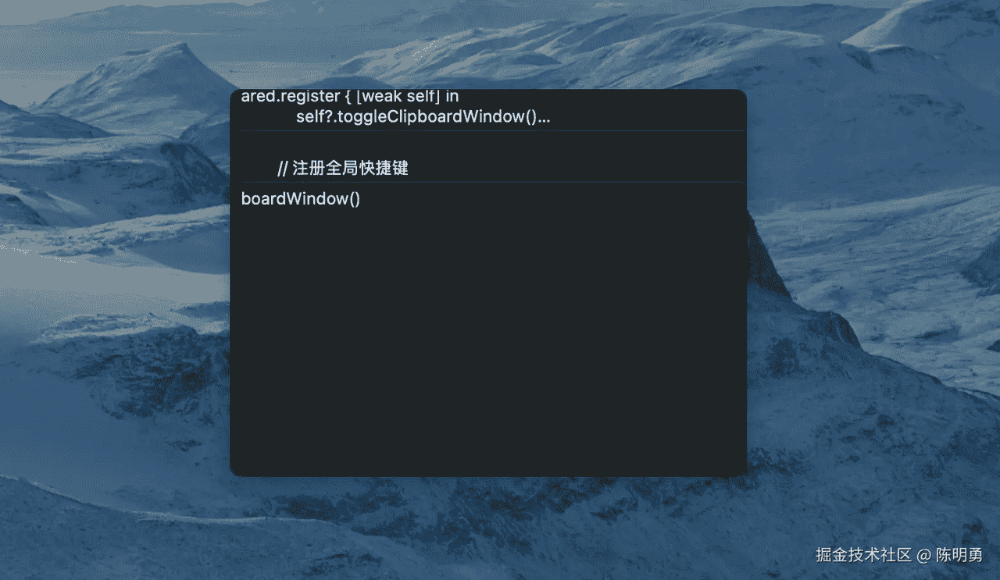

### 位置优化

虽然剪贴板被设置为系统级别的浮动窗口，但是其位置却不是我所想的那样，我希望面板是位于屏幕下方，因此我需要再次提出优化的需求：


优化之后，剪贴板已位于屏幕位最下方：

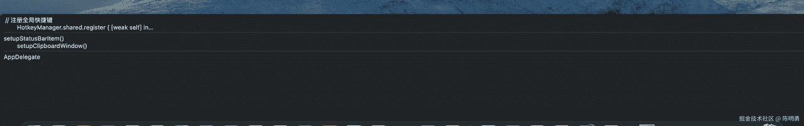

### 卡片式展示以及水平排列

根据目前的效果图可知，剪贴板所保存的内容，是垂直从上到下排列的，这并不是我喜欢的效果，因此我再次向 Trae AI 提出优化：


经过一系列的调整和优化，例如 **卡片高度的调整 **、 **内容类型的标识 **以及 **多屏幕的兼容 **等，最终的效果图如下所示：

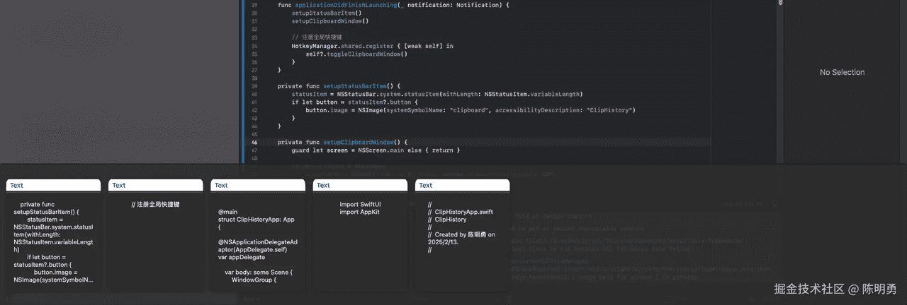

到目前为止， **剪贴板管理工具 **已经可以基本使用了。不过还可以添加一些小功能，例如支持删除条目以及退出应用的功能。

### 条目的删除

接下来，再次向 Trae AI 提出完善的需求，支持删除条目的功能。


调整后的效果图如下所示：

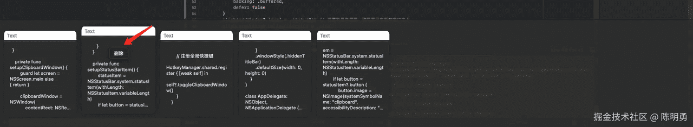

### 退出应用功能

目前， **剪贴板管理工具 **作为一个没有主窗口的应用，它的图标显示在顶部菜单栏中。然而，目前无法通过点击该图标进行任何操作。因此我希望能添加一个功能，可以通过点击菜单栏图标来退出应用。所以，最后再向 Trae AI 提出这个新功能的需求：


调整后的效果图如下所示：


到这里，一个基本的 **剪贴板管理工具 **应用就开发完成了。

## 最终效果演示

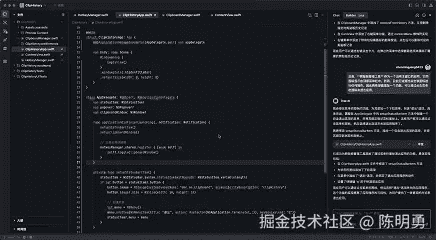

## 小结

通过与 Trae AI 进行多轮对话， Mac 剪贴板管理工具终于完成了开发。未来，我还可以继续与 Trae AI 互动，进一步完善该应用，例如添加搜索功能、条目归类等功能。

从本文的案例中可以看出， Trae AI 的功能非常强大，尤其是其 Builder 功能。通过该功能，我这位 Swift 零基础的小白，凭借简单的文字描述，就能够从零开始，成功开发出一个 Mac 剪贴板管理工具。 Trae AI 通过简化开发流程，极大降低了开发门槛，也让没有编程经验的人也能快速上手。

点击[阅读原文](https://www.trae.ai/?utm_source=juejin&utm_medium=juejin_trae&utm_campaign=AGI_article)，一键直达下载~