# 快到马年了，使用Trae做了个春节倒计时🏮，预祝大家马年春节快乐🧧

> 来源：[https://agijuejin.feishu.cn/docx/MJsbdgxDMowtI3xtJv7cQQNpnbe](https://agijuejin.feishu.cn/docx/MJsbdgxDMowtI3xtJv7cQQNpnbe)

> 作者：董员外

> 链接：https://juejin.cn/post/7470527684049748009

> 来源：稀土掘金

> 著作权归作者所有。商业转载请联系作者获得授权，非商业转载请注明出处。

> 如有侵权，请联系删除。

[**本文所使用的 Trae**](https://www.trae.ai/?utm_source=juejin&utm_medium=juejin_trae&utm_campaign=AGI_article) 免费下载链接： www.trae.ai

蛇年春节刚过，距离2026马年春节还有350多天，作为一个技术爱好者，在这样一个特殊的时刻，用代码来记录倒计时是一种很有趣的方式。本文将通过使用Trae开发一个简单的春节倒计时程序，并将其部署到阿里云服务器上，实现一个完整的开发过程。

trae下载地址： [www.trae.ai](https://www.trae.ai/?utm_source=juejin&utm_medium=juejin_trae&utm_campaign=AGI_article)

可以看到trae和cursor的布局基本没有差别

Trae里的Builder功能是一个能从0到1开发完整项目的工具，和Cursor的Composer功能相同，能够理解多个文件，并且自动生成文件和代码

**启用方式 **：使用command + U快捷键打开侧边对话框

## 开发春节倒计时

打开一个文件，新建项目

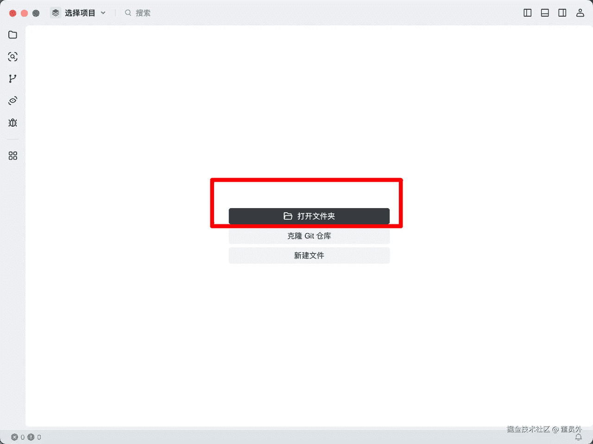

接着在对话框里输入功能描述和要求：

> 使用html、css、js开发一个春节倒计时网站，功能要求：例如明年是2026年，网站上就要显示距离2026年马年春晚还有 多少天多少小时多少分多少main，帮我生成可运行的代码

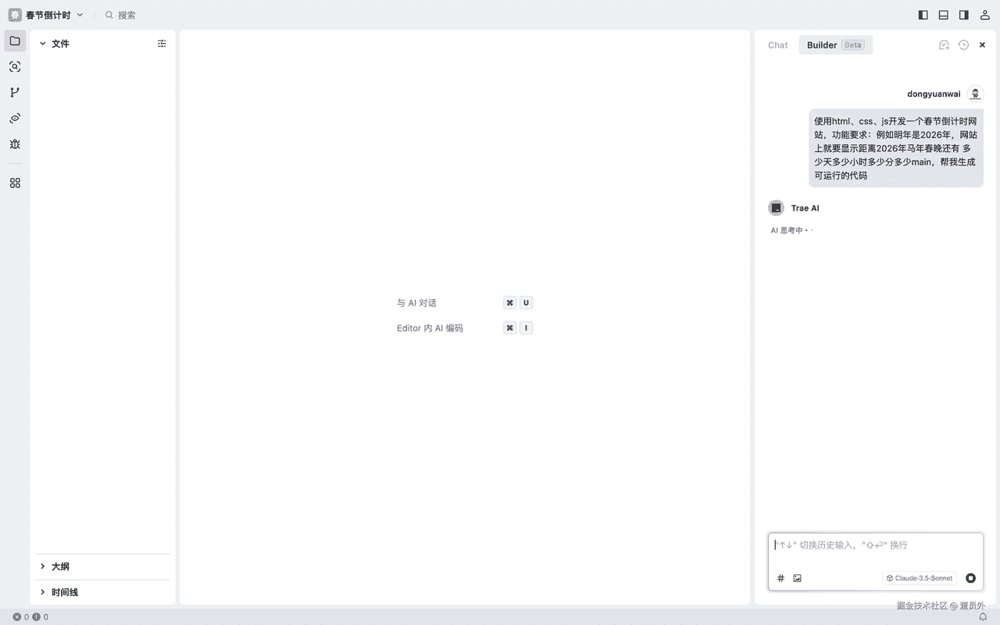

虽然我写有错别字，但是trae依然能够理解我的意思，并把功能实现。果然，Claude-3.5-sonnet确实强大👍

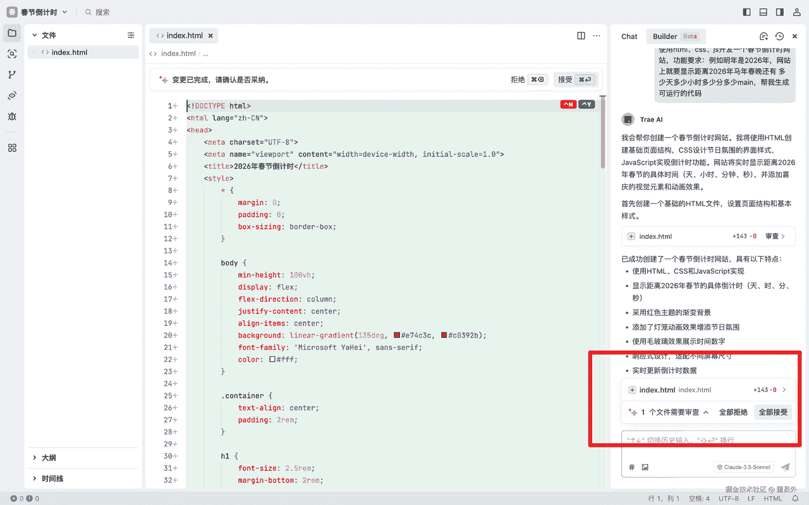

trae能够根据我的描述生成对应的文件和代码，选择全部接受后就可以在浏览器里看到效果

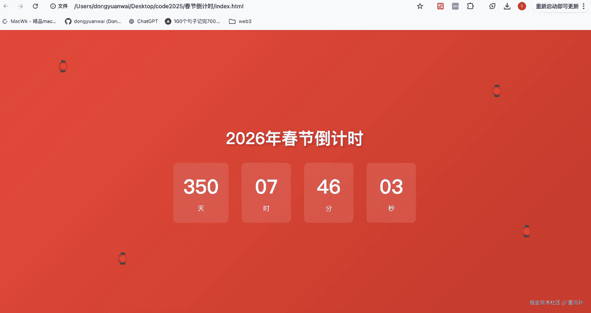

可以看到效果，功能确实是实现了，但是把全部代码都放到一个文件里，不利于后面功能的添加和修改，现在我们让trae修改一下

> 把html和js分开写到不同的文件里，并添加注释增加代码的可读性

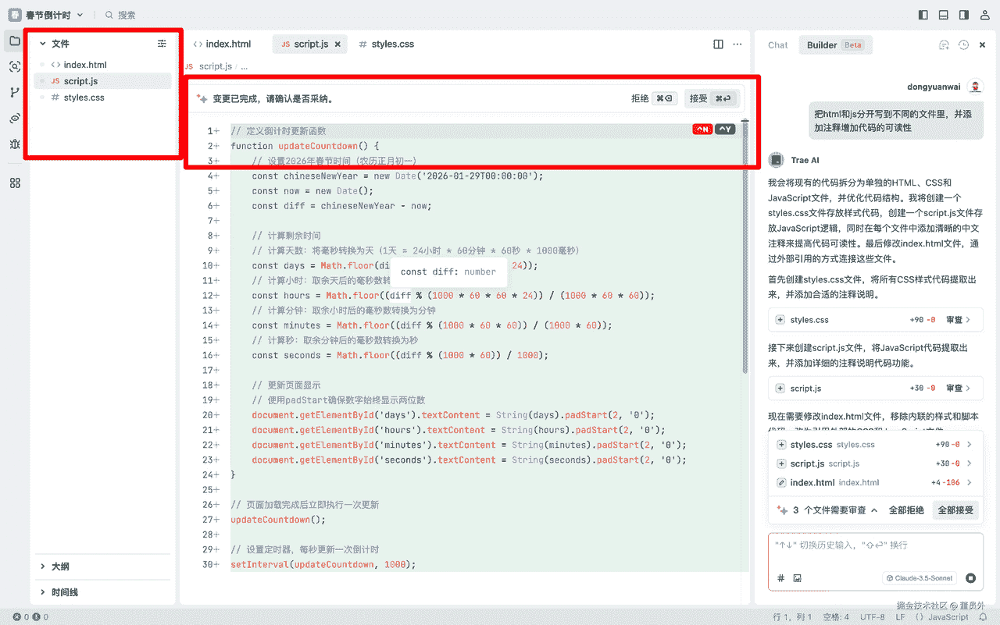

现在代码和功能果然变得清晰明了了起来

但是也发现了一个问题，只有距离2026年的倒计时，我想要十年内所有的倒计时，现在再让trae修改一下

> 不仅要2026年的倒计时，未来十年都要,并且 年份后面还要显示年份生肖，例如：距离2026年马年春节还有

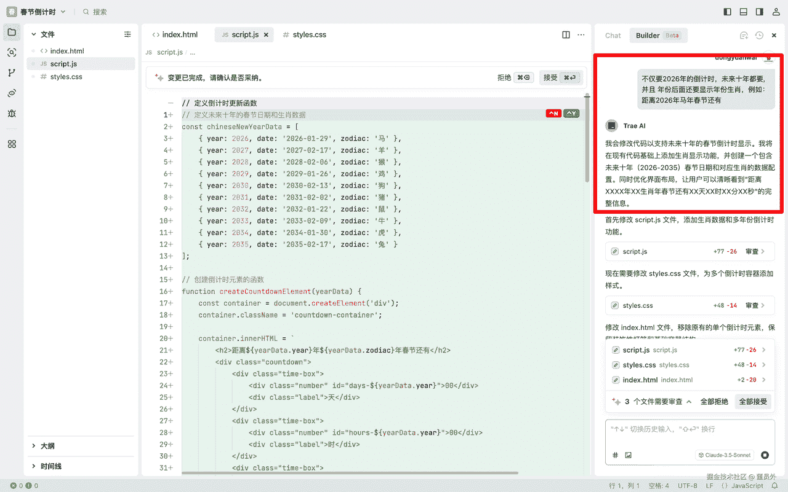

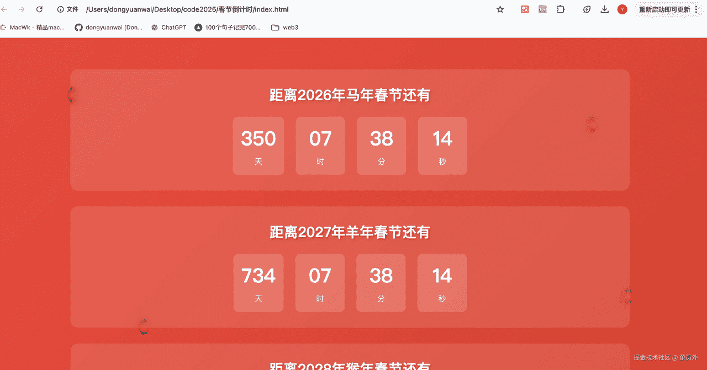

> 功能是做出来了，但是效果不是我想要的，我想要只显示最近一年的春节倒计时

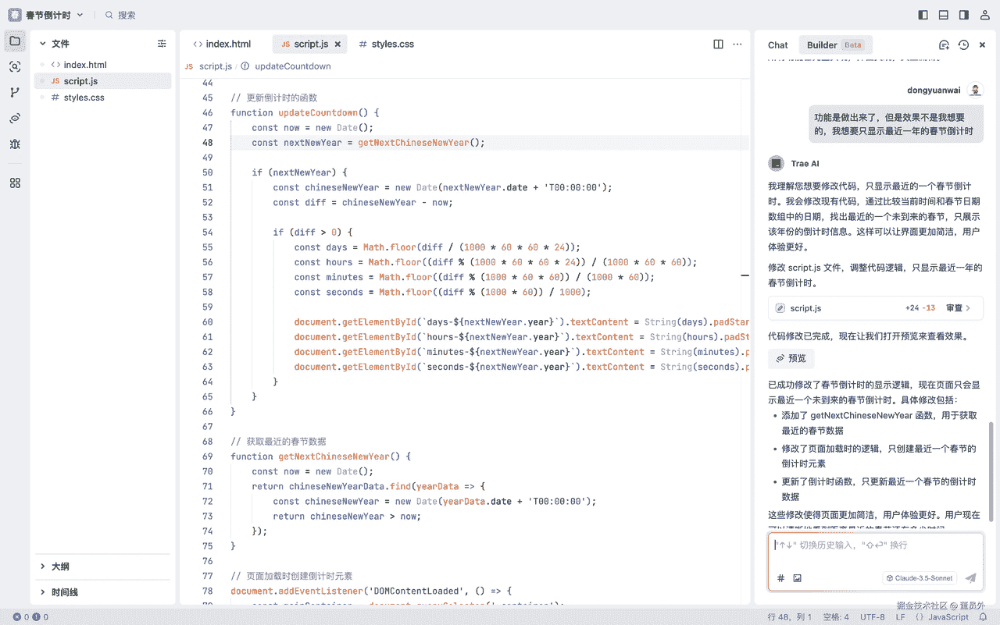

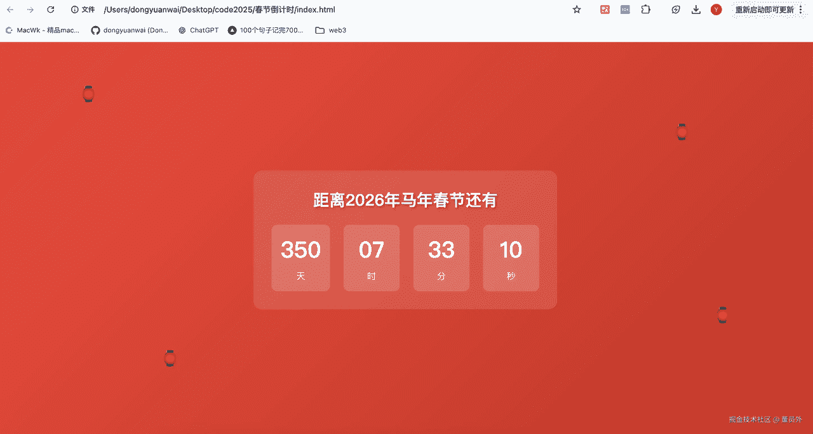

现在页面已经开发好了，就差让jym在线上看见了，所以把它放到云服务器上

## 部署上线

在这设置域名站点

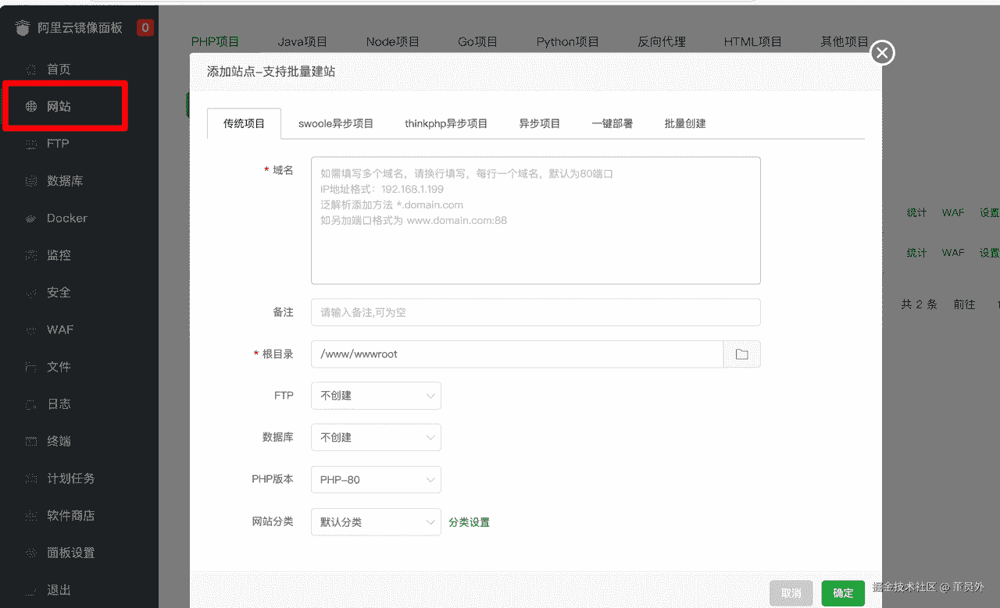

在这上传代码文件

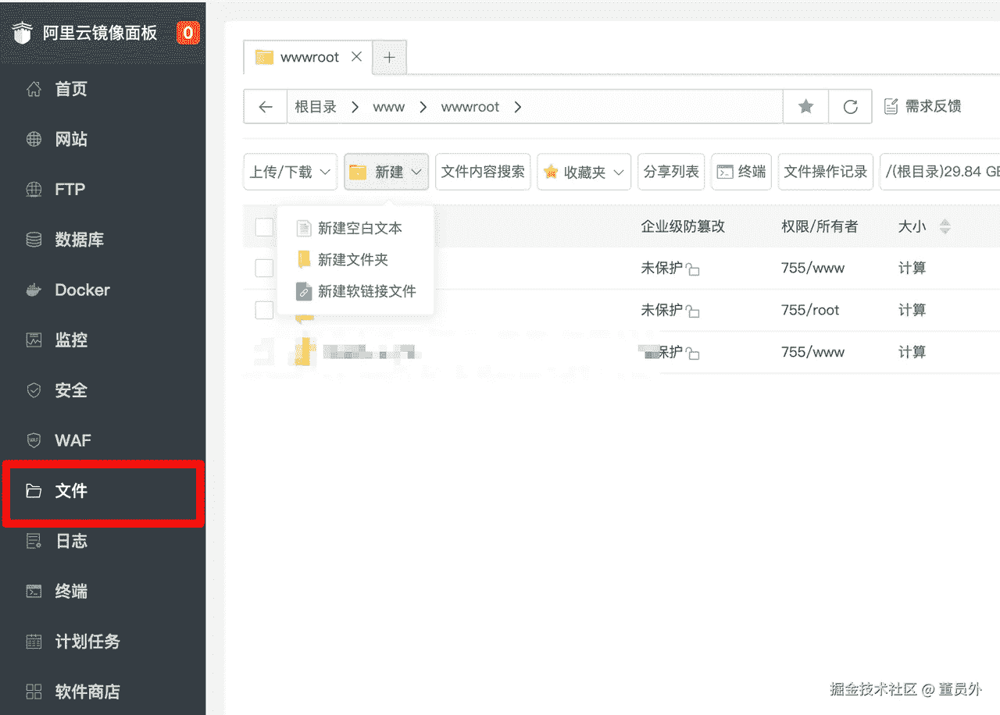

大家可以浏览： [春节倒计时网站](https://link.juejin.cn/?target=http%3A%2F%2Fdongyuanwai.cn%2F)

在此提前预祝大家2026年马年春节快乐，马到成功、龙马精神、一马当先，立马实现

[**本文所使用的 Trae**](https://www.trae.ai/?utm_source=juejin&utm_medium=juejin_trae&utm_campaign=AGI_article) 免费下载链接： www.trae.ai