# Trae开箱AI IDE编程初体验：不手写一行代码用SpringBoot3+Elements-Plus开发一个简单留言本

> 来源：[https://agijuejin.feishu.cn/docx/ASHBdebUwohRo2xm67NcITaSnP8](https://agijuejin.feishu.cn/docx/ASHBdebUwohRo2xm67NcITaSnP8)

> 作者：九卷技术录

> 链接：https://juejin.cn/post/7472678890277273626

> 来源：稀土掘金

> 著作权归作者所有。商业转载请联系作者获得授权，非商业转载请注明出处。

> 如有侵权，请联系删除。

[**本文所使用的 Trae**](https://www.trae.ai/?utm_source=juejin&utm_medium=juejin_trae&utm_campaign=AGI_article) 免费下载链接：www.trae.ai

## Trae 简介

在 AI 大模型大爆发发展情况下，字节跳动推出了 AI 编辑器 Trae，用于对程序员编码进行辅助、改进和变革。

Trae 与 AI 深度集成，提供智能问答、代码自动补全以及基于 Agent 的 AI 自动编程能力。使用 Trae 开发项目时，你可以与 AI 灵活协作，提升开发效率

文档地址： docs.trae.ai/docs/what-i…

## Trae 功能特性

**1、智能问答**

在编写代码时，随时可以与 AI 助手对话，获取代码解释、代码注释和错误修复等帮助。

《 [侧边对话 ](https://docs.trae.ai/docs/side-chat)》 Chat 模式：

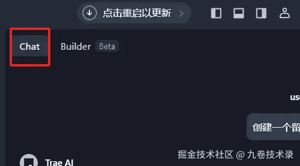

《 [内嵌对话 ](https://docs.trae.ai/docs/inline-chat)》模式：

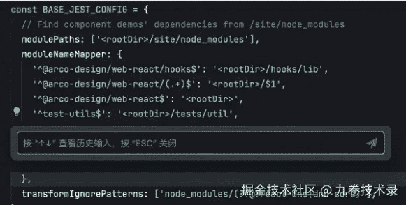

**2、代码自动补全**

AI 助手能够理解当前代码并在代码编辑器中实时提供建议，提升编程效率。

文档： docs.trae.ai/docs/comple…

**3、代码片段生成**

你可以通过自然语言描述需求，AI 助手将生成相应的代码片段，甚至能够编写完成整个文件代码。

4、从 0 到 1 生成项目所有代码

这个就是 Builder 模式：

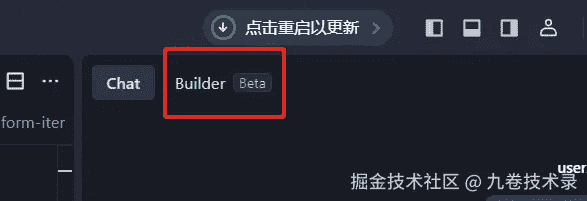

AI 助手将根据你的描述提供相关代码或自动创建所有文件。 文档： docs.trae.ai/docs/builde…

## Trae 实战留言本

### 下载安装 Trae

到官网 [www.trae.ai/ ](https://www.trae.ai/?utm_source=juejin&utm_medium=juejin_trae&utm_campaign=AGI_article)直接下载你需要的版本，Trae 提供 Mac 和 Win 版本，我的是 Win ，所以我下载 Win 版本。

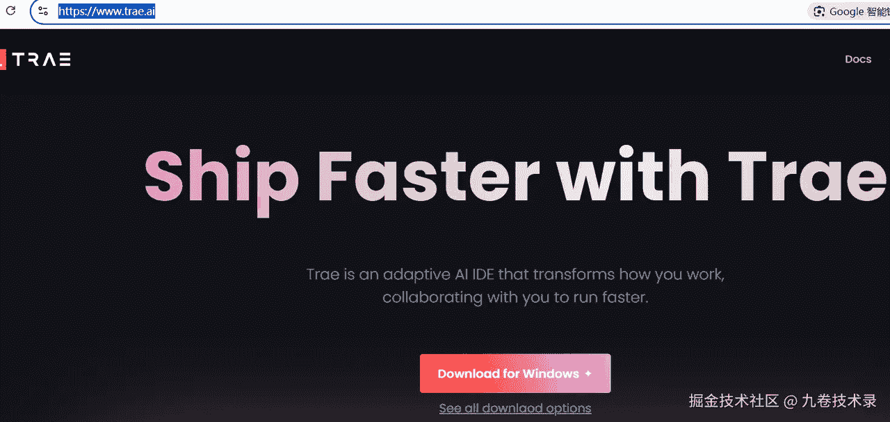

下载完成后，直接点击 exe 进行安装。

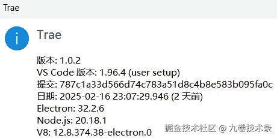

然后打开 Trae，它有一个一步一步操作的提示，到注册时候需要科学上网才能注册（ 温馨提示：版本1.0.2注册需要科学上网才行 ）。

全部搞定之后就可以实战 AI 编程了。

### Chat 模式实战留言本 - 后端开发

#### 开始实战

用 Chat 模式，直接在对话框中输**入 “创建一个留言本**应用，功能有：”， 这里我误点击回车键 ，然后没想到，Trae 自动规划了留言本的基本功能：

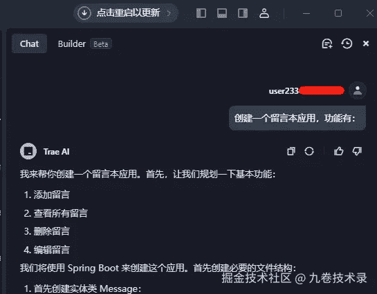

然后 Trae 就直接帮我创建了 4 个代码文件和里面的代码，还有一个配置文件，最后再加一个总结。我就只输入了上面 “创建一个留言本应用，功能有：” 这么简单的一句话，没有其它的输入对话内容了。蛮强大的功能。

> 用的 AI 代码大模型：Claude-3.5-Sonnet

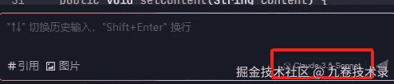

下面是 Trae 创建代码文件和代码、配置等的步骤。

#### 1、首先创建实体类 Message：

创建实体类 Message.java，然后把里面的代码写的很完整，

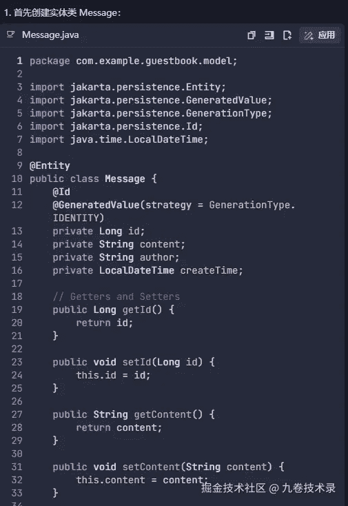

```
package com.example.guestbook.model;

import jakarta.persistence.Entity;
import jakarta.persistence.GeneratedValue;
import jakarta.persistence.GenerationType;
import jakarta.persistence.Id;
import java.time.LocalDateTime;

@Entity
public class Message {
    @Id
    @GeneratedValue(strategy = GenerationType.IDENTITY)
    private Long id;
    private String content;
    private String author;
    private LocalDateTime createTime;

    // Getters and Setters
    public Long getId() {
        return id;
    }

    public void setId(Long id) {
        this.id = id;
    }

    public String getContent() {
        return content;
    }

    public void setContent(String content) {
        this.content = content;
    }

    public String getAuthor() {
        return author;
    }

    public void setAuthor(String author) {
        this.author = author;
    }

    public LocalDateTime getCreateTime() {
        return createTime;
    }

    public void setCreateTime(LocalDateTime createTime) {
        this.createTime = createTime;
    }
}
```

#### 2、创建 Repository 接口

MessageRepository.java 接口代码：

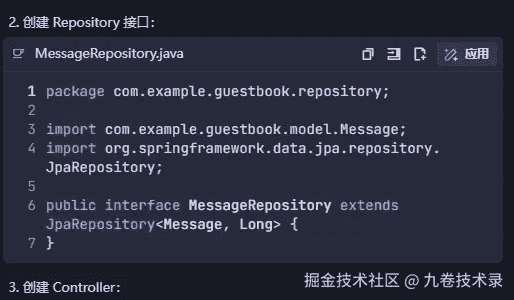

```
package com.example.guestbook.repository;

import com.example.guestbook.model.Message;
import org.springframework.data.jpa.repository.JpaRepository;

public interface MessageRepository extends JpaRepository&lt;Message, Long&gt; {
}
```

#### 3、创建 Controller

MessageController.java 控制器代码

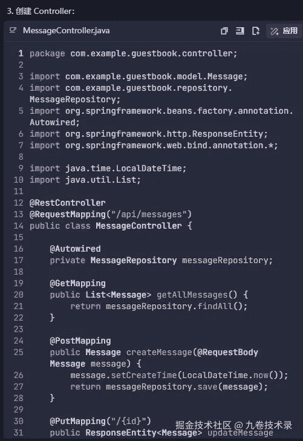

```
package com.example.guestbook.controller;

import com.example.guestbook.model.Message;
import com.example.guestbook.repository.MessageRepository;
import org.springframework.beans.factory.annotation.Autowired;
import org.springframework.http.ResponseEntity;
import org.springframework.web.bind.annotation.*;

import java.time.LocalDateTime;
import java.util.List;

@RestController
@RequestMapping(&quot;/api/messages&quot;)
public class MessageController {

    @Autowired
    private MessageRepository messageRepository;

    @GetMapping
    public List&lt;Message&gt; getAllMessages() {
        return messageRepository.findAll();
    }

    @PostMapping
    public Message createMessage(@RequestBody Message message) {
        message.setCreateTime(LocalDateTime.now());
        return messageRepository.save(message);
    }

    @PutMapping(&quot;/{id}&quot;)
    public ResponseEntity&lt;Message&gt; updateMessage(@PathVariable Long id, @RequestBody Message messageDetails) {
        Message message = messageRepository.findById(id)
                .orElseThrow(() -&gt; new RuntimeException(&quot;Message not found&quot;));

        message.setContent(messageDetails.getContent());
        message.setAuthor(messageDetails.getAuthor());
        
        Message updatedMessage = messageRepository.save(message);
        return ResponseEntity.ok(updatedMessage);
    }

    @DeleteMapping(&quot;/{id}&quot;)
    public ResponseEntity&lt;?&gt; deleteMessage(@PathVariable Long id) {
        Message message = messageRepository.findById(id)
                .orElseThrow(() -&gt; new RuntimeException(&quot;Message not found&quot;));

        messageRepository.delete(message);
        return ResponseEntity.ok().build();
    }
}
```

#### 4、配置文件

application.properties 文件里配置：

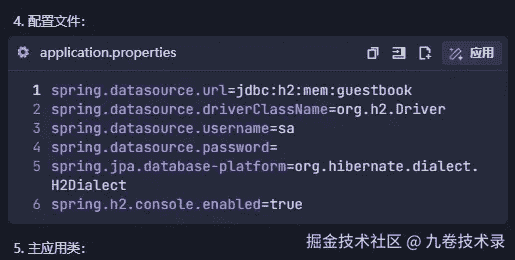

```
spring.datasource.url=jdbc:h2:mem:guestbook
spring.datasource.driverClassName=org.h2.Driver
spring.datasource.username=sa
spring.datasource.password=
spring.jpa.database-platform=org.hibernate.dialect.H2Dialect
spring.h2.console.enabled=true
```

#### 5、主应用类

GuestbookApplication.java 文件：

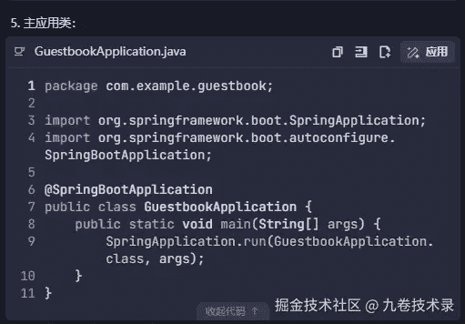

```
package com.example.guestbook;

import org.springframework.boot.SpringApplication;
import org.springframework.boot.autoconfigure.SpringBootApplication;

@SpringBootApplication
public class GuestbookApplication {
    public static void main(String[] args) {
        SpringApplication.run(GuestbookApplication.class, args);
    }
}
```

#### 6、pom.xml 依赖配置

pom.xml 依赖配置

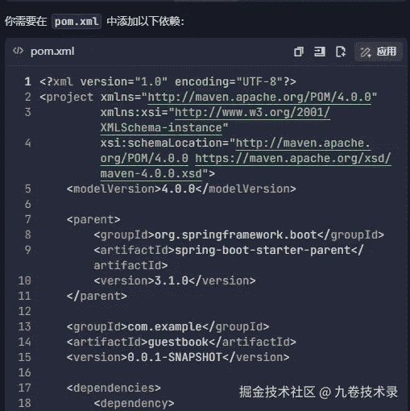

#### 7、最后来一个总结

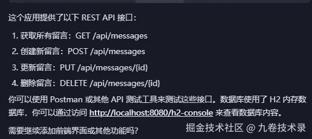

#### 8、项目目录结构

因为整个项目的目录和文件结构没有展示出来，所有我进行了第二次对话：写出上面留言本项目的文件夹结构，文件夹里面的java文件。

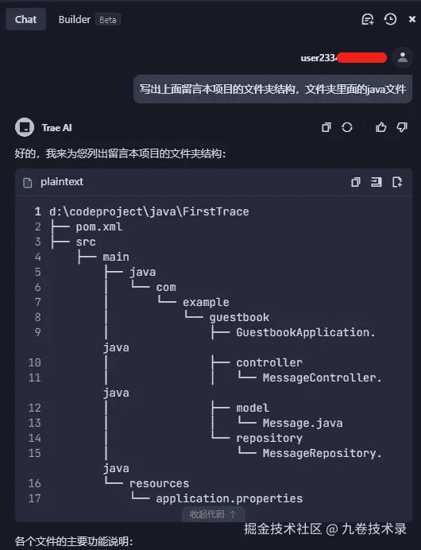

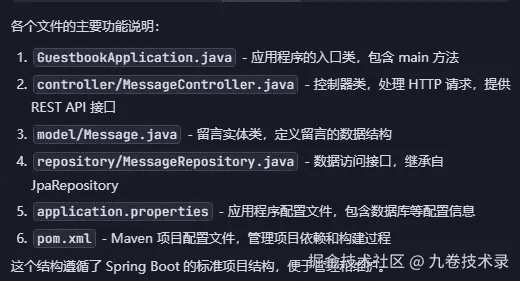

### 前端开发

#### 开始实战

开始对话：“继续完善留言本，用 vue3 来构建前端界面”

Trae 的回答是用 Vue3 + Element Plus 来构建。

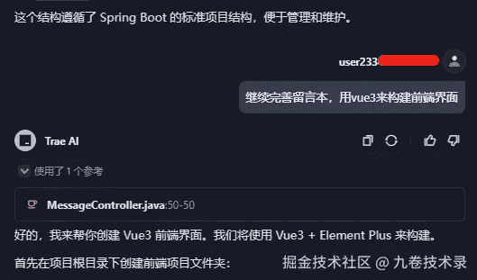

首先在项目根目录下创建前端项目文件夹：

```
cd d:\codeproject\java\FirstTrace
mkdir frontend
cd frontend
npm init vite . -- --template vue
```

> ⚠️注意：这里需要有 nodejs。如果没有请自行安装nodejs。

安装必要的依赖：

```
npm install
npm install element-plus axios
```

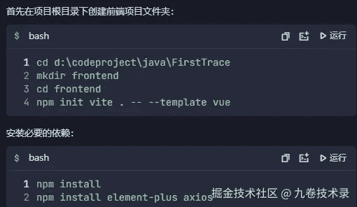

#### 1、首先创建一个留言组件

MessageList.vue

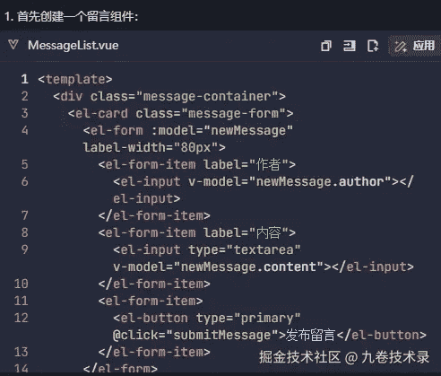

#### 2、修改主要文件

App.vue

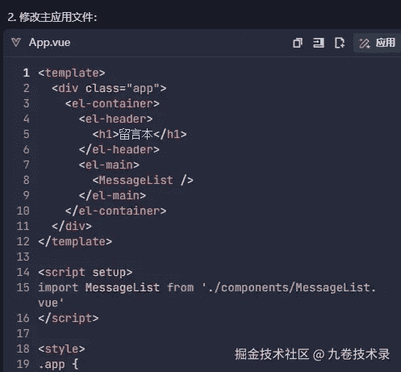

#### 3、修改 main.js

main.js

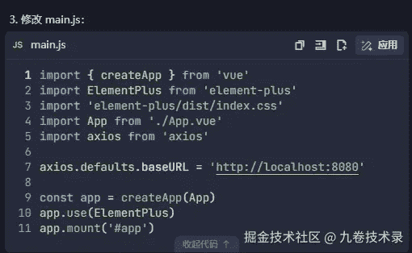

#### 4、在后端添加跨域配置，创建新的配置类

WebConfig.java

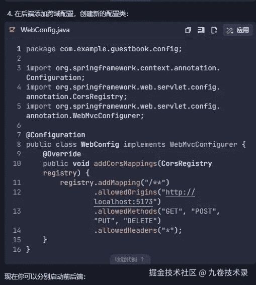

### 查看留言本效果

分别启动后端和前端。

#### 启动后端

```
cd d:\codeproject\java\FirstTrace
mvn spring-boot:run
```

#### 启动前端

```
cd d:\codeproject\java\FirstTrace\frontend
npm run dev
```

#### 浏览器运行留言本

访问 http://localhost:5173 即可看到留言本应用。主要功能包括：

1.  发布新留言

1.  查看所有留言

1.  编辑留言

1.  删除留言

界面使用了 Element Plus 组件库，提供了美观的 UI 界面。每条留言都显示作者、内容和发布时间，并且可以进行编辑和删除操作。

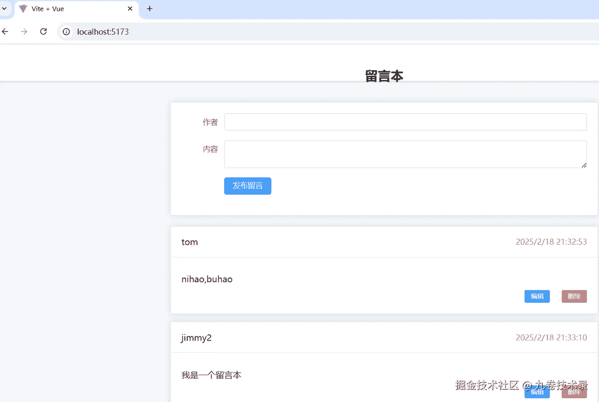

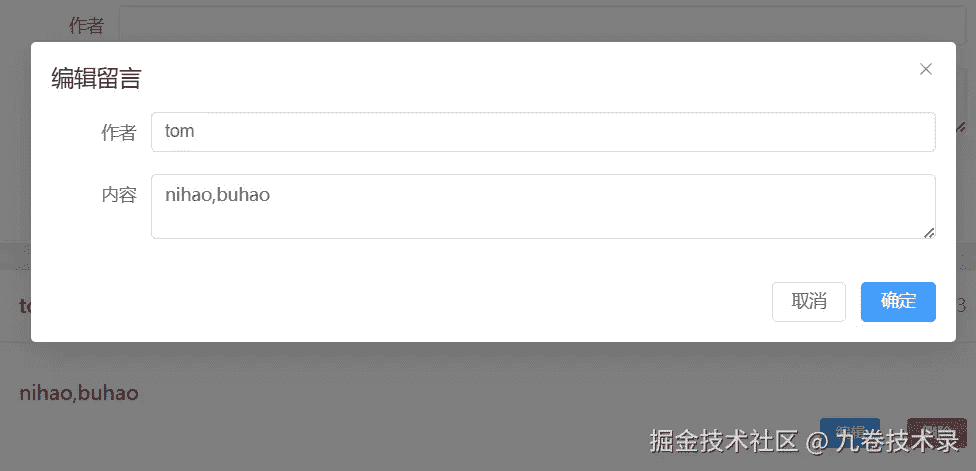

## 完整代码地址

GitHub 地址： github.com/jiujuan/jav…

[**本文所使用的 Trae**](https://www.trae.ai/?utm_source=juejin&utm_medium=juejin_trae&utm_campaign=AGI_article) 免费下载链接：www.trae.ai