# Trae——慧码速造——完整项目开发体验

> 来源：[https://agijuejin.feishu.cn/docx/Q7D5dWcPnopWmCxJVvLcZmWVnde](https://agijuejin.feishu.cn/docx/Q7D5dWcPnopWmCxJVvLcZmWVnde)

> 作者：红目香薰

> 链接：https://juejin.cn/post/7474427694630338610

> 来源：稀土掘金

> 著作权归作者所有。商业转载请联系作者获得授权，非商业转载请注明出处。

> 如有侵权，请联系删除。

“ **慧 **” 突出智慧，说明本工具以智慧的方式迅速生成代码，实现软件构建。

**Trae快速访问地址： **[**www.trae.ai/**](https://www.trae.ai/?utm_source=juejin&utm_medium=juejin_trae&utm_campaign=AGI_article)

## 引言

当前 Trae 已经有了 Win 端的版本了，整个体验下来效果还是非常赞的，从一个空的项目文件夹开始，到可上线的全后端项目，不仅仅是用时短上，更大的优势是精准性更加强大。这里完整的演示一下从0-1的整个过程。


## 项目需求

这里先通过一张图来说一下要完成的项目，需要前后端分离的写，后端用Python，前端使用H5+CSS3+JS来完成，这样前后端两个服务，运维起来也方便。

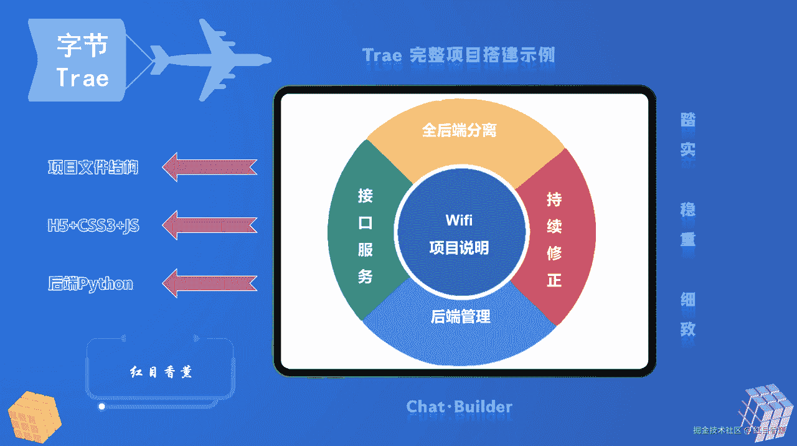

我想创建一个 wifi测网速 的项目，需求大致如下：

```
项目名：Wifi测网速项目创建提示词
要求，前后端层次分明

后端python语言使用Flask库：

1、用户的登录(/users/login)接口，登录会校验用户是否存在-post请求-参数：username,pwd
2、用户注册(/users/register)接口，每次登录成功后修改用户表的modifyDate的时间信息为登录时间-post请求-参数：username,pwd，phone
3、用户查询历史记录接口(/history)-post请求-参数：uid
4、提供下载测试文件接口(/download)-get请求-无参数
5、提供接收上传文件接口(/upload)-post请求-参数：file
6、回复客户端的ping请求接口(/ping)，返回网络延迟时间。-get请求
7、提供一个ip所属地址查询功能(/address)，使用http://ip-api.com所提供的免费接口即可-get请求-参数：ip。
8、管理员登录接口(/users/adminLogin)接口，
9、提供swagger的api接口文档，在对应的接口文件中清楚对应的注解。

数据库表信息说明：

1、采用MySQL数据库
2、数据库连接地址：rm-bp1zq3879r28p726lco.mysql.rds.aliyuncs.com
3、数据库名称：nutpi_wifi
4、登录用户名：qwe8403000
5、登录用户密码：使用admin占位
6、字符集：utf8
7、排序规则：utf8_general_ci
8、数据库引擎：InnoDB
9、创建users表用于存储用户信息，需要有：id(int类型主键自增)、createDate(默认当前时间)、modifyDate(默认当前时间)、userName、phone、pwd、status(用户状态0是正常、1是禁用、2是注销，默认值0)、user_role(用户角色0是普通用户、1是vip用户,默认值0)。
10、用户登录日志表user_log，用户存储用户的每次登录地址，需要有：id(int类型主键自增)、createDate(默认当前时间)、uid(用户id的外键)、address(登录ip地址)
11、创建历史记录表user_history，需要有：id(int类型主键自增)、createDate(默认当前时间)、uid(用户id的外键)、netType(网络类型)、SSID、ACType(网络运营商)、Ping、down(下载速度)、up(上传速度)、other(其它备注)

前端使用静态HTML5+CSS3+JavaScript+jQuery协作完成：

1、需要绘制一个(提夫尼蓝色为主要背景色，登录框样式采用自然流畅式的主题样式)登录页面。
2、需要绘制一个操作页，采用上左右的结构，上部的主题是项目标题以及退出操作，左侧为梳妆菜单栏，右侧切换的为左侧菜单栏的具体操作tab页面。
3、左侧菜单需要有用户信息操作菜单(可通过用户的userName、phone、status、user_role信息进行搜索)、历史记录查询菜单(可根据用户的可通过用户的userName、phone、status、user_role，历史记录表历史记录的信息进行搜索信息查询)、修改提供下载测试文件的文件路径与名称的修改操作、可接收上传文件的大小约束操作、ping请求的返回参数控制。

```

## 文档结构

从下图中可以看到整个文档结构。

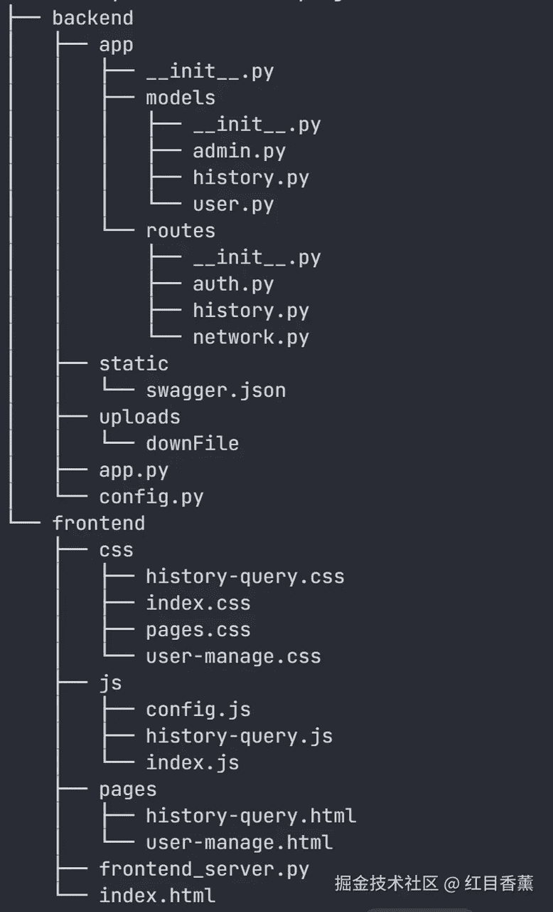

## Trae 应用展示——提问与项目结构构建

将问题进行提问后返回了对应文件夹的层级创建与对应开发中所需要的包内容。

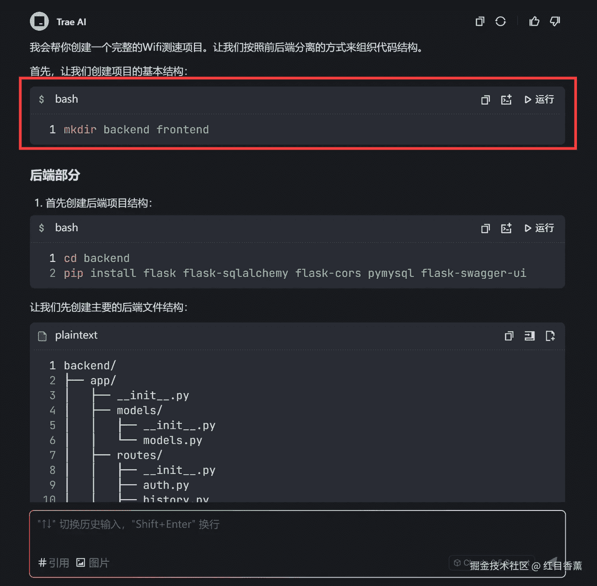

配置文件给的也很明确，很方便。

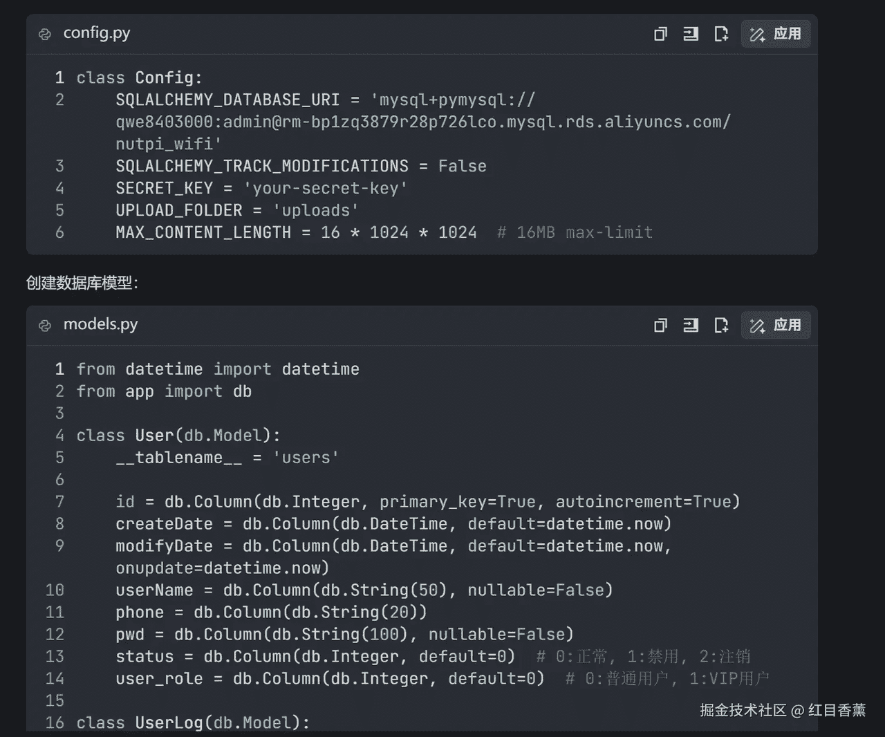

提示完毕所给出的后续内容需要输入文字进行识别，这里不能直接输入序号哦，可以看到序号没作用。

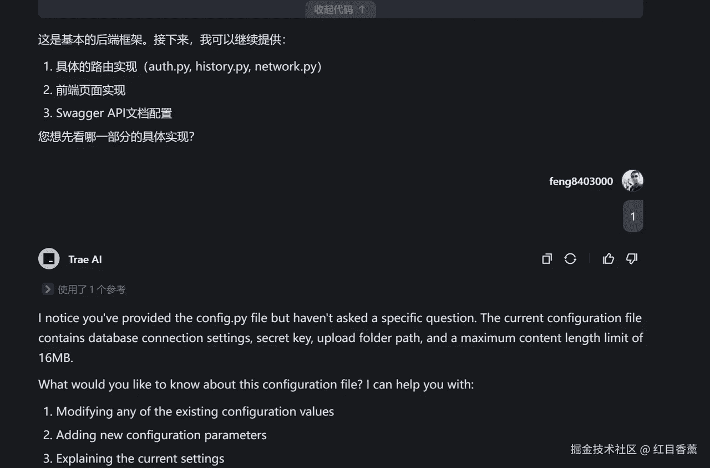

在第一次返回的时候已经给了具体的提问步骤：

+   1、具体的路由实现（auth.py, history.py, network.py）

+   2、前端页面实现

+   3、Swagger API文档配置

提示操作步骤：

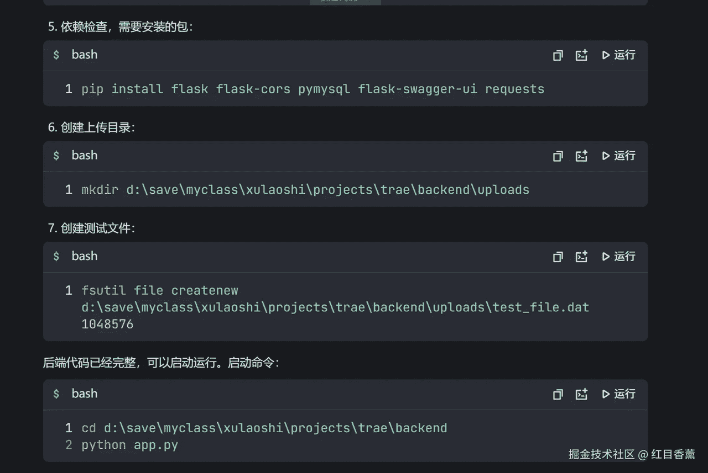

在这里也可以看到给出了操作步骤，我们按照对应的步骤来注意完成就可以了。 虽然不能一次性的将所有代码都表达出来，但是有步骤提示就已经很方便了。

## 效果分析

整个代码输出过程的时间消耗还是比较长的。总计产出：

| 类别 | 详情 | 数量 | 备注 |
| --- | --- | --- | --- |
| 目录结构 | 一级目录 | 3 | backend、frontend、uploads |
|  | 二级目录 | 7 | app/、scripts/、static/、uploads/、css/、js/、pages/ |
| 文件统计 | Python 文件 (.py) | 12 | 主要在 backend/app 目录下 |
|  | HTML 文件 (.html) | 4 | frontend 目录下 |
|  | CSS 文件 (.css) | 4 | frontend/css 目录下 |
|  | JavaScript 文件 (.js) | 5 | frontend/js 目录下 |
|  | JSON 文件 (.json) | 1 | swagger.json |
|  | 配置文件 | 1 | config.py |
| 代码行数 | 后端代码 | ~850 | Python 文件总行数 |
|  | 前端代码 | ~600 | HTML、CSS、JS 文件总行数 |
|  | 配置文件 | ~50 | 包括 config.py 和 swagger.json |
| 总计 | 总文件数 | 27 | 所有类型文件总数 |
|  | 总代码行数 | ~1500 | 所有代码文件的总行数 |
| 主要模块分布 | 后端 | - | 用户认证、历史记录、网络测试 |
|  | 前端 | - | 用户管理、历史查询、登录界面 |
|  | 配置 | - | 数据库、文件路径、API 文档 |

### 代码持续生成过程描述

基本所有的功能都可以直接给出 **提示 **代码，看好，这里是提示代码，并非是现成的代码，无法保障可以正常运行或者完成我们需要的功能，所以需要我们来持续的提问，持续的测试，在测试过程中解决各类的问题，过程中我们还能不断的来完善我们的项目。


### 工作时间消耗比

整体看消耗比最高的是30%的功能修正，毕竟是AI生成的代码，自己对上下文理解不是很充分，在寻找bug点的时候对时间消耗的比例高一些，但是相对来说已经很快了。

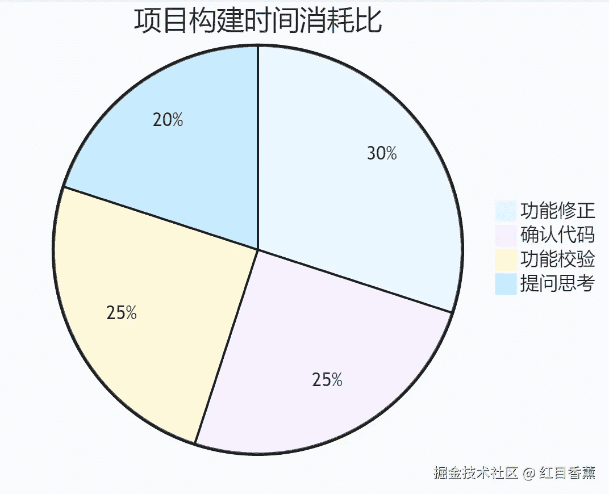

### 异常解决心得

这里当我完成项目后我询问了一下：计算一下完成本次项目共计询问次数与重复询问的问题点，主要问题出现在哪里，做个总结。

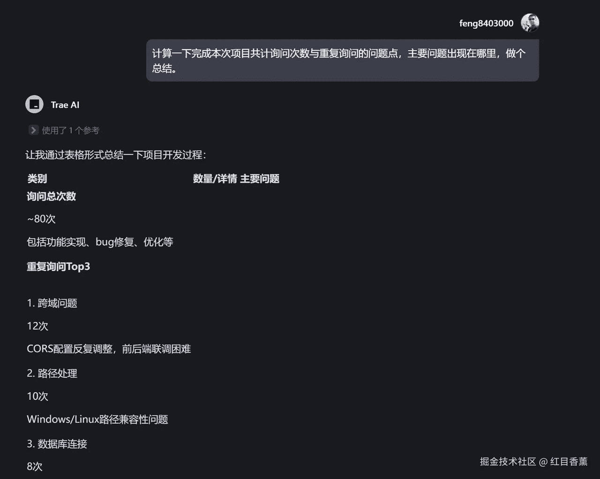

**跨域问题： **跨域问题前后我至少提问10次以上，每次给出的结果都是在修改CORS()这个函数，但是一直没有解决，最后我是自己来写的，直接写成了CORS(app)，通过注解的方式处理静态页面Ajax访问时的OPTIONS验证问题。所以这里的训练数据应该不是很足，还需要进化。

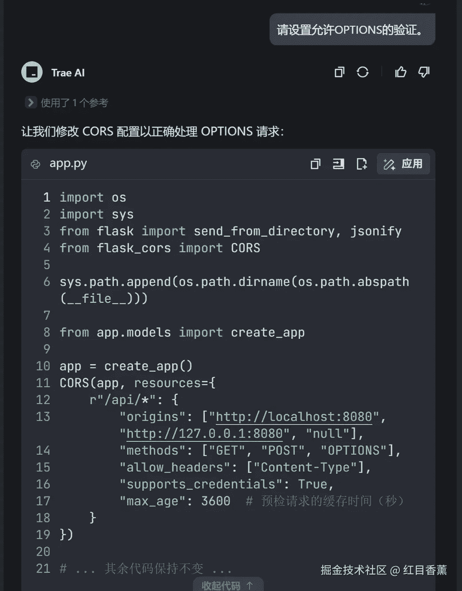

**系统差异性问题： **这里我也卡住了好一会，特别是刚开始将win上的代码放到Linux跑起来的时候，基础的swagger页面的访问不到，就是说路径不符，各种路径都尝试了，最后还是想到了17年的套路，使用反射的方式来获取路径。只有这种方式是最靠谱的，这里的提示希望能给大家带来一定的帮助。

```
if platform.system().lower() == &#x27;linux&#x27;:
    backend_dir = &#x27;/opt/trae/backend&#x27;
else:
    current_file = inspect.getfile(inspect.currentframe())
    backend_dir = os.path.dirname(os.path.abspath(current_file))
    
static_dir = os.path.join(backend_dir, &#x27;static&#x27;)
        
if platform.system().lower() == &#x27;linux&#x27;:
    static_dir = static_dir.replace(&#x27;\\&#x27;, &#x27;/&#x27;)
        
response = send_from_directory(static_dir, path)
# 更新 CORS 头
response.headers.add(&#x27;Access-Control-Allow-Origin&#x27;, &#x27;*&#x27;)
response.headers.add(&#x27;Access-Control-Allow-Methods&#x27;, &#x27;GET, POST, OPTIONS&#x27;)
response.headers.add(&#x27;Access-Control-Allow-Headers&#x27;, &#x27;Content-Type, Authorization&#x27;)
response.headers.add(&#x27;Access-Control-Max-Age&#x27;, &#x27;600&#x27;)
```

**路由中文问题： **对于路由这里我也是煞费苦心，这种写法就是路径拼接呗，默认给的提示是有问题的，无法正常访问，我测试了好多次，都是给的Object显示，并且路由文件并不会在后续的文件中主动继承。

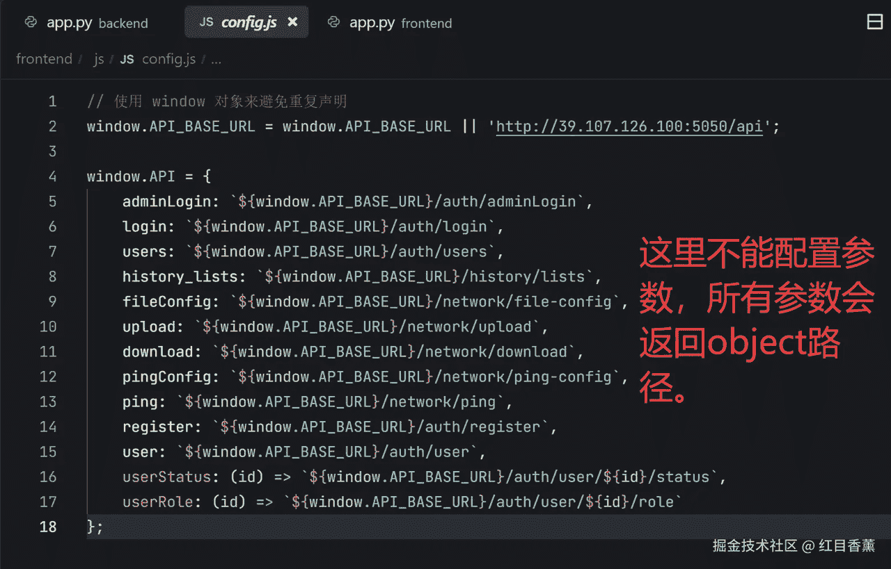

没有继承路由： 很明显可以看到这个子路径的设置问题，如果对所有文件的内容不熟悉肯定是很难定位问题的。

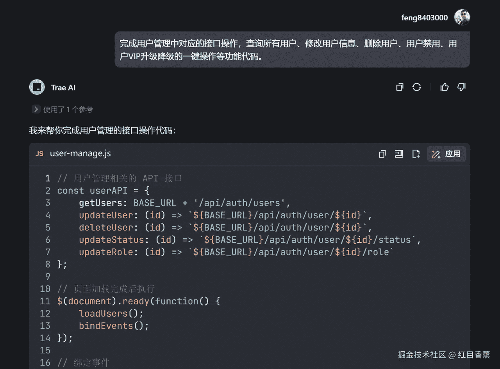

## 对于解决问题的最优方案

看绝招，通过这个方法我几乎解决了所有问题。

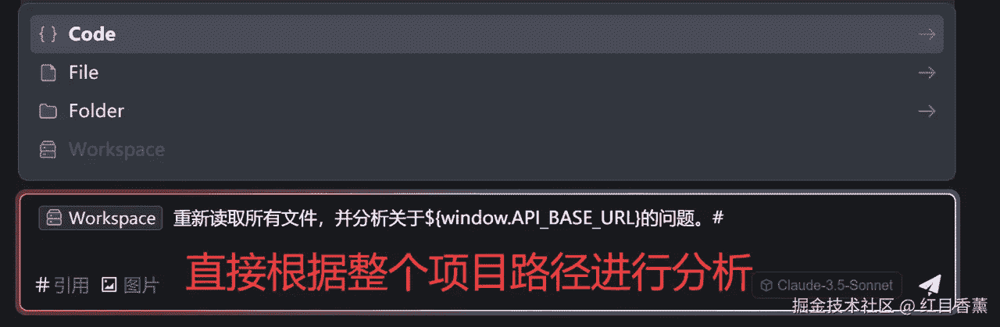

## 服务器上架

访问swagger页面。

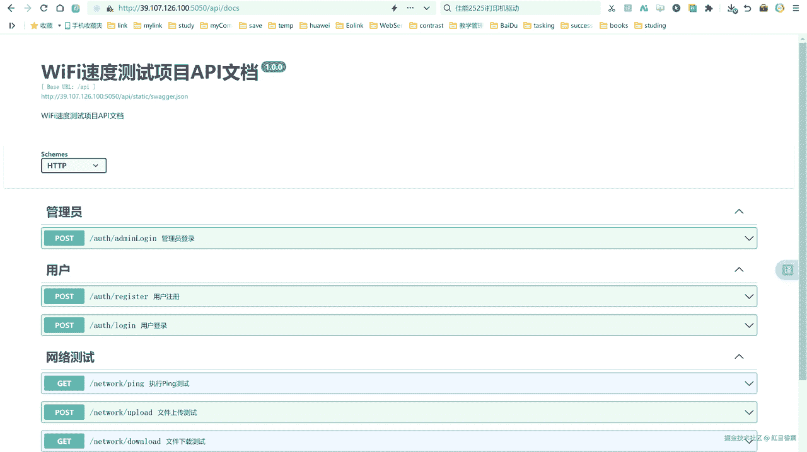

后端管理登录页面：

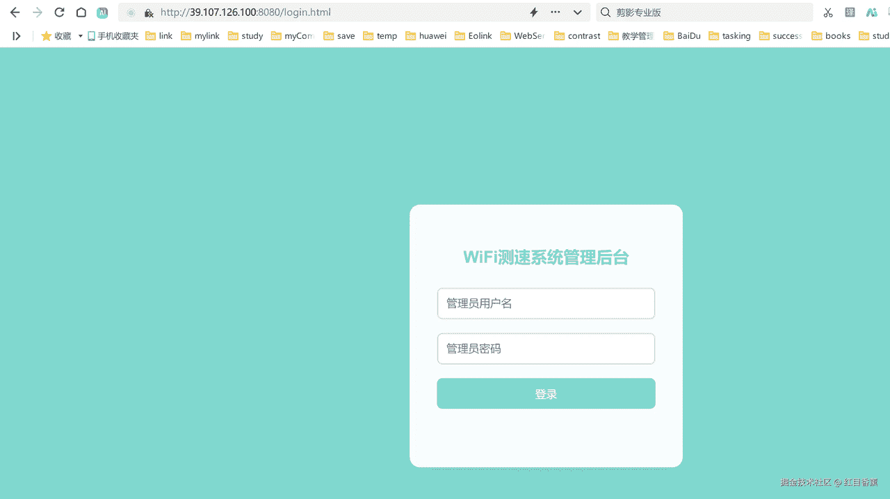

后端登录效果：

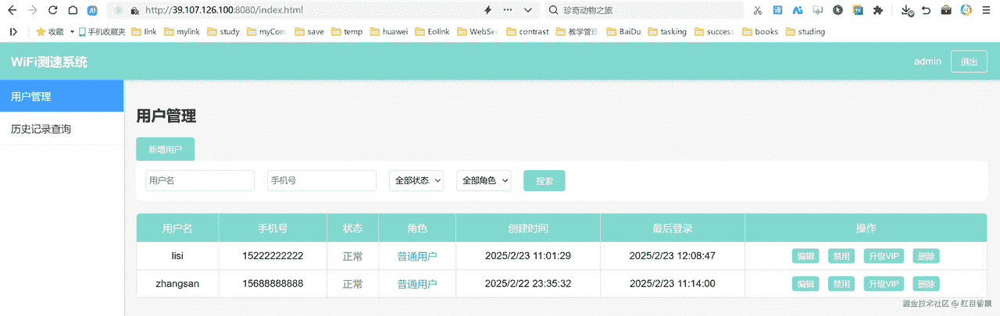

数据库初始化代码示例：

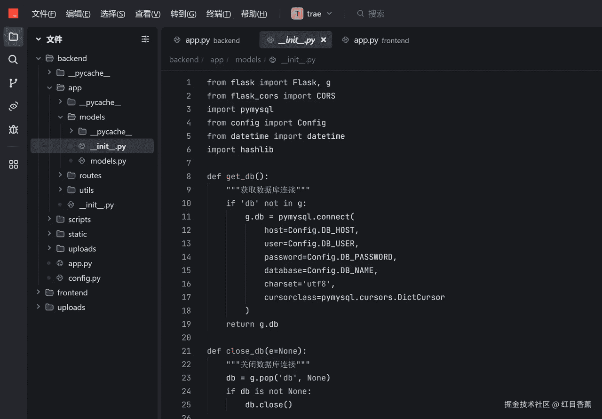

数据库初始化效果：

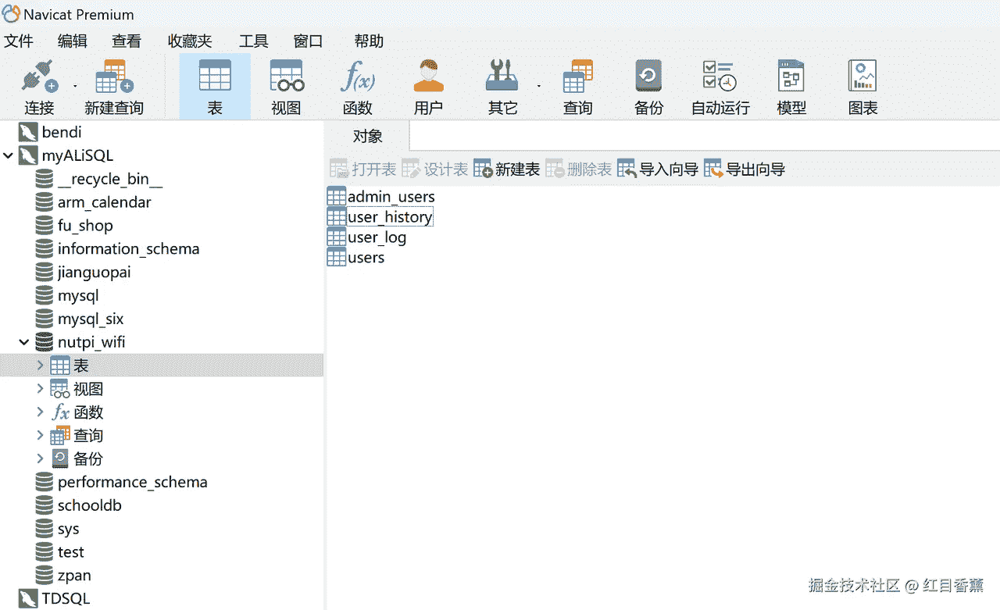

## WiFi速度测试系统项目总结

### 一、项目概述 项目指标 内容说明 项目名称

WiFi速度测试系统 开发周期

约27小时 技术架构

前后端分离 主要功能

用户管理、历史记录查询

### 二、技术栈 层级 技术选型 说明 前端

HTML/CSS/JS： 原生开发，轻量级实现 后端

Flask/Python： RESTful API 设计 数据库

MySQL： 数据持久化存储 文档

Swagger： API 文档自动生成

### 三、主要成果

1.  系统功能

+   完整的用户管理系统

+   历史记录查询与统计

+   跨平台兼容支持

1.  技术亮点

+   前后端完全分离

+   RESTful API 设计

+   自动化API文档

+   跨域问题解决方案

### 四、经验总结

1.  成功经验

+   模块化设计有效

+   配置集中管理

+   错误处理规范化

1.  待改进点

+   环境适配方案优化

+   测试用例完善

+   部署流程优化

### 五、后续建议

1.  技术优化

+   添加日志系统

+   引入缓存机制

+   完善单元测试

1.  功能扩展

+   数据可视化

+   用户权限细分

+   批量数据处理

1.  运维支持

+   监控系统集成

+   自动化部署

+   性能优化方案

## Trae使用总结

推荐使用Chat来询问，一般只要有一点代码开发常识的人都能看懂个差不多，根据这些模糊的功能理解，持续的进行提问效果比直接使用Builder好的多，如果一点代码不动再去使用Builder。

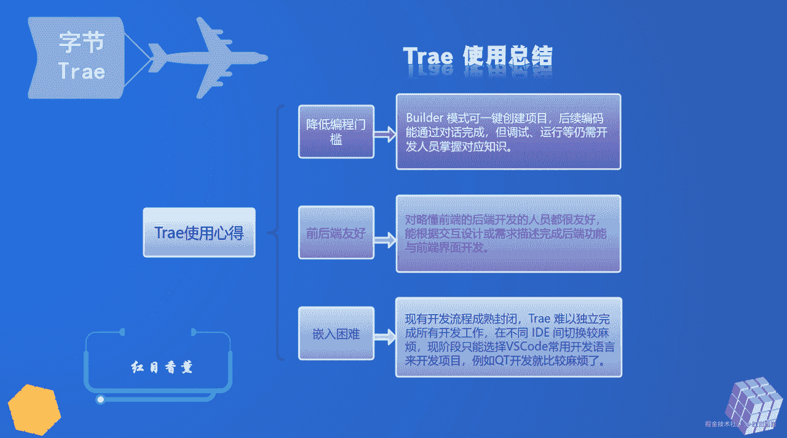

**Trae快速访问地址： **[**www.trae.ai/**](https://www.trae.ai/?utm_source=juejin&utm_medium=juejin_trae&utm_campaign=AGI_article)