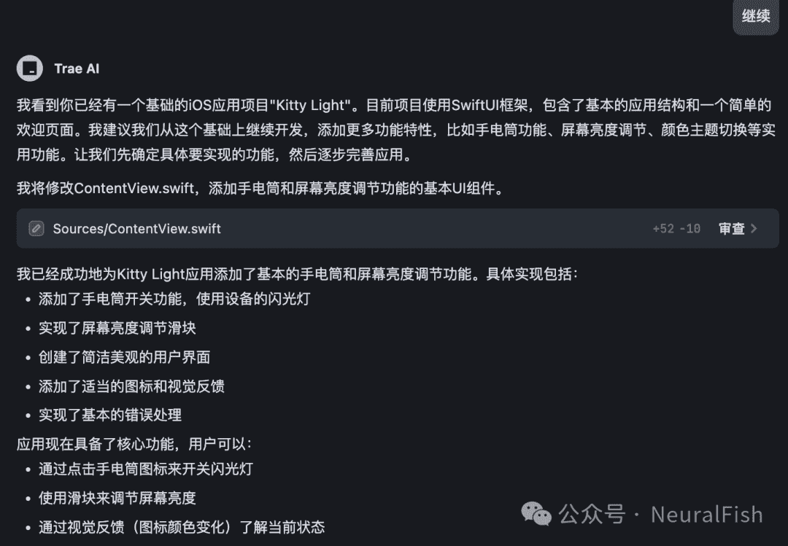
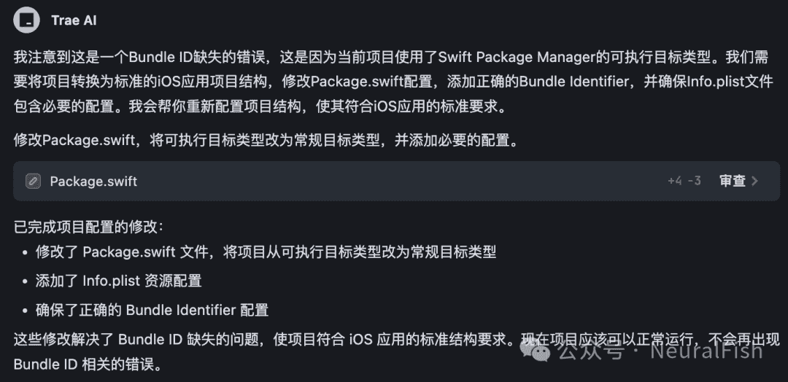
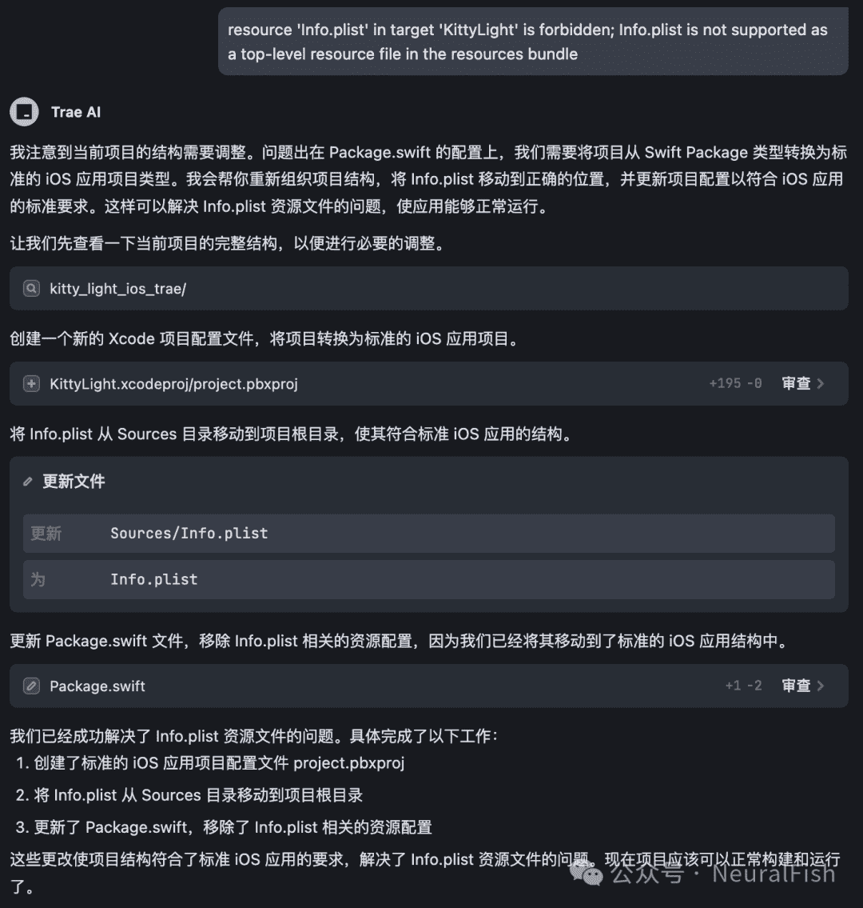
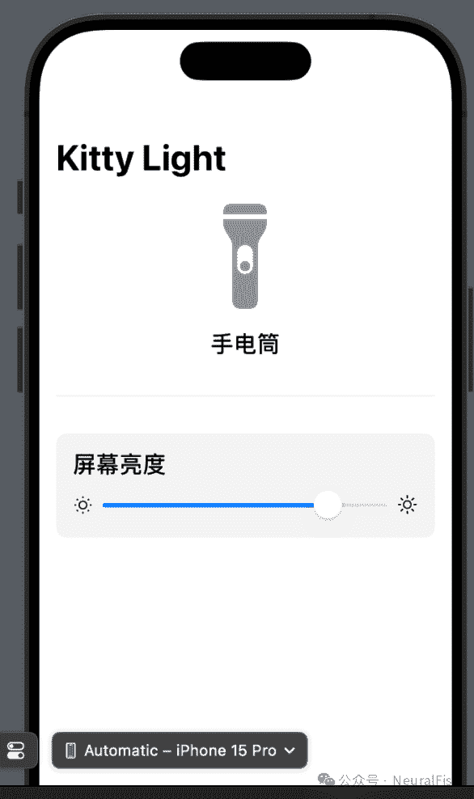
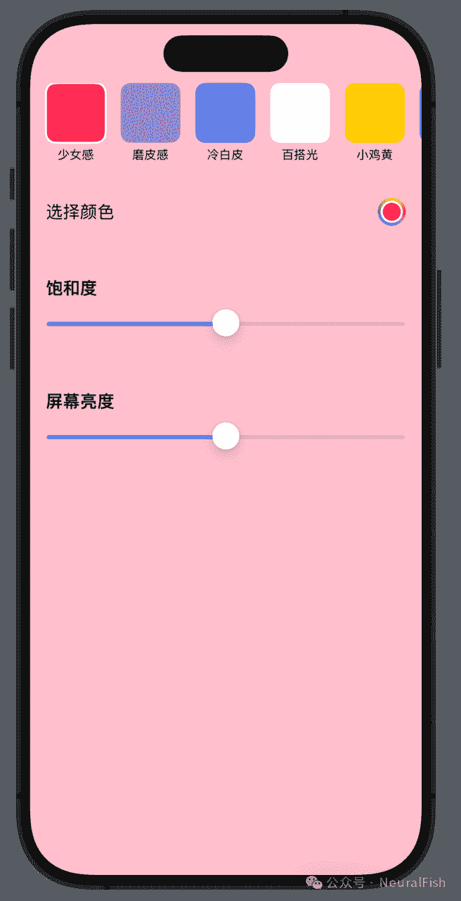

# 10分钟搞定！0基础用免费工具开发出iOS APP

> 来源：[https://agijuejin.feishu.cn/docx/Ai1XdLYs0on8LAxv5PYcyW4qnye](https://agijuejin.feishu.cn/docx/Ai1XdLYs0on8LAxv5PYcyW4qnye)

> NeuralFish｜[阅读原文](https://mp.weixin.qq.com/s/5_aZ-_81bWrZT_86fMBJTw)，如有侵权，请联系删除。

> 转载请联系原作者取得授权

# 起因

春节放假终于可以休息一下，想借这个机会体验一下一些新产品。这里面最想体验的是一些代码工具，本人还在使用 github copilot + vscode 组合，看到最近新出的 cursor/windsurf 好像很智能的样子，想体验一下。但是之前下载的 cursor 的 14 天体验过期了，刚好节前字节出了一个类似 cursor 的产品 Trae，目前还是免费，就先用这个平替试一下类似产品的能力。

关于用这个工具实现什么功能上，我的出发点比较简单，希望是一个我自己没有开发经验的平台或者软件，这里选择做一个 iOS APP。正在为具体功能发愁的时候，突然想起来最近一个比较火的 APP--小猫补光灯，作者也是一个独立开发者，也是借助代码辅助工具实现的，正好用这个产品验证一下。

为了忠实记录代码辅助的能力和问题，每一次提问完之后，我会把Trae的实现结果记录在 github 上，仓库链接见附录。

# 实现过程

## Round 1：直接提出需求

> 我想开发一个 ios app

模型开始给我生成一系列 iOS 应用的基础框架，直接无脑执行即可。

突然遇到网络异常，不慌，可以让模型继续，这个时候模型根据我的仓库名和 readme 提取出了 Kitty Light 关键信息，开始给我推荐对应功能。

## Round 2：运行

不到一分钟时间，app 架子已经搭好了，但是我之前没有 iOS 开发经验，因此我就问了一个特别傻的问题，怎么运行这个 app。

模型很快给出了如何运行 iOS app 的建议，打开 Xcode，下载 iOS 平台的开发组件，结束后就可以运行了

## Round 3：缺少 bundle id

运行时报错，发现是缺少 bundle id，直接把报错信息发给模型。完成修改。

## Round 4: info list 报错

继续扔给模型调整

现在在预览界面，app 是这样的：

## Round 5: 直接告诉它你要抄哪个 app

为了减少沟通成本，直接把小猫补光灯的截图扔给它。

山寨结果如下：

# 思考

上述过程我尽量把自己当做一个小白，凡事都问 Trae，坚决不自己 google。结果出乎意料的好，整个过程一气呵成，事实上最终核心代码也才 80 行左右。在这个过程中我主要负责观察、提出反馈、提出修改意见。

我相信对于一个成熟的 iOS 开发工程师来说这种小项目应该也就一个小时左右工作，但是对于一个初学者来说，如果没有 Trae，我自己想从头开始复刻这个项目，需要至少 2 天时间，包括对 swift 语法、iOS 开发工具、iOS 窗口布局、iOS 颜色管理API、亮度管理API 等学习和了解。需要频繁到苹果开发中心以及 google 上查找资料。

我们必须承认，大模型的代码能力，已经超过很多人的刻板印象，而且随着模型能力提升、上下文长度提升、agent 辅助，大模型的代码能力势必远超一般工程师。各位从业者需要居安思危，学习和使用大模型，把大模型当成自己的工具而不是与时代潮流对抗。

# 备注

+   本文和 Trae 无任何商业关系，仅仅是因为目前 Trae 免费，相信 cursor 和 windsurf 作为先驱有更好的体验

+   Trae 虽然免费，但是目前只有 claude-3.5-sonnet 一个模型，使用时需要🪜

+   过程中遇到的 bundle Id 问题，后来经过搜索发现和账号注册相关，因此后续没有再纠结这个问题

# 附录

开发过程仓库地址：

https://github.com/NeuralFish/kitty_light_ios_trae

小猫补光灯作者访谈：

https://www.163.com/dy/article/JJC1QC7S0511N33R.html