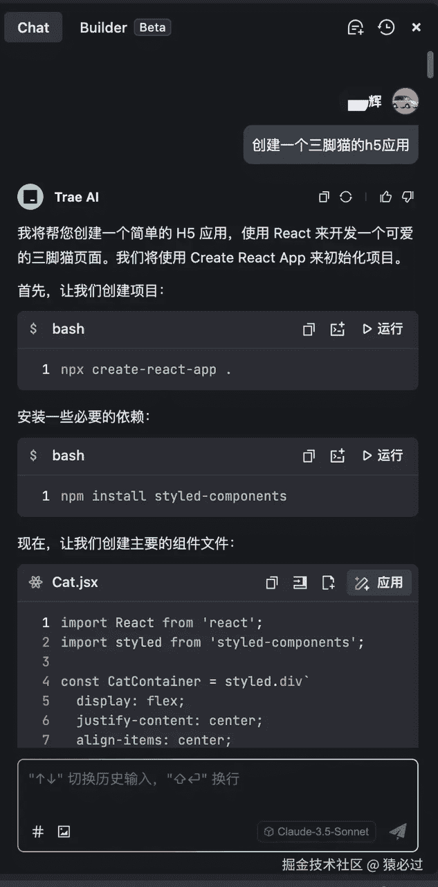
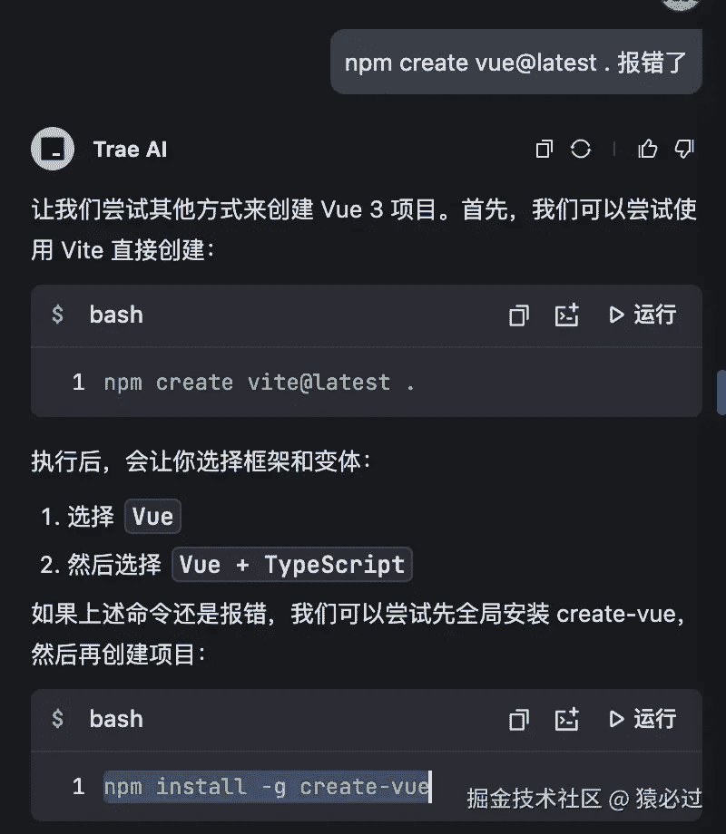
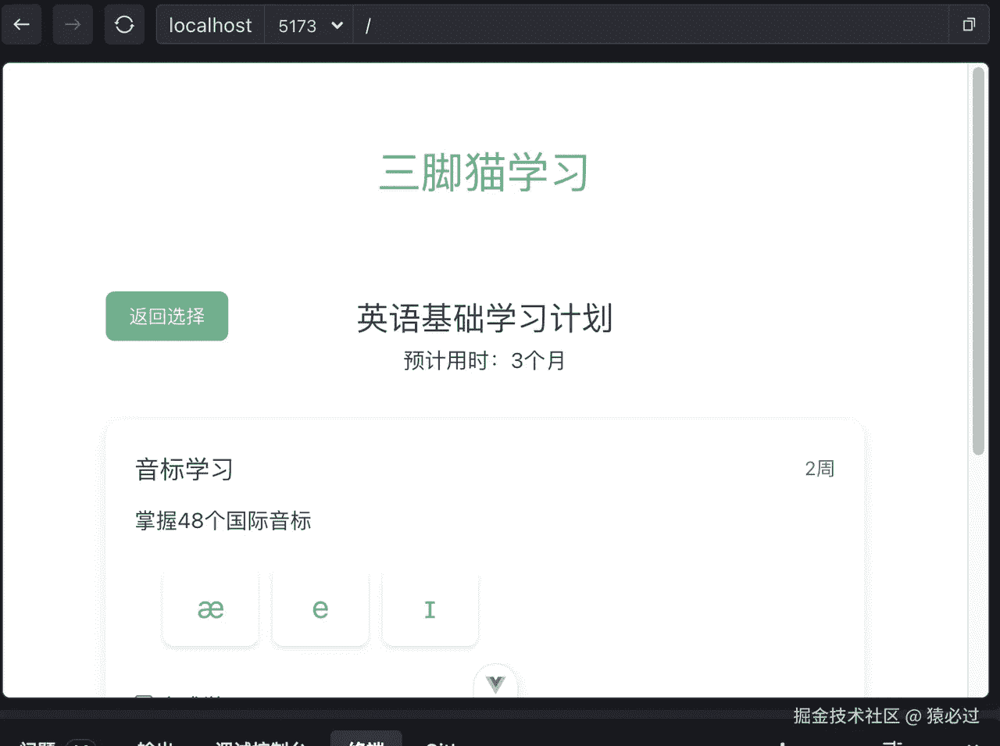

# Trae圆了我一个产品梦：AI教育 Native的应用

> 来源：[https://agijuejin.feishu.cn/docx/Eq4udkc4xodxRcx5lMicQeIunXf](https://agijuejin.feishu.cn/docx/Eq4udkc4xodxRcx5lMicQeIunXf)

> 作者：猿必过

> 链接：https://juejin.cn/post/7463002074146979879

> 来源：稀土掘金

> 著作权归作者所有。商业转载请联系作者获得授权，非商业转载请注明出处。

> 如有侵权，请联系删除。

我正在参加Trae「超级体验官」创意实践征文，  本文所使用的 Trae 免费下载链接：www.trae.ai/?utm_source…

## 产品构思

之前用过cursor开发过一个chrome浏览器插件，这次遇到Trae，更大胆一点，做了一个今天刚有灵感的应用。对H5比小程序、APP更熟悉，而且H5也更方便调试，找个软柿子捏，哈哈。

因为自己有了产品思路了，所以开发起来得心应手。

**产品名称：** 三脚猫

**产品定位：** 做一款AI教育的 Native的应用，通过这个应用任何初学者可以快速学习一个新技能。

**产品设计：**

1.  用户先选择一个新技能

1.  应用针对这个技能生成一个学习计划

1.  针对这个学习计划和用户交互，完成每天的学习

## 开发环节

好，进入正题了。

第一步就是下载Trae，刚好用Mac，去官网下载就好了，安装挺快的。

第二步登录，忘记是选google还是github了，反正设置里面没看到，登出再进 去就直接进去了。这个希望可以切换账号。

第三步，我们左侧有两个功能，我一开始也没看教程， 不了解chat和Builder的区别；用了之后才发现Builder可以直接创建文件、修改文件，功能要更强大一点。

### 创建项目

刚开始卡主了，我本地的node是11的版本运行报错了，调整了一下我想用vue3来写，更熟悉一点。可是vue3需要node16+，那我就切换到node18了。

这次项目顺利的创建好了。

一开始用npm create vue@latest . 报错了，后面换成npm install -g create-vue；报错了不要怕，直接问Trae。

### 产品基础模块搭建

你可以把Trae当做一个程序员，你就是产品，直接发号施令不要怕他完成不了，死劲虐他就行了。他的能力可远远大于chatgpt3.5。

好，chat模式麻烦在于你要手动一个一个应用，糊里糊涂切换到了Builder模式，这次好了，他会自动根据你的需求描述找到需要修改的文件，改完之后问你是否接受。也可以看他具体改了什么文件，执行审查会跳转到源代码。

### 产品演示

## 最后想说的话

这个项目我会一直迭代，已经提交到github了，项目地址：github.com/zyhui98/tca…

特别看好后面AI在教育领域的发展，期待Trae越做越好，成为最牛逼的IDE。

对AI，我有三个思考：

**Agi 需要个人助理**

我现在用OPPO手机，他已经超越了Sara的功能，不光是可以用大模型回答我的问题，也可以 phone use,通过理解我的指令去操作我的手机，比如给我今天的朋友圈所有的朋友点赞。

如果说对话框不是AI 的一个好的产品形态，那么私人助理将是一个选项，私人助理会无缝获取你的上下文数据。

如何获取你的上下文？可以是浏览器记录，输入法，剪贴板，截屏，邮件等。我觉得输入法信息量最大，最容易做成。微信输入法的问 AI 就是这个思路。

App Agent 是什么形态？

假设未来有一个类似抖音的软件，不过你滑屏出来的不是短视频，而是一个个的APP， 就像小程序一样 你也不需要安装 直接就可以使用。

这些APP不是人开发的，而是AI agent生成的，现在 Devin 不就是可以达到这个水平吗？他主动去推送你要做的任务。如果你确认了它就自动去执行，或者是主动和你交互，动态去构建一个交互页面，让你来操作。重点是这个页面是实时开发的，是为了完成这个任务实时触发生成的，你说牛不牛。

**AI时代新的交互方式**

智能眼镜是AI的上下文，智能耳机是AI的输出，智能手套是触摸屏，是输入。

什么是智能手套？给你解释一下，你可以理解为他是一个鼠标，通过你的拇指移动模拟位置移动，再通过不同的拇指接触代表不同的指令，最少也有好操作四种指令了。当然你的语音输入也是很方便的一种指令。但是如果你不能发声的话，通过这个触摸手套应该是可以替代鼠标的。