# 从硬件到软件全链路环节增效最佳实践

> 来源：[https://agijuejin.feishu.cn/docx/S10edYvFMoM2NOxAWrgce3vvncd](https://agijuejin.feishu.cn/docx/S10edYvFMoM2NOxAWrgce3vvncd)

> 作者：完美句号

> 链接：https://juejin.cn/post/7466340201272016905

> 来源：稀土掘金

> 著作权归作者所有。商业转载请联系作者获得授权，非商业转载请注明出处。

## 一、前言：

最近公司有一个项目需求需要使用到AI智能识别的功能《垃圾智能AI识别系统》，本人一直从事Web领域开发工作，也没接触过人工智能这个赛道，刚好现在借这个“Trae「超级体验官」创意实践征文”来了解一下AI写代码相关的流程。

刚好也是接触新的技术领域，经过“Trae智能协作AI IDE”来帮助我从0到1来实现这个《构建开发板垃圾图片识别AI对话的Copilot》的项目，在很多地方帮助程序员开发人员更好地理解和优化代码，提高软件的可维护性和可靠性、安全性。


上图是通过“Trae智能协作AI IDE”从硬件到软件、模型的应用、生成Flask Web API服务，再到最后工作中的最佳实践，通过本人测试了Vue、Js、Python、Go等语言的实际场景，“Trae智能协作AI IDE”提供了智能代码补全、单元测试生成、问题修复等多项AI驱动的功能，使开发者能够专注于创造性工作而非繁琐的设置。

在实际使用中，我深刻体验到“Trae智能协作AI IDE”的便利，特别是在代码质量的提升方面展现了其独特优势，自动代码注释、智能问题解决建议，以及对话式AI视图的应用，不仅简化了日常开发中的繁琐任务，还显著提高了代码的可读性和可维护性。这些功能不仅仅在我忙碌的开发过程中节省了大量时间，还让我的开发工作更加高效和愉悦。


总的来说，“Trae智能协作AI IDE”不仅仅是一个工具，更是现代软件开发中不可或缺的助手。它的出现不仅推动了开发工具的技术进步，更为开发者们带来了全新的开发体验和工作方式。期待未来“Trae智能协作AI IDE”在AI驱动开发领域持续创新，为全球开发者提供更多实用且强大的功能。

---

### 1.1 项目需求描述：

客户有一个自动化垃圾分拣设备，需要装一个开发板，在AI技术加持下，作业单位可以通过识别不同的生活垃圾图片进行实时分析处理，来决定这个垃圾将要分拣到哪个区域。将AI识别技术用于垃圾分类质量来提高人工的效率，以实现对湿垃圾分类品质的智能管理和监督，接下来我们可以借助“Trae智能协作AI IDE”先构造一个垃圾图片识别的Copilot。


---

### 1.2 技术挑战：

与之前接触的Web领域不同，这次的项目是通过开发板将垃圾的图片识别出来进行分类合到结果的数据，因为也是刚刚接触硬件相关的开发，所以，下面大概列举一下这次挑战的技术点：

+   硬件开发板（基于香橙派的OrangePi AIpro(8-12T)）

+   图片智能识别领域（基于Python）

+   环境部署（Linux Ubuntu）

因为本人一直从事使用PHP进行Web相关的开发，接下来，就由“Trae智能协作AI IDE”边问边做，来一步一步的实现完成《构造一个垃圾图片识别的Copilot》的项目。

---

## 二、Trae智能协作AI IDE，让开发更轻松：

Trae与 AI 深度集成，提供智能问答、代码自动补全以及基于 Agent 的 AI 自动编程能力。使用 Trae 开发项目时，支持传统 IDE 相关能力，包括代码编写、项目管理、插件管理、源代码管理等。还可以在完备的 IDE 能力上，提供自动补全代码、根据注释生成代码、代码解释、生成测试代码、转换代码语言、技术对话等能力，你可以与 AI 灵活协作，提升开发效率。

“Trae智能协作AI IDE”可以使开发人员能够更有效地将人工智能集成到代码生成和文档中，为开发人员提供了一种非常实用和有效的方式来与大型语言模型（LLM）进行交互和协作，通过，开发者可以更高效地解决实际编程问题，提高编程效率和代码质量。

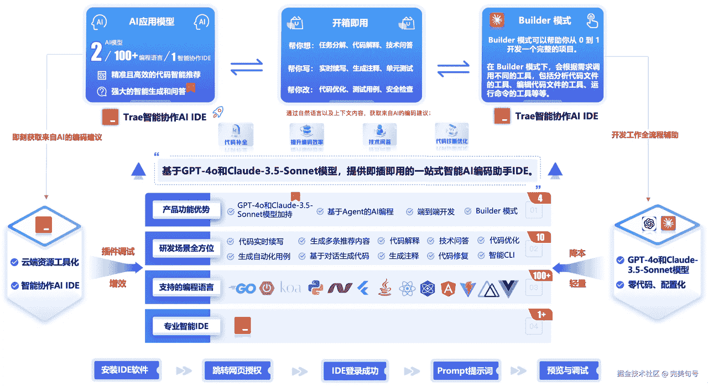

+   ①. 智能问答：在编写代码时，可以随时与 AI 助手对话，获得代码解释、代码注释和错误修复等帮助。

+   ②. 实时代码建议：AI 助手能够理解当前代码并在编辑器中实时提供代码建议，提升编程效率。

+   ③. 代码片段生成：通过自然语言描述你的需求，AI 助手将生成相应的代码片段，甚至能够编写项目级或跨文件的代码。

+   ④. Builder 模式 - 从0到1开发项目：告诉AI助手想要开发的程序，AI 助手将根据描述提供相关代码或自动创建所需文件。

Trae智能协作AI IDE官网

Trae智能协作AI IDE文档

---

## 三、基于“Trae智能协作AI IDE”实现《香橙派垃圾识别的AI项目》的最佳落地实践：

> 开发板的主要目的是帮助开发人员快速搭建嵌入式系统原型，进行软硬件联合调试和测试，从而提高开发效率和减少开发成本。

本人也是刚刚接触开发板，从“Trae智能协作AI IDE”给出的解释是：开发板是一种用于开发和测试电子系统的电路板，它是一个集成了各种硬件资源的平台。开发板是硬件开发中非常重要的工具，它为开发者提供了一个完整的实验和开发平台，使得产品从概念到实现的过程更加高效和便捷。


在我个人的理解中是相当于一个小型的主机，由于成本比较低、体积比较小，可以在智能家居、物联网、机器人等项目中，开发板作为核心硬件平台，支持项目的快速开发和部署，本文中我们使用香橙派的OrangePi AIpro(8-12T)开发板来开发运行的环境。

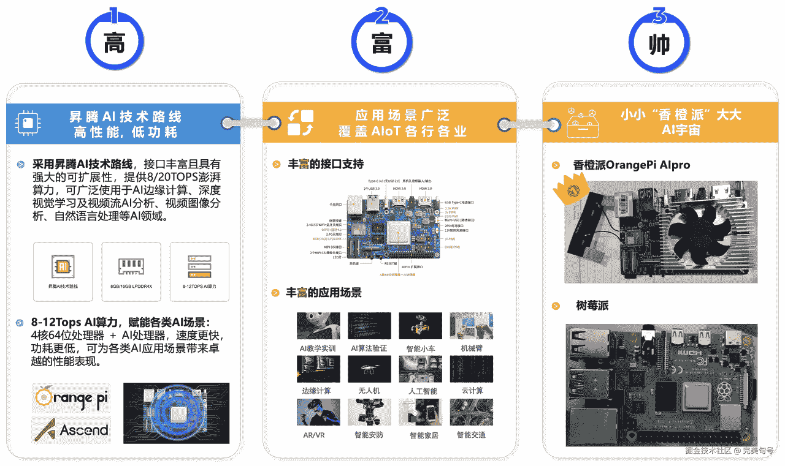

---

### 3.1 开发板开机准备：

先让“Trae智能协作AI IDE”帮我们看看香橙派的OrangePi AIpro(8-12T)开发板如果需要开机的话，需要使用到哪些配件，需要准备哪些配件：

+   Type-C电源线、插头

+   SD卡、SD卡读卡器

+   HDMI插头

+   散热风扇

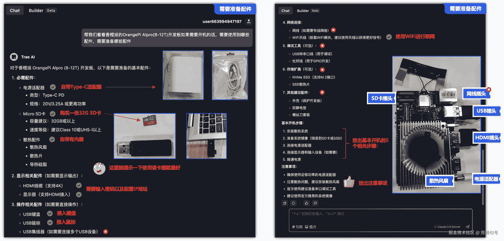

通过上面提到的准备的配件后，我们组装在一起，可惜回答没有提供相关的图片，这里建议后面AI可以能够生成图片，这里无奈只能去看看官方提供的PDF文档，可以看到如下图所示，基本上使用了4个位置的地方：键盘和鼠标USB插头、显示器HDMI插头、电源Type-c插头、SD卡插槽，这里是否支持通过自定义知识库，定制企业私有 RAG是否可以解决这个问题呢？

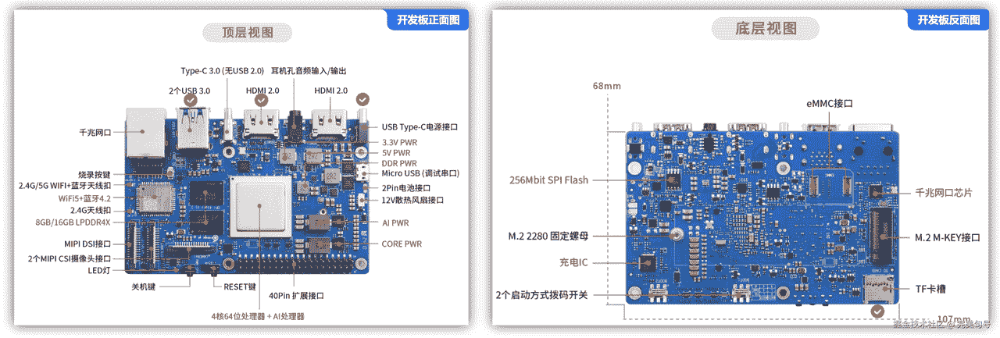

插入USB的鼠标和键盘、显示器HDMI线、自带的type-c电源线后，即可以去插上电源了，经过上面配件的组装后，一插入就自动启动了，没有什么开机键，即一通电就自动启动了。

但是有一个问题，等了5分钟除了风扇一直响外，只有一个灯在闪，但是显示器不显示画面，因为开发板肯定是刚买的，大概率问题不大，而且显示的线也是在当副屏幕在使用，所以，硬件坏掉的可能性比较低，让“Trae智能协作AI IDE”帮我分析一下是有什么原因导致的？从哪些方面入手处理？

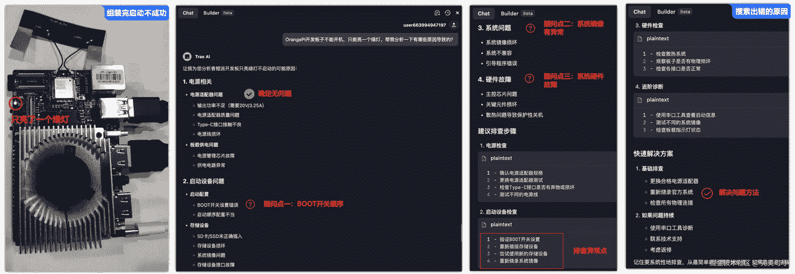

结合“Trae智能协作AI IDE”给出的原因与定位的问题点，我们可以使用排除法来确认不能开机的原因：

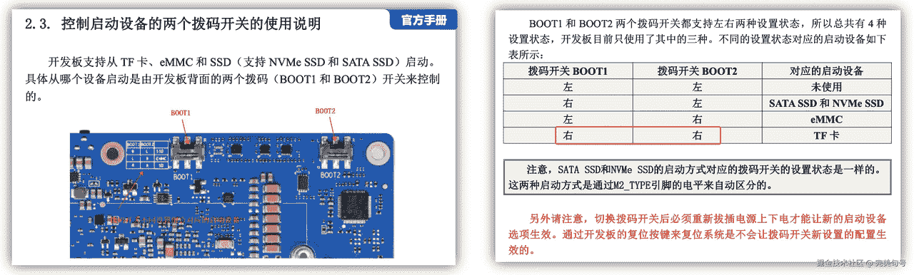

> 因为检查开发板子的难度太大，只能通过第三种方案重新进行烧录试试。

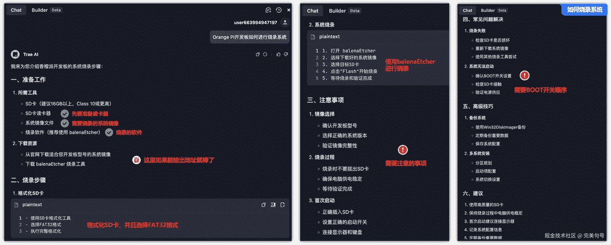

首先打开[balena烧录工具](https://link.juejin.cn?target=https%3A%2F%2Fwww.balena.io%2Fetcher%2F)地址，因为个人办公是Mac电脑，借用了同事的Windows电脑来进行此次的测试，我们选择OS为“WINDOWS”的X86|X64版本下载。


打开下载的balena烧录工具，不用安装，直接就打开了，非常的方便，不用在电脑上安装软件：

+   点击“从文件烧录”选择好我们提前下载的Linux镜像（百度云真的慢）

+   点击“选择目标磁盘”选中我们插入的TF卡(我提前格式化了)

+   点击“现在烧录”就可以开始进行烧录了

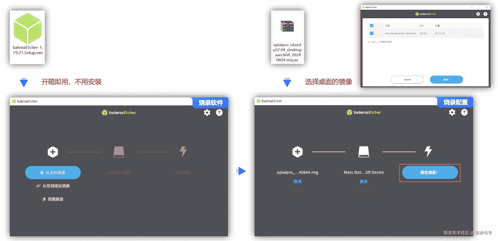

经过2个阶段，一个是验证阶段，一个是烧录阶段，最后烧录提示“出了点问题”，这里不用管，下面会解释为什么。


> 小细节：

1.  烧录时，提示U盘找不到，需要重新插入，此时，不用管他的提示。

1.  在烧录完成后，提示要格式化，也不需要管，因为在烧录时，就已经开始写成Linux的启动镜像盘了，此时，在windows系统是无法识别的，是正常的。

通过重新烧录系统之后，我们的系统就可以正常启动了，但是界面显示需要输入一个用户名和密码，才能进入系统。


通过使用“Trae智能协作AI IDE”查找马上给我们得到了结果，并且经过测试，输入以下这组用户名与密码之后，即可正常进入系统的桌面。

+   用户名：HwHiAiUser

+   密码：Mind@123

以上就是通过“Trae智能协作AI IDE”帮助我快速熟悉开发板的组装、刷固件、开机，虽然期间在刷固件花了点时间，但是我不需要面对冗长复杂的技术手册，往往需要花费大量时间阅读和理解，占用了开发者大量精力，也会拖慢项目开发进度，只需要通过“Trae智能协作AI IDE”问答式几秒钟就能给结果或者给出一些建议。

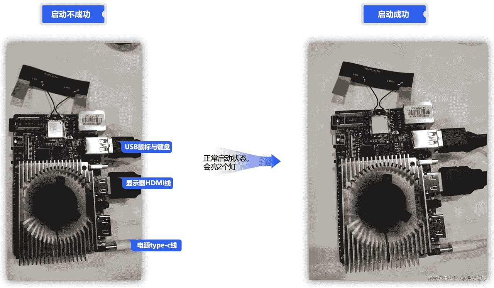

通过“Trae智能协作AI IDE”使用AI功能帮助我在不擅长的领域，给出一些建议，可以不用再去阅读大量的文档，帮助我们快速完成理解和分析，加速代码生成，快速实现开发需求。

---

### 3.2 开发版本远程链接：

远程连接就是在远程连接另外一台计算机，当某台计算机开启了远程桌面连接功能后，就可以在网络的另一端控制这台计算机了，通过远程桌面功能就可以实时的操作这台计算机，在上面安装软件，运行程序，所有的一切都像是直接在该计算机上操作一样。

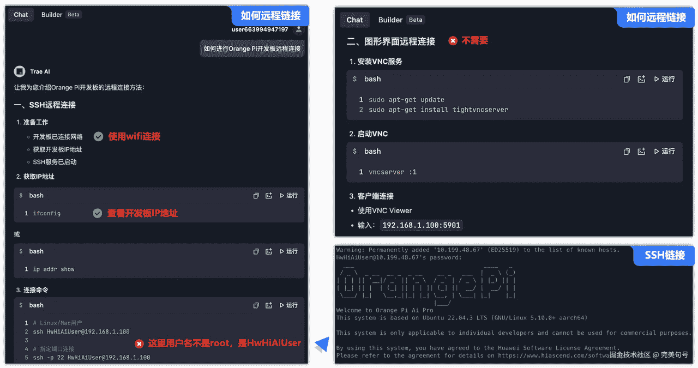

通过“ifconfig”查看Linux wifi地址，在开发板上如何寻找到IP地址，这样才可以使用SSH来进行登录。

一般来说，像开发板的话，会使用使用远程连接来提高工作效率、促进团队协作和资源共享，在询问“Trae智能协作AI IDE”如何进行开发板的远程链接，结合总结出以下方案：

+   ①. 由于办公环境没有网线，用的是Wifi，所以，先将开发板连上Wifi

+   ②. 查看IP地址，使用ifconfig命令来查看eth0网卡的IP地址，因为在同一个Wifi中，算是同一个局域内网，可以进行通信

+   ③. 开发板上的环境是Linux环境，所以我们使用SSH进行登录

+   ④. 登录上开发板环境

> 上面通过“Trae智能协作AI IDE”帮助我们检索想要的答案，将开发板从组装、烧录、开机等阶段的辅助，当然，其中，也会存在一些问题，只有一些文案的描述，如果里面能生成图片就更好了。

---

### 3.3 准备开发环境：

因为本人一直是使用PHP和vue在开发项目，没有接触过其它的语言，这次首先使用“Trae智能协作AI IDE”帮助查询一下用什么语言开发一个垃圾识别的项目，以下在“Trae智能协作AI IDE”帮我们推荐一下使用什么语言来进行开发？

从“Trae智能协作AI IDE”的回答提示来看，可以看到基于当前AI和机器学习领域的流行趋势，推荐使用Python语言。


“Trae智能协作AI IDE”搜索一下，如何查看环境python版本，可以判断一下我当前的环境中是否有python环境，给我推荐了一条shell命令行“python3 --version”，经过在开发板中查看，发现确实没有python运行环境，需要进行手动安装一下环境。

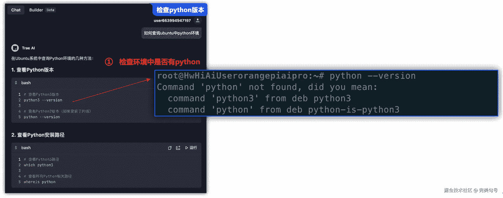

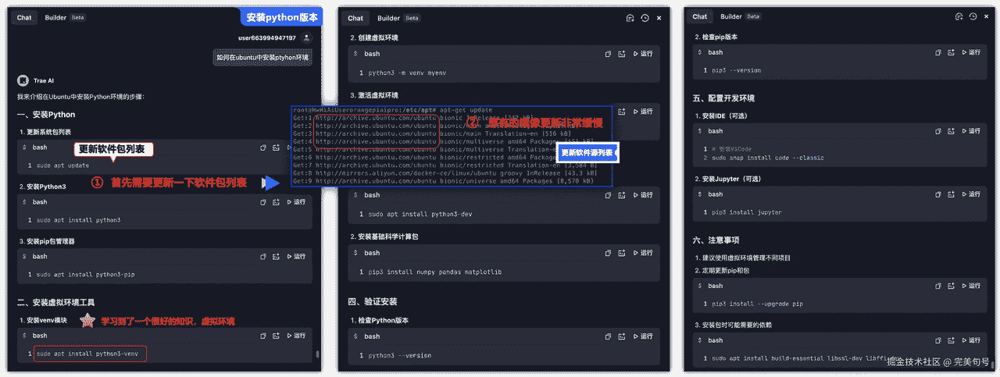

搜索“怎么在Ubuntu安装ptyhon环境”，根据提示的在开始安装之前，建议先更新一下Ubuntu软件包列表，以确保安装的最新的版本的软件包，需要输入shell命令“sudo apt update”，可以看到命令执行，开始下载和更新软件列表，但是在这个过程中，更新很缓慢，等了10几分钟也没更新完，在我的笔记中有更新镜像源的方法，但是查找的过程中还需要找笔记，让“Trae智能协作AI IDE”来几秒回答我。

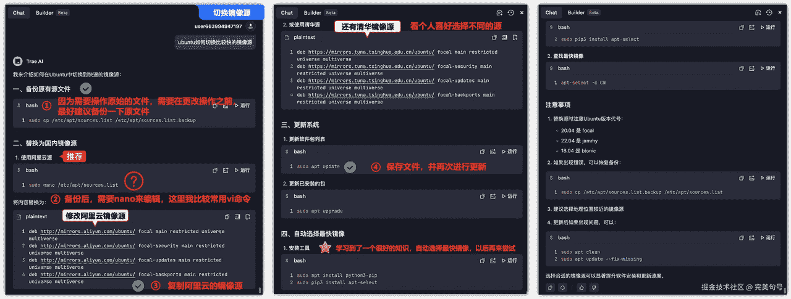

“Trae智能协作AI IDE”给出的答案，可以分为4步来进行手工来操作切换镜像源：

+   ①. 需要备份源文件，因为怕误操作，还可以还原回来，备份/etc/apt/sources.list文件。

+   ②. 编辑sources.list源文件，但是给出的答案是使用nano来操作，不过，我个人比较常用vi来进行编辑文件（不过，看个人的喜好）。

+   ③. 复制阿里云的镜像源，也可以是清华源。

+   ④. 保存文件后，再使用apt-get update命令进行更新Ubuntu软件包列表，来获取最新的版本的软件包。

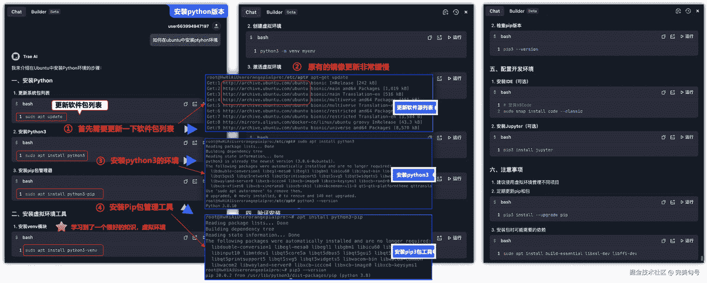

更新完软件包列表后，继续进行安装python环境，因为现在都是使用python3的版本了，所以，建议使用python3的环境，安装完成后，使用python3 –version查看版本为3.8.0，表示python3的环境是安装成功了。另外，也更新安装一下pip的包管理工具的安装，最终也是安装成功了。

【新知识扩展】：

这里不得不学到一个新的知识，就是虚拟环境，按照理解，就相当于docker一样，会启动一个隔离项目依赖的轻量级环境，非常适合刚入门的开发者，避免环境的问题导致排错困难，弄坏了一个环境，再新建一个虚拟环境即可。


> 小提示：如果刚接触Python的同学，可以参考一下，Python相当于Node是一个开发语言的环境，而Pip相当于Npm是一个包的管理工具，可以通过pip来安装一些包。

---

### 3.4 AI项目智能调试工具 – Jupyter：

在以前跟朋友交流的时候，了解到Python有一个Jupyter的在线调试工具，非常的方便，只需要装个软件，就能以web的方式进行访问，然后，可以在web页面进行调试工具，而不需要每个人登录到命令控制台，这样可以减少服务器登录的次数，并且提高了安全的风险，接下来，就让我来使用“Trae智能协作AI IDE”来了解并使用Jupyter。

Jupyter是一个开源的、基于Web的交互式计算环境，它允许用户创建和共享包含实时代码、数学方程、可视化和文本的文档。Jupyter最知名的组件是Jupyter Notebook，它是一个允许用户编写、运行和分享包含实时代码、方程、可视化和文本的交互式笔记本的Web应用程序。

> Jupyter是一个功能强大、易于使用的交互式编程环境，它非常适合数据科学家、研究人员和教育工作者等人群使用。


---

#### 3.5 安装Jupyter：

安装Jupyter Notebook通常很简单，用户可以通过Python的包管理器pip来安装。不过，在安装过程中可能会遇到一些常见问题，如网络连接问题或版本兼容性问题等。为了解决这些问题，用户可以尝试使用国内的镜像源来加速下载，或者更新pip到最新版本。

使用“pip3 install jupyter”命令后，等待几分钟后，提示报错：“pip install jupyter时，提示HTTPSConnectionPool(host='files.pythonhosted.org', port=443): Read timed out.”，网络超时了，使用“Trae智能协作AI IDE”搜索的答案，给了3种方案，可以根据自己的情况来逐一排查，在我这里我觉得第1个方案是最适合的方案。

```
pip install -vv jupyter -i https://pypi.tuna.tsinghua.edu.cn/simple
```

前面3个步骤，因为在上面安装Python3环境时，已经更新过软件包列表和安装过Pip3了，这里可以直接省略不需要再次重复安装一遍，在安装Jupyter时，使用“pip3 install jupyter”时，发生了报错Timeout超时的情况，我们可以看到上面通过后面加镜像源解决了这个问题。

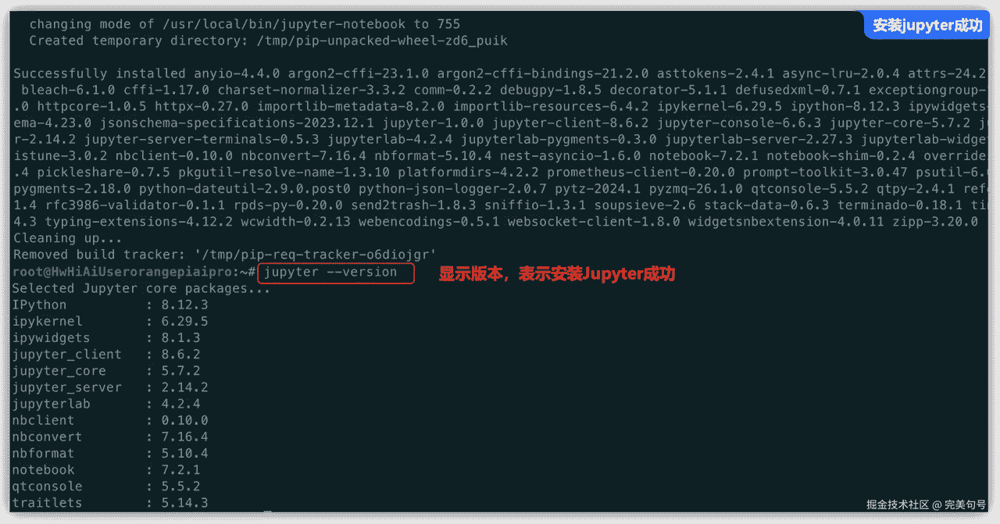

> 当然，这里其实还是推荐上次“Trae智能协作AI IDE”提到的python3虚拟环境，这样可以隔离安装的环境依赖。

---

#### 3.5.2 使用Jupyter：

> 如果想要运行Python，通常有两种方式，第一种方式就是在Python或者IPython的解释器环境中进行交互式运行，还有一种方式就是程序员最喜欢的编写.py文件，在文件中编写python代码，然后运行。

Jupyter是一个基于网页的交互式计算环境，主要用于Python开发，适合数据分析和机器学习，上面已经安装了 Jupyter软件，接下来就让我们来就启动Jupyter软件，根据上面的问答，直接使用以下命令，启动一个Web的服务：

```
jupyter notebook
```

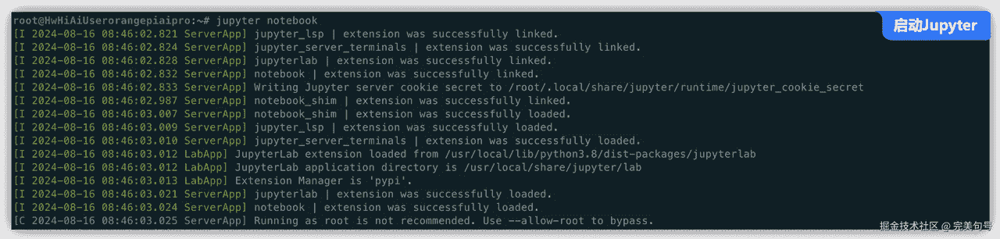

在浏览器中进行代码编辑，从浏览器执行代码的能力，并将计算结果附加到生成它们的代码上，打开如下图的“Python 3”，就可以得到一个网页形式的“Python环境”，可以在网页页面中直接编写代码和运行代码，代码的运行结果也会直接在代码块下显示，同时，如果想要在编程过程中编写说明文档，可在同一个页面中直接编写，便于作及时的说明和解释。

Jupyter提供了一个环境，可以在其中记录代码，运行代码，查看结果，可视化数据并在查看输出结果。这些特性使其成为一款执行端到端数据科学工作流程的便捷工具 ，可以用于数据清理，统计建模，构建和训练机器学习模型，可视化数据以及许多其他用途，详细的功能可以自己摸索一下。

---

## 四、“Trae智能协作AI IDE”最佳实践 - 基于“MobileNet V2”的模型的训练：

> 上面通过“Trae智能协作AI IDE”，从开发板子的组装到开机、再到安装环境，已经基本上具备了项目的开发，接下来，再接再厉，让“Trae智能协作AI IDE”继续给我们生成基于“MobileNet V2”的模型的训练模型。

为了在香橙派的开发板子上，先体验一下图像识别的项目，让“Trae智能协作AI IDE”帮我们推荐一款适合香橙派Python的垃圾识别图像分类的模型，可以看到推荐了一个“MobileNetV2”的模型，通过“数据准备”、“模型训练”、“模型部署”和“图像识别”4个大块，可以完成一个垃圾识别系统的开发，不过，给出的简单代码不满足需求。

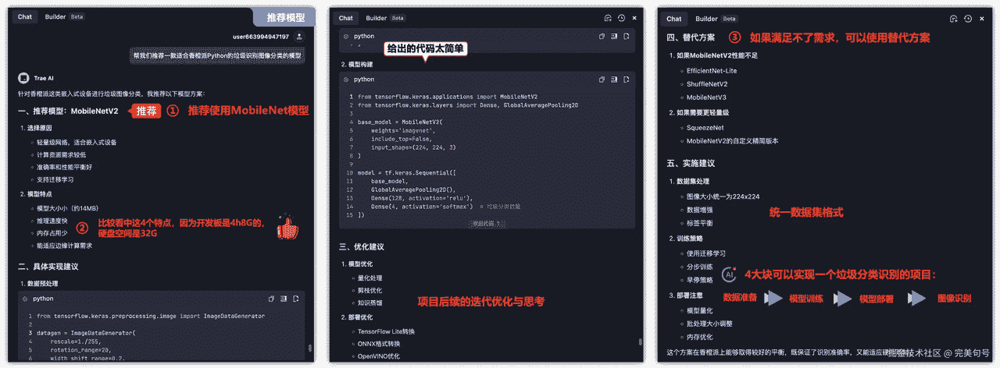

顺藤摸瓜，上面“Trae智能协作AI IDE”推荐了一个非常适合在资源有限的设备如香橙派上运行 – “MobileNetV2”模型，通过上下文有效的结合后，帮我生成一个“MobileNet”模型垃圾分类的项目，大概分为5个步骤来实现：“数据准备” -> “数据预处理” -> “模型搭建” -> “模型训练” -> “模型测试”。

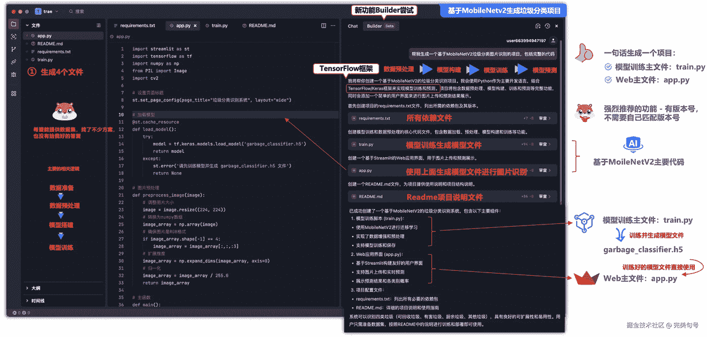

上面通过“Trae智能协作AI IDE”生成的《基于MobileNetv2的垃圾分类》的代码，可以先将train.py中的代码复制到JupyterLab中执行，发现报错：

```
ModuleNotFoundError: No module named &#x27;tensorflow&#x27;
```

提示'tensorflow'模块没有找到，通过“Trae智能协作AI IDE”的分析是开发板中的Python环境中没有安装tensorflow这个模块。

> TensorFlow是一个开源的机器学习库，由Google Brain团队开发，用于研究和生产中的各种机器学习和深度学习任务。它支持多种编程语言，但最为人所熟知的是其在Python中的应用。

解决方案：可以通过Python的包管理工具pip来安装tensorflow模块，安装成功后，会显示“Successfully installed”，表示安装成功了。

```
pip install tensorflow -i https://pypi.tuna.tsinghua.edu.cn/simple
```

安装模块后，再将生成的代码，复制到Cell中，再进行执行，发现提示“ValueError: The PyDataset has length 0”，这个问题还是比较简单的，就是没有找到文件与目录，就是找不到对应的文件与目录，此时，需要去找一下需要的数据集，包括2个部分：

+   需要训练的数据集

+   需要测试的数据集

从“Trae智能协作AI IDE”中，找了不少的方案也没有提供相关的现成的数据集（垃圾图片相关的），没有办法，只能通过在网上和群里询问大家，最后得到了一个公开的垃圾分类相关主题的数据集，里面包含训练和测试的数据集，一共有26个分类的样本图片。


将这些图片直接拖动到JupyterLab中即可上传到开发板中，还是比较方便的，否则只能靠FTP的工具来进行上传了，顺便将以下代码修改为对应正确的路径：

```
if __name__ == &#x27;__main__&#x27;:
    # 设置训练和验证数据目录
    train_dir = &#x27;/root/workspace/data_en/train&#x27;   # 替换为你的数据集路径
    validation_dir = &#x27;/root/workspace/data_en/test &#x27;  # 替换为你的数据集路径
    
    # 训练模型
history = train_model(train_dir, validation_dir)
```

通过“Trae智能协作AI IDE”分析，是因为训练集或者测试集的CLASSES字段只有4种不同的分类名称，才会导致数据集长度确实为0，同时，经过查看文件夹，确实有26个子文件夹，找到问题发生的原因了。

通过将类别修改为26种类型后，这里对应的是数据集中的类别：

```
# 垃圾分类的类别标签
CLASSES = [&#x27;Seashell&#x27;, &#x27;Lighter&#x27;,&#x27;Old Mirror&#x27;, &#x27;Broom&#x27;,&#x27;Ceramic Bowl&#x27;, &#x27;Toothbrush&#x27;,&#x27;Disposable Chopsticks&#x27;,&#x27;Dirty Cloth&#x27;,
            &#x27;Newspaper&#x27;, &#x27;Glassware&#x27;, &#x27;Basketball&#x27;, &#x27;Plastic Bottle&#x27;, &#x27;Cardboard&#x27;,&#x27;Glass Bottle&#x27;, &#x27;Metalware&#x27;, &#x27;Hats&#x27;, &#x27;Cans&#x27;, &#x27;Paper&#x27;,
            &#x27;Vegetable Leaf&#x27;,&#x27;Orange Peel&#x27;, &#x27;Eggshell&#x27;,&#x27;Banana Peel&#x27;,
            &#x27;Battery&#x27;, &#x27;Tablet capsules&#x27;,&#x27;Fluorescent lamp&#x27;, &#x27;Paint bucket&#x27;]
```

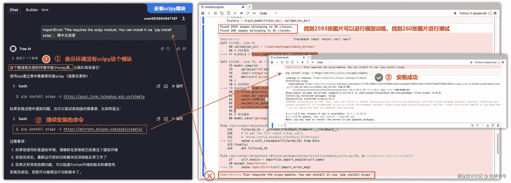

将修改的代码，再复制到Cell中，再次执行，会提示“ImportError: This requires the scipy module. You can install it via pip install scipy”，如图，这个提示也是比较简单的，安装一下即可。

当解决完所有的错误后，我们的模型也开始进行训练了，可以发现loss在不断下降，Accuracy在不断提高。另外，在模型训练完成后，代码会将“garbage_classification_model.h5”模型保存到本地。

---

## 五、“Trae智能协作AI IDE”最佳实践 - 基于“MobileNet”的模型的Streamlit We应用界面实时预测：

> 基于MobileNet的模型进行推理测试主要涉及几个关键步骤，包括模型加载、预处理输入数据、执行推理以及结果输出。

上面我们将train.py中的代码执行完成后，接下来可以使用基于Streamlit构建友好的用户Web界面，来体验一下上面模型训练后的模型推理，使用python app.py文件提示：“ModuleNotFoundError: No module named 'streamlit'”，可以单独安装streamlit模块。

再执行app.py脚本代码，再提示“ImportError: libGL.so.1: cannot open shared object file: No such file or directory”，通过搜索得知是因为缺少OpenCV的一些系统级依赖库，需要安装以后依赖后，重新运行应用应该就能正常工作。

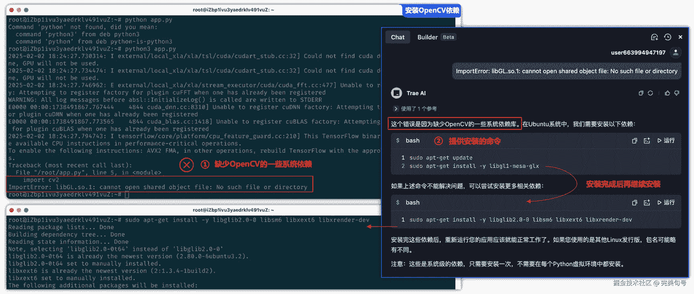

再执行python app.py代码，还是报错：“Thread 'MainThread': missing ScriptRunContext! This warning can be ignored when running in bare mode.”

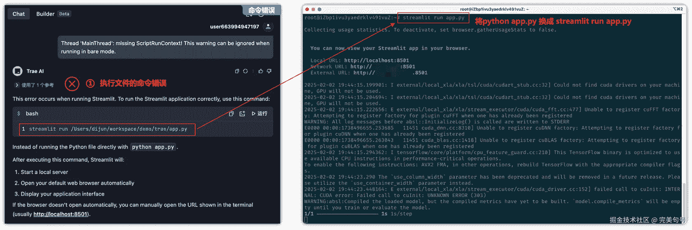

上面我们通过将基于MobileNet的模型的Streamlit启动了一个Web界面，接下来，我们通过一些图片来实际测试一下，根据我们的图片能否检测出来一些垃圾的分类，选择了一张照片，可以看到匹配度最高玻璃瓶。

以上就是通过“Trae智能协作AI IDE”，使开发人员能够更有效地将GPT-4o和Claude-3.5-Sonnet模型集成到代码生成和文档中，通过对基于“MobileNet”的模型垃圾图片的识别项目，打破传统的以代码为中心的范式，利用“Trae智能协作AI IDE”为开发人员提供了一种非常实用和有效的方式来与大型语言模型（LLM）进行交互和协作，可以看到在超越简单的代码自动完成和对代码片段的有限操作。

---

## 六、思考工作中传统模式团队开发的痛点：

> 随着AI人工智能、机器学习的不断发展，开发者的编程领域也在经历着一场前所未有的变革，在这个过程中，AI智能编程工具的出现为开发者们提供了一种全新的编程方式，AI辅助代码编程也已经成为了一个十分备受关注的领域。


作者也是经过了以上几个阶段的软件开发历程，从Web时代编程、到云时代分布式编程，到如今的AI时代，传统编程是人类程序员手动编写代码来实现特定的功能。

而通过使用AI辅助代码编程可以半自动化或全自动化的生成代码，从而提高编程效率和代码和质量，接下来分析一下我们在工作中会遇到有哪些问题点，以及这些问题点如何的使用“Trae智能协作AI IDE”来优化解决？

---

### 6.1 公司团队管理痛点：

> 如下为公司团队管理工作过程中，在开发的过程中，会存在很多团队管理的问题，比如接手不熟悉的业务代码、紧急处理其它业务的Bug、大量的命名、写大量的注释、有限的时间周期完成新技术的开发、代码阅读比较困难、代码无法做优化处理、文档与项目需求丢失。

以下是在多年开发中，遇到的团队管理问题，你是否也会跟我一样也会遇到呢？

+   ①. 同事临时请假，领导安排我接替同事的任务继续开发。

+   ②. 一个好几年不维护的项目，突然系统出Bug了，领导安排我紧急处理。

+   ③. 只给了半个工作日时间，一个中等模块的功能需求紧急上线。

+   ④. 很多项目因为工期给的少，导致缺失大量的单元测试，容易线上出Bug。

+   ⑤. 突然项目需要使用地图功能，之前没有接触过，需要紧急上线，查阅大量的资料，很多都是错误的、过时的。

+   ⑥. 某个项目经过几波人离职，没有任何文档、项目需求，继续开发新功能。

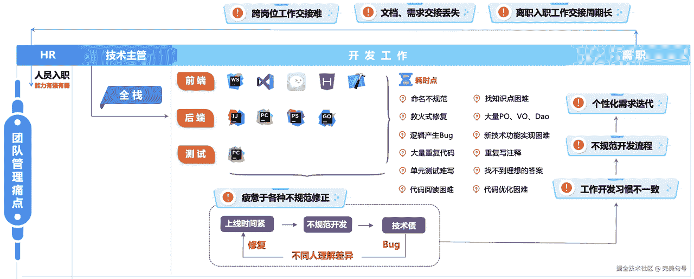

---

### 6.2 技术开发痛点：

> 以下是本人在技术开发中，遇到的一些主要问题点，很多重复的工作，其实可以使用AI的工具来代替。

场景一：当需要重复地编写相似的代码，很容易出错。

+   ①. Java开发，为了符合DDD领域驱动，写大量的Bean、Dao、Pojo、Service、Controller、Mapper、BO、VO、PO、Domain、Entity、Repository等比较重复的命名文件。

场景二：无法使用自然语言描述生成代码。

+   ②. 只需要写一句注释，简单描述自己的需求，就能让”Trae智能协作AI IDE”贴合上下文的编程语言习惯，生成相应的代码，参考这个注释、贴合上下文的编程语言习惯，自动生成相应的代码，程序员只需稍作修改就可以满足需求。

+   ③. “Trae智能协作AI IDE”根据注释来续写生成新代码的能力，大大提高了程序员的开发质量与效率，减少了重复编写代码所需的时间以及会遇到的错误。

场景三：当进行代码Review或者接手离职人员、请假临时对接功能，无法快速接入。

+   ①. 面临很多缺乏注释的复杂代码时，理解代码逻辑非常困难。

+   ②. 特别是有些写if狂的人，或者有些为了秀技术的，把简单的代码复杂度增加N倍的人，代码的调试变的非常难以阅读。

+   ③. 大部分人会重写该模块，增加重构的时间成本，还可能会产出额外的Bug。

+   ④. 选中某段复杂的代码片段，让 “Trae智能协作AI IDE” 帮你解释、生成注释、拆分函数优化代码和生成单元测试等多种操作，帮助理解代码逻辑，提高代码的可读性和可维护性。

+   ⑤. 新入职的实习生也能进行软件工程最佳实践落地，新手也能写出成熟代码，让”Trae智能协作AI IDE”成为新人成长路上的好助手。

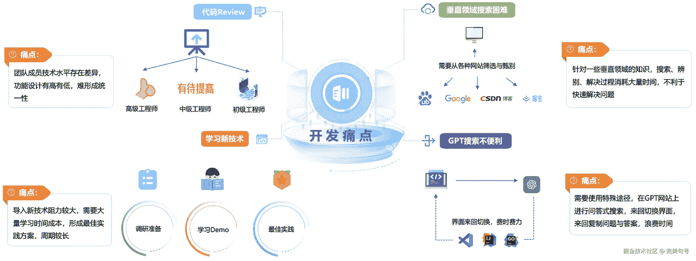