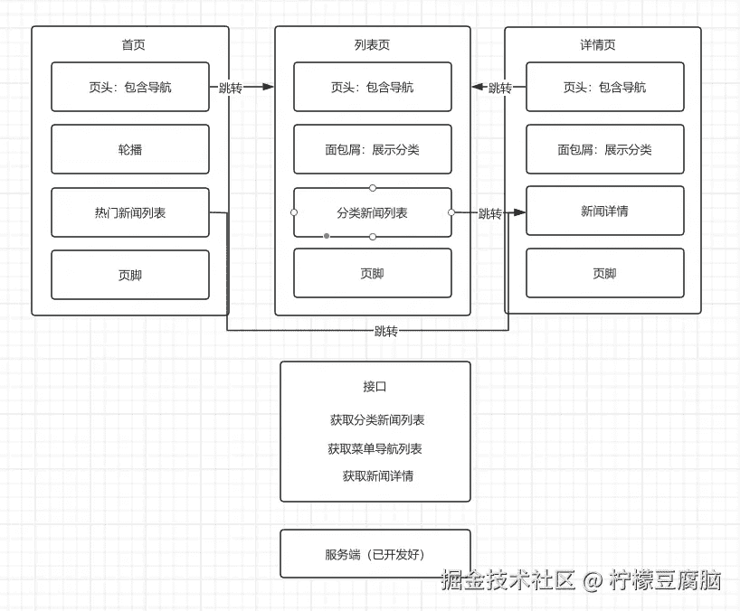
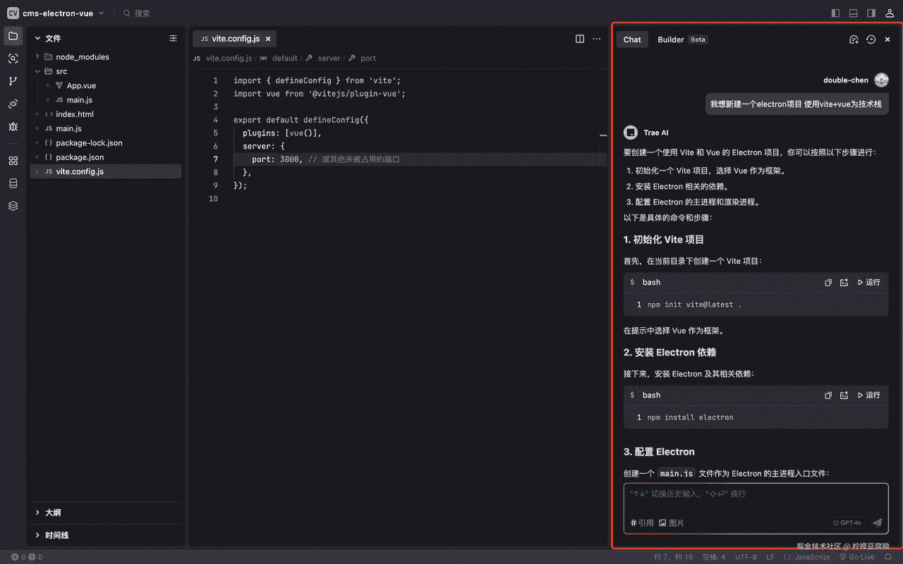
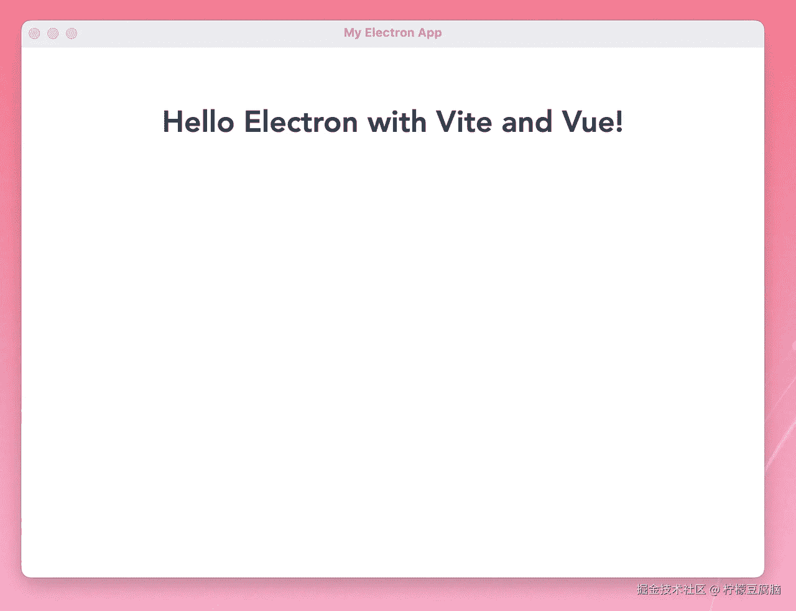
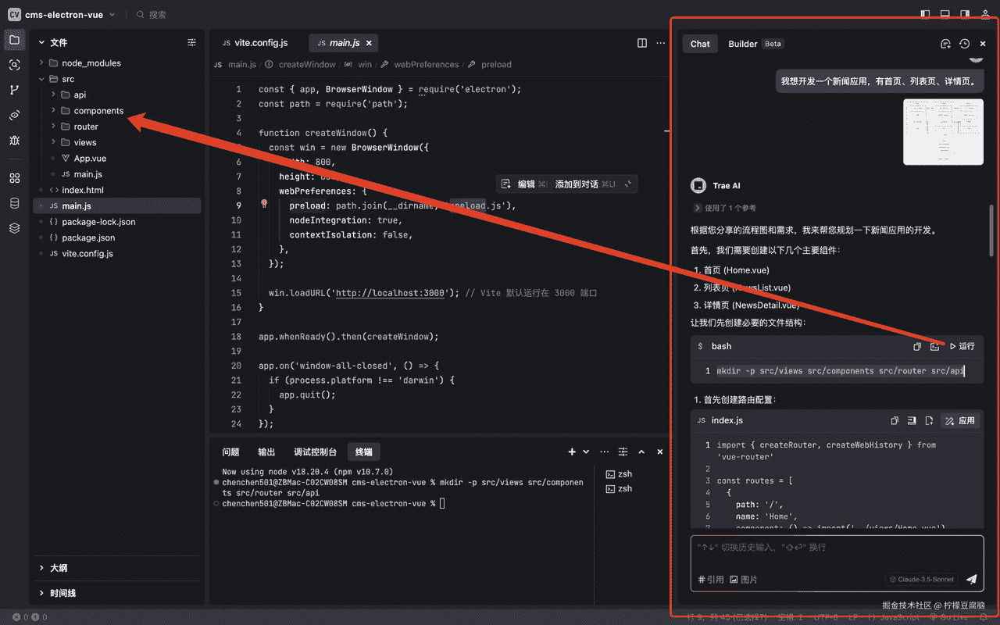
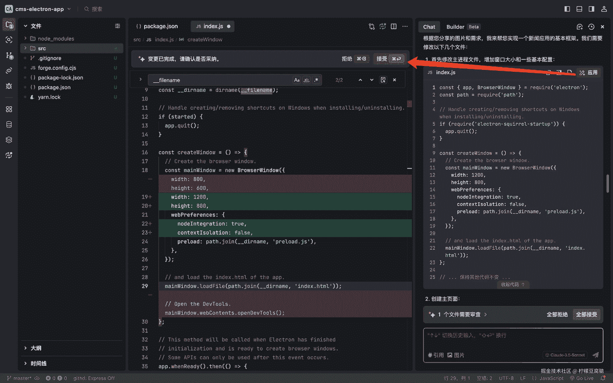
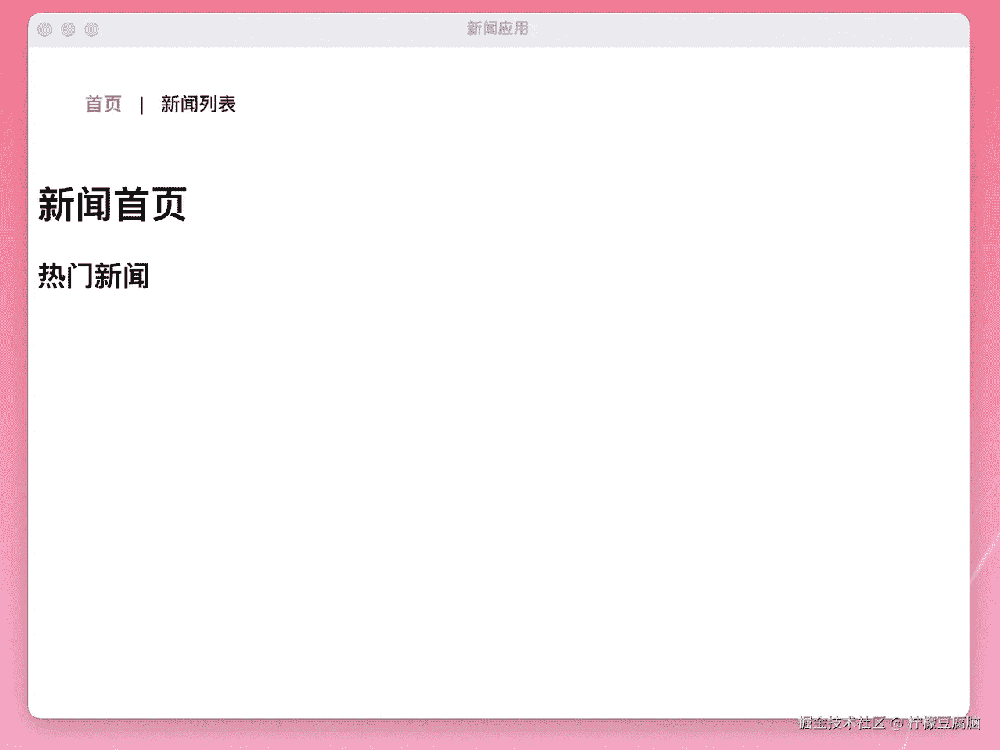

# AI IDE尝鲜：使用Trae开发新闻阅读桌面应用

> 来源：[https://agijuejin.feishu.cn/docx/WaxHdPb2qoxP09xDlmicwLsCnNh](https://agijuejin.feishu.cn/docx/WaxHdPb2qoxP09xDlmicwLsCnNh)

> 作者：柠檬豆腐脑

> 链接：https://juejin.cn/post/7469675268624269327

> 来源：稀土掘金

> 著作权归作者所有。商业转载请联系作者获得授权，非商业转载请注明出处。

> 如有侵权，请联系删除。

### 引言

**背景 **：在上一篇文章中，我开发一个新闻阅读微信小程序端，在我还不熟悉微信小程序端生态和API的情况下，使我初步了解并上手开发了微信小程序。一时技痒，再开发一个微信小程序的桌面端。

**目的 **：利用AI IDE Trae来帮助我学习并写出一款新闻阅读桌面应用。

### 计划

**技术栈选择 **：Electron。Trae AI告诉我Electron较主流，生态成熟，上手快，与之相对应Tauri性能更好，但是生态新、学习曲线可能较陡（需要了解一些 Rust）。所以选择Electron来完成我的开发。

**方案设计 **：沿用小程序的方案。只不过是搞一个桌面版的。

**新建项目 **：使用Trae帮我新建Electron项目。

**开发调试 **：根据Trae的指导和代码补全等功能完成我的项目开发和调试。

**效果展示 **：将编写的Electron桌面应用展示出来。

### 新建项目

1，打开Trae编辑器，在Chat对话框中提问：我想新建一个electron项目 使用vite+vue为技术栈。如下图所示：

2，按照Trae AI给的提示，一步一步新建项目并配置，成功启动如下图所示：

### 开发调试

看来我可以像开发vue（我熟悉的技术栈）一样开发桌面应用了。

1，我提问：我想开发一个新闻应用，有首页、列表页、详情页。并把我的设计图传给Trae AI。Trae AI给了我修改步骤，按照它的指示一步步修改我的项目。

如上图中，Trae AI生成的命令点击运行，帮我建好了项目文件目录，多么的方便！

2，点击应用按钮，Trae会将更改应用编辑器代码中，像git diff代码一样，可以看到需要新增/删除的代码，如果觉得代码改动没有问题，选择接受改动。

陆续输入了一些微调的提问，下图是得到的初步效果：

3，接下来我又提问了诸如：

1，帮我填充主页的内容 并完善样式

2，页面运行在1024*768的窗口中 怎么调整布局会比较好

3，帮我修改导航的样式

4，好 再帮我填列表页的内容 并完善样式

5，为啥分页组件显示的英文 怎么调整成中文显示

6，好 再帮我填详情页的内容 并完善样式

按照Trae AI给我的提示来完善我三个页面的内容和样式,我都没有改什么代码，项目基本完成。

### 效果展示

最终，我的新闻阅读桌面版UI部分就开发好啦，如下图所示：

### 总结

就这样，我们又花了半天时间熟悉了electron开发桌面应用。这会应用桌的数据都是写死在代码中的，由于请求接口数据在上一篇开发小程序时已经展示过，实在没什么难度，这里就不继续实验了。

使用下来的体会依然是很推荐，AI的能力和编辑器结合的很好，可以快速的将生成的代码应用到项目中。我这里的使用情景是：想学习一门不熟悉的技术，但是想写一个小Demo实践并学习。它真的是一款利器，还能给出不错的样式，让你的应用看得过去。