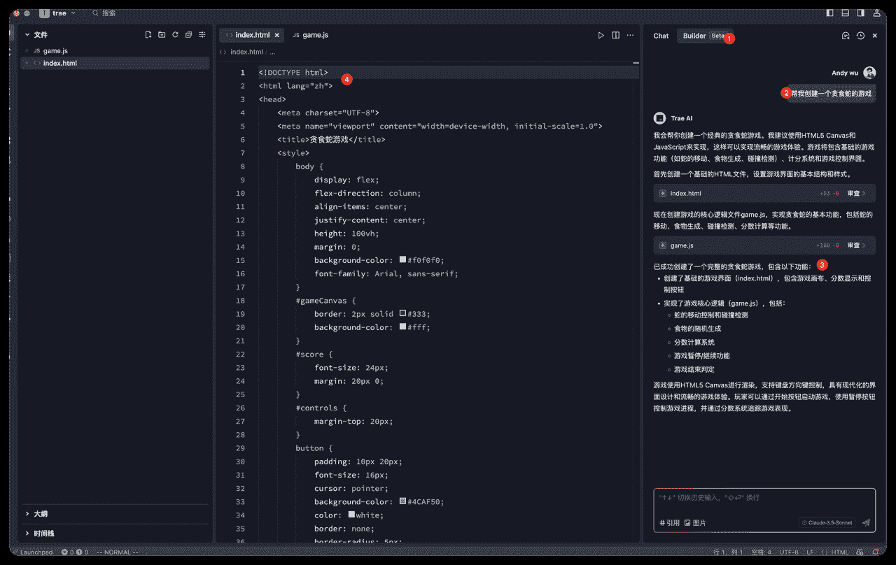
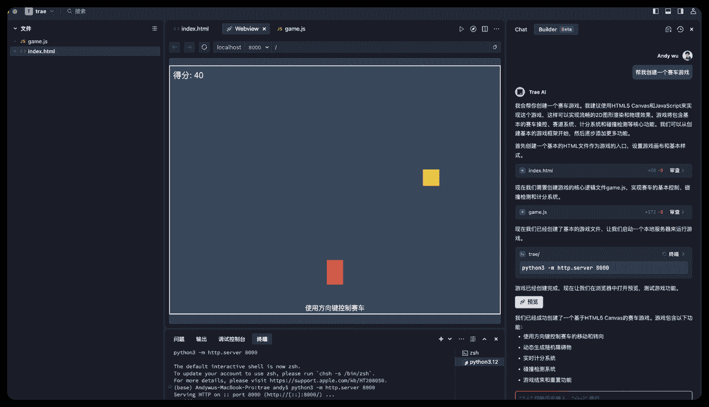
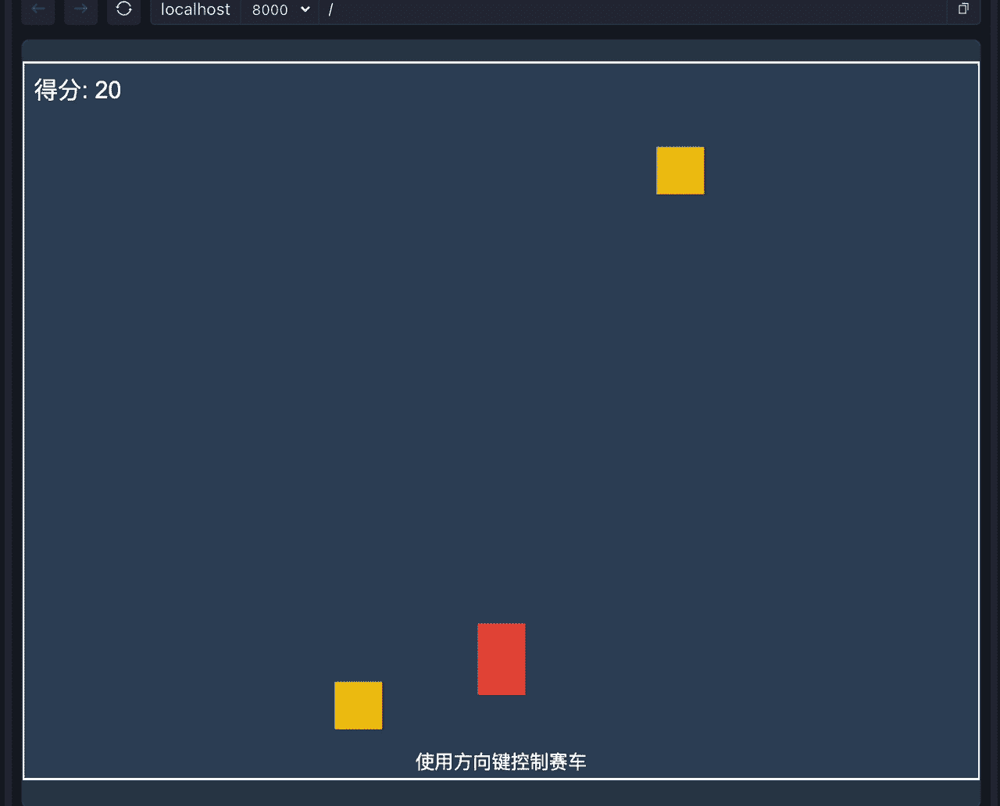
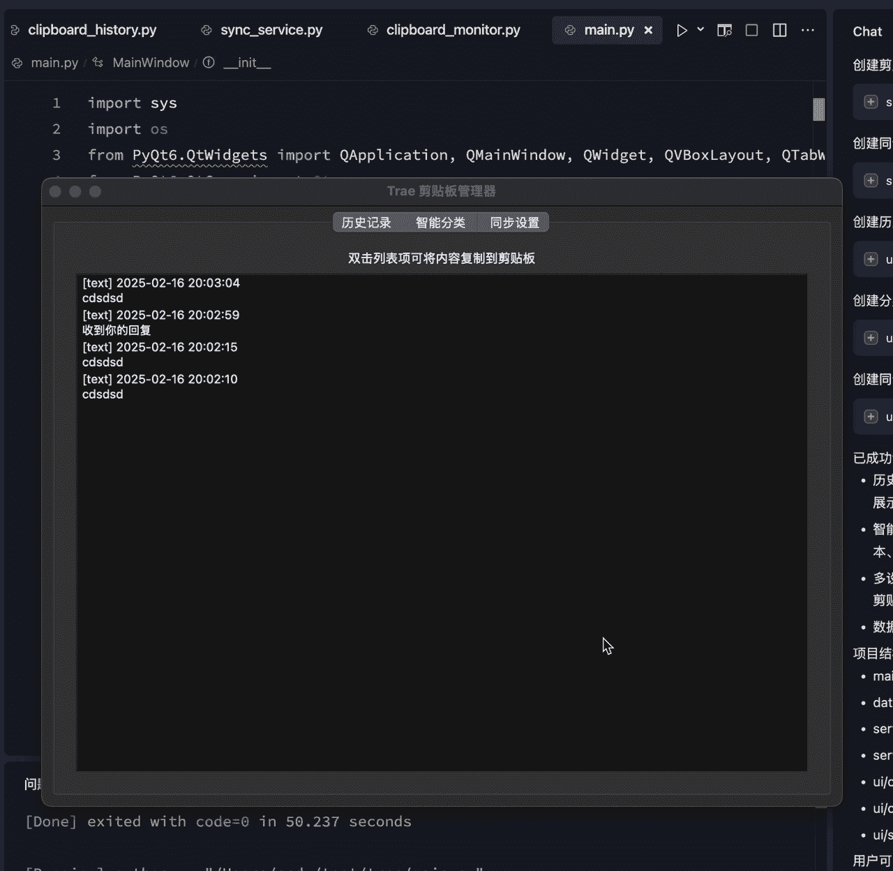
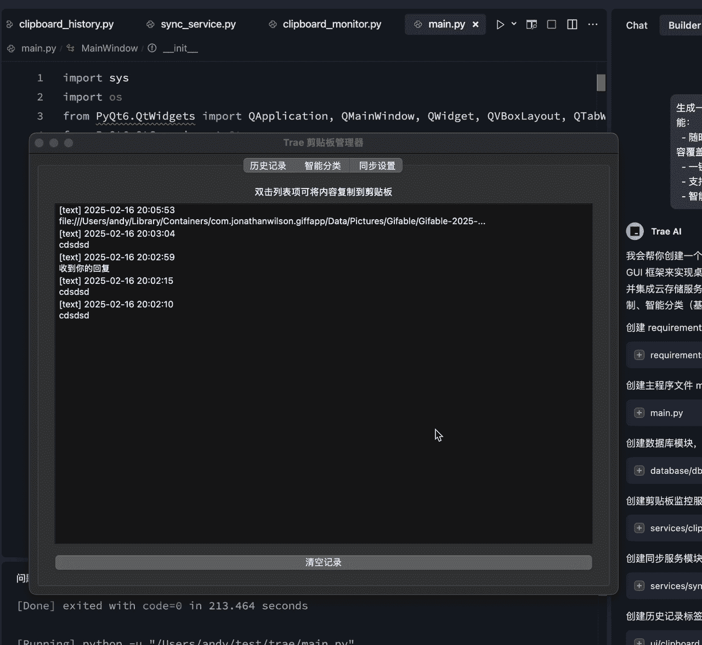

# Trae 的 Windows 版也终于发布了：文科生逆袭指南：用 Trae 零代码薅高端 AI 羊毛！

> 来源：[https://agijuejin.feishu.cn/docx/IjVodySD7ogvdBxq74Qc5J0VnIf](https://agijuejin.feishu.cn/docx/IjVodySD7ogvdBxq74Qc5J0VnIf)

> 作者：安仔

今天，Trae 的 Windows 版也终于发布了！之前一直只有 MacOS 版本，这让很多 Windows 用户望尘莫及。现在，Trae 终于支持 Windows 了！

下载地址：https://www.trae.ai/?utm_source=juejin&utm_medium=juejin_trae&utm_campaign=web_banner

现**在**的 AI 发展太快了，连本身的从业者都追赶不上，更别说普通人了。但正是类似 Trae 这类 AI 编程工具的出现，一个连 if/else 都分不清的技术小白了，用 Trae 都可以零代码搞出自己的小游戏或者日常提效工具！不信？接下来等安仔我来带大家来练练手吧~

在[此之前，在 MacOS 版本发布时，我已经](https://mp.weixin.qq.com/s/eqtntEqTCY5saKZqQw13Xw?token=1778576401&lang=zh_CN)写过一篇关于 Trae 的详细介绍教程，感兴趣的可以先看看预热下：《对标 Cursor 和 Windsurf，Trae 如何成为中文开发者的首选？》


这里我快速过一下 Trae 的几个主要核心功能：

1.  **全中文界面，跨平台支持**
Trae 提供完整的中文本地化界面，同时支持 Windows 和 MacOS 系统，满足不同用户的需求。操作界面简洁直观，即使是技术小白也能快速上手。

1.  **顶级 AI 模型免费畅享****
内置 Claude3.5 和 GPT-4o **两大顶尖 AI 模型，目前完全免费且不限速。相比其他平台高昂的订阅费用，Trae 让每个用户都能无成本享受到最先进的 AI 技术支持。

1.  **零门槛智能开发****
不懂编程也能轻松开发应**用，通过中文对话即可让 AI 生成所需代码。系统还能自动识别和解决代码错误，大大降低了技术门槛，让人人都能参与到 AI 开发中来。

最近你可能会觉得 DeepSeek 大模型那么火，为什么就不直接用它呢？是的， DeepSeek 的确是我们的国产之光，现在全国、小到普通用户，大到政府、企业，都在接入和使用它。

**但是 DeepSeek 对于协助编程有一个先天不足的地方，就是**它最大的上下文长度只有 64k，有点短了！生成代码的质量固然可以和国外顶尖大模型媲美，但是因为上下文限制，导致它无法处理更长的上下文，也就无法理解和处理更复杂的代码项目了，所以 Trae + Claude 3.5 等的组合，是目前协助编程比较好的解决方案。

好了，知道大家都等不及了，接下来我就带大家来练练手，看看用 Trae 零代码能做出什么好玩又实用的东西来~

### 逆袭第一式：零代码，几分钟搞出能发朋友圈炫耀的小游戏！

#### 案例 1：贪吃蛇游戏

在 Trae 上，通过快捷键打开 AI 聊天窗口 → 点击“Builder 模式”→ 输入“帮我创建一个贪食蛇的游戏”→ 等 60 秒 →AI 生成代码 → 点“运行”。



我们来看看效果如何：


是不是感觉有点简单就实现了你第一个小游戏？

我们快速再来一个新游戏 - 赛车游戏。

#### 案例 2：赛车游戏

一样的步骤，我们把刚刚创建的贪吃蛇游戏代码删掉，然后输入“帮我创建一个赛车游戏”，等 60 秒，AI 生成代码，点“运行”：





是不是觉得，你也可以做出这么炫酷的小游戏？哈哈，那我们来试试更复杂一点的，比如通过 AI 生成你的待办事项清单。

### 逆袭第二式：零代码，几分钟搞定你的待办事项清单！

一样的套路，先清空旧的文件，然后在对话框直接复制问一句“生成一个待办事项清单的应用”，如图：


如果有开发环境的问题，你可以继续在对话框输入具体问题，AI 都会帮你解决的。我们只要跟着 AI 的提示一步步操作，最终就得到了以下这个待办事项清单：


效果达到了，但是你可嫩觉得稍微有点丑？没关系，这次我们进阶一下，接下来我们直接上传下面这个图片给 AI，并告诉它“我要一个与图片类似的待办事项清单”：


我们来看看效果：


是不是瞬间就高级了很多？而且 AI 还顺便帮我基于图片一些新增功能也一并搞定了，一个实用又好看的小工具就诞生了！

好了，最后我们要不继续进阶一下，来个剪贴板记录的桌面应用？

### 逆袭第三式：零代码，几分钟搞定你的剪贴板记录神器！

+   **工具特点**：日常工作中经常需要在多段文字间来回复制粘贴，没有一个中介记录很不方便。有了剪贴板记录工具，你可以：

+   随时查看历史复制记录，再也不怕重要内容被新复制的内容覆盖

+   一键复用之前的任意记录，告别重复搜索复制的烦恼

+   支持多设备同步，手机电脑都能访问相同的复制历史

+   智能分类整理，让你的复制记录井井有条

好了，我们转换一下上面的特点变为我们给 AI 的提问：

```
生成一个剪贴板记录工具的 python 桌面应用，需要以下功能：
  - 随时查看历史复制记录，再也不怕重要内容被新复制的内容覆盖
  - 一键复用之前的任意记录，告别重复搜索复制的烦恼
  - 支持多设备同步，手机电脑都能访问相同的复制历史
  - 智能分类整理，让你的复制记录井井有条
```


我们来试试效果：



真的太神了！我给的要求都实现了，而且是桌面级的应用！我也是直接试用了里面的功能，是真的可以用哦！简直日常必备的一个利器啊！

我们再来加个需求给它：“我想你帮我加个功能：可以清空所有的剪贴记录”，因为我看到它当前版本是不能清空剪贴记录的，我们来看看最终效果：



是不是觉得很震撼？！这就是 Trae 甚至是目前 AI 能力的强大之处！所以知道为什么 AI 未来真的会取代不少职业、甚至是程序员的工作了吧？

## 结尾

**不**过说真的，大家千万不要焦虑和担心。Trae 的真正价值，或者说 AI 的真正价值，不是让人类成为 AI 的奴隶，而是把我们从重复劳动中解放。

当编程不再需要背诵语法，就像文字发明让思想突破了口口相传 —— 每个人都能用代码延伸自己的创造力，在数字世界镌刻独特的思想印记。

此刻站在 AI 革命的门槛上，大家不是被淘汰的文科生，而是手握新式鹅毛笔的第一代数字诗人。

你所拥有的文学素养、历史视野、哲学思辨，正是未来人机协作时代最稀缺的"元技能"。

现在，是时候让代码成为你新的修辞手法了。