# 利用Trae编辑器高效快速实现高可用扫描工具

> 来源：[https://agijuejin.feishu.cn/docx/HqELdqjPJov0RCxSL30cENhCndg](https://agijuejin.feishu.cn/docx/HqELdqjPJov0RCxSL30cENhCndg)

> 作者：郝同学的测开笔记

> 链接：https://juejin.cn/post/7462618269246832691

> 来源：稀土掘金

> 著作权归作者所有。商业转载请联系作者获得授权，非商业转载请注明出处。

> 如有侵权，请联系删除。

[本文所使用的 Trae ](https://www.trae.ai/?utm_source=juejin&utm_medium=juejin_trae&utm_campaign=AGI_article)免费下载链接： www.trae.ai/

## 前言

这段时间，运维同事离职，接触运维工作一段时间了，为了了解项目的k8s服务是否具备高可用能力，我们需要进行高可用测试，整个过程需要使用到 Go 编程，由于笔者之前一直接触的是 Python 语言， Go 语言正在学习中，为了更快实现高可用测试脚本，所以我们借用 Trae 编译器进行开发。

## Trae 是啥呢？

Trae 是有用的编码伙伴。它提供了AI问答、代码自动完成和基于代[理的AI编程功能等功能。](https://www.trae.ai/?utm_source=juejin&utm_medium=juejin_trae&utm_campaign=AGI_article)在使用 Trae 开发项目时，可以与AI协作，提高开发效率。详细介绍可以参考官网： www.trae.ai/

## 准备条件

开发之前，需要先下载 Trae ，访问官网，下载安装包安装即可，还是比较简单的。需要注意的是，在笔者写文章的时候，还没有 windows 版本，只能使用 Mac 版本， windows 用户可能需要等待一段时间，大概在节后会推出吧。

## 项目背景

开发脚本快速扫描 K8s 中的所有服务，找出哪些服务是不符合高可用设计的。

### 实现原理

在正式开发Kubernetes扫描工具时，需要遵循以下规则：

+   **Pod生命周期对象 **：DaemonSet、Deployment和StatefulSet需要关注副本数量和Pod反亲和性，尤其是Deployment和StatefulSet。DaemonSet保证每个节点上有且只有一个Pod。

+   **探针设置 **：readiness探针必须设置，未设置时为错误（error）；liveness探针未设置时可视为警告（warning），因为旧版本K8s可能因缺少探针导致重启问题。启动探针可选，视项目需求决定是否扫描。

+   **探针恢复时间 **：需要计算Pod异常状态的恢复时间，因为探针有检测延迟，高可用性测试中恢复时间是关键指标。

+   **Job和CronJob **：一般不在扫描范围内，因为它们属于离线业务。但需要扫描Pod是否配置了节点亲和性或选择器，防止Pod被随机调度到不适合的节点，保证集群稳定性。

### 新建项目

打开 Trae ，如截图所示

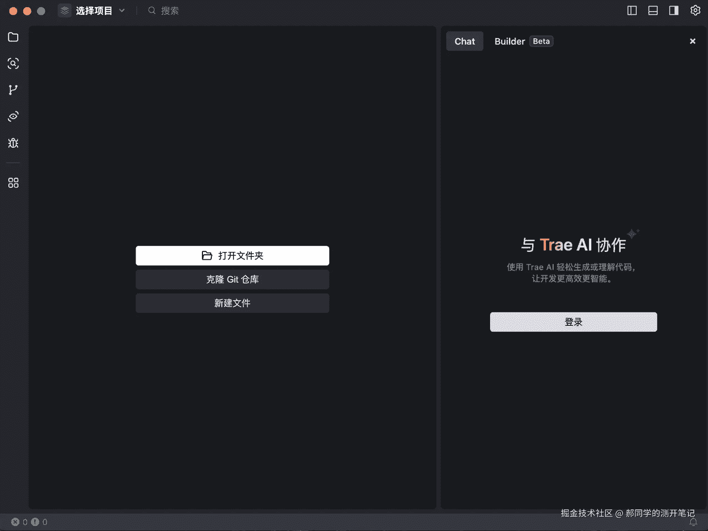

这里提供了三种方式，笔者这里选择打开文件夹，我预先新建了一个文件夹 KubeWatch ，这里直接打开即可。

打开时，还有一个提示，如下图

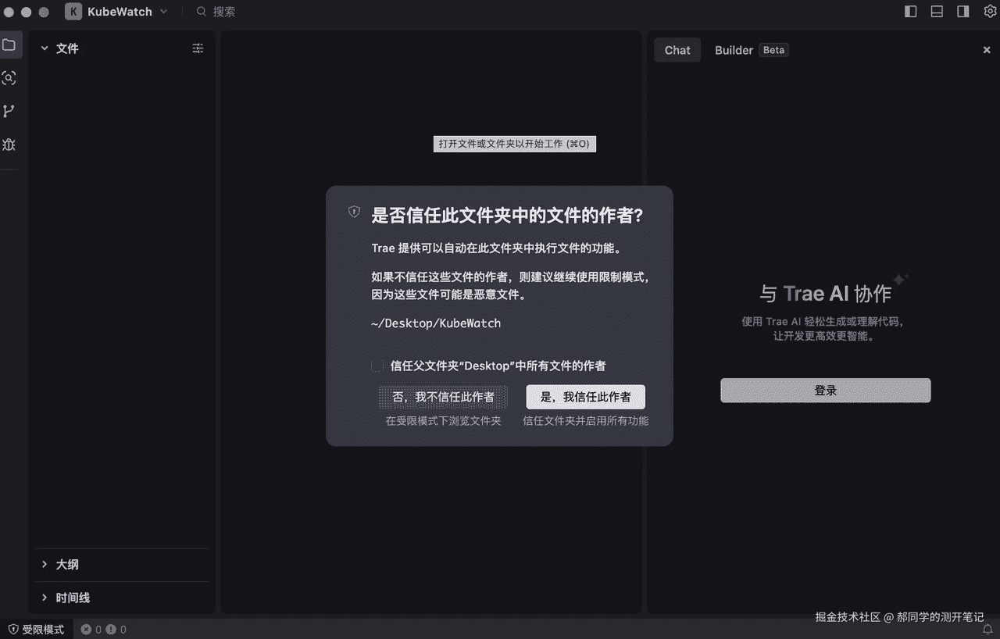

挺好的，还是注重安全隐私的。

### 登录使用AI

这个需要一些技术手段了，懂得都懂哈，不详细说了。登录之后，如下图所示

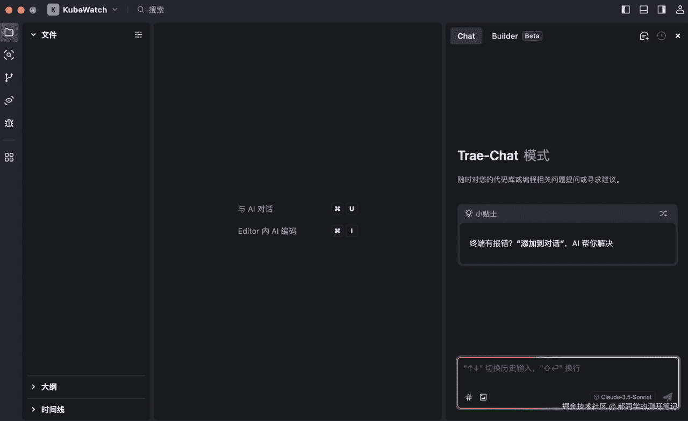

就可以让AI协助编程了。

### 代码实现

#### 客户端的初始化

首先需要使用 go 实现k8s客户端的初始化，这里直接借助 ai 生成。如下图所示

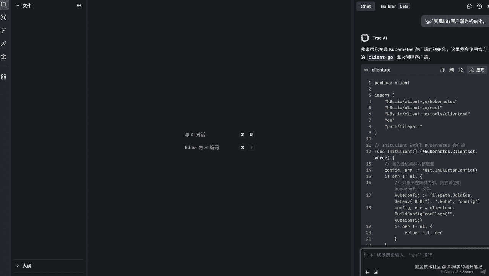

点击应用，就直接帮我生成 client.go 文件，如下图所示

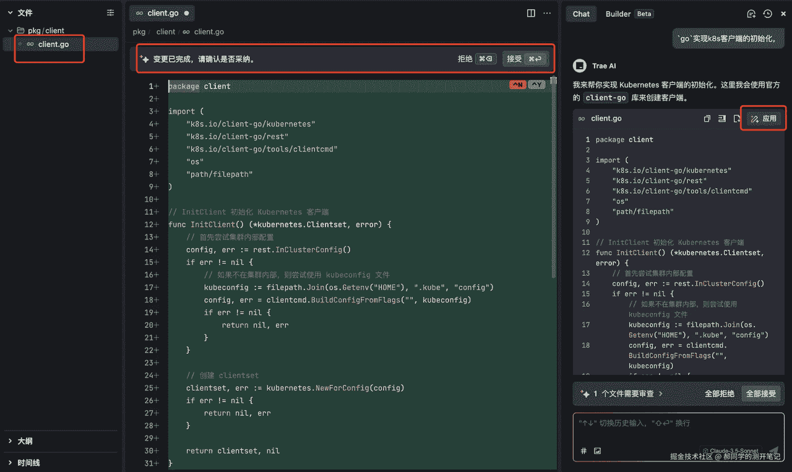

最后，你可以做一个判断，选择是否接受，笔者这里选择接受。基本逻辑已经有了。

#### mod 管理依赖

我想要使用mod来管理依赖项，直接将问题抛给 ai ，如下图所示

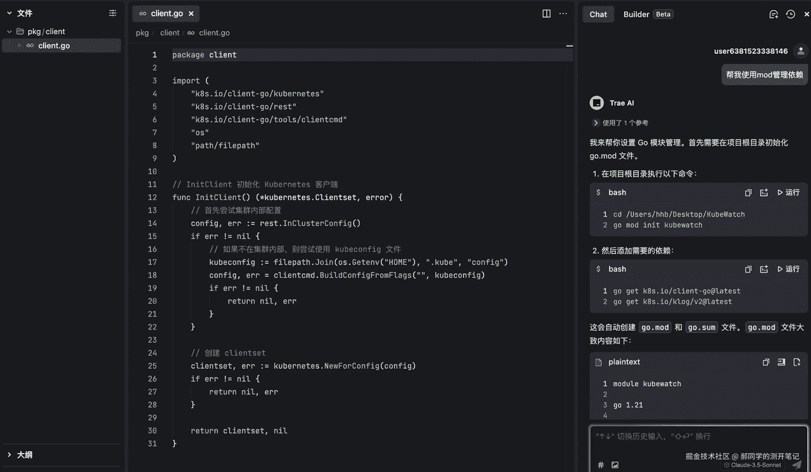

此时，还有一个很方便的功能，直接点击运行即可操作成功，不需要自己照着命令敲，如下图所示

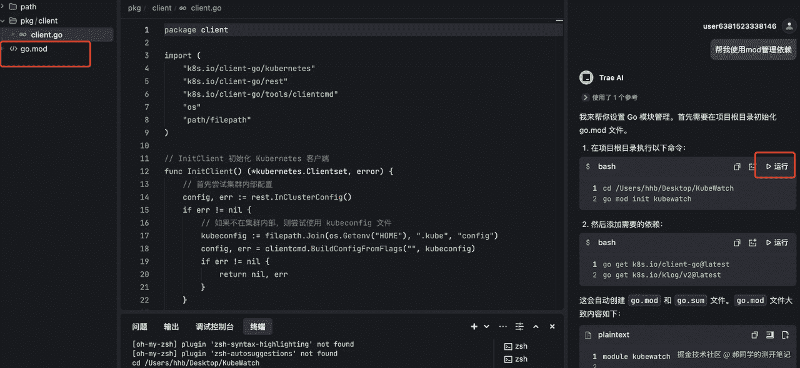

看到没有，运行之后，直接就生成了 go.mod 文件，这效率贼快。

#### 遍历 pod 进行扫描

还是借助 ai ,问问它如何遍历，如图所示

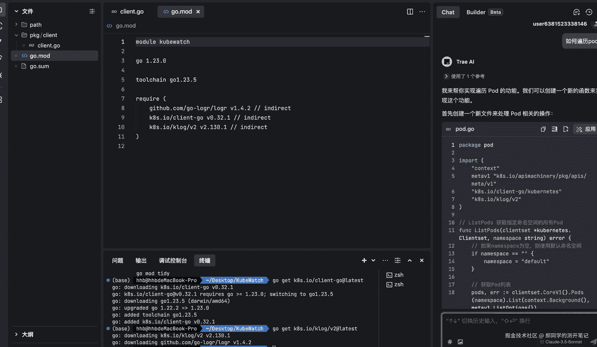

还是给出了比较满意的答案，但这次我不采用，自己实现，让 ai 帮我解释，主要逻辑代码如下：

```
func (ha *HAScanner) Scan(pod *v1.Pod) (*HAAnalyzeResult, error) {

    result := &amp;HAAnalyzeResult{}
    if len(pod.OwnerReferences) == 0 {
       return nil, nil
    }
    for _, o := range pod.OwnerReferences {
       if o.Kind == &quot;Deployment&quot; {
          deploy, err := ha.k8s.AppsV1().Deployments(pod.Namespace).Get(context.Background(), o.Name, metav1.GetOptions{})
          if err != nil {
             return nil, errors.Cause(err)
          }
          result.Name = deploy.Name
          result.Namespace = deploy.Namespace
          result.Kind = o.Kind
          result.Replicas = *deploy.Spec.Replicas
          if deploy.Spec.Template.Spec.Affinity == nil || deploy.Spec.Template.Spec.Affinity.PodAntiAffinity == nil {
             result.HasPodAntiAffinity = false
          } else {
             result.HasPodAntiAffinity = true
          }
       } else if o.Kind == &quot;ReplicaSet&quot; {
          replicaSet, err := ha.k8s.AppsV1().ReplicaSets(pod.Namespace).Get(context.Background(), o.Name, metav1.GetOptions{})
          if err != nil {
             return nil, errors.Cause(err)
          }
          result.Name = replicaSet.Name
          result.Namespace = replicaSet.Namespace
          result.Kind = o.Kind
          result.Replicas = *replicaSet.Spec.Replicas
          if replicaSet.Spec.Template.Spec.Affinity == nil || replicaSet.Spec.Template.Spec.Affinity.PodAntiAffinity == nil {
             result.HasPodAntiAffinity = false
          } else {
             result.HasPodAntiAffinity = true
          }
       } else if o.Kind == &quot;StatefulSet&quot; {
          statefulset, err := ha.k8s.AppsV1().StatefulSets(pod.Namespace).Get(context.Background(), o.Name, metav1.GetOptions{})
          if err != nil {
             return nil, errors.Cause(err)
          }
          result.Name = statefulset.Name
          result.Namespace = statefulset.Namespace
          result.Kind = o.Kind
          result.Replicas = *statefulset.Spec.Replicas
          if statefulset.Spec.Template.Spec.Affinity == nil || statefulset.Spec.Template.Spec.Affinity.PodAntiAffinity == nil {
             result.HasPodAntiAffinity = false
          } else {
             result.HasPodAntiAffinity = true
          }
       } else if o.Kind == &quot;DaemonSet&quot; {
          ds, err := ha.k8s.AppsV1().DaemonSets(pod.Namespace).Get(context.Background(), o.Name, metav1.GetOptions{})
          if err != nil {
             return nil, errors.Cause(err)
          }
          result.Name = ds.Name
          result.Namespace = ds.Namespace
          result.Kind = o.Kind
       } else {
          log.Infof(&quot;not support the kind, pod: %s, ns: %s&quot;, pod.Name, pod.Namespace)
          return nil, nil
       }
    }
    hasReadiness := false
    hasLiveness := false
    for _, c := range pod.Spec.Containers {
       if c.ReadinessProbe != nil {
          hasReadiness = true
          readiness := c.ReadinessProbe
          result.ReadinessTime = append(result.ReadinessTime, readiness.FailureThreshold*readiness.TimeoutSeconds+readiness.FailureThreshold*readiness.PeriodSeconds)
       }
       if c.LivenessProbe != nil {
          hasLiveness = true
          liveness := c.LivenessProbe
          result.LivenessTime = append(result.LivenessTime, liveness.FailureThreshold*liveness.TimeoutSeconds+liveness.FailureThreshold*liveness.PeriodSeconds)
       }
    }
    result.HasLiveness = hasLiveness
    result.HasReadiness = hasReadiness

    result.ScanTime = time.Now()
    if pod.Spec.NodeSelector == nil || len(pod.Spec.NodeSelector) == 0 {
       result.HasNodeAffinity = false
    } else {
       result.HasNodeSelector = true
    }
    return result, nil

}
```

编辑器中，选中这段代码，如下图所示

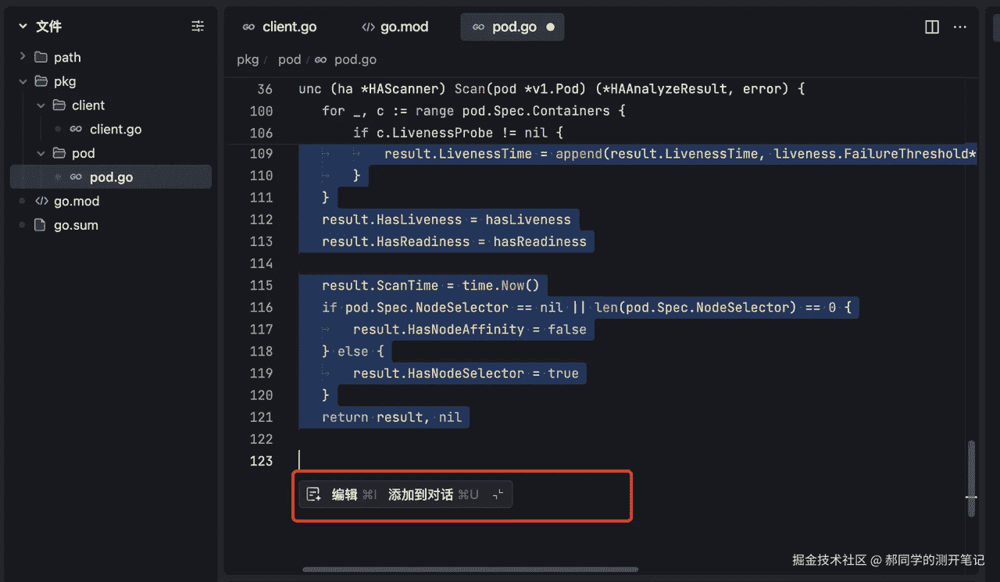

可以看到有两个按钮，我们是想让 ai 帮我解释，所以点击添加到对话，点完之后，如下图所示

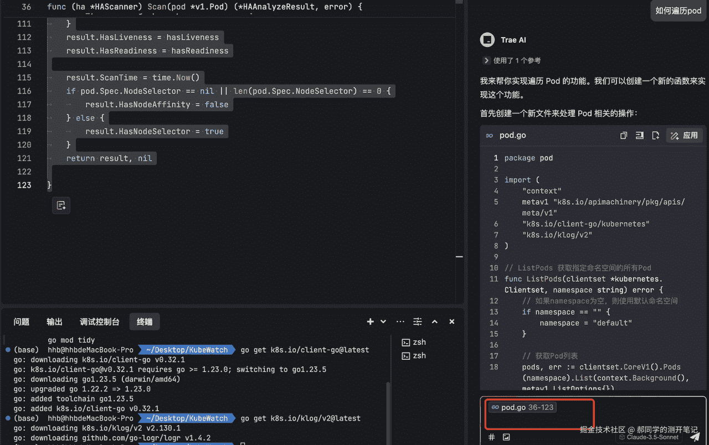

可以看到对话框中，直接显示了选中代码的位置，然后就可以进行发问了，如下图所示

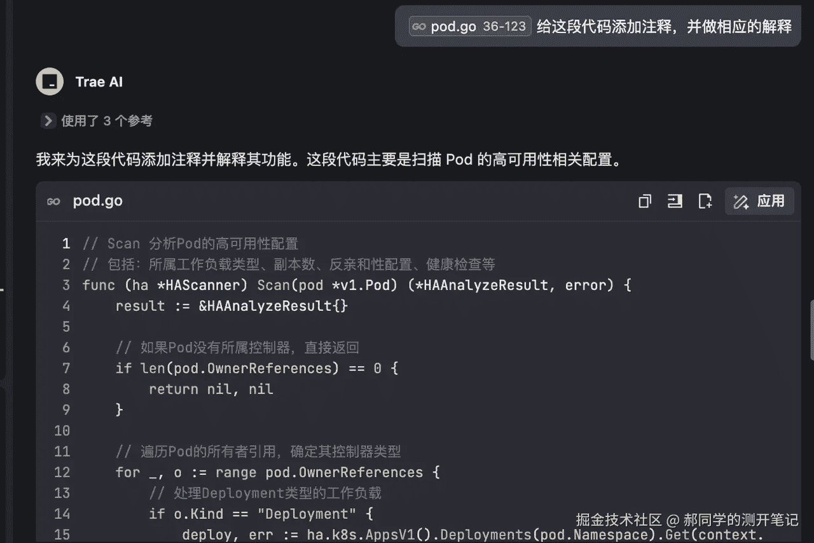

此时，可以直接点击应用，这样就可以变更原来选中的代码，变为增加注释的代码，如下图所示

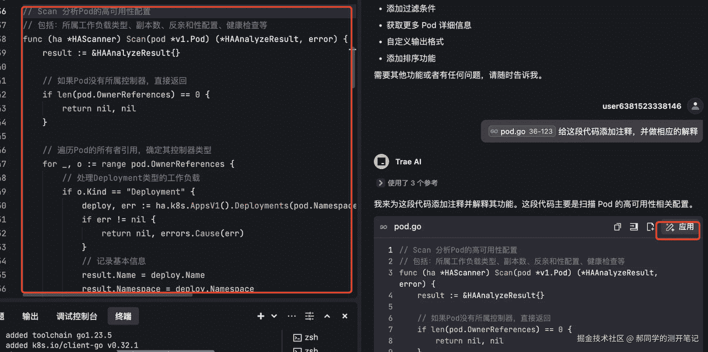

当然，也对这段代码给出了合理的解释，下面是 ai 给的解释：

1.  工作负载分析 ：

+   检查 Pod 的所属控制器（Deployment、ReplicaSet、StatefulSet、DaemonSet）

+   获取工作负载的基本信息（名称、命名空间、副本数等）

+   检查是否配置了 Pod 反亲和性（用于保证 Pod 分散部署）

1.  健康检查分析 ：

+   检查容器是否配置了就绪探针（Readiness Probe）

+   检查容器是否配置了存活探针（Liveness Probe）

+   计算探针的检查总时间（失败阈值 × 超时时间 + 失败阈值 × 周期时间）

1.  调度策略分析 ：

+   检查是否配置了节点选择器（NodeSelector）

+   记录扫描时间戳

这个函数主要用于评估 Pod 的高可用性配置，包括：

+   副本数量（确保服务可用性）

+   反亲和性（确保 Pod 分散部署）

+   健康检查（确保服务健康状态）

+   调度策略（确保合理的 Pod 分布）
这些信息可以用来评估工作负载的高可用性水平，帮助运维人员识别潜在的可用性风险。

解释的与我们项目预期实现效果是一样的， perfect

## 最后

在这篇文章中，我们深入探讨了如何利用Trae编辑器高效、快速地实现一个高可用的扫描工具。在实现过程中，我们见证了Trae在简化复杂任务、提高开发效率方面的出色表现。无论是对于新手还是有经验的开发者，Trae都是一个值得依赖的工具，能够帮助我们更快速地构建出更具稳定性和高效性的解决方案。通过这次实现，我对Trae的功能有了更深刻的理解，并且相信它会在未来的开发中持续发挥重要作用。

[本文所使用的 Trae ](https://www.trae.ai/?utm_source=juejin&utm_medium=juejin_trae&utm_campaign=AGI_article)免费下载链接： www.trae.ai/