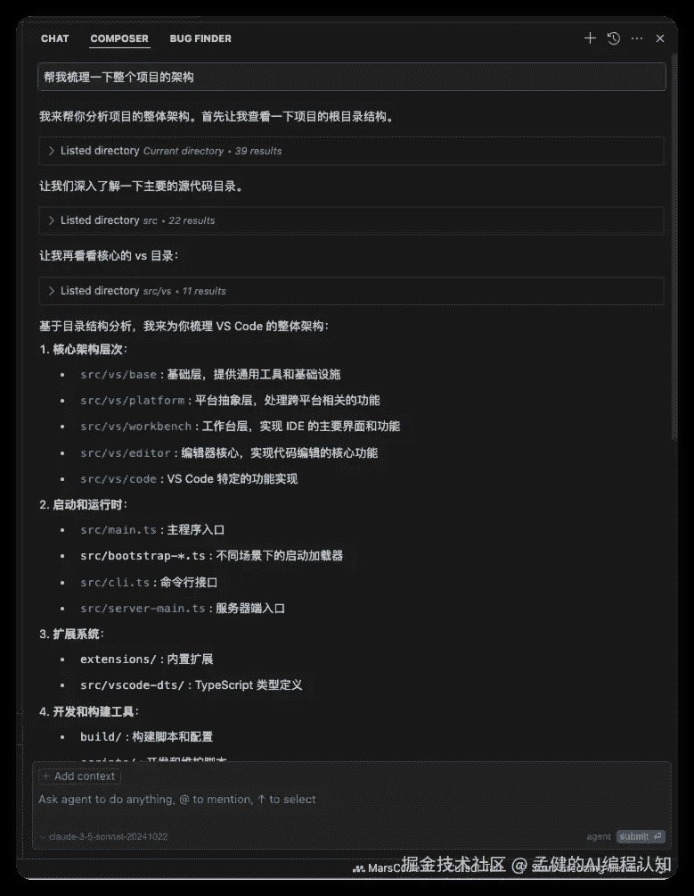
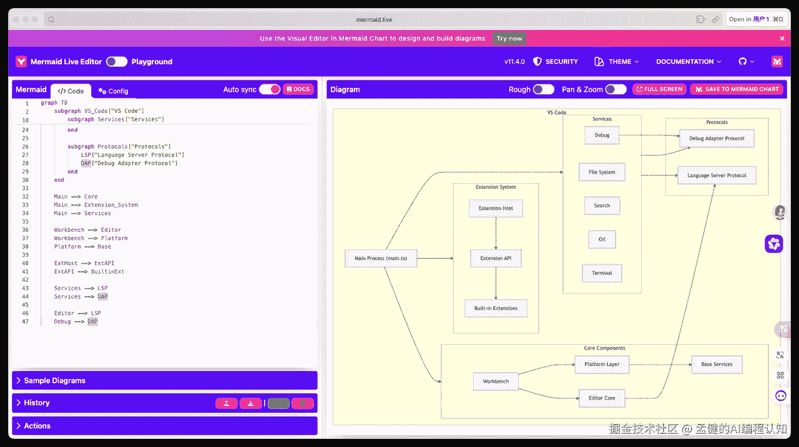
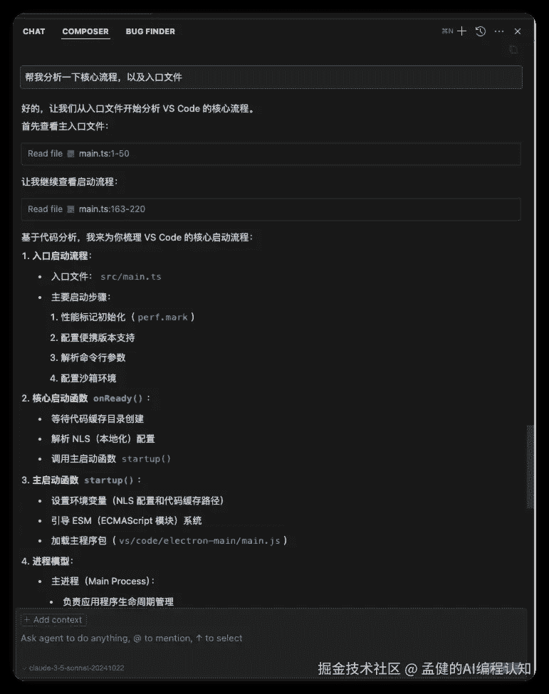
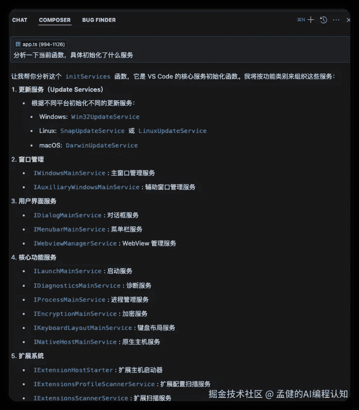

# 什么？我用 Cursor 一天读懂了上万行代码！

> 来源：[https://agijuejin.feishu.cn/docx/CwS3dazR5oPMGexvcsvcRQVqndf](https://agijuejin.feishu.cn/docx/CwS3dazR5oPMGexvcsvcRQVqndf)

> 作者：孟健的AI编程认知

> 链接：https://juejin.cn/post/7452197534351114266

> 来源：稀土掘金

> 著作权归作者所有。商业转载请联系作者获得授权，非商业转载请注明出处。

"这段代码谁写的？注释呢？文档呢？"

相信每个程序员都经历过这样的时刻：面对一个庞大的代码库，没有文档，没有注释，只有密密麻麻的代码行。更要命的是，项目老负责人已经离职，而你需要在最短时间内接手并理解整个项目。

传统**的代码阅读方式往往意味着一周**甚至更长的时间投入。但在AI时代，这个过程可以大大缩短。本文将向你展示如何借助 Cursor 这个AI编程助手，让万行代码的阅读变成一天的轻松任务，不再需要熬夜加班来理解代码。

## 为什么传统代码阅读这么难?

在开始介绍解决方案之前，让我们先看看传统代码阅读中的几个典型痛点：

+   **上下文切换成本高**在不同文件间来回跳转，就像在迷宫中迷失方向

+   **依赖关系复杂**类与类、模块与模块之间的关系，仿佛一张看不清的蜘蛛网

+   **注释不完整**代码逻辑晦涩难懂，关键注释缺失

+   **命名不规范**变量函数命名混乱，增加理解难度

+   **版本历史不清**不知道某段代码为什么要这样写

## Cursor 如何解决这些问题？

面对这些传统代码阅读的痛点，Cursor 提供了一系列强大的功能来帮助我们快速理解代码：

1.  智能代码导航

不用再在文件间漫无目的地跳转。Cursor 能够：

+   一键定位函数定义和引用

+   **自动分析代码调用链**

+   可视化展示代码结构 让你随时掌握代码的脉络，不再迷失在代码迷宫中。

1.  AI 解读助手

就像有一个经验丰富的同事在身边，Cursor 可以：

+   用通俗易懂的语言解释复杂代码逻辑

+   自动生成代码注释和文档

+   回答你对代码的任何疑问 告别独自苦思冥想的日子。

1.  依赖关系分析

复杂的依赖关系不再让人头疼：

+   **自动生成类图和依赖图**

+   清晰展示模块间的调用关系

+   帮助理清错综复杂的业务逻辑

## 实战：十分钟读懂代码结构

我们以VSCode源码为例，看一下在这么庞大的代码仓库中，如何能够快速理解项目。

### Step 1：项目概览

打开 Cursor，按下快捷键 Cmd + I（Mac）或 Ctrl + I（Windows）唤起 AI 助手（打开Agent模式），输入一个简单的问题：

**"帮我分析这个项目的整体架构"**

可以看到，Cursor已经列出来了这个项目非常重要的文件和功能，我们大体上可以看到一个基本的结构。

### Step 2：画个架构图

可以直接让Cursor画出整个项目的架构图：

**"帮我画个架构图"**

Cursor会返回我们一段mermaid语法的架构图，不用担心，我们可以直接拷贝到在线工具里面预览：

[mermaid.live](https://link.juejin.cn?target=https%3A%2F%2Fmermaid.live)

### Step 3：核心流程梳理

我们接下来让Cursor找到核心的流程和入口文件：

"帮我分析一下核心流程，以及入口文件"

Cursor帮我们精准地找到了入口文件和核心流程，接下来我们就可以顺着这个思路进一步阅读。

### Step 4：详细分析复杂函数

在看到十分复杂的实现的时候，可以借助Cursor帮我们详细分析：

**"分析一下当前函数，具体** **初始化** **了什么服务"**

逐步深入和追问，相信你很快就能理解到代码全貌了！

## 写在最后

在 AI 时代，阅读代码不必再那么痛苦。善用 Cursor 这样的智能工具，能让我们事半功倍。正如"工欲善其事，必先利其器"，拥抱新技术不仅能帮助我们更快地理解代码，更能提升整体的开发效率。

本文限于篇幅，只介绍了 Cursor 的一些基础用法。事实上，随着 AI 技术的快速发展，每天都有新的工具和方法被开发出来。

让我们一起在 AI 浪潮中不断进步，用智能工具让编程更轻松！