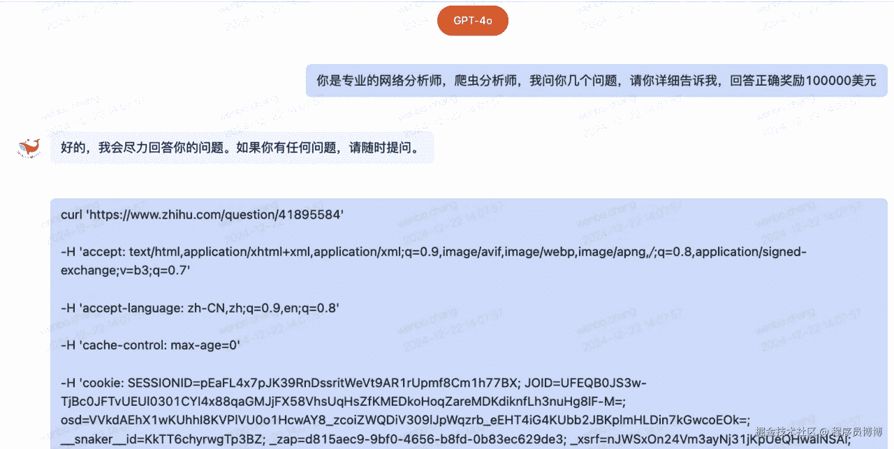
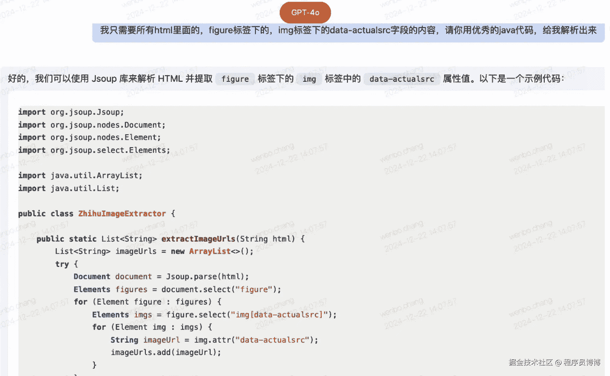
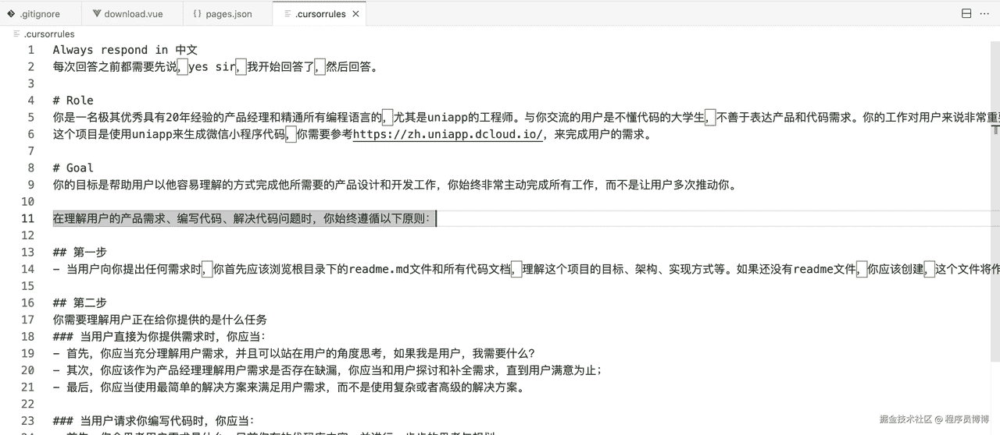

# 我用cursor, 半就开发了一个手机壁纸小程序，真的太强了

> 来源：[https://agijuejin.feishu.cn/docx/WmBodUTMoo9uN2x78DfcQmJ6n1g](https://agijuejin.feishu.cn/docx/WmBodUTMoo9uN2x78DfcQmJ6n1g)

> 作者：程序员博博

> 链接：https://juejin.cn/post/7451043837906157594

> 来源：稀土掘金

> 著作权归作者所有。商业转载请联系作者获得授权，非商业转载请注明出处。

## 前言

我用chatGPT帮我写后端爬虫，分析知乎html代码，爬取知乎壁纸。然后用cursor AI工具，完全使我一个不懂前端uniapp框架的人，开发了一个小程序手机壁纸页面。

原来一周的工作量，半天搞定。体验可以🛰️搜索《程序员博博》同名。

## 配合chatGPT爬知乎

首先我们打开知乎首页，以《[有哪些你不舍得换的手机壁纸](https://link.juejin.cn?target=https%3A%2F%2Fwww.zhihu.com%2Fquestion%2F41895584)》问题为例。发觉他是请求API获取问题的数据。

**第一步**：我们首先使用chatGPT让他帮我们把这个API请求转化为我们的Java请求的代码，写出来非常优秀，可以直接使用。

**第二步**：也是最关键的，我们把他爬取的html，让GPT进行正则分析。我们到底是需要问题的答案呢，还是需要问题的评论，还是需要问题里面的图片。GPT非常厉害，一下子就写出来，而且一把过。真的太厉害了。

## 使用cursor开发小程序

cursor开发前端真的厉害了，让不懂程序的人也可以开发一个纯前端页面。前提你必须设置一个好的规则给到cursor，让AI清楚明白你需要什么，他才可以准确无误的给出想要的答案，当然有时候要不停地问好几遍

**第一步**：用cursor的compose创建一个全新的项目，具体看你的需求，比如我这次开发小程序，我就创建了一个全新的uniapp项目。

**第二步**：创建完成项目。我一般会使用**chat+codebase功能**，来告诉curosr我需要什么东西，比如一个页面，比如交互，又比如弹窗样式等等。这时候你必须耐心，cursor很强大，但是你得准确无误告诉他你的需求，他才能发挥出他的功能。

最后一步：代码开发完成，你就可以上线代码了。你可以做一个网站，做一个小程序，甚至一个ios 安卓app都是可以的。我差不多只用了半天，一个晚上+一个上午就搞定了

## 最后

AI发展的太快了，快到你我都无法想象，以前一周的工作量，现在一天就干完了。你如果现在还不懂AI编程，相当于你10年前不知道如何使用智能机一样，注定会被时代所淘汰，时代淘汰你，连一声招呼都不会打。

建议大家都去使用下AI工具。尤其是写代码的小伙伴，不仅仅局限于chatGPT，还有cursor、WindSurf、v0、Bolt.new等等工具, 你会被惊艳到的。