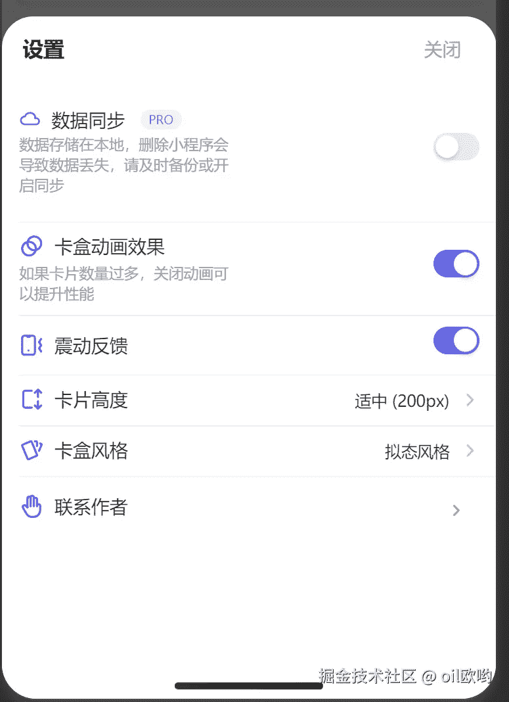
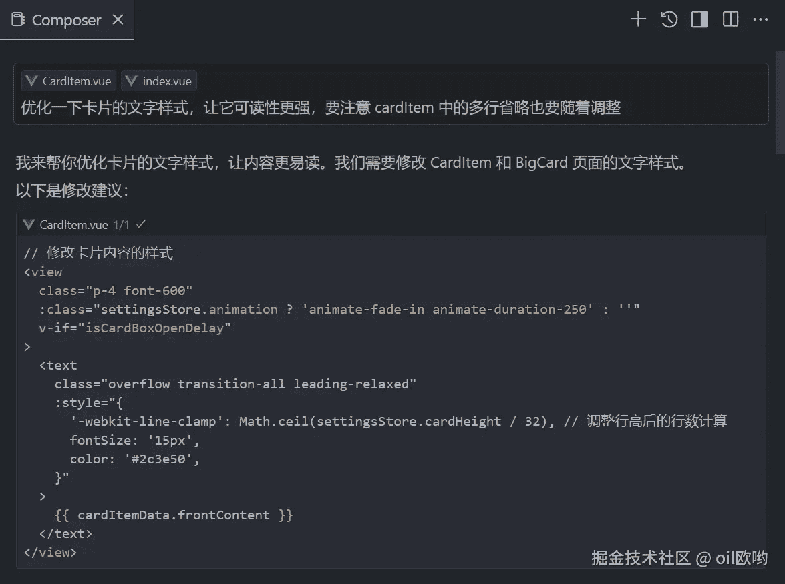

# cursor 真强啊，用 AI 把我的卡盒小程序所有 UI 交互优化了

> 来源：[https://agijuejin.feishu.cn/docx/DphRdPv72oDwbixWooRcQxCinBh](https://agijuejin.feishu.cn/docx/DphRdPv72oDwbixWooRcQxCinBh)

> 作者：oil欧哟

> 链接：https://juejin.cn/post/7447163741974986786

> 来源：稀土掘金

> 著作权归作者所有。商业转载请联系作者获得授权，非商业转载请注明出处。

## 前言

自从我的卡盒小程序功能稳定后，我就开始把整体的 UI 和交互继续打磨。之前因为时间原因想要先上线给大家看看反馈，所以有的地方妥协用了一些原生的 API，自己感觉还是差点意思，这几天下班后就开始继续优化，但是改造 UI ，重复和琐碎的事情太多了，于是我就想到这种事情交给 AI 做应该很不错，所以也开始用上了 cursor，不得不感叹 cursor 真强啊。实话说，就在这两三天，我干了之前自己做一周左右的活儿。

这两天小程序更新了特别多小功能点，以及样式的优化，我先给大家介绍一下，后面讲讲我是怎么用 cursor 优化的。

## 新特性

### 设置页

设**置页用来放一**些**自定义配**置，因为考虑到使用小程序的群体很多，每个人的喜好点不同，设备的性能差别也会很大，所以提供了卡片动画效果，震动反馈的关闭。

除此以外，还增加了一个新的卡盒风格，现在有拟态风格和现代风格，拟态的话会又层次感一点，比较像真实卡片，现代风格就是比较扁平化，圆角也更大一点，大家可以看看区别：

### 目录功能

现在除了卡盒和卡片，新增了一个目录维度，可以把卡盒放在不同的目录进行分类：

### 卡片列表切换（未发布）

这是我自己在使用过程中，发现卡盒也可以用作 todo 清单，因此想着做个列表模式，可以在卡盒内自由切换，切换的过程尽量让它丝滑，无论是卡片内是短文本还是长文本，不过文本太长卡片太多还宽高的变化还是没有位置的变化那么丝滑，这里我在手机试了一下，会比开发环境中更流畅一些，也可能是手机的配置比较好。

### 快速新增卡片（未发布）

在大卡片模式拖动到最后一个轮播图可以直接长按添加新卡片了。

###

## 交互优化

### 双指捏合收起卡盒

这个是我的第一篇文章 🗃️耗时一周，肝了一个超丝滑的卡盒小程序 中一个评论提到的。

虽然这个同学现在都有还没回复我，也不知道发现了没，但是我还是做了这个功能🥲 图片比较糊，因为是实机录完转 gif ，但是可以大概看出效果。双指在卡盒中捏一下，会有一个缩放效果，然后就收起卡盒了。

## 样式优化和统一

样式优化和统一 cursor 可是帮大忙了，我把我各个位置的弹窗都统一成同一种风格了。左侧一个大的标题，右侧一个取消按钮。

### 卡片文字的可读性

这是一个小细节，旧版的字体颜色很深，而且密度比较大，所以文字多的时候会觉得看的密密麻麻的，而且文字一坨一坨的。现在我把文字颜色微调浅一点，然后字间距调大，看起来就不会那么累了，UI 上也清爽一些。

## 我如何使用 cursor 进行优化

我用的是 cursor 的 claude-3.5 sonnect 模型，主要用的就是 composer 功能，composer 可以让我们选中几个项目中的文件，然后向 cursor 说出需求，他会基于这几个文件去分析你的当前代码设计，然后根据需求进行代码修改或生成新的文件。打开 cursor 后，快捷键 CTRL + I 就可以打开 composer 功能。

我的第一次使用就是选中我已有的一个弹窗设计，然后让它先优化一下样式，让它更清爽一点，然后基于这个弹窗，选中其他的几个弹窗，让 cursor 统一一下样式，参考某个弹窗，几乎两次对话就改完了，以往这种杂活儿我可能得整一两个小时，让 cursor 来做就五分钟！

还有一个可读性优化的例子，我选择了一个 vue 文件，里面是我的卡片的组件代码，让 cursor 帮我优化，并且说一些注意点：

cursor 生成代码后，就会告诉你调整的范围，最好自己再 review 一下，一些变量写错的问题 cursor 也会犯的。

我的用法像和人一样聊天，你自己的项目你最清楚，使用 cursor 的时候就像带一个新人参与你的项目，实现需求时。你帮 cursor 找引用的资料，让它参考着做，做完了你帮他验证一下功能的可行性，同时还要帮他 review 一下代码，如果自己能够发现的问题，能够准确指出让它帮你修改。不论是需求还是问题，你说的越精确效果就越好，

我目前还是将一些繁琐工作交给 cursor 去完成，没有让它参与创意方面的工作，不过我看人家小白都可以用 cursor 从零到一做一个 app，可能 cursor 的潜力我还没有完全挖掘。

> **注意点**

1.  因为 cursor 的代码改动太方便了，一下子改很多个文件，而且不像自己改那么可控，因此一旦你确定没问题了，就用 git 提交一下代码保存一下当前的记录，避免调整太多了，代码不受你的控制了，引入意外的问题。

1.  代码改动后，记得点一下 accept 接受改动，不然你切换不同 composer 时，会把当前 composer 的改动移除，再基于新的 composer 改动后，两边的代码就有点冲突了。

## 总结

后续我会更高强度的使用 cursor，它的可用性真的太超出我的意料，我也算是高频使用 AI 工具的人了，上手之后还是觉得太方便了。后续如果有新的心得也会与大家分享。学习卡盒小程序我会一直持续迭代的，我会不断打磨这个小场景下的易用性，欢迎大家上手体验，评论区好的建议我也都会积极采纳的，如果有感兴趣的朋友可以让我拉你进体验版，很多新特性可以提前体验到。