# Windsurf：超越 Cursor 的下一代 AI 编辑器

> 来源：[https://agijuejin.feishu.cn/docx/SgOyd0owDomaJ9xBMIwc6EhRn5c](https://agijuejin.feishu.cn/docx/SgOyd0owDomaJ9xBMIwc6EhRn5c)

> 作者：奇舞精选

> 链接：https://juejin.cn/post/7441138589116858419

> 来源：稀土掘金

> 著作权归作者所有。商业转载请联系作者获得授权，非商业转载请注明出处。

在 AI 编程领域，不管是IDE编辑器还是ID**E插件，出了**很多的产品，**比如全球爆火的** Cursor**，微软的 Copil****ot，还有**国产的 豆包**MarsCode** 等等，效果都很不错。**今天向大家推荐**一款**可以平替Cu**rsor的AI编辑器W**indsur**f。Windsurf是由Codeium团队开发的一款新型AI编程助手，旨在通过深度集成AI技术提升开发者的编码效率。它不仅在上下文理解、工具链集成和智能编程助手方面表现出色，还提供了丰富的功能和灵活的协作模式。同样他与Cursor一样存在提供了免费的 GPT-4o 和 Claude 3.5 Sonnet 模型，并且现在是完全的免费使用。

### Windsurf的特点

#### AI智能代理：

Flows = Agents + Copilots

Windsurf采用了AI Flow范式，支持多步骤、多工具协同，自动维护上下文状态，智能任务规划和执行。可以像 Copilot 一样与你协作，也可以像 Agent 一样独立处理复杂的任务。

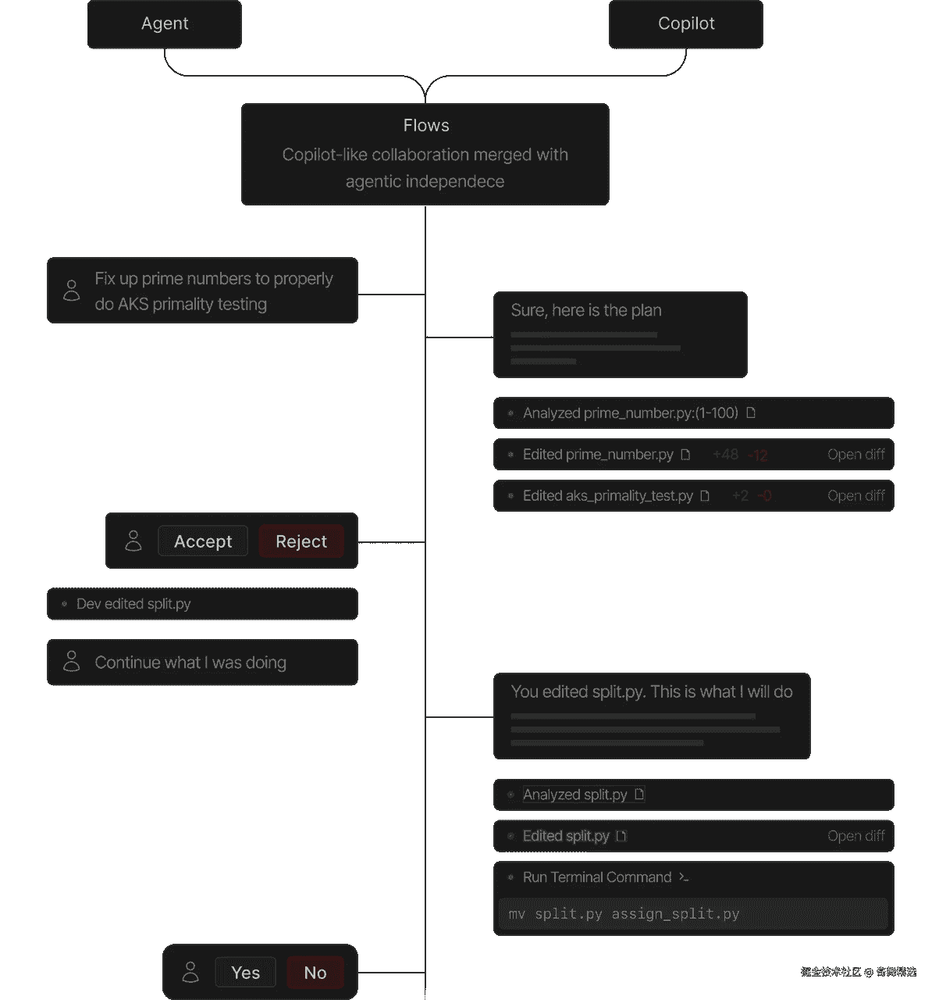

### Cascade 模式

提供编辑和聊天两种模式，编辑模式可以生成和修改代码，直接将生成的代码写入到对应的文件，聊天模式专注于提供开发建议、解答代码问题。

#### 内置代码搜索

1.  分析工具文件系统操作

1.  管理命令行集成

1.  自动化智能代码编辑和重构

#### 上下文理解能力

Windsurf的上下文引擎能够更深入地理解项目代码关系，提供更智能的代码建议。它不光补全你正在写的代码，还能预测你接下来要写什么。

### Windsurf的安装和使用

+   **安装**：Windsurf支持Windows、Mac和Lin[ux平台](https://link.juejin.cn?target=https%3A%2F%2Fcodeium.com%2Fwindsurf%25EF%25BC%2589%25E4%25B8%258B%25E8%25BD%25BD%25E5%25AE%2589%25E8%25A3%2585%25E5%258C%2585%25E8%25BF%259B%25E8%25A1%258C%25E5%25AE%2589%25E8%25A3%2585%25E3%2580%2582)，安装过程简单，可以直接从官网（codeium.com/windsurf）下载…

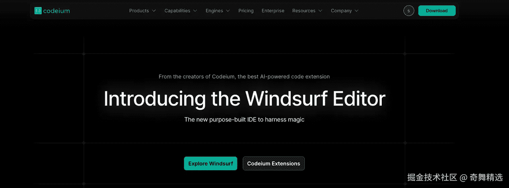

运行Windsurf后，看到下面的页面

设置流程：

如果想使用**VS Code**的配置，可以选择从**VS Code**导入，也可以选择重新开始配置**Windsurf****。如果你选择了**重新开始**，那么后续该如何****导入VS **Cod**e配置哪，Windsurf**提供了从**控制面板重新添加的入口。**（在 Mac 上为 ⌘+⇧+P，在 Windows/Linux 上为 Ctrl+Shift+P）并输入“import from VS Code”。

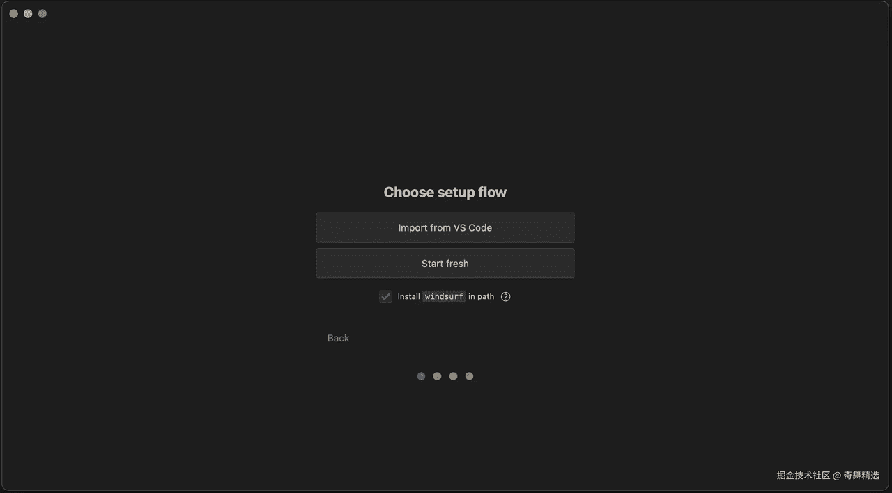

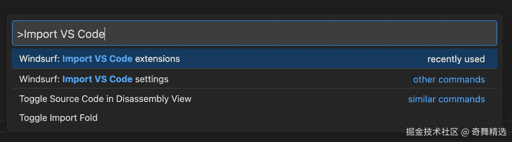

**选择编辑器的主题**：

从这些默认值中选择你最喜欢的颜色主题！别担心，以后可以随时更改此设置。请注意，如果你从 VS Code 导入，则导入的主题将覆盖此主题。

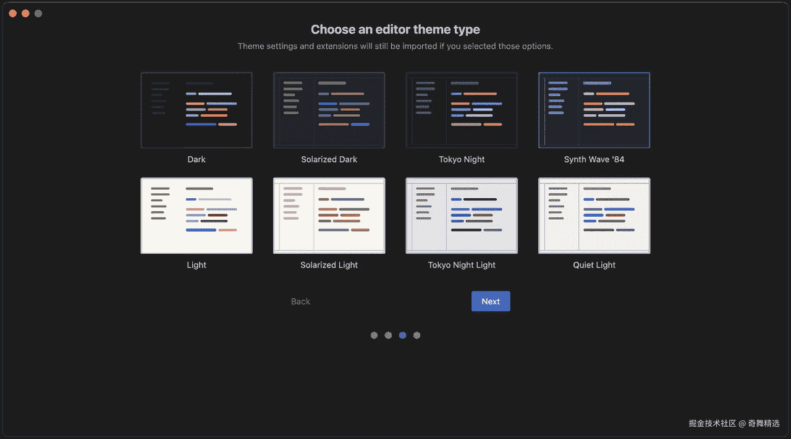

**注册/登录**

要使用 **Windsurf**，需要使用 **Codeium** 帐户。

**主界面：**

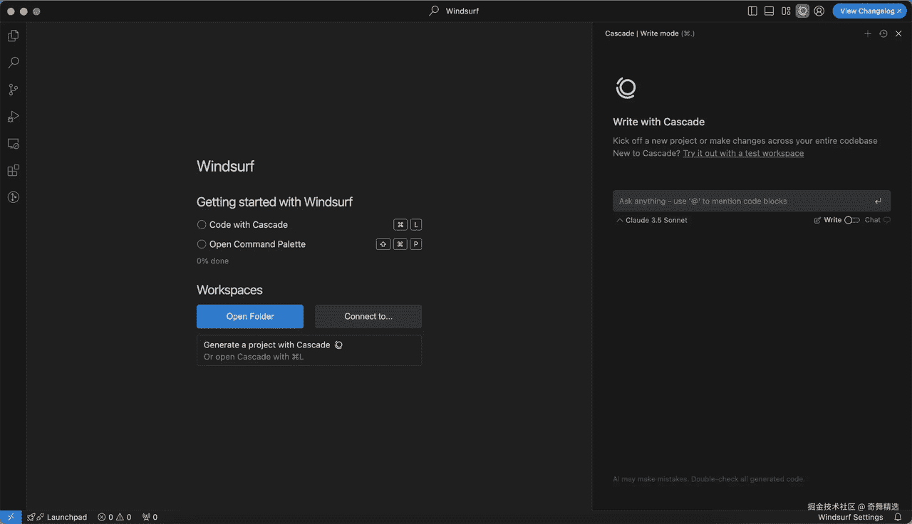

#### Cascade（command+L、ctrl+L）

**Casc**ade将功能**分成了两类**，一个是Chat模式，一个是Write模式，

**Chat模式**：在Chat模式时，只是作为一个贴心的助理，协助你处理问题

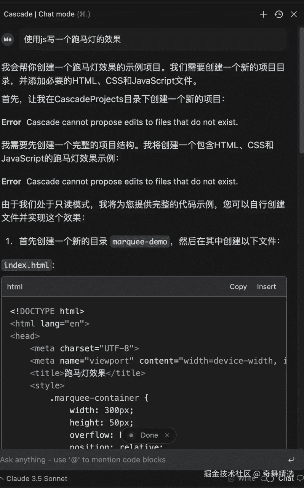

**Write模式:** 在Write模式，直接将生成的代码写入到项目中。

自然语言修改代码（**Cmd+i**）：支持在选中代码的时候，使用自然语言修改对应的代码。

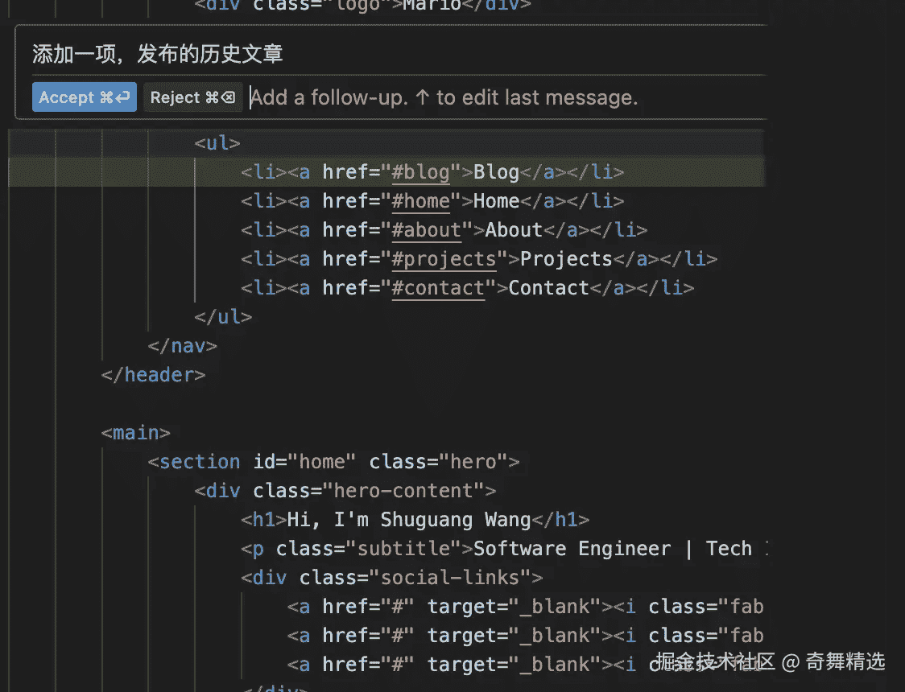

通过上面的介绍，简单知道了Windsurf的简单实用，下面我将使用使用Windsurf编写一个个人网站

这样我的网站就有了基础的框架，只是现在的样式还不符合我们的要求，不过没有关系我们可以一点一点让windsurf进行优化，慢慢的变成我们想要的样子。

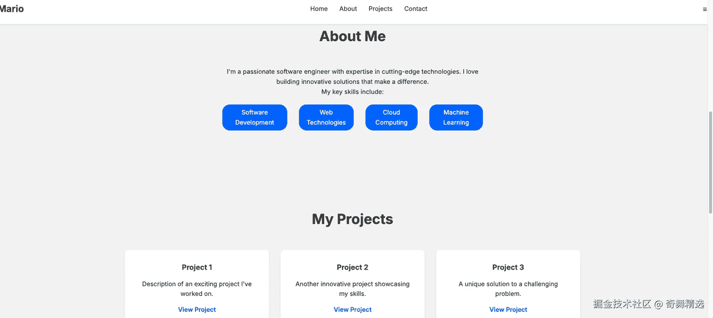

继续给Windsurf提示词，让他进行分析当前项目，并继续改造

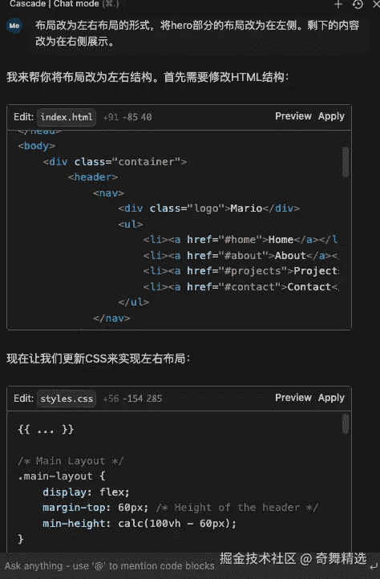

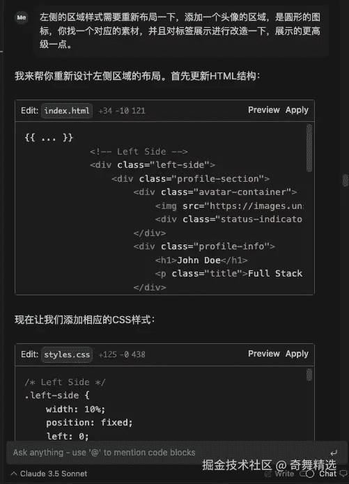

经过几次的对话，对具体的细节进行不断的调整，Windsurf就生成了我们所想要的效果。

**成果展示：**

**总结：**

通过上面对Windsurf的简单介绍和实际例子的使用，大家可以清晰地了解到其强大的功能和灵活的应用场景。在实际工作中，根据自己的业务需求，巧妙地运用Windsurf可以帮助开发者快速编写一些基础的代码。