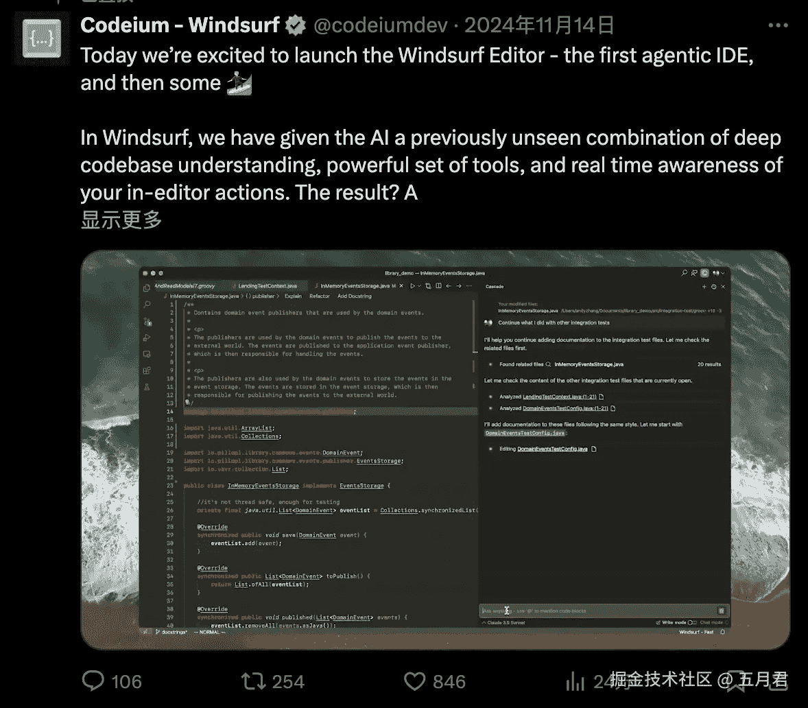
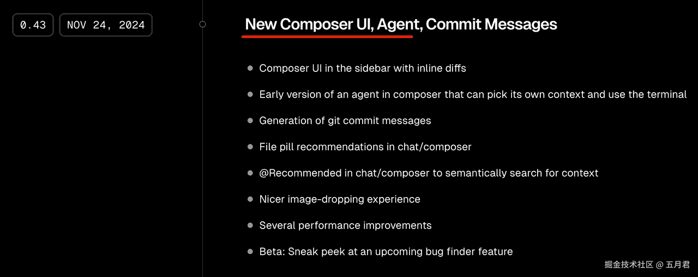
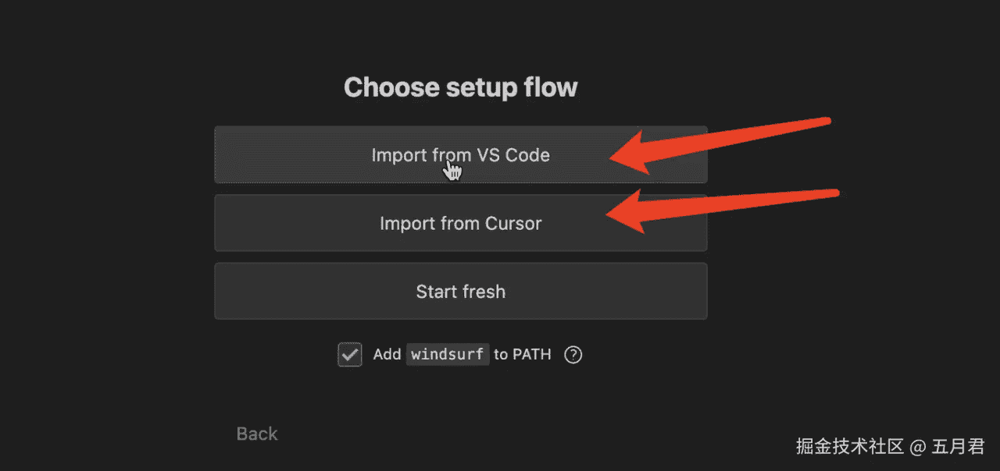
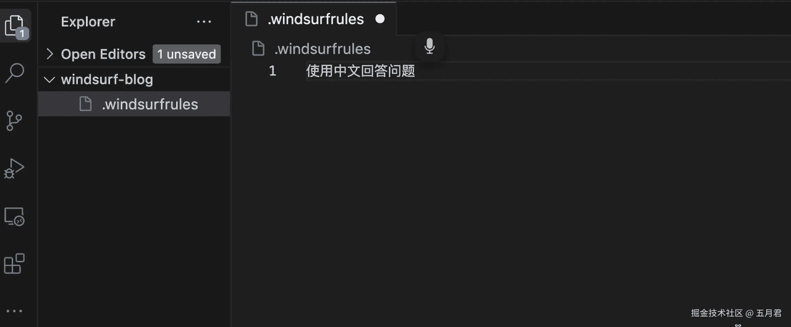
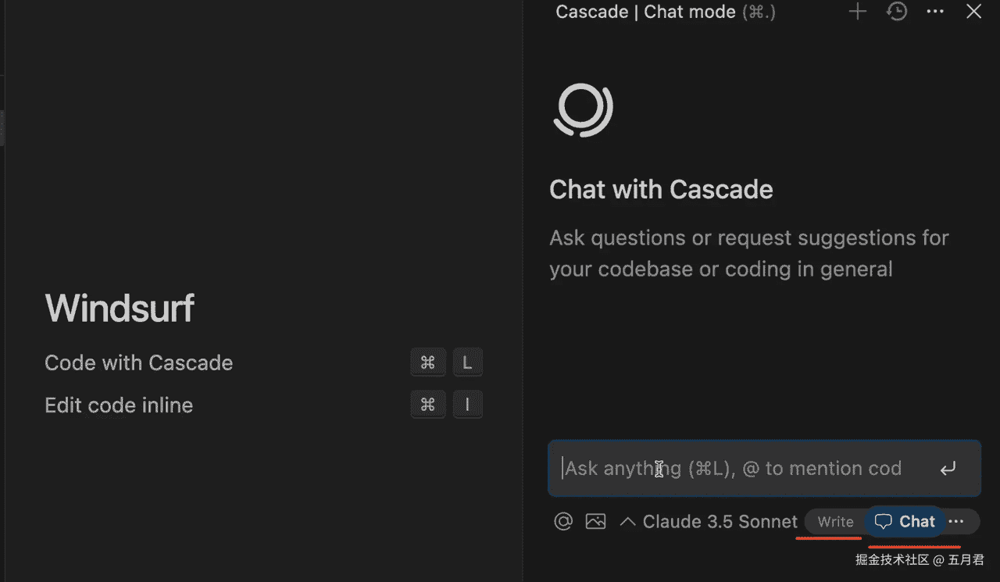
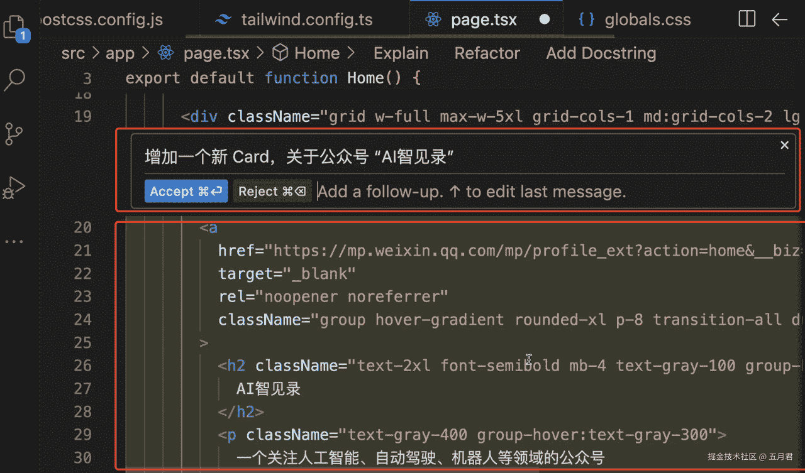
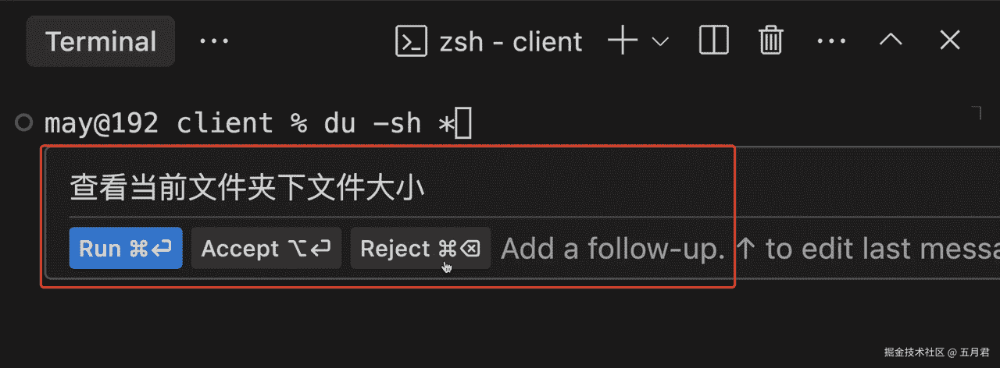
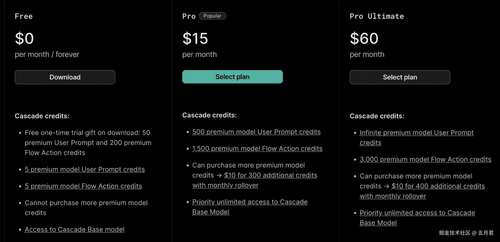

# Windsurf：唯一让 Cursor 瑟瑟发抖的最强对手！

> 来源：[https://agijuejin.feishu.cn/docx/LLZUdwwPuojPjQxLM7jcrMVsndb](https://agijuejin.feishu.cn/docx/LLZUdwwPuojPjQxLM7jcrMVsndb)

> 作者：五月君

> 链接：https://juejin.cn/post/7456819237651890228

> 来源：稀土掘金

> 著作权归作者所有。商业转载请联系作者获得授权，非商业转载请注明出处。

Cursor 近期很爆火，能真正意义上与之匹敌的，只有 Windsurf 了。

Windsurf 是由 Codeium 公司推出的一款 AI 辅助编程工具，同 Cursor 一样，Windsurf 也是基于 VS Code 深度开发集成。

之前介绍过 Cursor 的 Agent，功能很强大，参见 感受下 Cursor Agent 的强大魅力！。但首个推出 Agent 的 AI IDE 是 Windsurf，其于 2024 年 11 月 14 日推出。

现在对代码库有了更深度理解，同时吸收了 Copilot 的协作性和 Agent 独立的能力，在 Cascade 窗口 Write 模式下（这个类似 Cursor Composer），它可以自动的添加和编辑一些文件，甚至建议、执行或迭代一些终端命令。在这个过程中，一些命令的执行是需要我们手动确认的。

Cursor 的 Agent 是在 2024 年 11 月 24 日推出。

## 下载安装

进入 Windsurf 官网下载页面 codeium.com/download，点击… Download 按钮下载，它会根据你电脑当前系统推荐相应的安装包。

下载之后，点击安装，安装过程中，Windsurf 支持从 Cursor 或 VS Code 导入

## Demo 演示

安装成功之后，打开项目，让 Windsurf 帮我创建一个 Blog 项目。

完整的 Demo 参见笔者录制的以下视频。

www.xiaohongshu.com/explore/677…

## 功能特性

1.  规则文件配置

创建文件 .windsurfrules，这是 Windsurf 的规则文件，这里可以放一些我们项目的编码规范。例如，Windsurf 有时候会用英语回答，这里我更期望它能用中文回答，配置如下所示。

规则文件更多内容参见 https://docs.codeium.com/windsurf/cascade#workspace-rules

1.  主要功能：Cascade

使用命令 Command + L 打开 Windsurf Cascade 窗口。有两种模式 chat、write。

1.  **Chat 模式**

Chat 模式更像一个 AI 助手，基于我们的代码做一些答疑，或者一些问题解答。

1.  **Write 模式**

Write 模式，可以帮我们写代码，添加、修改文件，自带 Agent 功能，期间还可以执行终端命令，不用再打开新窗口了。

1.  文件内唤起内联聊天

在单文件内使用快捷键 Command+i 唤起内联聊天窗口修改代码。

1.  终端命令

终端内也支持使用快捷键 Command+i 唤起内联聊天窗口。

不常用的命令，很难记住，现在有了这个内联的聊天窗口，已经让我们的工作很方便了。

## 价格

新用户免费试用 14 天，Pro 版每月 15$，记得之前看大家发的是 10$，这是最近又涨价了？

## 总结

通过上面的示例演示和主要功能特性的讲解，大家对 Windsurf 应该已经有了一个清晰的认知。整个流程下来也挺丝滑的，入门也很简单，有兴趣的朋友们可以尝试下！