# AI 生成前端项目的 bolt.new 是怎么做到的？

> 来源：[https://agijuejin.feishu.cn/docx/II4vdBM8yobrDVx7jS2csFs0ngd](https://agijuejin.feishu.cn/docx/II4vdBM8yobrDVx7jS2csFs0ngd)

> 作者：zxg_神说要有光

> 链接：https://juejin.cn/post/7438916462751088650

> 来源：稀土掘金

> 著作权归作者所有。商业转载请联系作者获得授权，非商业转载请注明出处。

最近一些 AI 生成前端代码的应用挺火的。

比如 [bolt.new](https://link.juejin.cn?target=https%3A%2F%2Fbolt.new%2F)

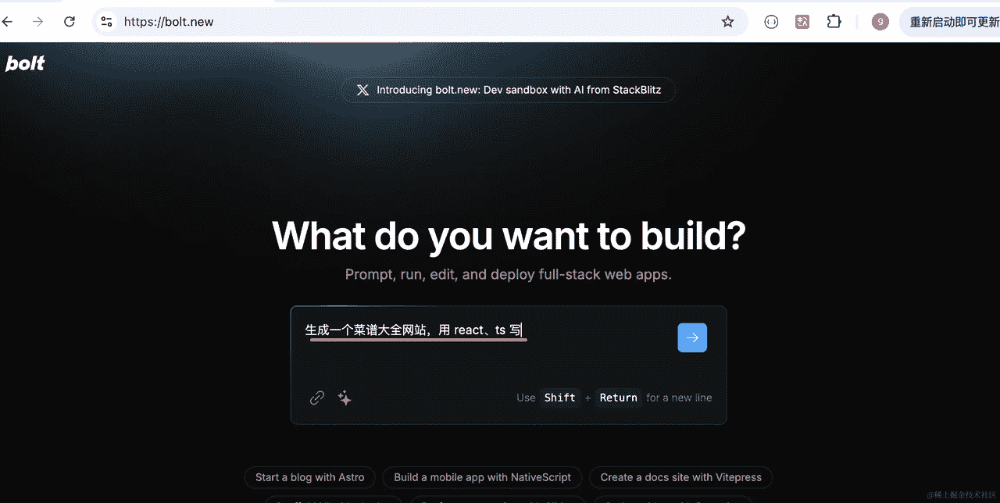

我告诉他写个菜谱大全网站，用 react、ts 写。

它会依次生成这个项目的全部代码：


可以看到，它的流程是这样的：

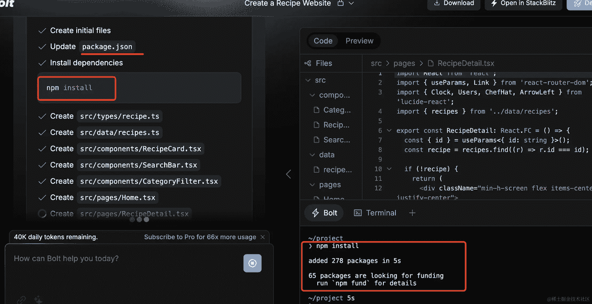

先生成 package.json，然后执行 npm install。

依次生成所有的文件。

然后跑下 npm run dev：

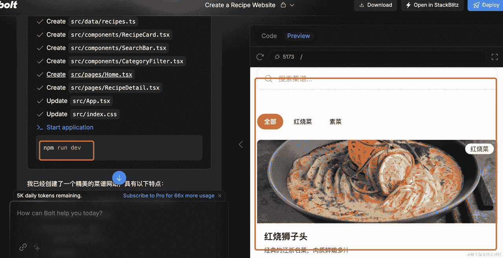

这样就可以在右侧看到生成的代码和预览效果了：


交互啥的都没问题。

之后点击部署：

它会部署到服务器，然后给你一个 url。

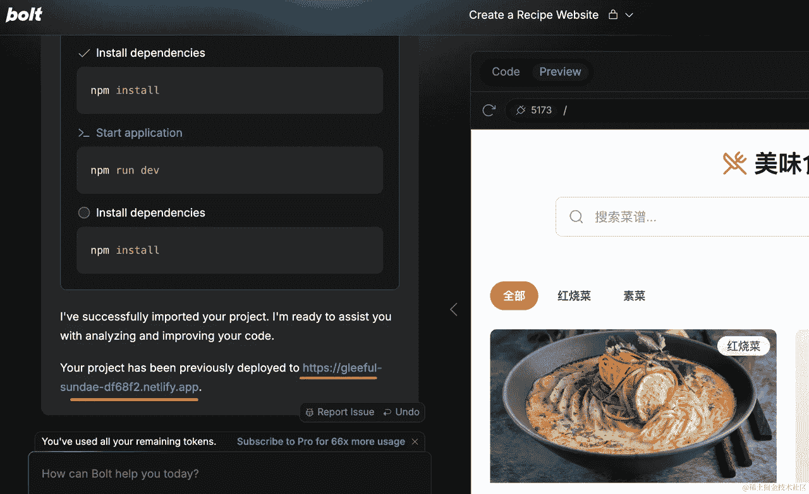

打开看下：

gleeful-sundae-df68f2.netlify.app/


这样一个菜谱网站就给写完并部署好了。

是不是很震撼！

要一个月薪 2 万的前端工程师写，也得要至少一天吧。

但是 AI 只要一分钟就给生成然后部署好了。

当然，我的需求比较简单，你完全可以描述更细致的需求，让 AI 给你生成。

生成后也可以再提需求，让它继续完善。

或者你也可以基于这些代码自己改：

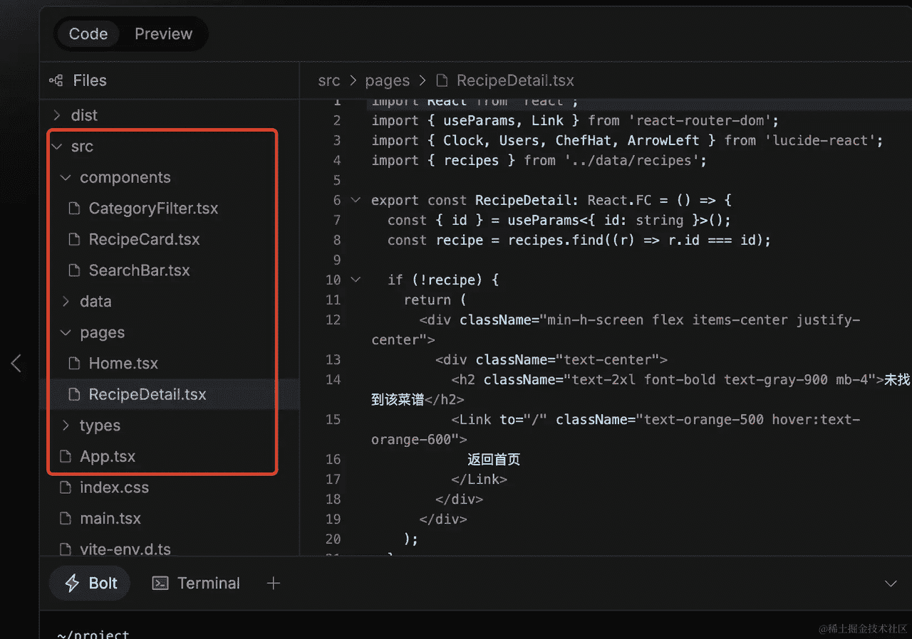

这对于工作效率的提高，比任何基建都好用。

最近流行的 cursor，也是帮你写代码，但是它是集成到了 vscode 里，自己做了一个编辑器。

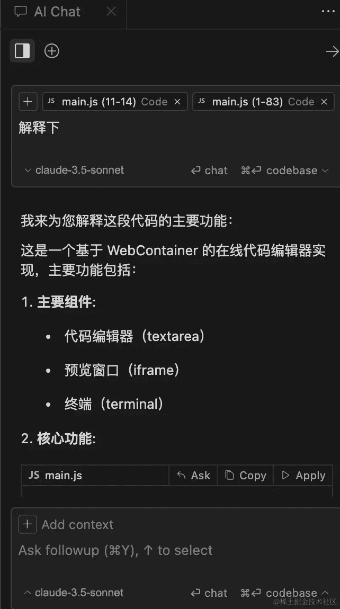

核心也是基于聊天做的。

大差不差的。

那 bolt.new 这种 AI 生成前端代码并在浏览器里编译、运行的功能，实现原理是什么呢？

我们简单分析下。

首先我们需要调用 AI 接口，告诉它需求，让它给生成代码。

这里看下 cursor 用的模型：

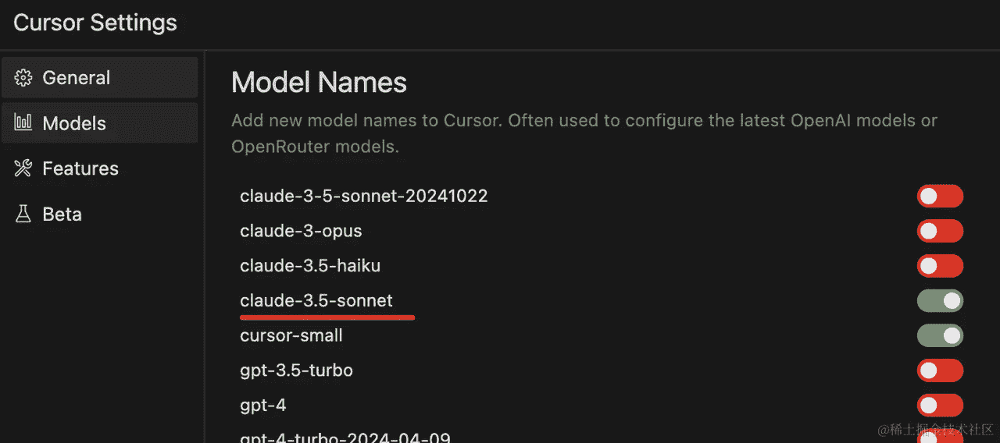

默认是 claude-3.5-sonnet 这个。

国内调用国外的 ai 接口有重重阻碍。

所以我们一般都是找个国内的代理商的 api 来用。

这种代理挺多的，我这里用的 [302.ai](https://link.juejin.cn?target=https%3A%2F%2Fgpt302.saaslink.net%2Fbzgo6g)，你也可以用别的

这种代理都是给你对接好了国内、国外各种模型，你可以直接用：

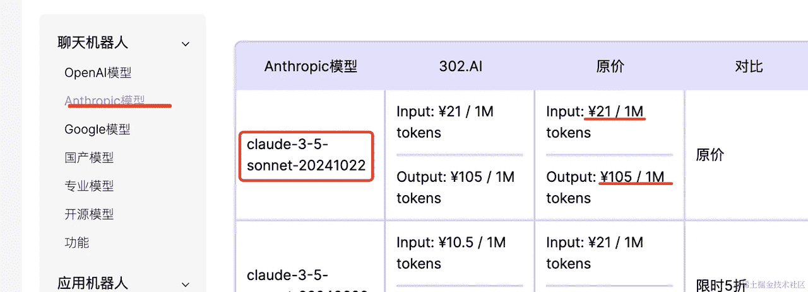

刚才 cursor 用的那个模型也有。

我这里充了 5 美元，也就是 40 人民币，可以用支付宝支付，这点确实方便：

国外的那些模型，你支付都是个问题。

所以还是调用 AI 接口，还是直接用国内的代理香。

创建个聊天机器人，指定 cursor 用的那个模型：

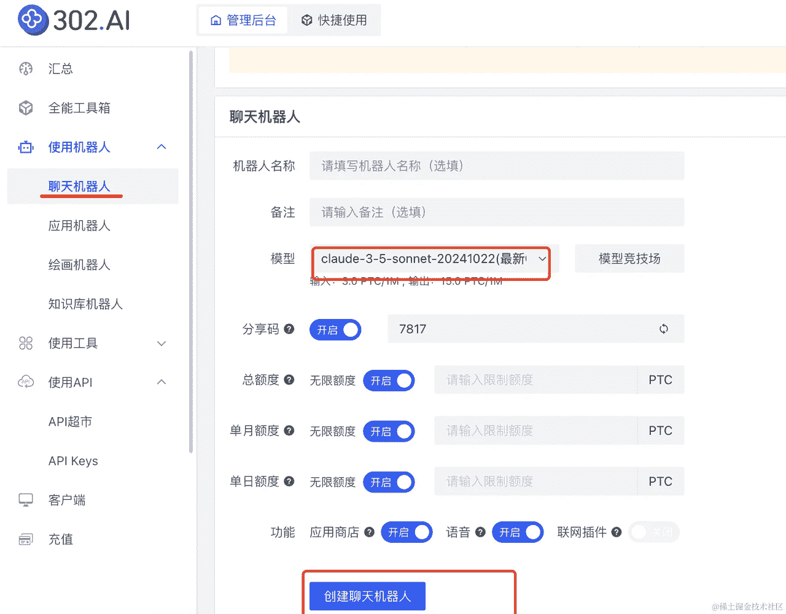

让它给生成一个菜谱网站：

生成一个菜谱大全网站，用 react、ts 写，先用 json 形式给我项目目录，然后依次给我每个文件的内容

首先，目录是这样的：

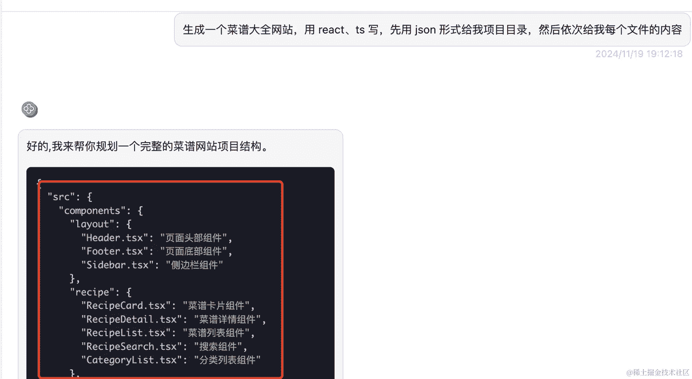

然后依次给我了每个文件的内容：

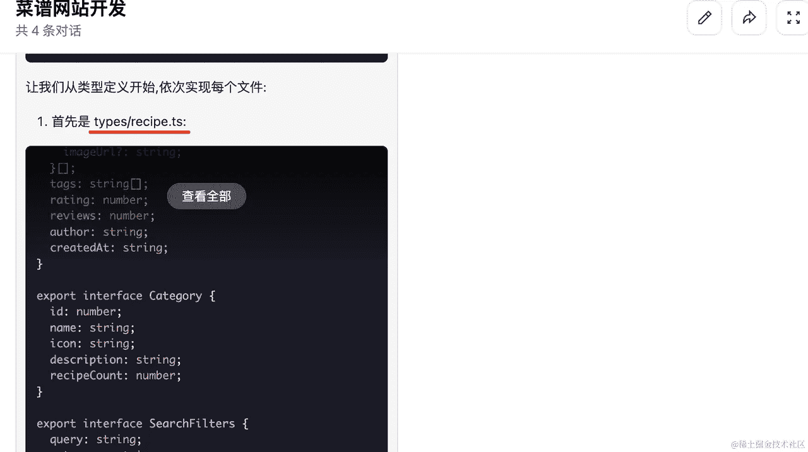

你也可以分别询问每个文件的内容：

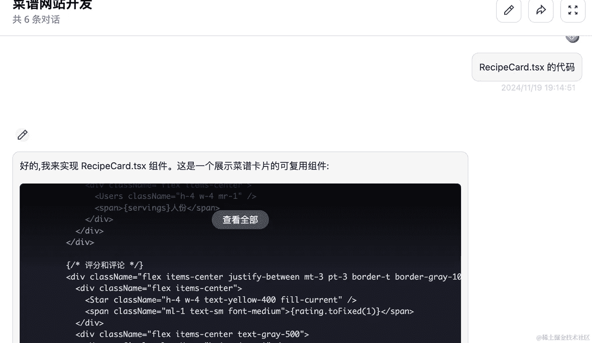

bolt.new 就是这样新生成了目录，然后依次生成的每个文件：

我们在项目里怎么调用这个 AI 接口呢？

这样：

创建一个 api key。

然后看下调用接口的文档：

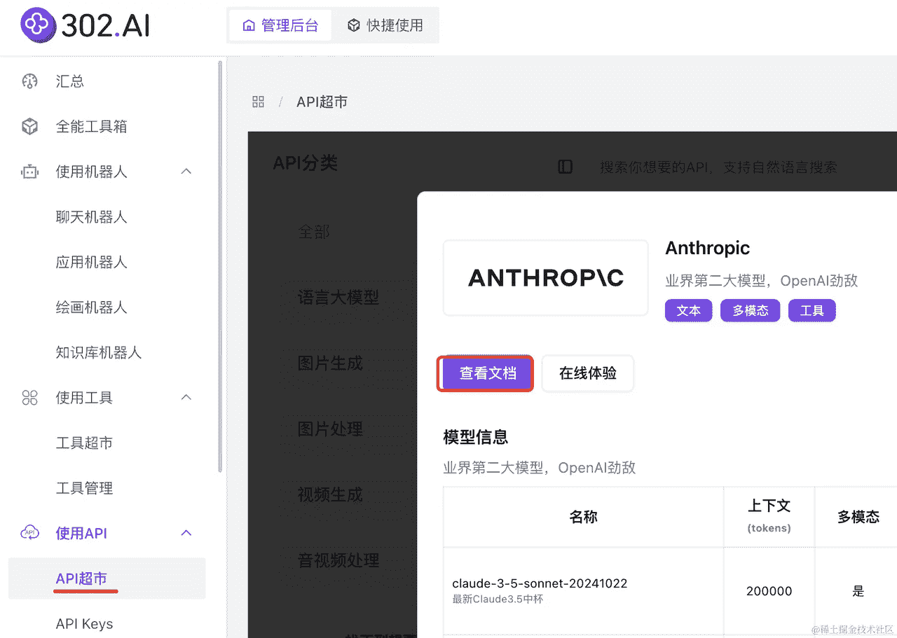

把示例代码复制下来：

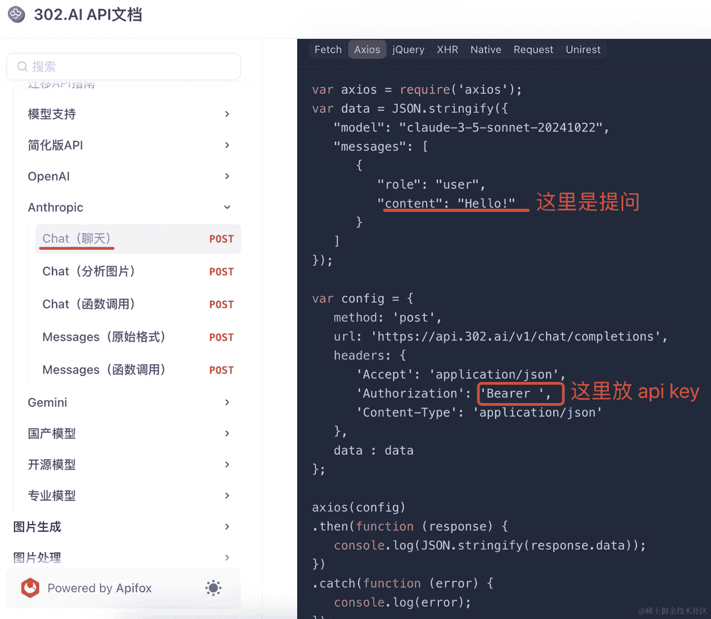

我们创建个测试项目：

```
bash
 代码解读
复制代码
mkdir ai-testcd ai-testnpm init -y
```

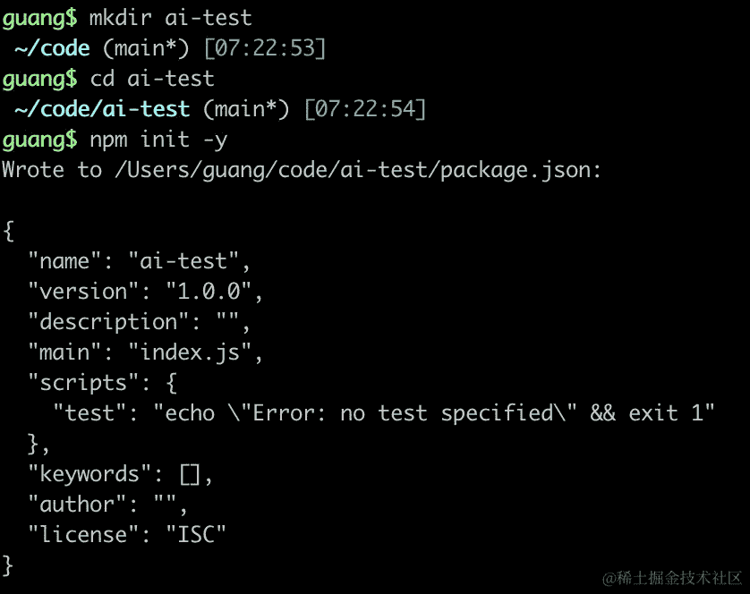

创建 index.js

```
javascript
 代码解读
复制代码
var axios = require(&#x27;axios&#x27;);var data = JSON.stringify({   &quot;model&quot;: &quot;claude-3-5-sonnet-20241022&quot;,   &quot;messages&quot;: [      {         &quot;role&quot;: &quot;user&quot;,         &quot;content&quot;: &quot;生成一个菜谱大全网站，用 react、ts 写，用 json 形式返回，key 是文件目录，value 是文件内容&quot;      }   ]});var config = {   method: &#x27;post&#x27;,   url: &#x27;https://api.302.ai/v1/chat/completions&#x27;,   headers: {       &#x27;Accept&#x27;: &#x27;application/json&#x27;,       &#x27;Authorization&#x27;: &#x27;Bearer API_KEY放这里&#x27;,       &#x27;Content-Type&#x27;: &#x27;application/json&#x27;   },   data : data};axios(config).then(function (response) {   console.log(JSON.stringify(response.data, null, 4));}).catch(function (error) {   console.log(error);});
```

填入刚才的 api key，content 那里输入内容。

安装依赖，然后跑一下：

```
bash
 代码解读
复制代码
npm install --save axiosnode ./index.js
```

我们打印下这部分：

```
javascript
 代码解读
复制代码
console.log(response.data.choices[0].message.content)
```

和我们在网页那里问的结果一样：

我们可以用 remark 来 parse 出 AST，拿到这部分代码：

在 [astexpoler.net](https://link.juejin.cn?target=https%3A%2F%2Fastexplorer.net%2F%23%2Fgist%2Fc2092957576e4fe0343db18940c6338e%2F638dcac8116133edf8f0d977175a73a24afcaf32) 可以看到 AST。

然后把这些依次写到磁盘里就好了。

加上 typescript、vite、tailwind 等基础代码，就可以跑了。

那 bolt.new 在浏览器里执行 npm install、npm run dev，是怎么做到的呢？


这是用他家之前出的 [WebContainer](https://link.juejin.cn?target=https%3A%2F%2Fwebcontainers.io%2F) 来做的。

前几年刚出的时候火过一段时间，不知道大家还有印象没：

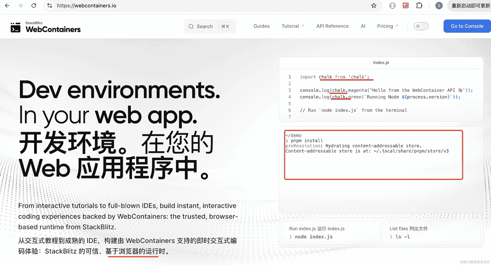

就是基于 wasm 实现的浏览器里的 node 运行时，也可以跑 npm。

所以自然就可以执行 npm install、npm run dev，跑各种 node 代码。

个人用、不商用是免费的：

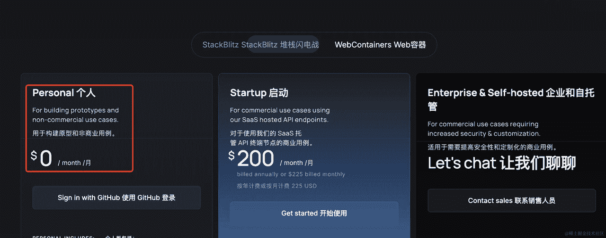

那怎么用呢？

官方有个 demo：

stackblitz.com/edit/stackb…

最终效果就是在浏览器里跑起来了 express 服务：

api 是这么用的：

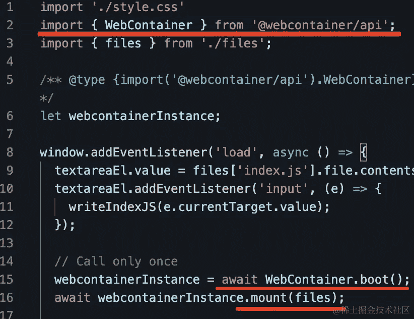

调用 @webcontainer/api 包的 WebContainer 的 api。

首先调用 boot，把它跑起来。

然后调用 mount 传入一些 files。

这里有两个 file：

一个 package.json，一个 index.js

后面还可以调用 fs 的 api 来写入文件：

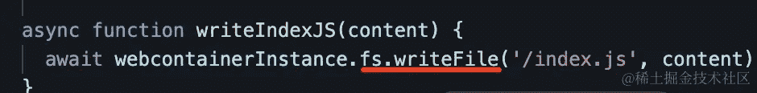

总之，就是 webcontainer 里有一套文件系统。

然后有了 package.json 就可以跑 npm install 了：

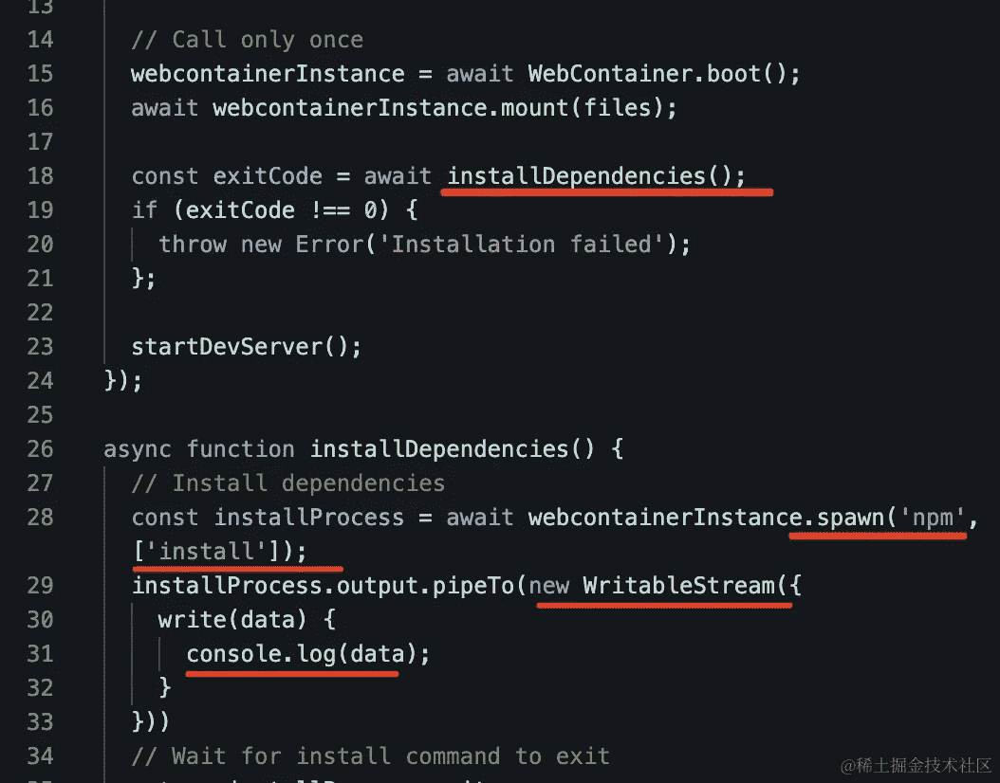

调用 spawn 来执行命令，这里跑下 npm install。

然后结果可以在 WriteStream 里拿到。

这里只是打印了下，后面可以接入 xtrerm 在浏览器里显示终端。

也就是在这个东西：

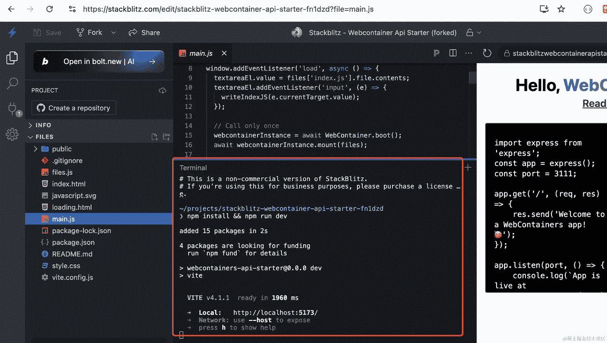

之后继续执行 npm run start 的命令就好了

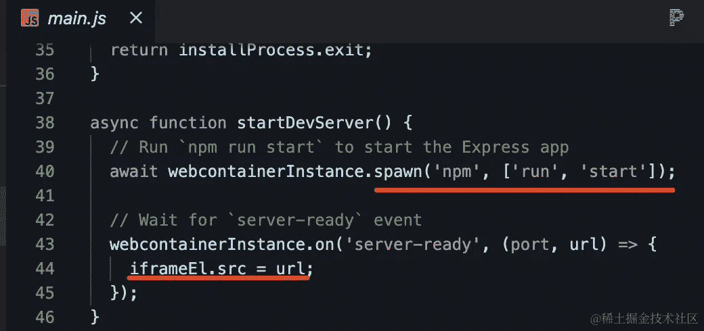

这里是通过 iframe.src 来访问的这个 express 服务。

这样，我们就通过 @webcontainer/api 在浏览器里跑了一个 express。

其实 WebContaienr 用起来还是很简单的，

这俩都是他家的：

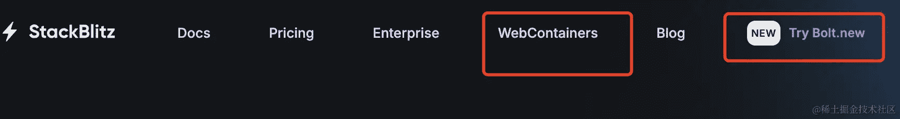

那自然会在实现 bolt.new 的时候用到 WebContainer 在浏览器里做构建。

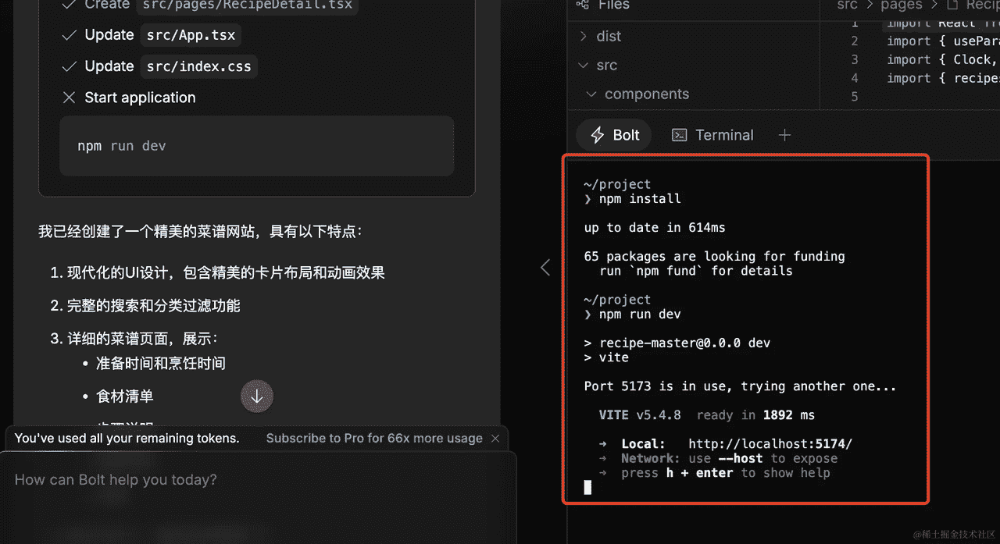

那之后的部署呢？

在浏览器里跑完 npm run build 之后，拿到 dist 目录上传到服务器就好了。

这就是 bolt.new 的大概实现原理。

## 总结

今天我们了解了一下 bolt.new，它可以通过文本描述需求，让 AI 去生成前端项目的代码，然后在 webcontainer 里跑 npm install 和 npm run build 等，把产物部署到服务器上，之后直接通过 url 访问 AI 生成的代码的效果。

我们简单试了一下这个流程，首先我们用的国内的一个 AI 代理商的接口来试了下代码的生成，用的 cursor 一样的模型，生成的目录和代码都是可以直接跑的。

然后学习了下  @webcontainer/api，它是一个基于 wasm 实现的浏览器里的 node 环境，可以往其中写入一些文件，然后跑各种 node 脚本。

之后我们还可以在服务器上加一个接口来接收编译后的代码，实现部署。

把这个流程连起来，就是 bolt.new 的实现原理。

当然，具体细节肯定还有很多，但思路就是这样的。