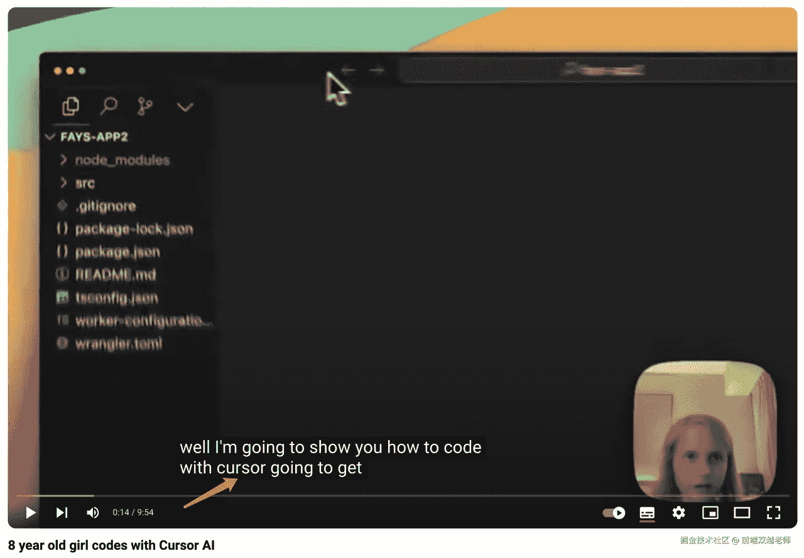
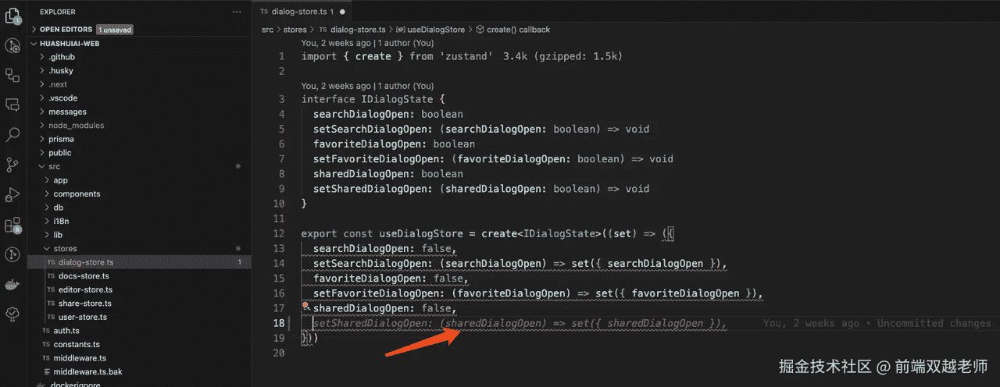
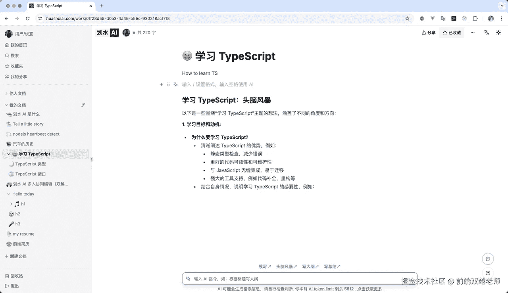
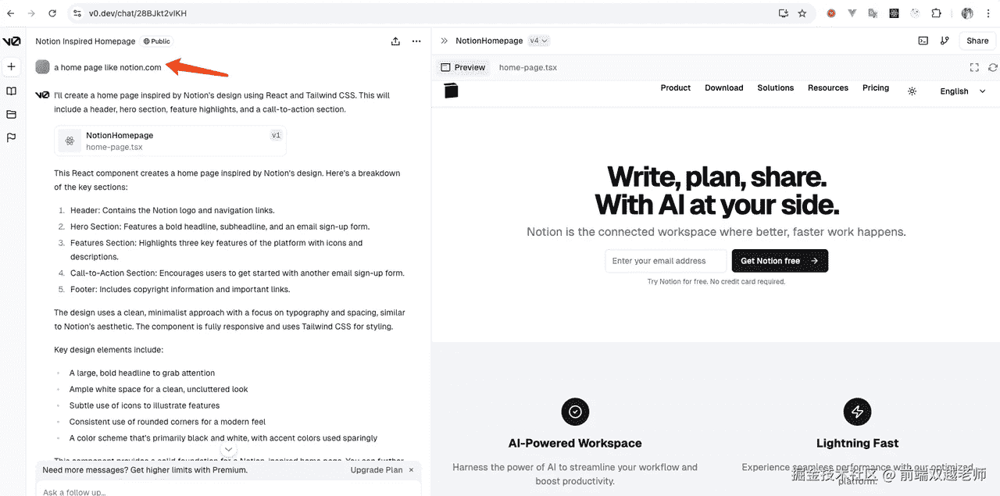
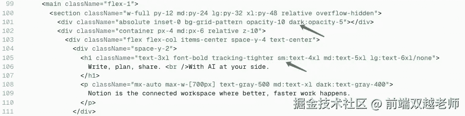

# 程序员设计不出精美的 UI 界面？让 V0 来帮你

> 来源：[https://agijuejin.feishu.cn/docx/Tnr7dZ1Q1oiADexDT8ccI74Fndg](https://agijuejin.feishu.cn/docx/Tnr7dZ1Q1oiADexDT8ccI74Fndg)

> 作者：前端双越老师

> 链接：https://juejin.cn/post/7438647233219903542

> 来源：稀土掘金

> 著作权归作者所有。商业转载请联系作者获得授权，非商业转载请注明出处。

大家好，我是双越，也是 [wangEditor](https://link.juejin.cn?target=https%3A%2F%2Fwww.wangeditor.com%2F) 作者。

> [今年我致](https://juejin.cn/pin/7434191897616777279)力于开发一个 Node 全栈 AIGC 知识库 划水AI，包括 AI 写作、多人协同编辑。复杂业务，真实上线，大家可以去注册试用。

[本文分享一下](https://link.juejin.cn?target=https%3A%2F%2Fv0.dev%2F)前端实用的 [AI 工](https://juejin.cn/pin/7434191897616777279)具 v0.dev 以及我在 划水AI 中的实际应用经验，非常推荐这款工具。

## 不同 AI 工具写代码

### ChatGPT 不好直接写代码

去年 ChatGPT 发布，但它一直是一个聊天工具，直接让它来写代码，用一问一答的形式，体验其实并不是非常友好。

可以让它来生成一些单一的代码或工具，例如 生成一个 nodejs 发送 Email 的函数 。然后我们把生成的代码复制粘贴过来，自己调整一下。

它可以作为一个导师或助理，指导你如何写代码，但它没法直接帮你写，尤其是在一个项目环境中。

PS. 这里只是说 ChatGPT 这种问答方式不适合直接写代码，但 ChatGPT 背后的 LLM 却未后面各种 AI 写代码工具提供了支持。

### Cursor 非专业程序员

Cursor 其实去年我就试用过，它算是 AI 工具 + VSCode ，付费试用。没办法，AI 接口服务现在都是收费的。

前段时间 Cursor 突然在社区中很火爆，国内外都有看过它的宣传资料，我记得看过一个国外的 8 岁小女孩，用 Cursor 写 AI 聊天工具的视频，非常有意思，我全程看完了。

Cursor 可能会更加针对于非专业编程人员，去做一些简单的 demo ，主要体验编程的逻辑和过程，不用关心其中的 bug 。

例如，对于公司的 PM UI 人员，或者创业公司的老板。它真的可以产生价值，所以它也可以收费。

### Copilot 针对专业程序员

我们是专业程序员，我更加推荐 Copilot ，直接在 vscode 安装插件即可。

我一直在使用 Copilot ，而且我现在都感觉自己有点依赖它了，每次写代码的时候都会停顿下来等待它帮我生成。

在一些比较明确的问题上，它的生成是非常精准的，可以大大节省人力，提高效率。

[如果你遇到 Copil](https://link.juejin.cn?target=https%3A%2F%2Fdocs.aws.amazon.com%2Fcodewhisperer%2Flatest%2Fuserguide%2Fwhat-is-cwspr.html)ot 收费的问题，可以试试 Amazon CodeWhisper ，同样的功能，目前是免费的，未来不知道是否收费。

## UI 很重要！！！

对于一个前端人员，有 UI 设计稿让他去还原开发这并不难，但你让他从 0 设计一个精美的 UI 页面，这有点困难。别说精美，能做到 UI 的基本美观就已经很不容易了。

举个例子，这是我偶遇一个笔记软件，这个 UI 真的是一言难尽：左上角无端的空白，左侧不对齐，icon 间距过大，字号不统一，tab 间距过小 …… 这种比较随性的 UI 设计，让人看了就没有任何试用的欲望。

可以在对比看一下 [划水AI](https://juejin.cn/pin/7434191897616777279) 的 UI 界面，看颜色、字号、艰巨、icon 等这些基础的 UI ，会否更加舒适一些？专业一些？

PS. 无意攻击谁（所以打了马赛克），只是做一个对比，强调 UI 的重要性。

## V0 专业生成 UI 代码

[V0](https://link.juejin.cn?target=https%3A%2F%2Fv0.dev%2F) 也是专业**写代码的，****不过它**更加专注于一个方向 —— 生成 UI 代码 ，能做到基本的美观、舒适、甚至专业。

给一个指令 a home page like notion.com 生成了右侧的 UI 界面，我觉得已经非常不错了。要让我自己设计，我可设计不出来。

这一点对于很多人来说都是极具价值的，例如中小公司、创业公司的前端人员，他们负责开发 UI 但是没有专业的 UI 设计师，或者说他们开发的是一些 toB 的产品，也不需要招聘一个专职的 UI 设计师。

你可以直接拷贝 React 代码，也可以使用 npx 命令一键将代码转移到你自己的项目中。

它甚至还会考虑到响应式布局和黑白主题，这一点很惊艳

再让 V0 生成一个登录页，看看能做到啥效果。在首页输入指令 A login form like Github login page

等待 1-2 分钟，生成了如下效果，我个人还是挺满意的。如果让我自己写，我还得去翻阅一些 UI 组件库文档，看 form 表单怎么写，怎么对齐，宽度多少合适 …… 光写 UI 也得搞半天。

[划水AI](https://juejin.cn/pin/7434191897616777279) 中“我的首页” 就是 V0 生成的，虽然这个页面很简洁，但是我个人对 UI 要求很高，没有工具帮助，我无法短时间做到满意。

## 最后

任何行业和领域，看它是否成熟、是否能发展壮大，一个很重要的特点就是：是否有庞大的细分领域。例如现代医学、现代制造业、计算机领域…… 专业细分及其周密，大家各司其职，整个领域才能欣欣向荣。

AI 领域也是一样，AI 编程将是一个细分领域，再往下还有更多细分领域，像针对 UI 的、针对数据库的、针对云服务的，未来会有更多这方面的发展。