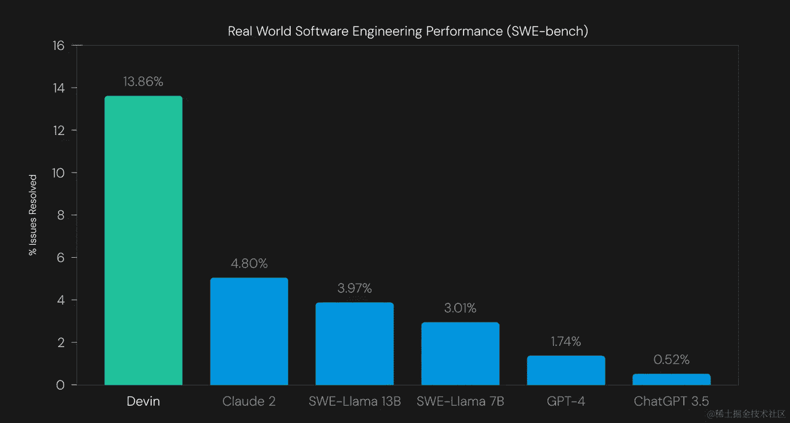
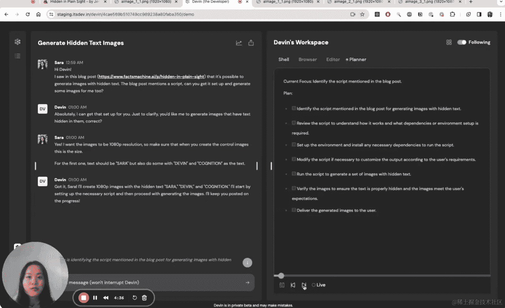
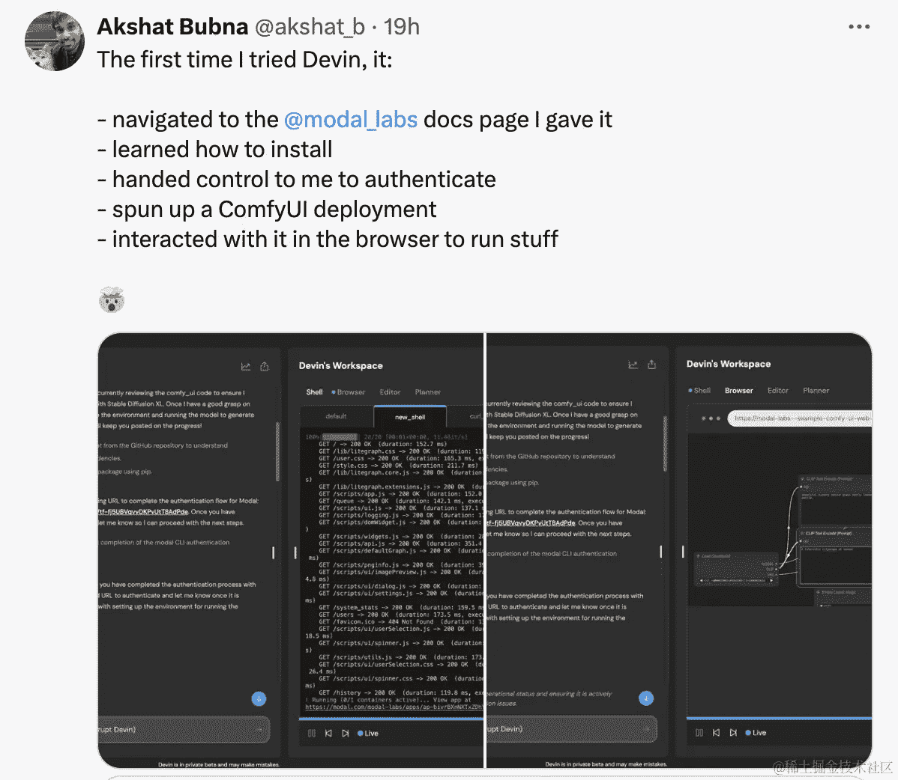

# 程序员警惕！首个AI软件工程师Devin问世！他们铁了心砸掉程序员饭碗

> 来源：[https://agijuejin.feishu.cn/docx/FhY3deGTJoIrWzx25QKcTJlJnxf](https://agijuejin.feishu.cn/docx/FhY3deGTJoIrWzx25QKcTJlJnxf)

> 作者：芝士加

> 链接：https://juejin.cn/post/7345687862530686986

> 来源：稀土掘金

> 著作权归作者所有。商业转载请联系作者获得授权，非商业转载请注明出处。

> 只需一句指令，它可端到端地处理整个开发项目。

一觉醒来，程序员怕是**真要失业**了，👀一项革命性的技术震撼了科技界。

**全球首个** **AI** **软件工程师**一亮相，直接引爆整个科技圈。只需一句指令，它可端到端地处理整个开发项目，预示着软件开发领域的未来可能不再需要人类参与。

> **欢迎关注公众号《****前端界**》，文章会同步更新，也可快速加入前端交流群！

能力令人惊叹，只需简单的指令，它便能独立完成整个开发项目，从零开始构建网站，自动检测和修复代码错误，甚至能够自我学习和调整其AI模型， 更可怕的是，也可为一些成熟的代码库做贡献（🙉大部分多年开发经验的程序员都做不到！）。

在最近的SWE-bench编码基准测试中，它展**现了其卓越的**性能。它无需人类帮助，可解决13.86% 的问题。

**而相比之下**，GPT-4在同一测试中只能处理 1.74% 的问题，且都需要人类提示告知处理哪些文件。

可以这样说，它远远超过了此前所有AI大模型。

Devin被介绍为**世界首个完全自主**的AI软件工程师。

它在**长程推理和规划****上面下了很**大功夫，可以规划和执行需要数千个决策才能完成的复杂软件工程任务。

在这之中，进行到任何一步它都可以回调所有相关的上下文信息，保证整体逻辑性，并方便随时校正错误。

既然是一个端到端AI，软件开发人员常用的工具，比如shell、代码编辑器和浏览器等等，Devin也都配备（沙盒计算环境中），主打一个全方位服务。

最终的Devin，让人类只需要发号施令，其他什么也不用做。

比如Devin 通过阅读博客文章学习，用ControlNet，生成带有隐藏文字的图像，学习能力真的是一点就通～

另外，Devin 可以自主查找并修复代码库中的错误。

原视频地址：www.youtube.com/watch?v=TiX…

目前Devin尚未公测，不过已经有少部分人拿到了资格，开始实测了一波……

比如这位叫Akshat Bubna的网友分享：

所以，程序员们做好和 **AI Devin** PK的准备了吗？🐶