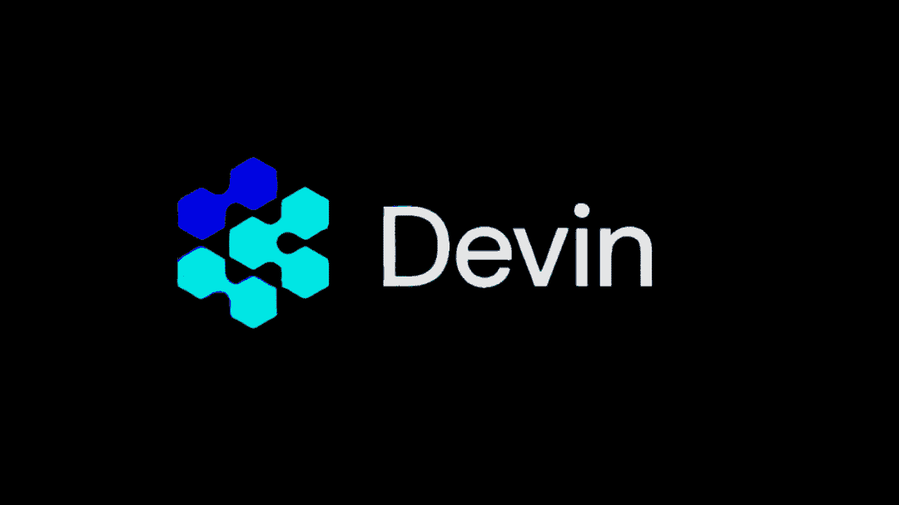
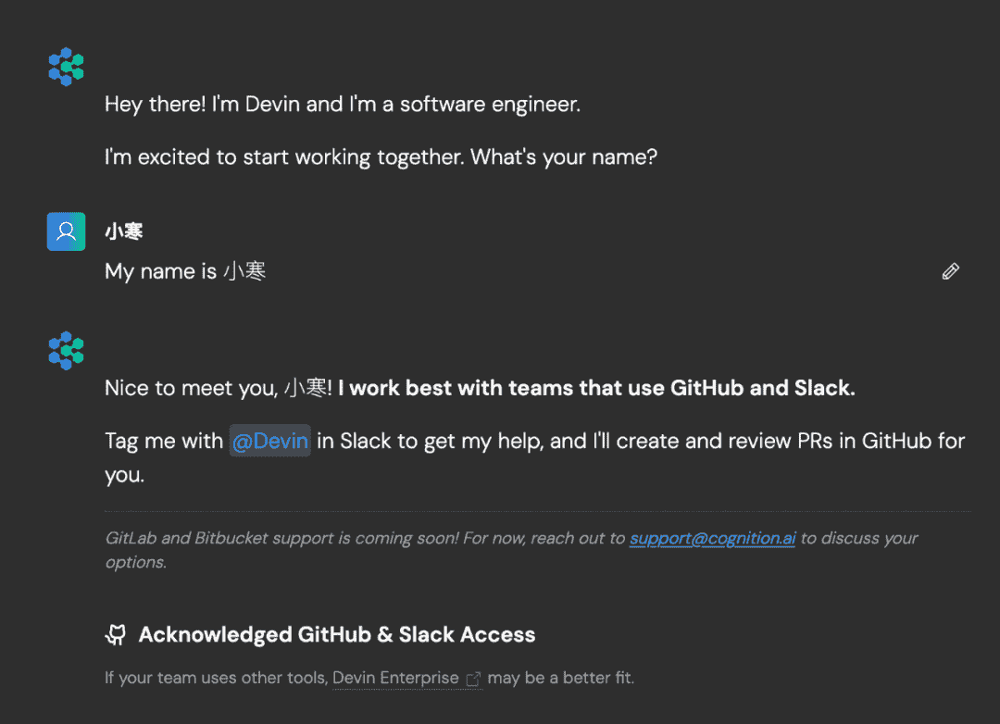
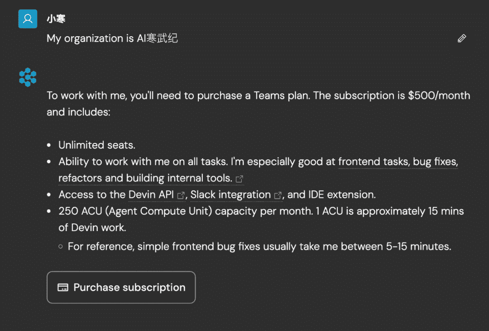
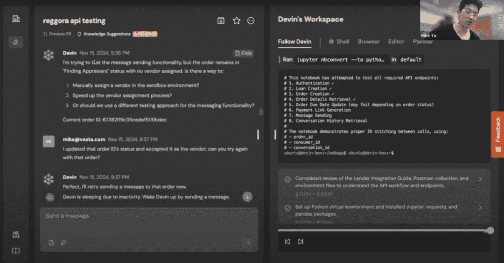
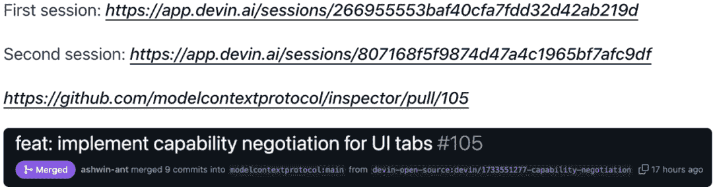
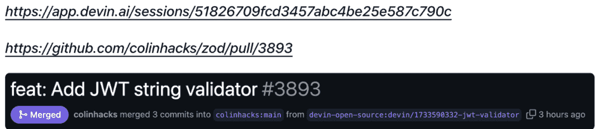
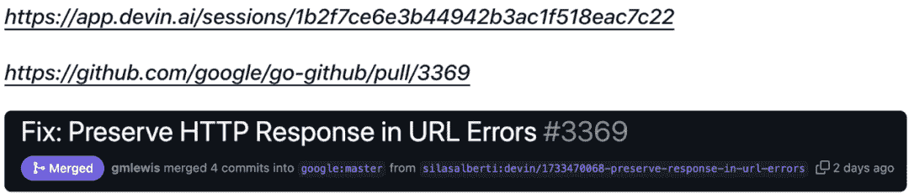
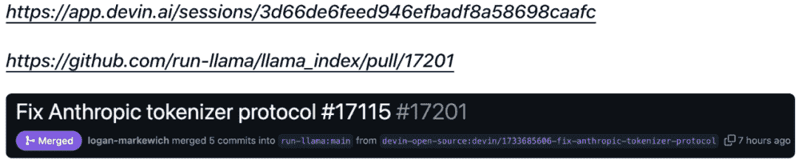
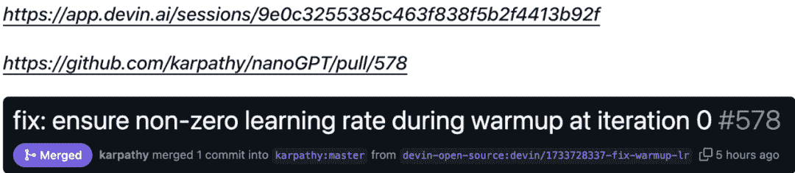

# 一觉睡醒，你的AI码农同事Devin已经正式上线了，月薪只要3500

> 来源：[https://agijuejin.feishu.cn/docx/GJqhdfkeHoUHraxzLEecgdnMnAT](https://agijuejin.feishu.cn/docx/GJqhdfkeHoUHraxzLEecgdnMnAT)

> 作者：AI寒武纪

> 链接：[https://mp.weixin.qq.com/s/6o](https://mp.weixin.qq.com/s/6o2UFIBbNhFBHfSjRyK90w)2UFIBbNhFBHfSjRyK90w

> 来源：🛰️👸号丨AI寒武纪

> 如有侵权，请联系删除。

> 还记得Devin吗？号称全球第一位人工智能软件工程师，今天终于正式发布了

由 Cognition 团队开发的 AI 编程助手 Devin 于 北美2024 年 12 月 10 日正式发布，面向工程团队提供服务，每月起价 500 美元。我来翻译一下：你的AI码农同事Devin已经正式上线了，每个月工资只要500美金起，以后你就要开始和Devin比拼KPI了，就问你慌不慌

Devin正式版不限制席位数量，只要支付了 500 美元的月费，整个团队都可以使用 Devin 的所有功能并提供 Slack 集成、IDE 扩展和 API 接口，Cognition 工程团队还将提供使用指导和技术支持。所有工程团队现在都可以在 app.devin.ai 上开始使用 Devin

**Devin 究竟是什么？**

简单来说，Devin 是一款人工智能软件工程师，它能够理解你的需求，并像一位经验丰富的程序员一样编写和修改代码。它不仅可以修复 bug，还能进行代码重构、创建代码初稿，甚至编写测试脚本。想象一下，你只需简单描述你的需求，Devin 就能帮你完成大量的编程工作，这将大大提升你的工作效率，让你有更多时间专注于更具创造性的任务

# **Devin 的优势工作场景**

虽然 Devin 可以作为一种通用工具，但 Cognition 团队建议用户从以下场景开始使用：

恼人的小 bug 和边缘案例？交给 Devin！ 在 Slack 中 @Devin，它就能像一个敏锐的侦探一样，找出代码中的问题并提供解决方案。你甚至可以直接在 Slack 中与 Devin 讨论代码逻辑，就像与同事交流一样自然

积压的任务太多？Devin 帮你快速启动！ 每天开始工作前，将待办事项列表中的任务分配给 Devin，它可以帮你创建 PR 的初稿，让你轻松开启一天的工作。

想要优化代码结构？Devin 是重构高手！ 使用 Devin IDE 扩展（目前支持 VSCode 及其分支），你可以轻松地让 Devin 重构你指定的代码片段，让你的代码更加简洁优雅

当然，Devin 的能力远不止于此。它可以辅助构建集成、迁移和维护文档等多种任务。就像一位全能的助手，Devin 几乎可以处理任何你交给它的编程任务

# **如何使用Devin**

Slack 是启动 Devin 会话的主要界面。用户可以快速标记 @devin 来卸载较小的任务，并在报告 bug 时进行修复。可以尝试让 Devin 优先处理下一个第三方集成、重构或代码库问题。Devin 完成后会向用户发送消息，用户可以随时查看 Devin 创建的 PR。Devin 还可以自动回复 GitHub PR 评论

用户还可以通过 IDE 中的 % G 命令直接将异步工作交给 Devin。Devin 扩展（测试版功能适用于 VScode 及其分支）允许用户直接在 IDE 中查看 Devin 的 PR，并审查和接受 Devin 的代码

为了充分发挥 Devin 的潜力，Cognition 团队提供了一些实用技巧：

1.  1. **从你熟悉的任务开始。** 先让 Devin 处理一些你知道如何完成的任务，这样你可以更好地评估它的工作成果，并逐步建立对它的信任

1.  2. **清晰的指令是关键。** 就像指导一位新人程序员一样，告诉 Devin 如何测试和检查它的工作，并提供详细的需求说明，这有助于 Devin 更好地理解你的意图，并生成更符合你期望的代码

1.  3. **把大任务分解成小任务。** 为了避免 Devin 迷失方向，建议将大型任务分解成更小的、更易于管理的子任务，并控制每次会话的时长，最好不要超过 3 小时

1.  4. **持续反馈，共同进步。** Devin 的学习能力非常强，你的反馈对它至关重要。在聊天中提供你的意见，接受或修改 Devin 建议的知识，都能帮助 Devin 更好地理解你的编程风格和偏好，从而提供更个性化的服务

# Devin 不是花瓶，已经参与开源贡献

Devin 不仅能帮助你提升工作效率，还积极参与开源社区的建设。它已经成功地为 Anthropic MCP、Zod、Google Go Github 客户端、Llama Index 和 Karpathy's nanoGPT 等多个知名开源项目做出了贡献，证明了其在实际应用中的价值

**Anthropic MCP**：Devin 识别了用户报告的问题原因，并通过浏览器阅读 MCP 规范以理解“能力协商”，并在浏览器中端到端地测试其更改

**Zod**：Devin 为流行的库 Zod 添加了新功能，并与用户协同规划、跨多个文件实施该功能，并编写了测试

Google Go Github 客户端：Devin 解决了 Go Github 客户端中 HTTP 错误响应对象传播的问题，并自动编写和运行单元测试

**Llama Index**：Devin 修复了 Anthropic tokenizer 实现中的一个错误，并编写了单元测试

Karpathy's nanoGPT: Devin 为一个细微但重要的代码更改编写了测试脚本

### **Cognition 团队**

Cognition 团队规模虽小，但人才济济。其创始团队拥有 10 枚 IOI 金牌，成员包括曾在 Cursor、Scale AI、Lunchclub、Modal、Google DeepMind、Waymo 和 Nuro 等公司从事前沿应用人工智能工作的领导者和构建者