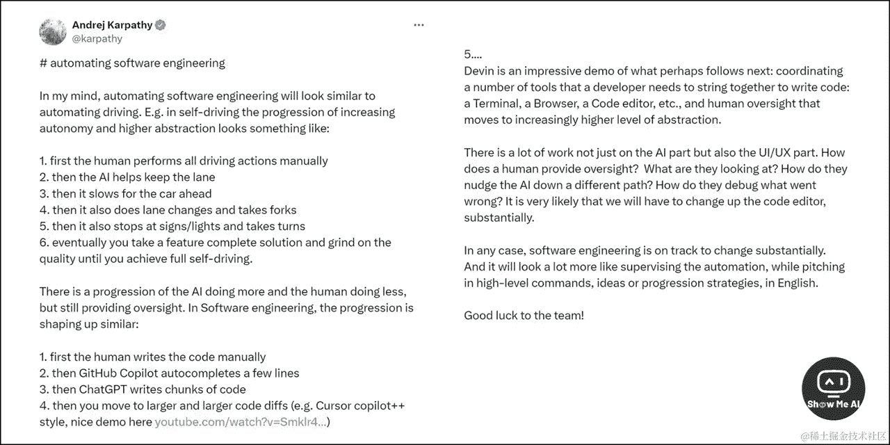
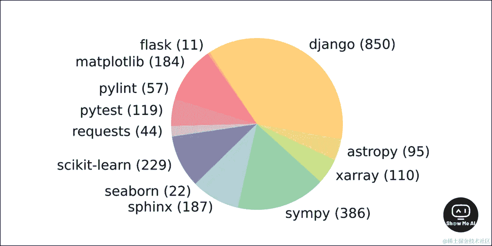
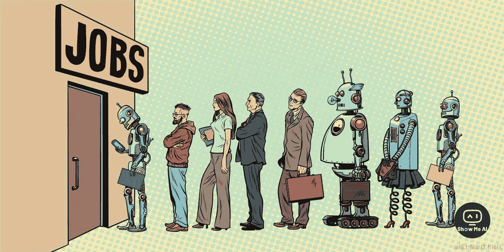
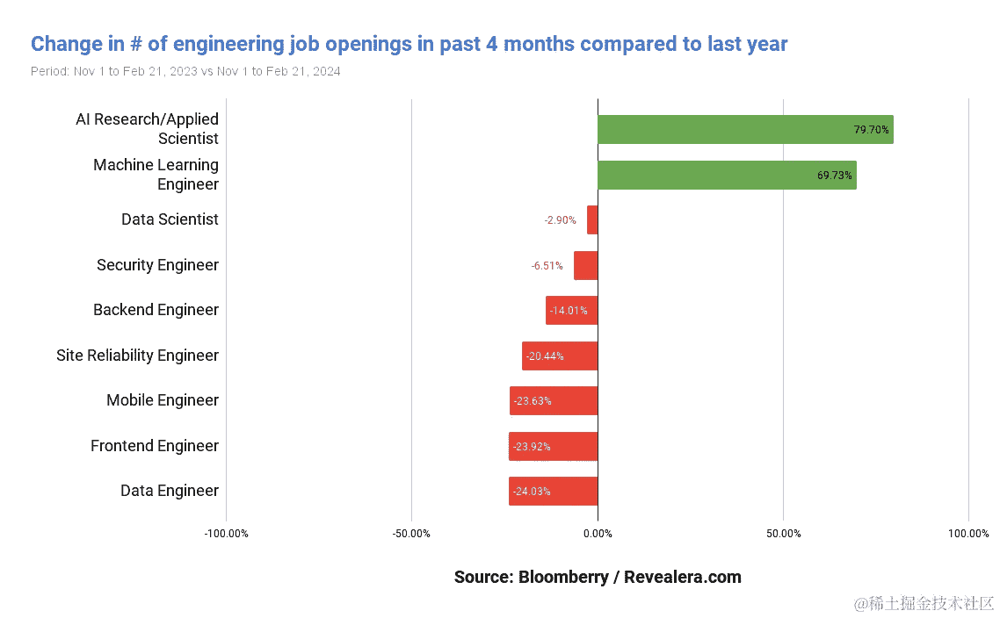
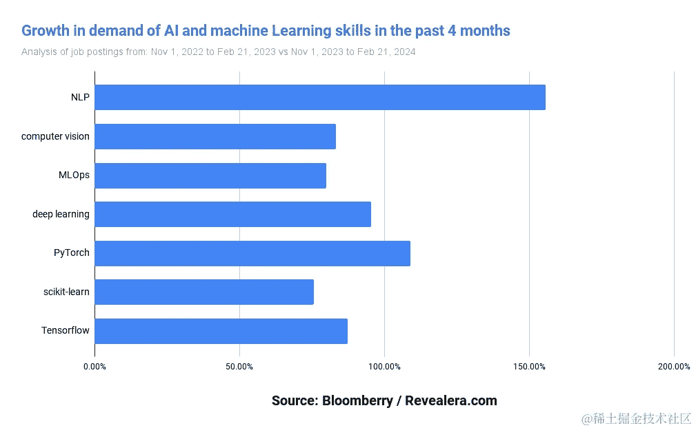
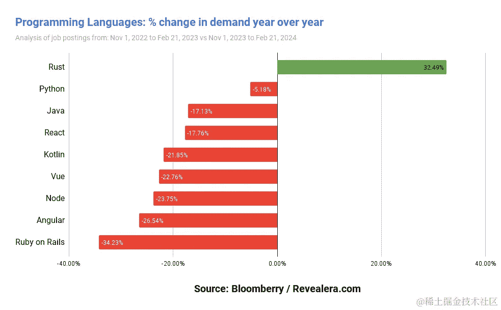
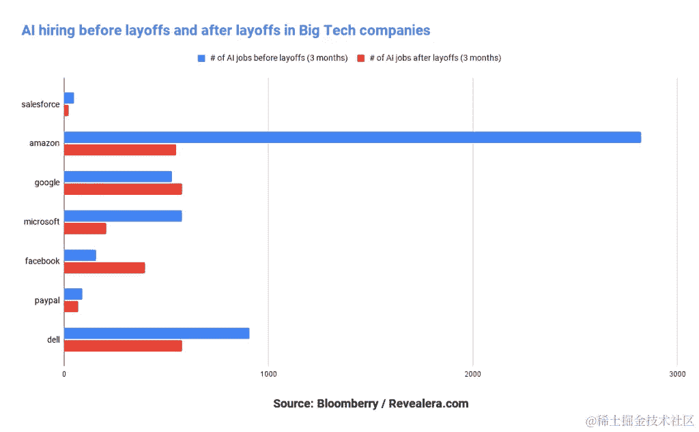
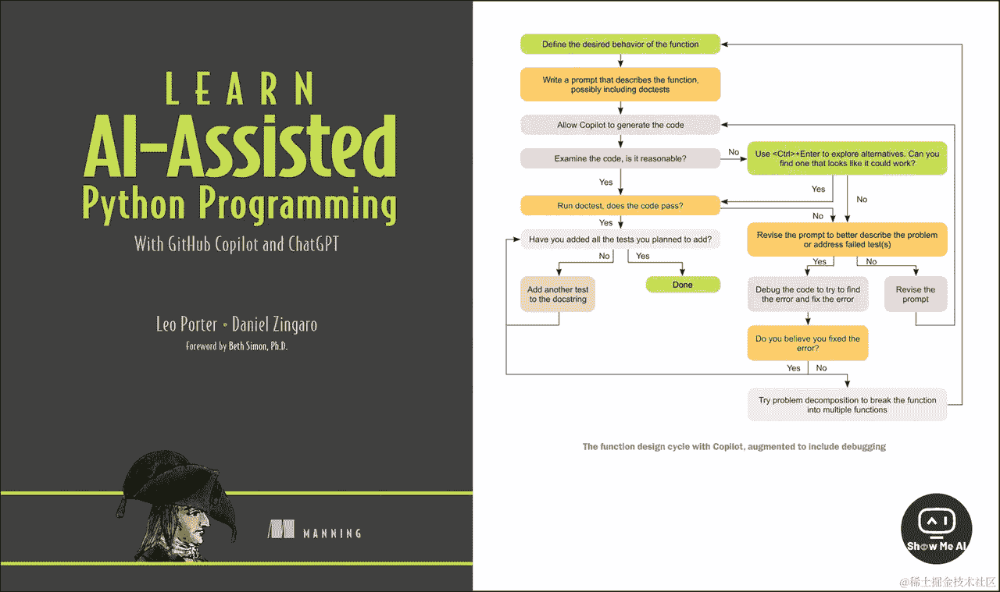

# 全球首位AI软件工程师 Devin；2000万份数据探寻「工作难找」的真相；产品经理AI修炼手册；<电子书>AI帮我快速学Pyhton | ShowMeAI日报

> 来源：[https://agijuejin.feishu.cn/docx/TAoXdoYG3oA9D7xkKnMcBBhSn0d](https://agijuejin.feishu.cn/docx/TAoXdoYG3oA9D7xkKnMcBBhSn0d)

> 作者：ShowMeAI

> 链接：https://juejin.cn/post/7347910830731919397

> 来源：稀土掘金

> 著作权归作者所有。商业转载请联系作者获得授权，非商业转载请注明出处。

## 🉑 全球首位AI软件工程师 Devin：这次破大防的是程序员们

3月12号，Cognition Labs 在其X账号推出了全球首位AI软件工程师 Devin，其表现随机引发了全球IT界的关注。

虽然官方之发布了演示 Demo 片段，但**其展现出的能力带给程序员们**极**大的震撼：Devin 熟练掌**握**全栈开发技能，能自主学习**并快速掌握新技术，能端到端地构建和部署应用程序，能自己排查和修正 bug，甚至还能训练和微调自己的AI模型。

最让人感到震撼的是，用户只需[**输入一句指令，D**](https://link.juejin.cn?target=https%3A%2F%2Fmp.weixin.qq.com%2Fs%2FITGqXumeKL3j13aKOb0PSA)evin 就能端到端完成整个开发项目 😮 ⋙ 查看演示视频

> www.cognition-labs.com/blog

据官网介绍，Devin 在 **SWE-bench** **基准测试中的表现，碾压全球其他所有大模型：在**没有人类帮助的情况下，Devin 可以解决**13.86%**的问题。相比之下，GPT-4 只能处理1.74%的问题，而且还需要人类告诉它需要处理哪些文件。

**这次好像，，狼真的来了** 😨

开发团队介绍，Devin 已经通过一家顶级AI公司的实际工程面试，还在 Upwork 平台上完成了很多项真实的工作任务！！全球程序员们，还有与他们密切协作的产品经理们，紧迫感瞬间拉满~

> twitter.com/karpathy/st…

**不过，似乎，也不用那么紧迫** 🧐

**Andrej Karpathy 大神转帖并阐**述了他的观点：软件自动化的进程可能类似于「自动驾驶」，有一个逐渐增加自动化、减少人类参与的过渡周期，大致进程可以分为：

+   初始阶段：人类手动编写代码。

+   辅助阶段：GitHub Copilot 等工具开始自动完成一些代码行

+   扩展阶段：ChatGPT 等工具能够编写更大块的代码

+   集成阶段：使用更高级的工具 (如Cursor copilot++风格) 处理越来越大的代码差异。

+   未来展望：协调开发者需要使用的各种工具 (如终端、浏览器、代码编辑器等) 进行编程 (就像 Devin)，并在更高抽象层次上提供人类监督

**这极大地改变了软件工程各岗位的协作方**式，并且对编码器的用户界面和用户体验 (UI/UX)设计提出了全新的挑战。不过，也有声音表示，Devin 的演示 Demo 很短且不排除有夸张的部分 (我们经历过很多了)，所以真实效果仍需检验。

> Devin 拍了怕「程序员」，整个IT大厦跟着晃了一下 👋👋👋

## 👀 Devin 很厉害但还不够，连「初级软件工程师」都胜任不了

> www.htormey.org/can-you-rep…

在可预期的相当长一段时间内，Devin 不可能取代软件工程师。

一方面，人类工程师的岗位职能是多样的，除了编程，还有用户需求洞察、复杂问题拆解、协作沟通思考等等。AI的能力远不能覆盖所有技能。

另一方面，哪怕是在「编程」这个方向，Devin 展示出的能力也不太「够用」——人类最初级软件工程师的工作复杂度，足以让 Devin 崩溃。

**为了解释清楚这个观**点，就要先介绍一下「SWE-bench」这个基准测试。

其实，SWE-bench 已经是更接近现实的基准测试了，它包含了 2,294 个来自 GitHub 的实际问题和拉取请求，这些任务要求AI有更深层次的理解 & 与代码的交互，因此测试成绩能够比较真实地展示AI的能力。

**所以，De**vin 在 SWE-bench 上正确解决了 13.86% 的问题，的确展示出了远超以往的技术水平，说明 Cognition Labs 团队非常优秀。

但是！对比一下人类开发者的实际工作，就会发现 SWE-bench 基准测试的复杂度一般。

**拿「修复bug」这类测试举例**。

**SWE-bench 要求 Devin** 修复的是编程竞赛算法库中的常见 bug：一般涉及到**一个特定的算法问题，而且通常**有明确的输入和输出，以及有一个或多个已知的解决方案。这种类型的任务正式AI擅长的。

然而，真实世界中的软件开发通常要复杂得多，开发者们在修复bug时，可能需要面对多系统交互、并发和性能问题、用户反馈和需求变更、代码维护和重构等等问题。而这些挑战并没有体现在 SWE-bench 基准测试里。

总之！莫慌！Devin 短时间内对不会替代人类软件工程师！反而，Devin (这类AI 工具) 会成为优秀的助手，帮助人类将日常任务自动化，释放出更多时间和创造力~

## **🉑 20**00万份岗位数据，揭露程序员「工作难找」的残酷真相

> bloomberry.com/how-ai-is-d…

一项调查显示，25%的工程师们花了一年才找到新工作。这在过去几年是完全不可想象的！！

**作者分析了2022年11****月1日至2024年2月2**1日期间的2000万个技术岗位空缺，想一探究竟：到底发生了什么？！AI是这一切的罪魁祸首吗？

**哪些工程岗位 (例如机器学习、数据科**学、前端、后端) 的需求增长和下降最多？

**增长**：AI研究科学家和机器学习工程师的需求显著增长，其中AI科学家的职位空缺增长了80%，机器学习工程师增长了70%。这表明这些角色目前非常受欢迎。

**下降**：其他类型的工程师需求减缓，特别是移动工程师、前端工程师和数据工程师的职位空缺比一年前下降了超过20%，目前不那么受欢迎。

各工程岗位的薪资在过去一年中如何变化？

过去一年中，尽管AI人才的需求激增，但在高生活成本城市 (如旧金山、纽约和西雅图) 的薪资并没有显著增长。实际上，考虑到通货膨胀，薪资与之前是基本持平的，即使是AI科学家和机器学习工程师的薪资也是如此。

哪些技能/技术/语言的需求增长和下降最多？

+   **增长**：自然语言处理 (NLP) 技能的需求增长最为显著，增长了 155%。计算机视觉的需求增长较少，可能是因为其应用场景更为专业化，而 LLMs (大语言模型) 的职位空缺增长了惊人的 3000%。

+   **下降**：Rust 编程语言需求增长显著，而 Ruby on Rails 的受欢迎程度持续下降。React的需求虽然下降，但仍在从Angular和Vue中抢占市场份额。

公司在裁员后是否比之前招聘了更多的AI人才？

裁员后，公司在招聘AI人才方面没有显著增加。虽然在裁员后三个月内，与裁员前相比，进行裁员的公司平均增加了20%的AI相关职位空缺，但总体职位空缺也增加了24%。这表明裁员和增加AI人才招聘之间没有直接关系。公司可能因为其他原因 (如过度招聘、高利率和成本效率措施) 进行裁员，而不是为了转向AI战略。

SO！结论是！AI技术爆发与这轮技术岗位裁员，木有明显关系~ 不过呢，各个岗位的工程们可以把AI技能学起来了，可以考虑转到更更受欢迎的AI科学家、机器工程师等方向，还能为即将到来的 LLM 浪潮做准备 🥳

## 👀 但是产品经理笑了：欢迎 Devin！这下可以大展拳脚了~

> www.commandbar.com/blog/devin-…

相较于程序员们的悲观与焦虑，产品经理们对 Devin 展示出积极的善意！

一方面，填写工单、用户故事、规范文档、战略备忘录、分析数据、总结用户反馈等等，这些繁琐的工作终于可以交给AI了！！

另一方面，想办法让领导过审项目需求、保持工程师和设计师的积极性、与用户沟通并洞察真实需求等「核心技能」，还是AI短时间内攻不破的堡垒~

**还有就是，AI可以预见地将大幅**提升整个团队的效率，换句话说，小团队也很有可能搞出「大动静」，极大拓展了创意落地的想象空间 👀

> 作者提到了 Kraftful 这家公司正在研发面向产品经理的 Copilot，，旨在通过自动化和智能化的工具来提高产品经理的工作效率，感兴趣可以关注下 👇

> www.kraftful.com

## 🉑 产品经理的AI修炼手册：AI 技术进步，将极大拓展 PM 岗位版图

> world.hey.com/haws/the-ri…

想成为被AI加持的产品经理，需要从哪些方面进行努力呢？不妨看看这篇教程！

作者非常清晰地列出了各项技能清单，而且明确说，不用担心自己没有技术背景，只要保持热情地学习，实现目标就是完全有可能的！而且已经有很多这样的例子的~

**AI + 产品经理 = ？**

+   岗位职责：识别何时使用AI、理解客户需求、研究最新AI模型、构建概念验证（PoC）、与工程团队合作将AI模型整合到产品中。

+   注意事项：技术与用户需求之间找到平衡；可能需要阅读白皮书、听播客、亲自尝试工具，并理解不同模型适用的问题类型。

**AI技术可能带来变革的领域？**

+   大语言模型（LLM）在聊天机器人、搜索、情感分析等方面的应用

+   预测分析在库存管理、患者护理、客户流失预防等方面的潜力

+   合成数据生成在测试数据和调查响应中的应用

+   多模态应用如何结合视觉和语言处理

+   AutoML 如何简化机器学习模型的训练过程

+   ……

**日常工作必备的AI工具**

+   工具清单：ChatGPT、Perplexity、AutoML 平台、Replit等等。

+   工具作用：可以帮助进行高效的产品发现、原型设计和用户测试。

**仍应坚守的基本原则**

+   追求技术进步的同时应坚持基本的原则，比如深入了解用户需求、专注于提供增量价值、使用工具进行实验、持续学习AI的最新发展，并始终将伦理和透明度作为工作的核心。

**AI技能将成为产品经理的标配**

产品经理们要尽早行动，积累AI相关经验，并且为即将到来的技术突破做好准备。熟练掌握AI技能的产品经理，更有可能成为未来的行业领航者。

## 🉑 借助 AI 学会 Pyhton 编程：所有人都能轻松敲代码的时代要来了

> ShowMeAI知识星球资源编码：R240

这本书很有意思，主要内容是教你**在 GitHub Copilot 和 ChatGPT** 的帮助下，快速搞定 Python 编程。

随着AI的普及，编程的门槛也会随之降低，直到大多数人都能轻松上手。比如，就像使用手机和电脑一样，操作 Devin (成熟版) 开发个应用出来。而人工智能领域最受欢迎的编程语言就是 Python。

**是时候学起来了**！勇敢的人先享受世界~

> www.manning.com/books/learn…

阅读这本书不需要编程背景，但应该具备基本的计算机素养。书籍会总结讲解展示原理、代码、代码运行结果解析等内容，所以你的电脑上需要安装 GitHub Copilot 和 ChatGPT (或者同类型软件)。

**随**着内容的展开，读者可以学会用 Copilot 编写 Python 代码，并且理解代码是否符合预期；还可以在不符合预期时，知道如何处理。这本书主要目的，是在实战中教会你 AI+Python 并完成任务目标，而不是照本宣科的讲  Python 的基础知识。

以下是书籍的详细大纲，感兴趣可以前往星球下载电子版 (PDF，英文版)！👆 网站可以在线阅读，还可以直接 COPY 代码！

1.  AI辅助编程与Copilot入门

+   探讨如何与计算机对话

+   技术简介

+   Copilot如何改变我们学习编程的方式

+   Copilot还能为我们做些什么？

+   使用Copilot时的风险与挑战

+   我们需要掌握的技能

+   对AI代码助手（如Copilot）的社会担忧

1.  **开始使用Copilot**

+   准备你的计算机开始学习

+   系统配置

+   在Visual Studio Code中与Copilot协同工作

+   解决Copilot的常见问题

+   我们的第一个编程问题

1.  **设计函数**

+   函数概述

+   函数的优势

+   函数的作用

+   函数的合理任务是什么？

+   与Copilot一起设计函数的循环过程

+   用Copilot创建高效函数的实例

1.  阅读Python代码（第一部分）

+   为什么我们需要阅读代码

+   让Copilot帮助解释代码

+   你需要了解的十大编程特性（第一部分）

+   介绍函数、变量、条件判断、字符串、列表

1.  阅读Python代码（第二部分）

+   你需要了解的十大编程特性（第二部分）

+   介绍循环、缩进、字典、文件、模块

1.  **测试与提示工程**

+   测试代码的重要性

+   封闭测试与开放测试

+   如何测试你的代码

+   重新审视与Copilot设计函数的过程

+   完整的测试示例

+   另一个完整的测试示例：文件测试

1.  **问题分解**

+   问题分解概念

+   自顶向下设计的小例子

+   识别作者身份

+   使用自顶向下设计识别作者身份

+   分解过程子问题

+   自顶向下设计的总结

+   实现我们的函数

+   进一步探索

1.  **调试与深入理解代码**

+   错误（bug）的成因

+   如何定位bug

+   如何修复bug（找到后）

+   根据新技能调整工作流程

+   应用调试技能解决新问题

+   使用调试器深入理解代码

+   调试的注意事项

1.  **自动化日常繁琐任务**

+   程序员为何要创建工具

+   如何使用Copilot编写工具

+   示例1：清理电子邮件文本

+   示例2：为PDF文件添加封面页

+   示例3：整合手机照片库

1.  **制作游戏**

+   游戏程序简介

+   引入随机性

+   示例1：猜数字游戏（Bulls and Cows）

+   示例2：Bogart游戏

1.  **未来展望**

+   提示模式

+   当前局限性与未来趋势

> 感谢贡献一手资讯、资料与使用体验的 ShowMeAI 社区同学们！

> ◉ 点击 👀日[**报&周刊合集，**](https://link.juejin.cn?target=https%3A%2F%2Fmp.weixin.qq.com%2Fmp%2Fhomepage%3F__biz%3DMzg2OTYyMTcwMw%3D%3D%26hid%3D2%26sn%3D51f7bead52c41447cd0ecb3d57b884e7)订阅话题 #**ShowMeAI日报，**一览AI领域发展前沿，抓住最新发展机会！

> ◉ 点击 🎡生[**产力工具与行业应用大全，**](https://link.juejin.cn?target=https%3A%2F%2Fwww.showmeai.tech%2Ftutorials%2F85)一起在信息浪潮里扑腾起来吧！