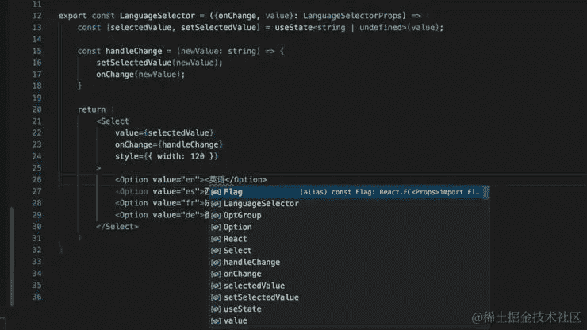
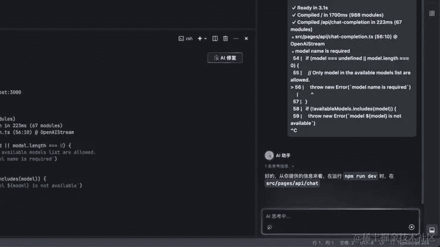
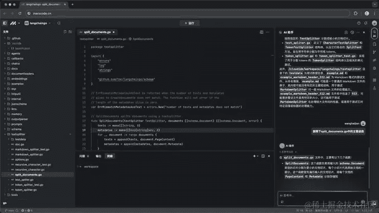

# “豆包MarsCode”智能开发工具，面向国内开发者免费

> 来源：[https://agijuejin.feishu.cn/docx/HBDfdsIxWof2lnxvBG0cgP8Snub](https://agijuejin.feishu.cn/docx/HBDfdsIxWof2lnxvBG0cgP8Snub)

> 作者：嚣张农民

> 链接：https://juejin.cn/post/7387205769907290146

> 来源：稀土掘金

> 著作权归作者所有。商业转载请联系作者获得授权，非商业转载请注明出处。

6 月 26 日，字节跳动在北京发布了基于豆包大模型打造的智能开发工具 - 豆包MarsCode ，面向国内开发者免费开放。

发布会以“用 AI 激发创造”为主题，在草地露营的轻松氛围中发布了豆包MarsCode 并介绍了其主要功能，同时发布开发者及社区共创计划，吸引了众多业界人士、开发者和科技爱好者的关注。

豆包MarsCode产品发布会现场

**AI时代开发工具的思考**

正式发布前，字节跳动开发者服务团队、豆包MarsCode 负责人李东江，分享了一些对 AI 时代开发工具演进趋势的思考。

字节跳动开发者服务团队、豆包MarsCode 负责人 李东江

进入 AI 时代，大语言模型在编程语言方面具备强大的优势和潜力，比复杂的自然语言和编程语言更加简洁、严谨，可预测。

针对“应当如何构建一款 AI 时代的开发者工具”这一命题，李东江表示， AI 不是替代开发者的“竞争者”，而是开发者的“好帮手”，团队更希望打造一款软件，能够助力提升开发者工作效率，让开发者有更多精力和时间用于思考和创造，这也就是为什么发布会的主题是“用 AI 激发创造”。

李东江提到，新的模型、新的算力、新的产品、新的技术每天都在出现，无论是产品还是技术，一切都还处在早期，都在快速更新迭代。

AI 技术驱动下，未来一定会衍生出下一代的开发工具。豆包MarsCode 团队，希望与开发者共同探索、建设，一起打造 AI 时代的新的开发者工具。

豆包MarsCode 首发功能揭秘

发布会上，豆包MarsCode 产品负责人王海建介绍了豆包MarsCode 产品的两种形态 - 编程助手和 Cloud IDE，同时通过需求开发、修复Bug、开源项目学习三个实际场景，详细演示了豆包MarsCode 的项目问答、代码补全、单测生成、Bug Fix等功能。通过完整场景演示串联各功能的使用配合，豆包MarsCode显示出 在日常工作中的优秀落地能力，无论是新手程序员还是经验丰富的开发者，都能体验到豆包MarsCode 带来的助力和效率提升。

豆包MarsCode 产品负责人 王海建

**需求开发场景**

通过一个翻译机器人构建的实际案例，王海建演示了在 AI 的辅助下，开发者可以如何通过唤起编程助手进行 Chat 提问，分析需求、熟悉代码、编写代码和调试代码。

代码补全不仅仅可以帮助开发者更快地输入代码，更是可以通过不断提供代码建议，给开发者带来灵感和启发。

豆包MarsCode 的创新功能——代码补全 Pro，不同于传统的代码续写，它支持自动根据用户编辑意图预测下一个改动点并给出代码推荐。

除了代码预测与补全，当编码中出现需要修复的代码 Lint 错误时，编程助手会直接在编辑器中主动给出修改代码，我们不需要去查看是什么报错原因，只需要判断修复结果是否正确，如果正确，一键采纳修复后的代码即可。

最后，当我们写完代码，为了保障代码的质量与后续的可维护性，通常还需要写单元测试。这时只需要在编程助手中触发 test，就可以得到这个函数的测试用例。

可以看到，相比于传统的开发方式，豆包MarsCode 编程助手可以帮助开发者更轻松、更专注地编程。

**Bug 修复场景**

在 Debug 场景下，豆包MarsCode 的 AI 修复功能可通过理解报错信息、调用栈的代码、全局的项目代码，去分析错误原因，从而直接给出针对性的修复建议。

除了单轮修复，豆包MarsCode 也在尝试基于 Agent 方式实现多轮自动修复，AI 会自主调用一系列代码查询工具、调试工具获取报错信息、自主规划方案、自主写出代码并应用到项目当中去，来修复 Bug。

雷峰网(👸号：雷峰网)了解到，目前该功能正在字节内部做验证，争取能够尽快发布与大家见面。

**开源项目学习场景**

第三个场景下，豆包 MarsCode IDE 通过提供开发模板，让开发者能够快速进入项目而无需运维本地环境。借助原生集成的 AI 能力，开发者不再需要自己去理解代码，从而更高效地上手项目。

总的来说，豆包MarsCode在以下两个方面帮助开发者：

**对于想的阶段，** 提供更好的信息，例如做代码解释，研发知识的问答，来激发开发者创造；

**对于做的阶段，** 帮助开发者更快地完成编码，例如代码的补全、下一步编码动作的预测，代码的错误修复，来提升开发者效率。

**开发者与社区共创计划**

发布会尾声，豆包MarsCode 市场运营负责人赵旭东介绍了豆包MarsCode 开发者与社区共创计划。后续豆包MarsCode 会通过成立用户组、各类系列开发者活动等方式，助力开发者探索 AI 编程新范式。

豆包MarsCode 市场运营负责人 赵旭东

豆包MarsCode 用户组将由开发者自组织自运营，豆包MarsCode 团队不会参与到用户组的管理，但是会为用户组提供丰富的各类资源支持，支持各地用户组发展，例如场地资源、产品资源、活动物料、专家讲师支持等，帮助促进各地开发者更有效的探索 AI 编程新范式，助力我们的开发者学习成长。

开发者活动方面，豆包MarsCode 将陆续在北、上、深、杭等城市举办 Meetup ，同开发者走出会议室进入户外，以更加轻松的方式，交流 AI 编程技巧和经验，一起用 AI 激发创造。

豆包MarsCode 还计划协同各开发者社区，将 AI 能力融入到社区使用场景中，将豆包MarsCode 的能力更便捷地提供给开发者。

目前，豆包MarsCode 已与掘金社区在 AI 助手、账号打通、专属沸点专区等层面合作。

豆包MarsCode 已于 6 月 26 日正[式发布，点击阅复制即可访问官网](https://link.juejin.cn?target=http%3A%2F%2Fwww.marscode.cn)使用。（ www.marscode.cn ）