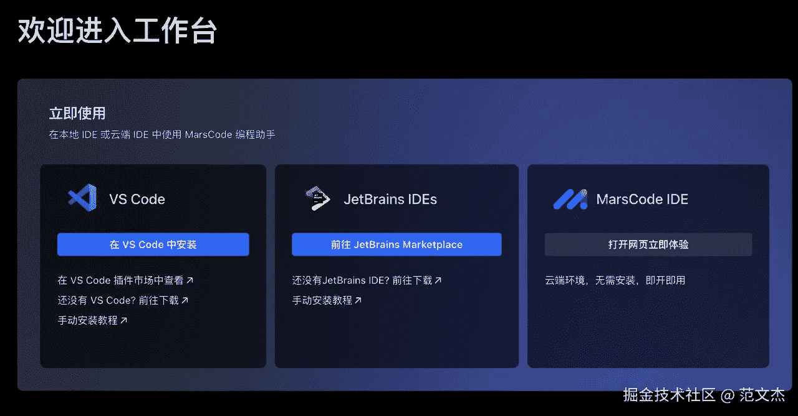
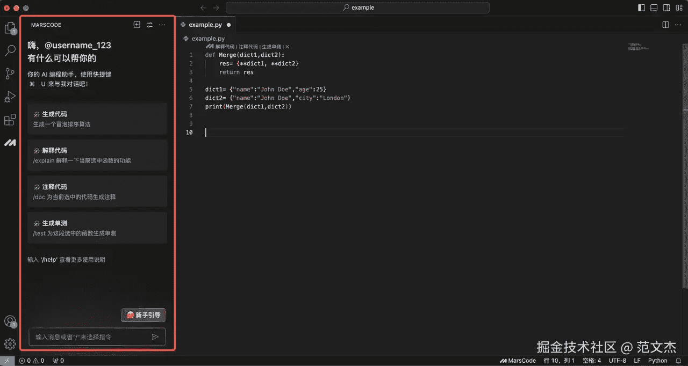
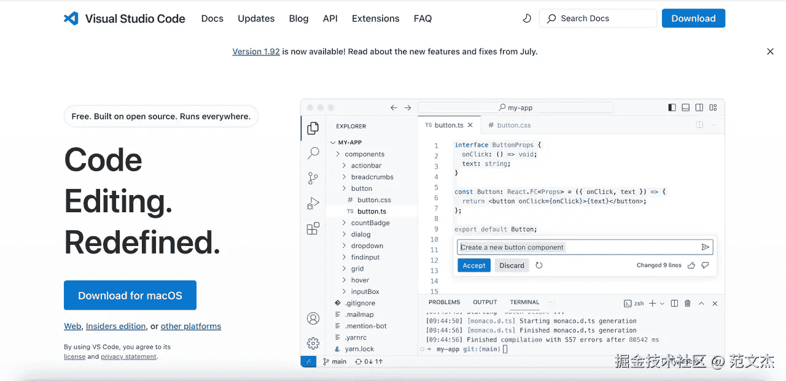
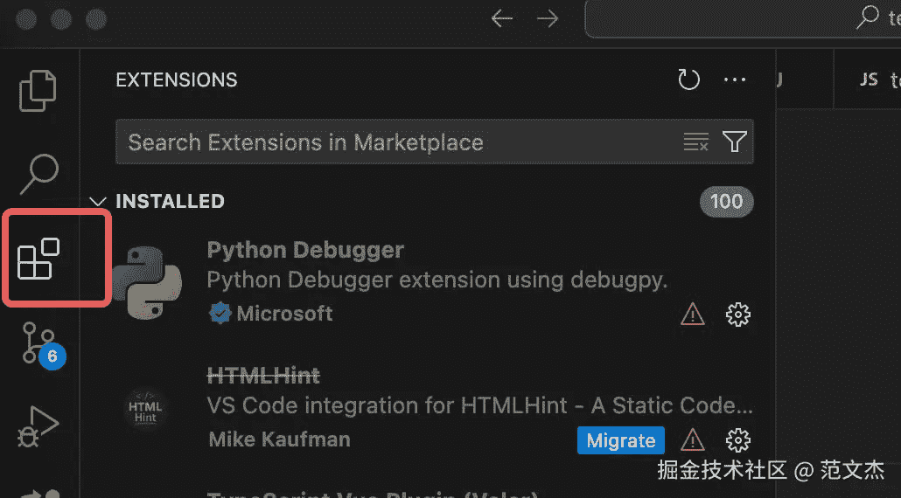
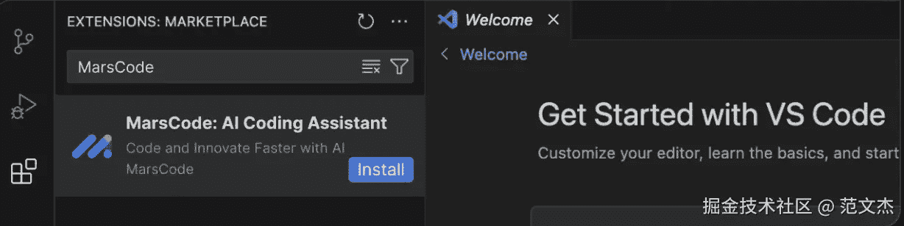
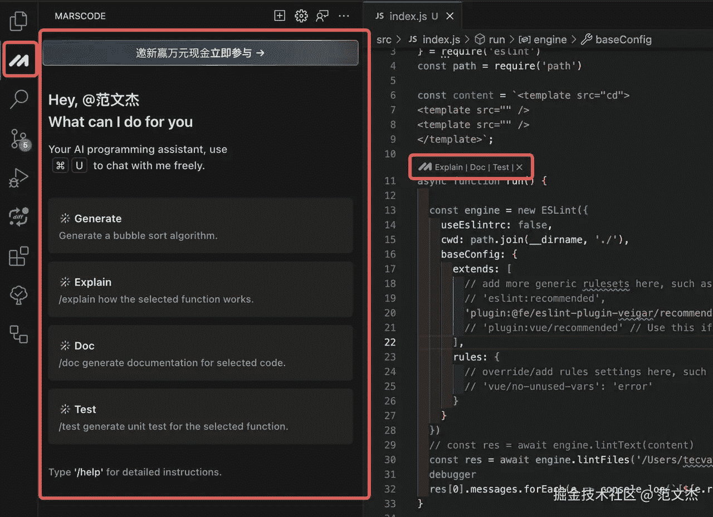
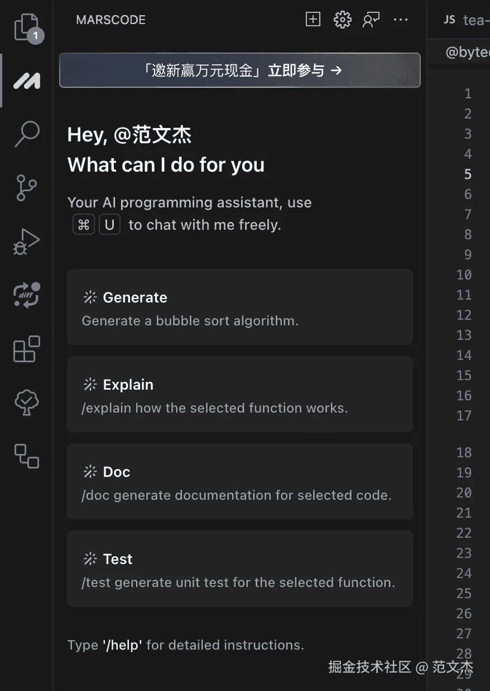
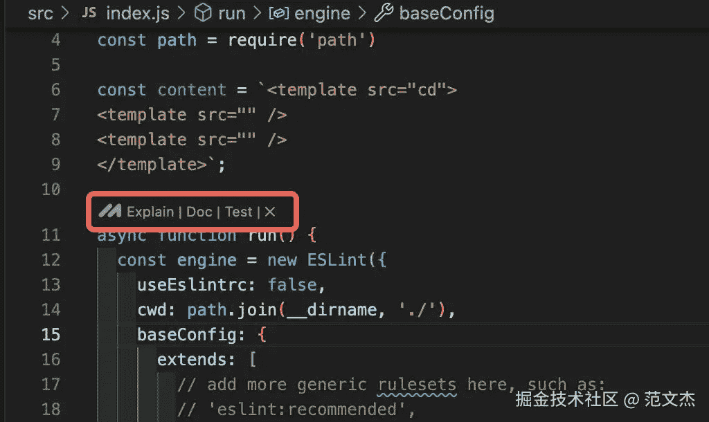
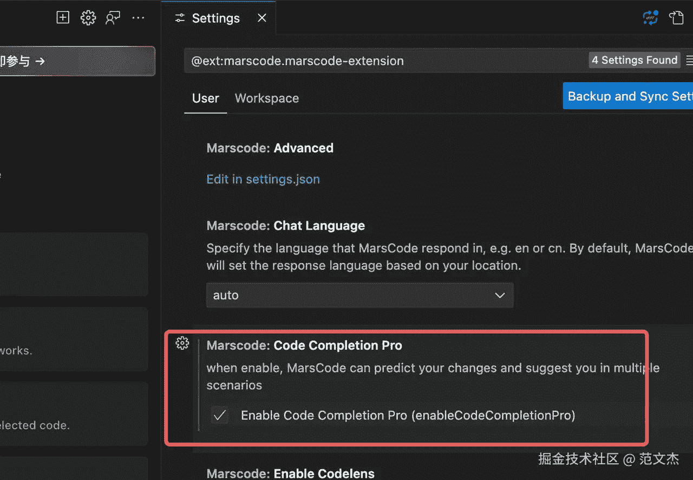

# 豆包 Marscode 入门：初识

> 来源：[https://agijuejin.feishu.cn/docx/Q8hgdJ82WonFGcxp6GNc6lWDnue](https://agijuejin.feishu.cn/docx/Q8hgdJ82WonFGcxp6GNc6lWDnue)

> 作者：范文杰

> 链接：https://juejin.cn/post/7444574123420287002

> 来源：稀土掘金

> 著作权归作者所有。商业转载请联系作者获得授权，非商业转载请注明出处。

## 背景

这是一个全新的内容生产时代，从 GPT3.5 开始，LLM 已经爆发出惊人的内容生成能力，引发各行各业的高度关注，生态繁荣迅速为我们带来了 GPT 4o、Claude、豆包等各类细分领域模型，大量敢于吃螃蟹的人已经通过各种方式吃到大模型带来的时代红利。

LLM[ ](https://link.juejin.cn?target=https%3A%2F%2Fresearch.google%2Fblog%2Fml-enhanced-code-completion-improves-developer-productivity%2F)有很强的内容生成能力，非常擅长基于旧的信息生成新的知识片段，在文本、图像、视频等内容生成领域其实都算是大放异彩了，并且它也非常适合辅助编程，善于做代码生成、测试生成、代码 bug 分析、文档生成、代码理解等任务，进而能够显著提升变成效率(《ML-Enhanced Code Completion Improves Developer Productivity》)，因此业界有许多团队在探索这个方向。

虽然，我们可以用传统的 LLM 对话框做辅助编程，但相比而言，专门为编程定制的，基于 LLM 的 IDE 必然会有更高的开发效率。以豆包MarsCode 为例，它可以：

1.  **更强的上下文索引、理解能力，** 能够更好地理解代码的上下文和开发者的意图，从而提供更加准确和相关的建议。这种能力不仅限于简单的代码补全，还包括对代码结构、变量命名、函数调用等方面的深度理解。

1.  更契合开发过程行为的各类 LLM 交互， 这些交互不仅仅是简单的对话或代码补全，而是深度嵌入到开发者的工作流程中。例如，豆包MarsCode 可以根据用户当前编码动作推断下一步可能的动作，直接给出下一步代码建议，用户只需点击 Tab 按钮即可采用；

1.  专门为编写代码而训练和微调的定制化模型， 配合 豆包MarsCode 内置的各类行之有效的 prompt，帮助开发者更高效地完成任务。对于使用者而言，这些复杂的模型和 prompt 是透明的，他们只需专注于编写代码，豆包MarsCode 会自动提供最合适的建议和补全；

1.  具备更强大的错误检测和修复能力， 豆包MarsCode 可以实时分析代码，检测出潜在的错误和漏洞，并提供相应的修复建议。这不仅能帮助开发者更快地发现问题，还能提高代码的质量和稳定性。

某种程度上，以 ChatGPT 为代表的大模型能力，打开了一个新的内容生产时代，而 豆包MarsCode 等基于 LLM 的辅助编程工具，则极大降低大模型的使用与软件开发部署门槛，能够极大提升软件工程效率。

我认为，这对每一位正在或将来有意愿从事程序开发工作的人都是大有益处的。

+   对**新手**而言：可以借助 豆包MarsCode 提供的这些能力快速上手熟悉语言与框架，不必花费过多学习时间就能进入开发状态并完成任务，可以无痛上手开发个人博客、小游戏、浏览器插件甚至学习 leetcode 题目等

+   对**专业开发者**而言：豆包MarsCode 可以帮你完成许多基础而琐碎的重复性任务，还能很好地帮你完成各类 Debug、代码优化、代码分析方面的工作，是一个非常强大的 7*24 编程助手。

## 启动

接[下来我们来开始进入正题，豆](https://www.marscode.cn/workbench)包MarsCode 提供了两种使用方式，一是 Web IDE 形态，二是 IDE 插件形式，进入 豆包MarsCode 首页可看到多个入口：



IDE 插件的安装路径非常简单，可以直接在 VS Code 插件市场搜索 豆包MarsCode 关键字，下载安装即可：



其次是 Web IDE，直接进入 Dashboard(www.marscode.cn/dashboard) 即可启动。

**两**者核心功能相似，都能借助豆包模型配合各类专门为编程设计的交互模型实现辅助编码，只是使用方式上略有差异，下面展开细讲。

## 使用 VS Code 插件

### Step1：安装插件

首先介绍 VS Code 插件，使用之前需要先在本地 PC 安装 VS Code 与 豆包MarsCode 插件：

1.  [如](https://link.juejin.cn?target=https%3A%2F%2Fcode.visualstudio.com%2FDownload%25EF%25BC%259B)果你未安装 VS Code，则需要提前下载安装，下载地址：code.visualstudio.com/Download；



1.  安装 Visual Studio Code 后，点击左侧导航栏上扩展按钮，打开扩展窗口。



1.  在搜索框搜索“豆包”或者“MarsCode”关键词，找到豆包豆包MarsCode 后单击**「install」**，完成安装。



1.  安装完成后，点击左侧 豆包MarsCode icon 即可进入 豆包MarsCode 交互面板；



### Step2：创建项目

正式开始之前，我们需要在本地创建教学项目，方便后续讲解，这里我们只需要创建一个最简单的项目结构即可，可参考执行如下命令：

```
mkdir -p my-test/src &amp;&amp; cd my-test 
npm init -y 
touch src/index.js
```

之后使用 VS Code 打开该项目。

### Step3：理解基础功能

#### 1）交互面板

安装完成并打开 VS Code，即可看到左边操作区域出现 M 字形的 豆包MarsCode Icon，点击即可打开 豆包MarsCode 操作面板：



**插件操作面板** 是 MarsCode 的主要交互入口，这里可以看到若干围绕 LLM 建立的交互能力，包括：

+   **Generate(生成)：**只需以文字方式提交需求，豆包MarsCode 即可生成对应代码，这一功能对编程新手尤其重要，可帮助新手快速理解和掌握编程的基本原理和技巧。另外，通过直接观察生成的代码，新手也可以更好地理解代码的结构、逻辑和语法，从而提高自己的编程能力，进而提升学习效率；

+   **Explain(解释)：**能详细解释给定代码的作用，对于新手可通过这样的方式，更加深入地理解代码的功能和逻辑，从而更好地掌握编程技能，最终也还是能够提升理解与学习效率；

+   **Doc(生成文档)：**给特定代码加上详细且清晰的代码注释，以便提高代码的可读性和可维护性，这有助于帮助开发者迅速理解代码意图；

+   **Test(单测)：**为特定代码生成单测，以提升代码稳定性；事实上，许多程序员擅长编写业务代码但并不擅长为这些代码编写对应的单元测试代码，因为这需要对代码的功能、逻辑、边界情况等有深入的理解，并运用合适的测试框架和工具来实现，而 豆包MarsCode 非常擅长分析并生成模块对应的测试代码，这能够非常有效地提升开发效率；

+   **Fix(修复):** 能够分析并修复特定代码中潜在的问题，包括稳定性、性能、安全性等，相当于一个 7 * 24 的私人代码教练，能帮你写出更好更容易维护的代码。

#### 2）行内交互

其次，右侧代码编辑框中也会出现如图所示的交互按钮，可用于对特定代码片段做解释、生成文档、生成单测等动作：



在这里，豆包MarsCode 会动态分析代码结构，为每一个函数、Class 等添加交互按钮，开发者可在此处围绕函数、Class 直接与 LLM 交互，相对更方便一些。

#### 3）打开自动补全功能

此外，豆包MarsCode 还支持代码补全功能，不过默认关闭，推荐用户主动调整配置，开启该功能。

1.  点击配置按钮：


1.  开启 Code Completion Pro 配置



行内补全能力非常强大，它能够持续分析你的编码动作，在适当时机、位置提供代码补全提示，遇到合适的代码只需点击 Tab 按钮即可采纳，推荐大家打开。

### 小结

豆包MarsCode所提供的编程辅助 能力可有效提升整体开发效率，包括：

1.  自动生成代码：豆包MarsCode 可以根据自然语言描述生成代码片段或整个函数。这种自动化可以减少重复性工作，让开发者专注于更高层次的设计和问题解决；

1.  智能代码补[全](https://link.juejin.cn?target=https%3A%2F%2Fresearch.google%2Fblog%2Fml-enhanced-code-completion-improves-developer-productivity%2F)：豆包MarsCode 可以提供上下文感知的代码补全，不仅限于单个单词或符号，还可以补全整个代码块。这种智能补全可以减少开发者输入的字符数，提高编码速度(参考《ML-Enhanced Code Completion Improves Developer Productivity》)；

1.  错误检测：豆包MarsCode 可以实时检测代码中的潜在错误，并提供修复建议。这种功能可以帮助开发者在编写代码时就发现并修复错误，减少调试时间；

1.  文档生成：豆包MarsCode 可以根据代码生成详细的文档，包括 API 文档、使用示例和参数描述。这可以帮助团队成员更快地理解和使用代码库，提升项目的可维护性；

1.  代码重构：豆包MarsCode 可以根据代码的上下文和结构，提供代码重构的建议，帮助开发者优化代码，提高代码的可读性和可维护性；类似的，豆包豆包MarsCode 还适用于性能分析与优化、安全问题检测等场景；

1.  学习和培训：豆包MarsCode 可以根据开发者的需求，提供相关的学习资源和培训材料，帮助开发者快速掌握新技术和新工具。