# 豆包MarsCode 上线新能力 #Workspace：快速上手代码仓库、轻松分析项目结构

> 来源：[https://agijuejin.feishu.cn/docx/EiCUdPx2qoAgphxVRSYcljQBn4e](https://agijuejin.feishu.cn/docx/EiCUdPx2qoAgphxVRSYcljQBn4e)

> 作者：豆包MarsCode

> 链接：https://juejin.cn/post/7431454931264585765

> 来源：稀土掘金

> 著作权归作者所有。商业转载请联系作者获得授权，非商业转载请注明出处。

“不应该呀”

“我就是按 readme 运行的呀”

“为什么这都能跑？”...

每每遇到灵魂质问时，你是否希望有个人能够做你的小黄鸭，聆听你的解决思路，陪你一起分析你的疑惑与痛苦？

在日复一日写代码开发的日子里，你是否一度希望有个贴心的、知冷知热的、对你的项目了如指掌的朋友（大佬）陪在你身旁？

好消息！豆包MarsCode AI 问答已上线新功能 #Workspace，支持用户在 #Workspace 后输入自然语言与代码仓库进行问答互动，通过 Code Knowledge Graph 技术对代码仓库进行离线代码索引构建，根[据用户的提问智能选取最相关的](https://juejin.cn/post/7431455802516914213)代码内容作为上下文提供给模型，以此提高模型回复结果的可用性，获得与业务高适配度的回答，支持 Java Script、Type Script、Python、Golang、Java、C++ 等常用语言，做最懂你业务代码的 code partner！ （🎁体验新功能还可参与有奖活动呦)

接下来就让我们一起来看看 #Workspace 在豆包MarsCode 中的使用方式和典型应用场景吧！

## **使用方式**

在 VSCode/JetBrains 中安装豆包MarsCode 编程助手，打开插件面板，点击对话框中# icon，或键盘输入 # 后唤起上下文列表，选中 Workspace 后在输入框中输入提问与 AI 对话。

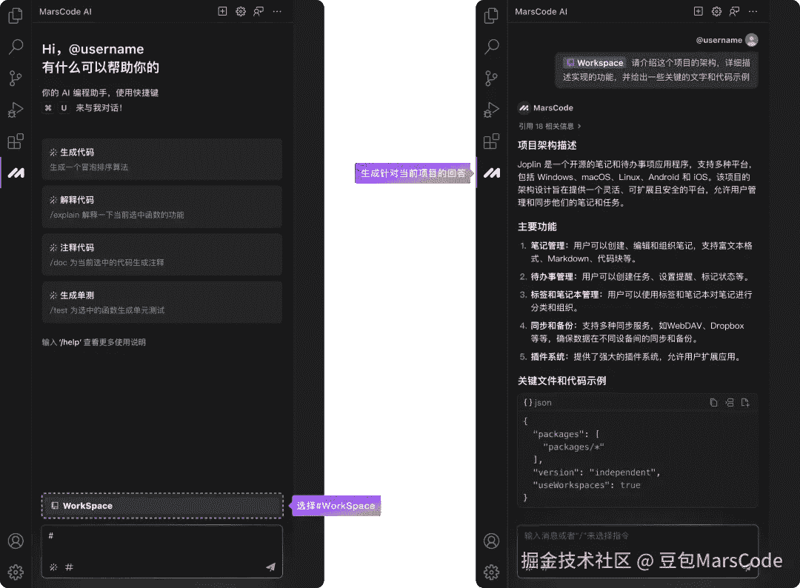

## **实现原理**

当识别到用户提问带有  **#Workspace** 时，AI 将自动从仓库中检索与提问相关的代码信息作为上下文，结合整个项目代码仓库进**行回答，AI 是如何**能在短时间内快速学习你的代码仓库呢？下面就让我们来介绍下  #Workspace 的工作原理吧~

当用户在 IDE 内打开代码仓库时，豆包MarsCode AI 将通过 Code Knowledg**e Gr**a**ph 技**术针对整个 Workspace 的代码构建本地 Index 索引，识别关键代码之间的联系。当用户提出问题时，豆包MarsCode AI 将基于语义搜索、代码索引以及 IDE Language Services 快速识别并召回对应的关键代码以及关联代码，再通过一系列复杂的算法对其进行排序，最后由模型返回结果。

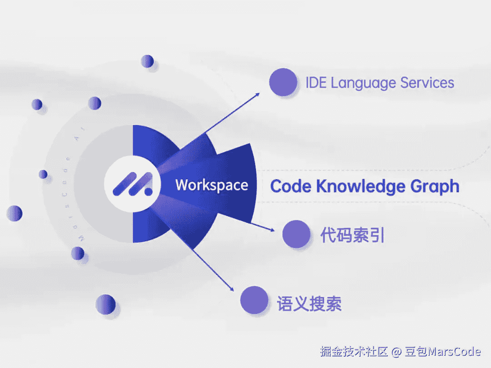

**#Workspace** 虽然过程复杂，但我们尽力优化时延，无需等待过久即可获得结果！

> **📢豆**包**M**arsCode AI 承诺， 用户离线构建代码索引的结果均只会保存在用户本地，不会上传到云端更不会被用于模型训练，我们为每一位用户的隐私保驾护航~

## **支持场景**

### **场景一：快速上手熟悉代码仓库**

当**你想要快速了解或学习某个仓库时，可以在智能问答窗口中通过 #** 唤起 #Workspace，选中后输入你的需求，例如： “ #Workspace请介绍这个项目的架构，详细描述实现的功能，并给出一些关键的文件和代码示例”。

豆包MarsCode AI 将针对这个问题在全局代码中搜索相关 Context 进行回答，下图展示了豆包MarsCode AI 对一个开源笔记项目进行分析总结，我们可以看到，在未打开任何文件的情况下，AI 依旧给出了详细准确的答案，并在“引用信息”一栏找到了相关代码文件，点击即可跳转打开，用户可以根据引用列表对答案进行检查。

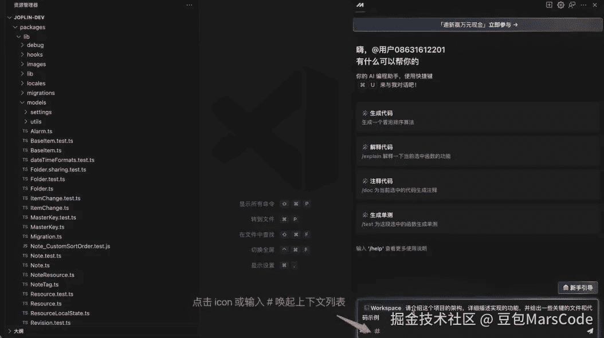

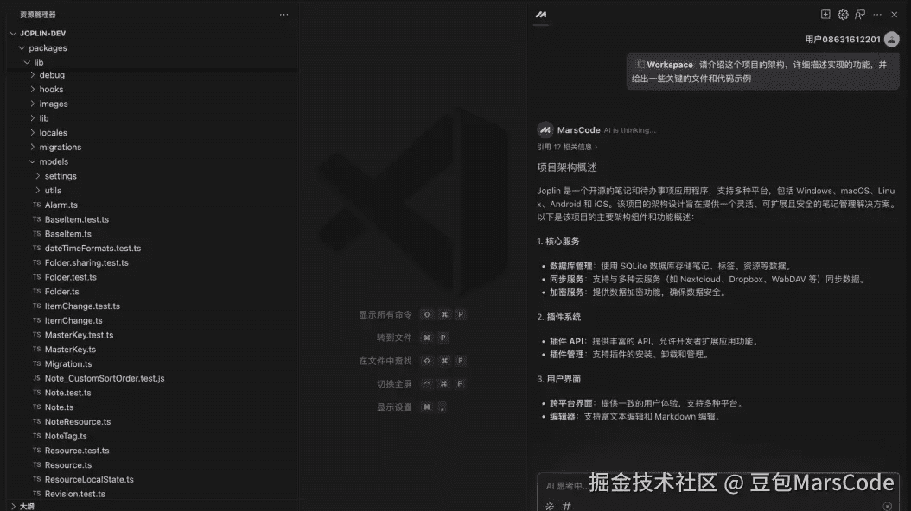

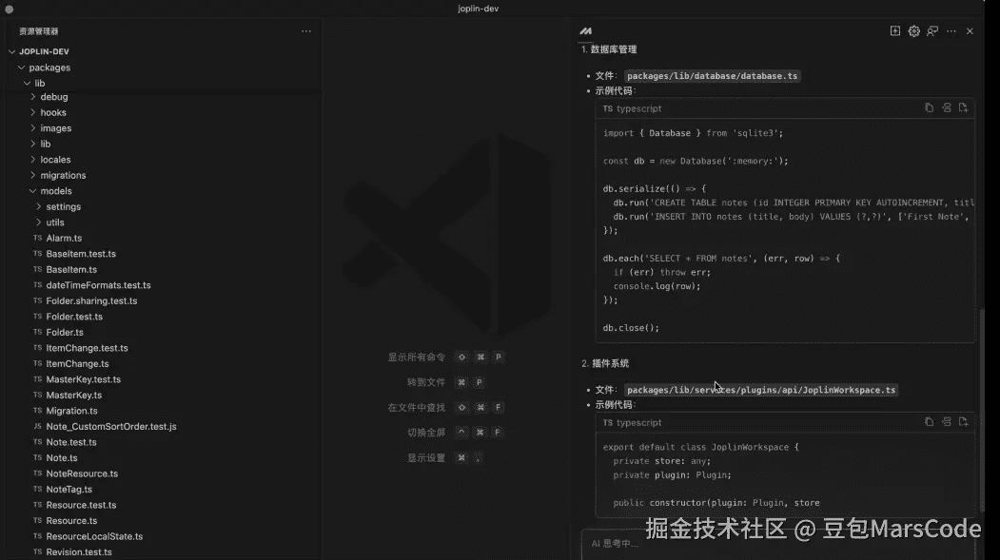

### **场景二：代码或模块功能搜索**

全局了**解仓库后即可开始接下来的开发工作，那么问题来了，知道需**求后，我应该在哪里对仓库进行修改呢？向豆包MarsCode AI 继续追问吧！继续在输入框添加 #Workspace 并输入自然语言需求。仍以这个笔记项目为例，在上面的仓库介绍中我们看到文件夹模型是用来组织笔记的，追问： “ #Workspace Folder 模型中创建文件夹的代码在哪里实现？请介绍其实现原理。” 此时 AI 将给出对应的文件位置以及对逻辑进行简要描述，我们可以在引用信息列表中，找到这个文件并点击打开。

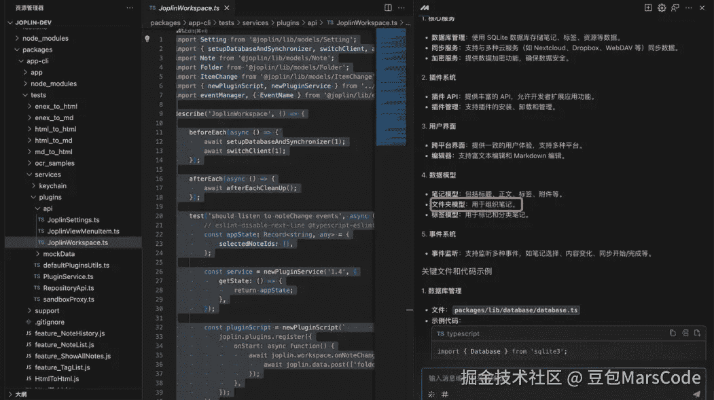

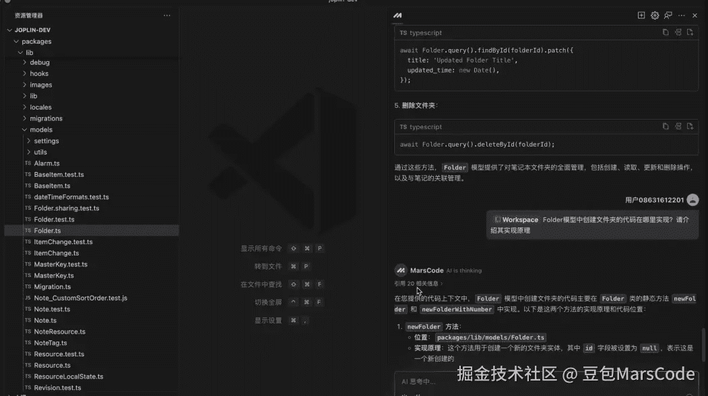

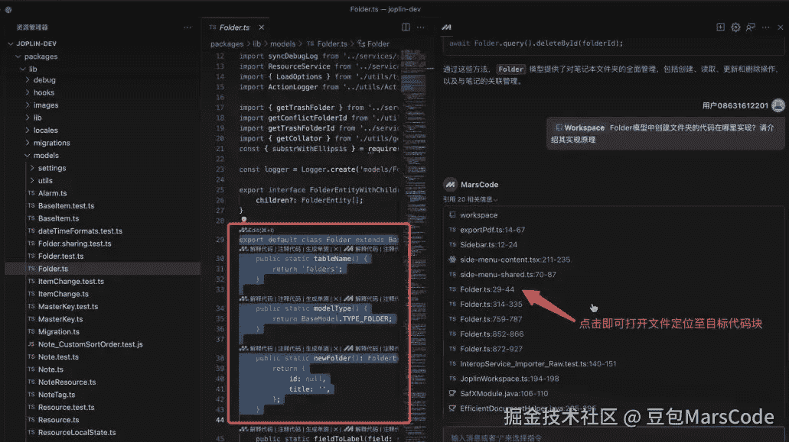

### 场景三：生成需求代码并找到代码修改位置

那**么**已**知需**求和大致的修改模块，我们应该要如何生成代码呢？继续追问 豆包MarsCode AI 吧！提问： “#Workspace 在创建笔记本时支持用户填写 1-10 的序号，对笔记本进行序号排序，请生成代码的同时告诉我需要添加在哪里 ”。 此时豆包MarsCode AI 不仅可以告诉你实现逻辑的函数代码，还会告诉你需要添加到 Folder 类中，快速实现想要的需求！

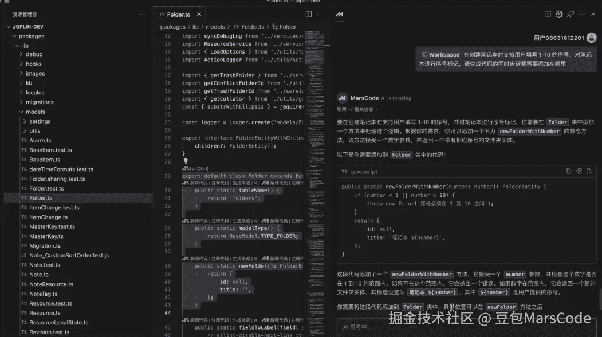

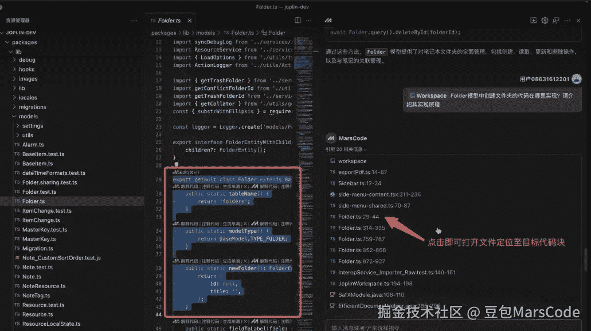

### **场景四：** **使用已实现方法生成新的代码**

在日**常编码中经常会碰到使用重复代码的场景，有时候可能**并不知道某个功能是否有现成的函数已实现，此时用 #Workspace 查询一下吧！下图示例中，选中期望添加新需求的代码片段，向 AI 提问： “#Workspace 请添加更新 electronApp 中侧边栏笔记本排序的代码”。 此时 AI 将在整个代码仓库检索是否存在可复用代码，使用已有实现来生成需求逻辑代码，输出完成后，点击 insert 一键替换 Editor 选中部分，快速生成代码！

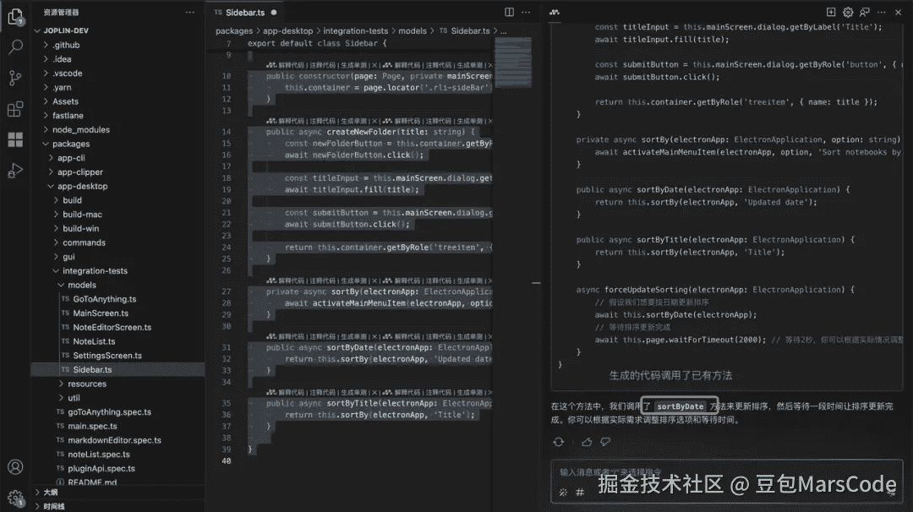

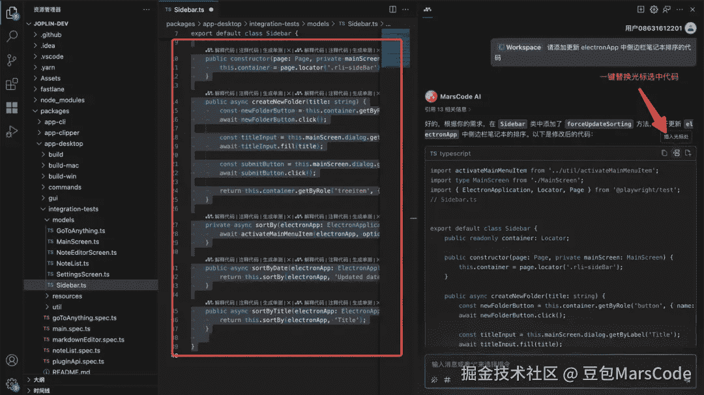

### 场景五：生成单测并添加至对应位置

为了保障项目质量，我们需要对逻辑代码添加单测，但有时候总是不知道某些函数是否已有单测，单测用例又该写在哪里。向豆包MarsCo**de AI 提问吧！输入 #Workspace，豆包Mar**sCode AI 将在工作区中进行全局检索，例如下图，提问： “#Workspace 查询 addNoteCounts 是否有单测覆盖，若没有请生成单测用例”。 此时豆包MarsCode AI 检索完成后，发现并没有对应单测，除了生成单测代码外，还会告诉用户添加在哪个单测文件中。

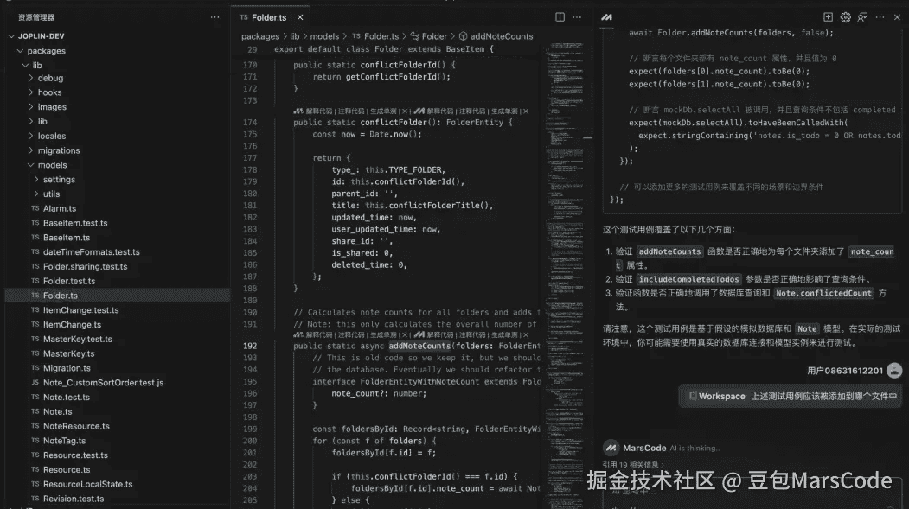

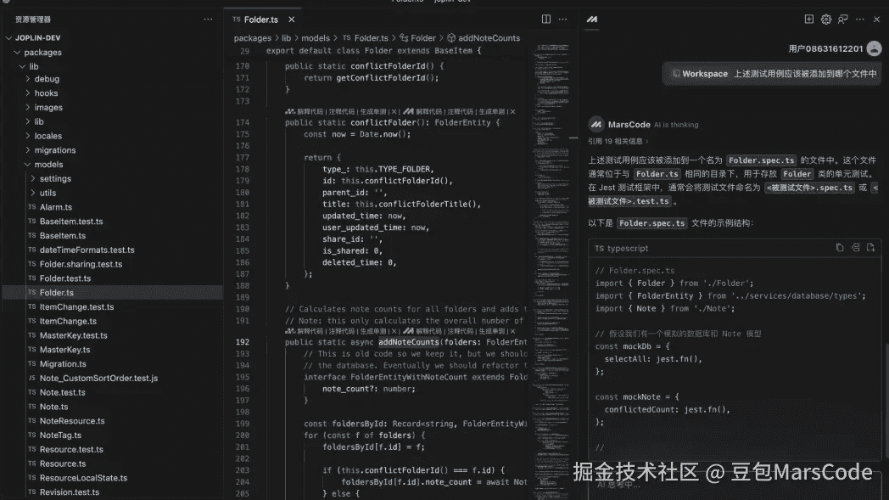

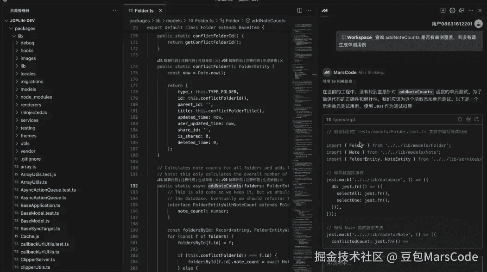

### **场景六：修改代码后生成文档**

在开**发过程中，有时维护 readme 是一份繁重的工作**，有了豆包MarsCode AI，一切都将变得简单。如下图，我们期望对 Application 类撰写一个 readme 描述，向 AI 提问： “#Workspace 参考 app.ts 中的 Application，生成类的描述”。 AI 将给出对应的描述内容，包含了功能介绍、属性介绍、构造函数、示例代码等关键内容，一键复制粘贴即可得到一个描述文档，快捷又准确！

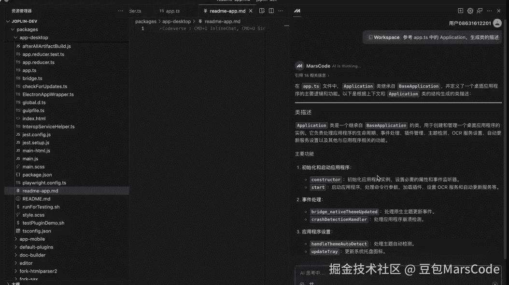

借助  **#Workspace** 功能，你可以更高效地了解项目及其内在逻辑，更便捷地完成代码编写，运行代码、理解代码将不再是难题，即使是刚入门的编码也能在短时间内看懂项目的复杂逻辑，实现项目的顺利运行，开发提效更近一步！

## [## ](https://juejin.cn/post/7431455802516914213)[**体验新功能，人人有礼**](https://juejin.cn/post/7431455802516914213)

### **活动时间**

10月29日-11月30日

### **参与方式**

Step1：登录安装豆包MarsCode 编程助手。

Step2：在 AI 问答窗口中通过 # 唤起 Workspace，选中后提出与仓库代码相关的问题，AI 助手可快速结合当前仓库进行工程理解、代码查询和问答等。

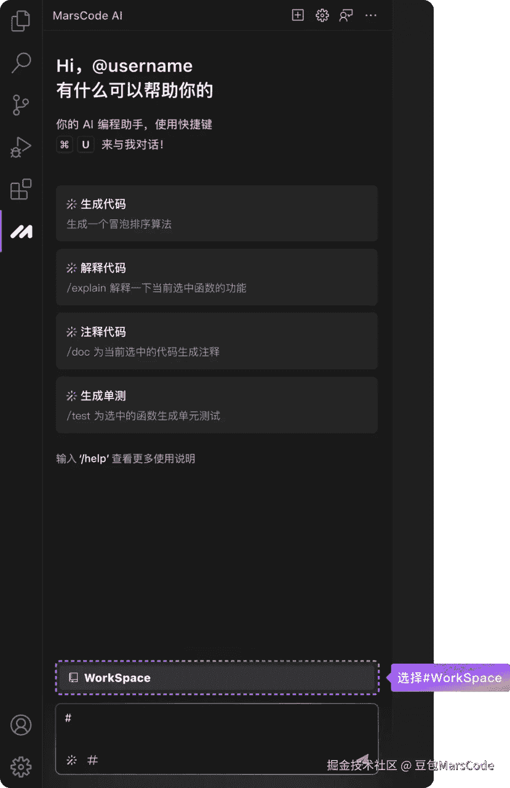

Step3：充分体验新功能#Workspace，在稀土掘金 #豆包MarsCode 上新 Workspace#  话题下分享使用测评（沸点、文章均可）或提交相关Bug反馈，即可领取礼品。

[🌟欢迎大家前往豆包M](https://www.marscode.cn/chat-playground?utm_source=content&utm_medium=article&utm_campaign=workspace1)arsCode 官网 Playground ，使用我们提供的 demo 仓库，体验 Workspace 仓库级问答的能力。

