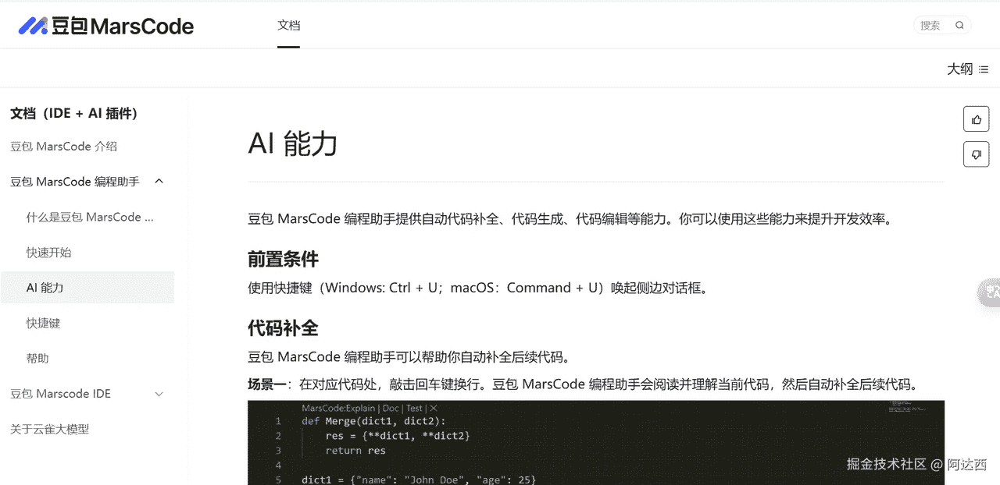
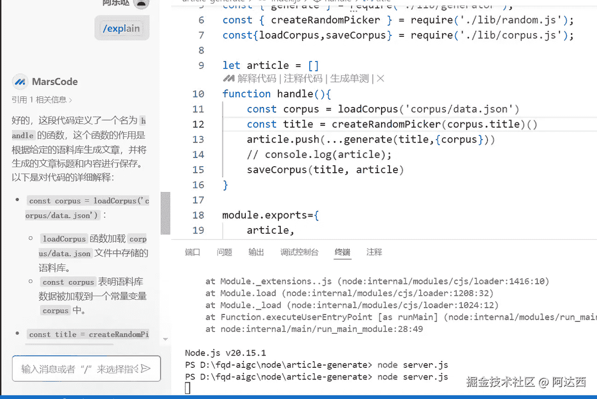
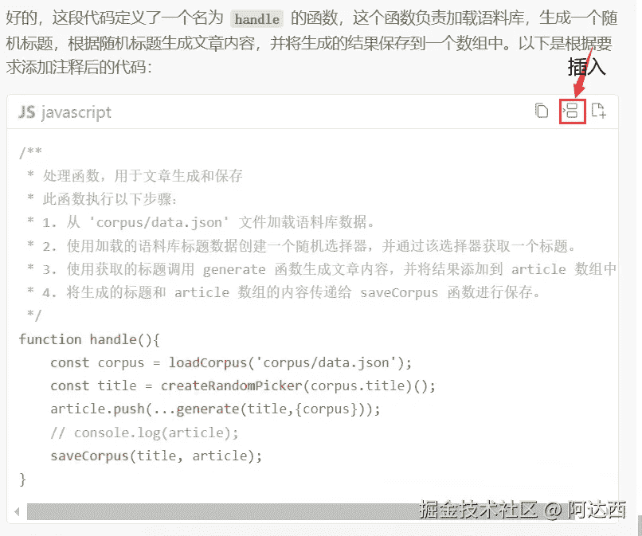
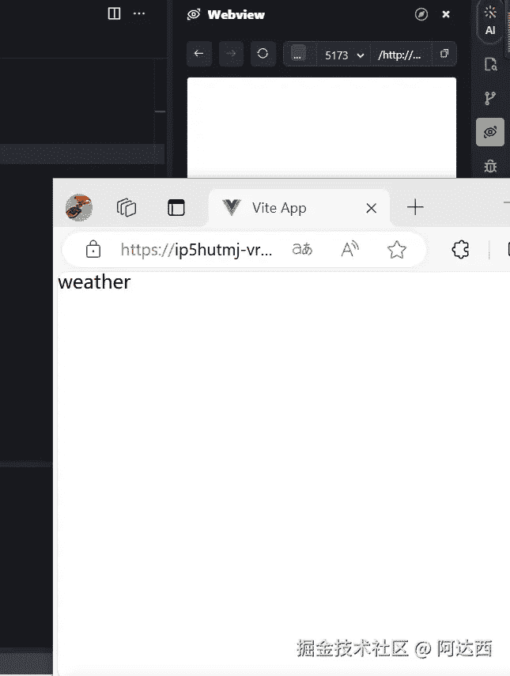
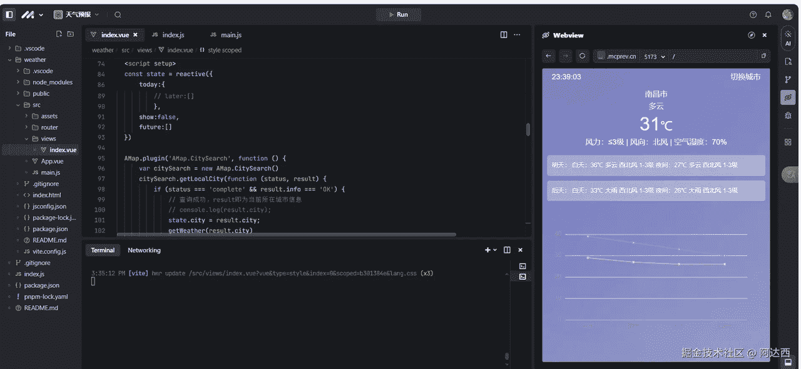

# 「豆包Marscode体验官」使用MarsCode就两个字：可行！

> 来源：[https://agijuejin.feishu.cn/docx/ZIhgdMlOooOh7vxKBbecxeSqnDg](https://agijuejin.feishu.cn/docx/ZIhgdMlOooOh7vxKBbecxeSqnDg)

> 作者：阿达西

> 链接：https://juejin.cn/post/7395080141128597513

> 来源：稀土掘金

> 著作权归作者所有。商业转载请联系作者获得授权，非商业转载请注明出处。

> 早就听说字节跳动的人工智能编程助手工具豆包MarsCode很好用了，也在掘金上看到了很多的掘友都分享了一些掘金的使用体验。但是由于前段时间有点事情，家里发大水把田都给淹了，回家种了几天的地。昨天刚回来，所以现在就来体验一下豆包的MarsCode。可能我还没有发现豆包的一些功能，我就在这里分享一些我的使用体会。

## 豆包MarsCode介绍

豆包MarsCode有两种产品，一种是AI 编程助手-VSCode，另一种是Cloud IDE，直接从这这个链接进去，www.MarsCode.cn/home可以了解到更多的信息。

进去后我们可以看到一个比较高级的首页，让人一看就感觉很牛逼的样子。左上角有官方的文档，里面有具体的使用介绍，我这里就不做过多的介绍，大家感兴趣的可以自己去看看，官方文档写的还是比较详细的。

我在这里就给大家分享一下我自己的使用感受吧！

### AI 编程助手使用感受

1.  **代码补全**，其实VSCode里面也有插件能够帮我们自动补全代码，我提前也安装了这个插件，所以我在代码补全这一功能上并没有很大的感受。但是我发现使用了MarsCode编程助手后，他都会提醒我今天的代码补全已达上限了等之类的话具体的我也没注意看，毕竟我现在也很少使用这个代码补全功能。不过这个代码补全功能还挺准确的，补全的代码与我下一步想敲的代码差不多。

1.  **代码解释**代码解释功能我感觉还是比较方便的，对于我们新手朋友们还是比较友好的。我们平时跟着网上的教程敲代码的时候，经常会有不能理解的代码片段。我们当然可以使用其他的大模型来解释代码的意思，如通义千问，文心一言，以及GPT等，但是这还是较为麻烦的。但是AI编程助手可以快捷的帮我们解释这段代码，只用点击解释代码他就给我们弹出解释的内容。

1.  **代码注释** 作为一个合格的程序员，我们需要对我们的代码进行详细的注释以便后续阅读代码，或者同事间的友好合作。点击后可以快速的生成详细的注释。点击插入后可以快速的插入到我们想要插入的位置。

但是我个人感觉这有点鸡肋。我只想将注释部分插入到我想要的地方，而不是将整个内容插入到我的代码中。我觉得还是可以在这里改进一下，如果是通过代码注释的时候，插入到代码中，只需要将注释部分插入进去就行了。如图：

1.  **代码测试** 就是生成单测。点击后可以直接生成一个关于这段代码的测试。这个代码我感觉有点小鸡肋，具体原因不说，你们可以自己去看看。

1.  **代码生成**这个功能还是可以给个好评的，我们通过描述我们想要的功能，他会自动帮我们生成相应的代码，如图：

最让我喜欢的还是这个功能，就是我们可以把我们想要的功能通过注释写出来，然后他就会帮我们生成我们相应的代码片段。

## 使用MarsCode IDE的一些体会

MarsCode IDE 是一个云端 AI IDE 平台。通过内置的 AI 编程助手，开箱即用的开发环境，这可以让我们更专注于各类项目开发，而不用再去想着繁琐的环境配置。作为云端 IDE，我们只需要一台可以访问浏览器的计算机、笔记本或者平板电脑便可以打开豆包 MarsCode 完成开发工作，这大大的方便了我们的日常工作。一些优秀的地方我就不说了，我就讲讲我遇到的一些小问题。

### 1、使用vue模版只能使用TypeScript

我刚使用MarsCode IDE的时候一眼就看到了vue模版，我这想着都可以不用再去创建个vue项目了，兴高采烈的打开，直接npm run dev结果直接给我报错，结果仔细看一下，原来是用的TypeScript。这让我JavaScript的颜面何在，哼！后来只好使用nodejs创建vue项目，这个和我们正常使用VSCode类似。

### 2、编辑器预览显示效果有点小bug

这个bug 不知道是我的网速问题还是什么，我用浏览器查看的话可以看到，但是在预览里面显示就有问题，没有显示出来。如图：

另外预览的触发较为频繁，用户不用保存自动帮助保存，这个我还是比较喜欢的。但是保存太频繁了，用户敲击一个字母都要触发一次，导致预览的时候会报错（其实正常情况下是不会报错的，只是那句语句还没打完就保存了）

### 3、可能是云端的原因，一些地方的加载速度还是没有VSCode快，让我这样的急性子等的有点捉急。

## 用MarsCode IDE创建一个天气预报app

我[使用了MarsCode IDE创建一个天气预](https://link.juejin.cn/?target=https%3A%2F%2Fvant-ui.github.io%2Fvant%2F%23%2Fzh-CN)报app，[这样我们可以制作一个属于自己](https://link.juejin.cn/?target=https%3A%2F%2Fecharts.apache.org%2Fzh%2Findex.html)的天气预报。在这个app中我们借助了高德开放平台 | 高德地图API (amap.com)来帮助我们获取到天气及地区的信息，另外使用了Vant 4 - 轻量、可定制的移动端组件库 (vant-ui.github.io)，还使用了Apache ECharts帮我们快速创建可视化图表。

最后给大家看看我的效果图：

## 总结

通过短短几分钟的磨合，对这个IDE还是可以掌握的，因为这个与我们常用的VSCode并没有太大的改变，其中还有许多新增加的功能，我还没有使用到，在后期我也会慢慢的去学习如何使用这个IDE，同时也希望官方大大可以将上面我遇到的一些小bug给优化一下。一句话，支持豆包Marscode