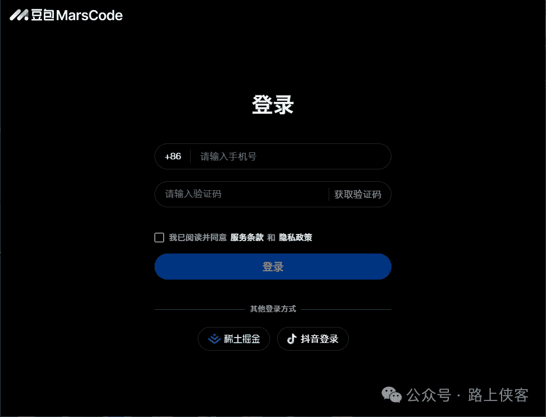
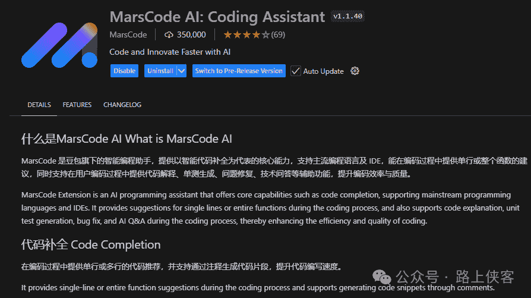
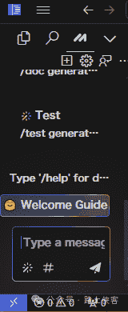
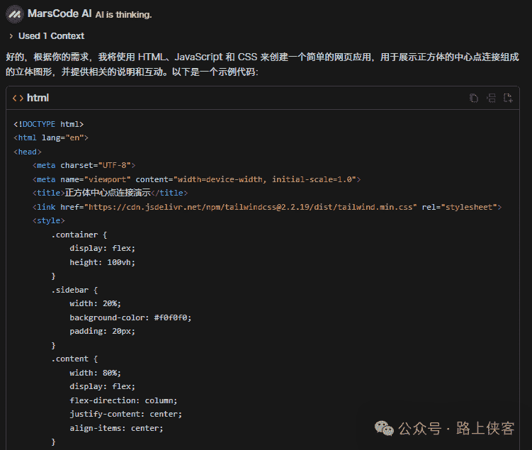
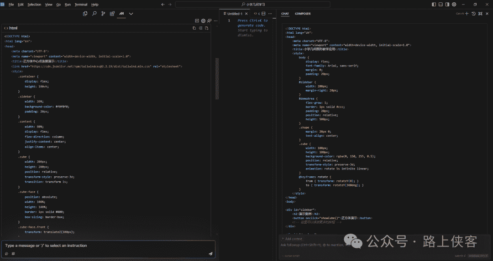
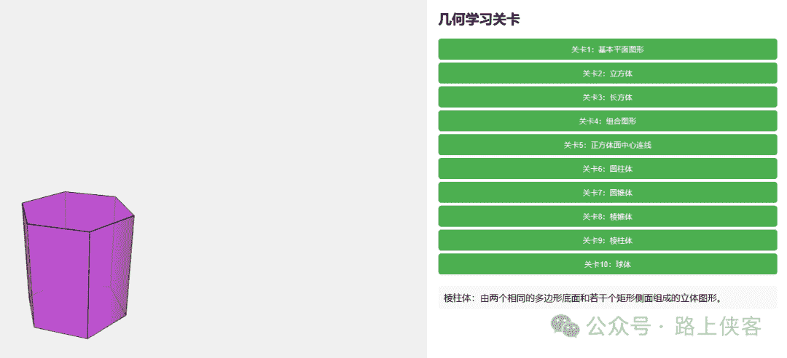
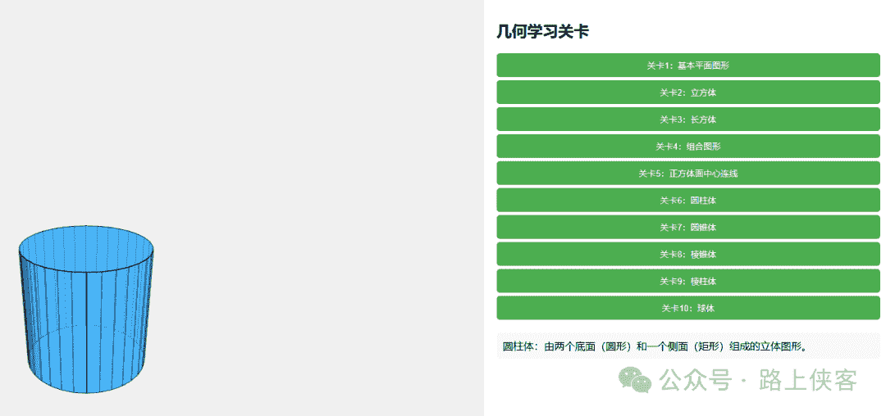

# 免费使用豆包的Marscode来无代码编程制作应用程序平替Cursor

> 来源：[https://agijuejin.feishu.cn/docx/FHIidvOSuo9Cwrx0UBZcUZEun4S](https://agijuejin.feishu.cn/docx/FHIidvOSuo9Cwrx0UBZcUZEun4S)

> [ Roa](https://mp.weixin.qq.com/s/V9oZOXDhwDKp2NA_LgQMGQ)d Hero 路上侠客｜阅读原文，如有侵权，请联系删除。

> 转载请联系原作者取得授权

今天来使用豆包的Marscode来无代码编程制作应用程序。很多人都说它是Cursor的平替，我们来看看是否好用。

官方网址：

https://www.marscode.cn

手机号登录授权即可，然后如果在Cursor中安装过Marscode插件的话，中间直接调转使用。

插件安装。

使用快捷键（Windows: Ctrl + U；macOS：Command + U）唤起侧边对话框。

设计一个小学几何演示应用。

输入自然语言提示词后，很快开始自动化编程。

生成速度上和Cursor自带的chat差不多。

效果上好像比起Cursor差了些。

这样的话我们可以对两个不同工具在无代码编程上的对比了，以后也可以同时开两个窗口进行效果比较。左边是marscode，右边是cursor chat。

效果如下：

除了上述的两个工具，我们在windsurf中也进行了相应的测试，发现比之之前两个工具算是绝杀了。

效果如下：

优化后更是实现了相当多的多面体演示：

对上述效果最佳无代码编程工具和如何创建应用感兴趣的小伙伴可以私信路上侠客。

补充知识：

关于https://www.marscode.cn 的相关探究

一、网站性质

很抱歉，仅根据现有的参考信息，无法确切得知https://www.marscode.cn 是什么网站。没有与之直接相关的信息来明确其性质、所属主体或者网站类型等内容。

二、功能和用途

由于不知道该网站具体是什么类型的网站，所以难以确切描述其功能和用途。但从一般意义上来说，如果这是一个与代码相关的网站，可能具有以下功能和用途：

代码展示与学习：

对于开发者和编程爱好者来说，可能会展示各类编程语言的示例代码，像Java、Python、JavaScript等。以JavaScript为例，网站可能会有展示如何通过JavaScript实现网页交互功能的代码，如点击按钮弹出提示框等操作的代码示例。这有助于初学者学习代码的语法和逻辑，也能为有经验的开发者提供参考和灵感 。

可能提供不同项目的完整代码结构，如构建一个简单的Web应用程序的代码框架，包括前端页面布局代码和后端服务器交互代码等，让学习者能够从整体上把握项目开发的流程和代码组织方式。

代码分享与交流：

开发者们可以在这个平台上分享自己编写的代码，无论是自己开发的小工具、小游戏的代码，还是在工作中遇到的某个特定功能的实现代码。其他用户可以对这些分享的代码进行查看、学习、评论和提出改进建议，促进代码的优化和知识的共享。

可能设有专门的论坛或者社区板块，大家可以在里面交流代码编写过程中的经验、遇到的问题以及解决方法。例如在开发移动应用程序时，如何优化代码以提高性能，避免内存泄漏等问题，开发者们可以在这个社区里分享各自的见解。

代码开发工具提供：

如果是比较综合性的代码相关网站，可能会提供一些在线的代码开发工具，如代码编辑器。这些编辑器可能具有语法高亮显示功能，能够清晰地显示不同代码元素，如关键字、变量名、函数名等，方便开发者编写代码时快速识别代码结构。

也许会提供代码调试工具，帮助开发者找出代码中的错误。当代码运行出现问题时，调试工具可以逐步跟踪代码的执行过程，显示变量的值在不同阶段的变化情况，从而确定问题所在的位置和原因。

三、用户评价

由于缺乏关于https://www.marscode.cn 的任何用户评价相关的参考信息，无法给出该网站具体的用户评价情况。一般来说，对于一个网站的用户评价会从以下几个方面产生：

功能实用性：

如果是代码相关网站，用户会关注其提供的代码示例是否实用。例如，对于想要学习Web开发的新手来说，如果网站上的示例代码能够涵盖从基础的HTML结构搭建到复杂的服务器端交互的各个环节，并且代码注释详细，易于理解，那么用户可能会给予较高的评价。反之，如果代码示例过于简单或者缺乏实际应用场景，用户可能会觉得不太实用。

在线开发工具的功能完整性也会影响用户评价。比如代码编辑器是否支持多种编程语言的语法提示，如果用户在编写Python代码时，编辑器不能准确地提供函数名和参数的提示，可能会降低用户对该网站的好感度。

界面友好度：

网站的界面布局是否清晰合理对于用户体验至关重要。一个好的代码网站，其代码展示区域应该有足够的空间，并且字体大小、颜色搭配等不会让用户在长时间查看代码时感到视觉疲劳。例如，代码的颜色区分应该符合一般的编程规范，关键字用一种颜色，变量用另一种颜色等，这样可以提高代码的可读性。

导航栏和菜单的设计也需要简洁明了，用户能够轻松找到自己想要的内容，如代码分类浏览、搜索功能等。如果用户在寻找特定类型的代码或者功能时，需要花费大量时间在复杂的菜单和页面跳转中，可能会对网站产生负面评价。

社区互动性：

在有社区功能的代码网站上，社区的活跃程度和互动氛围会影响用户评价。如果用户发布的代码或者问题能够得到及时的回应和解答，并且社区成员之间的交流积极、友好，那么用户会觉得这个社区很有价值。相反，如果社区无人问津，或者存在不友好的言论和行为，可能会导致用户不再愿意参与其中。

四、运营模式

同样，由于缺乏关于这个网站的直接信息，难以准确阐述其运营模式。一般而言，一个代码相关网站可能会有以下运营模式：

内容驱动模式：

网站的运营核心在于优质代码内容的提供。通过邀请专业的开发者或者编程专家撰写高质量的代码示例、教程等内容，吸引用户访问。例如，定期发布一些热门技术领域的代码解析文章，像人工智能领域的Python代码实现机器学习算法的示例，并配上详细的算法原理讲解和代码注释，以此吸引对人工智能感兴趣的开发者和学习者。

鼓励用户生成内容（UGC）也是常见的方式。网站可以设置激励机制，如积分、徽章等，鼓励用户分享自己的代码作品或者编写的代码教程。当用户贡献的内容达到一定质量和数量标准时，可以获得相应的奖励，这不仅能增加网站的内容量，还能提高用户的参与度和忠诚度。

广告盈利模式：

在网站上展示与编程、开发相关的广告。例如，展示一些代码开发工具的广告，像知名的代码编辑器软件或者代码版本管理工具等。这些广告可以按照点击量或者展示量向广告商收费，从而获得盈利。

也可以与一些在线教育平台合作，推广编程课程广告。对于想要深入学习编程知识的用户来说，看到相关的优质课程广告可能会产生兴趣并点击了解，而网站则可以从这些广告合作中获取收益。

增值服务模式：

提供一些付费的高级功能或者服务。比如，提供更强大的代码调试工具，付费用户可以享受更详细的错误分析和更多的调试功能。或者提供代码托管服务，付费用户可以获得更大的代码存储空间、更安全的代码管理等增值服务。

针对企业用户，可能提供定制化的代码解决方案或者企业级的代码培训服务，收取相应的服务费用。

五、所属的行业领域

根据网站名称中的“marscode”以及参考信息中缺乏与该网站直接相关的特殊指向信息推测，这个网站很可能属于代码开发或者编程相关的行业领域。

代码开发领域：

在这个领域中，网站可能主要服务于开发者群体。如果是这样，它可能提供各种编程语言的代码资源，涵盖从前端开发的HTML、CSS、JavaScript到后端开发的Python（Django、Flask等框架）、Java（Spring框架等）等。例如，为前端开发者提供如何实现响应式网页设计的代码示例，包括如何使用CSS媒体查询和JavaScript动态调整页面布局等内容。

也可能专注于某一特定类型的代码开发，如移动应用开发（Android开发使用Java或Kotlin，iOS开发使用Swift或Objective - C）。网站可以提供移动应用开发中的常见功能实现代码，像用户登录注册功能、数据存储和读取功能等代码示例，方便移动应用开发者在开发过程中参考和借鉴。

编程教育领域（可能性较小但不排除）：

如果网站涉及编程教育领域，可能会提供编程课程的在线学习资源。例如，以视频教程的形式讲解编程语言的基础知识，从变量、数据类型等基础概念开始，逐步深入到函数、类、对象等高级概念。并且可能会配合课后练习和项目实践，让学习者在实践中巩固所学知识。

可能会有针对不同年龄段和学习目标的编程课程分类。比如针对儿童的趣味编程课程，通过图形化编程工具（如Scratch）的使用来培养孩子的编程兴趣和逻辑思维能力；针对成人的职业技能提升编程课程，如Python数据分析课程或者Java企业级开发课程等。