# 豆包MarsCode初体验，用聊天的方式开发一款Excel可视化工具

> 来源：[https://agijuejin.feishu.cn/docx/L42ldPZdQoXHIYx9l7RcNRUgnbh](https://agijuejin.feishu.cn/docx/L42ldPZdQoXHIYx9l7RcNRUgnbh)

> Java基基｜[阅读原文](https://mp.weixin.qq.com/s/f8mMrKivsHSlVbIt29P07w)，如有侵权，请联系删除。

> 转载请联系原作者取得授权

## 一、项目背景

在B端领域工作久了听到的最多的一句话就是：你做的这个系统，还不如Excel好用。每每听到这样的回答，我总是心里咯噔一下，随即陷入了漫长的思考。

某日心血来潮，想着Excel无非是表格嘛，不如我就搭建一个Excel可视化工具，让用户日常对于Excel的查看更方便一些。虽说想好了就准备要开始做，但由于许久没有写过代码了，擅长的python语言的很多语法都忘得差不多了。

刚好想起字节新推出的国产的AI编程工具— —豆包MarsCode，豆包MarsCode还支持Cloud IDE开发模式，连IDE都不用安装，于是便尝试使用豆包MarsCode的AI助手来帮助我完成这个项目的开发。

## 二、豆包MarsCode初体验

### 项目搭建

使用手机号注册了豆包MarsCode后，由于豆包MarsCode支持使用模版搭建项目，这倒是省了我不少创建文件的前期工作。如下如所示：

项目搭建完成后，一眼就注意到了豆包MarsCode编辑器右侧的“AI助手”栏目，那也就是说我可以一边聊天，一边编程？

**灵感获取**

那么在正式开始编程之前，我将我准备做的项目需求告知AI助手，希望能得到一些需求实现的解决方案。如下图所示：

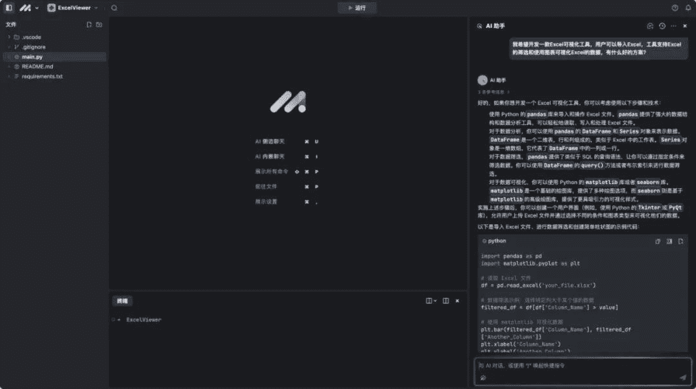

豆包MarsCode的AI助手根据我的问题给出了不错的解决方案，除了给出了项目实现的步骤和思路，还给出了实现的示例代码。

### 代码AI修复

我们打开“main.py”文件，尝试点击代码块的“插入光标处”按钮，代码便被直接插入到了编辑区域中。但当我点击“运行”来项目时，发现项目报错了，在“终端”中打印出了错误信息。如下图所示：

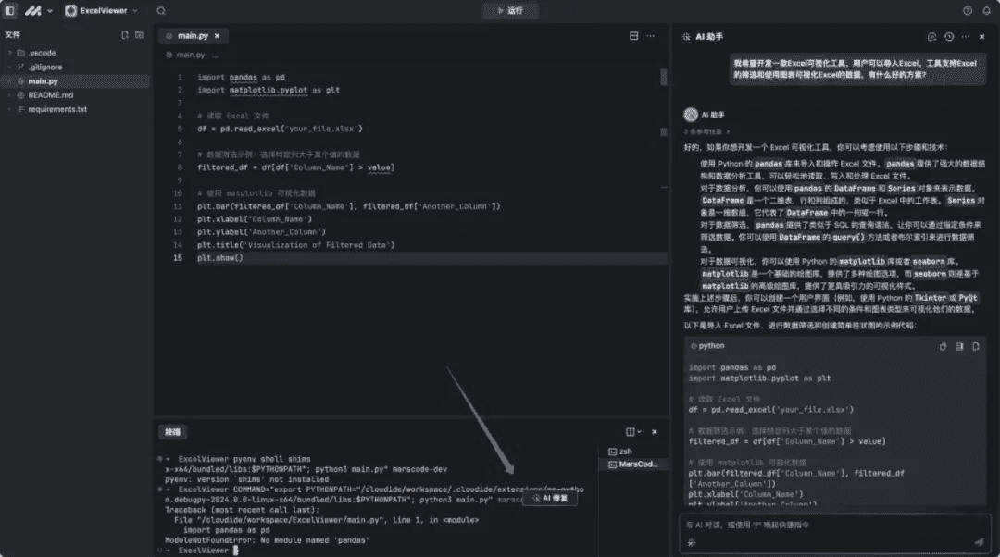

和其他的IDE的终端不同，豆包MarsCode除了报错信息外，在终端处还显示了一个“AI修复”的按钮。当我们点击“AI修复”按钮时，豆包MarsCode直接将终端中的报错信息直接询问AI助手，AI助手根据问题立即给出了解决方案。如下图所示：

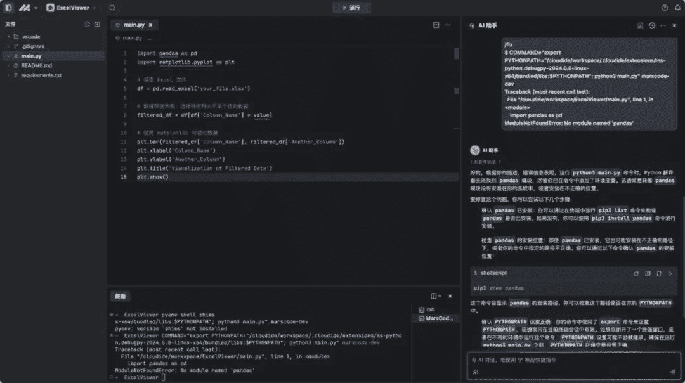

在AI助手的帮助下，我们发现由于项目中未安装pandas、matplotlib模块导致的。那么接下来我们直接根据AI助手的提示再次询问AI助手如何解决，此时AI助手不仅给出了解决方案，还直接给出了安装模块所需的命令行代码。

点击命令行上的“运行”按钮，命令行便直接添加到了终端中，执行完成后，项目所依赖的模块便被安装完成。如下图所示：

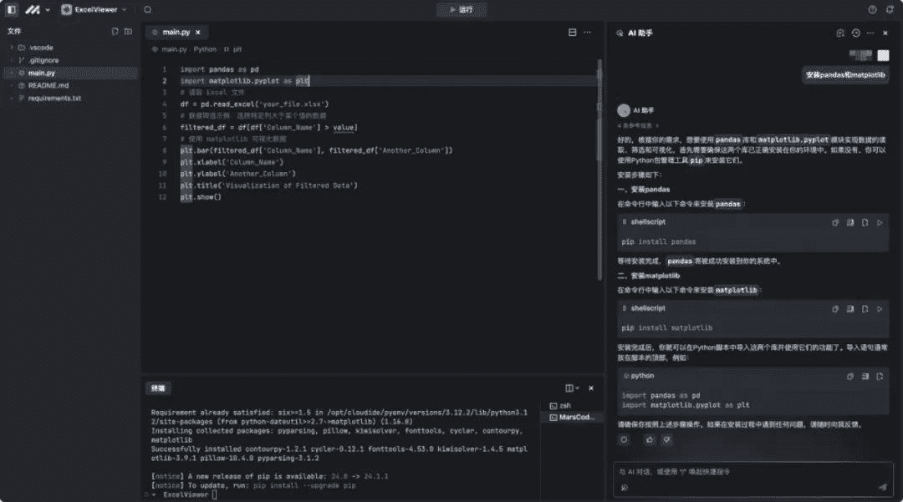

模块安装完成后，我们发现代码上的“Value”代码处还存在报错信息，当我们鼠标移动到相应的代码时，豆包MarsCode也提供了“AI修复”功能，在唤起“AI对话”的窗口中，我们直接可以在当前代码处进行AI对话，并且获得建议。如下图所示：

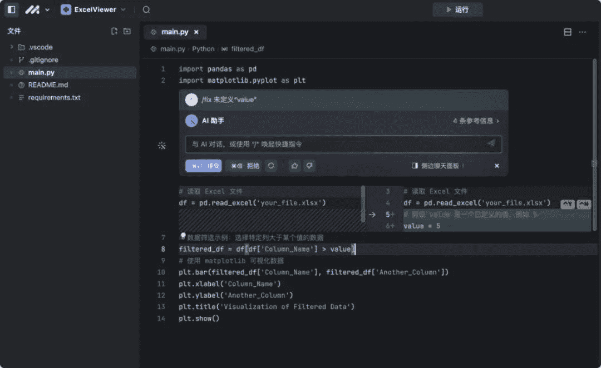

点击“接受”按钮后，AI助手便把修复问题的代码直接插入到了编辑器中。

## 三、项目实战

在了解了豆包MarsCode的基础使用方法后，下一步该正式开始项目开发阶段。

### 导入模块

首先，我们先导入项目所依赖的python模块，并且借助豆包MarsCode终端安装所模块。这一次我们采用“面向注释”编程，当输入注释文字并换行，豆包MarsCode会根据注释文字给出代码补全建议，如下代码所示：

```
# 导入pandas和streamlit模块
import pandas as pd
import streamlit as st
```

对于缺少的streamlit模块的问题，我们可以直接询问AI助手，并且执行命令行来安装streamlit模块到项目中。如下图所示：

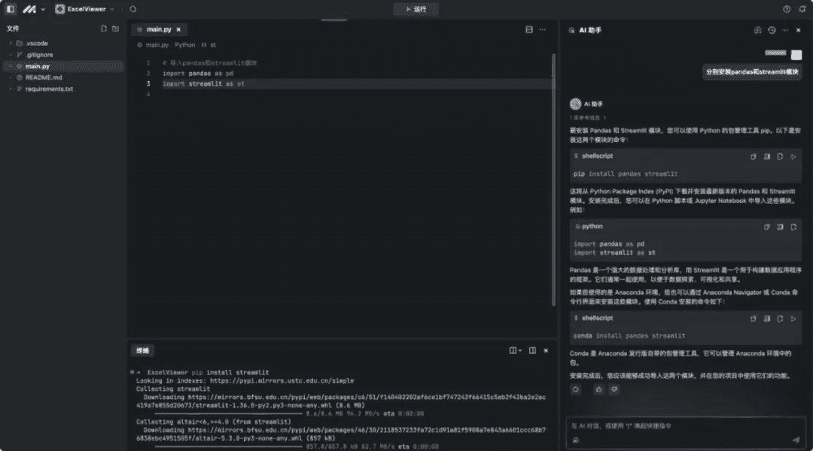

**上传文件**

下一步，我们为工具设置一个标题，然后实现一个上传文件的功能。只需要输入注释，豆包MarsCode会自动预测和补全代码块，如下代码所示：

```
# 设置标题为&quot;Excel可视化&quot;
st.title(&quot;Excel可视化&quot;)

# 上传文件
uploaded_file = st.file_uploader(&quot;请选择Excel文件&quot;, type=[&quot;xlsx&quot;, &quot;xls&quot;])
```

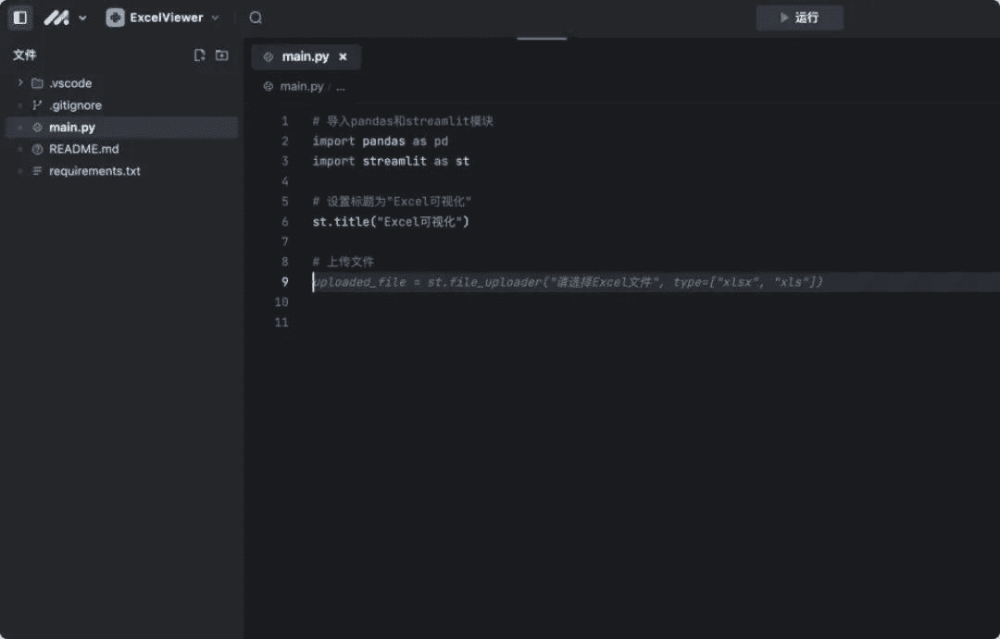

**显示数据**

当我们需要显示导入的文件的数据时，虽然我们只需要显示内容，但豆包MarsCode似乎很聪明，它写了一个判断逻辑，当上传的文件不为空时才显示数据。如下代码所示：

```
# 显示文件内容
if uploaded_file is not None:
  df = pd.read_excel(uploaded_file)
  st.write(df)
```

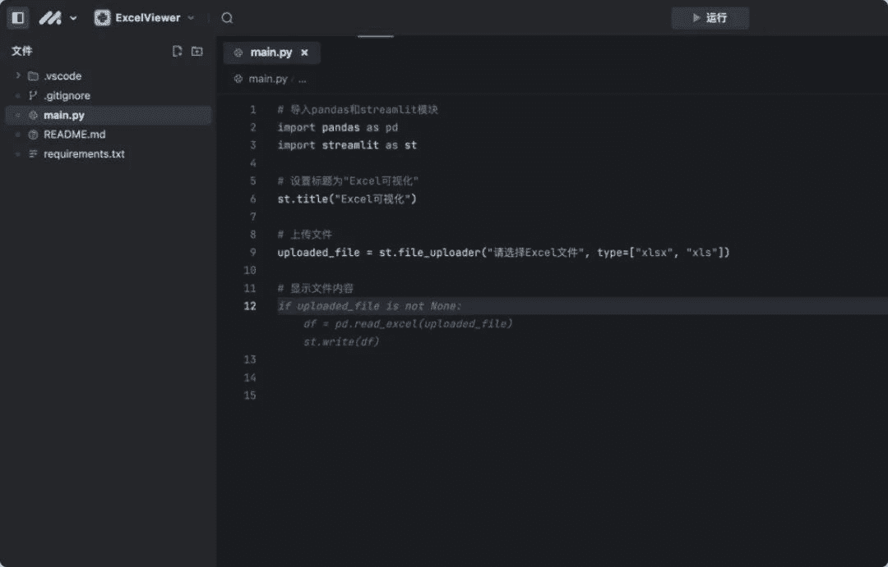

**预览项目**

初步完成项目基础功能后，我们希望预览当前项目。点击豆包MarsCode顶部导航栏的“运行”按钮，可以看到在终端中看到项目运行的结果，如下图所示：

从终端中我们可以看到，要运行该项目需要执行「streamlit run main.py」命令行，运行命令行后，豆包MarsCode会直接生成一个网络服务，我们甚至可以在豆包MarsCode的“Web预览”中访问项目运行的结果。如下图所示：

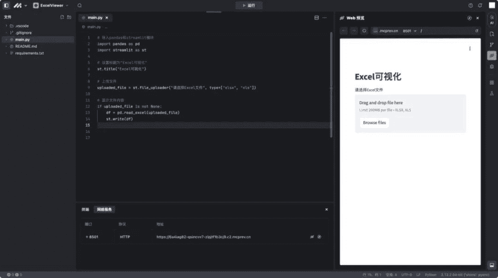

我们也可以点击「网络服务」栏目上的“地址”来在浏览器中查看项目，我们尝试下上传一个Excel文件来看看项目运行的效果，如下图所示：

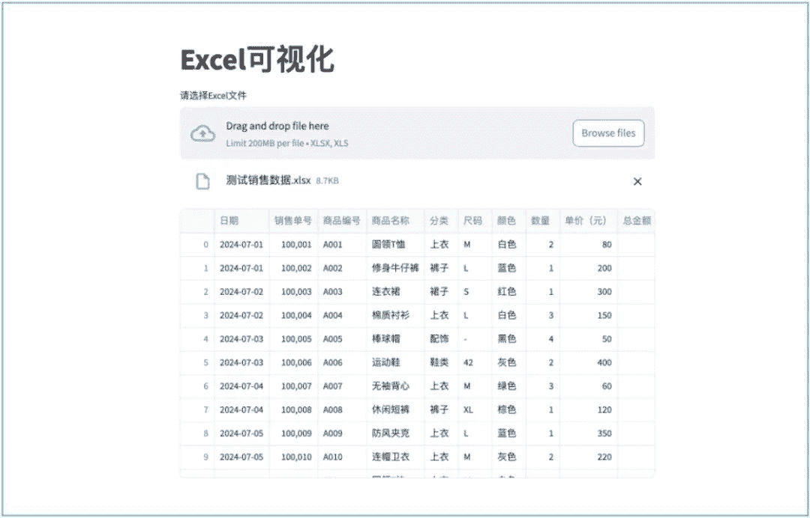

**显示图表**

表格显示完成后，下一步我们希望能够选择数据中的某一项作为条件，并且实现可视化。我们尝试描述一些复杂且连贯的内容，来看看豆包MarsCode的连续代码生成的效果。如下代码所示：

```
# 选择表格中的列作为条件来显示图表
selected_column = st.selectbox(&quot;选择列作为条件&quot;, df.columns)

# 选择图表类型
chart_type = st.selectbox(&quot;选择图表类型&quot;, [&quot;折线图&quot;, &quot;柱状图&quot;])

# 根据选择的图表类型显示图表
if chart_type == &quot;折线图&quot;:
  st.line_chart(df[selected_column])
elif chart_type == &quot;柱状图&quot;:
  st.bar_chart(df[selected_column])
```

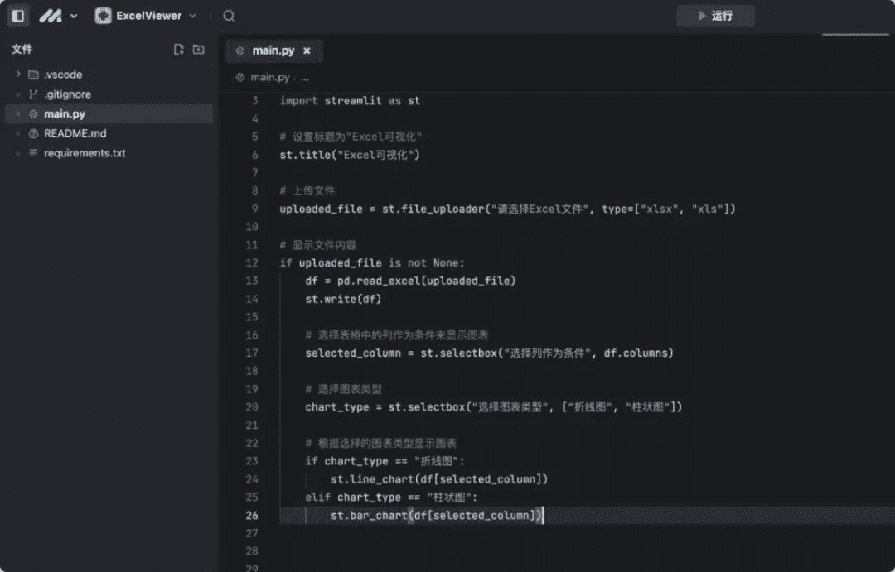

效果很不错，当连续使用“Tab”来接受AI助手的建议时，豆包MarsCode像是真正的开发者一样，先写注释再补全代码，并且在连续生成下，不知不觉中我们已经完成了项目的开发。

在浏览器中再次预览项目，令人惊讶的是，豆包MarsCode完成了我们所设想的项目效果。如下图所示：


# **四、项目小结**

完整的项目下来，可能你会惊奇地发现，我甚至没有写一行代码。

在后面在查看豆包MarsCode的说明文档时我才了解到，豆包MarsCode不只是实现了代码补全功能，还开发了代码补全 Pro功能，可以基于上一次的编辑内容及代码情况，预测下一个改动点并给出代码推荐，这也就解答了为什么我能够只写注释但实现了许多复杂的功能。

在不断查看豆包MarsCode的内容时，发现豆包MarsCode还有很多亮点的功能我都还没有使用到，这更加激起了我对于AI编程的好奇心。

在未来，是不是我们，甚至是不懂代码的人，也能通过像豆包MarsCode这样强大的AI编程助手来实现项目开发？

我好奇着，也期待着。