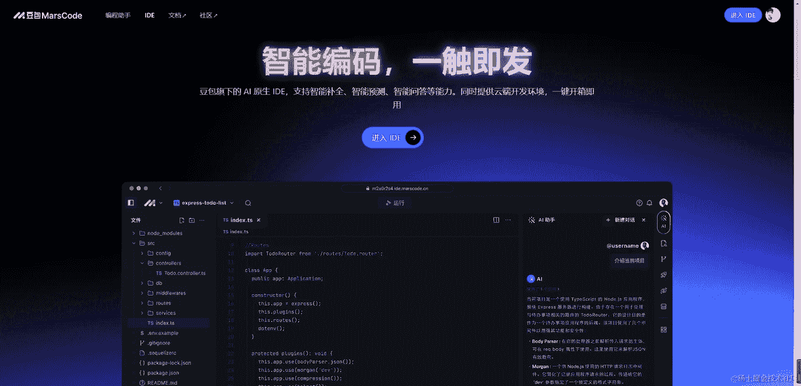
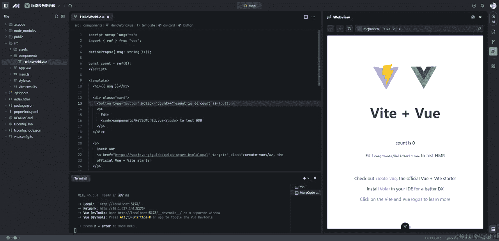
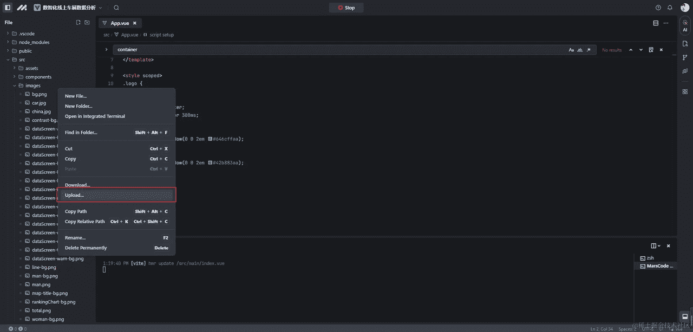
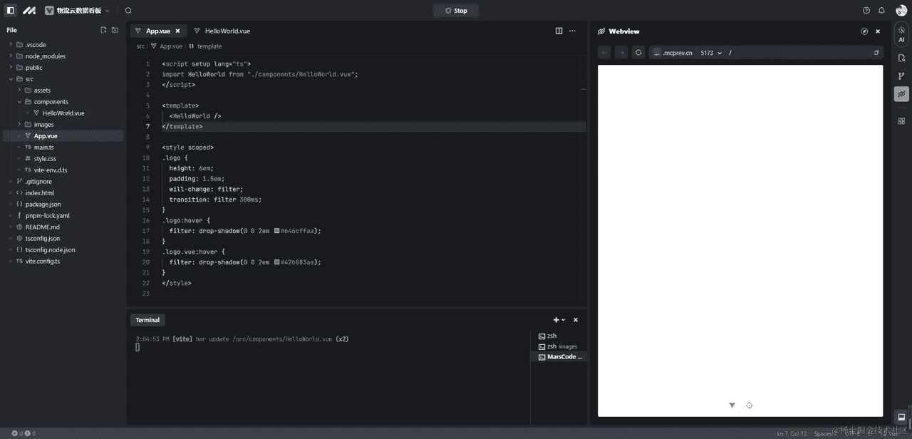
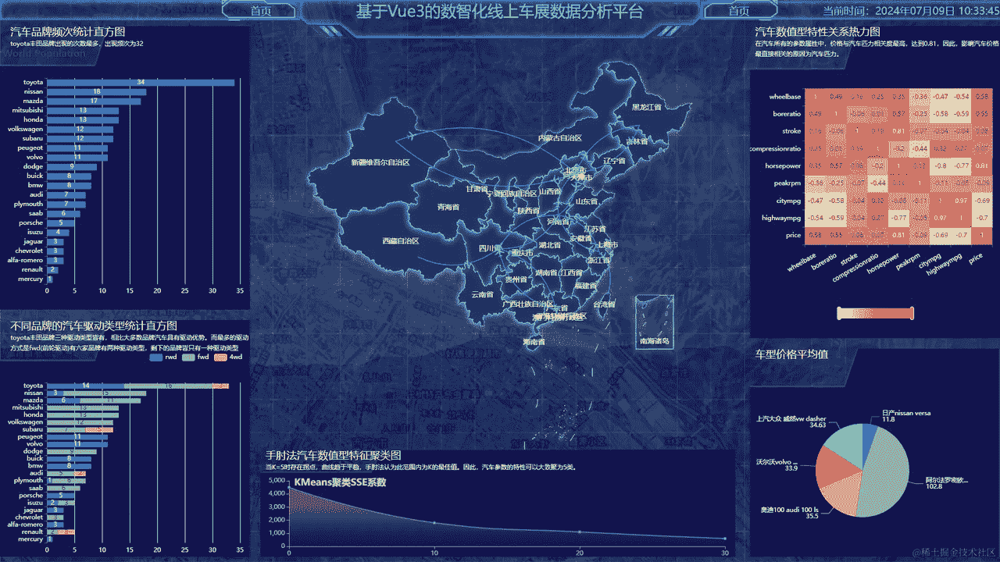
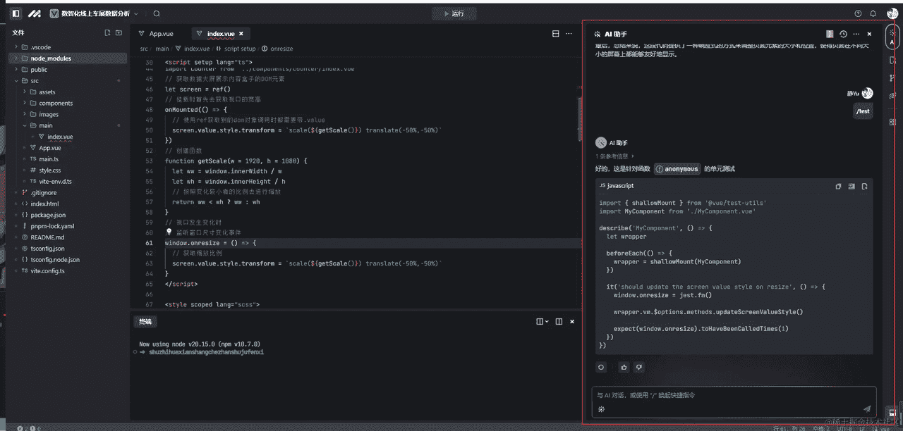
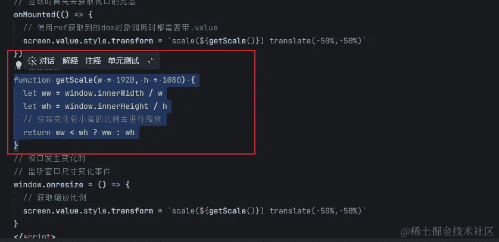
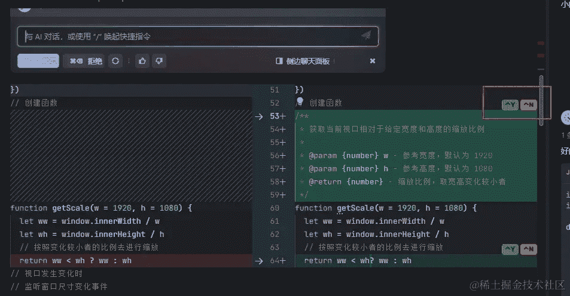
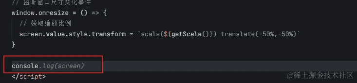

# 我用豆包Marscode画数据大屏

> 来源：[https://agijuejin.feishu.cn/docx/AWf5d3PB4ouVvRxF8x5ciKYJnAe](https://agijuejin.feishu.cn/docx/AWf5d3PB4ouVvRxF8x5ciKYJnAe)
>
> 作者：静Yu
>
> 链接：https://juejin.cn/post/7389643487911919652
>
> 来源：稀土掘金
>
> 著作权归作者所有。商业转载请联系作者获得授权，非商业转载请注明出处。

## 认识豆包Marscode

豆包 MarsCode IDE 是一个 AI 原生的云端集成开发环境（IDE）。内置的 AI 编程助手和开箱即用的开发环境让我们可以更加专注于各种项目的开发。豆包 MarsCode 编程助手，具备以智能代码补全为代表的 AI 功能。支持了多种编程语言以及主流的 IDE，它能够在开发过程中对单行代码乃至整个函数提供编写提议。除此之外，它还对代码解释、单元测试生成以及问题修复等功能提供支持，进而提升了开发的效率与质量。



### 功能介绍

豆包 MarsCode 编程助手支持的功能如下表所示。

### 支持的语言/框架

豆包 MarsCode 编程助手支持的主流语言和框架如下：

## 体验豆包Marscode

进入IDE之后，注册登录进入主页


作为一名前端开发工程师，选择`Vue`+`Echarts`创建一个大屏项目：数智化线上车展数据分析平台。

你选择创建一个`Vue`项目之后，会初始化一个项目，点击`RUN`即可运行。浏览`package.json`文件，发现默认创建的项目是`Vue3`+`vite`构建的项目。虽然官方提供的模板是`vue3`的，如果你希望使用`Vue2`可以通过`Github`导入项目。



接下来就正式进入我们项目的开发，画大屏必不可少的就是`Echarts`了，通过`npm`安装速度较慢，所以使用淘宝的镜像及其命令 `cnpm`。因为豆包 MarsCode IDE 内置了 AI 助手，提供代码自动补全与生成、问题修复、代码优化等能力。再安装了`cnpm` 之后，IDE猜到了我是在查看版本，在控制台输入`cnpm`之后就会自动补全`cnpm -v`来查看版本。

通过命令 `cnpm install echarts --save`安装`Echarts`，`cnpm`的安装速度就很快了，差不多一分钟就搞定，在项目的`package.json`文件中也可以看到安装的版本`5.5.1`。

画大屏也需要静态图片来装饰整个大屏，可以通过`upload`批量上传。



将模板默认生成的代码，简单删一删就变为一个空的项目，我们就可以正式开始大屏的制作了。



可视化数据大屏首先要解决的问题就是适配性，这是一个比较专业性的问题。豆包Marscode集成了AI功能，我们看一下它是怎么回答的。

> 想要可视化大屏适配任何多种分辨率的屏幕，前端该如何实现

我选择的解决方案是：通过 `css` 的 `scale` 属性，根据屏幕大小，对图表进行整体的等比缩放，从而达到自适应效果。

CSS 的 `scale` 属性用于指定元素的缩放比例。它是 `transform` 属性的一个值，可以使用 CSS 中的 `transform` 属性来设置元素的缩放比例。

`scale` 属性可以接受一个或两个参数。如果只提供一个参数，它将同时应用于元素的宽度和高度，导致元素在两个维度上按比例缩放。如果提供两个参数，第一个参数表示宽度的缩放比例，第二个参数表示高度的缩放比例。

```
/* 元素整体缩放为原来的 50% */
transform: scale(0.5);

/* 元素宽度缩放为原来的 75%，高度缩放为原来的 120% */
transform: scale(0.75, 1.2);
```

`scale` 属性可以与其他 `transform` 属性值结合使用，比如 `translate`、`rotate` 等，以实现更复杂的变形效果。同时，`scale` 属性也可以用在 CSS 动画中，通过改变缩放比例来实现元素的动态缩放效果。 具体代码如下：

```
let screen = ref()
// 挂载时首先去获取视口的宽高
onMounted(() => {
  // 使用ref获取到的dom对象调用时都需要带.value
  screen.value.style.transform = `scale(${getScale()}) translate(-50%,-50%)`
  console.log(`scale(${getScale()}) translate(-50%,-50%)`, '666')
})
// 创建函数
function getScale(w = 1920, h = 1080) {
  let ww = window.innerWidth / w
  let wh = window.innerHeight / h
  // 按照变化较小者的比例去进行缩放
  return ww < wh ? ww : wh
}
// 视口发生变化时
window.onresize = () => {
  screen.value.style.transform = `scale(${getScale()}) translate(-50%,-50%)`
}
```

`getScale()` 函数通常用于根据浏览器视口大小计算一个缩放因子。这个因子通常被用作`scale`属性的值，以确保`screen`元素可以根据屏幕大小自动调整大小。`translate(-50%,-50%)` 部分是用于将缩放后的元素居中显示的样式，`transform-origin: left top` 表示`transform`属性的原点位于元素的左上角。 这段代码提供了一种响应式的方式来调整页面元素的大小和位置，使得页面在不同大小的屏幕上都能够友好地显示。 写这篇文章的时候，我的大屏已经是开发完成的状态。所以我们先看一下最终效果，来吧展示，哈哈~~~



> 整个可视化大屏分为六部分，分别是两个横向的柱状图，一个中国地图，一个折线图、一个饼状图以及一个热力图。

## 横向柱状图 && 折线图

`x`轴配置：

+   类型为`'value'`，表示`x`轴为数值轴。

+   轴标签的颜色为白色。

+   边界间隙为`[0, 0.01]`，表示`x`轴的起始和结束位置会留有一定的空白。

`y`轴配置：

+   类型为`'category'`，表示`y`轴为类目轴。

+   轴标签的颜色为白色。

+   `y`轴的类目数据包括了多个汽车品牌名称。

`Echarts`-`category` 类目轴，适用于离散的类目数据。为该类型时类目数据可自动从 `series.data`或 `dataset.source` 中取，或者可通过 `yAxis.data` 设置类目数据。

`series`:`type: 'category'`柱状图（或称条形图）是一种通过柱形的高度（横向的情况下则是宽度）来表现数据大小的一种常用图表类型。

`type:'line'`折线图是用折线将各个数据点标志连接起来的图表，用于展现数据的变化趋势。

```
    xAxis: {
      type: 'value',
      axisLabel: {
        color: 'white',
      },
      boundaryGap: [0, 0.01],
    },
    yAxis: {
      type: 'category',
      axisLabel: {
        color: 'white',
      },
      data: [],
    },
     series: [
      {
        name: '',
        type: 'bar',
        label: {
          show: true,
        },
        data: [],
      },
    ],
```

## 热力图

`ECharts`热力图是一种数据可视化的图表类型，它通过颜色的深浅来表示数据的大小或密集程度。在热力图中，数据通常以矩形网格的形式呈现，每个小矩形格子的颜色深浅代表该位置上的数据大小，一般使用渐变色来表达数据的强弱。

+   **`min`**：表示热力图数据值中的最小值。在热力图中，所有小于或等于`min`的数据值都将被视为该范围的下限，通常用于确定颜色映射的起始点。

+   **`max`**：表示热力图数据值中的最大值。相应地，所有大于或等于`max`的数据值都将被视为该范围的上限，用于确定颜色映射的终点。

可以从实现的效果图中看出，热力图数据基本都是0.xx，所以我这的最大值设置为1.0，如果设置的数值过大，会出现所有颜色基本一致的情况，看不出具体差异。

```
 visualMap: {
      min: -0.75,
      max: 1.0,
      calculable: true,
      orient: 'horizontal',
      left: 'center',
      bottom: '15%',
    },
    series: [
      {
        name: 'Punch Card',
        type: 'heatmap',
        data: data,
        label: {
          show: true,
        },
        emphasis: {
          itemStyle: {
            shadowBlur: 10,
            shadowColor: 'rgba(0, 0, 0, 0.5)',
          },
        },
      },
    ],
```

## 中国地图

### 注册地图

在`ECharts`中，需要先注册地图类型，才能使用它。对于中国地图，可以使用`echarts.registerMap`方法注册地图数据。注册时，需要指定地图的名称（如`'china'`）和地图数据（即之前准备的JSON数据文件）。

### 配置地图选项

通过配置`ECharts`实例的`option`属性，可以定义地图的显示样式、数据系列、提示框、视觉映射组件（`visualMap`）等。对于中国地图，通常需要设置地图的标题、数据系列类型为`'map'`、地图类型为`'china'`等。同时，还可以通过`series`属性中的`data`数组来设置各个省份或城市的数据，这些数据将用于控制地图上的颜色深浅或图标大小等。

### 渲染地图

配置完`option`属性后，调用`ECharts`实例的`setOption`方法，将配置对象传入，即可渲染出中国地图。此时，地图将按照配置显示数据，并支持交互操作，如缩放、拖动等。


```
myEcharts.setOption({
    // geo地理坐标系组件 支持在地理坐标系上绘制散点图，线集
    geo: {
      map: &#x27;china&#x27;, // 中国地图
      roam: true, // 是否开启放大缩小/拖拽功能
      //地图的位置调试
      left: 150,
      top: 120,
      right: 150,
      bottom: 0,
      // 缩放比列
      zoom: 1.12,
      // 地图中心点位置
      layoutCenter: [&#x27;50%&#x27;, &#x27;50%&#x27;],
      //地图上的文字的设置
      label: {
        show: true,
        color: &#x27;white&#x27;,
        fontSize: 14,
      },
      // itemStyle地图区域的多边形 图形样式
      itemStyle: {
        areaColor: &#x27;#12235c&#x27;, // 地图区域的颜色
        // borderColor: &#x27;#2ab8ff&#x27;, // 图形的描边颜色
        borderColor: &#x27;rgba(147, 235, 248, 1)&#x27;,
        borderWidth: 0.8,
        shadowColor: &#x27;rgba(128, 217, 248, .8)&#x27;,
        shadowOffsetX: -2,
        shadowOffsetY: 2,
        shadowBlur: 10,
        opacity: 0.9,
      },
      //地图高亮的效果
      emphasis: {
        label: {
          color: &#x27;white&#x27;,
          fontSize: 32,
          // fontWeight: &#x27;bold&#x27;,
        },
        itemStyle: {
          // areaColor: &#x27;#5470c6&#x27;,
          borderWidth: 2,
          borderType: &#x27;dashed&#x27;, // 高亮时虚线边框
        },
        // focus: &#x27;self&#x27;, // 鼠标移入地区，其余地区淡出
      },
    },
    //布局位置
    grid: {
      left: 0,
      top: 0,
      right: 0,
      bottom: 0,
    },
    // 航线的设置 series-lines
    series: [
      {
        type: &#x27;lines&#x27;, //航线的系列
        data: [
          {
            // 北京-&gt;河南
            coords: [
              [116.405285, 39.904989], // 起点
              [113.665412, 34.757975], // 终点
            ],
          },
          {
            // 河南-&gt;北京
            coords: [
              [113.665412, 34.757975],
              [116.405285, 39.904989],
            ],
          },
          {
            // 北京-&gt;黑龙江
            coords: [
              [116.405285, 39.904989],
              [126.642464, 45.756967],
            ],
          },
          {
            // 黑龙江-&gt;北京
            coords: [
              [126.642464, 45.756967],
              [116.405285, 39.904989],
            ],
          },
          {
            // 河南-&gt;浙江
            coords: [
              [113.665412, 34.757975],
              [120.153576, 30.287459],
            ],
          },
          {
            // 浙江-&gt;河南
            coords: [
              [120.153576, 30.287459],
              [113.665412, 34.757975],
            ],
          },
          {
            // 浙江-&gt;台湾
            coords: [
              [120.153576, 30.287459],
              [121.509062, 25.044332],
            ],
          },
        ],
        // 开启动画特效
        effect: {
          show: true,
          period: 5, // 箭头指向速度，值越小速度越快
          trailLength: 0, // 特效尾迹长度[0,1]值越大，尾迹越长重
          // symbol: &#x27;arrow&#x27;, // 箭头图标
          symbol: planePath, // 箭头图标使用引入的箭头
          symbolSize: 18,
        },
        // 线路统一的样式设置
        lineStyle: {
          color: &#x27;#00eaff&#x27;,
          width: 1.5, //尾迹线条宽度
          opacity: 0.7, //尾迹线条透明度
          curveness: 0.3, //尾迹线条曲直度
        },
      },
    ],
  })
```

到此为止，整个大屏基本上就开发完成了。撒花完结！

# AI能力

在整个项目的开发过程中，真切体会到内置AI的强大，忍不住单独抽个模块再来介绍一下。

## AI对话视图

### 侧边聊天

侧边对话框（Side AI Chat）位于工作区右侧。你可以通过快捷键（macOS：⌘+U；Windows：Ctrl+U）唤起对话框，或直接点击侧边栏中的 AI 按钮唤起。



### 内嵌聊天

当我们选中一段代码之后会自动弹出AI功能导航，可以进行代码解释、注释、生成单元测试。



尤其是代码注释，自己不想写可以通过AI搞定，切莫偷懒！！！ 可以通过选择Y、N决定是否使用生成的注释。



## 使用AI能力

### 普通问答

唤起对话框后，你可以在输入框中输入你的问题，然后点击 发送 按钮或敲击回车键，AI 助手将回答你的问题。你可以进行多轮问答，不断补充细节，从而使 AI 助手的回答更加准确。

### 补全代码

AI 助手支持自动补全当前代码。



# 结语

豆包 MarsCode 编程助手是一款功能强大的开发工具，它通过集成先进的AI技术，为开发者提供了从代码编写到测试、维护的全流程支持。对于希望提高开发效率、降低维护成本并提升软件质量的团队来说，豆包 MarsCode 是一个值得考虑的选择。感兴趣的建议进一步查阅其官方文档和社区资源，以更深入地了解其功能和最佳实践。

在整个开发流程中，真切感受到了在线开发工具的便捷、高效、流畅。AI功能的集成，更是极高的提升了程序员的开发效率，力荐！
