# 【科普】程序员必看，AI时代新协议 MCP 正在连接吞噬一切，20+资源全收录！如果你最近经常刷 X 的话，你会发现一个

> 来源：[https://agijuejin.feishu.cn/docx/FRdldCuM2o247fxyVvncd7Fwn0f](https://agijuejin.feishu.cn/docx/FRdldCuM2o247fxyVvncd7Fwn0f)

这篇文章主要介绍了 MCP 技术，包括其定义、作用、Server 和 Client 的概念及应用，提供了 MCP 服务的网站、支持的客户端，列举了必装的 MCP Server 及安装方法，分享了其他资源如配置文件、学习视频等，还展示了群友的产品分享。强调 MCP 重要，需积极学习和拥抱。

关联问题: MCP应用场景有哪些 MCP如何保障安全 怎样开发MCP产品

> 字数 1800，阅读大约需 9 分钟

如果你最近经常刷 X 的话，你会发现一个频繁出现的关键词：`MCP`。

X（Twitter）上，AI 圈 10w+ 关注大V橘子兄这么评价：

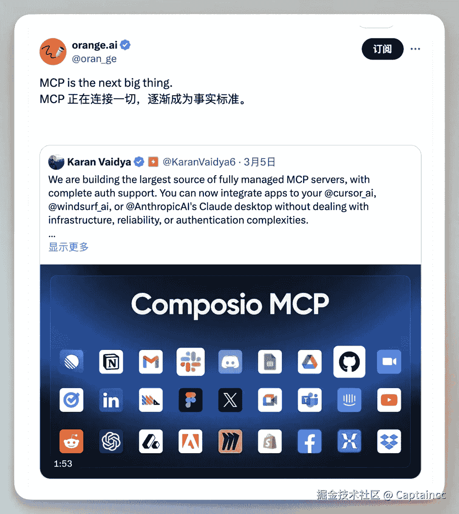

不少独立开发圈的朋友们，对MCP技术也很感兴趣。


前段时间自己摸索，用AI写了一个MCP服务器，自然语言控制AI生成音频，效果让我十分震惊，所以快速组个MCP技术交流群。

个人觉得 MCP是 AI Agent 落地的关键协议，生态正在爆炸式增长，海外知名软件，没一个不在不提供自己的 MCP 服务。

让我想到今早上Monica团队出品的Manus产品刷屏，除了营销推广的力量，更重要的是AI Agent技术的成熟，这只是开始，预计今年5-8月份，大家会更震惊。

所以，对于MCP技术，不得不看，不得不学，一起积极拥抱。

下面是群内交流碰撞、整理的内容。想加群，可加我🛰️: vista8，备注MCP

## 一、什么是MCP？

### 1.1 Anthropic 官方解释

英文全称：Model Context Protocol （模型上下文协议）

MCP 是一种开放式协议，它规范了应用程序向 LLM 提供上下文的方式。 把 MCP 想象成人工智能应用的 `USB-C` 接口 。

就像 `USB-C` 提供了将设备连接到各种外设和配件的标准化方式一样，MCP 也提供了将人工智能模型连接到不同数据源和工具的标准化方式。

### 1.2 群友们的理解

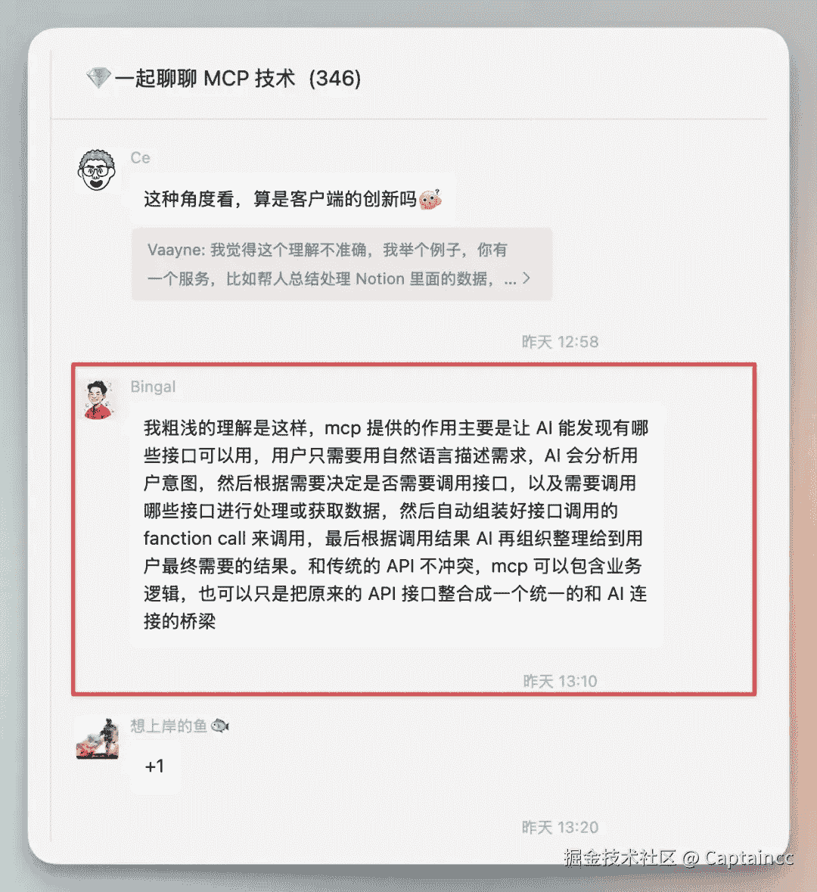

> `MCP` 提供的作用主要是让 AI 能发现有哪些接口可以用，用户只需要用自然语言描述需求，AI 会分析用户意图，然后根据需要决定是否需要调用接口，以及需要调用哪些接口进行处理或获取数据，然后自动组装好接口调用的 `fanction call` 来调用，最后根据调用结果 AI 再组织整理给到用户最终需要的结果。和传统的 `API` 不冲突，`mcp` 可以包含业务逻辑，也可以只是把原来的 `API` 接口整合成一个统一和 AI 连接的桥梁。

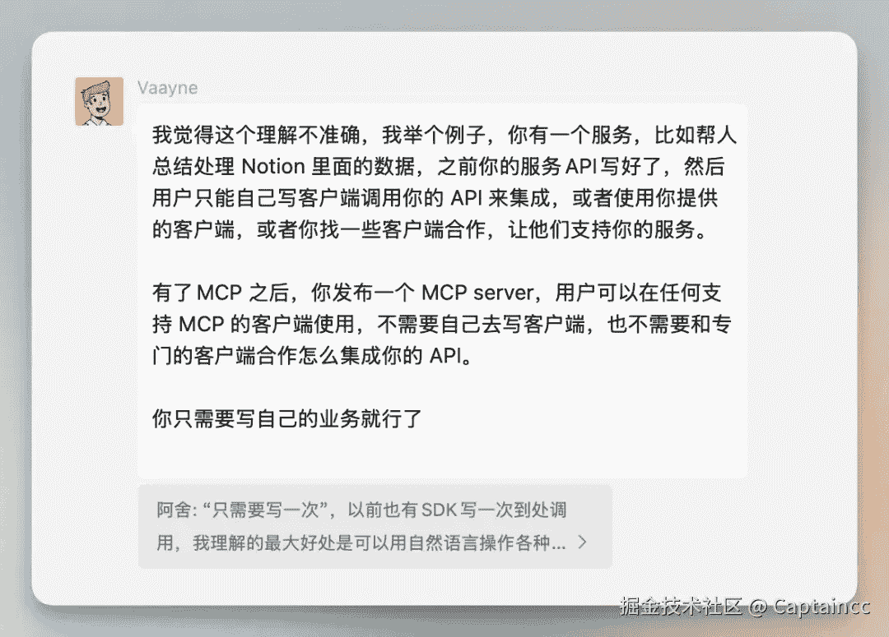

> 有了`MCP` 之后，你发布一个 `MCP server`，用户可以在任何支持 `MCP` 的客户端使用，不需要自己去写客户端，也不需要和专门的客户端合作怎么集成你的 `API`。

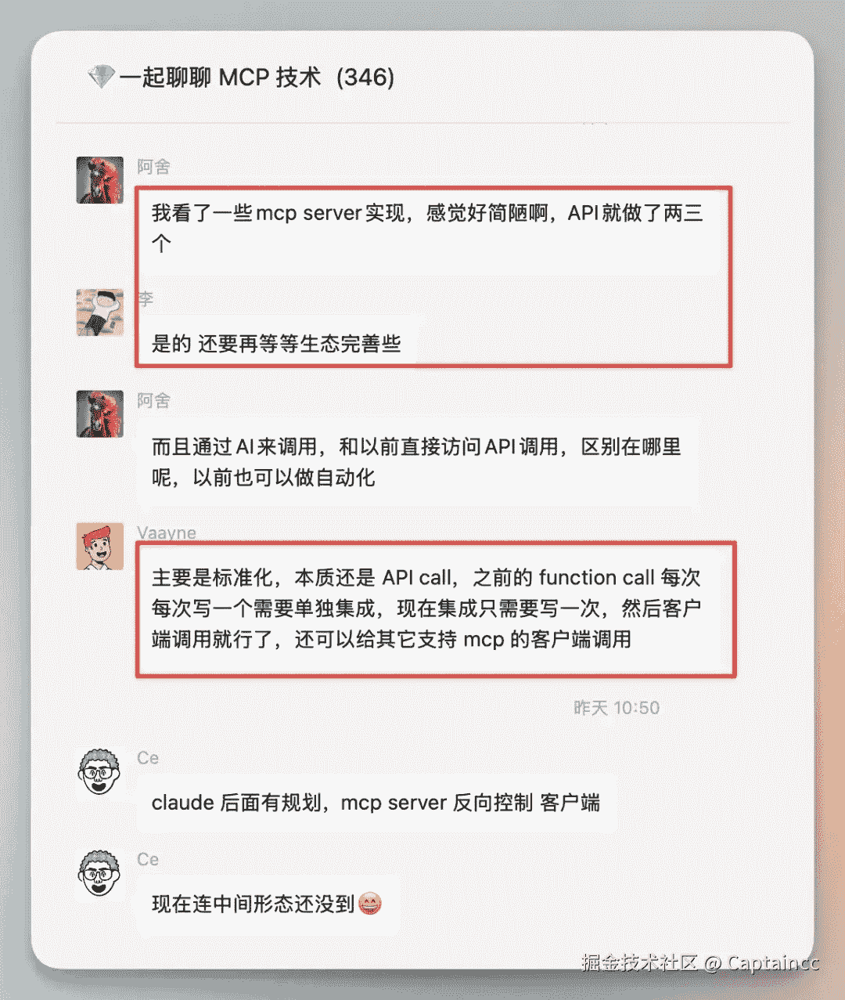

> 主要是标准化，本质还是 `API call`，之前的 `function call` 每次每次写一个需要单独集成，现在集成只需要写一次，然后客户端调用就行了，还可以给其它支持 `mcp` 的客户端调用

### 1.3 AI 大白话解释：

想象一下，你有一个非常聪明的机器人，这个机器人可以做很多事情，比如回答问题、分析数据、甚至帮你写文章。但是，这个机器人需要从不同的地方获取信息，比如书籍、网站、数据库等。

问题来了，每个信息来源都有自己的格式和方式，这就像是每个设备都有不同的插头和接口。

`MCP`就像是一个通用的插头，让这个聪明的机器人可以方便地连接到各种不同的信息来源。 这样，无论信息来源是什么样的，机器人都能轻松地获取和使用这些信息，就像你用一个`USB-C`接口可以连接各种不同的设备一样。

简单来说，`MCP`就是一个标准，让不同的应用程序和AI模型可以更容易地交流和共享信息，而不需要为每个信息来源单独设计一套复杂的连接方式。

这样，AI模型就能更高效地工作，提供更好的服务。

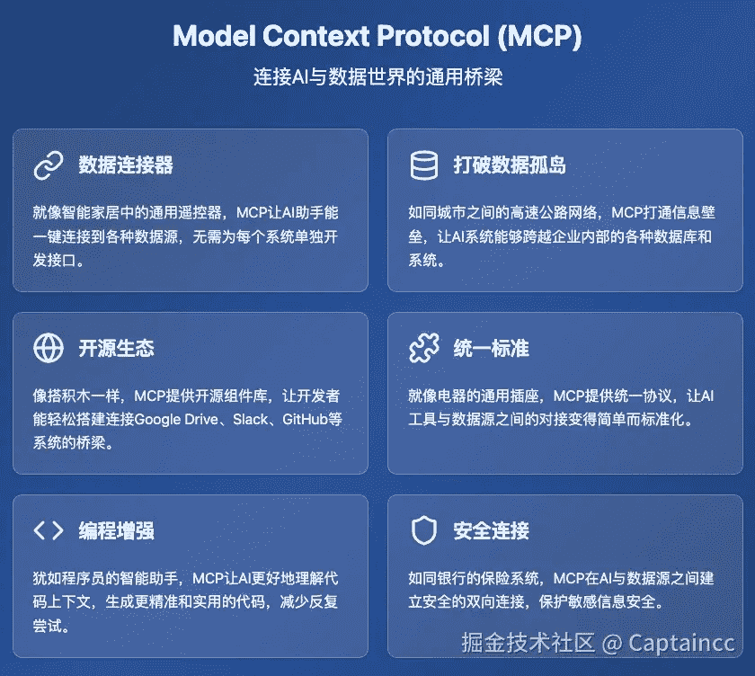

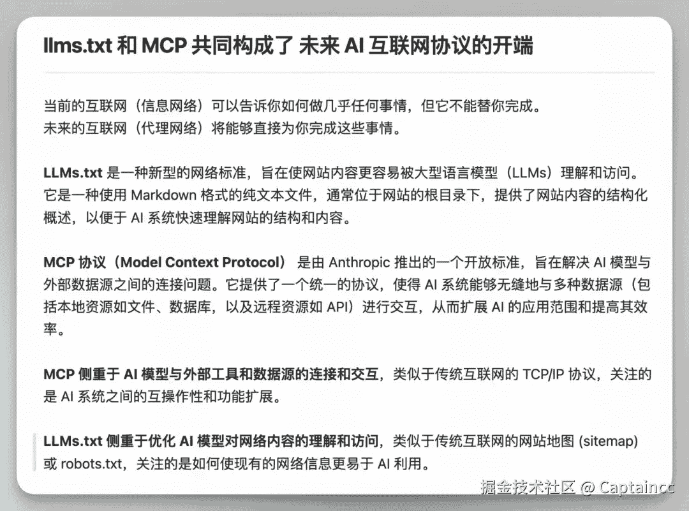

### 1.4 MCP Server 和 Client 是什么？

`MCP server` 和 `MCP client` 是 Model Context Protocol（`MCP`）的核心组件。

`MCP server` 是一个程序，暴露特定的功能或数据源，例如访问文件、数据库或 `API`，供 AI 模型使用。

`MCP client` 则是一个程序，代表 AI 模型连接到这些服务器，允许模型请求和接收数据或执行操作。

`MCP client` 的核心原则包括：

+ 服务器连接：首先连接到 `MCP server`，获取可用工具列表。
+ 工具使用：根据用户需求调用服务器提供的功能，确保安全性和用户批准。

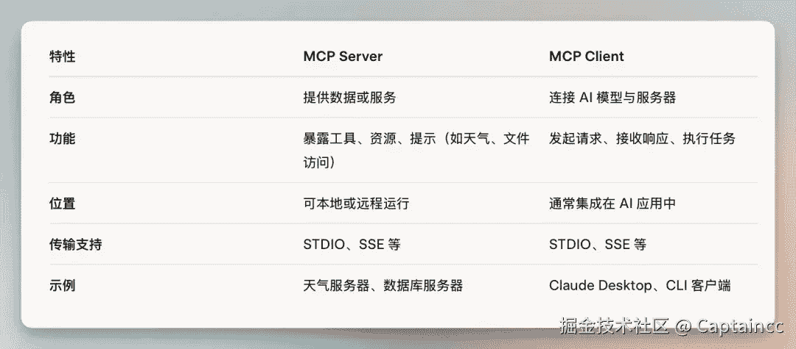

实际应用：

+ 一个 `MCP server` 可以提供天气信息，`MCP client` 则帮助 AI 模型通过该服务器获取天气预报，而无需自己处理数据获取逻辑。
+ 另一个例子是，`MCP server` 可能允许 AI 访问用户电脑上的文件，`MCP client` 确保连接和权限管理，保护用户数据安全。

`MCP` 还支持多种传输模型，如 `STDIO`（标准输入输出）和 `SSE`（服务器发送事件），适合本地和远程集成，未来可能会有更多传输方式。

## 二、提供 MCP 服务的网站

+ Smithery - Model Context Protocol Registry smithery.ai/ [1]
+ PulseMCP | Keep up-to-date with MCP www.pulsemcp.com/ [2]
+ Awesome MCP Servers mcpservers.org/ [3]
+ MCP Servers https://mcp.so/ [4]
+ Glama MCP glama.ai/mcp/servers [5]
+ Cursor Directory cursor.directory/ [6]

## 三、支持 MCP的客户端

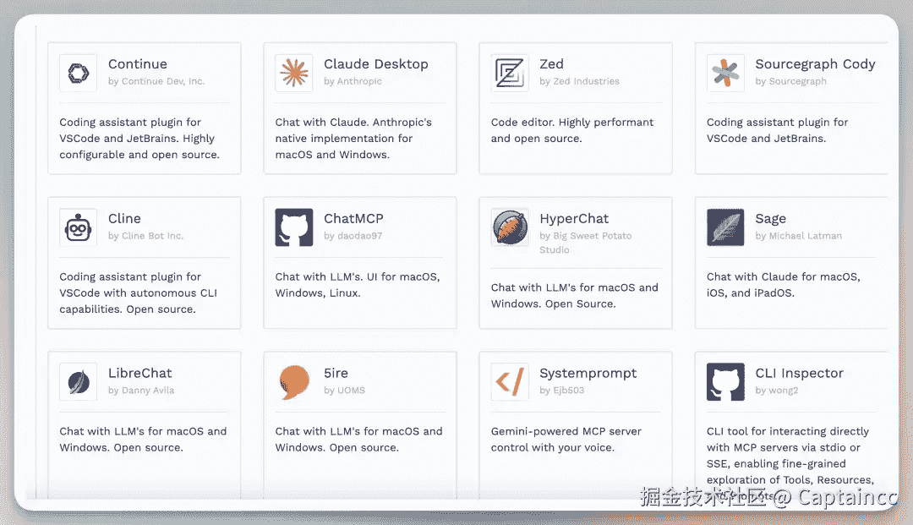

## 四、实战

### 4.1 必装的一些 MCP Server

#### 搜索增强

##### `brave-search`（Brave浏览器提供的API，绑定信用卡每月1000次免费）

github.com/modelcontex… [7]

##### `puppeteer`（无头浏览器，模拟真实点击访问）

github.com/modelcontex… [8]

#### 数据库

##### `SQLite`数据库

github.com/modelcontex… [9]

##### `Supabase` 数据库`MCP`

github.com/NightTrek/S… [10]

### 4.2 如何安装`MCP server`

#### 4.2.1 `VS code` + `Cline`

如果用`VS code` + `Cline`，点击这里可以搜索`MCP server`，选择安装。

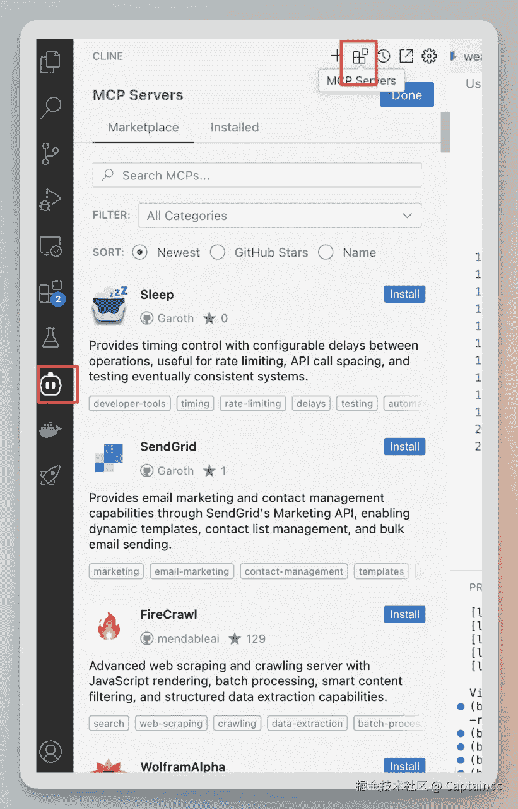

#### 4.2.2 `VS code` + `Roo Code`（也适用于 `CoolCline` [11] ）

`Roo code`没有`mcp server store`，需要手动配置`MCP Settings`。

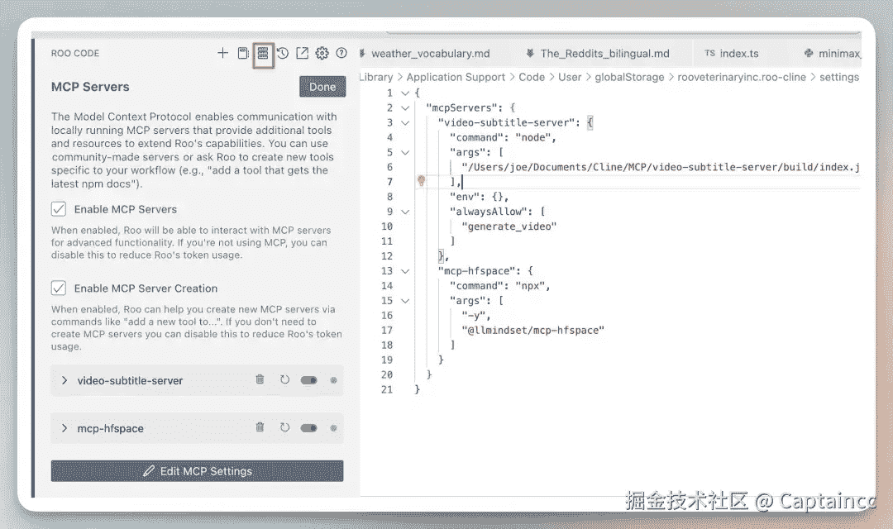

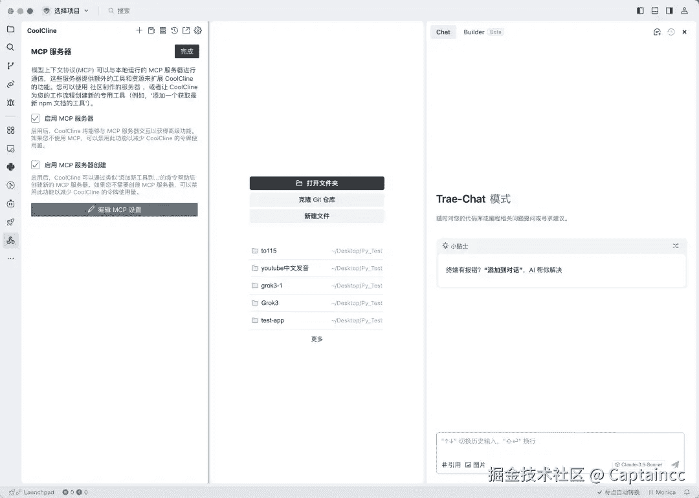

安装方法可以去其他 `MCP` 应用市场复制查看 `Server`配置文件，修改成类似上图中的格式。

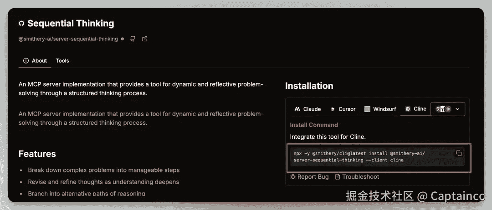

### 4.3 Use Case

> 把海螺AI的`API`做成 `MCP`，一句话生成音频。

播放地址： https://xiangyangqiaomu.feishu.cn/wiki/PXAKwEgLQir9rkkV1zjcGnMHntg?fromScene=spaceOverview [12]

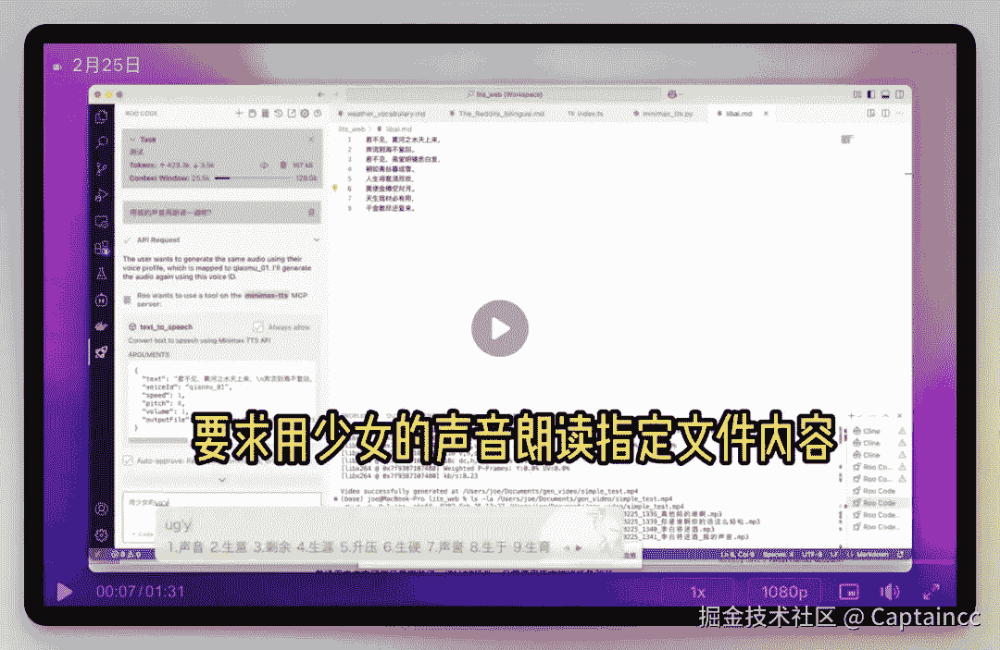

## 五、其他资源

### 5.1 Awesome MCP

大量`MCP` 服务和安装地址 github.com/appcypher/a… [13]

### 5.2 Anthropic 官网`MCP`文档

For Server Developers - Model Context Protocol modelcontextprotocol.io/quickstart/server [14]

### 5.3 分享自己的`MCP server`配置

个人安装的一些`MCP`和对应配置文件。

```json
{
  "mcpServers": {
    "puppeteer": {
      "command": "npx",
      "args": [
        "-y",
        "@modelcontextprotocol/server-puppeteer"
      ],
      "disabled": true,
      "alwaysAllow": []
    },
    "brave-search": {
      "command": "npx",
      "args": [
        "-y",
        "@modelcontextprotocol/server-brave-search"
      ],
      "env": {
        "BRAVE_API_KEY": "你申请的Brave 浏览器的API key"
      },
      "alwaysAllow": [
        "brave_web_search"
      ]
    },
    "apple-notes-mcp": {
      "command": "uvx",
      "args": [
        "apple-notes-mcp"
      ],
      "alwaysAllow": [
        "get-all-notes",
        "read-note"
      ]
    },
    "sequential-thinking": {
      "command": "npx",
      "args": [
        "-y",
        "@modelcontextprotocol/server-sequential-thinking"
      ],
      "alwaysAllow": [
        "sequentialthinking"
      ]
    },
    "obsidian": {
      "command": "npx",
      "args": [
        "-y",
        "obsidian-mcp",
        "/{你的Obsidian仓库地址}/"
      ],
      "alwaysAllow": [
        "list-available-vaults",
        "search-vault"
      ]
    },
    "filesystem": {
      "command": "npx",
      "args": [
        "-y",
        "@modelcontextprotocol/server-filesystem",
        "/Users/(你电脑的Username)/"
      ]
    },
    "playwright": {
      "command": "npx",
      "args": ["-y", "@executeautomation/playwright-mcp-server"]
    }
  }
}
```

注意，配置 `MCP` 不要用明文 `API key`，上面的例子不是最佳实践。现在据说Github一搜`MCP`，全是各种服务的`API` 😂😂😂

### 5.4 学习视频

#### 5.4.1 告别手动！`MCP` 自动化工作流，AI 提效 N 倍：`Cline` + `MCP` 保姆级教程

www.bilibili.com/video/BV1Vj… [15]

#### 5.4.2 AI Jason课程

这个博主分享了不少`MCP`知识 www.youtube.com/@AIJasonZ [16] www.youtube.com/watch?v=oAo… [17]

#### 5.4.3 五里墩茶社讲`MCP`

www.bilibili.com/video/BV1AL… [18]

#### 5.4.4 `MCP` 交流论坛

www.reddit.com/r/mcp/ [19]

#### 5.4.5 群友好文章

`MCP` 终极指南： guangzhengli.com/blog/zh/mod… [20]

作者： x.com/iguangzheng… [21]

## 六、群友产品分享 or 自我介绍

1. AI辅助阅读整本书： https://3min.top [22]
1. 电子书阅读器 https://readest.com [23]
1. AI快速启动器 www.enconvo.com [24]
1. 社会化AI书签 https://youmemark.com [25]
1. Sumbuddy总结插件 [26]
1. 词根词缀记忆助手 wordroots.suiyimen.com [27]
1. 公文写作AI助手 https://shinbun.news [28]
1. 飞书文档转👸号 feishu2wx.chengfeng.me [29]
1. AI换脸工具 [30]

##### 引用链接

[1] smithery.ai/:
[2] www.pulsemcp.com/:
[3] mcpservers.org/:
[4] mcp.so/:
[5] glama.ai/mcp/servers:
[6] cursor.directory/:
[7] github.com/modelcontex…:
[8] github.com/modelcontex…:
[9] github.com/modelcontex…:
[10] github.com/NightTrek/S…:
[11] CoolCline:
[12] xiangyangqiaomu.feishu.cn/wiki/PXAKwEgLQir9rkkV1zjcGnMHntg?fromScene=spaceOverview:
[13] github.com/appcypher/a…:
[14] modelcontextprotocol.io/quickstart/server:
[15] www.bilibili.com/video/BV1Vj…:
[16] www.youtube.com/@AIJasonZ:
[17] www.youtube.com/watch?v=oAo…:
[18] www.bilibili.com/video/BV1AL…:
[19] www.reddit.com/r/mcp/:
[20] guangzhengli.com/blog/zh/mod…:
[21] x.com/iguangzheng…:
[22] https://3min.top:
[23] https://readest.com:
[24] www.enconvo.com:
[25] https://youmemark.com:
[26] Sumbuddy总结插件:
[27] wordroots.suiyimen.com:
[28] https://shinbun.news:
[29] feishu2wx.chengfeng.me:
[30] AI换脸工具:


[9] `github.com/modelcontex…`

[10] `github.com/NightTrek/S…`

[11] CoolCline: `gitee.com/coolcline/c…`

[12] [`xiangyangqiaomu.feishu.cn/wiki/PXAKwE…`](https://link.juejin.cn/?target=https%3A%2F%2Fxiangyangqiaomu.feishu.cn%2Fwiki%2FPXAKwEgLQir9rkkV1zjcGnMHntg%3FfromScene%3DspaceOverview)

[13] `github.com/appcypher/a…`

[14] [`modelcontextprotocol.io/quickstart/…`](https://link.juejin.cn/?target=https%3A%2F%2Fmodelcontextprotocol.io%2Fquickstart%2Fserver)

[15] `www.bilibili.com/video/BV1Vj…`

[16] `www.youtube.com/@AIJasonZ`

[17] `www.youtube.com/watch?v=oAo…`

[18] `www.bilibili.com/video/BV1AL…`

[19] `www.reddit.com/r/mcp/`

[20] `guangzhengli.com/blog/zh/mod…`

[21] `x.com/iguangzheng…`

[22] [`3min.top`](https://link.juejin.cn/?target=https%3A%2F%2F3min.top)

[23] [`readest.com`](https://link.juejin.cn/?target=https%3A%2F%2Freadest.com)

[24] `www.enconvo.com`

[25] [`youmemark.com`](https://link.juejin.cn/?target=https%3A%2F%2Fyoumemark.com)

[26] Sumbuddy总结插件: [`chromewebstore.google.com/detail/sumb…`](https://link.juejin.cn/?target=https%3A%2F%2Fchromewebstore.google.com%2Fdetail%2Fsumbuddy%2Fknpckkifmkioijpoejgngbghdpacfajp%3Fauthuser%3D0%26hl%3Dzh-CN)

[27] `wordroots.suiyimen.com`

[28] [`shinbun.news`](https://link.juejin.cn/?target=https%3A%2F%2Fshinbun.news)

[29] `feishu2wx.chengfeng.me`

[30] AI换脸工具: `h5.1pix.fun/ai/glamPic/…`
