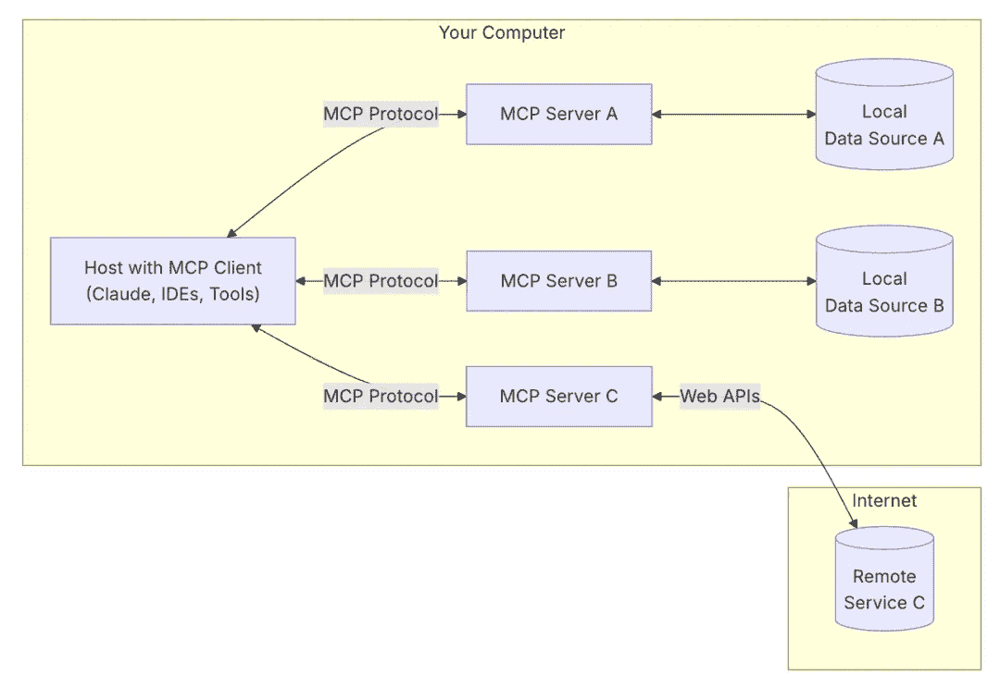
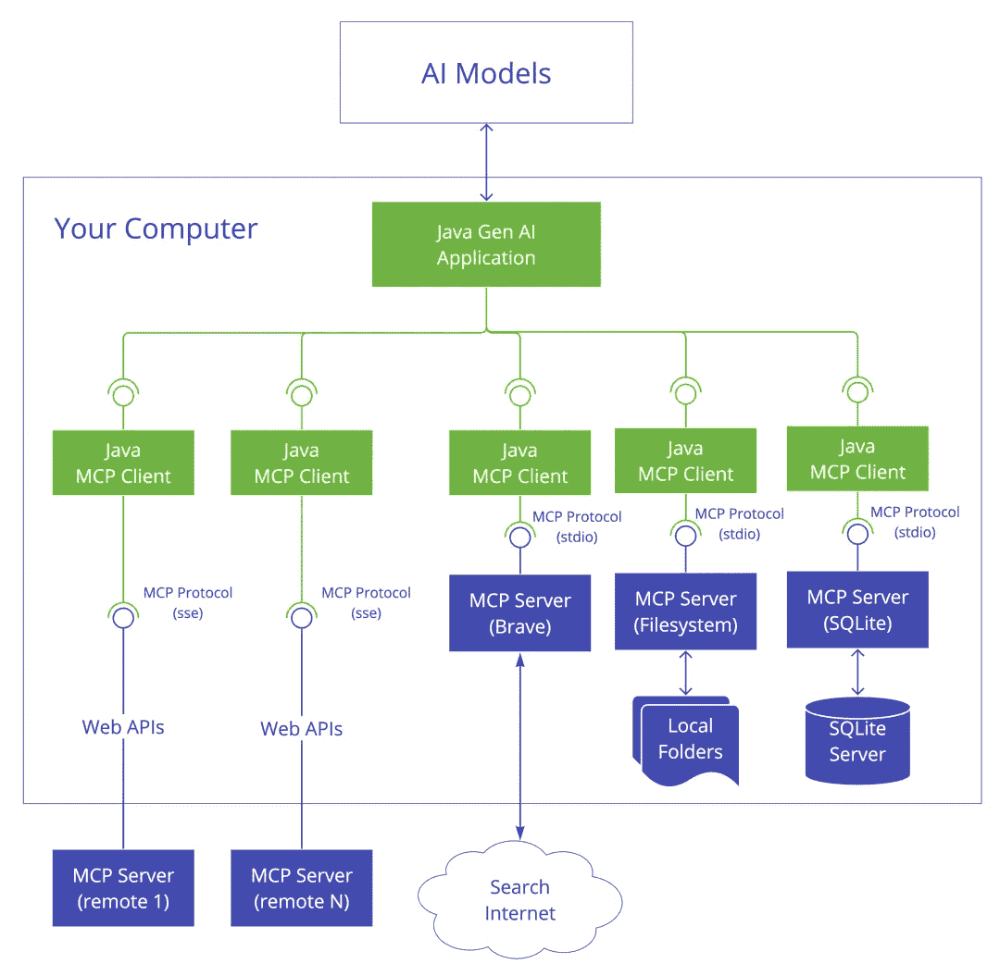
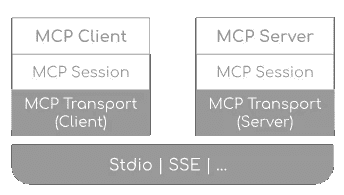
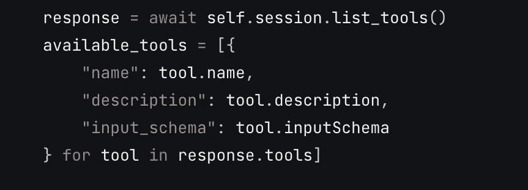
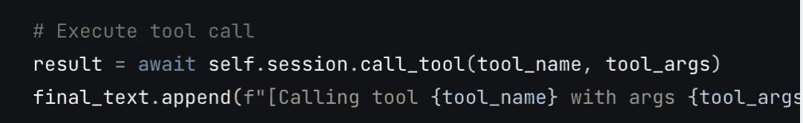
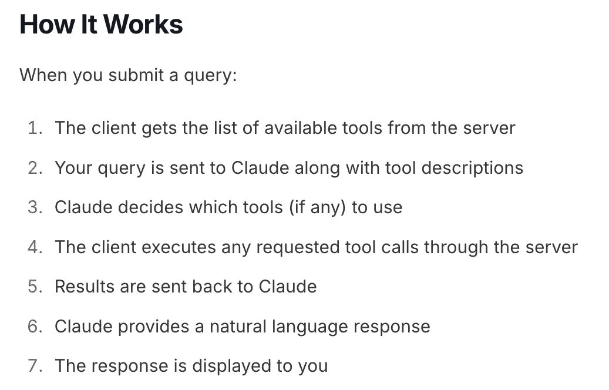
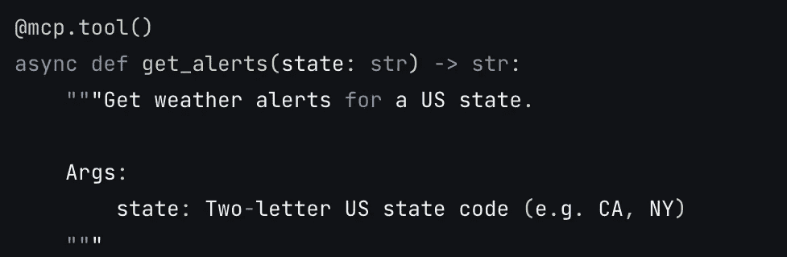
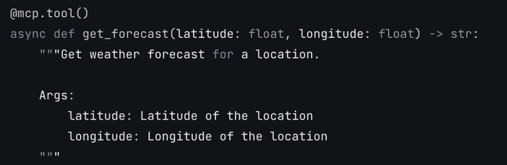

# 给MCP祛魅

> 来源：[https://agijuejin.feishu.cn/docx/VxgidEtTFo2groxhHA4clTZ5nzf](https://agijuejin.feishu.cn/docx/VxgidEtTFo2groxhHA4clTZ5nzf)

> 🔗 原文链接： h[ttps://mp.weixin.q](https://mp.weixin.qq.com/s/qtsxTC8_LioHUuZHQo5CoA)q.com/s/qtsxTC8_...

原创 陈利人 待字闺中 2025年03月11日 12:10  北京

MCP（Model Context Protocol，模型上下文协议）推出将近一年，随着Cursor等IDE工具的兴起和Claude Sonnet的编程能力的提升，逐步得到技术圈人的关注。最近，随着Manus的一圈轰炸，有人给出了Manus=Cursor+MCP的解方，这时MCP渐渐进入一般大众的视野，热度顿时提升为“神”级创新。那么，今天我们来给MCP祛魅。

MCP是在OpenAI的Function call和GPTs之后出现的，那么它一定是看到了Function call的开发和使用的复杂性，而且看到了GPTs的封闭和不开放性。

Function call可以说是MCP的灵感的来源和基础功能，可以理解Function call等同于工具（tools）。大模型（LLM）能够理解工具的描述和参数的规定，然后，会从一堆工具中去选择一个和几个工具来解决用户提出的问题。没有LLM能自动选择和调用工具的能力，也没有MCP这个概念的可能。这是MCP的源头和基础，不得不说，这是OpenAI的巨大原始贡献。

但是，Function call，或者 Tools 使用，对很多开发者，就不用说一般用户了，尽管能用大模型来copilot，还是很不方便，网络访问，权限控制，流程控制，错误处理，可靠性，版本维护，升级改动，等等，一大堆事情都要去编程处理。而且，对不同的应用场景，可能还需要定制化。

既然Function call这么复杂不好用，那么OpenAI提出了GPTs的概念，说白的，GPTs就类似于微信的小程序，它的底层实现，依然是基于Function call，做好的一个一个GPTs，用户可以选择使用哪一个。这儿的问题是，GPTs相当于是已经包装好的闭源应用，只能在OpenAI平台上使用，不开放，不是生态玩法（可能只是OpenAI生态）。你给OpenAI做了个GPT，对别的平台，你还得做一个，这样，对服务商，开发者，依然不方便，不利于市场拓展。

由此看到，Function call太底层，GPTs太高层，这时，就有了MCP这样处于中间层的协议或产品出来了。

大家习惯用下面这张图来说明MCP的架构。

但我觉得下面这张更清晰。

中间的Java Gen AI Application就是一个应用，用更流行的词，是Agent（智能体），然后，它可以调用（触发）不同的Java MCP Client来完成一个用户的需求，而这时，Client会通过MCP protocol来调用和它配套的MCP Server来实际完成任务。所有的细节处理，都有MCP SDK来包装完成的。

再底层一点的实现，是下面这张图。 懂不懂不重要， 大概知道一层一层实现就可以了。

MCP处理的一个用户的需求（query或request）是这样的：

MCP Client从MCP Server得到所有工具（tools或function calls）的列表和描述，包括参数描述。

MCP Client将用户的需求和工具加描述列表送给大模型（LLM）。

大模型确定应该使用哪个工具。

MCP Client通过调用MCP Server来执行大模型选择的工具，从而得到工具执行后的结果。

MCP Client讲结果送给大模型来提供自然语言的描述，然后呈现给用户。

在MCP Server中，是通过类似Java的文档规范来定义和说明工具的，这样，MCP SDK可以通过这种方式来自动输出工具和描述列表的。

MCP的好处是用这种形式开发的产品或应用，可以通过MCP Client的方式，嵌入到别的AI应用中，它们类似于开发中的组件，或库，或微服务，水都可以尽情的调用。这些MCP应用更新，升级，对这些新开发的AI应用都是无感的，这样，更利于Agent生态的开发。

但MCP也有它的不足，还是有很多的开发量，对一般的普通用户，实际也很难上手开发。

也许，MCP还是一个AI native时代的过渡产品，我们还可以期待更多更让人激动的创新出来。