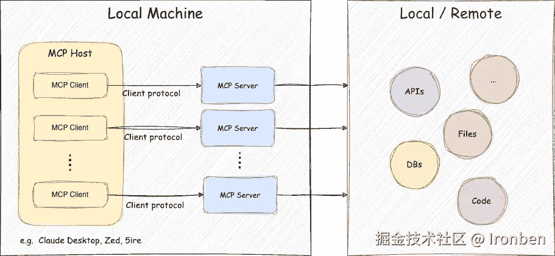
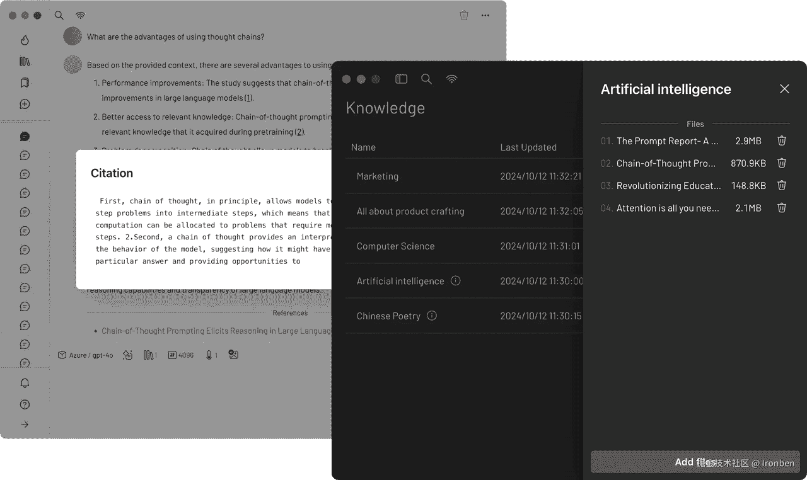
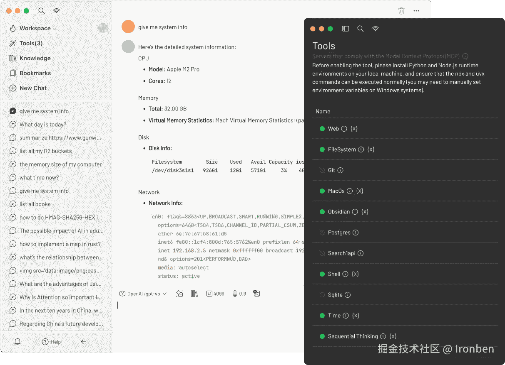

# 看好 MCP，但用不了 Claude，所以做了一款 MCP 客户端 MCP 标准化了大模型与资源和工具的连接方式，随着大模

> 来源：[https://agijuejin.feishu.cn/docx/KuzEd8yqHoHJI0xqvjGc1Zfsnyh](https://agijuejin.feishu.cn/docx/KuzEd8yqHoHJI0xqvjGc1Zfsnyh)

> 🔗 原文链接： h[ttps://juejin.cn/p](https://juejin.cn/post/7455035788655247400)ost/745503578865...

Anthropic 去年发布的模型上下文协议（ Model Context Protocol ）让我看到了人工智能在不久将来的一种可能性——即使在通往 AGI 的路上撞墙，随着大模型能用的资源和工具越来越多，人工智能会渗透至我们生活和工作的方方面面。

MCP 作为一个开放协议，标准化了应用程序如何向大型语言模型（LLMs）提供上下文信息。用开发商的话来说 MCP 就好比 AI 应用的 USB-C 端口。USB-C 提供了一种标准化的方式来连接你的设备到各种外围设备和配件，而 MCP 提供了一种标准化的方式来连接 AI 模型到不同的数据源和工具。 也就是说，MCP 的作用是帮助开发者构建基于 LLMs 的 Agent 和复杂工作流程。

MCP 协议中有几个关键概念，分别是

+   **MCP Hosts **：主机程序，比如 Claude Desktop、集成开发环境（IDEs）或者人工智能工具（AI tools）。这些程序希望通过 MCP 来访问数据。MCP Hosts 充当用户界面或者前端，用户通过它们与 MCP 系统交互。

+   **MCP Clients **：协议客户端，它们与服务器保持着一对一（1:1）的连接。MCP Clients 负责与 MCP Servers 通信，发送请求并接收数据。

+   **MCP Servers **：轻量级的程序，每个都通过标准化的 Model Context Protocol 暴露特定的功能。MCP Servers 是后端服务，它们处理来自 MCP Clients 的请求，并提供所需的数据或服务。

+   Local Data Sources ：这些是你的计算机上的文件、数据库和服务，MCP 服务器可以安全地访问它们。这些是本地数据源，MCP Servers 可以直接与之交互，以获取或存储数据。

+   Remote Services ：这些是可以通过互联网访问的外部系统（例如，通过 APIs）。MCP 服务器可以连接到这些远程服务，以获取数据或执行操作。

Claude 桌面客户端实际上是一个 MCP Host，针对启用的每个 MCP Server 都有一个对应的 MCP Client。

[目前官方列出的 MCP 客](https://link.juejin.cn/?target=https%3A%2F%2Fclaude.ai%2Fdownload)户端[有 Cl](https://link.juejin.cn/?target=https%3A%2F%2Fzed.dev%2F)aude 桌[面客户端 、 Ze](https://link.juejin.cn/?target=https%3A%2F%2Fgithub.com%2Fcontinuedev%2Fcontinue)d [、 Sourcegrap](https://link.juejin.cn/?target=https%3A%2F%2Fmicrosoft.github.io%2Fgenaiscript%2Freference%2Fscripts%2Fmcp-tools%2F)h [Cody 、](https://link.juejin.cn/?target=https%3A%2F%2Fgithub.com%2Fcline%2Fcline) F[irebase Ge](https://link.juejin.cn/?target=https%3A%2F%2Fgithub.com%2Fdanny-avila%2FLibreChat)nkit 、 Continue 、 GenAIScript 、 Cline 、 LibreChat 、 TheiaAI/TheiaIDE 。其中对 MCP 支持最好的自然是 Anthropic 自家的 Claude 桌面客户端。但 Anthropic 最近一系列封号小连招让很多国内用户无法使用 Claude，所以不得不寻找替代方案。

[5ire ](https://link.juejin.cn/?target=https%3A%2F%2F5ire.app)最初并不支持 MCP， 作为一款大模型客户端，刚发布时候的功能主要有：

1.  基于 RAG 的本地知识库

1.  提示词库

1.  书签

1.  用量统计

1.  全局搜索

在自己的号也被封掉了，就决定把 5ire 打造成一款 MCP 客户端。 在对代码进行大量重构后，尝试内置了一些 MCP Servers。由于当前还存在一些兼容性问题，暂时没有开放添加 Server， 如果对代码比较了解，可以修改 {userData}/5ire 文件夹下的 mcp.json 配置文件添加 Server。

[最后出来的效果可参](https://link.juejin.cn/?target=https%3A%2F%2F5ire.app)考官网视频： [5ire.app 项目地址是：](https://link.juejin.cn/?target=https%3A%2F%2Fgithub.com%2Fnanbingxyz%2F5ire) nanbingxyz/5ire

如果对 MCP 或开源感兴趣，欢迎沟通交流。

