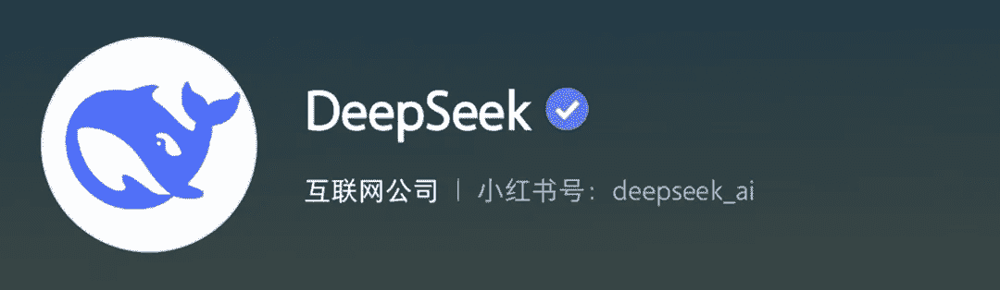
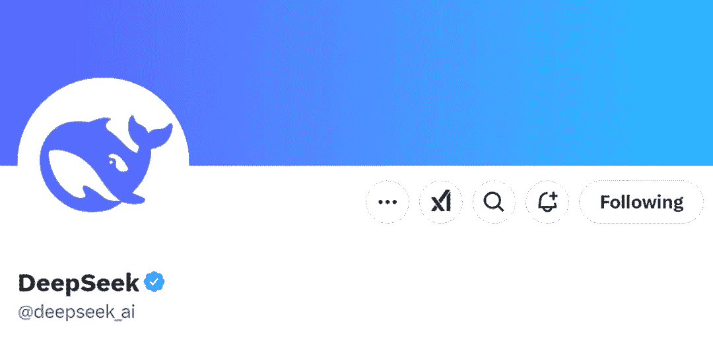

# DeepSeek官方-信息发布及服务渠道的说明

> 来源：[https://agijuejin.feishu.cn/docx/CilJdjVrsokSEKxmD3acWVPjnxh](https://agijuejin.feishu.cn/docx/CilJdjVrsokSEKxmD3acWVPjnxh)

来源：深度求索 DeepSeek 2025年02月06日 19:46 北京

链接：https://mp.weixin.qq.com/s/u5coDiS5lXKjENlu1ghcoQ

近期我们注意到，部分与 DeepSeek 有关的仿冒账号和不实信息对公众造成了误导和困扰。为保障用户权益，减少虚假信息的不良影响，我们现就官方账号等问题说明如下：1. 目前，DeepSeek 仅在以下社交媒体平台拥有唯一官方账号：

+   🛰️👸号：DeepSeek

+   📕：@DeepSeek（deepseek_ai)

+   X (Twitter) : DeepSeek (@deepseek_ai)

**除以上官方账号外，其他任何以 DeepSeek 或相关负责人名**义对外发布公司相关信息的，均为仿冒账号。

如未来 DeepSeek 在其他平台开设新的官方账号，将通过其他已有官方账号进行公告。

**与** DeepSeek 有关的一切信息以官方账号发布为准，任何非官方账号、个人账号发布的信息均不代表 DeepSeek 观点，请大家注意甄别。2. 获取 DeepSeek 模型服务，请认准官方网站，通过正规渠道下载官方正版 App：

+   官方网站：www.deepseek.com

+   官方 App: DeepSeek（DeepSeek-AI 人工智能助手）开发者：杭州深度求索人工智能基础技术研究有限公司

PS：**DeepSeek 官方网页端与官方正**版 App 内不包含任何广告和付费项目。

3. 目前除 DeepSeek 官方用户交流🛰️群外，我们从未在国内其他平台设立任何群组，一切声称与 DeepSeek 官方群组有关的收费行为均系假冒，请大家仔细辨别，避免财产损失。

感谢大家一如既往的支持与关心，我们将再接再厉研发更加创新、**专业、高效的模型，并持续与**开源社区分享。DeepSeek 深度求索

#