# DeepSeek R1 联网满血版使用指南

> 来源：[https://agijuejin.feishu.cn/docx/XWkMdcDgnogtKXx1fpacdQN8nQb](https://agijuejin.feishu.cn/docx/XWkMdcDgnogtKXx1fpacdQN8nQb)

> 作者 - 程序员安仔

> 原文链接 - https://mp.weixin.qq.com/s/p7EL7_fIUQD3-W_ZNXhKWg

新年这段时间，DeepSeek 实在太火了，火到了全球，用户请求数爆了，但也被国外 DDos 攻击爆了，到现在的 Deepseek 网页服务和 API 服务时不时都还在抽风，你看看目前的 Deepseek 服务状态：

https://status.deepseek.com/

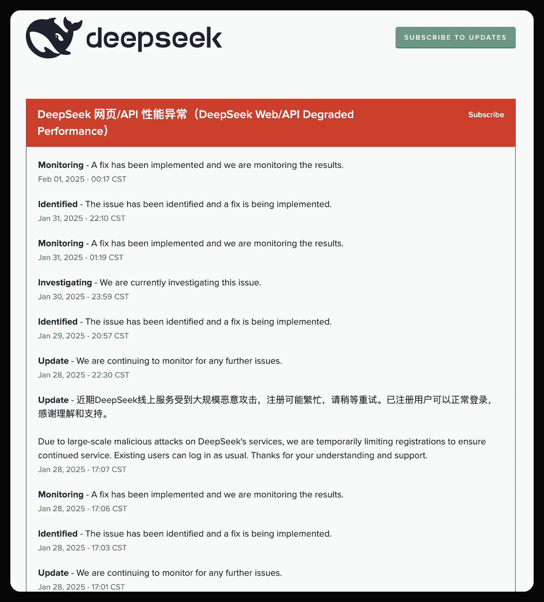

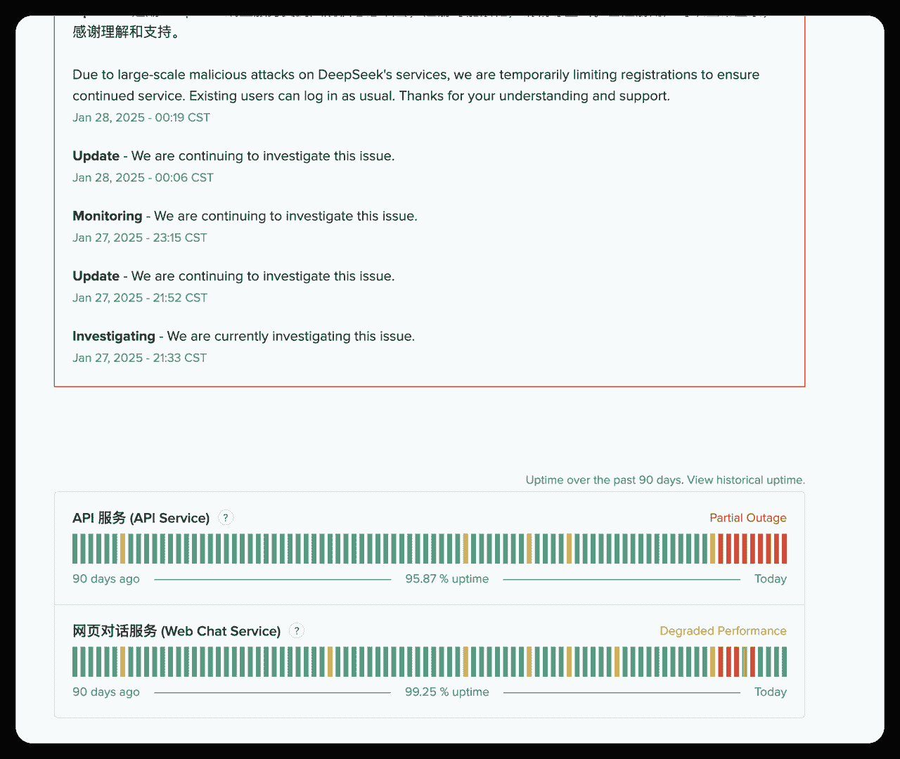

真的一言难尽，好东西总是被坏人盯上。所以最近突然就爆火了很多网上教程教大家本地部署 DeepSeek R1，但本地部署的 DeepSeek R1 基本上都是残血版，因为美国的显卡封锁，加上昂贵的显卡价格，普通人哪有可能可以有那么多好的显卡来部署满血版...以下是本地部署前要好好考虑的几点：

1.  本地部署 DeepSeek 需要高性能硬件，普通电脑难以满足其需求。

1.  部署 DeepSeek 成本高昂，电费消耗大，不如云端服务。

1.  部署过程复杂，普通用户难以成功，高手选择直接使用官网服务。

1.  本地部署存在安全隐患，如数据泄露和模型投毒风险。

所以我今天给大家带来一篇网上最全的 DeepSeek R1 使用指南，甚至是基于联网搜索版的 DeepSeek R1，大让大家可以少资源、低成本甚至零成本真正体验到 DeepSeek R1 的强大功能。

## 首先，肯定先帮 DeepSeek 官方服务卖个广告

DeepSeek 官方服务地址：

https://chat.deepseek.com/

其实上述所说的 Deepseek R1 联网满血版，官方都完全有提供，而且是无限使用，完全免费的：

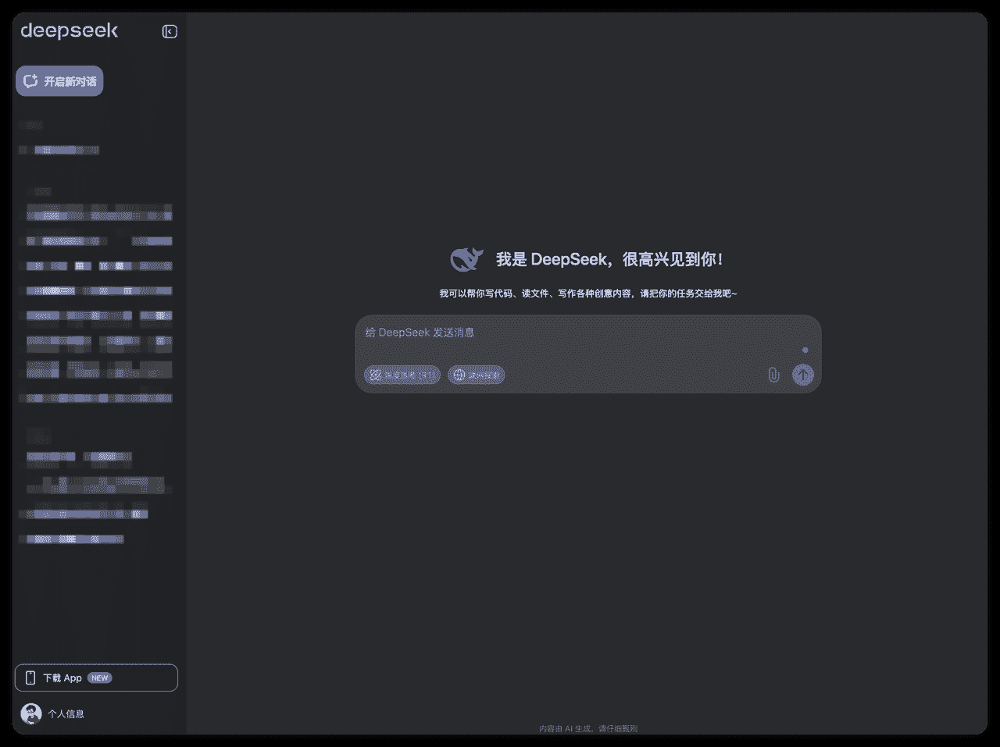

只不过就是因为开头所说，Deepseek 服务这段时间都是不太稳定，所以大家可以先知道情况，蹲守一下，等以后稳定了，就可以直接用官方服务了。

接下来我们就来看看目前针对这个情况 DeepSeek R1 的替代方案吧，下面我就简写“DeepSeek R1”为“DS R1”来表示。

## 1. Perplexity AI （可免费/需要 🪜）

Perplexity AI 是一个非常强大的 AI 搜索引擎，它不仅支持 Claude 3、GPT-4、Mistral 等主流大模型，还支持 DeepSeek 的模型。最重要的是，它的搜索功能非常强大，而且可以基于特定的搜索目的来进行搜索：

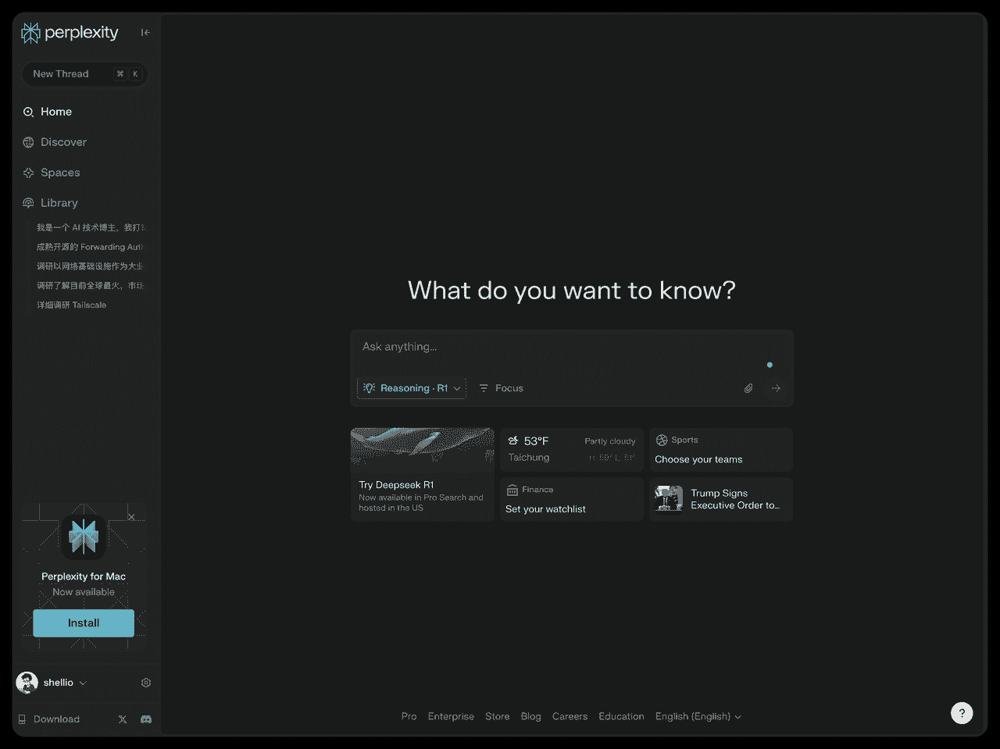

Perplexity AI 的地址：

https://www.perplexity.ai/

它提供免费版和付费版两种选择：

+   免费版：每天有限额的使用次数，但已经足够日常使用

+   Pro 版：每月 20 美元，无限制使用，还可以使用更多高级功能

这里你可以直接选择模型Reasoning R1，这个就是直接基于 DeepSeek R1 的模型结合搜索结果来回答你的问题，非常强大：

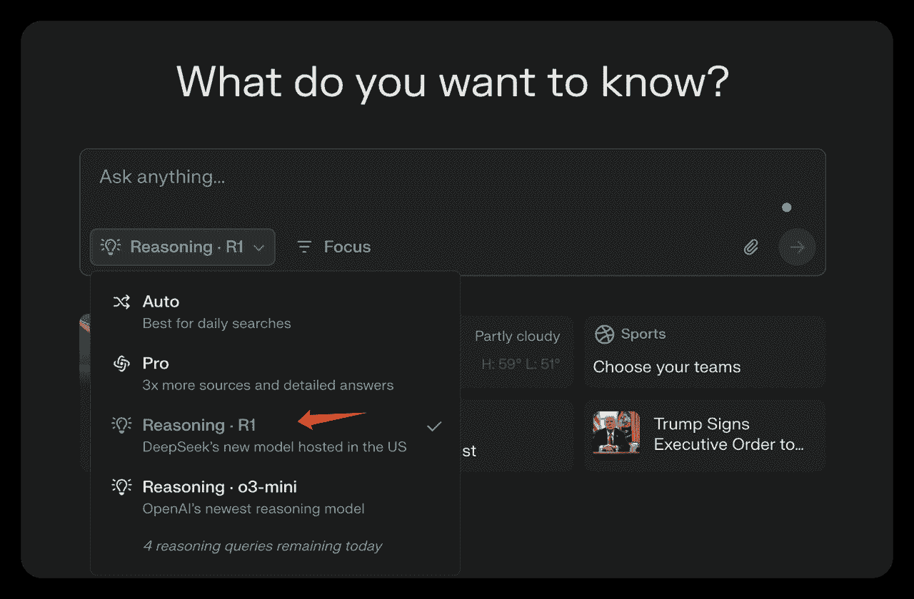

比如我搜索“deepseek r1 和 openai o3 mini 的对比和优缺点”，它就会基于搜索结果来回答你的问题：

基于搜索结果的思考过程：

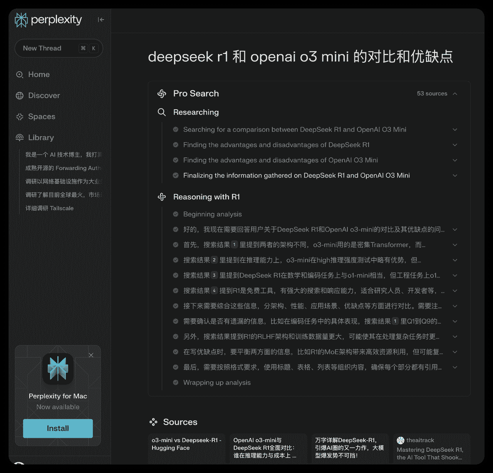

最终的回答：

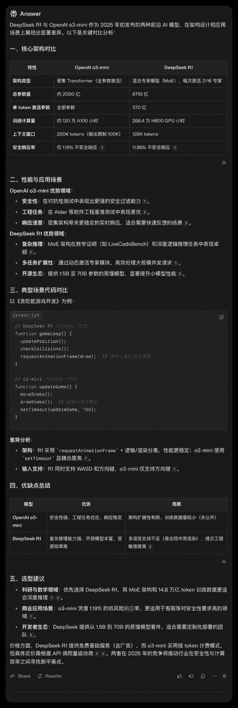

如果你想要一个稳定可靠、搜索功能强大的 DS R1 替代方案，Perplexity AI 算是最佳选择之一。

## 2. 纳米 AI 搜索 （免费/不需要 🪜）

纳米 AI 搜索是一个国内的 AI 搜索引擎，它也支持 DeepSeek R1 模型。

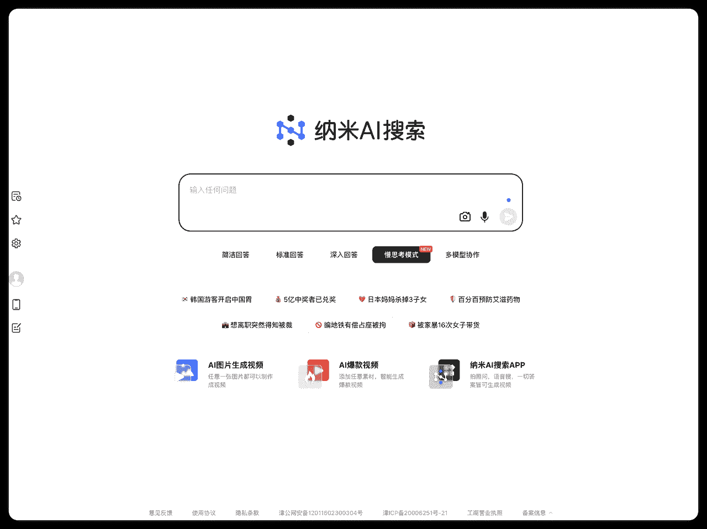

地址：https://www.n.cn/

它目前主要是提供专线版：即小参数版本的 DS R1 32B 的模型，但是速度快，而且稳定性相对较好。这里使用的时候，记得在提问题前选择好慢思考模式才能触发到使用 DS R1 的专线模型：

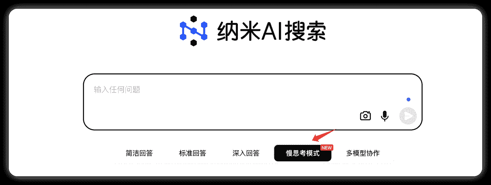

这里我们来试试搜索“deepseek r1 对比 openai o1 的优缺点”，你可以看到，它的思考过程用的就是 DS R1 32B 的模型，而且结果也是结合搜索结果思考后来回答你的问题：

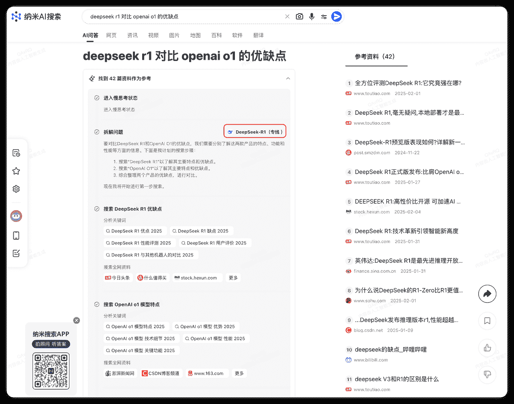

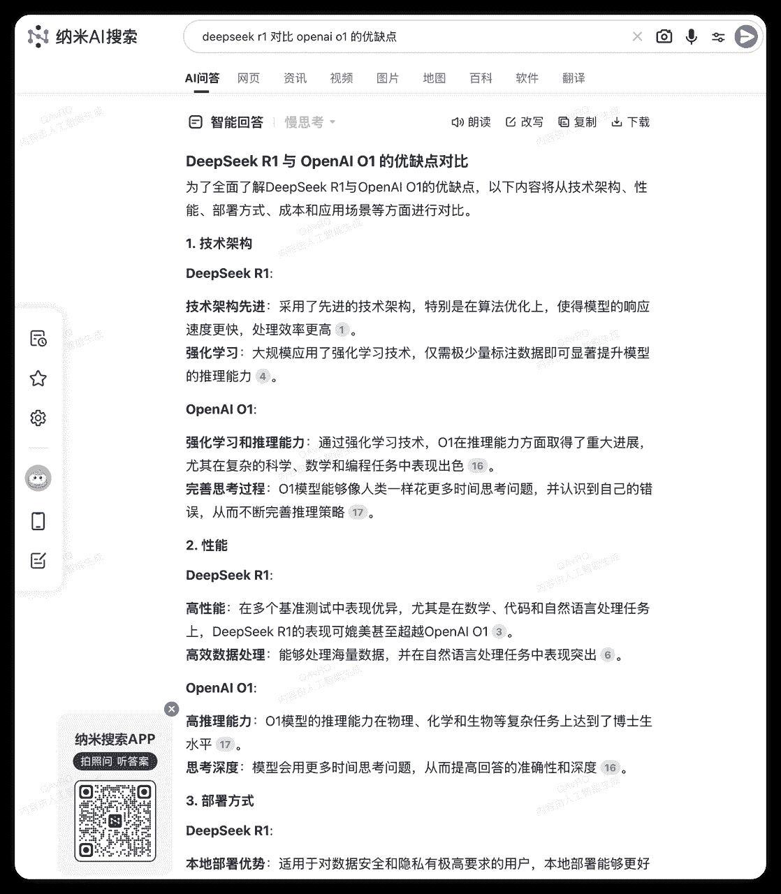

不过，我这里也试了下，纳米 AI 搜索也不是次次都会基于你的提问就直接用 DS R1 32B 的模型，有时候则不使用，估计是根据提问的复杂程度来决定的。

## 3. Cursor （可免费/需要 🪜）

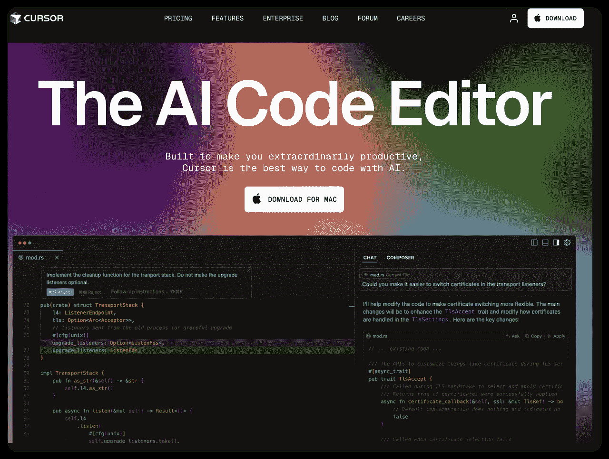

以下是 Cursor 的官方地址：

https://cursor.sh/

Cursor 是一款专为程序员打造的新一代 AI 编程助手，它有以下几个突出的优点：

1.  **智能代码补全和生成**：通过 AI 模型实时提供代码建议，大幅提升编码效率

1.  **强大的代码解释和重构**：可以快速理解复杂代码，并提供优化建议

1.  **内置多种顶级 AI 模型**：包括 GPT-4、Claude 3 以及 DeepSeek R1 等

1.  **联网搜索功能**：可以结合搜索来解答技术问题，提供更准确的答案

Cursor 提供了以下几种付费方案（月付，年付会再便宜一些）：

1.  **免费版 （Hobby）**

+   提供 2 周的 Pro 版本试用期

+   每月 2000 次代码补全

+   50 次慢速高级模型请求

+   可以使用基础功能

1.  **Pro 版本 （$20/月）**

+   无限制代码补全

+   每月 500 次快速高级模型请求

+   无限制慢速高级模型请求

+   每天 10 次 O1-mini 模型使用额度

+   包含所有高级功能

1.  企业版 （Business） （$40/用户/月）

+   包含 Pro 版本所有功能

+   组织级隐私模式

+   集中式团队计费

+   管理员仪表盘和使用统计

+   SAML/OIDC SSO 支持

Cursor 的免费试用期提供完整的 Pro 版本功能体验，让你可以充分测试各项高级特性。试用期是从注册开始计算的实际天数，而不是使用天数。

如果你想尝试 Cursor 的 DeepSeek R1 功能，建议先使用免费试用期进行体验，看看是否符合你的需求再决定是否升级到付费版本。

要使用 Cursor 的 DeepSeek R1 模型进行联网搜索和回答，非常简单：

1.  在 Settings > Models 中开启 deepseek-r1 选项

1.  在对话框中选择 DeepSeek R1 作为对话模型

然后在不同操作系统下，可以通过以下快捷键快速调出 Cursor 的聊天栏窗口：

1.  **Windows/Linux**:

+   按下 Ctrl + L

1.  **macOS**:

+   按下 Cmd + L

如下图：


然后你就可以通过结合以下快捷指令来使用联网功能：

+   使用 @Web 命令让 AI 基于网络搜索结果来回答问题；

+   使用 @url 命令让 AI 分析特定网页的内容，比如 @https://www.deepseek.com；

比如，我这里要搜索“deepseek r1 对比 openai o1 的优缺点”，我就可以直接构造以下的提问：

```
@Web deepseek r1 对比 openai o1 的优缺点
```

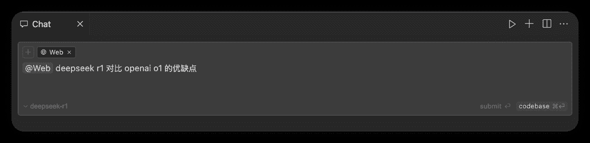

甚至是指定加上一些网络地址来附加作为搜索的参考：

```
@Web deepseek r1 对比 openai o1 的优缺点 @https://www.deepseek.com
```

以下是具体的回答效果：

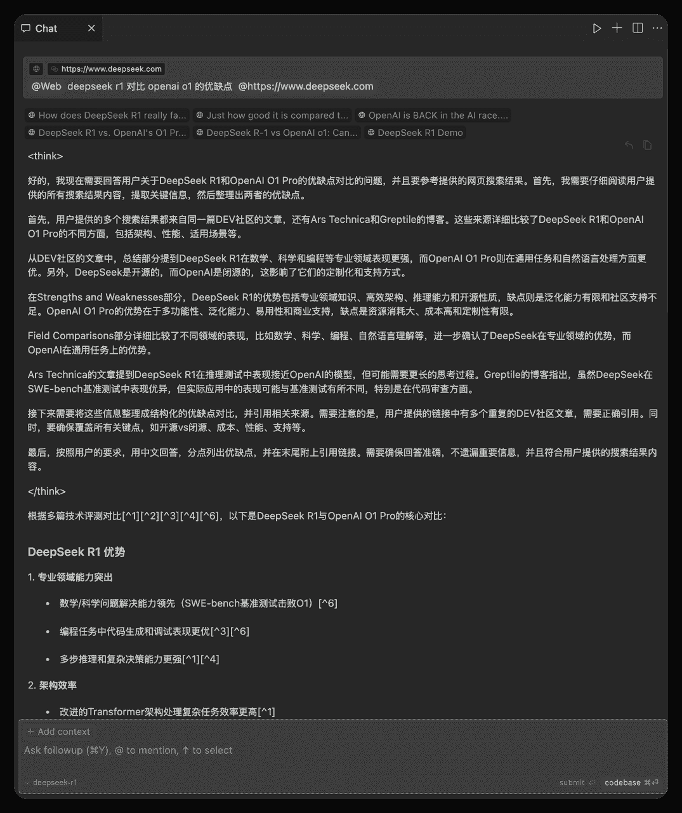

值得一提的是，Cursor 使用的是完整版的 DeepSeek R1（671B 参数），而不是精简版，这保证了回答的质量。

## 4. Monica （付费/需要 🪜）

Monica 是一个功能强大的 AI 助手工具，它提供了多种 AI 模型的集成使用体验。作为一个跨平台的应用程序，Monica 支持 Windows、macOS 和 Linux 系统，并提供了浏览器扩展和移动端 APP。


以下是 Monica 的官方地址：

https://monica.im/invitation?c=BO🐧MGZB/

最近，Monica 已经直接集成了完整版的 DeepSeek R1（671B 参数）模型并且可以直接结合联网搜索来回答问题：

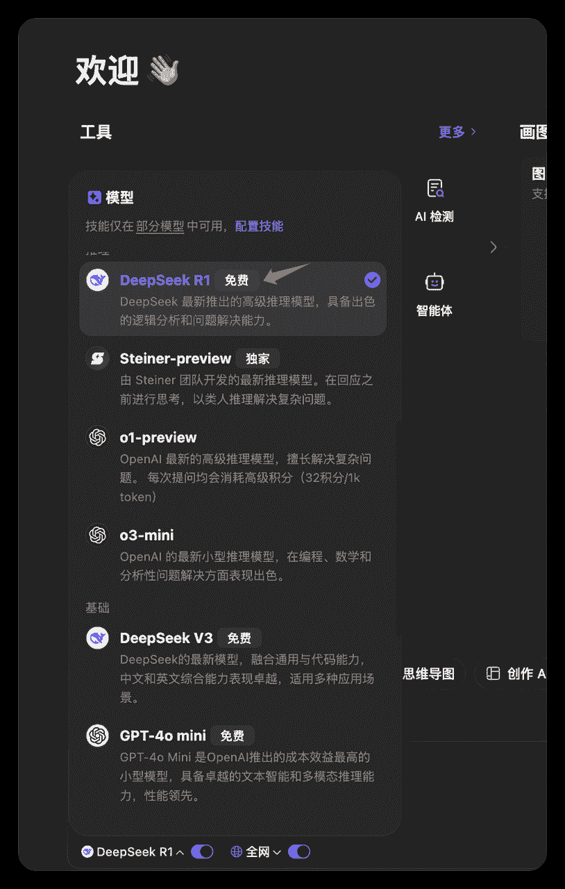

我们来试试效果，还是那个问题：

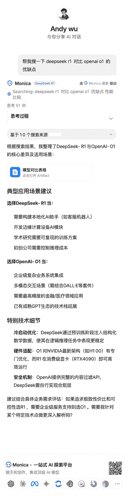

这种交互效果，是不是比 Cursor 的联网搜索效果还要好？

## 5. 秘塔 AI 搜索 （免费/不需要 🪜）

秘塔 AI 搜索是一个专注于中文搜索的 AI 搜索引擎，它结合了强大的搜索功能和 AI 对话能力。

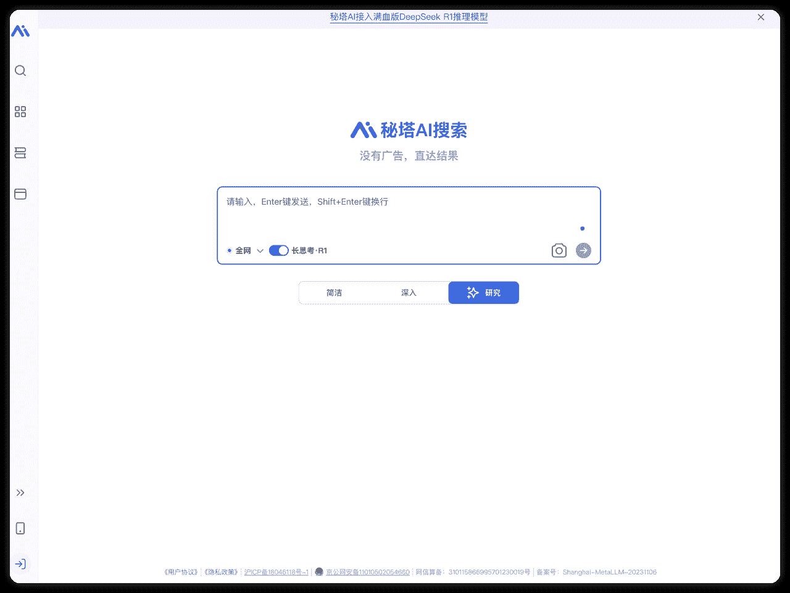

以下是它的主要特点：

1.  纯净的搜索体验

+   没有广告干扰

+   直达搜索结果

+   界面简洁清晰

1.  全网搜索能力

+   覆盖主流网站内容

+   实时更新搜索结果

+   支持多种搜索过滤

1.  便捷的使用方式

+   提供网页版访问

+   🛰️小程序随时可用

+   支持移动端和桌面端

官方地址：

https://metaso.cn/

现在秘塔 AI 也通过结合 R1 模型和自己的搜索引擎，提供基于实时搜索结果进行准确回答，以及信息来源的引用链接，我们来继续用同样的问题来试试效果：

对话结果链接：

https://metaso.cn/s/W4TJaq9

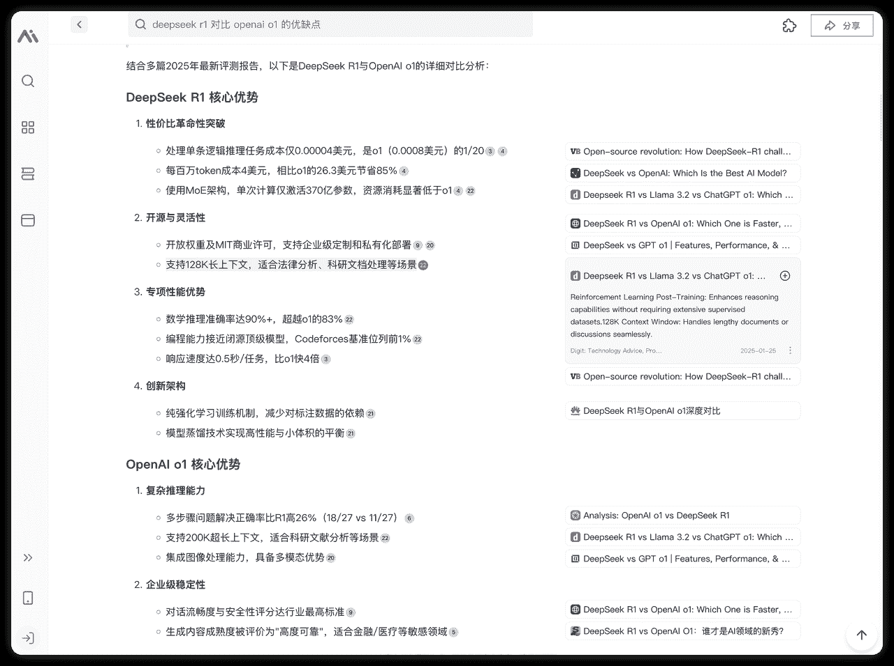

是不是觉得最后这个用起来更符合我们国人使用呢？而且还是完全免费的，是不是很棒？

## 普通人玩转 AI 的正确姿势：把专业的事交给专业的人

看完这篇指南你会发现：**用好 AI 根本不需要懂技术！** 就像我们不会自己造手机却能用🛰️聊天一样，AI 时代真正的聪明人是：

1️⃣ **会挑工具的咖啡师**

与其花 3 天部署残血版 AI（还随时可能崩溃），不如直接选现成的"AI 咖啡机"：Perplexity 是星巴克级的稳定体验，秘塔搜索是瑞幸式的高性价比，Cursor 则是专业咖啡师的手冲服务 —— 总有一款适合你

2️⃣ **会提问题的好奇宝宝**

这些工具已经把 DeepSeek R1 这样的顶尖大脑装进了手机大小的界面里。你要做的只是像问朋友那样提问：

❌ 错误姿势："请用混合精度训练优化模型参数"

✅ 正确姿势："帮我写个情人节表白代码，要带爱心动画！"

最后请记住：

你的创造力 × 云端 AI = 超能力

（**彩蛋：听说最近已**经有大佬也通过扣子来对接 DeepSeek R1 来实现联网搜索回答了，有兴趣的网络搜索一下关键词：WaytoAGI，往里面找找看 👀）

