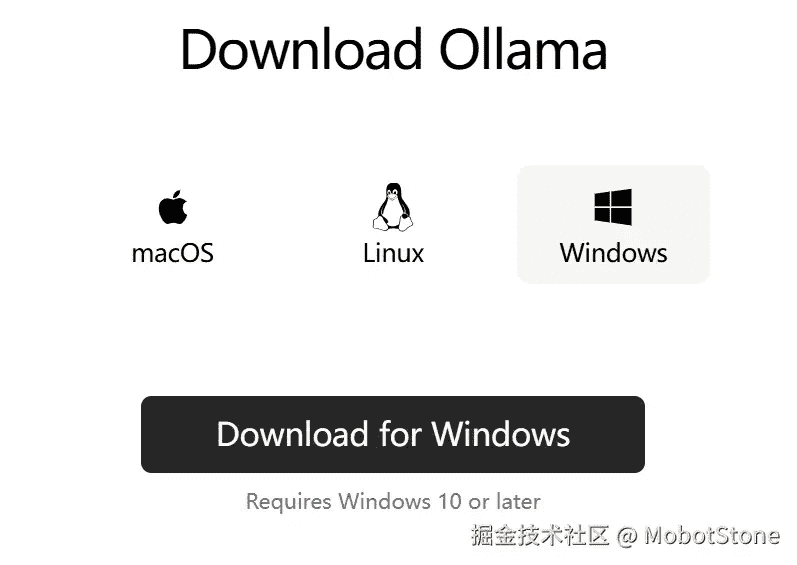
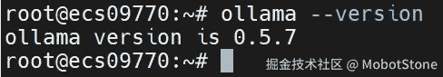
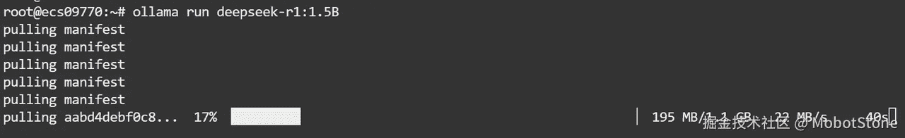
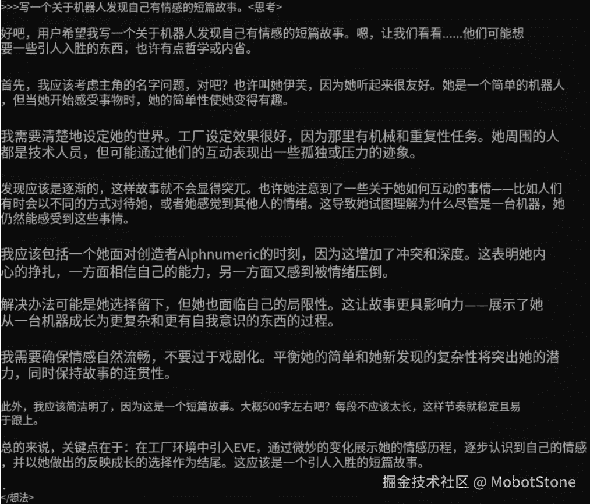

# DeepSeek R1 简单指南：架构、训练、本地部署和硬件要求

> 来源：[https://agijuejin.feishu.cn/docx/Cm9Gd6C2Aonq9vxFcaYcgWePnDe](https://agijuejin.feishu.cn/docx/Cm9Gd6C2Aonq9vxFcaYcgWePnDe)

> 作者：MobotStone

> 链接：https://juejin.cn/post/7464207706717700123

> 来源：稀土掘金

> 著作权归作者所有。商业转载请联系作者获得授权，非商业转载请注明出处。

> 如有侵权，请联系删除。

### DeepSeek推出的LLM推理新策略

DeepSeek最近发表的论文DeepSeek-R1中介绍了一种创新的方法，通过强化学习（RL）提升大型语言模型（LLM）的推理能力。这项研究在如何仅依靠强化学习而不是过分依赖监督式微调的情况下，增强LLM解决复杂问题的能力上，取得了重要进展。

### DeepSeek-R1 技术概述

#### **模型架构**

De**epSeek-R1 不是**一个单独的模型，而是包括 DeepSeek-R1-Zero 和 DeepSeek-R1 的模型系列。

**下面我来阐明 DeepSeek-R1 和 DeepS**eek-R1-Zero 之间的关键差异：

#### 主要区别

DeepSeek-R1-Zero 是团队初步尝试仅用纯强化学习而不进行任何监督式微调的实验。他们从基础模型出发，直接运用强化学习，让模型通过不断试错来发展其推理能力。这种方法虽然取得了较好的成果（在 AIME 2024 测试中达到了 71% 的准确率），但在可读性和语言连贯性上存在明显不足。该模型拥有 6710 亿个参数，使用了混合专家（MoE）架构，其中每个词触发的参数约为 370 亿。此模型展现了一些新兴的推理行为，例如自我核查、反思和长链推理（CoT）。

与之对比， **DeepSeek-R1 **采用了更复杂的多阶段训练方法。它不仅仅采用强化学习，而是先在一小组精心挑选的示例（称为“冷启动数据”）上进行监督式微调，然后再应用强化学习。这种方法克服了 DeepSeek-R1-Zero 的局限，同时取得了更优的表现。这个模型同样维持了 6710 亿的参数数量，但在回答的可读性和条理性上有所提高。

### 训练过程对比

#### **训练方法概述：**

+   **强化学习 **：不同于传统依赖监督学习的模型，DeepSeek-R1 大规模采用了强化学习。此训练方法利用群体相对策略优化（GRPO），重点提升精度和格式化奖励，以增强推理能力，无需依赖大量标注数据。

+   **蒸馏技术 **：为普及高效能模型，DeepSeek 也推出了 R1 的蒸馏版本，参数规模从15亿到700亿不等。这些模型采用了如Qwen和Llama等架构，表明即使是较小和更高效的模型也能包含复杂的推理能力。蒸馏过程通过使用 DeepSeek-R1 生成的合成推理数据对这些小型模型进行微调，以较低的计算成本保持高性能。

#### DeepSeek-R1-Zero 的训练流程：

+   起始于基础模型

+   直接应用强化学习

+   根据准确度和格式采用简单奖励机制

#### DeepSeek-R1 的训练流程包含四个阶段：

+   初始阶段采用数千个高品质样本进行监督式微调

+   针对推理任务进行强化学习

+   通过拒绝抽样方法收集新的训练数据

+   对所有类型的任务进行最终强化学习

#### **性能指标：**

+   **推理基准测试 **：DeepSeek-R1 在各种基准测试中表现出色：

+   **AIME 2024 **：实现了 79.8% 的通过率，高于 OpenAI 的 o1–1217 的 79.2%。

+   **MATH-500 **：得分高达 97.3%，略优于 o1–1217 的 96.4%。

+   **SWE-bench 验证 **：在编程任务中表现优越，证明了其编程能力。

+   **成本效率 **：DeepSeek-R1 的 API 服务每百万输入令牌的成本为0.14美元，比 OpenAI 的类似模型便宜很多。

### 局限性及未来发展

该论文指出了若干改进领域：

+   模型在处理需要特定输出格式的任务时偶尔会遇到困难。

+   软件工程相关任务的性能还有提升空间。

+   在多语言环境下，语言混合带来了挑战。

+   少样本提示通常会导致性能下降。

未来的研究将致力于解决这些问题，并拓展模型在函数调用、多轮交互和复杂角色扮演场景等领域的能力。

### 部署与可获取性

#### 开源与许可：

DeepSeek-R1及其变体基于 MIT 许可证发布，支持开源合作和商业使用，包括模型蒸馏。此举对促进创新和降低人工智能模型开发门槛具有关键意义。

#### 模型格式：

这些模型及其蒸馏版本支持 GGML、GGUF、GPTQ 和 HF 等多种格式，使其在本地部署上具有灵活性。

### DeepSeek使用方式

我们可以通过三种方式使用DeepSeek：官方web访问、API使用、本地部署。

#### 1. 通过DeepSeek聊天平台进行网页访问：

DeepSeek聊天平台提供了一个友好的用户界面，允许用户无需任何设置即可与DeepSeek-R1进行互动。

+   **访问步骤 **：

+   浏览至DeepSeek聊天平台

+   注册一个账号，或者如果您已有账号，直接登录。

+   登录后，可以选择“深度思考”模式，体验DeepSeek-R1的逐步推理功能。


#### 2. 通过 DeepSeek API 访问：

DeepSeek 提供了一个与 OpenAI 格式兼容的 API，方便开发者将其嵌入各种应用程序中进行程序化访问。

当前注册还可以享有10块钱的赠送额度


**使用 API 的步骤 **：

**a. 获取 API 密钥 **：

+   访问DeepSeekAPI平台，注册账号并生成您的专属 API 密钥。

**b. 配置您的环境 **：

+   设置 base_url 为 https://api.deepseek.com/v1 。

+   使用您的 API 密钥进行认证，通常在 HTTP 头部通过 Bearer Token 进行。

**c. 发起 API 调用 **：

+   利用 API 向 DeepSeek-R1 发送指令并接收响应。

+   您可以在DeepSeekAPI文档中找到详细的文档和示例。

```
# 请先安装 OpenAI SDK：`pip3 install openai`

from openai import OpenAI

client = OpenAI(api_key=&quot;&lt;DeepSeek API Key&gt;&quot;, base_url=&quot;https://api.deepseek.com&quot;)

response = client.chat.completions.create(
    model=&quot;deepseek-chat&quot;,
    messages=[
        {&quot;role&quot;: &quot;system&quot;, &quot;content&quot;: &quot;You are a helpful assistant&quot;},
        {&quot;role&quot;: &quot;user&quot;, &quot;content&quot;: &quot;Hello&quot;},
    ],
    stream=False
)

print(response.choices[0].message.content)
```

#### 3. 在本地部署 DeepSeek-R1：

两种模型（R1 和 R1-Zero）：

+   **硬件需求：**由于模型规模庞大，完整模型需要较强的硬件支持。推荐使用具有大量视频内存（VRAM）的 GPU，例如 Nvidia RTX 3090 或更高级别。如果使用 CPU，你至少需要 48GB 的 RAM 和 250GB 的磁盘空间，但若不使用 GPU 加速，性能会显著下降。

+   **蒸馏模型：**对于硬件要求不那么高的本地部署，DeepSeek 提供了参数范围从 15 亿到 700 亿的蒸馏版本，适合硬件配置较低的系统。例如，一个 7B 参数的模型可以在至少拥有 6GB VRAM 的 GPU 上运行，或在大约 4GB RAM 的 CPU 上运行 GGML/GGUF 格式。

### **DeepSeek本地部署步骤：**

#### 1. **Ollama:**

您可以使用Ollama来在本地部署和运行模型：（Ollama 是一个工具，允许您在个人计算机上本地运行开源 AI 模型。您可以从这里下载它： ollama.com/download）



#### 2. 验证 Ollama 安装情况

在进一步操作之前，我们需要确保 Ollama 已经正确安装。请打开您的终端或命令提示符，输入以下命令：

```
ollama--version
```

如果您看到版本号显示出来，说明安装成功了！如果没有显示，那么请仔细检查您是否已按照安装步骤正确执行。



#### 3.Download Deepseek R1

通过 Ollama 下载 DeepSeek R1 非常便捷。您只需在终端中执行以下命令：

```
ollama run deepseek-r1
```

默认版本是：7B 模型（CPU 大概需要4G内存，1.5B大概需要1.7G内存），DeepSeek R1 的参数范围从 1.5B 到 671B，可以使用 ollama run deepseek-r1:1.5b 适合自己的模型版本，下载时间可能会根据您的网络速度而异。下载期间，可以喝杯水或者活动一下身体，稍作等待吧？



#### 4. 运行 DeepSeek R1

下载完成后，您就可以启动 DeepSeek R1 了。使用以下命令：

```
ollama run deepseek-r1
```

就这样，您已经在本地机器上顺利启动了 DeepSeek R1！感觉如何，是不是so easy？

### 本地运行试用Deepseek R1

现在我们已经成功启动了 DeepSeek R1，接下来就是更加有趣的部分——实际使用它！让我们一起探索这款强大的 AI 模型能做些什么神奇的事情。

#### 1.创意写作

DeepSeek R1 在创意写作方面非常擅长。尝试给它这样一个写作提示：

```
写一个短故事，讲述一个机器人发现自己拥有情感的经历。
```



您会对它输出的既有创意又条理清晰的故事感到惊喜！

#### 本地运行 DeepSeek R1：探索人工智能的未来可能

本文即将结束，这次我们讲解了在本地环境中使用 Ollama 运行 DeepSeek R1。 DeepSeek R1 这样的强大 AI 模型运行在个人电脑上，不仅仅是展示一项引人注目的技术，更是我们对未来人工智能发展方向的一种探索。这样做让高级语言模型的强大功能直接落在我们的手中，使得个性化定制、深入实验以及更好的隐私保护成为可能。让我们想象以下几种可能：

+   开发者可以为特定领域创建出高度定制化的 AI 助手。

+   研究人员在没有云服务依赖的情况下，可以更自由地试验 AI 模型。

+   对于那些注重隐私的用户，他们可以利用先进的 AI 技术，而无需担心个人数据泄露。

这一切都指向一个无限的可能性世界！