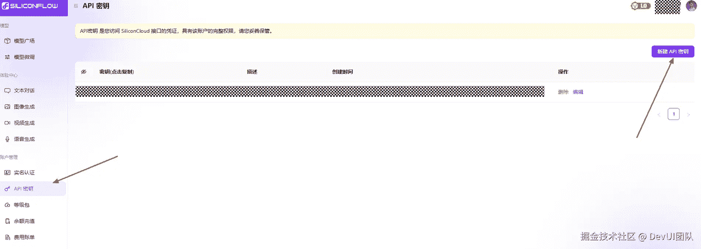

# 🔥告别DeepSeek“服务器繁忙，请稍后重试”，10分钟使用MateChat+DeepSeekAPI，搭建自己的专属AI助手

> 来源：[https://agijuejin.feishu.cn/docx/Mf3Gd2ETXoRxRNxTWlzcK1dfnES](https://agijuejin.feishu.cn/docx/Mf3Gd2ETXoRxRNxTWlzcK1dfnES)

> 作者：DevUI团队

> 链接：https://juejin.cn/post/7469691502630551593

> 来源：稀土掘金

> 著作权归作者所有。商业转载请联系作者获得授权，非商业转载请注明出处。

> 如有侵权，请联系删除。

近期DeepSeek大火之后，小编也去深入体验了一下，只能说国产大模型真好用还不用🪜。但是吧DeepSeek老是友好的提醒我“服务器繁忙，请稍后重试”，这作为一个技术人马上就坐不住了，咱怎么受得了这委屈~


**于是三下五除二，**马上拿出近期DevUI推出的MateChat对接了一把硅基流动deepseek r1模型API，10分钟时间，从此告别牛马作为人上人，与DeepSeek的“服务器繁忙，请稍后重试”说bye bye。话不多说，先上图给大佬们看看效果咋样。（由于录屏文件大小受限，只展示了一小段，问答交互很丝滑）


下面就给大家呈上完整的使用教程~

## MateChat对接DeepSeek教程（10分钟）

### 1、 获取DeepSeek的API keys与调用方式

前往[硅基流动 x 华为云联合推出基于昇腾云的](https://link.juejin.cn?target=https%3A%2F%2Fcloud.siliconflow.cn%2Fmodels)[ Deep](https://link.juejin.cn?target=https%3A%2F%2Fdocs.siliconflow.cn%2Fquickstart)Seek [R1&V3 推理服务](https://link.juejin.cn?target=https%3A%2F%2Fwww.deepseek.com%2F)官网，创建API keys，然后参照官网提供的API文档进行调用。DeepSeek官网的也参照同样方式操作即可，由于爆火它已经关闭了已暂停API服务充值，我们只能通过这样曲线救国了~



这个是官网提供的调用方式，其提供了与OpenAI兼容的使用方式，我们先安装OpenAI依赖，用于在 Node.js 环境中与 OpenAI的API进行交互。

```
js
 代码解读
复制代码
// Please install OpenAI SDK first: npm install openaiimport OpenAI from &quot;openai&quot;;const openai = new OpenAI({        baseURL: &#x27;https://api.siliconflow.cn/v1&#x27;,        apiKey: &#x27;&lt;Your API Key&gt;&#x27;});async function main() {  const completion = await openai.chat.completions.create({    messages: [{ role: &quot;system&quot;, content: &quot;You are a helpful assistant.&quot; }],    model: &quot;deepseek-ai/DeepSeek-V2.5&quot;,  });  console.log(completion.choices[0].message.content);}main();
```

> 注：[由于DeepSeek爆火官网已经关闭了已](https://link.juejin.cn?target=https%3A%2F%2Fcloud.siliconflow.cn%2Fmodels)暂停API服务充值，所以上述调用你大概率会得到"APIError: 402 Insufficient Balance"，这里所以我们以硅基流动 x 华为云联合推出基于昇腾云的 DeepSeek R1&V3 推理服务  来对接MateChat提供界面前台。

+   如果要使用DeepSeek官网调用的话使用方式与上述一致，只需要替换apiKey/baseURL以及model三个变量即可

+   另外硅基流动提供了14元的2000w token的免费额度，适合体验上手的用户~

### 2、  通过MateChat项目提供页面交互完成DeepSeek的API调用

文章接上回《秒变智能化 — 使用MateC**hat为你的项目**添加一个智能化助手》，我们新建项目的App.vue中的script文件如下。我们只需要将下述70-85行项目提交代码替换为DeepSeek大模型API调用方式即可。

```
ts
 代码解读
复制代码
&lt;script setup lang=&quot;ts&quot;&gt;import { ref } from &#x27;vue&#x27;;import { Button } from &#x27;vue-devui/button&#x27;;import &#x27;vue-devui/button/style.css&#x27;;const description = [  &#x27;MateChat 可以辅助研发人员编码、查询知识和相关作业信息、编写文档等。&#x27;,  &#x27;作为AI模型，MateChat 提供的答案可能不总是确定或准确的，但您的反馈可以帮助 MateChat 做的更好。&#x27;,];const introPrompt = {  direction: &#x27;horizontal&#x27;,  list: [    {      value: &#x27;quickSort&#x27;,      label: &#x27;帮我写一个快速排序&#x27;,      iconConfig: { name: &#x27;icon-info-o&#x27;, color: &#x27;#5e7ce0&#x27; },      desc: &#x27;使用 js 实现一个快速排序&#x27;,    },    {      value: &#x27;helpMd&#x27;,      label: &#x27;你可以帮我做些什么？&#x27;,      iconConfig: { name: &#x27;icon-star&#x27;, color: &#x27;rgb(255, 215, 0)&#x27; },      desc: &#x27;了解当前大模型可以帮你做的事&#x27;,    },    {      value: &#x27;bindProjectSpace&#x27;,      label: &#x27;怎么绑定项目空间&#x27;,      iconConfig: { name: &#x27;icon-priority&#x27;, color: &#x27;#3ac295&#x27; },      desc: &#x27;如何绑定云空间中的项目&#x27;,    },  ],};const simplePrompt = [  {    value: &#x27;quickSort&#x27;,    iconConfig: { name: &#x27;icon-info-o&#x27;, color: &#x27;#5e7ce0&#x27; },    label: &#x27;帮我写一个快速排序&#x27;,  },  {    value: &#x27;helpMd&#x27;,    iconConfig: { name: &#x27;icon-star&#x27;, color: &#x27;rgb(255, 215, 0)&#x27; },    label: &#x27;你可以帮我做些什么？&#x27;,  },];const startPage = ref(true);const inputValue = ref(&#x27;&#x27;);const inputFootIcons = [  { icon: &#x27;icon-at&#x27;, text: &#x27;智能体&#x27; },  { icon: &#x27;icon-standard&#x27;, text: &#x27;词库&#x27; },  { icon: &#x27;icon-add&#x27;, text: &#x27;附件&#x27; },];const messages = ref&lt;any[]&gt;([  {    from: &#x27;user&#x27;,    content: &#x27;你好&#x27;,  },  {    from: &#x27;model&#x27;,    content: &#x27;你好，我是 MateChat&#x27;,    id: &#x27;init-msg&#x27;,  },]);const newConversation = () =&gt; {  startPage.value = true;  messages.value = [];}const onSubmit = (evt) =&gt; {  inputValue.value=&#x27;&#x27;;  startPage.value = false;  // 用户发送消息  messages.value.push({    from: &#x27;user&#x27;,    content: evt,  });  setTimeout(() =&gt; {    // 模型返回消息    messages.value.push({      from: &#x27;model&#x27;,      content: evt,    });  }, 200);};&lt;/script&gt;
```

**70-85行**代码替换如下，逻辑主要1、引入openai依赖库完成接口api调用 2、替换matechat原写的onsubmit方法发起模型接口请求。

> 此处以硅基流动为例，如果需要平替其他大模型更换下面单个变量即可~

+   第6行的**apiKey**变量替换为硅基流动官网创建的API key

+   第7行的**baseURL**变量替换为[硅基流动文档实例](https://link.juejin.cn?target=https%3A%2F%2Fdocs.siliconflow.cn%2Fquickstart)提供的Url：api.siliconflow.cn/v1

+   第32行的**model**变量替换为[硅基流动文档实例](https://link.juejin.cn?target=https%3A%2F%2Fdocs.siliconflow.cn%2Fquickstart)提供的model名称：deepseek-ai/DeepSeek-V2.5

```
ts
 代码解读
复制代码
import OpenAI from &#x27;openai&#x27;;const client = ref&lt;OpenAI&gt;();client.value = new OpenAI({  apiKey: &#x27;&#x27;, // 替换模型APIKey  baseURL: &#x27;https://api.siliconflow.cn/v1&#x27;, // 替换模型API地址  dangerouslyAllowBrowser: true,});const onSubmit = (evt) =&gt; {  inputValue.value = &#x27;&#x27;;  startPage.value = false;  messages.value.push({    from: &#x27;user&#x27;,    content: evt,    avatarConfig: { name: &#x27;user&#x27; },  });  fetchData(evt);};const fetchData = async (ques) =&gt; {  messages.value.push({    from: &#x27;model&#x27;,    content: &#x27;&#x27;,    avatarConfig: { name: &#x27;model&#x27; },    id: &#x27;&#x27;,    loading: true,  });  const completion = await client.value!.chat.completions.create({    model: &#x27;deepseek-ai/DeepSeek-V2.5&#x27;, // 替换官网案例提供的model名称    messages: [{ role: &#x27;user&#x27;, content: ques }],    stream: true,  });  messages.value[messages.value.length - 1].loading = false;  for await (const chunk of completion) {    const content = chunk.choices[0]?.delta?.content || &#x27;&#x27;;    const chatId = chunk.id;    messages.value[messages.value.length - 1].content += content;    messages.value[messages.value.length - 1].id = chatId;  }};
```

替换完重新**npm run dev**启动项目，这时候你问它是谁的时候如果回答如下，恭喜你自己搭建了一个前端自定义的智能助手且智慧大脑对接了deepseek的项目了💕


为了方便大家快速获取完整代码，下面是我本地新创建项目的App.vue文件，这里175行补充对话回答中的MD渲染来提升用户体验~<McMarkdownCard :content="msg.content" :theme="theme"></McMarkdownCard>

```
ts
 代码解读
复制代码
&lt;script setup lang=&quot;ts&quot;&gt;import { onMounted, ref } from &#x27;vue&#x27;;const theme = ref(&#x27;light&#x27;);const themeService = window[&#x27;devuiThemeService&#x27;];const description = [  &#x27;MateChat 可以辅助研发人员编码、查询知识和相关作业信息、编写文档等。&#x27;,  &#x27;作为AI模型，MateChat 提供的答案可能不总是确定或准确的，但您的反馈可以帮助 MateChat 做的更好。&#x27;,];const introPrompt = {  direction: &#x27;horizontal&#x27;,  list: [    {      value: &#x27;quickSort&#x27;,      label: &#x27;帮我写一个快速排序&#x27;,      iconConfig: { name: &#x27;icon-info-o&#x27;, color: &#x27;#5e7ce0&#x27; },      desc: &#x27;使用 js 实现一个快速排序&#x27;,    },    {      value: &#x27;helpMd&#x27;,      label: &#x27;你可以帮我做些什么？&#x27;,      iconConfig: { name: &#x27;icon-star&#x27;, color: &#x27;rgb(255, 215, 0)&#x27; },      desc: &#x27;了解当前大模型可以帮你做的事&#x27;,    },    {      value: &#x27;bindProjectSpace&#x27;,      label: &#x27;怎么绑定项目空间&#x27;,      iconConfig: { name: &#x27;icon-priority&#x27;, color: &#x27;#3ac295&#x27; },      desc: &#x27;如何绑定云空间中的项目&#x27;,    },  ],};const simplePrompt = [  {    value: &#x27;quickSort&#x27;,    iconConfig: { name: &#x27;icon-info-o&#x27;, color: &#x27;#5e7ce0&#x27; },    label: &#x27;帮我写一个快速排序&#x27;,  },  {    value: &#x27;helpMd&#x27;,    iconConfig: { name: &#x27;icon-star&#x27;, color: &#x27;rgb(255, 215, 0)&#x27; },    label: &#x27;你可以帮我做些什么？&#x27;,  },];const startPage = ref(true);const inputValue = ref(&#x27;&#x27;);const inputFootIcons = [  { icon: &#x27;icon-at&#x27;, text: &#x27;智能体&#x27; },  { icon: &#x27;icon-standard&#x27;, text: &#x27;词库&#x27; },  { icon: &#x27;icon-add&#x27;, text: &#x27;附件&#x27; },];const messages = ref&lt;any[]&gt;([  {    from: &#x27;user&#x27;,    content: &#x27;你好&#x27;,  },  {    from: &#x27;model&#x27;,    content: &#x27;你好，我是 MateChat&#x27;,    id: &#x27;init-msg&#x27;,  },]);const newConversation = () =&gt; {  startPage.value = true;  messages.value = [];}import OpenAI from &#x27;openai&#x27;;const client = ref&lt;OpenAI&gt;();client.value = new OpenAI({  // chatgpt的apikey  // apiKey: &#x27;&#x27;, // 模型APIKey  // baseURL: &#x27;https://api.openai.com/v1&#x27;, // 模型API地址  // 硅基流动的apikey  apiKey: &#x27;&#x27;, // 模型APIKey  baseURL: &#x27;https://api.siliconflow.cn/v1&#x27;, // 模型API地址  // deepseek的apikey  // apiKey: &#x27;&#x27;, // 模型APIKey  // baseURL: &#x27;https://api.deepseek.com&#x27;, // 模型API地址  dangerouslyAllowBrowser: true,});const onSubmit = (evt) =&gt; {  inputValue.value = &#x27;&#x27;;  startPage.value = false;  // 用户发送消息  messages.value.push({    from: &#x27;user&#x27;,    content: evt,    avatarConfig: { name: &#x27;user&#x27; },  });  fetchData(evt);};const fetchData = async (ques) =&gt; {  messages.value.push({    from: &#x27;model&#x27;,    content: &#x27;&#x27;,    avatarConfig: { name: &#x27;model&#x27; },    id: &#x27;&#x27;,    loading: true,  });  const completion = await client.value!.chat.completions.create({    // model: &#x27;gpt-4o-mini&#x27;, // 替换为自己的model名称    model: &#x27;deepseek-ai/DeepSeek-V2.5&#x27;, // 替换为自己的model名称    // model: &#x27;deepseek-chat&#x27;, // 替换为自己的model名称    messages: [{ role: &#x27;user&#x27;, content: ques }],    stream: true, // 为 true 则开启接口的流式返回  });  messages.value[messages.value.length - 1].loading = false;  for await (const chunk of completion) {    const content = chunk.choices[0]?.delta?.content || &#x27;&#x27;;    const chatId = chunk.id;    messages.value[messages.value.length - 1].content += content;    messages.value[messages.value.length - 1].id = chatId;  }};const themeChange = () =&gt; {  if (themeService) {    theme.value = themeService.currentTheme.id === &#x27;infinity-theme&#x27; ? &#x27;light&#x27; : &#x27;dark&#x27;;  }}onMounted(() =&gt; {  themeChange();  if (themeService &amp;&amp; themeService.eventBus) {    themeService.eventBus.add(&#x27;themeChanged&#x27;, themeChange);  }});&lt;/script&gt;&lt;template&gt;  &lt;McLayout class=&quot;container&quot;&gt;    &lt;McHeader :title=&quot;&#x27;MateChat&#x27;&quot; :logoImg=&quot;&#x27;https://matechat.gitcode.com/logo.svg&#x27;&quot;&gt;      &lt;template #operationArea&gt;        &lt;div class=&quot;operations&quot;&gt;          &lt;i class=&quot;icon-helping&quot;&gt;&lt;/i&gt;        &lt;/div&gt;      &lt;/template&gt;    &lt;/McHeader&gt;    &lt;McLayoutContent      v-if=&quot;startPage&quot;      style=&quot;display: flex; flex-direction: column; align-items: center; justify-content: center; gap: 12px&quot;    &gt;      &lt;McIntroduction        :logoImg=&quot;&#x27;https://matechat.gitcode.com/logo2x.svg&#x27;&quot;        :title=&quot;&#x27;MateChat&#x27;&quot;        :subTitle=&quot;&#x27;Hi，欢迎使用 MateChat&#x27;&quot;        :description=&quot;description&quot;      &gt;&lt;/McIntroduction&gt;      &lt;McPrompt        :list=&quot;introPrompt.list&quot;        :direction=&quot;introPrompt.direction&quot;        class=&quot;intro-prompt&quot;        @itemClick=&quot;onSubmit($event.label)&quot;      &gt;&lt;/McPrompt&gt;    &lt;/McLayoutContent&gt;    &lt;McLayoutContent class=&quot;content-container&quot; v-else&gt;      &lt;template v-for=&quot;(msg, idx) in messages&quot; :key=&quot;idx&quot;&gt;        &lt;McBubble          v-if=&quot;msg.from === &#x27;user&#x27;&quot;          :content=&quot;msg.content&quot;          :align=&quot;&#x27;right&#x27;&quot;          :avatarConfig=&quot;{ imgSrc: &#x27;https://matechat.gitcode.com/png/demo/userAvatar.svg&#x27; }&quot;        &gt;        &lt;/McBubble&gt;        &lt;McBubble v-else :content=&quot;msg.content&quot; :avatarConfig=&quot;{ imgSrc: &#x27;https://matechat.gitcode.com/logo.svg&#x27; }&quot;&gt;          &lt;McMarkdownCard :content=&quot;msg.content&quot; :theme=&quot;theme&quot;&gt;&lt;/McMarkdownCard&gt;        &lt;/McBubble&gt;      &lt;/template&gt;    &lt;/McLayoutContent&gt;    &lt;div class=&quot;shortcut&quot; style=&quot;display: flex; align-items: center; gap: 8px&quot;&gt;      &lt;McPrompt        v-if=&quot;!startPage&quot;        :list=&quot;simplePrompt&quot;        :direction=&quot;&#x27;horizontal&#x27;&quot;        style=&quot;flex: 1&quot;        @itemClick=&quot;onSubmit($event.label)&quot;      &gt;&lt;/McPrompt&gt;      &lt;d-button        style=&quot;margin-left: auto&quot;        icon=&quot;add&quot;        shape=&quot;circle&quot;        title=&quot;新建对话&quot;        size=&quot;sm&quot;        @click=&quot;newConversation&quot;      /&gt;    &lt;/div&gt;    &lt;McLayoutSender&gt;      &lt;McInput :value=&quot;inputValue&quot; :maxLength=&quot;2000&quot; @change=&quot;(e) =&gt; (inputValue = e)&quot; @submit=&quot;onSubmit&quot;&gt;        &lt;template #extra&gt;          &lt;div class=&quot;input-foot-wrapper&quot;&gt;            &lt;div class=&quot;input-foot-left&quot;&gt;              &lt;span v-for=&quot;(item, index) in inputFootIcons&quot; :key=&quot;index&quot;&gt;                &lt;i :class=&quot;item.icon&quot;&gt;&lt;/i&gt;                {{ item.text }}              &lt;/span&gt;              &lt;span class=&quot;input-foot-dividing-line&quot;&gt;&lt;/span&gt;              &lt;span class=&quot;input-foot-maxlength&quot;&gt;{{ inputValue.length }}/2000&lt;/span&gt;            &lt;/div&gt;            &lt;div class=&quot;input-foot-right&quot;&gt;              &lt;d-button icon=&quot;op-clearup&quot; shape=&quot;round&quot; :disabled=&quot;!inputValue&quot; @click=&quot;inputValue = &#x27;&#x27;&quot;&gt;清空输入&lt;/d-button&gt;            &lt;/div&gt;          &lt;/div&gt;        &lt;/template&gt;      &lt;/McInput&gt;    &lt;/McLayoutSender&gt;  &lt;/McLayout&gt;&lt;/template&gt;&lt;style&gt;.container {  width: 1000px;  margin: 20px auto;  height: calc(100vh - 40px);  padding: 20px;  gap: 8px;  background: #fff;  border: 1px solid #ddd;  border-radius: 16px;}.content-container {  display: flex;  flex-direction: column;  gap: 8px;  overflow: auto;}.input-foot-wrapper {  display: flex;  justify-content: space-between;  align-items: center;  width: 100%;  height: 100%;  margin-right: 8px;  .input-foot-left {    display: flex;    align-items: center;    gap: 8px;    span {      font-size: 12px;      color: #252b3a;      cursor: pointer;    }    .input-foot-dividing-line {      width: 1px;      height: 14px;      background-color: #d7d8da;    }    .input-foot-maxlength {      font-size: 12px;      color: #71757f;    }  }  .input-foot-right {    &amp; &gt; *:not(:first-child) {      margin-left: 8px;    }  }}&lt;/style&gt;
```

## 🔥项目使用&技术答疑

完整示例建议前往参考[MateChat官网](https://link.juejin.cn?target=https%3A%2F%2Fmatechat.gitcode.com)文档，我们开放了更多能力可以帮助[大考完善](https://link.juejin.cn?target=https%3A%2F%2Fgitcode.com%2FDevCloudFE%2FMateChat%2Fblob%2Fdev%2FCONTRIBUTING.md)场景，同时也希望感兴趣的同学前往参与贡献