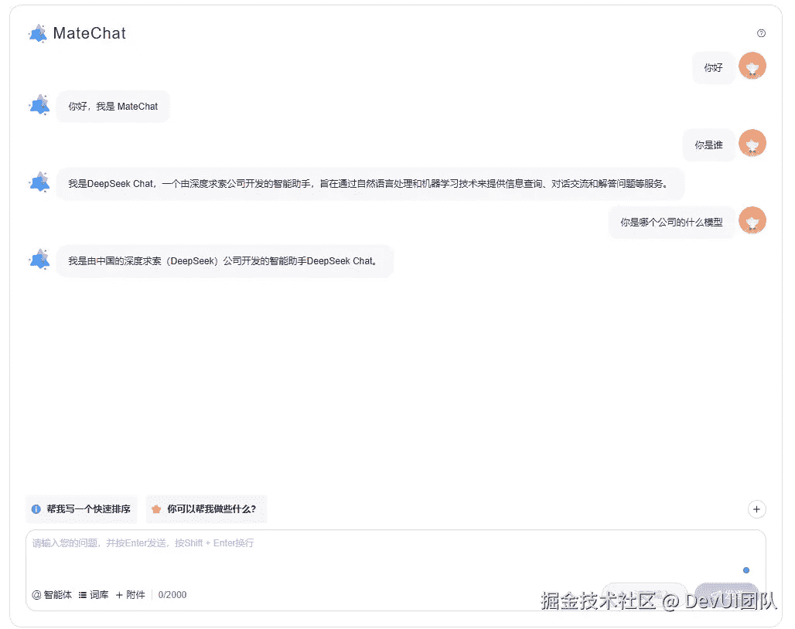

# 🔥告别DeepSeek“服务器繁忙，请稍后重试”，10分钟使用MateChat+DeepSeekAPI，搭建自己的专属AI助手

> 来源：[https://agijuejin.feishu.cn/docx/Mf3Gd2ETXoRxRNxTWlzcK1dfnES](https://agijuejin.feishu.cn/docx/Mf3Gd2ETXoRxRNxTWlzcK1dfnES)

> 作者：DevUI团队

> 链接：https://juejin.cn/post/7469691502630551593

> 来源：稀土掘金

> 著作权归作者所有。商业转载请联系作者获得授权，非商业转载请注明出处。

> 如有侵权，请联系删除。

近期DeepSeek大火之后，小编也去深入体验了一下，只能说国产大模型真好用还不用🪜。但是吧DeepSeek老是友好的提醒我“服务器繁忙，请稍后重试”，这作为一个技术人马上就坐不住了，咱怎么受得了这委屈~


于是三下五除二，马上拿出近期DevUI推出的MateChat对接了一把硅基流动deepseek r1模型API，10分钟时间，从此告别牛马作为人上人，与DeepSeek的“服务器繁忙，请稍后重试”说bye bye。话不多说，先上图给大佬们看看效果咋样。（由于录屏文件大小受限，只展示了一小段，问答交互很丝滑）


下面就给大家呈上完整的使用教程~

## MateChat对接DeepSeek教程（10分钟）

### 1、获取DeepSeek的API keys与调用方式

前往[硅基流动 x 华为云联合推出基于昇腾云的 DeepSeek R1&V3 推理服务](https://link.juejin.cn?target=https%3A%2F%2Fwww.deepseek.com%2F)官网，创建API keys，然后参照官网提供的API文档进行调用。DeepSeek官网的也参照同样方式操作即可，由于爆火它已经关闭了已暂停API服务充值，我们只能通过这样曲线救国了~


这个是官网提供的调用方式，其提供了与OpenAI兼容的使用方式，我们先安装OpenAI依赖，用于在 Node.js 环境中与 OpenAI的API进行交互。

```javascript
// Please install OpenAI SDK first: npm install openai
import OpenAI from "openai";
const openai = new OpenAI({
  baseURL: 'https://api.siliconflow.cn/v1',
  apiKey: '<Your API Key>',
});
async function main() {
  const completion = await openai.chat.completions.create({
    messages: [{ role: "system", content: "You are a helpful assistant." }],
    model: "deepseek-ai/DeepSeek-V2.5",
  });
  console.log(completion.choices[0].message.content);
}
main();
```

> 注：[由于DeepSeek爆火官网已经关闭了已](https://link.juejin.cn?target=https%3A%2F%2Fcloud.siliconflow.cn%2Fmodels)暂停API服务充值，所以上述调用你大概率会得到`APIError: 402 Insufficient Balance`，这里所以我们以硅基流动 x 华为云联合推出基于昇腾云的 DeepSeek R1&V3 推理服务 来对接MateChat提供界面前台。

+ 如果要使用DeepSeek官网调用的话使用方式与上述一致，只需要替换`apiKey`/`baseURL`以及`model`三个变量即可

+ 另外硅基流动提供了14元的2000w token的免费额度，适合体验上手的用户~

### 2、通过MateChat项目提供页面交互完成DeepSeek的API调用

文章接上回《秒变智能化 — 使用MateChat为你的项目添加一个智能化助手》，我们新建项目的`App.vue`中的`script`文件如下。我们只需要将下述70-85行项目提交代码替换为DeepSeek大模型API调用方式即可。

```typescript
<script setup lang="ts">
import { ref } from 'vue';
import { Button } from 'vue-devui/button';
import 'vue-devui/button/style.css';
const description = [
  'MateChat 可以辅助研发人员编码、查询知识和相关作业信息、编写文档等。',
  '作为AI模型，MateChat 提供的答案可能不总是确定或准确的，但您的反馈可以帮助 MateChat 做的更好。',
];
const introPrompt = {
  direction: 'horizontal',
  list: [
    {
      value: 'quickSort',
      label: '帮我写一个快速排序',
      iconConfig: { name: 'icon-info-o', color: '#5e7ce0' },
      desc: '使用 js 实现一个快速排序',
    },
    {
      value: 'helpMd',
      label: '你可以帮我做些什么？',
      iconConfig: { name: 'icon-star', color: 'rgb(255, 215, 0)' },
      desc: '了解当前大模型可以帮你做的事',
    },
    {
      value: 'bindProjectSpace',
      label: '怎么绑定项目空间',
      iconConfig: { name: 'icon-priority', color: '#3ac295' },
      desc: '如何绑定云空间中的项目',
    },
  ],
};
const simplePrompt = [
  {
    value: 'quickSort',
    iconConfig: { name: 'icon-info-o', color: '#5e7ce0' },
    label: '帮我写一个快速排序',
  },
  {
    value: 'helpMd',
    iconConfig: { name: 'icon-star', color: 'rgb(255, 215, 0)' },
    label: '你可以帮我做些什么？',
  },
];
const startPage = ref(true);
const inputValue = ref('');
const inputFootIcons = [
  { icon: 'icon-at', text: '智能体' },
  { icon: 'icon-standard', text: '词库' },
  { icon: 'icon-add', text: '附件' },
];
const messages = ref<any[]>([
  {
    from: 'user',
    content: '你好',
  },
  {
    from: 'model',
    content: '你好，我是 MateChat',
    id: 'init-msg',
  },
]);
const newConversation = () => {
  startPage.value = true;
  messages.value = [];
};
const onSubmit = (evt) => {
  inputValue.value = '';
  startPage.value = false;
  // 用户发送消息
  messages.value.push({
    from: 'user',
    content: evt,
  });
  setTimeout(() => {
    // 模型返回消息
    messages.value.push({
      from: 'model',
      content: evt,
    });
  }, 200);
};
</script>
```

70-85行代码替换如下，逻辑主要1、引入`openai`依赖库完成接口api调用 2、替换matechat原写的`onSubmit`方法发起模型接口请求。

> 此处以硅基流动为例，如果需要平替其他大模型更换下面单个变量即可~

+ 第6行的`apiKey`变量替换为硅基流动官网创建的API key

+ 第7行的`baseURL`变量替换为[硅基流动文档实例](https://link.juejin.cn?target=https%3A%2F%2Fdocs.siliconflow.cn%2Fquickstart)提供的Url：`api.siliconflow.cn/v1`

+ 第32行的`model`变量替换为[硅基流动文档实例](https://link.juejin.cn?target=https%3A%2F%2Fdocs.siliconflow.cn%2Fquickstart)提供的model名称：`deepseek-ai/DeepSeek-V2.5`

```typescript
import OpenAI from 'openai';
const client = ref<OpenAI>();
client.value = new OpenAI({
  apiKey: '', // 替换模型APIKey
  baseURL: 'https://api.siliconflow.cn/v1', // 替换模型API地址
  dangerouslyAllowBrowser: true,
});
const onSubmit = (evt) => {
  inputValue.value = '';
  startPage.value = false;
  messages.value.push({
    from: 'user',
    content: evt,
    avatarConfig: { name: 'user' },
  });
  fetchData(evt);
};
const fetchData = async (ques) => {
  messages.value.push({
    from: 'model',
    content: '',
    avatarConfig: { name: 'model' },
    id: '',
    loading: true,
  });
  const completion = await client.value!.chat.completions.create({
    model: 'deepseek-ai/DeepSeek-V2.5', // 替换官网案例提供的model名称
    messages: [{ role: 'user', content: ques }],
    stream: true,
  });
  messages.value[messages.value.length - 1].loading = false;
  for await (const chunk of completion) {
    const content = chunk.choices[0]?.delta?.content || '';
    const chatId = chunk.id;
    messages.value[messages.value.length - 1].content += content;
    messages.value[messages.value.length - 1].id = chatId;
  }
};
```

替换完重新`npm run dev`启动项目，这时候你问它是谁的时候如果回答如下，恭喜你自己搭建了一个前端自定义的智能助手且智慧大脑对接了deepseek的项目了💕



为了方便大家快速获取完整代码，下面是我本地新创建项目的`App.vue`文件，这里175行补充对话回答中的MD渲染来提升用户体验~`<McMarkdownCard :content="msg.content" :theme="theme"></McMarkdownCard>`


```vue
<script setup lang="ts">
import { onMounted, ref } from 'vue';
const theme = ref('light');
const themeService = window['devuiThemeService'];
const description = [
  'MateChat 可以辅助研发人员编码、查询知识和相关作业信息、编写文档等。',
  '作为AI模型，MateChat 提供的答案可能不总是确定或准确的，但您的反馈可以帮助 MateChat 做的更好。',
];
const introPrompt = {
  direction: 'horizontal',
  list: [
    {
      value: 'quickSort',
      label: '帮我写一个快速排序',
      iconConfig: { name: 'icon-info-o', color: '#5e7ce0' },
      desc: '使用 js 实现一个快速排序',
    },
    {
      value: 'helpMd',
      label: '你可以帮我做些什么？',
      iconConfig: { name: 'icon-star', color: 'rgb(255, 215, 0)' },
      desc: '了解当前大模型可以帮你做的事',
    },
    {
      value: 'bindProjectSpace',
      label: '怎么绑定项目空间',
      iconConfig: { name: 'icon-priority', color: '#3ac295' },
      desc: '如何绑定云空间中的项目',
    },
  ],
};
const simplePrompt = [
  {
    value: 'quickSort',
    iconConfig: { name: 'icon-info-o', color: '#5e7ce0' },
    label: '帮我写一个快速排序',
  },
  {
    value: 'helpMd',
    iconConfig: { name: 'icon-star', color: 'rgb(255, 215, 0)' },
    label: '你可以帮我做些什么？',
  },
];
const startPage = ref(true);
const inputValue = ref('');
const inputFootIcons = [
  { icon: 'icon-at', text: '智能体' },
  { icon: 'icon-standard', text: '词库' },
  { icon: 'icon-add', text: '附件' },
];
const messages = ref<any[]>([
  {
    from: 'user',
    content: '你好',
  },
  {
    from: 'model',
    content: '你好，我是 MateChat',
    id: 'init-msg',
  },
]);
const newConversation = () => {
  startPage.value = true;
  messages.value = [];
};
import OpenAI from 'openai';
const client = ref<OpenAI>();
client.value = new OpenAI({
  // chatgpt的apikey
  // apiKey: '', // 模型APIKey
  // baseURL: 'https://api.openai.com/v1', // 模型API地址
  // 硅基流动的apikey
  apiKey: '', // 模型APIKey
  baseURL: 'https://api.siliconflow.cn/v1', // 模型API地址
  // deepseek的apikey
  // apiKey: '', // 模型APIKey
  // baseURL: 'https://api.deepseek.com', // 模型API地址
  dangerouslyAllowBrowser: true,
});
const onSubmit = (evt) => {
  inputValue.value = '';
  startPage.value = false;
  // 用户发送消息
  messages.value.push({
    from: 'user',
    content: evt,
    avatarConfig: { name: 'user' },
  });
  fetchData(evt);
};
const fetchData = async (ques) => {
  messages.value.push({
    from: 'model',
    content: '',
    avatarConfig: { name: 'model' },
    id: '',
    loading: true,
  });
  const completion = await client.value!.chat.completions.create({
    // model: 'gpt-4o-mini', // 替换为自己的model名称
    model: 'deepseek-ai/DeepSeek-V2.5', // 替换为自己的model名称
    // model: 'deepseek-chat', // 替换为自己的model名称
    messages: [{ role: 'user', content: ques }],
    stream: true, // 为 true 则开启接口的流式返回
  });
  messages.value[messages.value.length - 1].loading = false;
  for await (const chunk of completion) {
    const content = chunk.choices[0]?.delta?.content || '';
    const chatId = chunk.id;
    messages.value[messages.value.length - 1].content += content;
    messages.value[messages.value.length - 1].id = chatId;
  }
};
const themeChange = () => {
  if (themeService) {
    theme.value = themeService.currentTheme.id === 'infinity-theme' ? 'light' : 'dark';
  }
};
onMounted(() => {
  themeChange();
  if (themeService && themeService.eventBus) {
    themeService.eventBus.add('themeChanged', themeChange);
  }
});
</script>
<template>
  <McLayout class="container">
    <McHeader :title="'MateChat'" :logoImg="'https://matechat.gitcode.com/logo.svg'">
      <template #operationArea>
        <div class="operations">
          <i class="icon-helping"></i>
        </div>
      </template>
    </McHeader>
    <McLayoutContent
      v-if="startPage"
      style="display: flex; flex-direction: column; align-items: center; justify-content: center; gap: 12px"
    >
      <McIntroduction
        :logoImg="'https://matechat.gitcode.com/logo2x.svg'"
        :title="'MateChat'"
        :subTitle="'Hi，欢迎使用 MateChat'"
        :description="description"
      ></McIntroduction>
      <McPrompt
        :list="introPrompt.list"
        :direction="introPrompt.direction"
        class="intro-prompt"
        @itemClick="onSubmit($event.label)"
      ></McPrompt>
    </McLayoutContent>
    <McLayoutContent class="content-container" v-else>
      <template v-for="(msg, idx) in messages" :key="idx">
        <McBubble
          v-if="msg.from === 'user'"
          :content="msg.content"
          :align="'right'"
          :avatarConfig="{ imgSrc: 'https://matechat.gitcode.com/png/demo/userAvatar.svg' }"
        >
        </McBubble>
        <McBubble v-else :content="msg.content" :avatarConfig="{ imgSrc: 'https://matechat.gitcode.com/logo.svg' }">
          <McMarkdownCard :content="msg.content" :theme="theme"></McMarkdownCard>
        </McBubble>
      </template>
    </McLayoutContent>
    <div class="shortcut" style="display: flex; align-items: center; gap: 8px">
      <McPrompt
        v-if="!startPage"
        :list="simplePrompt"
        :direction="'horizontal'"
        style="flex: 1"
        @itemClick="onSubmit($event.label)"
      ></McPrompt>
      <d-button
        style="margin-left: auto"
        icon="add"
        shape="circle"
        title="新建对话"
        size="sm"
        @click="newConversation"
      />
    </div>
    <McLayoutSender>
      <McInput
        :value="inputValue"
        :maxLength="2000"
        @change="(e) => (inputValue = e)"
        @submit="onSubmit"
      >
        <template #extra>
          <div class="input-foot-wrapper">
            <div class="input-foot-left">
              <span v-for="(item, index) in inputFootIcons" :key="index">
                <i :class="item.icon"></i>
                {{ item.text }}
              </span>
              <span class="input-foot-dividing-line"></span>
              <span class="input-foot-maxlength">{{ inputValue.length }}/2000</span>
            </div>
            <div class="input-foot-right">
              <d-button icon="op-clearup" shape="round" :disabled="!inputValue" @click="inputValue = ''">清空输入</d-button>
            </div>
          </div>
        </template>
      </McInput>
    </McLayoutSender>
  </McLayout>
</template>
<style>
.container {
  width: 1000px;
  margin: 20px auto;
  height: calc(100vh - 40px);
  padding: 20px;
  gap: 8px;
  background: #fff;
  border: 1px solid #ddd;
  border-radius: 16px;
}
.content-container {
  display: flex;
  flex-direction: column;
  gap: 8px;
  overflow: auto;
}
.input-foot-wrapper {
  display: flex;
  justify-content: space-between;
  align-items: center;
  width: 100%;
  height: 100%;
  margin-right: 8px;
  .input-foot-left {
    display: flex;
    align-items: center;
    gap: 8px;
    span {
      font-size: 12px;
      color: #252b3a;
      cursor: pointer;
    }
    .input-foot-dividing-line {
      width: 1px;
      height: 14px;
      background-color: #d7d8da;
    }
    .input-foot-maxlength {
      font-size: 12px;
      color: #71757f;
    }
  }
  .input-foot-right {
    & > *:not(:first-child) {
      margin-left: 8px;
    }
  }
}
</style>
```


```ts
代码解读
复制代码
```

# 🔥项目使用&技术答疑

完整示例建议前往参考[MateChat官网](https://link.juejin.cn?target=https%3A%2F%2Fmatechat.gitcode.com)文档，我们开放了更多能力可以帮助[大考完善](https://link.juejin.cn?target=https%3A%2F%2Fgitcode.com%2FDevCloudFE%2FMateChat%2Fblob%2Fdev%2FCONTRIBUTING.md)场景，同时也希望感兴趣的同学前往参与贡献
