# 人工智能发展史：1900~2023

> 来源：[https://agijuejin.feishu.cn/docx/ClMIdWAMmoSytrxTRfYcQnjEnwd](https://agijuejin.feishu.cn/docx/ClMIdWAMmoSytrxTRfYcQnjEnwd)

> 作者：[王几行XING](https://www.zhihu.com/people/brycewang1898)

> 原文： [https://zhuanlan.z](https://zhuanlan.zhihu.com/p/703419161)hihu.com/p/703419...

## 第一阶段：人工智能发展历史：1900-1959

### 1909年

西班牙工程师 Leonardo Torres y Quevedo 发明了“Occultus”，这是一个可以自动执行国际象棋对弈的机器，预示了未来的计算智能。

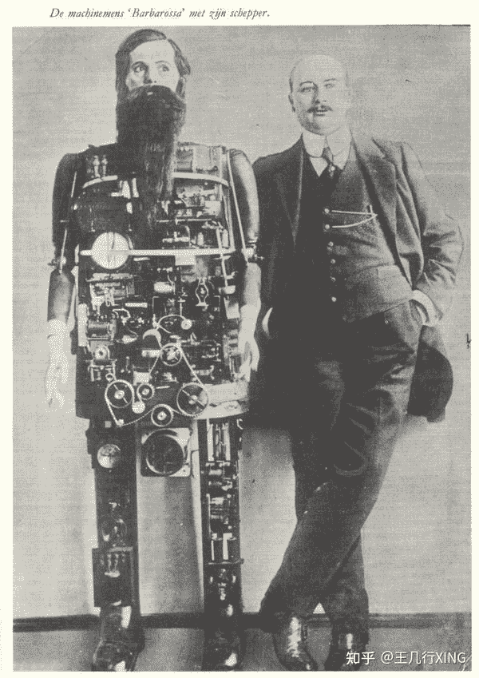

### 1914年

Torres y Quevedo 展示了他改进的机电国际象棋自动机，可以在没有人类干预的情况下进行国际象棋游戏，标志着早期机器智能的突破。

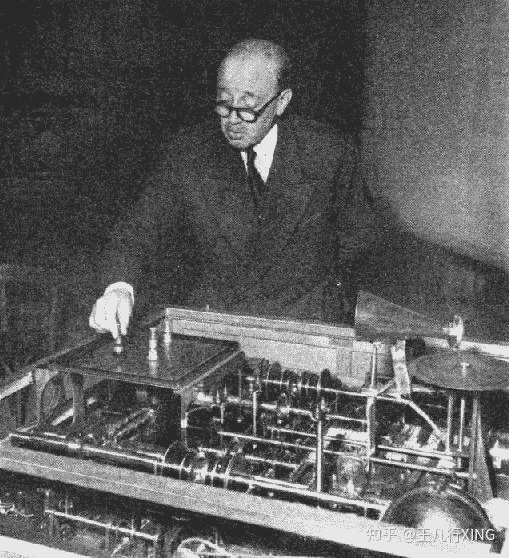

### 1928年

数学家 David Hilbert 提出了“决策问题”，探讨数学陈述是否可以通过算法自动化求解，这一问题推动了计算理论的发展。

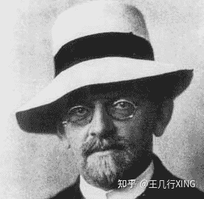

### 1931年

Kurt Gödel 发表了不完备定理，证明了在任何足够强大的公理系统中，总有一些命题无法通过系统内的公理证明或证伪，这对逻辑和计算理论有重大影响。

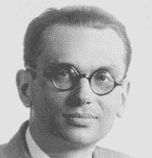

### 1935年

Alonzo Church 证明了一阶逻辑的不可判定性，即并非所有数学问题都能通过算法求解，为计算理论奠定了基础。

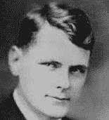

### 1936年 - 1

Alan Turing 提出了图灵机概念，这是一个抽象计算模型，能够模拟任何计算过程，成为计算机科学的核心概念。

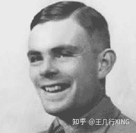

### 1936年 - 2

Alonzo Church 提出了 λ 演算，这是函数定义和应用的数学形式系统，对编程语言设计有深远影响。

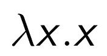

### 1941年

Konrad Zuse 制造了世界上第一台可编程计算机 Z3，能够执行复杂计算，标志着现代计算机的诞生。

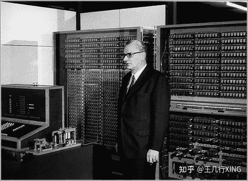

### 1943年

Warren McCulloch 和 Walter Pitts 提出二值神经元模型，模拟生物神经网络的运作机制，是神经网络研究的早期工作。

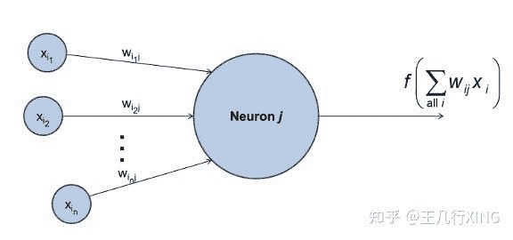

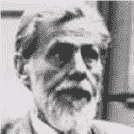

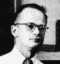

### 1943年

Emil Post 提出了生成规则，进一步发展了算法和计算理论，对形式语言和自动机理论有重要贡献。

### 1945年

John Von Neumann 提出了存储程序架构，即现代计算机的基本架构，允许计算机存储和执行程序。

### 1946年

ENIAC 计算机问世，这是第一台通用电子数字计算机，能够高速执行复杂计算任务，推动了计算机的发展。

### 1946年

首次麦西会议（Macy Conferences）召开，讨论控制论，探讨控制和通信的科学，奠定了人工智能研究的多学科基础。

### 1947年

John Von Neumann 提出了自复制自动机的概念，研究自动系统的自我复制能力，对后来的细胞自动机和复杂系统研究有重要影响。

### 1948年

Norbert Wiener 出版《控制论》一书，定义了控制论这一新兴学科，探讨控制和通信在动物和机器中的相似性。

### 1948年

Alan Turing 在《智能机器》中探讨了机器能否思考的问题，提出了机器智能的早期理论。

### 1950年

Claude Shannon 提出了“计算机下棋”这一设想，探讨用计算机程序模拟棋类游戏，对人工智能的发展有重要启示。

### 1950年

Alan Turing 提出图灵测试作为判断机器是否具有智能的方法，成为人工智能领域的重要基准。

### 1951年

曼彻斯特大学的 Christopher Strachey 和 Dietrich Prinz 编写了国际象棋和西洋跳棋程序，展示了早期的计算机游戏智能。

### 1951年

巴黎召开了“计算机与人类思维”会议，讨论计算机与人类认知的关系，推动了人工智能研究。

### 1952年

首次机器翻译国际会议召开，展示了使用计算机进行语言翻译的潜力，推动了自然语言处理的发展。

### 1954年

Georgetown 大学与 IBM 合作展示了机器翻译系统，能够将俄语句子翻译成英语，标志着机器翻译的早期成功。

### 1955年

Arthur Samuel 开发的西洋跳棋程序首次实现了自学习功能，通过对弈改进其策略，成为机器学习的早期实例。

### 1956年

达特茅斯会议召开，John McCarthy 等人首次正式提出“人工智能”这一术语，标志着人工智能作为独立研究领域的诞生。

### 1957年

Frank Rosenblatt 发明了感知器，这是一个模拟神经元学习过程的算法，对后来的神经网络研究有重大影响。

### 1958年

John McCarthy 发明了LISP编程语言，专为人工智能研究设计，成为人工智能编程的主要语言之一。

### 1959年

John McCarthy 和 Marvin Minsky 在 MIT 成立了人工智能实验室，致力于人工智能研究，培养了大批人工智能领域的专家。

## 第二阶段：1960-1969

### 人工智能发展历史：1960-1969

### 1960年

Henry Kelley 和 Arthur Bryson 发明了反向传播算法，这一算法后来成为训练人工神经网络的关键技术。同年，Donald Michie 设计了 MENACE，这是一个用火柴盒构建的简单强化学习系统，用于下西洋跳棋。Hilary Putnam 发表了《Minds and Machines》一文，提出了计算功能主义理论，认为心智状态可以用计算机程序模拟。

### 1961年

Melvin Maron 提出了“自动索引”方法，改进了信息检索系统的效率。Karl Steinbuch 发明了 Lernmatrix，这是一个早期的神经网络模型，用于模式识别。同年，Leonard Scheer 和 John Chubbuck 开发了 Mod I 和 Mod II 计算机，这些系统后来在航空航天领域得到了应用。Space General Corporation 开发了一种月球探测器，进一步推动了自动控制系统的发展。

### 1962年

IBM 推出了“Shoebox”，这是一个早期的语音识别系统，能够识别和响应少量的英语单词。AMF 公司的“VersaTran”机器人问世，这是一种早期的工业机器人，能够执行简单的装配任务。

### 1963年

John McCarthy 移居斯坦福大学，创立了斯坦福人工智能实验室（SAIL），成为人工智能研究的重要基地。Lawrence Roberts 发表了《三维固体的机器感知》，标志着计算机视觉的诞生。Jim Slagle 开发了一个用于符号积分（微积分）的程序。Edward Feigenbaum 和 Julian Feldman 出版了《计算机与思维》，探讨了计算机模拟人类思维的可能性。同年，Vladimir Vapnik 提出了支持向量网络（SVN），这成为后来支持向量机（SVM）的基础。

### 1964年

Peter Toma 展示了机器翻译系统 Systran，能够实现自动语言翻译，大大推进了自然语言处理领域的发展。

### 1965年

Jack Good 在其文章中首次提出“超智能机器”的概念，预示了“奇点”理论，即机器智能将迅速超过人类智能。Case Institute of Technology 建造了首个计算机控制的机械臂。Ed Feigenbaum 开发了 Dendral 专家系统，用于化学分析。Gordon Moore 提出了著名的摩尔定律，预测集成电路的复杂性每年会翻倍。Herbert Simon 预言“在20年内，机器将能够完成任何人类能做的工作”。Hubert Dreyfus 发表了《炼金术与人工智能》，批评了人工智能的过度乐观。Lotfi Zadeh 提出了模糊逻辑理论，改进了处理不确定性和模糊信息的方法。Alexey Ivakhnenko 发表了第一个多层网络的学习算法。Bruce Lacey 在计算机艺术展览“Cybernetic Serendipity”上展示了他的机器人 Rosa Bosom。

### 1966年

Robert McGhee 开发了“Phony Pony”，这是一个四足机器人。Leonard Baum 推广了隐马尔可夫模型，用于统计推断。Ross Quillian 提出了语义网络，用于表示和处理语言知识。同年，Joe Weizenbaum 开发了著名的对话系统 Eliza，能够模拟心理治疗师的对话模式。ALPAC 报告批评了机器翻译的进展，导致美国政府削减了相关研究资金。

### 1967年

Charles Fillmore 提出了格框语法，为语言学和自然语言处理提供了一种新的句法分析方法。

### 1968年

Glenn Shafer 和 Stuart Dempster 提出了“证据理论”，为处理不确定性提供了新的理论框架。Jerry Feldman 开发了手眼系统，使机器人能够通过视觉引导进行物体操作。

### 1969年

Christopher Longuet-Higgins 提出了联想记忆模型。Marvin Minsky 和 Samuel Papert 在其著作《感知器》中指出了感知器的局限性，导致神经网络研究一度停滞。同年，斯坦福大学召开了第一次国际人工智能联合会议（IJCAI）。斯坦福研究所的 Shakey 机器人问世，这是第一个能够进行自主决策和动作的移动机器人，由 Nils Nilsson 等人开发。Victor Scheinman 设计了“斯坦福臂”，这是一个灵活的机械臂，能够执行复杂的操作任务。Roger Schank 提出了概念依存理论，用于自然语言处理。Cordell Green 开发了程序的自动综合方法。John McCarthy 发表了《从人工智能的角度看哲学问题》，探讨了框架问题。

## 第三阶段：1970-1979

1970年

+   **Albert Uttley **的 Informon 系统用于自适应模式识别，通过模拟生物神经系统处理信息。

+   **Hitachi **展示了一种机器人，可以根据图纸构建物体，展示了工业自动化的潜力。

+   **Tom Martin **创立 Threshold Technology，专注于语音识别技术，推动了语音识别的商业化。

+   **Masakazu Ejiri **开发了 Hivip Mk1 机器人，集成了机器视觉，能够识别和处理视觉信息。

+   **William Woods **提出了增强转换网络（ATN），用于自然语言处理，改进了计算机理解语言的能力。

1971年

+   斯坦福推车（Stanford cart） 成为第一辆自主室外行驶的车辆，标志着自主移动机器人技术的突破。

+   Atsuo Takanishi 设计了 WL-5 和 WL-10R 机器人，这些机器人能够模拟人类步行。

+   **Richard Fikes **和 **Nils Nilsson **开发了 STRIPS 规划器，用于自动生成解决问题的步骤，奠定了人工智能规划领域的基础。

+   **Noam Chomsky **发表文章批评 Burrhus Skinner 的行为主义理论，强调语言的内在结构。

+   Ingo Rechenberg 在其论文《进化策略》中提出了一种用于优化问题的进化计算方法，对进化算法研究具有重要影响。

+   **爱丁堡大学 **制造了 Freddy 机器人，能够在视觉指导下组装复杂的物体，展示了早期的计算机视觉和机器人结合的成果。

1972年

+   Alain Colmerauer 开发了 PROLOG 编程语言，成为逻辑编程的基础，广泛应用于人工智能研究。

+   Kenneth Colby 的聊天机器人 Parry 与 MIT 的 Eliza 进行了首次聊天机器人对话，展示了早期的自然语言处理能力。

+   **Richard Karp **证明了许多问题只能在指数时间内解决，揭示了计算复杂性理论的重要概念。

+   **Harry Klopf **发表了《大脑功能与自适应系统》，提出了生物神经系统的自适应模型。

+   **William Woods **开发了 LUNAR 问答系统，能够回答与月球科学相关的问题，展示了早期的专家系统。

+   **诺丁汉大学 **制造了 SIRCH 机械臂，能够进行精确的装配任务，展示了早期的机器人技术。

+   **Bruce Buchanan **开发了 MYCIN 专家系统，用于诊断细菌感染和推荐治疗方案，成为医学人工智能的里程碑。

+   **Terry Winograd **开发了 Shrdlu 系统，能够理解和执行自然语言指令，展示了计算机与人类语言交互的潜力。

+   **Shigeo Hirose **设计了 ACM III 蛇形机器人，能够在复杂环境中移动，展示了灵活机器人技术。

+   Petternella-Salinari 设计了六足机器人，能够模仿昆虫的步态，展示了仿生机器人技术。

1973年

+   James Lighthill 在《人工智能：一般调查》中批评人工智能过度承诺，导致英国政府减少对 AI 的资助，标志着 AI 研究的第一次寒冬。

+   **Ichiro Kato **设计了 Wabot，这是第一台拟人步行机器人，能够进行简单的步行和操作任务，展示了早期的拟人机器人技术。

+   **Antal Bejczy **开发了 JPL 探测车，用于行星探索，展示了机器人在空间探索中的潜力。

+   **Jim Baker **将隐马尔可夫模型应用于语音识别，大大提高了语音识别的准确性。

1974年

+   **Marvin Minsky **提出了框架理论，用于表示复杂的知识结构，对人工智能的知识表示和推理具有重要影响。

+   **Paul Werbos **发表了用于神经网络的反向传播算法，这一算法后来成为训练多层神经网络的关键技术。

1975年

+   **Roger Schank **提出了剧本理论，解释了人类如何通过预先存储的情景剧本理解和生成语言。

+   **Ben Skora **设计了 Arok 机器人，这是一种多功能家庭机器人，展示了机器人在日常生活中的潜力。

+   **Raj Reddy **团队在卡内基梅隆大学开发了三个语音识别系统：Harpy、Hearsay-II 和 Dragon，推动了语音识别技术的发展。

+   **Hearsay-II **的黑板模型由 Rick Hayes-Roth、Lee Erman、Victor Lesser 和 Richard Fennell 开发，成为多智能体系统的基础。

+   首次医学人工智能研讨会在罗格斯大学举行，标志着人工智能在医学应用中的重要里程碑。

+   **John Holland **提出了遗传算法，这是一种基于自然选择的优化方法，对进化计算研究具有深远影响。

1976年

+   **Richard Laing **提出了通过自检实现自我复制的范式，对自复制系统研究具有重要意义。

+   Stephen Grossberg 提出了自适应共振理论（ART），用于无监督学习，解决了模式识别中的稳定性问题。

+   **Fred Jelinek **发表了《连续语音识别的统计方法》，奠定了统计语音识别的基础。

+   **Shigeo Hirose **设计了 Kumo-I 和 PV-II 机器人，展示了灵活机器人在复杂环境中的应用。

+   **Masha **六足机器人问世，能够模仿昆虫的步态，展示了仿生机器人技术的进步。

1977年

+   **Robert McGhee **设计了仿生虫 Bionic Bug，能够模拟生物的运动方式，展示了仿生机器人技术。

+   **Georges Giralt **在法国开发了 Hilare 机器人，这是一个移动机器人，能够在室内环境中导航。

+   **通用汽车公司 **开发了计算机视觉系统 Sight-I，用于工业自动化，展示了计算机视觉的应用潜力。

+   **Ian Witten **提出了演员-评论员方法，用于强化学习，改进了智能体学习策略。

+   **David Marr **和 **Tomaso Poggio **提出了“2 1/2 草图”理论，解释了人类视觉系统如何从二维图像中提取三维信息。

1978年

+   **John McDermott **开发了专家系统 R1/XCON，用于配置计算机系统，展示了专家系统在工业应用中的潜力。

+   **Shunichi Amari **发表了神经场方程，用于描述神经网络的动力学行为。

+   Ryszard Michalski 开发了第一个实用的从示例中学习的系统 AQ11，推动了机器学习的发展。

+   **通用汽车公司 **在 Lothar Rossol 组织的计算机视觉研讨会上展示了最新进展，推动了计算机视觉的实际应用。

1979年

+   **Johan DeKleer **提出了定性推理理论，用于模拟和解释物理系统的行为。

+   Robert Williams 成为首位被机器人意外致死的工厂工人，凸显了机器人安全的重要性。

+   **通用汽车公司 **开发了 Consight 机器人，用于自动化生产线，展示了机器人在工业自动化中的潜力。

+   **Tokuji Okada **设计了三指机器人手，能够执行精细操作任务，展示了机器人技术的进步。

+   William Clancey 开发了 Guidon 系统，用于医学教育，展示了专家系统在教育中的应用。

+   **Hans Berliner **使用 BKG 9.8 系统在 Monte Carlo 击败世界西洋双陆棋冠军，展示了计算机在游戏中的能力。

+   **Drew McDermott **提出了非单调逻辑，用于处理不确定性和推理中的变化。

+   Kunihiko Fukushima 发表了卷积神经网络 Neocognitron，能够进行模式识别，奠定了深度学习的基础。

## 第四阶段：1980-1989

### 1980年

+   **John McCarthy **提出了限界推理，提供了一种处理不完全信息和资源受限情况下进行推理的方法。这一理论改进了人工智能系统在不确定和动态环境中的表现，拓展了 AI 在实际应用中的范围。

---

+   **Jo**hn Searle 提出了“中文房间”思想实验，质疑计算机是否能真正“理解”语言，而不仅仅是机械地处理符号。他认为机器缺乏真正的意识和理解能力，这一论点引发了关于人工智能本质的广泛讨论。

约翰·塞尔（John Searle）在其文章《心灵、大脑与程序》中提出了“中文房间”思想实验，以质疑计算机和人工智能的理解能力。这个思想实验旨在反驳强人工智能（Strong AI）的观点，即认为计算机不仅可以模拟人的思维过程，还能真正理解和拥有意识。

**思想实验的设定 **：

+   设想一个不懂中文的英语母语者被关在一个房间里。

+   房间内有一本详细的手册，里面记载了如何根据输入的中文字符，按照一定的规则生成相应的中文输出字符。

+   外面的人通过窗口向房间内递交中文问题（输入），房间内的人根据手册将问题转换为答案（输出），然后将答案递出去。

**操作过程 **：

+   房间内的人通过手册中的规则，机械地处理中文输入并生成中文输出。

+   尽管房间外的人认为房间内的“系统”能理解中文，但实际上房间内的人并不理解中文。他只是根据预定的规则进行符号操作。

**实验目的 **：

+   通过这个实验，塞尔试图证明：即使计算机能够通过操作符号（比如中文字符）生成合理的答案，也并不意味着它真正理解这些符号的含义。

+   计算机和房间内的人一样，只是在进行符号操作，并不具备真正的理解和意识。

**思想实验的核心论点 **：

+   **语法与语义的区分 **：计算机只能处理语法（符号操作），但不能理解语义（符号的意义）。

+   **强人工智能的反驳 **：强人工智能认为机器可以拥有思维和理解能力，塞尔则认为机器的符号操作不等同于理解。

**批评与回应 **：

+   系统论（Systems Reply） ：批评者认为，虽然房间内的人不理解中文，但整个系统（包括人、手册、房间）理解中文。塞尔回应说，即使整个系统也不具备真正的理解，因为系统内部的每个部分都不理解中文。

+   机器人论（Robot Reply） ：另一种批评认为，若将房间内的人换成一个有感知能力的机器人，并让它与外界互动，那么它可能具备理解能力。塞尔反驳说，即便机器人有感知能力，其内部处理仍然只是符号操作，不等同于理解。

通过“中文房间”思想实验，塞尔提出了对人工智能理解能力的深刻质疑，指出当前的计算机程序在符号操作方面可能达到人类水平，但在真正理解和意识方面仍然存在本质的差距。这一思想实验在人工智能哲学领域引发了广泛讨论和争论，对理解计算机和人类思维的本质有重要启示。

---

+   IntelliGenetics 成立，成为首家专注于生物信息学和人工智能的初创公司，标志着人工智能在商业和生物医学领域的应用开始兴起。

### 1981年

+   **Automatix **推出了首个带有视觉系统的商用机器人，能够在工业生产中进行复杂的装配和检查任务，展示了计算机视觉技术在实际工业中的应用潜力。

+   Russell Andersson 设计了 SCIMR 机器人，具备执行复杂任务的能力，进一步推动了智能机器人技术的发展。

+   **Danny Hillis **开发了连接机器，这是一种大规模并行计算机，采用了数千个处理器并行工作的架构，为并行计算领域开辟了新的研究方向。

+   **Hans Kamp **提出了话语表示理论，改进了自然语言理解，特别是语言在上下文中的动态变化。

### 1982年

+   Shunichi Mizuno 开发了 cybot New Monroe 机器人，展示了具有自主学习能力的机器人技术。

+   **Hans Moravec **在卡内基梅隆大学开发了 Rover 探测车，能够在复杂环境中进行自主导航。

+   Kenneth Salisbury 和喷气推进实验室合作开发了机械手，提高了机器人的操作精度和灵活性。

+   **John Hopfield **描述了基于递归的神经网络，提出了 Hopfield 网络，用于解决组合优化问题。

+   **加拿大高级研究所 **成立了人工智能和机器人学项目，旨在推动人工智能基础研究。

+   **Bart Everett **开发了 Robart I 机器人，具备自主导航和决策能力。

+   **日本启动 **第五代计算机系统项目，旨在开发基于并行处理和逻辑推理的新型计算机。

+   **Teuvo Kohonen **提出了自组织映射（SOM），用于无监督学习，改进了数据分类和聚类方法。

+   **Judea Pearl **提出了贝叶斯网络，用于概率推理和决策支持。

+   **David Parker **重新发现了反向传播算法，推动了神经网络训练技术的发展。

+   Joseph Bosworth 开发了个人机器人 RB5X，具备一定的自主学习能力。

### 1983年

+   **Dainichi Kiko **开发了侍者机器人，展示了服务机器人的潜力。

+   Scott Kirkpatrick 提出了模拟退火算法，用于解决复杂优化问题，模拟物理退火过程中的能量最小化。

+   **Mike Cohen **和 Stephen Grossberg 提出了连续递归网络，用于动态系统建模。

+   **Yurii Nesterov **提出了加速梯度下降法（Nesterov 动量），显著提高了优化算法的收敛速度。

+   **John Laird **和 Paul Rosenbloom 开发了 SOAR 认知架构，旨在模拟人类的思维过程。

+   Geoffrey Hinton 和 Terry Sejnowski 开发了玻尔兹曼机，用于概率模型和无监督学习。

+   **Gerard Salton **和 **Michael McGill **出版了《现代信息检索导论》，介绍了词袋模型和向量空间模型。

+   **Odetics **开发了 Odex 机器人，具备复杂的运动能力和任务执行能力。

### 1984年

+   **Tomy **推出了玩具机器人 Omnibot 2000，具备简单的遥控和编程功能。

+   **Mike Forino **开发了个人机器人 Hubot，具备一定的家庭服务功能。

+   Valentino Braitenberg 出版了《载具》，探讨了简单机械系统中的行为与复杂行为的关系。

+   Stephen Jacobsen 和麻省理工学院开发了机械手，提高了机械手在复杂操作中的精度和灵活性。

+   **Doug Lenat **启动了 Cyc 项目，旨在建立一个涵盖常识知识的大规模知识库，为人工智能提供推理和理解的基础。

+   Barbara Hayes-Roth 开发了通用黑板系统 BB1，改进了多智能体系统的协调和通信能力。

### 1985年

+   **Ichiro Kato **开发了 Wasubot 机器人，并与交响乐团合作表演，展示了机器人在艺术和娱乐领域的应用潜力。

+   **Ross Quinlan **开发了 ID3 算法，用于决策树分析，改进了机器学习中的分类问题解决方法。

+   **第一届国际遗传算法会议 **举行，促进了遗传算法研究和应用的交流与发展。

+   **Piero Scaruffi **在 Olivetti 开设了人工智能中心，这是美国以外首个主要的非学术人工智能中心，推动了人工智能的国际化发展。

+   **Yann LeCun **重新发现了反向传播算法，推动了神经网络的训练和应用。

+   **Rodney Brooks **提出了机器人下层控制架构，强调分布式控制和行为驱动的机器人设计。

### 1986年

+   Terrence Sejnowski 和 Charles Rosenberg 开发了 NETtalk，用于语音生成，展示了神经网络在自然语言处理中的应用。

+   **Hinton **和 **Sejnowski **在卡内基梅隆大学组织了第一次连接主义暑期学校，推动了神经网络和连接主义的研究。

+   **Jeanny Herault **和 Christian Jutten 提出了独立成分分析，用于信号分离和特征提取。

+   **David Zipser **提出了自编码器，用于降维和特征提取，改进了无监督学习方法。

+   David Rumelhart ， Geoffrey Hinton 和 Ronald Williams 重新发现了反向传播算法，推动了多层神经网络的训练技术。

+   Da**vid Rumelhart 和** Jay McClelland 出版了《并行分布式处理》一书，探讨了神经网络和连接主义模型。

+   **Paul Smolensky **提出了限制玻尔兹曼机，用于概率图模型和无监督学习。

+   **Barbara Grosz **出版了《注意、意图与话语结构》，探讨了自然语言理解中的语境和意图识别。

### 1987年

+   **Hinton **加入了加拿大高级研究所（CIFAR），进一步推动了神经网络和机器学习的研究。

+   **Dana Ballard **使用无监督学习逐层构建表示，改进了计算机视觉和模式识别方法。

+   **Chris Langton **创造了“人工生命”一词，开创了新的研究领域，探索生命现象的模拟。

+   **Marvin Minsky **出版了《心智社会》，提出了心智是由许多小代理人组成的理论，解释了复杂行为的产生。

### 1988年

+   **Hilary Putnam **发表文章质疑人工智能对心智研究的贡献，认为计算机模拟不能完全解释人类心智。

+   **Toshio Fukuda **开发了自我重构机器人 CEBOT，能够根据任务需求改变形态，展示了灵活机器人技术。

+   **Dean Pomerleau **开发了自驾车 ALVINN，能够在公路上自动驾驶，展示了自动驾驶技术的潜力。

+   **Hans Moravec **出版了《心智的孩子们》，预测了机器人和人类的未来关系，讨论了机器智能的发展前景。

+   **Philip Agre **开发了 Heideggerian AI 系统 Pengi，用于玩街机游戏 Pengo，展示了情境感知的人工智能系统。

+   **Fred Jelinek **团队在 IBM 发表了《语言翻译的统计方法》，奠定了现代机器翻译的基础，推动了自然语言处理的发展。

### 1989年

+   **Alex Waibel **开发了时延神经网络，用于语音识别。

+   **Chris Watkins **提出了 Q 学习算法，用于强化学习。

+   **Rodney Brooks **设计了六足机器人 Genghis，展示了移动机器人技术的进步。

+   **Yann LeCun **将反向传播应用于卷积网络，用于监督学习，开发了手写数字识别的 LeNet-1。

+   **George Cybenko **证明了神经网络可以近似任何连续函数，奠定了神经网络作为通用函数逼近器的理论基础。

+   **Kurt Hornik **证明了神经网络是通用逼近器，进一步支持了神经网络的理论发展。

## 第五阶段：1990-19991990年

+   **Carver Mead **描述了神经形态处理器，这种处理器模仿生物神经系统，通过模拟电路进行计算，实现低功耗和高效率的计算。神经形态处理器在传感和控制任务中表现出色，对生物启发的计算具有重大影响。

+   **Robert Jacobs **提出了“专家混合”架构，这种架构通过结合多个专家模型，提高了预测的准确性。专家混合模型将不同专家模型的预测结果进行加权平均，使得整体模型在处理复杂数据和多维度问题时表现更加出色，广泛应用于机器学习和数据挖掘领域。

+   Robert Schapire 提出了提升（boosting）算法，这是一种集成学习方法，通过训练多个弱分类器并将其组合成一个强分类器，显著提高了模型的性能和准确性。提升算法在许多应用中取得了成功，成为机器学习领域的经典技术。

+   **Jordan Pollack **开发了递归自联想记忆（RAAM），这种神经网络模型能够通过递归方式对数据进行编码和解码，有效表示和处理嵌套和递归的数据结构。RAAM 技术在自然语言处理和认知建模中具有重要应用。

+   **Peter Brown **在 IBM 实现了统计机器翻译系统，通过分析大量双语文本数据，学习语言之间的翻译模式，实现高质量的自动翻译。这一技术显著提高了机器翻译的准确性和实用性，推动了自然语言处理的发展。

+   **Ray Kurzweil **出版了《智能机器时代》一书，讨论了人工智能的潜力和可能的社会影响，预测了未来计算机将具有人类水平的智能，并探讨了这一技术进步对社会、经济和文化的深远影响。

### 1991年

+   **Isabelle Guyon **采用了 Vapnik 的支持向量机（SVM）用于模式分类，支持向量机通过寻找最佳超平面，将不同类别的数据分隔开来，实现高效准确的分类。这一技术在图像识别、文本分类和生物信息学等领域得到了广泛应用。

### 1992年

+   Ha**va Siegelmann 和** Eduardo Sontag 证明了递归神经网络等价于图灵机，表明神经网络具有通用计算能力，能够模拟任何图灵机，进一步推动了神经网络在计算理论和实际应用中的发展。

+   **Ron Williams **提出了 REINFORCE 算法，这是一种用于强化学习的策略梯度方法，通过直接估计策略的梯度来优化决策过程，广泛应用于机器人控制和游戏 AI 等领域，提高了智能体在复杂环境中的学习效率。

+   **Long-ji Lin **提出了“经验回放”算法，用于强化学习，通过存储和重用过去的经验，使智能体能够更好地利用历史数据进行学习，显著提高了强化学习算法的性能和稳定性。

### 1993年

+   **Masayuki Inaba **开发了远程大脑机器人，通过远程处理实现复杂任务，分布式计算在机器人技术中的应用潜力得到展示，提高了机器人的计算能力和任务执行效率。

+   **Rodney Brooks **开发了 Cog 机器人，模拟人类感知和运动控制，通过集成多个传感器和执行器，Cog 机器人能够进行复杂的感知和运动任务，展示了人工智能在机器人感知和控制中的应用前景。

+   **Tom Mitchell **开发了 Xavier 机器人，具备自主导航和任务执行能力，结合了路径规划、避障和任务执行等功能，能够在复杂环境中自主完成各种任务，展示了移动机器人技术的进展。

### 1994年

+   **首次“通向意识科学”会议 **在亚利桑那州图森市举行，汇集了神经科学、心理学和哲学等领域的专家，讨论了意识的本质、产生机制以及在人工智能中的模拟方法，推动了意识研究的多学科交流与合作。

+   Ernst Dickmanns 的无人驾驶汽车在巴黎戴高乐机场附近行驶了超过1000公里，展示了自动驾驶技术的潜力，通过集成计算机视觉和传感器技术，实现了车辆的自主导航和避障，标志着无人驾驶技术的重要里程碑。

+   Jonathan Schaeffer 的 Chinook 程序赢得了世界西洋双陆棋冠军，通过穷举搜索和优化算法，Chinook 能够在西洋双陆棋比赛中战胜人类顶尖选手，展示了计算机在策略游戏中的强大能力。

### 1995年

+   **Tin-kam Ho **提出了随机决策森林算法，通过在训练数据的不同子集上训练多棵决策树，并通过投票机制进行预测，显著提高了分类器的鲁棒性和准确性，广泛应用于图像识别、金融预测等领域。

+   **David Wolpert **提出了第一个“无免费午餐”定理，表明在所有可能的优化问题中，任何两个优化算法的性能在平均意义上是相同的，这一结论揭示了优化算法选择的重要性和复杂性。

### 1996年

+   **本田 **推出了 P2 仿人机器人，具备双足行走和多关节运动能力，能够在复杂地形上进行自主行走，展示了人形机器人在运动控制和协调方面的技术突破。

+   **David Field **和 Bruno Olshausen 提出了稀疏编码理论，通过假设神经信号的稀疏性，提高了信号表示的效率和鲁棒性，稀疏编码理论对神经科学和计算机视觉研究具有重要影响。

+   Atsuo Takanishi 开发了 Wabian 仿人机器人，进一步改进了机器人步态和平衡控制，Wabian 机器人通过集成先进的传感器和控制算法，实现了更自然和稳定的步态，展示了人形机器人在运动控制方面的进展。

### 1997年

+   **Mikel Forcada **和 **Ramon Neco **提出了用于机器翻译的编码器-解码器模型，通过将输入序列编码为固定长度的向量，再解码为目标序列，显著提高了机器翻译的质量和灵活性，广泛应用于翻译、文本摘要等任务。

+   Jürgen Schmidhuber 和 Sepp Hochreiter 开发了长短期记忆（LSTM）模型，LSTM 通过引入记忆单元和门控机制，有效解决了传统循环神经网络在处理长序列数据时的梯度消失问题，被广泛应用于语音识别、机器翻译等领域。

+   **NASA **的 Mars Pathfinder 着陆火星，并部署了首个漫游机器人 Sojourner，具备自主导航和科学探测能力，成功完成了多项火星表面任务，展示了机器人技术在行星探索中的应用潜力。

+   IBM 的 Deep Blue 国际象棋计算机击败了世界象棋冠军 Garry Kasparov，结合深度搜索和启发式算法，实现了高水平的国际象棋对弈能力，标志着人工智能在复杂博弈中的突破。

### 1998年

+   **Yann LeCun **开发了 LeNet-5，用于手写数字识别，LeNet-5 通过多层卷积和池化操作，实现了对手写数字的高效识别，成为卷积神经网络的经典模型，广泛应用于计算机视觉领域。

+   Sebastian Thrun 开发了 Minerva 和 Pearl 机器人，展示了机器人在博物馆导览中的应用，机器人具备自主导航和交互能力，能够为参观者提供导览服务，展示了服务机器人在公共场所的潜力。

+   Thorsten Joachims 发表了《支持向量机的文本分类》，提出了基于支持向量机的文本分类方法，显著提高了文本处理中的分类性能，这一方法在信息检索和自然语言处理领域得到了广泛应用。

+   斯坦福大学的 Sergey Brin 和 Larry Page 发表了《大型超文本网络搜索引擎的解剖》，并推出了搜索引擎 Google，采用了基于网页链接结构的 PageRank 算法，革命性地改变了信息检索技术和互联网搜索体验。

## 第六阶段：2000-2009

### 2000年

+   Cynthia Breazeal 的 Kismet 机器人 ：Kismet 是一个能够表达情感的机器人，旨在与人类进行情感交流和互动。Kismet 通过面部表情、头部动作和声音表达情感，展示了情感计算的潜力。

+   Seth Lloyd 的“计算的最终物理极限” ：Lloyd 探讨了计算的物理极限，提出量子计算机在理论上可以利用物理系统的基本特性实现极高效的计算。

+   Hirochika Inoue 的 H6 仿人机器人 ：H6 是一个能够执行复杂任务的仿人机器人，展示了人形机器人在工业和服务领域的应用潜力。

+   **本田的 Asimo 机器人 **：Asimo 是一个高度先进的仿人机器人，具备流畅的步行和跑步能力，能够在人类环境中进行互动，展示了人形机器人的技术进展。

### 2001年

+   Juyang Weng 的“机器人和动物的自主心理发展” ：Weng 提出了通过与环境互动，机器人和动物可以实现自主心理发展的理论，强调了学习和适应能力的重要性。

+   Herbert Jaeger 的回声状态网络 ：回声状态网络是一种新型的递归神经网络，能够高效地处理时序数据，应用于语音识别和时间序列预测。

+   Nikolaus Hansen 的 CMA-ES 演化策略 ：Hansen 提出了协方差矩阵适应演化策略（CMA-ES），一种用于解决非线性优化问题的演化算法，表现出色。

+   Yoshua Bengio 的神经概率语言模型 ：Bengio 提出了神经概率语言模型，通过结合神经网络和概率模型，提高了自然语言处理的性能。

### 2002年

+   iRobot 的 Roomba ：Roomba 是一款自动化的家用清洁机器人，能够自主导航和清洁地面，成为商用机器人的成功案例。

+   **Wolfgang Maass 和 H**enry Markram 的液态状态机 ：液态状态机是一种模拟大脑皮层神经活动的计算模型，能够处理动态和复杂的时序数据。

+   Ronan Collobert 开发的深度学习平台 Torch ：Torch 是一个开源的深度学习平台，提供了灵活和高效的神经网络开发工具，推动了深度学习研究的发展。

### 2003年

+   Hiroshi Ishiguro 的 Actroid 机器人 ：Actroid 是一个外形逼真的仿人机器人，能够模仿人类的表情和动作，用于人机交互和娱乐。

+   **Jackrit Suthakorn 和 Gregory **Chirikjian 的自主复制机器人 ：他们开发了一个能够自主复制的机器人，展示了自我复制技术的潜力和挑战。

+   Gabriela Csurka 的特征包模型 ：特征包模型是一种图像分类方法，通过将图像分解为特征包进行表示，提高了图像识别的准确性。

+   Tai-Sing Lee 的视觉皮层层次贝叶斯推理 ：Lee 提出了层次贝叶斯模型，用于解释视觉皮层如何处理和推理视觉信息，推动了计算神经科学的发展。

+   DARPA 对语音识别进展的评估 ：DARPA 评估了语音识别技术的进展，强调了在噪声环境和多语言情况下提高识别准确性的挑战。

+   Klaus Loeffler 的 Johnnie 仿人机器人 ：Johnnie 是一个具备灵活运动能力的仿人机器人，展示了在运动控制和协调方面的技术进展。

### 2004年

+   Mark Tilden 的 Robosapien ：Robosapien 是一个仿生机器人，能够执行多种动作和任务，具有较高的娱乐性和实用性，广泛应用于教育和娱乐领域。

### 2005年

+   Jun-ho Oh 的 Hubo 仿人机器人 ：Hubo 是一个高度灵活的仿人机器人，能够执行复杂任务，并在多个国际机器人竞赛中获得奖项，展示了仿人机器人技术的进步。

+   Hod Lipson 的“自组装机器” ：Cornell 大学的 Lipson 开发了一种能够自我组装和自我修复的机器人系统，展示了未来自适应和自修复机器人的可能性。

+   Patrice Simard 使用 GPU 实现神经网络 ：Simard 展示了利用图形处理单元（GPU）来加速神经网络训练的技术，大大提高了深度学习模型的训练速度和效率。

+   Andrew Ng 在斯坦福大学启动了 STAIR 项目 ：该项目旨在开发一个具备多种功能的智能机器人，能够在复杂环境中执行任务，推动了通用人工智能的发展。

+   **S**ebastian Thrun 的无人驾驶车 Stanley 赢得 DARPA Grand Challenge ：Stanley 成功完成了无人驾驶越野比赛，标志着自动驾驶技术的重大突破。

+   **Pietro Perona 和 **Fei-Fei Li 的贝叶斯层次模型 ：该模型用于学习自然场景分类，显著提高了图像分类的准确性，推动了计算机视觉的发展。

+   Boston Dynamics 的四足机器人 BigDog ：BigDog 是一个能够在复杂地形上行走和奔跑的四足机器人，展示了仿生机器人在军事和救援中的潜力。

### 2006年

+   Geoffrey Hinton 的深度信念网络（DBN） ：Hinton 提出了深度信念网络及其快速学习算法，为深度学习的突破奠定了基础。

+   **蒙特卡洛树搜索算法 **：这一算法广泛应用于博弈论和规划问题，尤其在围棋和其他复杂游戏中表现出色。

+   Scott Hassan 创立 Willow Garage ：这家机器人初创公司致力于开发开源机器人操作系统（ROS）和先进的机器人技术。

+   Alex Graves 的连接时序分类（CTC） ：CTC 是一种用于处理可变长度序列数据的算法，在语音识别和手写识别中取得了重要应用。

+   Osamu Hasegawa 的自组织增量神经网络（SOINN） ：SOINN 是一种用于无监督学习的自适应神经网络，能够处理动态和不确定性数据。

### 2007年

+   Yoshua Bengio 的堆叠自编码器 ：Bengio 提出了分层训练深度网络的方法，显著提高了深度学习模型的性能和效率。

+   斯坦福大学推出机器人操作系统（ROS） ：ROS 是一个开源的机器人操作系统，提供了丰富的开发工具和库，广泛应用于机器人研究和开发。

### 2008年

+   Dharmendra Modha 在 IBM 启动神经形态处理器项目 ：Modha 的团队致力于开发模拟人脑结构和功能的计算设备，推动了神经形态计算的发展。

+   Oriza Hirata 的戏剧作品“我工作者” ：这部戏剧首次引入机器人作为演员，探索了人类与机器人的互动关系，具有重要的社会和文化意义。

+   **Cynthia Breazeal 团队在 MI**T Media Lab 推出 Nexi ：Nexi 是首个具备移动、灵活和社交能力的机器人，能够进行复杂的情感交流和任务执行。

### 2009年

+   Fei-Fei Li 的 ImageNet 数据库 ：ImageNet 是一个包含数百万张人类标记图像的大型数据库，为计算机视觉和深度学习提供了丰富的训练数据，推动了图像识别技术的发展。

+   DARPA 对语音识别进展的评估 ：DARPA 评估了语音识别技术的最新进展，特别是在多语种和复杂环境中的应用，提高了语音识别系统的鲁棒性和准确性。

## 第七阶段：2010-2019

### 2010年

+   **ImageNet挑战赛 **：设立新的视觉识别基准，为计算机视觉研究设立了标准。

+   **DeepMind **：由Demis Hassabis、Shane Legg和Mustafa Suleyman创立，专注于AI研究。

+   **算法交易事件 **：纽约股市因算法交易引发的闪电崩盘而关闭，损失一万亿美元。

+   **云机器人 **：James Kuffner提出的术语，指通过云计算增强机器人的能力。

+   **可折叠编程材料 **：Daniela Rus开发的可编程材料，可通过折叠改变形状和功能。

+   **Nao机器人 **：Lola Canamero开发，能够展示情感的机器人。

### 2011年

+   Trimit (Summly) ：由Nick D'Aloisio开发的摘要工具，可自动生成文章摘要。

+   **深度学习语音识别 **：Dong Yu在语音识别领域的进展，将深度学习应用于此。

+   **IBM的Watson **：在电视问答节目中与人类选手竞争并获胜。

+   **基于SOINN的机器人 **：Osamu Hasegawa开发的机器人，可独立学习和适应新任务。

### 2012年

+   **Baxter **：Rodney Brooks开发的可编程工业机器人，适用于制造业。

+   **开放源代码机器人基金会 **：成立，促进机器人技术的开源发展。

+   **无监督神经网络 **：Andrew Ng的团队通过视频数据训练神经网络，识别视频中的猫。

+   **AlexNet **：Alex Krizhevsky和Ilya Sutskever展示的神经网络模型，在计算机视觉领域取得突破。

### 2013年

+   **序列到序列学习 **：Nal Kalchbrenner和Phil Blunsom提出的机器翻译方法。

+   **深度Q网络 **：Volodymyr Mnih开发，结合深度学习和强化学习，实现智能体在复杂环境中的学习。

+   **变分自编码器 **：Max Welling和Diederik Kingma开发的生成模型，可用于数据生成和特征学习。

+   **Word2vec **：Tomas Mikolov提出的词向量模型，在自然语言处理领域广泛应用。

+   **Caffe **：Yangqing Jia开发的深度学习框架，简化了深度学习模型的训练和部署。

+   **R-CNN **：Ross Girshick开发的区域卷积神经网络，用于目标检测。

+   **《智能不是人工的》 **：Piero Scaruffi撰写的书籍，讨论了人工智能的哲学和技术问题。

### 2014年

+   Eugene Goostman ：Vladimir Veselov和Eugene Demchenko开发的程序，通过了图灵测试。

+   **VGG-16 **：Karen Simonyan和Andrew Zisserman创建的深度卷积神经网络，用于图像分类。

+   **GRU和编码-解码模型 **：Kyunghyun Cho开发的循环神经网络和翻译模型。

+   **GoogLeNet **：Christian Szegedy设计的卷积神经网络，在ImageNet挑战赛中表现出色。

+   **递归注意模型 **：Volodymyr Mnih开发的注意力机制，用于提高图像描述的准确性。

+   **GAN **：Ian Goodfellow提出的生成对抗网络，用于图像生成。

+   **无HMM的LSTM **：Alex Graves开发的长短期记忆网络，去除了隐马尔可夫模型。

+   **序列到序列学习 **：Ilya Sutskever和Oriol Vinyals在谷歌实现的序列到序列模型，用于机器翻译。

+   **小冰 **：微软在中国推出的文本聊天机器人，能进行自然对话。

+   **深度视觉-语义对齐 **：Andrey Karpathy和Fei-Fei Li提出的方法，将图像和文本对齐。

+   **神经图灵机 **：Alex Graves、Greg Wayne和Ivo Danihelka开发的神经网络，结合外部存储器。

+   **记忆网络 **：Jason Weston、Sumit Chopra和Antoine Bordes开发的网络，用于问答系统。

+   **实时口语翻译 **：微软的Skype展示的实时语音翻译技术。

+   **DeepMind收购 **：谷歌收购了DeepMind，加强其在人工智能领域的研究。

### 2015年

+   **Deep Speech 2 **：百度开发的语音识别系统，使用GRU提高识别精度。

+   **Keras **：Francois Chollet开发的深度学习框架，简化了神经网络的构建和训练。

+   **152层残差网络 **：微软开发的深度残差网络，大幅提升了图像分类性能。

+   **TensorFlow **：Rajat Monga团队开发的开源深度学习框架，被广泛应用于机器学习研究。

+   **Chainer **：Seiya Tokui开发的深度学习框架，支持动态计算图。

+   **禁止进攻性自主武器 **：AI科学家发布公开信，呼吁禁止开发和使用自主武器。

+   **艺术风格的神经算法 **：Leon Gatys、Alexander Ecker和Matthias Bethge提出的算法，可将图像转换为艺术风格。

+   **深度卷积GAN **：Alec Radford提出的生成对抗网络，用于生成逼真的图像。

### 2016年

+   **深度与宽度 **：Ronen Eldan和Ohad Shamir证明深度神经网络比宽度神经网络更具表达能力。

+   **AlphaGo **：DeepMind开发的围棋程序，击败围棋大师李世石，展示了AI的强大能力。

+   **具有身份映射的ResNet **：Kaiming He开发的1001层残差网络，通过身份映射解决了深度网络训练中的梯度消失问题。

+   **自注意力 **：Jianpeng Cheng和Mirella Lapata提出的注意力机制，用于提高自然语言处理的性能。

### 2017年

+   **Transformer模型 **：谷歌开发的用于句子分析的模型，消除了循环神经网络的局限性。

+   AlphaGo Zero和AlphaZero ：DeepMind开发的围棋和多游戏AI，无需人类数据即可自我学习。

+   **Pix2pix **：Alexei Efros团队提出的图像到图像转换框架，用于图像生成和风格迁移。

+   **GAN变体 **：2017年引入超过100种生成对抗网络变体，用于各种生成任务。

+   **DeepL **：Linguee推出的免费翻译工具，以高质量翻译著称。

+   **邻近策略优化 **：John Schulman提出的强化学习算法，改进了策略优化的效率和稳定性。

### 2018年

+   **生成查询网络（GQN） **：Ali Eslami和Danilo Rezende开发的模型，可从多个视角生成新视图。

+   **OpenAI Five **：OpenAI开发的Dota 2游戏AI，展示了团队协作能力。

+   **非局部神经网络 **：Xiaolong Wang开发的模型，通过非局部操作提高了视频理解的准确性。

+   **ULMFiT **：Jeremy Howard和Sebastian Ruder提出的迁移学习方法，大幅提升了文本分类性能。

+   **神经ODE **：David Duvenaud开发的常微分方程神经网络，用于连续时间序列建模。

+   **BERT **：Jacob Devlin提出的双向编码器表示模型，在阅读理解任务中表现出色。

### 2019年

+   **GPT-2 **：OpenAI开发的大型语言模型，可生成令人信服的长文文本。

+   **AlphaStar **：DeepMind开发的《星际争霸II》AI，展示了在复杂战略游戏中的高超技巧。

## 第八阶段：2020-2024

### 2020年

+   **GPT-3 **：OpenAI开发的庞大语言模型，具有1750亿个参数，能够生成高度连贯的文本。

+   **聊天机器人Meena **：Daniel Adiwardana和Thang Luong在谷歌开发，能进行更自然的对话。

+   Neural Radiance Fields (NeRF) ：谷歌提出的技术，利用神经网络生成逼真的3D场景。

### 2021年

+   **AlphaFold 2 **：DeepMind开发，解决了蛋白质结构预测的难题，在生物学领域取得重大突破。

+   **DALL-E **：OpenAI开发的图像生成模型，可根据文本描述生成高质量图像。

+   **Codex **：OpenAI开发的编程助手，能够根据自然语言描述生成代码。

### 2022年

+   **LaMDA **：谷歌开发的对话模型，旨在提供更自然的对话体验。

+   **Gato **：DeepMind推出的通用AI系统，可在多种任务中表现出色。

+   Stable Diffusion ：Stability AI推出的文本到图像生成模型，广泛用于图像生成。

### 2023年

+   **ChatGPT-4 **：OpenAI推出的新版聊天模型，在对话能力和文本生成方面取得显著进步。

+   **AlphaTensor **：DeepMind开发的AI系统，优化了矩阵乘法算法，提升了计算效率。

+   **Gemini **：谷歌推出的新一代AI模型，在多个领域展示了卓越的性能。

参考来源：

1， [A Timeline of Art](https://link.zhihu.com/?target=https%3A//www.scaruffi.com/mind/ai1950.html)ificial Intelligence

2，Wikipedia