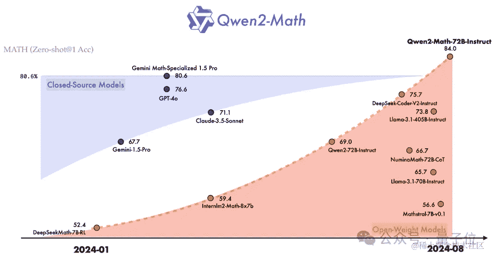
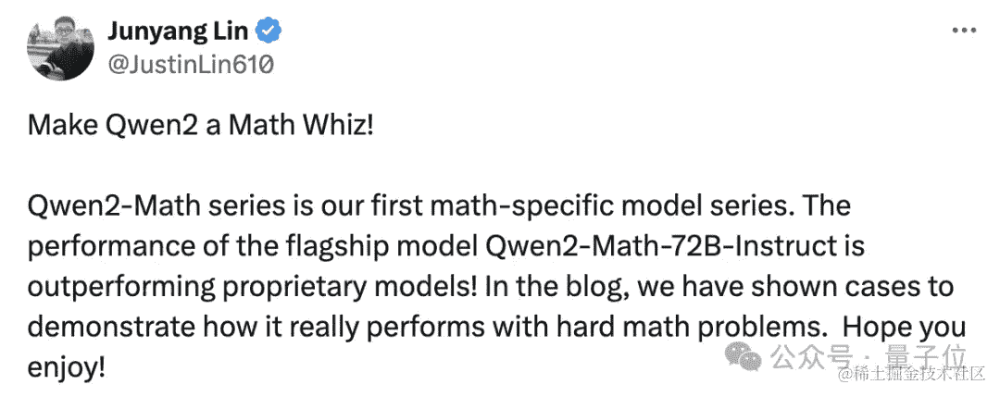
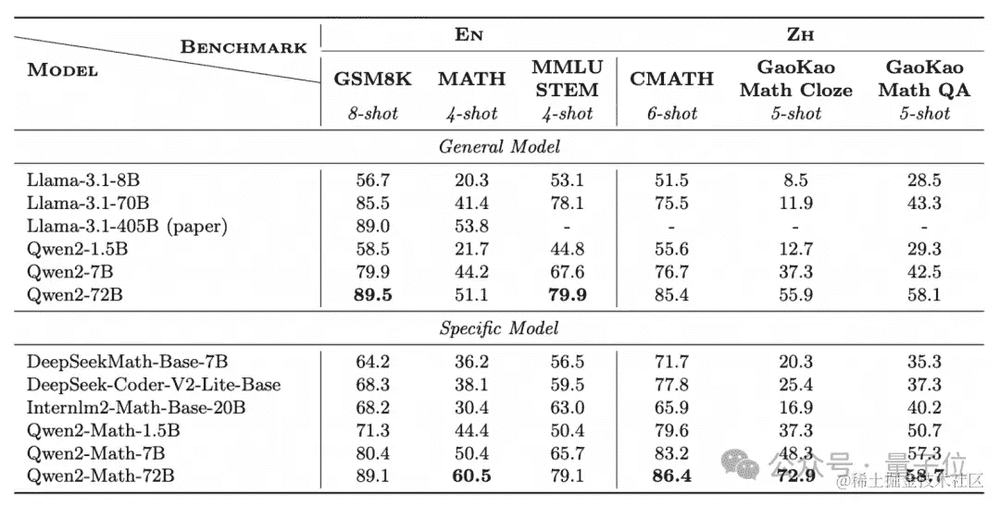
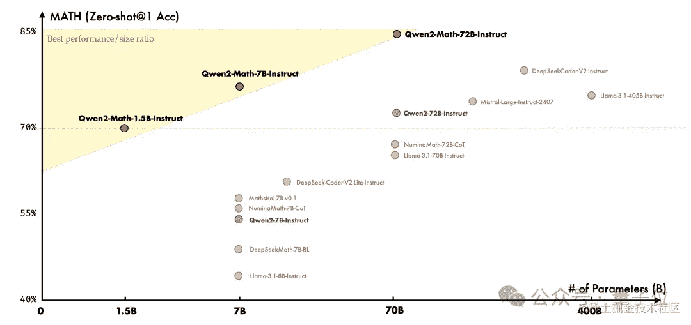
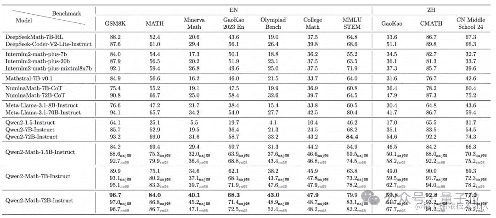
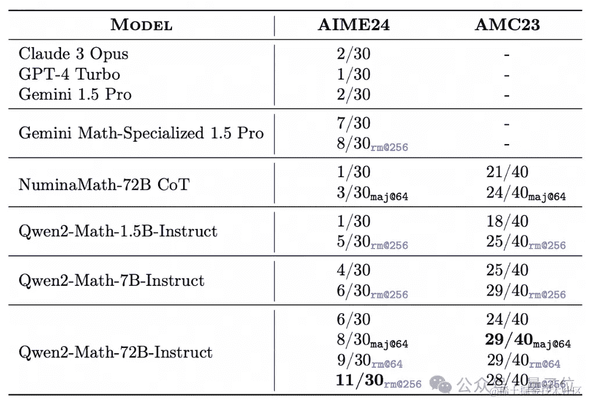
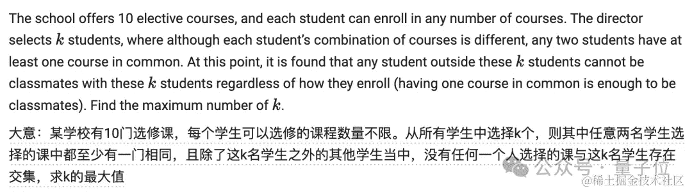
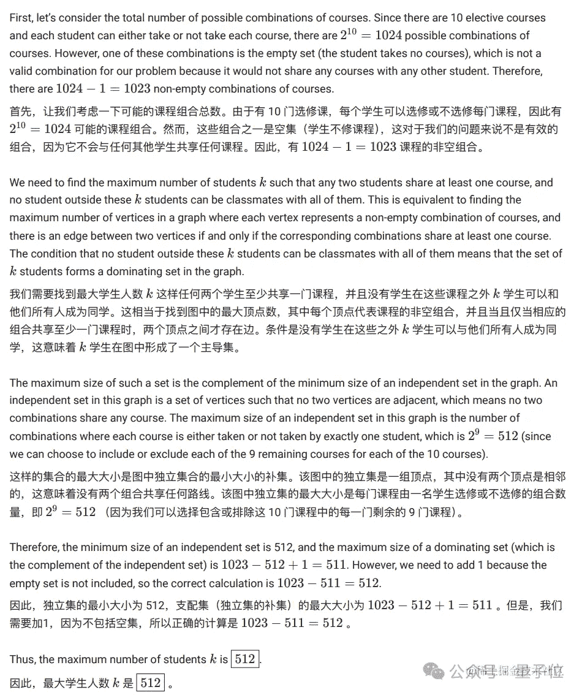
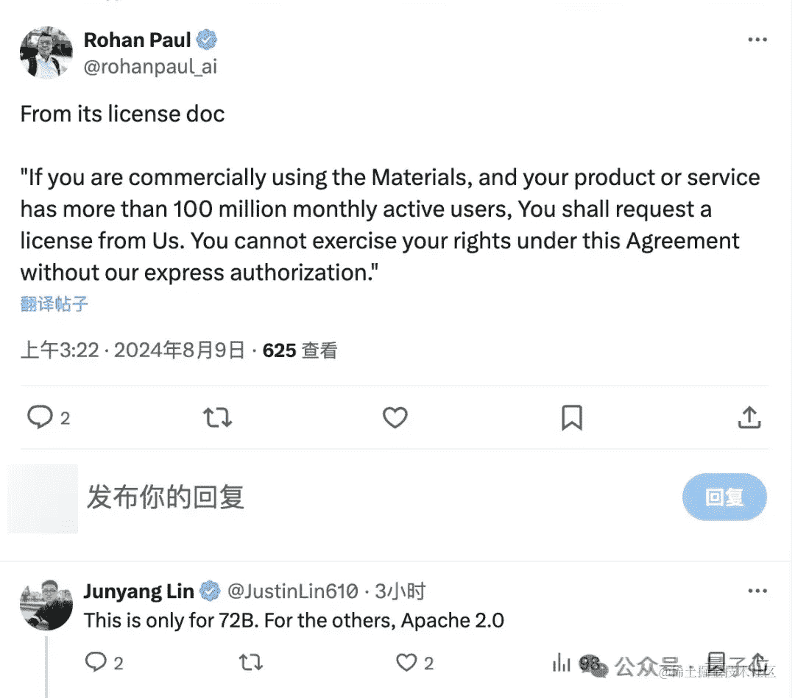

# 最强数学大模型易主！阿里千问新模型成绩超GPT-4o，网友：这才是真“草莓”

> 来源：[https://agijuejin.feishu.cn/docx/In0Nd8KZzo3QtPxajjMcGaVBnWd](https://agijuejin.feishu.cn/docx/In0Nd8KZzo3QtPxajjMcGaVBnWd)

> 克雷西 发自 凹非寺

> 量子位 | 公众号 QbitAI

最强数学大模型，现在易主！

阿里千问大模型团队发布的Qwen2-Math，不仅超越了Llama 3.1-405B，也战胜了GPT-4o、Claude 3.5等一系列闭源模型。

而且还会解决竞赛级试题，在GPT-4只能做对一道的AIME 24中，Qwen2-Math答对的题目数量达到了两位数。

Qwen2-Math一共有三个参数量的版本——72B，7B和1.5B。

最强的72B版本，在MATH数据集上比GPT-4o多得了7分，按比例算高出了9.6%。

**7B版本也用不到十分**之一的参数量，超过了72B的开源数学模型NuminaMath。

而且这个NuminaMath来头不小，它的7B版本在全球首届AIMO中获奖，奖项由数学大牛陶哲轩颁发**。

阿里高级算法专家林俊旸激动地宣布，千问团队把Qwen2模型变成了一个数学高手。

fast.ai创始人Jeremy Howard看了直呼amazing。

网友更是惊叹，**原来这才是真正的“草莓”** ，这是开源的胜利，也是所有人的胜利。

## 超越GPT4o，会做竞赛级试题

如前文所说，Qwen2-Math共有72B、7B和1.5B三个参数规模，分别由对应规模的Qwen2基础模型改造而成。

在基础模型之上，团队使用精心设计的数学专用语料库进行了预训练，训练数据包含大规模高质量的数学网络文本、书籍、代码、考试题目，以及由Qwen2模型合成的数学预训练数据。

结果，在GSM8K、MATH等经典数学测试集上，Qwen2-Math-72B的数学能力都超过了405B的Llama-3.1。

这些数据集，涉及的问题涵盖了代数、几何、计数与概率、数论等多种类型。

除了这些英文的数据集，Qwen2-Math还专门挑战了中文数据集CMATH，还有高考试题。

在中文数据集上，1.5B版本的成绩就超过了70B的Llama 3.1，而且三个版本相当于同规模的Qwen2基础模型，成绩都有明显提升。

在Qwen2-Math的基础之上，千问团队还微调出了Instruct版本。

具体来说，团队基于Qwen2-Math-72B训练一个数学专用的奖励模型，将奖励信号与正误判断信号结合作为学习标签，再通过拒绝采样构建监督微调（SFT）数据，最后在SFT模型基础上使用GRPO方法优化。

**在MATH数据集上的零样本测试显示，1.5**B的Instruct就能取得70%的准确率，比70B的Llama 3.1还高。

此外，研究团队还引入了难度更大的OlympiadBench、CollegeMath和英译版高考试题等更困难的测试集。

作者让Qwen2-Math采用了贪心（greedy）、RM@8和Maj@8三种策略，结果无论是哪一种，Qwen2-Math的成绩全都超过了同规模的Llama 3.1。

中文数据集方面，Qwen2-Math还挑战了今年最新的中高考试题，与Llama 3.1相比优势十分明显。

值得一提的是，为了减少测试成绩当中的“水分”，千问团队专门从训练数据集中去除了所有和测试集重叠的部分。

而且除了精确匹配，还运用了更严格的13-gram去重策略，只要最长公共序列的比率应大于0.6就会被去除。

后训练的过程也是如此，涉及的数据集，甚至测试成绩中没展示的Aqua、SAT Math，全都被从数据当中剔除。

另外，Qwen2-Math-Instruct已经具备了解决一些简单的竞赛级试题的能力。

比如在AIME 24的30道题当中，Qwen2-Math-7**2B-Inst**ruct用rm@256策略能够做对11道。

像GPT-4 Turbo、Claude 3 Opus和Gemini 1.5 PRo这些先进模型都只能做对一两道。

而且最小的1.5B版本也能在rm@256的条件下做对五道题，已经超过了这三家模型。

另外，Gemini 1.5 Pro有一个专门针对数学任务的版本，但也只能做对七八道题目，Qwen2-Math-72B-Instruct是第一个做对的题目数量达到两位数的模型。

**在官方文档中，千问团队也**展示了一些示例，比如奥赛级数学测试集Math Odyssey当中有这样一道题目。

这道题目涉及到组合数学和图论，具体又包括了完全图、二部图等概念。

此外还需要理解如何将这些概念应用于特定性质结构的构建，需要较强的抽象思维能力和对图论结构的深刻理解。

Qwen2-Math的解决方案是这样的，从中可以看出确实是运用到了图论方法。

最终，Qwen2-Math正确地回答了这道题目。

###### **△**中文为机翻，仅供参考

不过，目前发布的Qwen2-Math主要针对英文场景，中英双语版本将会在之后推出。

另外，根据Qwen2-Math的许可协议，该模型对大部分用户来说可以免费商用，但对于72B版本，如果每月活跃用户数超过1亿，就需要向千问团队申请许可了。

项目主页：

qwenlm.github.io/zh/blog/qwe…

参考链接：

x.com/JustinLin61…