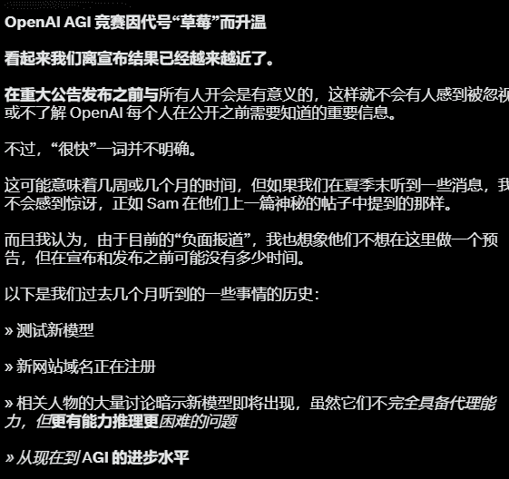
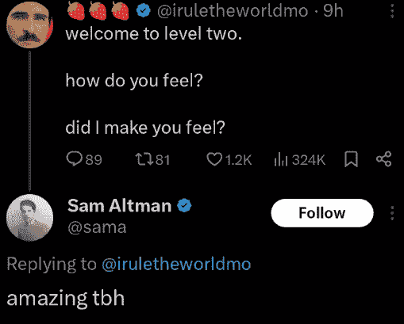
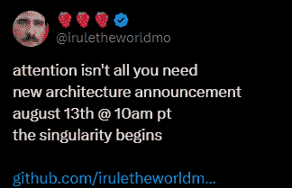
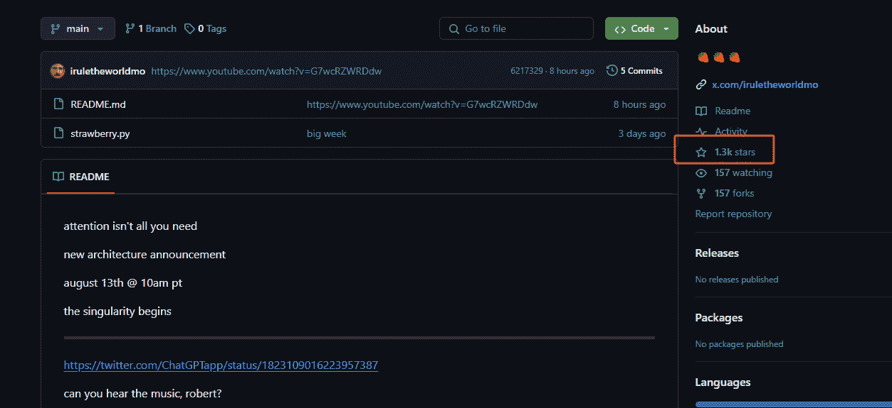
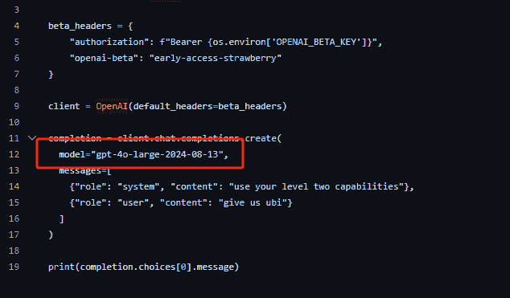

# OpenAI的“草莓”(Strawberry)计划真的要实现了吗？

> 来源：[https://agijuejin.feishu.cn/docx/FxfRdLFmzorQ1jxEYJQcRJhln5f](https://agijuejin.feishu.cn/docx/FxfRdLFmzorQ1jxEYJQcRJhln5f)

# 一、代号“草莓”(**Strawberry**)

**这两天OpenAI代**号“草莓”（Strawberry）的计划想必大家有所耳闻，不知道的先给大家普及一下，请看下图。

如果你觉得这次仅仅是一个小道消息或者一个短新闻那就大错特错了，在某地，甚至有个人专门整了一个账号来持续炒作这个事儿。我们现在姑且叫他“草莓哥”吧。

我看了看“草莓哥”的发消息的频率，真的是够快，从“草莓”计划出现的第一天起他就在不断发消息，给你们感受一下。

甚至一些消息还能获得OpenAI CEO 山姆·奥特曼的回复，比如下面这条。

虽然看起来很像是一次草莓哥和山姆联手发起的“炒作”，不过等等，草莓哥说的“Level Two”是个什么意思？ “欢迎来到第二级别”又是什么意思？怎么听着这么云山雾罩的呢？

# 二、OpenAI对AGI的分级

这其实要从Open AI 对人工智能的分级来讲起了。在早些时候（大概一个月前），Open AI内部对通向AGI定义了5个层级，分别是：

聊天机器人、推理者、自主代理(Agent)、创新者、组织者。

下面我们就仔细讲一讲这5个等级。

## LEVEL 1：聊天机器人——具有对话语言能力的AI聊天机器人

这一阶段的代表模型包括GPT-4系列模型、Claude系列模型等，它们标志着自然语言处理技术的重大突破，而我们正处于这一层级。

这些聊天机器人的核心在于其理解和生成类人文本的能力。通过对海量数据的学习，它们能够进行连贯且与上下文相关的对话。这种能力体现在几个关键方面：首先是自然语言理解，它们能够捕捉语言的细微差别，包括俚语、习语和语境；其次是上下文意识，在整个对话过程中保持连贯性，记住先前的互动以提供更相关的回应。

在文本生成方面，这些AI模型表现出色。无论是日常对话、正式沟通、创意写作还是技术解释，它们都能产生语法正确且符合上下文的文本。这种多功能性使它们在多个领域找到了应用，从客户支持到个人助理，从教育工具到娱乐平台。

更值得注意的是，高级模型如GPT-4还具备多语言能力，能够理解和生成多种语言的文本，这大大扩展了它们的应用范围，促进了跨语言交流。同时，这些模型还能提供个性化体验，根据用户的偏好和历史互动来定制回应。

## LEVEL 2：推理者——具有人类水平问题解决能力的推理AI系统

OpenAI认为他们的新模型（或许是GPT-5）即将达到这个水平，这标志着AI发展的一个重要阶段。这类推理系统不仅仅是生成类人文本，而是能够以类似人类的理解深度和推理能力来解决复杂问题。它们真正理解所面临的问题，应用逻辑推理，并以模仿人类认知过程的方式设计解决方案。

这种能力体现在以下几个方面：

1.  LEVEL 2 级别的AI系统能够理解因果关系原理，进行推断，并根据提供的信息得出结论。它们不仅能处理简单的逻辑问题，还能应对需要多步骤推理的复杂情况。

1.  其次，这些系统展现出卓越的问题解决技能。与当前主要提供信息或建议的聊天机器人不同，这些AI系统能够独立解决复杂问题，包括数学推理、科学分析和战略规划等。同时，它们还能够从经验中学习，分析自身的成功和失败，并随时间改进其问题解决策略，获得更精细的推理能力。

1.  最后，这些AI系统还具备协作问题解决的能力。它们能够与人类和其他AI系统合作，接收输入、提供反馈，并与人类专家协同工作以达到最佳解决方案。

## LEVEL 3：自主代理(Agents)——能够代表用户自主采取行动的AI系统

LEVEL 3级别的AI系统应该称得上是真正意义上的“代理”。（请原谅我没有使用“智能体”这一词，因为在这里显得词不达意）

这个级别的AI系统能够根据用户的目标和偏好，独立执行任务和做出决策。它们不仅能理解和处理信息，还能在现实世界或数字环境中自主操作，无需持续的人类监督。其核心特征是其自主性。它们能够独立运作，根据预定目标、学习到的偏好和情境背景执行任务并做出决策。这种自主性使得这些系统能够在没有持续用户输入或监督的情况下，高效地完成复杂任务。

不仅如此，“自主代理”还具备了LEVEL 2级别的推理能力，它们能够理解并致力于实现用户设定的特定目标，对任务进行优先排序、管理资源，并根据需要调整策略以高效完成这些目标。这种能力使自主人工智能成为处理复杂、多步骤任务的理想选择。

最后，多领域功能性也将会是它的另一个关键特点。它们可以在各种领域中运作，从管理个人日程到控制智能家居设备、进行金融交易等。这种多功能性使得自主人工智能能够执行广泛的任务，成为真正的"全能助手"。

## LEVEL 4：创新者——能够协助发明并可能为研究做出贡献的AI系统

在这一阶段，这些先进的AI系统不仅能解决现有问题，还能产生新想法、创造新解决方案，并推动创新。它们超越了常规任务和问题解决的范畴，能够参与创造性过程，可能为科学发现、技术进步，甚至人工智能本身的发展做出重大贡献。

"创新者"的核心特征是其创造性思维能力。它们具有生成新颖想法和概念的能力，可以以独特的方式组合现有知识来创造新的解决方案，它们能够独立识别当前知识或技术中的空白，并努力用创新解决方案填补这些空白。这种能力与人类发明家和研究人员的思维过程非常相似。这种创造性使得创新者AI能够在各个领域中提出突破性的想法。

在研究与开发方面，这些AI系统展现出卓越的能力。它们可以设计实验、分析数据、形成假设，并进行模拟以探索新的可能性。这种能力使创新者AI成为科学研究和技术开发过程中的强大助手，甚至可能成为独立的研究者。

## LEVEL 5：组织者——能够完成整个组织工作的AI系统

这个级别的AI系统的能力将由个体升级为群体，在管理和执行通常由整个组织完成的广泛任务。它们整合了各种高级能力，如决策、管理和运营执行，能够在组织内的多个领域自主运作，实现前所未有的效率和协调性。

组织者AI的一个核心特征是其综合决策能力。这些系统可以在组织的不同职能部门做出战略、战术和运营决策，处理组织内的各种职能，包括财务、人力资源、市场营销、生产、物流、客户服务等。它们能够无缝切换不同任务，并有效管理这些任务之间的相互依存关系，确保组织各个部门的协调运作。它们能够分析海量数据、预测各种可能的结果，并做出与组织整体目标一致的决策。这种全面的决策能力使组织者AI成为企业管理的强大工具。

最后，组织者AI具有强大的可扩展性。这些AI驱动的组织系统可以根据需求灵活地扩大或缩小其运营规模。它们能够快速适应市场变化，扩展到新的市场领域，或根据需要精简运营，这种灵活性在当今瞬息万变的商业环境中尤为重要。

# 三、达到LEVEL 2对我们有什么好？

虽然“草莓哥”和山姆都在说我们要达到LEVEL 2了，但是达到这个级别对我们有多大好处和坏处现在是大家都不知道的。

**先说说**坏处吧，如果这个级别真的达到了，那么又将有大批个人创业者和创业公司产出的产品被一朝扫进了历史的垃圾堆里。因为我们当下都是在往工学方向努力，这无异于是给模型“描花边”，起到的是装点的作用（封装）。那么你想想，如果模型不再需要这些“花边”了呢？将会是什么景象？

**再说说好处，尽管当前的模型已经令人印象深刻，但在面对需要深度推理的任务时，往往还是力不从心。有很多时候你会编写一个带反思的工作流**（也就是吴恩达说的Agentic设计模式的一种）就已经很厉害了，但你会发现现有的这些技术手段还是无法满足高准确率的应用场景，尤其是事关人身生命、财产安全的场景。

**所以，如果人工智能的发展达到了LEVEL 2级别，那么更加稳健、能力更强的AI系统将会涌现。能够持续执行复杂任务的AI系统可能会应运而**生，彻底改变我们的工作方式。更令人期待的是，AI系统可能在创新领域大显身手，成为科技进步的加速器，甚至有望接管并优化整个组织的工作流程，带来前所未有的效率提升。

# 四、“草莓哥”的新计划

就在写这篇文章时，我们亲爱的“草莓哥”又在发消息说今天会有新大招放出来，而时间正好是北京时间今晚18点（太平洋时间上午10点）。

而他新建的GitHub仓库已经有1.3K的Star了。

而他在strawberry.py这个文件中将model的Name指向了“gpt-4o-large-2024-08-13”。

希望今天下午的时候有什么新变化，如果没有的话，我会像这位仁兄一样对他说:

以上。

吃瓜围观链接：https://github.com/iruletheworldmo/strawberry