# 给小白的AI产品推荐

> 来源：[https://agijuejin.feishu.cn/docx/GcDtdXRiooIN5cxp0bzcFjyLnTc](https://agijuejin.feishu.cn/docx/GcDtdXRiooIN5cxp0bzcFjyLnTc)

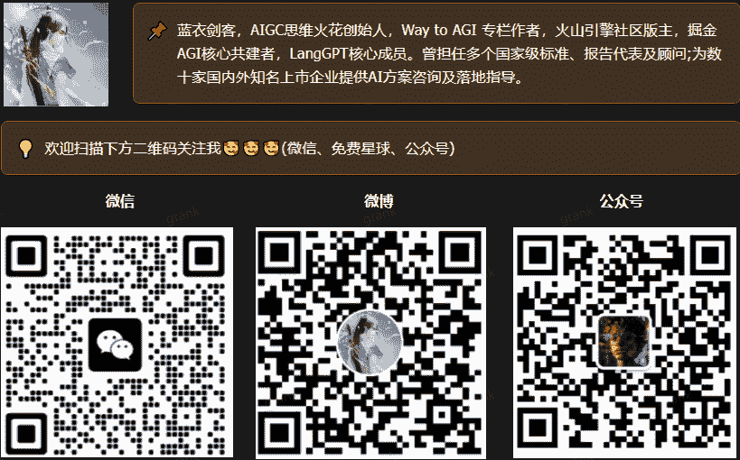

# 一、叨叨两句

前两天有个朋友私聊我问“小白应该选什么AI产品上手好”，我竟然一时语塞，因为从业这么多年，我却不知道该如何讲起。索性今天闲着也是闲着，就整理一下思路，来带大家盘一盘现在这些AI产品哪个好用，哪个更适合新人入手。

**不过需要注意的是，有些我个人感觉不好用/不常用/没用过的产品就不在推荐**范围内，以下推荐带有强烈主观性，只给大家一些参考意见。说的有失偏颇也请大家原谅。

话不多说，开始吧！

# 二、聊天对话类AI产品

## 2.1 国内

### 2.1.1 Kimi

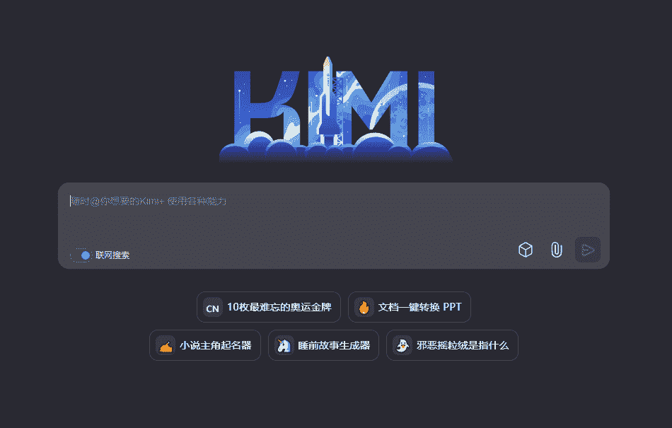

谈到聊天对话类的AI产品，我首推的是Kimi。Kimi最显著的特点就是它的超长上下文能力，这一特性在国内的AI聊天对话产品中可以说是独树一帜的。Kimi最初支持20万字的上下文，而现在已经提升到了惊人的200万字。这对于需要处理长文本或大量信息的任务来说是一个巨大的优势。

因此，如果你从事文案工作，特别是需要处理大量文字或文件的工作，我强烈推荐使用Kimi。它的超长上下文能力可以帮助你更有效地处理和分析大量信息，提高工作效率。对于需要长期记忆或需要参考大量背景信息的任务，Kimi的这一特性尤其有用。

但是，Kimi也有一些不足之处。经过使用，我发现它在文字生成和语义理解、和文字生成质量方面的能力可能不如国内其它产品好，并且它不支持用户自定义智能体。但尽管如此，我仍然强烈推荐Kimi给刚入门AI的朋友们。

### 2.1.2 智谱清言

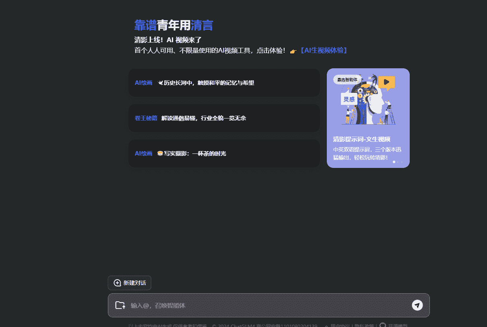

接下来，让我们来谈谈智谱清言。在中国AI领域，智谱AI的模型可以说是开创性的（22年就和清华一起自研了GLM130B）。这主要归功于其背后的技术，源自清华大学研发团队的科研成果转化。从模型质量来看，智谱AI的表现相当出色。

在产品设计方面，智谱AI明显以ChatGPT为对标，努力打造类似的用户体验。值得一提的是，智谱AI是国内首批开放智能体应用的AI公司之一。这意味着他们在智能体开发和模型优化方面已经积累了丰富的经验和技术。特别是在逻辑推理和处理复杂提示词方面，智谱AI表现出了明显的优势，这使得它在处理需要深度思考和分析的任务时表现出色。

### 2.1.3 腾讯元宝

腾讯元宝是国内相对较晚推出的AI应用，但它迅速凭借其独特优势在市场上站稳了脚跟。腾讯元宝的最大亮点在于其强大的AI搜索功能。

腾讯元宝最近更新了搜索体验，推出了深度搜索等新功能，大大提升了用户体验。其搜索的独特之处在于能够访问大量微信生态系统内的私域资源，这包括：

1.  微信公众号的内容

1.  腾讯内部、互联网上的其他优秀资源

这其中一些资源对其他AI服务提供商来说是难以触及的，这给腾讯元宝带来了显著的竞争优势。

除了独特的数据资源外，腾讯元宝还依托于腾讯"混元"大语言模型，它能够生成高质量的内容。特别是在使用深度搜索功能时，腾讯元宝能够更全面、更深入地回答用户的问题。这使得腾讯元宝成为GPT Search的一个很好的替代选择，尤其是对于需要访问中文内容和微信生态系统信息的用户来说。

总的来说，腾讯元宝虽然起步较晚，但凭借其独特的资源优势和持续改进的AI技术，正在成为中国AI搜索和对话市场的一个重要玩家。

### 2.1.4 通义千问

通义千问的最大亮点是其强大的推理能力。之前，在各种国内推理评测中，Qwen系列模型获得了最高分，这充分证明了它在处理复杂任务和逻辑推理方面的卓越表现。这种能力使得通义千问在面对需要深度思考和分析的问题时，能够提供更加准确和有洞察力的回答。

在复杂任务的处理方面，通义千问的表现尤为出色。无论是多步骤的问题解决，还是需要综合多方面信息的分析任务，通义千问都能够游刃有余地应对。这使得它在科研、商业分析等领域具有广阔的应用前景。

此外，通义千问还允许用户创建自定义的智能体，并在这方面取得了不错的效果。这种功能极大地增强了其灵活性和适应性，使得用户可以根据特定需求定制AI助手，从而在各种专业领域发挥作用。

然而，通义千问也存在一些需要改进的地方。比如，通义千问在语义理解方面略显逊色。这一点在用户使用提示词调试自定义智能体时可能会更明显地感受到。语义理解的不足可能会导致在某些需要精确理解语境和含义的任务中表现不如预期。

## 2.2 国外

### 2.2.1 ChatGPT

接下来，让我们把目光转向国际AI领域的明星产品——ChatGPT。这款由OpenAI开发的AI助手可以说是家喻户晓，对许多人而言，它就像是打开AI世界的第一把钥匙，引领我们步入了一个全新的智能时代。

ChatGPT的成功绝非偶然。首先，它的开创性不容忽视。作为首批向公众开放的大规模商用AI对话系统之一，ChatGPT在全球范围内掀起了一场AI革命，让人工智能从实验室走入了千家万户。它不仅改变了人们对AI的认知，也为未来的技术发展指明了方向。

在用户体验方面，ChatGPT可谓是精心设计。它的界面简洁直观，交互流畅自然，即使是AI领域的新手也能轻松上手。这种以用户为中心的设计理念，大大降低了普通人接触和使用AI的门槛，为AI的普及做出了重要贡献。

从技术角度来看，ChatGPT的实力毋庸置疑。它背后的GPT系列模型在性能和能力上一直处于行业领先地位。无论是语言理解的深度，还是生成内容的质量，ChatGPT都展现出了令人惊叹的水平。这强大的技术基础使得ChatGPT能够应对各种复杂的任务和挑战。

然而，我们也要客观地认识到ChatGPT的一些局限性。随着AI技术的飞速发展，尽管ChatGPT仍然强大，但它已不再是市场上唯一的顶级选择。其他AI公司和研究机构也在不断推出新的模型和产品，有些在特定领域甚至超越了ChatGPT的表现。

此外，对于国内的用户来说，使用ChatGPT可能会遇到一些技术障碍。由于网络连接的问题，用户可能会经历连接不稳定、响应延迟等困扰，这在一定程度上影响了使用体验。

总的来说，如果你身在海外或拥有稳定的国际网络连接，ChatGPT无疑是一个极佳的选择。它强大的功能、优秀的用户体验以及广泛的应用范围，使其成为AI对话领域的标杆产品。然而，对于国内用户而言，可能需要考虑一些本地化的替代方案，以获得更流畅、更便捷的使用体验。

### 2.2.2 Claude

Claude最引人注目的特点是其卓越的文字生成能力。在这方面，Claude系列模型已经展现出超越GPT系列模型的潜力。与GPT相比，Claude生成的文本更加流畅自然，质量也更高。这种优势在长文本生成和复杂叙事任务中表现得尤为明显。

事实上，对于任何涉及创意写作的工作，Claude都可能是最佳选择。它能够理解细微的语境差异，生成富有感情色彩和个性化的内容，这正是创意产业所需要的。无论你是小说家、剧本作者，还是内容创作者，Claude都有可能成为你的得力助手。

然而，使用Claude也存在一些值得注意的问题。最大的隐患是账号被封禁的风险较高。许多用户反馈遇到过突然被封号的情况，这种不稳定性可能会给持续的工作流程带来一定的困扰。由于这种频繁的封号问题，使用Claude时需要格外谨慎。这种使用上的限制在某种程度上影响了Claude的实用性，特别是对于那些需要长期稳定使用AI工具的用户来说。（当然了还有访问难度的问题）

### 2.2.3 Gemini(原Brad)

Gemini的发展历程颇为有趣。它最初以"Bard"的名字亮相，经过几次更名后，最终确定使用"Gemini"这个充满想象力的名称。值得一提的是，Gemini不仅仅是一个应用名称，它的底层技术也采用了同名的Gemini系列模型，这一点是毋庸置疑的。

Gemini的优势主要体现在其强大的语言处理能力上。在自然语言理解方面，Gemini展现出了卓越的表现，能够准确把握复杂的语境和细微的语义差别。同时，它在语言生成方面也不遑多让，能够创作出高质量、流畅自然的文本内容，无论是日常对话还是专业写作，都能应对自如。

从性能角度来看，Gemini模型的表现更是令人瞩目。它曾一度在全球AI模型性能排行榜中占据榜首位置，展示了其强大的技术实力。即使在最近的一些评测中，根据一些博主的报告，Gemini在多项测试中仍然保持着领先地位，这进一步证实了其持续的技术优势。

然而，Gemini也存在一些局限性。首先是访问限制的问题。对于国内的用户来说，你大概率访问不到，这在一定程度上限制了它的普及。其次，与Claude类似，Gemini目前不支持用户创建自定义的智能体。这意味着用户无法根据特定需求定制AI助手，可能会影响到一些专业用户或特殊场景下的应用。

对于那些能够访问Gemini的用户来说，它无疑是一个强大的AI工具，特别适合需要高质量语言理解和生成的任务。无论是学术研究、商业写作，还是创意创作，Gemini都能提供出色的支持。然而，在选择使用Gemini时，你需要权衡其访问限制和功能局限性，以确定它是否适合自己的具体需求。

# 三、 图像类产品

在图像AI领域，我们见证了一场引人注目的变革。不久前，国外产品还是这个舞台上的独角戏，风靡全球。国内产品似乎还在后台默默追赶，努力缩小差距。今天，我们看到的是一幅截然不同的画面。国内的图像AI产品不再甘居人后，而是以惊人的速度赶超，甚至在某些方面开始引领潮流。所以谈到图像类AI产品的时候就有国内的产品可以讲一讲了。

## 3.1  国内

### 3.1.1 可灵

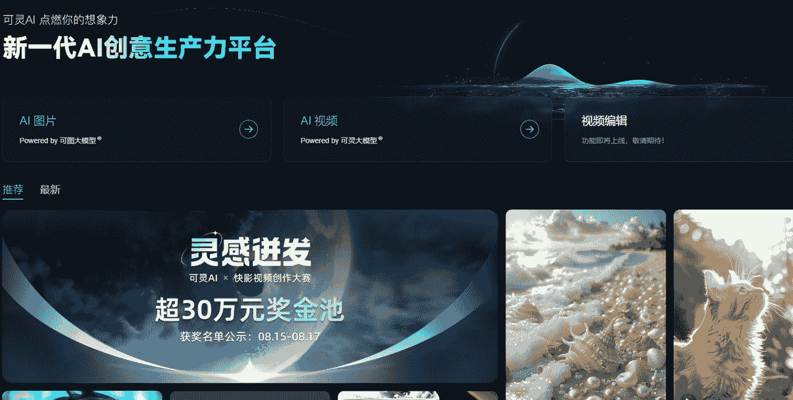

首先介绍的是"可灵"，这是一款由快手团队开发的AI应用。可灵主要用于生成高质量的图像和视频。它的一大特点是生成的图像质量非常高。

可灵最初采用内测邀请制，但现在已经向所有用户开放使用。然而，可灵的价格相对较高。与其他AI应用相比，它的费用要贵一些。对于重度用户，最高档的年费可能达到几千元人民币，如果平均到每个月，使用成本在400到600元人民币之间。但如果临时使用或轻度使用的话，仍然有每日免费点数和60多元单月的最便宜包月选项，对轻度用户来说还是值得一试的。

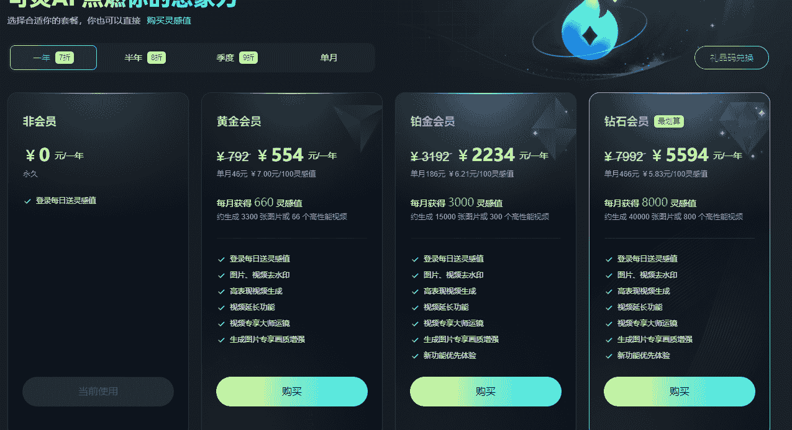

### 3.1.2 通义万相

通义万相作为国产AI工具，它在中文理解和处理方面表现出色，这一特点使其在国内市场具有独特优势。

用户可以从多种艺术风格和图像风格中进行选择，满足不同创作需求。生成的图像质量较高，细节丰富，能够满足大多数用户的期望。操作界面设计简洁直观，用户友好度高，降低了使用门槛。作为阿里生态系统的一部分，该工具可以与阿里其他产品和服务无缝整合，为用户提供更全面的解决方案。重点是现在免费，每天签到获取灵感值就可以。

然而，这个应用也存在一些局限性。为了符合国内监管要求，某些类型的图像可能无法生成，这在一定程度上限制了创作自由度。在处理非中文语言或国际化内容方面，它可能不如一些国际AI图像生成工具那样出色。由于模型训练数据可能主要基于中文环境，在处理多元文化内容时可能存在偏差。

## 3.2 国外

### 3.2.1 Leonardo

Leonardo是我最早接触的文生图AI应用了（大概在23年8月份），生成质量和效果可以说是一流的。下面我仔细盘一盘它的优势：

首先，Leonardo支持用户上传自己DIY的模型，尤其是Lora模型。这一功能极大地增强了应用的灵活性和个性化程度，让用户能够根据自己的需求和喜好定制生成过程。对于那些追求独特风格或有特定需求的用户来说，这无疑是一个巨大的优势。

其次，Leonardo为用户提供了丰富的模型选择。用户可以选择使用官方精心微调过的模型，这些模型通常能够保证较高的生成质量和稳定性。同时，对于那些喜欢探索和尝试的用户，Leonardo还提供了使用社区贡献的Lora模型的选项。这种多样性不仅满足了不同用户的需求，也为整个社区的创新和发展提供了平台。

最令人印象深刻的是，Leonardo能够生成非常高质量的图片。无论是细节的精致程度，还是整体的艺术效果，Leonardo生成的图像都达到了相当高的水准。这一点在生成纹身图案时尤为重要，因为纹身设计往往需要精细的细节和独特的艺术风格。

谈到价格，Leonardo曾经被认为相对较贵，这可能让一些用户望而却步。然而现在看来，它的价格已经变得更加合理，更具竞争力。因此，对于那些有能力且追求高质量图像生成的用户，我强烈建议可以尝试使用这款产品。

尽管如此，Leonardo也存在一个不容忽视的劣势：访问限制。这确实是目前使用Leonardo时唯一需要特别注意的问题。然而，对于那些能够克服这个障碍的用户来说，Leonardo提供的优质体验往往能够弥补这个不便。

### 3.2.2 Midjourney

在AI绘图领域，Midjourney可以说是家喻户晓的产品了。如果你接触过AI绘图工具，Midjourney很可能是你听到最多的名字。

Midjourney的确有许多优点：它的模型非常强大，能生成高质量的图像，而且用户可以进行充分的个性化设置。然而，它的使用过程并不那么便捷。你需要通过Discord应用加入Midjourney的频道，或者创建自己的频道并邀请Midjourney机器人，才能开始生成图片。

因此，从学习难度来看，我认为Midjourney的学习曲线是最陡峭的。另外，从某种程度上说，它并不是一个完整的产品，因为它没有帮助用户解决"最后一公里"的问题，也就是说，它在用户体验和易用性方面还有待改进。

# 四、 视频类产品

## 4.1 国内

### 4.1.1 可灵

AI视频生成领域，有一款国产应用正在崭露头角，引起了业内外的广泛关注——这就是可灵。如果您曾活跃于AI交流群，或者有幸在可灵刚推出时就体验过它的视频生成功能，您就会深刻感受到可灵在这一领域的强悍实力。事实上，可灵生成的视频质量已经达到了一个令人惊叹的水平，足以与国际一些顶尖模型相媲美。

可灵的优势主要体现在三个关键方面：

首先，是其卓越的视频生成质量。可灵生成的视频无论是在画面清晰度、连贯性还是内容丰富性上，都达到了与国际顶级模型相当的水准。这种高质量的输出不仅满足了普通用户的需求，也为专业创作者提供了强大的工具支持。

其次，可灵在生成速度上表现出色。相比国外同类产品，可灵的处理效率更高，能够更快地完成视频生成任务。在当今快节奏的内容创作环境中，这种高效率无疑是一个巨大的优势，能够大大提升用户的工作效率。

最后，对于国内用户来说，可灵的可访问性是其一大亮点。相较于一些可能需要特殊访问方式的国外产品，可灵为国内用户提供了更加便捷、稳定的使用体验。这种便利性不仅降低了使用门槛，也为更多人探索AI视频生成技术提供了机会。

基于这些显著优势，在国内文生视频领域，我目前毫不犹豫地首推可灵。它为国内用户提供了一个高质量、高效率的视频生成解决方案，满足了从个人创作者到专业团队的各种需求。

除了价格因素外，目前可灵在功能和性能上几乎没有太多值得批评的地方。它代表了国内AI视频生成技术的最高水平，为用户提供了优质的服务体验。可灵的出现不仅填补了国内在高端AI视频生成领域的空白，也为整个行业树立了新的标杆。

## 4.2 国外

### 4.2.1 RunWay

作为我最早接触的视频AI产品，Runway给我留下了深刻的印象。事实上，我的第一个完全由AI生成的视频作品就是借助Runway的强大功能完成的。那次经历让我亲身体验到了Runway的卓越性能，也让我深刻认识到它背后模型的非凡实力。

Runway的优势主要体现在以下几个方面：

首先，Runway拥有强大的底层模型。这个模型是Runway卓越性能的核心，它能够理解复杂的视频生成需求，并将其转化为高质量的视频输出。这种强大的基础技术使Runway能够应对各种复杂的视频生成任务。

其次，Runway展现出了令人惊叹的高质量视频生成能力。无论是画面的清晰度、动作的流畅性，还是内容的连贯性，Runway生成的视频都达到了相当高的水准。这种高质量的输出不仅满足了普通用户的需求，也为专业创作者提供了强大的工具支持。

最后，Runway团队一直在进行持续的技术迭代和更新。这种不断创新的精神确保了Runway能够始终保持在视频AI技术的前沿，为用户提供最新、最强大的功能。

然而，任何产品都不可能十全十美，Runway也存在一些值得注意的问题：

如果你是共用账号或者要ROLL的特别好的视频，那么Runway的生成队列相对来说较短。这意味着在使用高峰期，用户可能需要等待一段时间才能开始自己新的视频生成任务。其次，在某些时段，Runway的生成速度可能会变慢。这两个问题可能会影响用户的使用体验，特别是对于那些需要快速生成视频的用户来说。

### 4.2.2 PixVerse

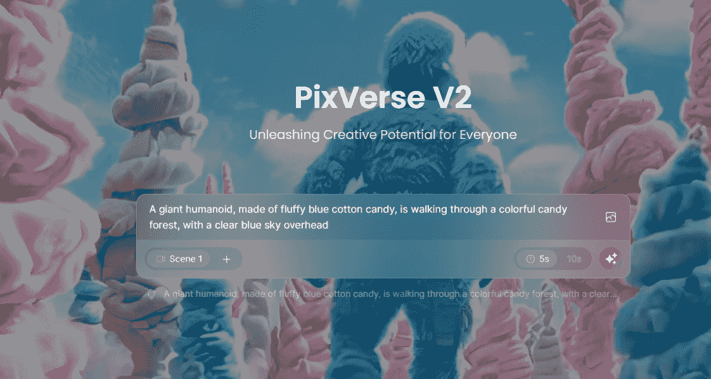

这款AI视频生成工具展现了多方面的优势，为用户提供了丰富而灵活的创作体验。其多模态输入功能支持文本到视频和图像到视频的转换，极大地拓展了用户的创作可能性。工具提供的realistic、anime和3D animation三种风格选项满足了不同用户的多样化需求，使创作过程更加个性化。

用户可以通过调整动作强度、添加负面提示词等方式实现对生成内容的精细化控制，这种高度定制的特性让创作者能够更好地表达自己的想法。社区支持是该工具的另一大亮点，通过Discord服务器提供的社区协作功能，用户可以方便地进行交流和创意分享，促进了创作生态的繁荣。

在效率方面，该工具表现出色。通常只需3-4分钟即可生成一段10秒视频，大大提高了创作效率。其Web应用和Discord服务器界面设计直观友好，易于上手，降低了用户的使用门槛。特别值得一提的是，Discord服务器生成的视频质量较高，细节丰富，为用户提供了优质的创作素材。此外，工具还提供视频上采样功能，可以进一步提升视频的清晰度和亮度，满足了对视频质量有更高要求的用户。

然而，这款工具也存在一些不足之处。Web应用和Discord服务器生成的视频质量存在差异，可能导致用户体验不一致。即使在图像到视频的转换过程中，用户仍需提供准确的文本描述，这在某种程度上增加了使用难度。作为AI生成工具，其创作内容可能缺乏人类创作者的独特创意和艺术表现，这是目前AI创作的普遍局限。

# 五、 PPT类产品

当谈到PPT类AI产品时，不得不提的是，无论国内还是国外，这类产品都非常丰富。市场上的PPT类AI产品通常是在传统PPT设计和生成工具的基础上，融入了生成式AI的新功能。这种融合带来了许多创新，但同时也造成了产品种类的繁多，可能会让用户在选择时感到困惑。考虑到这一点，我决定基于个人使用经验，为大家筛选出一些我认为值得推荐的产品。

## 5.1 国内

### 5.1.1 爱设计PPT

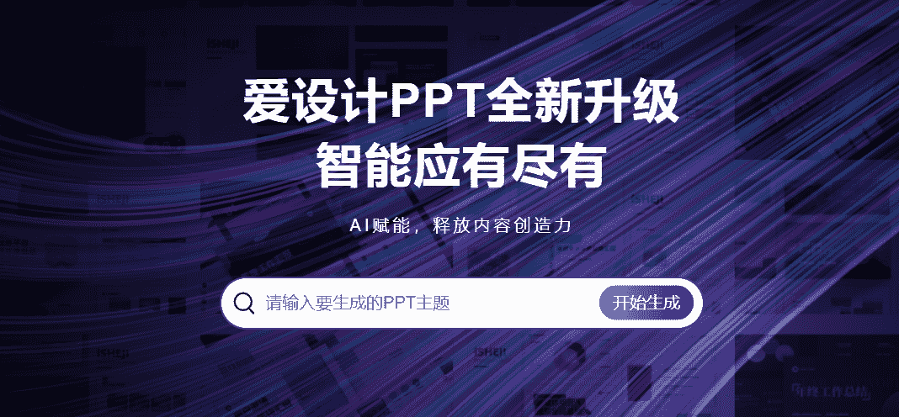

在国内AI辅助制作PPT的产品领域中，有一款产品脱颖而出，成为我唯一推荐的选择——爱设计PPT。这款产品在众多国内PPT类AI产品中独树一帜，其卓越的性能和用户体验让人不得不为之赞叹。几个月前，我有幸与爱设计PPT背后公司"爱设计"的CEO进行了深入交流。这次交流让我对他们产品的成功有了更深入的理解：

首先，这款产品背后拥有一支实力强大的团队。这支团队不仅技术过硬，还对市场需求有着敏锐的洞察力。正是这样的团队才能持续推动产品的创新和进步。

其次，他们成功把握住了AI与PPT结合的市场机遇。在AI技术迅速发展的背景下，他们敏锐地察觉到了将AI应用于PPT制作的巨大潜力，并迅速开发出了这款产品。这种前瞻性的市场洞察力和快速的执行能力，是爱设计PPT成功的关键因素之一。

最后，这款产品已经在国内AI生成PPT产品中确立了市场领先地位。这不仅证明了产品的优秀品质，也反映了用户对爱设计PPT的高度认可。

基于以上原因，我强烈推荐国内用户使用爱设计PPT。它不仅代表了当前国内AI辅助PPT制作的最高水平，还在不断进步，为用户提供越来越好的体验。爱设计PPT的成功不仅仅是一款产品的成功，更是AI技术在实际应用中的一次重要突破。

对于那些经常需要制作PPT的人来说，无论是商务人士、教育工作者还是学生，爱设计PPT都是一个值得尝试的工具。它能够大大提高PPT制作的效率，同时保证高质量的输出。随着AI技术的不断进步，我们有理由相信爱设计PPT会在未来带来更多令人惊喜的功能和性能提升，继续引领AI辅助PPT制作领域的发展。

## 5.2 国外

### 5.2.1 Gamma

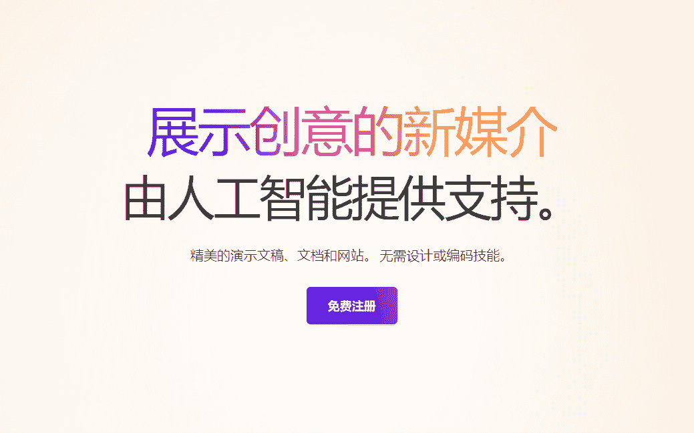

作为我在各种交流群中频繁推荐的产品，Gamma以其卓越的性能和用户体验赢得了广泛认可。每当有人询问最佳AI生成PPT软件时，我都毫不犹豫地推荐Gamma。这种坚定的推荐源于Gamma在多个方面的突出表现。

令人惊喜的是，即使是Gamma的免费版本，也能生成质量非常高的PPT。虽然在早期版本中可能存在一些不足，但随着不断的优化和改进，现在的免费版本已经能够满足大多数用户的需求。这种"免费也能高质量"的策略，无疑大大提升了Gamma的普及度和用户基础。

从个人使用体验来看，Gamma的表现令人印象深刻。我最近使用Gamma制作了一系列PPT，每次的生成效果都非常令人满意。无论是内容的组织、设计的美观度，还是整体的专业感，Gamma都展现出了卓越的水准。这种稳定的高质量输出，让用户能够更加信赖和依赖这个工具。

# 六、 音频类产品

## 6.1 国内

实话实说，确实没用过，不好推荐。

## 6.2  国外

### 6.2.1 Elevenlabs（语音生成）

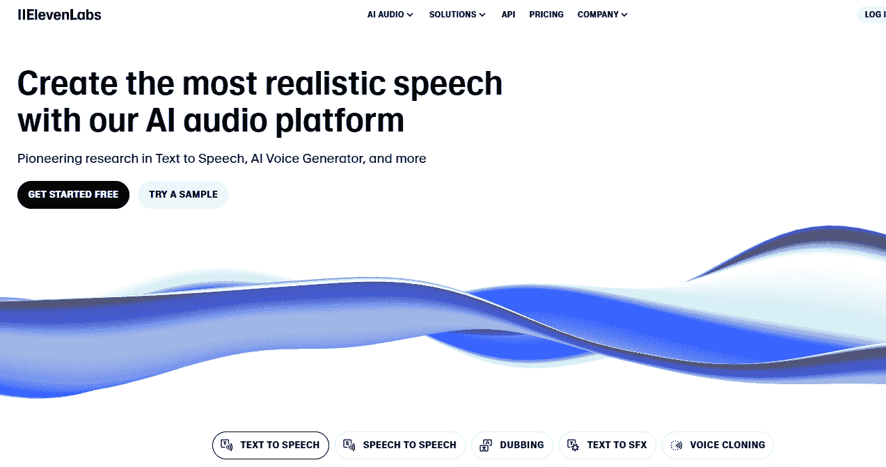

ElevenLabs作为一款先进的AI语音生成工具，在多语言支持、语音质量和灵活性方面表现出色。它的Multilingual v2模型支持近30种语言，能够生成自然、清晰且情感丰富的语音，几乎可以媲美人类真实声音。其精准的声音克隆技术和灵活的定制选项使其适用于各种专业应用场景，从内容创作到客户服务，再到游戏开发和教育等领域。

它不仅能够帮助企业和创作者突破语言障碍，扩大全球影响力，还能为视障人士提供更好的内容可及性。其开放的API和活跃的社区支持也为进一步的创新和集成提供了可能性。

然而，ElevenLabs也面临一些挑战。语言切换问题和对高质量音频样本的依赖可能会影响用户体验。此外，其定价策略可能会限制某些用户群体的使用。同时，与所有AI技术一样，它也引发了关于伦理、版权和对人类工作影响的讨论。

# 七、 私人定制类产品

接下来，让我们聊一下我称之为"私人定制类"的AI产品。这个分类的命名有其特殊原因：

1.  这类产品主要允许用户对AI模型进行个性化选择。

1.  用户可以创建自己的AI Agent，以满足特定需求。

1.  支持用户设计和实现一系列自定义的工作流程。

1.  这些产品通常需要一些前端技术知识，以便更好地创建内容和优化使用体验。

正是由于这些产品具有高度的可定制性和个性化特征，我决定将它们单独列为一个类别。这类产品为用户提供了更大的灵活性和创造空间，使AI工具能够更精准地满足个人或企业的特定需求。

然而，这种高度定制化也意味着使用这类产品可能需要更多的技术知识和学习成本。对于那些愿意投入时间和精力深入了解AI技术，并希望将AI工具完全适配自身需求的用户来说，这类产品无疑是极具吸引力的选择。

### 7.1 Dify

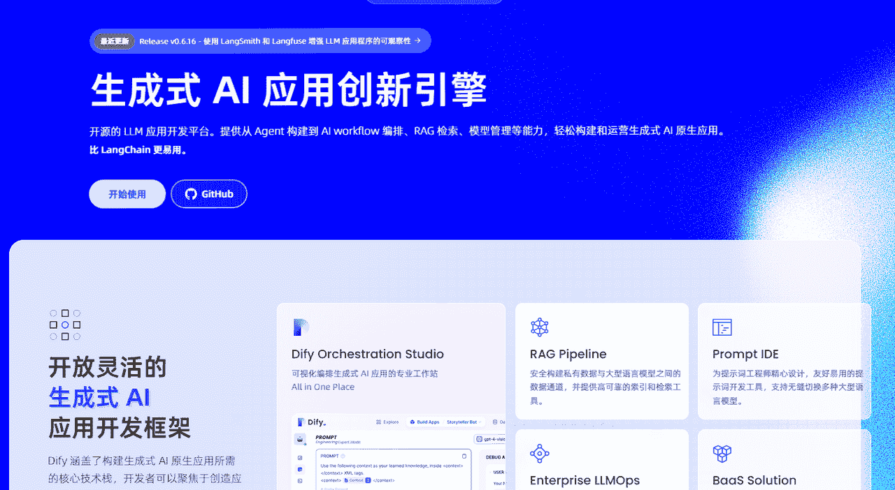

在私人定制类AI应用中，Dify无疑是一个值得关注的佼佼者。作为一个开源的应用，Dify以其出色的易用性和强大的功能赢得了用户的青睐。它的安装过程简单快捷，熟练用户仅需约5分钟就能在本地完成部署，这在众多开源项目中实属罕见。Dify将所需依赖集成到一键部署指令中，大大降低了使用门槛。

Dify不仅支持本地部署，还推出了云端应用，为用户提供了更多选择。无论是工作流、智能体还是知识库，Dify都能轻松应对。对于想要深入体验AI定制化的进阶用户来说，Dify无疑是理想之选。然而，本地部署仍需用户自行处理模型接入等问题，包括购买API、接入不同类型的模型如embedding模型、语言模型和rewriter模型等,学习曲线相对陡峭。此外，构建个人知识库时还需考虑数据量、嵌入质量和API费用等因素。

对于偏好云端使用的用户，Dify提供了包月套餐，最高价格为59-159美刀/月。不过，但值得注意的是，访问Dify云端服务可能需要特殊方法。

总的来说，Dify为用户提供了高度定制化的AI使用体验，无论是技术能力较强还是追求便利的用户，都能在Dify中找到适合自己的使用方式。在选择时，用户需要根据个人需求、技术能力和预算做出权衡。

### 7.2 扣子

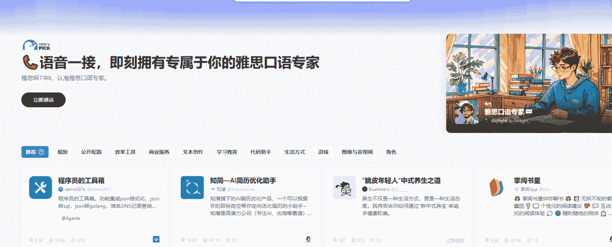

国内版的扣子是一款在AI应用领域知名度极高的产品。如果您经常接触AI应用，很可能已经听说过它。扣子在国内AI应用市场中占据了重要地位，其功能丰富，支持知识库、工作流和插件等多种功能。

相较于Dify，扣子的一大优势在于其完善的社区市场。用户可以选择使用官方推出的插件或 AI Agent，也可以使用其他用户创建的内容。这种开放的生态系统使得扣子在易用性方面表现出色，许多插件和工作流都可以直接使用，无需自行搭建。

然而，扣子也存在一些潜在的使用限制。普通版本&专业版主要接入国内模型，其中专业版只能选择豆包pro系列模型，这可能导致某些情况下的性能问题。例如，在进行批量处理时，某些模型的并发处理能力可能不够稳定，长时间运行后可能会崩溃。此外，由于国内大模型在一些方面还不够成熟，可能会出现一些意料之外的小问题。

尽管如此，对于个人使用和学习而言，扣子仍然是一个非常好的选择。它支持多种接入方式，包括接入个人微信公众号。对于具备技术能力的用户，还可以利用其他开源项目来创建自定义的智能体。扣子还支持接入企业服务号和企业微信，这在企业应用方面显示出了很大的潜力。

### 7.3 Coze(海外版扣子)

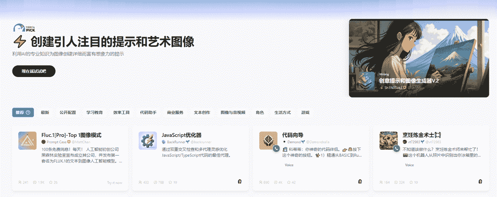

海外版的扣子可以说是当前私人定制AI应用中的佼佼者，我甚至称之为"唯一真神"，原因在于它完美解决了其他产品存在的诸多问题。与Dify相比，海外版扣子大大降低了使用成本。Dify虽然支持Claude和GPT系列模型，但需要用户自行搭建插件和工作流，同时还要处理升级和bug调试等问题，这无形中增加了使用负担。相比国内版扣子，海外版在模型质量和数据源方面有明显优势。国内版虽然有插件和应用市场，但受限于国内模型和数据源的质量，难以生成高质量的语言内容。而海外版可以使用G搜索等优质数据源，大大提升了推理和生成的质量。

海外版扣子不仅支持Claude和GPT系列模型，还包括其他知名系列模型，为用户提供了丰富的选择。它拥有完善的插件市场和智能体市场，用户可以方便地找到并使用各种功能扩展。更令人兴奋的是，它能够与多种外部应用集成，极大地扩展了使用场景。这一点尤其吸引人，解决了许多用户的痛点问题。得益于优质的模型和数据源，海外版扣子能够生成更高质量的语言内容。相比其他需要复杂设置的产品，它更加用户友好，降低了使用门槛。

总的来说，海外版扣子成功地平衡了功能强大和易用性，为用户提供了一个全面而高效的AI应用平台。它不仅满足了高级用户的定制需求，也为普通用户提供了便捷的使用体验。对于那些追求高质量AI辅助的用户来说，海外版扣子无疑是一个值得尝试的选择，它完美地解决了我之前在使用其他产品时遇到的所有问题。

# 八、我捏了一个AI产品测评师

在写到这里时，我突然有了一个新的想法。虽然文章中介绍的产品相对较少，而且文章本身具有时效性，那为什么不创建一个"产品评测助手"呢？这个助手可以帮助你在未来更长的时间内快速识别和评估AI产品，这样的效果岂不是更好吗？

基于这个想法，我编写了一个提示词。这个提示词可以作为一个小工具，你只需要输入产品名称，模型就可以帮助你在海量信息中找出产品对应的优劣势。它不仅可以应对当前的产品，还能适应未来可能出现的新产品。

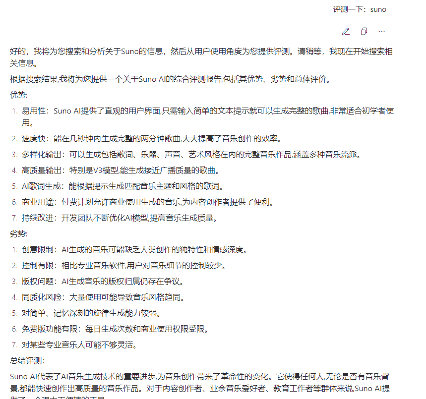

想要提示词的朋友欢迎关注我，我将会把提示词免费送给你。

# 九、 写在最后

归根结底，我们需要明白一个重要的观点：没有绝对最好的产品，只有最适合自己的产品。每个人的需求、条件和所处的地域都不尽相同，因此在选择AI产品时，最关键的是要根据自身情况做出判断。我分享的所有意见和经验仅供参考，但我真诚地建议你去亲自尝试一下我在文章中提到的这些产品。

这种尝试和探索的过程不仅能帮助你找到最适合的AI工具，还能让你更深入地了解AI技术的发展现状和潜力。在这个快速发展的AI领域，保持开放和好奇的心态，不断尝试新事物，是跟上技术进步步伐的重要方式。

以上。