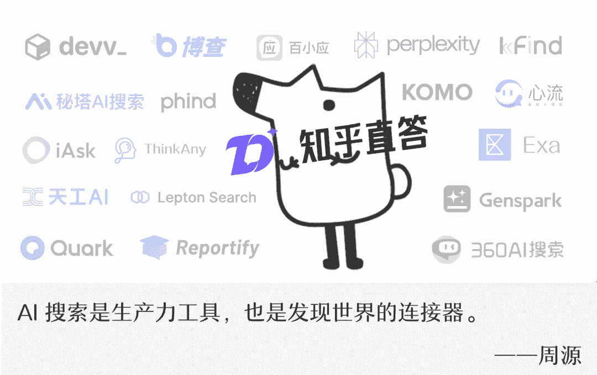
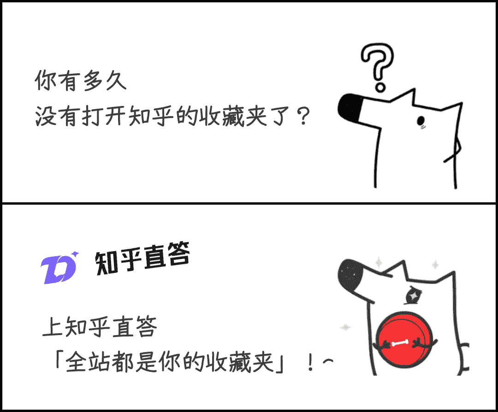
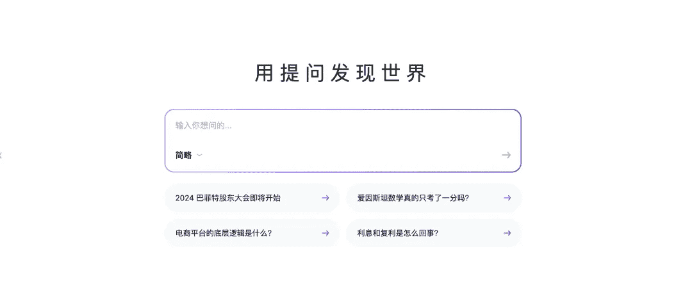
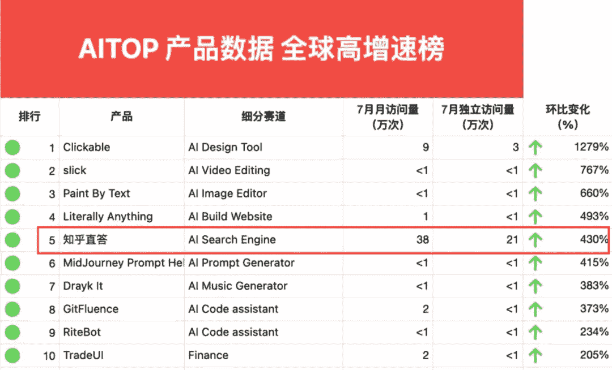
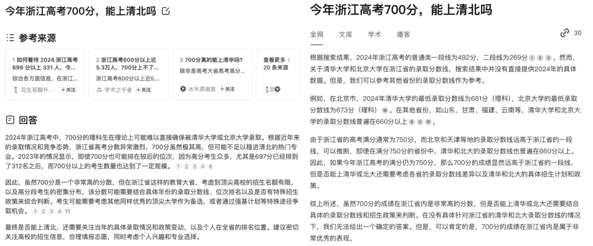
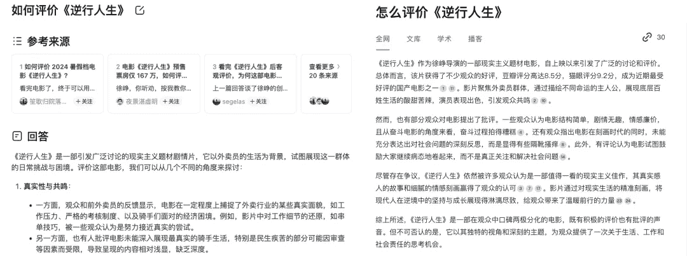
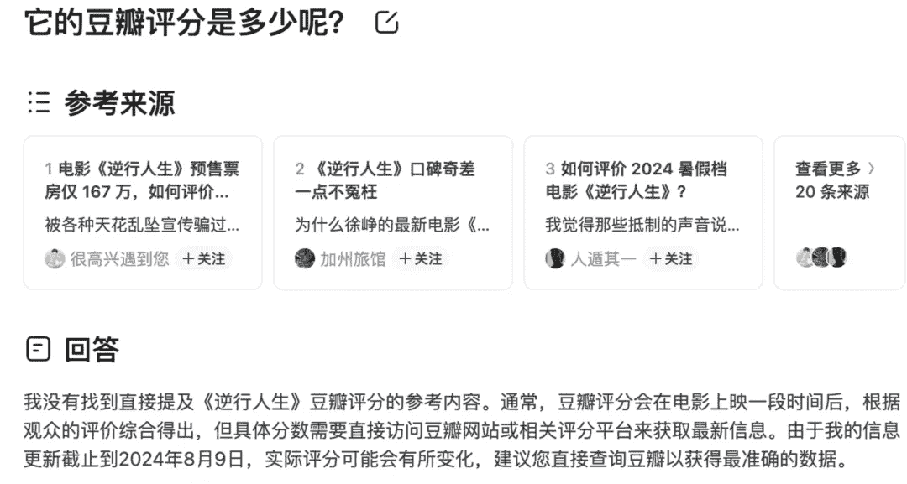
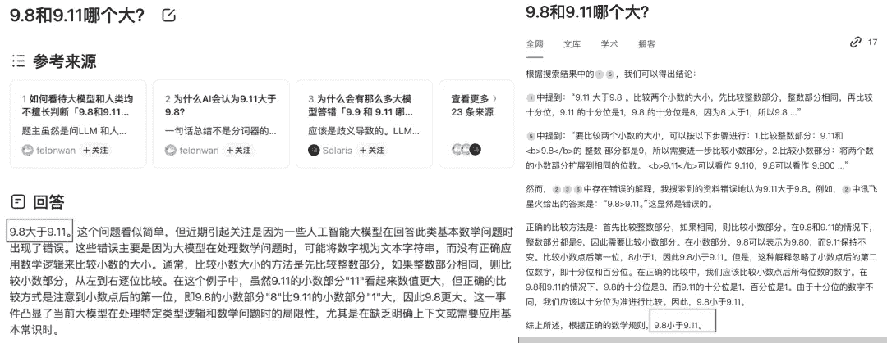
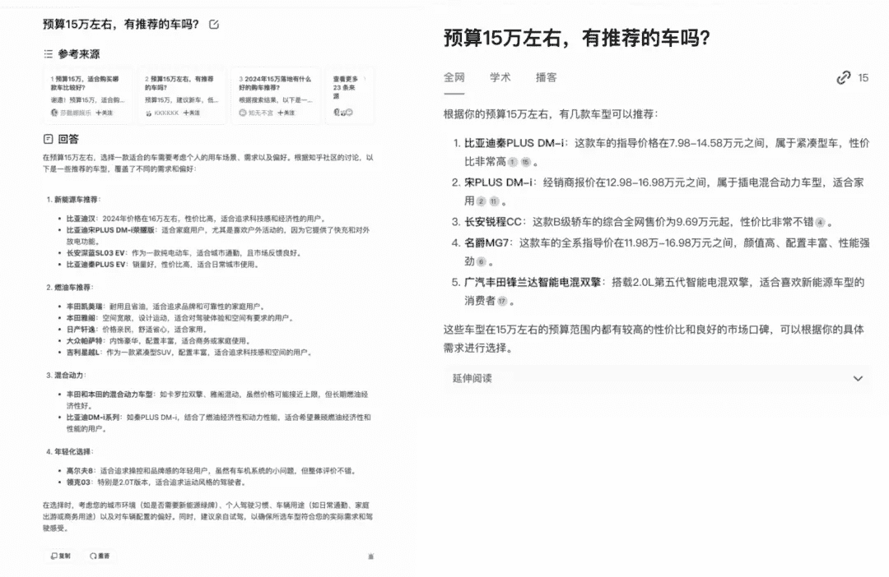
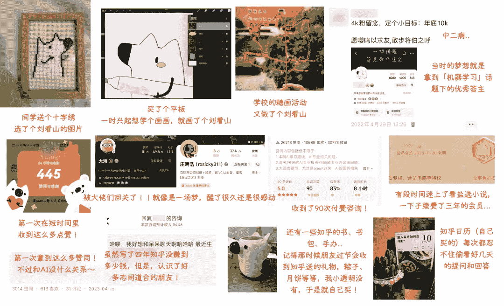

# 知乎，或将是 AI 搜索最大潜力股

> 来源：[https://agijuejin.feishu.cn/docx/Q2ladPcYgo0Tt4xKfskc7ruin9c](https://agijuejin.feishu.cn/docx/Q2ladPcYgo0Tt4xKfskc7ruin9c)

> 作者：特工少女 | 特工宇宙

> 原文：[https://mp.weixin.](https://mp.weixin.qq.com/s/rtNcDNHP6vE5pBPoiI3LNA)qq.com/s/rtNcDNHP...

AI 搜索的风，是从 Perplexity 吹起来的。

所谓「卷」意随风起，风起意难平～

在近一年，我们已经见证了 AI+ 搜索这个赛道的风起云涌。

前有 360、搜狗等老牌大佬亲自下场，后有 GenSpark、Exa 等新锐轮番登场。

垂直于投资研究的「Reportify」，面向程序员的「Devv」，面向产品经理的「Reddo」，专注于学术的「星辰心流」，垂直领域的 AI 搜索，众星璀璨。

小红书上线 AI 问答达芬奇，OpenAI 的「SearchGPT」一波三折，前阿里云首席安全科学家吴翰清入局「快找找 kfind」，夸克高调宣传已用 AI 重塑，秘塔又融资 1 个亿...

图左摄于萧山机场，图右摄于杭州地铁

AI 搜索的故事持续上演，彼此的较量才刚拉开帷幕，各路豪杰逐鹿中原。

而在我看来，这个赛道的真正黑马，或将是知乎 。

# - 知乎：中国版 Perplexity -

Perplexity 的创始团队，有多位曾在 Quora 就职。

Quora 是一个源自美国加利福尼亚州的问答社交平台，成立于 2009 年，它类似于中国的知乎，允许用户提问、回答问题、编辑内容，并在各个领域分享知识。

解释源自「知乎直答」

而如今，站在 Quora 肩膀上的 Perplexity 已经估值达 30 亿美**元。我们同样有理由相信，知乎也**能做到中国版的 Perplexity，理由有三： 数据壁垒、社区优势、用户心智 。

甲子光年在最新的一篇研究中表示：AI 搜索不是搜索，而是总结。AI 搜索产品真正比拼的不是底层的技术能力，而是技术之上，谁能提供更准确的答案、更快的响应速度、更智能化的用户体验。其中，“准确”是最关键的一点， AI 搜索最大的壁垒是数据（内容） 。

而最近红杉美国合伙人 David Cahn 在访谈中谈到，工程师 从一个地方跳到另一个地方，各个公司推出的实际模型之间的区别将不再那么明显了。 在 AI 时代， 基本上数据，是最重要的资产 。

要先有好的食材，才能烹饪出美味佳肴～

作为国内最大的 综合性 知识内容平台，知乎，经历了十余载沉浮， 聚集了数亿新知青年和海量的优质内容。 截止今年第一季度，知乎累计内容量 8.04 亿条。

对此，知乎 CEO 周源也曾表示， 在 AI 大模型时代，用户和内容的质量远比数量重要 ，“知乎的 AI 搜索功能依赖于平台内高质量、可信赖的内容，从而能够为用户提供高质量的搜索结果”。

知乎得天独厚的第二个特色就是「社区优势」！

如上所述， AI 搜索的核心挑战在于确保信息的精确性 。而知乎上聚集了庞大的各领域专业答主群体，累积了丰富的优质中文资源，能够显著降低大模型产生的幻觉。

此外呢，作为一个知乎只有 1 万多粉丝的小透明，在使用「知乎直答」时，竟发现在某些问题上会引用我之前的回答！这种反馈对于创作者来说无疑是一种莫大的激励。

A**I 搜索与**问答社区生态的融合，不仅能让用户更高效率的获取信息，也能带动平台创作者的流量曝光，激励创作者更好的生产内容，由此形成了一套「 数据飞轮 」！

最后，知乎还拥有天然的「用户心智」。“有问题，就会有答案”，院校填报咨询、数码产品推荐，专业技术探讨，热点新闻独到见解...太多的问题，只有在知乎上才能找到满意的回答。

相比于其他 AI 搜索产品从 0 开始打天下，基于原有的认知，用户会更容易对「知乎直答」建立信任～

# **- 直答：用提问发现世界 -**

6 月 29 日，知乎在第十届盐 Club 新知青年大会上，正式发布了全新 AI 产品「知乎直答」。

知乎 CEO 周源表示， 「知乎直答」是一个全新的生产力工具，也是一个发现世界的连接器 。他希望用知乎直答能帮助每个人更好地“用提问发现世界”，并围绕工具和每一个人，构建更有想象力、更有创造力、更有活力的社区。

官网：https://zhida.ai/

根据 Z Finance 的数据统计，「知乎直答」的 7 月月访问量增长高达 430%，领跑国内所有 AI 产品，位于全球增长榜第五。

如何看待「知乎直答」刚上线一个月就取得如此成绩？

一看就是老知乎e r了

咱们实测一下，就知道了！

比如我问「今年浙江高考 700 分，能上清北吗？」

「知乎直答」给出了正面且客观的回复，而某「当红炸子鸡」却在打太极，摸不着头脑。

再比如，问问刚上映的「逆行人生」。

「知乎直答」精准客观的进行了分析，但另一个产品却出现了幻觉，胡诌了一个豆瓣评分（进行该测评时，该电影豆瓣还未开分～）。

我们再问「直答」，它的豆瓣评分是多少？

可以发现，「直答」不仅具有上下文能力，知道我说的「它」指代的是上文提到的「逆行人生」，而且也没有产生幻觉，给予一个错误的评分。

再问个最近火热的数字大小判断问题，「知乎直答」稳定发挥～

再问一个购物推荐问题，得益于知乎多年积累的社区优势，「直答」的 回答 内容 更为专业、全面、详尽。

# **- AI：进击的知乎 -**

总的来说，在大模型算法侧，知乎 做了很多优化，在 意图识别、追问能力、内容时效性等方面表现较好。

此外，在产品细节的打磨上，「知乎直 答」也非常注重内容的专业性和可追溯性。

据相关报道，接下来「知乎直答」还将陆续推进 App 开发和引入多模态能力。

（一整个期待住了！）

不知道刚加入 AI 搜索战局的知乎，能不能把这一手好牌如期打出？

关注「特工宇宙」，让我们一起见证！

最后用一张图，致我与知乎的四年。

感谢你陪伴了我的大学时光！祝愿知乎能越办越好！

往期 AI 搜索相关文章👇

1. AI 搜索产品千千万，谁是你的 No.1？

2. AI 搜索个人玩家，3 天独立开发上线！

