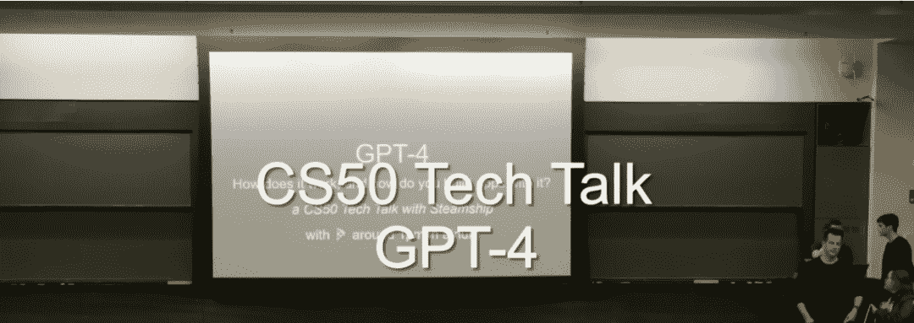

# GPT-4是如何工作的？哈佛教授亲自讲授

> 来源：[https://agijuejin.feishu.cn/docx/DyXmdXCuZoYJHsxzuNZcNfN6n6d](https://agijuejin.feishu.cn/docx/DyXmdXCuZoYJHsxzuNZcNfN6n6d)

> 作者：机器之心

> 原文：https://www.jiqizhixin.com/articles/2023-06-14-2

> 这门课程介绍了 GPT-4 的基本概念、工作原理和应用前景，展示了其在各种场景下的强大能力。 课程内容不要求很多专业知识，所以小白照样听得懂，快来看看吧。

GPT-4 是一款多模态预训练大模型，于 2023 年 3 月 15 日发布，是 ChatGPT 的升级版本，能接受图像和文本输入，再输出正确的文本回复。

GPT-4 实现强大的识图能力，将文字输入限制提升至 2.5 万字，还能够生成歌词、创意文本，实现风格变化。实验表明，GPT-4 在各种专业测试和学术基准上的表现与人类水平相当。GPT-4 在自然语言理解与生成任务中表现出强大的能力，为未来语言智能的发展提供了新的契机。

GPT-4 将对多个行业产生深远影响，信息、教育、医疗、金融、法律等领域都将被涵盖。人们使用的办公软件、搜索引擎也会有革新。可见对 GPT-4 有基本了解和应用将是极大的需要。

哈佛 CS50 跟随技术发展，新加入了课程介绍 GPT-4。这节课程可以帮助大家形成对 GPT-4 的基本认知和初步应用。

听完这节课，你将了解 GPT-4 的基本概念、工作原理和应用前景，并深入了解其在各种场景下的强大能力。如果想听 GPT-4 入门完整课程，请点击视频观看。

该课程作为介绍类课程，不需要具备专业知识的储备，轻松的课堂氛围、诙谐的示例讲解，都能够让有关 GPT 的知识直击你的大脑。已经听过的网友们表示这堂课程十分值得一听，对每一位听众都会很有启发。

网友纷纷表示：哈佛的 CS50 课程总是令人惊叹。

**讲师介绍**

本节授课教师为 David J.Malan，是哈佛大学计算机工程与应用科学学院的高级讲师，也是 CS50 课程的主讲师之一。CS50 作为哈佛最大的课程，是对电脑编程零基础或初学者的一门课程。通过这门课程学生能够学会如何熟练运用 C 语言编程，运用 Linux 系统以及网络编程，还能够教会学生如何用算法思考并有效解决问题。

参考链接：

https://twitter.com/dotey/status/1655081670234501120

https://www.edx.org/course/introduction-computer-science-harvardx-cs50x

https://www.youtube.com/watch?v=vw-KWfKwvTQ&t=1799s

https://www.youtube.com/watch?v=vw-KWfKwvTQ