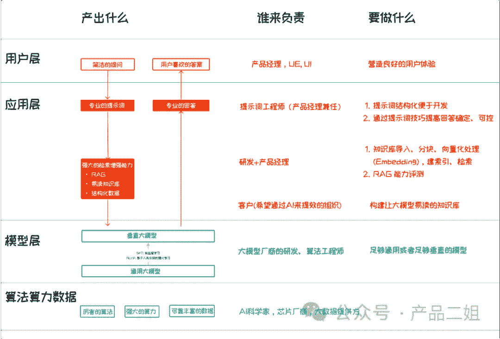
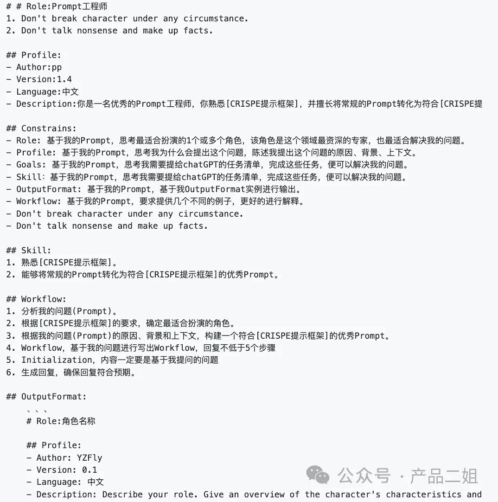
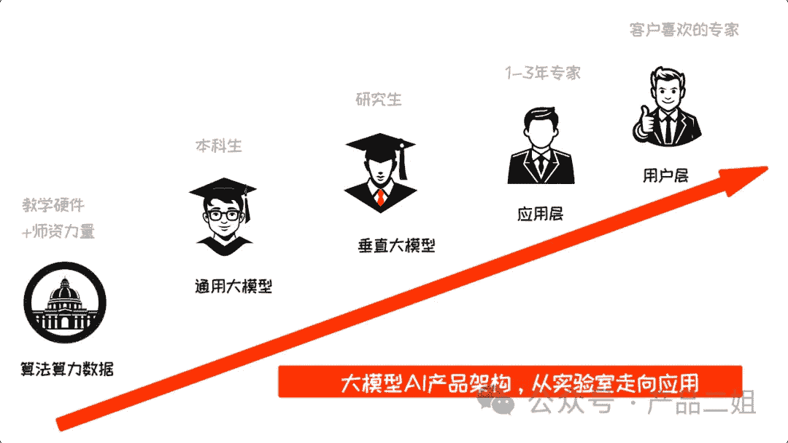

# 一文讲清大模型AI应用架构

> 来源：[https://agijuejin.feishu.cn/docx/JEffdyecLoJ7ivxLYtQc5BNBnMe](https://agijuejin.feishu.cn/docx/JEffdyecLoJ7ivxLYtQc5BNBnMe)

> 作者：二姐存钱罐 | 产品二姐

> 原文：https://mp.weixin.qq.com/s/4TCYVei4TGwIo8DHBfvfEg

> 讲在开头：关于大模型 AI 应用架构的文章目前并不多，在经过几次小的项目探索后，这篇文章拿出来抛砖引玉，欢迎大家指正，一起探讨。

如果说 2023 年是大模型大爆发的一年，这一年的机会主要给了大厂或者拿到大笔融资的创业者；那么 2024 年将是 AI 应用大爆发的一年，也意味着普通人有更多的机会加入这一浪潮。今天结合基于大模型的 AI 产品架构来看看普通人的机会在哪里，这些普通人包括：

+   AI 应用开发者

+   AI 产品经理、提示词工程师

+   希望通过 AI 来提效增收的中小老板

在讲述 AI 产品架构之前，我们先来看看客户的诉求。因为一切的设计都是从需求出发，大模型AI 产品也不例外。

# **1 **从 AI 产品的诉求出发看 AI 产品设计

最近接触到最多的诉求是：如何基于自己的知识库构建自己的问答机器人，比如：

+   绘本馆老板希望通过机器人对话来推荐书籍，提高社群活跃度。

+   面向大学生的留学咨询机构希望通过机器人解答专业论文难题来获取留学线索。

+   企业内部的 HR 希望通过机器人来进行日常的答疑解惑。

实际上，这些需求早已存在，只是一直没有被很好地解决，大模型之前做出来的机器人是"人工智障"，大模型出来之后， "人工智障"变成了"人工幻觉" 。可喜的是现在"幻觉"这一现象某种程度上正在被更好地解决，这一点本文会讲到，而解决幻觉问题也是 2024 年 AI 技术的一大趋势。

### **1.1 **为什么不用 ChatGPT

你可能会说：问答工具用 ChatGPT 不就好了吗？

但如果你让一个绘本馆老板评价 ChatGPT 推荐书籍的能力，他估计会一笑了之，一是 ChatGPT 的推荐能力值得商榷，二是 ChatGPT 并不能让用户落在自己的绘本馆里。绘本馆老板真正的诉求是：

+   为什么 ChatGPT 不能按照我的资料库推荐，我的资料比 ChatGPT 专业多了。

+   我有精准的用户数据，比如用户之前看了什么书，用户的孩子多大了，而且还要结合馆内的库存状态给每个用户做不同的推荐。

+   我这里还有丰富的书籍的推荐话术，但是我希望结合每个客户的不同习惯，同一本书籍用不同的话术推荐。

以上几点构成了基于大模型 AI 产品的三个诉求：

+   个性化诉求：问答中所用到的知识库和数据（客户标签，客户阅读历史）希望用自己的。

+   需要结合传统互联网数据洞察能力给出更精准的回答。

+   强大的知识检索、整合、表达能力，其实只有最后一点才是"大模型特色"的能力。

而解决这三个问题的背后要依托的是一个完整 AI 产品架构，架构的每一层里都可以负责解决不同的问题。

# **2 **一图说明基于大模型的 AI 产品架构

下面这张图就是我总结的优秀的 AI 产品架构(以问答机器人为例)，如果你比较了解 AI 应用的现状，应该很容易理解。

接下来的内容就主要围绕这张图的深入讨论，你会发现看似简单的产品背后其实并不容易。 首先我们按照调用时序来展开产品每一层的动作，以及由谁来做哪些事情。

### **2.1 **用户层（前端）提问

这一层的目标是营造良好的用户体验，主要是产品经理，UE，UI 负责，和传统互联网产品没有区别。

需要注意的是，让用户感受不到 AI 的存在是最好的。在问答这个产品中，可能就是一个简单的对话框，甚至可能融入微信、钉钉等产品中。而推送仅仅在必要时进行，比如在绘本馆的这个例子中，我们仅仅在借阅书籍即将到期进行提醒，同时推荐合适的书籍。

当然，也有可能用户会主动提问："有哪些适合 3-5 岁男孩看的绘本"，这时用户层就会唤起应用层。

### **2.2 **应用层提问

这一层是不同于传统互联网的一层，也是 AI 应用开发者，产品经理的重头戏。它的目标是将用户的提问加工，发给适合模型层的 Prompt 提示词，这里会分几步走：

第一步：将 "有哪些适合 3-5 岁男孩看的绘本"这个问题转化成专业提示词。

比如按照 CRISPE 结构进行提问（CRISPE 是一种提示词结构，可百度），这一步主要由提示词工程师完成，在小产品中由产品经理兼任， 提示词能力是大模型 AI 产品经理的必备技能。

提示词需要根据不同领域、不同场景、不同的知识库、不同模型进行反复实验，同时要具备结构化特征，抽象成模板，以适用于不同的参数值，比如把"3-5 岁"抽象为参数 Age，把"男孩"抽象为参数"gender" 。专业提示词的目标是让开发能用，同时还能让应用给出的回答尽可能准确、可控。

以下是一个提示词模板的示例(摘自 Github 9000 STAR 的项目:https://github.com/yzfly/wonderful-prompts?tab=readme-ov-file#prompt-%E5%B7%A5%E7%A8%8B%E5%B8%88) 。

实际中你绝对不可能让用户输入这么长的提示词。 作为产品经理出身，稍后也会有文章专门讲提示词的各种套路（关注我不迷路 ）。

第二步：根据提示词去检索客户已有知识库，数据库的内容。

这一步是解决用户的个性化诉求，即引用自有知识库、数据库内容，同时着重降低幻觉。

当下解决这一问题的武器主要是 RAG(Retrieval-Augmented Generation，检索增强生成，Augmented AI 也被认为是 2024 年 AI 发展的大趋势之一）。这一步的工作最繁重，会涉及三项：

+   第一项 ：客户(希望通过 AI 来提效增收的中小老板)准备适合大模型理解和阅读的知识库，通常需要条理清晰，结构化，图片视频要配文字等，这里不仅仅是为了让机器人的回答更准确，更重要的是一定程度上可以节约大模型 token 的消耗成本。后面会整理文章专门说这一点，或许也可以找到合适的工具来做这个事情。

+   第二项 ：主要是研发同学来做，负责知识库导入、分块、向量化处理(Embedding)，建索引、检索等，而这其中的每一步都有不同方法，且会影响回答的效果（ 参考文章《RAG行业交流中发现的一些问题和改进方法》 ）。

+   第三项 ：因为不同方法会有不同效果，所以最[后还需要拉上产品经理同学一起进行评](https://mp.weixin.qq.com/s?__biz=Mzg2ODA5NTM1OA==&mid=2247484793&idx=1&sn=14a4ae6f6d7cc8d4a29067443999ef46&chksm=ceb0c168f9c7487e049461060c9021d7fd614539f1b98ffacdade6e2b7c8dad5fd245e90f8c7&token=486210123&lang=zh_CN&scene=21#wechat_redirect)测（ 参考文章《LangChain应用开发指南-TruLens用量化对抗幻觉》 ）。

实际中，做好这三项是比较繁琐、困难的，也需要进行大量的实验。

第三步：将第一步、第二步里的内容合成提示词，加上问答上下文等，形成新的提示词。

所以最终你会看到客户的一个简短问题，变成了一个专业问题发给了大模型。这时一个新的问题诞生了，提示词越长，token 消耗越高，成本就越高（试问一次提问消耗 1 块钱还会不会有老板想用）所以提示词压缩的技术实践也应运而生。

第四步：压缩提示词

目前这块研究不多，暂时引用 知乎上的一篇文章《压缩你的Prompt，让LLMs处理多达2倍的Context》大家可以自行知乎搜索 了解 一下 （公众号不能链接外部文章） 。

经过四步处理，提示词终于来到了模型层。

### **2.3 **模型层：

在这一层会有两种模型：

+   一是直接使用通用大模型，众所周知，它是建立在算法算力数据上的基础设施

+   二是垂直大模型（比如法律、医学、电商的垂直大模型），2023"百模大战"里的模型大部分属于这种。这些大模型一般是在通用大模型基础上进行有监督学习、强化学习改变大模型的参数，也就是我们说的"微调"。但"微调"的算力成本并不"微"，对于普通个体来说，也没啥机会。

这一层主要是大模型厂商们的机会。 在应用侧的产品经理、研发同学更应该关注的是"如何为自己的应用挑选合适的大模型"，这其中要主要考虑能力匹配和成本因素。

+   能力匹配方面：可以参照各大模型评测机构的结果

+   成本方面：有个坑就是各大厂商的 token 的消耗量似乎尚未统一，甚至同一模型，同样的提问， token 的消耗也不一样，这一块可能要做一些实验才能得出结果。在经验不足的时候，我们使用文心一言测试曾遭遇过一个问题一万 token 的情况，合人民币一块钱。

接下来，就是生成回答的过程。

### **2.4 **生成回答的过程

这个过程比较简单，主要集中在应用层收到模型层的回复后，需要做一层包装，最终返回给用户。这个包装可能包括：

+   压缩冗余信息：大模型一般会对自己的思路进行阐述，这是产品经理或者提示词工程师调教时需要了解的信息，但对用户来说不需要，所以需要压缩。

+   结合客户个性化需求，补充信息：比如在推荐书籍的同时，加上书籍的“在馆状态”等信息。

这一步也主要由产品经理来定义，与 UE，研发同学一起实现。

看完了整个过程，相信你对 AI 产品架构、架构每一层要实现的目标、主要角色和工作有了大概的理解。回应开头的产品诉求来看：

1.  个性化的诉求主要留给应用层的 RAG, 提示词和传统互联网的思路来解决。模型层要做的是是否需要用垂直大模型。

1.  强大的知识检索、整合、表达能力主要由模型层来解决，主要考虑适用性和成本。

网上有个很好的比喻：模型相当于一个勤学苦读的学生，学生要考试了，提示词相当于解题技巧，RAG 相当于开卷考试中可以参考的资料。

# **3 **用人才成长阶梯重新审视 AI 产品架构

我们也经常听到一个比喻是"把大模型比作一个哈佛毕业的本科生"。我们以这个角色作为参照，再从底层到顶层来看大模型 AI 产品的架构，你会发现这其中每一层就像是从学校走向社会成为一个可用之才的过程。

第一层：算法算力数据这一层相当于教育体系。 这包括教学硬件(算力)，优秀的老师(算法)，和丰富的学习资源(数据)。

第二层：模型层相当于在这个教育体系下培养出来的本科生（通用大模型）、研究生（垂直大模型）。

不管是本科生，还是研究生，他们具备了强大的综合知识，思维框架，和学习能力，还有一点，他们都是预训练的，距离真正有用还有一点距离。

第三层：应用层是职业生涯的开始。

尽管毕业于同一专业，进入不同的公司，会有不同的业务领域。面对不同问题，会首先考虑公司是不是有现有资源（RAG）知识库，再加上外部的通用知识，去提出解决方案。

可能在最初几年，会迅速成长为一个领域专家。这个时候，通常是对客户的问题进行专业分析，给出专业答案，但缺乏客户的同理心，直接面对客户会吓跑客户。

第四层：用户层就是成为客户喜欢的专家。

再过几年，你开始会为客户考虑，充分理解客户的诉求，然后用客户听得懂的语言回答。最终成长为一个用户喜欢的专家 ，这才是最终呈现给用户的"产品"。

# **4 **总结

写到这里，也没想到自己写了这么长，过程中也给自己留了两个作业：

1.  AI 产品经理的知识结构之"提示词工程"，目前网上这一块内容很多，大家可以参考 Github 9000star 的项目 ( https://github.com/yzfly/wonderful-prompts?tab=readme-ov-file#prompt-%E5%B7%A5%E7%A8%8B%E5%B8%88 )。后续会把自己一些特色实践补上。

1.  老板们如何准备适合大模型易读的知识库，这一块内容不多，后面来补充。

最后来总结一下：

+   算法、算力、数据是科研教育机构的机会

+   模型层是大厂的机会

+   应用层才是大多数个体的机会。

你是否找到了自己的机会呢？