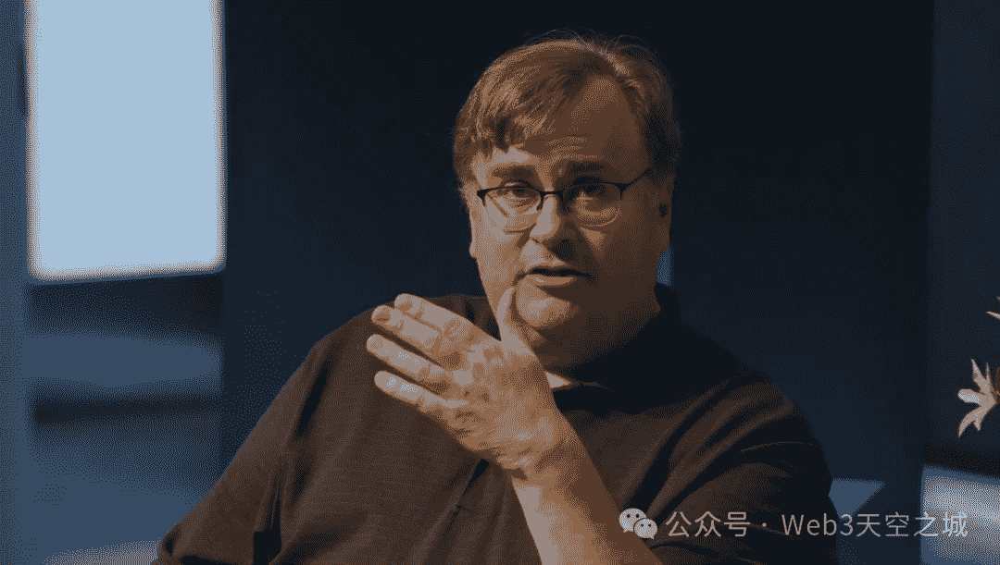

# 硅谷大神Reid Hoffman最新谈GenAI现状与未来：2万字全文+视频

> 来源：[https://agijuejin.feishu.cn/docx/WtjudlqUpoga5jxVdGwceoV4n3g](https://agijuejin.feishu.cn/docx/WtjudlqUpoga5jxVdGwceoV4n3g)

> 作者：天空之城城主 | Web3天空之城

> 原文：https://mp.weixin.qq.com/s/uF5Di3NPmESHQ7ZnfvjGvQ

日前，哥伦比亚大学商学院展开了一场别开生面的炉边谈话，LinkedIn创始人里德·霍夫曼(Reid Hoffman)与哥大商学院院长考斯蒂斯·麦克洛里斯(Costis McCloris)共同探讨了人工智能和数字经济的未来图景。

B站传送： 【 精校】硅谷大神Reid Hoffman 哥伦比亚商学院访谈【中英】-哔哩哔哩】

https://b23.tv/gLN7bFw

Reid Hoffman是谁？美国著名的互联网企业家、风险投资家。主要成就包括:

1.  联合创立了职业社交网站LinkedIn，并担任执行董事长。LinkedIn于2016年被微软以262亿美元收购。

1.  作为PayPal的创始董事会成员，参与早期运营。PayPal于2002年被eBay以15亿美元收购。

1.  是硅谷著名风险投资公司Greylock Partners的合伙人，投资了Facebook、Airbnb、Zynga等知名科技公司。

1.  被誉为"硅谷最成功的天使投资人之一"，在美国商界和创投界具有广泛影响力。

作为硅谷人脉最广的企业家和投资者之一，Reid在打造LinkedIn、PayPal等明星公司的过程中建树颇丰，并参与孵化了Facebook、Airbnb等一系列独角兽。他还与人合著了5本畅销书，最新一本还"网罗"了GPT-4作为"特邀嘉宾"。

而考斯蒂斯则是哥大商学院的"掌门人"，在其治理下学院实现了从传统商科教学向前沿科技教育的华丽转身。

Reid形象地将 **当下的AI浪潮比作"心灵的蒸汽机"，**标志着一场认知工业革命的序幕已然拉开。 在他看来，算法创新仅仅是"前菜"，当前的AI模型已经具备"赋予人类超能力"的巨大潜力，比如GPT-4能帮助我们深入洞察数据关联、发掘事物规律，并做出更精准的预测。在讨论中，二人还对比了开源VS专有模型、通用大模型VS特定领域小模型等话题。Reid认为， 随着我们与AI协同，迭代式思维和游戏化交互将成为常态。 同时AI将极大拓展人类的想象力和创造力边界，即便是艺术细胞欠佳的人，也能凭借言语实现"脑洞"到"眼前"的飞跃。

技术进步的速度同样令人瞠目。Reid指出，算力、数据的飞速增长以及Transformer等新范式的诞生，催生了过去十年AI能力的爆炸式提升。 这股势头短期内大概率会持续，直到遇到类似摩尔定律的瓶颈。

**对于AI开源的利弊，Reid给出了自己的看法。他指出 **开源社区在推动技术创新方面起到重要作用，但模型一旦开源就意味着失去可控性，存在被滥用的风险。 因此，发布前应当对模型严格审查、负责任地管控。在大模型与小模型之争上，相信随着通用大模型能力不断增强， 针对特定场景定制的小模型仍大有可为，未来或许会出现大小模型协同的局面。

谈到硬件发展，Reid高度评价了NVIDIA在GPU创新上的不懈探索，但同时预言其短期内将面临激烈竞争，因为很多玩家正试图在芯片和软件上另辟蹊径。他相信 未来几年NVIDIA芯片需求量依旧可观。

关于数据问题，二人一致认为， **数据访问的规则应该与信息获取遵循同样的逻辑，即**个体是否拥有对相关内容的合法访问权限。 在确保隐私和安全前提下，对高质量数据的获取将助力AI模型发挥更大价值。医疗助手、智能法务等面向大众的垂直应用正是很好的方向。

Reid还分享了自己 **在AI领域的投资理念和实践 **。在他看来， **判断一项技术的投资价值，要看其在提升个人、组织乃**至整个人类福祉方面是否具有变革性潜力。 对于那些描绘了美好愿景、拥有优秀创始团队和计划的企业，投资的时机自然成熟。 OpenAI就是他押中的一匹"黑马" ，与马斯克、奥尔特曼的交流更坚定了他在AI造福全人类方面的信念。他披露，当前几乎所有打着AI旗号的项目都不乏投资者追捧，有点类似互联网早期的盛况。

基于自己创业、管理的丰富经验，Reid还就快速成长**期的公司治理分享了真知灼见。在他看来， 硅谷一**个被严重低估的法宝就是"闪电式扩张"，即公司快速壮大时对"拥抱混乱"的包容度。 组织结构的重组、岗位的调整、高管的更替在所难免，但目标不是追求尽善尽美，而是要为犯错留足空间、及时止损。 除了理性判断力，同理心、接纳变化的心态和快速决策的能力也不可或缺。 互联网时代的竞争早已突破地域界限，变成全球化的角逐。只有 保持高频的OODA循环(观察、定位、决策、行动)， 才能在瞬息万变的赛道上笑到最后。

**关于AI对就业的影响 **，Reid提出了与众不同的见解。他认为打工人被AI颠覆只是时间问题，因为AI在许多具体任务上的表现已胜过人类。但从乐观的一面看，新的岗位需求也会随之而来。 关键是要善于用AI工具为己所用，"人机结合"反而能让自己更具竞争力。 一个最直观的例子是，客服将从机械化的电话答复升级为用情感化的沟通来建立品牌忠诚度。总的来说，就业市场正在加速洗牌，唯有顺应科技浪潮，练就一身硬核技能，方能立于不败之地。

当被问及 **如何看待政府对AI的监管 **时，Reid给出了自己的见解。他主张监管的重点应该是明确界定预期目标，为产业发展创造良性环境，而非简单地"踩刹车"。此外，科技公司也应积极承担社会责任，投身教育事业，与各界携手构建行业标准。只有监管与创新并行，用包容审慎的态度对待新生事物，我们才能驾驭好智能革命的"狂澜"，让AI造福人类。

最后，当被问及 **对年轻人的职业建议 ****时，Reid强调，机遇往往藏在风口之中。他 建议大家把眼**光投向软件、人工智能等前沿领域，主动去学习、去结交人脉，而非局限于某个具体的公司。 他以Airbnb的成功为例，阐释了想象力和行动力的重要性。在当时，Airbnb的商业模式饱受质疑，面临着诸多监管和道德风险，但Reid却凭借敏锐的洞察力和魄力，力排众议投资了这匹"黑马"。事实证明，他的远见卓识得到了最好的回报。

===

附：以下是完整访谈的天空之城书面版：

好的，各位晚上好。我是斯蒂芬·迈耶，担任商学院的詹姆斯·B·戈尔曼商学教授。我非常高兴欢迎大家参加今天的炉边谈话，我们将讨论塑造人工智能和数字经济的未来。这是新演讲者系列的一部分，这是一个独特的系列，旨在成为商业远见者分享他们的见解，设定和实施雄心勃勃的目标，以及激发新创新的平台。有谁比里德·霍夫曼更适合作为演讲者呢？

因此，我很荣幸地欢迎并介绍我们的两位嘉宾，LinkedIn 和 Inflection AI 的联合创始人、Greylock 合伙人 Reid Hoffman，以及哥伦比亚商学院院长 Costis McCloris。很高兴你能来到这里，里德。他希望我对他进行简短的介绍，但我想稍微详细一些。

他被誉为硅谷人脉最广的人，我相信他可能也是最忙碌的人之一。他是一位非常有成就的企业家和高管，作为投资者，在打造 LinkedIn 和 PayPal 等领先消费品牌的过程中发挥了重要作用。他在 Facebook 和 Airbnb 等许多公司中也发挥了重要作用。他还与人合著了五本畅销书，尽管他的最后一本是与一位非常强大的合著者 GPT-4 合作的。我确信他们谈论这是否是作弊或聪明。

他不仅参与商业活动，还参与许多慈善事业，并因此获得了很多奖项。对我来说最引人注目的是英国女王授予的大英帝国荣誉指挥官，我认为这很酷。以及马丁·路德·金中心颁发的向伟大致敬奖。欢迎里德来到哥伦比亚商学院。

他将与科斯蒂斯·麦克卢里斯进行讨论。科斯蒂斯是哥伦比亚商学院第16任院长，也是David and Lynn Silphan商学教授。他是一名电气工程师，后来成为商学院教授、商学院院长。在他的领导下，我认为学校发生了巨大的转变，特别是在教育领域的领先和拥抱技术方面。

鉴于他的远见卓识，他对我们项目的 STEM 认证发挥了重要作用，推出了 MBA、工程学硕士双学位和许多举措，包括数字未来计划，这是我所关心的，因为我是其中之一是教职联席主任的，也是这里共同赞助的。这是我们商学院的新智囊团。我们的目标是让学生们为下一个世纪的数字化转型做好准备。帮助组织、政府和社区了解、利用当前和未来的数字颠覆浪潮并从中实现繁荣。所以我非常期待我们正在进行的讨论。

言归正传，让我们欢迎 Reid Hoffman 来到哥伦比亚商学院，欢迎你们，然后将其交给McCloris。

McCloris：

我正在思考这次谈话，我意识到它可能会采取很多很多不同的路径。我们可以谈论早期的互联网和 PayPal 时期。我们可以谈论建立最成功的社交网络之一 LinkedIn，以及这段业务超大规模扩张的时期。我们可以谈谈您作为湾区风险投资家的令人难以置信的职业生涯。但我认为也许我们现在应该讨论人工智能。特别是，因为你实际上参与了投资、创办公司、为政府提供咨询，几乎所有这些领域都参与过。我认为，讨论这个问题并听取你的观点将会非常有益。

我们之前进行过一次简短的对话，你提到了“认知超能力”这个词。因此，为了开始我们的讨论，我想请你介绍一下，让我们了解人工智能能力的惊人增长。从你的角度来看，你对此有何看法？你认为我们的发展方向应该是什么？然后我们将从那里开始。

Reid：

从根本上来说，我认为我们正在做的是 创造一种认知工业革命，就像心灵的蒸汽机一样。 作为其中的一部分，它极大地增强了我们的能力。蒸汽机的出现使物理事物变得更加强大，引发了工业革命，推动了运输和物流，促进了制造业的发展。现在，我们正在经历的是一场在认知和语言特征上的革命。这场革命的序幕是由算法的创新拉开的。

当然，这些算法已经存在了几十年，但现在我们正在经历的是一个规模计算的革命。事实上，你可以应用数千、数万个计算单元、图形处理器（GPU），并且它改变了我们构建系统的方式，从编程转变为学习。这就是为什么你需要数据和其他所有资源的原因。

我们仍处于起步阶段，因为虽然这些人工智能、这些代理、这些模型已经学到了非常有趣的东西，但它们才刚刚开始理解数据关系、交易范式、计算规模以及所有这些因素的影响。但例如，GPT4 已经赋予我们超能力。

所以，如果你说，我想让一位专家告诉我这两者之间的相互关系。专家部训练人工智能的模型和博弈论，我相信我们可能可以找到 20 或 30 个可以做到这一点的人。然后你说，我想要这个，加上它与海洋学的相似之处。零人类。GPT4 可以做到这一点。

现在，这样做的想法，问题是，在某种程度上，当你使用这些设备时，你得到了什么，这就是你带来的。例如，在教育背景下，你说，给我写一篇关于商业战略的精彩文章，但它可能并不会写得那么好。它会连贯，我们已经写好了这一切。但是你会说，我想要了解数据和制造的交集将如何影响全球某些供应链中通用机器人和专用机器人的情况。假设这些材料越来越贵，而那些材料越来越便宜，你可能会得到更好的东西，例如，它仍然对它们的运作方式有用。这就是我所说的认知超能力。

自从我写了这本书以来，我意识到思维模式正在发生变化的一件事是，随着我们学会深思熟虑和深入，我们的思维模式将变得更像电子游戏。因为与长途跋涉试图得到一个大创意相反，你坐下来开始敲打，然后说，这是一个提示，哦，这不是很有趣，但这里还有另一个，哦，等等，也许我应该继续这个。我认为我们会有更多的，我们将拥有这种思考和推理的能力。以更好的方式参与这个迭代过程。

显然，将会有很多不同类型的超能力，因为，例如，我的艺术能力非常有限，但如果我有一个想法并且我可以描述它，我可以去大理或中途开始创作拿东西。这也拓宽了事情的范围。因此，如果我想为我朋友的生日制作一张卡片，想做一些具体的事情并有一个视觉创意，那就是另一种形式的超能力。这些只是所有事情的姿态。

我认为我们对语言所做的任何事情都是开始放大的最低限度。

当你考虑变化的速度时，人们已经知道你提到的很多事情已经有一段时间了。计算是我们在过去 10 年里开始大规模应用的技术。数据是我们在过去 10 年里开始大规模应用的东西。Transformer技术大约在七年前被发明。然而，从某种意义上说，我们已经看到了其能力的急剧增长。

您认为这种情况还会继续吗？

所有的指数曲线最终都会变成S曲线，所有的J曲线最终也会变成S曲线。但我认为这种情况肯定会持续几年甚至更长时间。任何声称他们肯定知道这种情况将在未来几年继续存在的人，可能是出于某种意识形态或愿望，或者其他原因，他们认为这种情况肯定会发生。但是，所有这些事情最终都会发生。

S曲线的一部分，我认为有些人会犯的错误之一，就是他们会认为三年后就会变得超级聪明，他们会问，你能得到这条能力的S曲线吗？这是由更大规模的计算驱动的吗？他们会说，这就是智商曲线。但这并不完全是一条智商曲线。你所做的推论、判断实际上并不是同一件事。现在，一些功能正在呈指数级增长。但这与智商并不是一回事。

当你思考时，你处于投资的有利位置，涉及到整个AI生态系统的各个方面。您对开源与专有模型或类似的东西有什么看法？我们如何加速增长，使其更具普及性，或者您对此有什么看法？

我在LinkedIn担任Mozilla董事会成员近11年，我们开源了许多不同的东西。我通常认为开源各种形式的软件（类似于公共和开放科学）具有很大的价值。这些模型有很多功能。开源模型的问题之一是让它们普遍可用，将功能交到每个人手中。现在，如果您说，嘿，我们可以开源它们，但只能是学术机构，只能是企业家，只能是政府。有些政府就不那么容易了。但开源的问题是，一旦模型走出谷仓，它就会无限地存在。就像我们在今年的选举中肯定会看到的一件事一样，就是使用这些不同的开源模型来生成内容，试图在选举中破坏我们的信息系统。这就是我们必须努力克服的问题。

现在，我认为我们也可以使用人工智能来帮助解决这个问题。但我对开源这些模型更加谨慎的原因是，它也会放大不良行为者，无论是流氓国家、网络犯罪分子、恐怖分子等等。如果这些人有开源网络浏览器，我就很好。他们对此无能为力。再次强调，这是一个开源数据库，他们对此无能为力。这些模型赋予他们超能力，但可能危害更大。

我们已经通过共享充分开源了吗？

其中一些模型是。因此，对于某些用例，例如大规模的政治错误信息，开源模型目前可以做到这一点。其中一些，例如我们将看到网络攻击的增加，我们已经看到网络攻击的增加，并且将继续增加，因为网络钓鱼等类似于错误信息。然后是其他一些领域，我认为到目前为止我们还没有扩大范围，例如生物恐怖主义等。但是，如果你只是继续开源所有东西，你就无法控制这些负面情况，其中一些情况很严重。所以，到目前为止，有一些问题，但没有五级火警。但是如果你不小心，我们会很快达到五级火警。

好的，让我换个话题。

我们已经走上了你之前提到的道路，大规模计算，大规模模型，以及构建具有通用属性的基本上基础模型，然后我们将其部署到不同的应用程序中。另一种观点是，与其构建大规模通用模型，不如构建较小的针对特定应用的模型。而且，正如你在工程领域所知道的那样，这种情况已经发生了很长很长时间。您如何看待目前的情况？双方都付出了很多努力，您观察到了什么？

我认为双方的努力都会取得很好的成果。当我们观察GPT-2、3、4时，可以看到，例如，对GPT-3进行了某些情况下的微调，然后GPT-4在大多数情况下都表现得更好，甚至GPT-3.5也是如此。因此，到目前为止，我们可以看到，随着模型规模的增大，它们的能力也在提升，变得更加强大，更有能力。如果你把它看作是一种研究助理，它可以立即、快速、随需应变，并且会产生一些幻觉问题，尽管他们正试图通过搜索和其他方式来解决这个问题。这就是说，你永远无法将幻觉问题降到零，但你可能会让它大大低于人类标准，在这种情况下，就我们的目的而言，这非常接近于零。或者说，至少已经足够好。因此，大规模模型的能力有了惊人的提升。

然而，你可能有理由想要一个较小的模型。它在手机上运行，运行起来更便宜，它只需要做一些特定的事情，或者它有一个不同的训练区域，你希望它在那个区域的生成性要好得多，错误要低得多，你不关心其他一切。这就是为什么我认为，未来不可避免的一部分是它不会只像一个模型。当你创建代理或创建某种应用程序时，你将部署多个协调的模型。

现在，让我们稍微切换到硬件方面。

您提到了计算硬件，首先想到的是NVIDIA，GPU，大型集群。五个月前我在这里与NVIDIA的Jensen黄仁勋进行了交谈，当时他的公司刚刚突破一万亿，而现在他们有2.3万亿左右。您如何看待目前尚未商业化这一事实？台积电似乎并没有从其生产这种超尖端集群的能力中赚取可观的租金，您认为这种情况会持续下去吗？您认为硬件是这场革命的必然推动因素，还是随着时间的推移会商品化或饱和的东西？

我认为NVIDIA做了很多出色的工作。他们并没有专门为AI或加密创建GPU，而是创造了一个非常好的数学处理器，这与那些情况有关。我认为，这是资本主义、发明等的好处之一，我认为NVIDIA不可避免地会面临激烈的竞争。尽管英伟达做出了巨大贡献，拥有出色的团队、出色的建筑和设计文化，但没有什么可以从结构上阻止它。因此，我认为未来几年英伟达芯片的需求量仍将非常大，但我知道有很多人努力创造替代芯片、替代程序，这就是市场有需求时会发生的情况。所以我认为，也许一两年后，你就会开始看到一些芯片，至少，它可能还不适用于训练，但将有助于我们所说的行业推理，即为模型服务，为结果服务。而且，我看到很多初创公司在推销，我看到很多大公司也在想办法以有趣的方式做到这一点。

你提到训练，你可能需要尖端技术。推理，也就是当我训练了模型，现在我正在执行查询以获得响应时，我可能需要专用硬件，但更简单，不同的硬件。

是的。

现在，让我们谈谈数据。这些系统正在吸收大量数据，包括我们的数据。我们是否已经用完了新数据来提供数据，这两个问题都存在？

我不认为是这样。

但另一件事是数据所有权问题，你对此有什么看法？我相信你会全面地思考这个问题，包括正在发生的OpenAI的所有事情等等。

这是一个复杂的问题，大多数人对此并不十分了解。

有时候，我们会遇到一些问题。比如，我听到有人在拍照。这就像有人在房间里给我拍照一样。那是你的照片吗？还是我的照片？或者是我们的照片？数据又是什么呢？我可能已经签署了一些免责声明，这可能是你的照片。但这是一件复杂的事情。

数据的价值是什么？它的价值数据是什么，它是如何形成的，它是由什么组成的？所以，我的第一印象是，当你训练这些模型时，就像在阅读一样，对吗？因此，管理数据的规则应该与管理阅读的规则相同，即你是否有权合法访问你正在阅读的内容？你买了这本书吗？等等。

那很好，因为那就是阅读。版权法不保护我购买一本书或将其赠送或出售给你，然后你阅读它，这就是其中的一部分。它确实阻止我做的是我买了这本书，然后我就想，哦，我要重做这本书并开始自己销售，等等。所以我认为这就是你想要在数据方面的细微差别。

显然，在很多地方你都会说，有些东西是我的私人数据，我不想在任何地方泄露。这些生成模型并不是特别擅长知道那是什么时候。因此，我们不要将这些数据输入生成模型本身。现在，部分原因是生成模型更像是推理引擎。人们经常将其视为数据库。但要到达推理引擎，这是因为你有一堆数据到达那里，但它是一个推理引擎。

我对《纽约时报》的法律案件感到困惑的一件事是，看，它转载了这些文章。你剪切并粘贴了文章的前半部分，然后说完成它。它以前就学过这些东西。现在，有权访问文章前半部分的人可能可以访问整篇文章，并且这可能仍然是一个合法的案例。我不清楚这里有什么危害。

如果你说，给我一篇文章，给出标题并生成它，然后你说，好吧，你正在提供《纽约时报》正在销售的东西，而这个人还没有购买它。那么这将是一个问题。我不认为这些模型会这样做，因为他们受过训练不这样做。

因此，数据方面存在许多不同的复杂性。我认为这个问题，例如，你正在接受互联网上广泛提供的内容的训练。我在互联网上发布。我想说的是，大家请读一下这篇文章。一个人工智能模型阅读它并接受训练，这让我觉得这是对这项技术的合理使用。

我认为我们希望这些模型的存在非常重要。这是我们在上台之前快速讨论过的事情之一，有了这些人工智能模型，我们就知道如何创建一个可以在每部智能手机上运行的医疗助理。无论你是否有机会看医生，每个人都可以使用它。

显然，它甚至可以以一种方式进行训练，比如说，嘿，你能看医生吗？如果你有，那太好了，让我告诉你一些事情，你应该马上去看医生，这就是你要告诉他们的。或者，你可能没事，但这些是你可能想和你的医生商量的事情。如果你没有机会看医生，然后说，看，我不是医生，但这是你可能会考虑的事情，那可能会很棒。

还有导师，还有一堆其他事情。或者，比如说，你请不起律师，你正在看一些类似合同的东西。实际上，存在一些方法可以帮助我们解决这个问题，这是一件好事。因此，一般来说，我认为我们应该期待这些模型得到训练。我们的主要问题并不是模型是否应该训练，而是我们应该确保尽可能多的人能接触到这些模型，以便帮助全人类，而不仅仅是富人或富裕国家。无论如何，这只是对某些数据的初步印象，但它显然非常复杂。是的，这是一个不断发展的话题，我们就这么说吧。

你提到了OpenAI。你是OpenAI的早期投资者之一，然后你开始了人工智能的转变，你已经在这方面进行了各种投资。那么，是什么促使你帮助启动OpenAI并继续关注它？你是如何评估人工智能投资的？你现在已经从事这个工作八年了，或者具体来说，OpenAI投资是在2015年还是2016年？

是的，我没有历史学家的记忆，所以我必须查阅文件才能得到准确的答案。

最初，我想我会成为一名学者。我在牛津大学攻读哲学学位，我决定通过帮助创建软件来对世界产生更大的影响。我实际上从未想过我会成为一名投资者。投资并不是我的直接目标，问题是我如何帮助构建正确类型的项目？因此，最初我更倾向于创业或产品创造。当我研究这些技术时，我通常会看到的东西。作为一个专注于软件的专家，我进行了一些非软件投资，但大部分都是慈善事业。

我认为，对于气候变化，核裂变和核聚变是关键，所以我会对此进行一些投资。有时你会看到一种你真正认为世界上应该存在的产品，所以你会投资它。当我进行这些投资时，我会将这些投资视为零，因为我不知道如何预测一系列结果。当然，我希望它们具有经济价值，但事实就是如此。

在软件方面，从互联网开始，然后是Web 2.0，然后是Web 3.0，再到人工智能，我寻找的是那些能够在提升个人、团体、社会、行业和人类水平方面产生巨大变化的东西，以及世界应该是什么样的？如果世界应该是这样的，可以创造一个真正有价值的行业转型，并且有一个企业家或她或他有一个非常好的计划并且拥有资源，那么时机就是正确的，这就是我进行投资的时机。

对于OpenAI来说，它始于我与萨姆·奥尔特曼和埃隆·马斯克的一些对话。看，我们即将迎来这场人工智能革命。我们应该确保有益的人工智能不仅是超大型科技公司的专利，而且具有造福人类的倾向。我并不明显反对大型科技公司。我认为他们为人文学科做了很多事情。但我认为这是一件好事。这也是我在Mozilla董事会任职超过11年的原因。我仍然是Kiva董事会成员。公共利益技术的真正重要问题是什么，而这是一个我们没有很好解决的问题？是的，让我们帮助它开始吧。这就是进入其中。

现在，在那个阶段，也许这里有什么东西，对吧？风险投资的一部分就像是，看看它或A轮融资，这是一个想法。可能有用，对吧？我们来试试吧。然后当你经历的时候，这是我真正学到的事情之一，我认为使硅谷成为一个如此有趣的地方的原因之一是它是一个密集的学习网络。我们都在以极快的速度交换有价值和无价值的物品，因此整个生态系统都在学习。这种情况在融资方式上有所体现，例如种子融资、A轮、B轮、C轮融资等。当你证明了某些观点并展示了一些可能更有可能成功的事物时，你就会进行下一轮更大规模的交易，价格也会更高。你正在为关注它、投资它、选择这样做的人、员工、投资者、客户、合作伙伴等建立一个网络。因此，在OpenAI刚刚起步时，这种规模的人工智能可能会产生一些有趣的成果。我们并不确定，但我们可以试试。我们要确保其治理首先以人性为导向，该子公司是一个营利性机构，由非营利组织管理，并且你知道，它有助于启动。

你如何评价近几年的人工智能投资？

我不确定现在是否有任何软件投资不把自己标榜为人工智能投资，这有点有趣。它非常像早期的互联网，它将会是一些非常了不起的东西。会有很多事情变得有点疯狂，而且不会成功，因为他们在制定战略时并没有真正考虑前景会是什么样子。我认为总的来说，结果，那些生存下来并蓬勃发展的公司将大体上是非常积极和具有联系性的。他们必须看看其中的一些事情，看看他们在做什么。但是，我可以想象一些初创公司可能会产生负面结果。但是，记住，投资者不喜欢被关联。员工不喜欢被关联。客户不喜欢这样做。有很多网络治理，因为当我们思考如何对人性做出反应时，这不仅仅是选民去投票站投票。这也是投票站。它也是顾客。这也是员工。也是投资者。这也是新闻。所有这些事情也创造了治理网络。所以我认为，通常当你度过这个难关时，你通常会得到广泛积极的结果。并非总是如此，但通常如此。

所以我认为，我们将看到任何涉及认知任务、任何涉及语言的事物的转变。我认为我们将看到一种新型药物的发现。我想我们将会，我告诉斯坦福大学长期规划委员会的一件事，可能是七年前，就是说，我看到了人工智能如何成为放大器的视线。每个学科。除了理论物理之外。

甚至可能是理论物理学，对吧？

那么，人工智能会做什么？如果你想自己做这个练习，想象一下，如果它比专门的搜索引擎好一千倍。并且这些学科中的每一个都可以使用专门的搜索引擎。好吧，想象一下好一千倍。这将是一个有用的人工智能工具。并不意味着它会写论文。显然，在某些方面可以。但是，当论文与它们相结合并围绕它进行某种人类概念化时，论文会好得多。

我想稍微转变一下。我们这里有一群主要是MBA学生的人。我想转向领导力。特别是管理这些公司的爆炸式增长和扩张。你已经做到了，你创办了最成功的社交网络公司之一LinkedIn。你管理着它，带领它度过了一段爆炸式增长时期。想到这个你会想到什么？

你可能知道，我确实写过一本名为《闪电扩张》的书。到目前为止，它部分地就像这本书一样，是我所发现的世界。无论是从创业角度来看，你们每个人都应该像自己的企业家一样思考自己的工作、生活和职业。并不意味着您一定应该创办一家公司。也许你应该，也许你不应该，但你应该以企业家的视角来思考你的职业道路。这是第一点。其次，你需要考虑如何与公司和组织建立联盟，以及如何处理权利等问题。再者，你需要理解闪电式扩张，这是硅谷，甚至在某种程度上是中国，以及世界上大多数地方并不真正理解的概念。在全球互联的世界中，从一个想法到行业转型的步伐是如何的，以及其中哪些东西是非典型的？

因此，有很多原则，比如拥抱混乱。你需要有快速行动的倾向，然后在行动过程中修复出现的问题。有一章是关于负责任的闪电式扩张的，就是要确保你不会引发一些非常糟糕的事情，但这并不是问题。所以，这些都是其中的一部分。

部分原因是，当你在做互联网软件时，包括移动软件，你基本上是在与整个世界竞争。这不仅仅是与坐在你旁边的人竞争，而是与街上的人竞争。因此，成为一个生态系统的一部分，了解速度和节奏以及解决关键问题的方式，例如进入市场，或者依据现代技术做某事，实际上是非常关键的。

当你有这样的愿景并试图带领公司度过爆炸性增长阶段时，你如何在这个过程中管理人员？

书中也有一大堆原则。例如，其中之一是当你思考时，所以规模节奏的一部分是缩放。员工数量大致按数量级排列，如10、100,000等。然后是组织如何变化，因为这些公司发生的一些事情是数量级的变化。比如，我见过一些公司从年初的20人增加到年底的800人。

那么，你是怎么做到的？

因此，你需要意识到的部分原因是，你的目标不是完美，不是稳定的组织结构图等，你在早期阶段担任关键领导者的一些人并不是你的目标。事情的正确领导者。举例来说，就像一条完全微观的建议，但对于做这些闪电式扩张的事情非常重要，那就是，好吧，你是我30%组织中的产品负责人。你不会说，好吧，只要你做得很好，当我们成为1,000%的组织时，你将继续担任产品主管。也许他们会，也许他们不会。你所说的是，只要你做得好，你的工作就会不断变大。因为当你从30%的组织转移到1,000%的组织时，你作为一家公司所做的事情就会变得更大。你的工作变得更大了。你不一定要继续担任产品主管。

通常，当你跨越每个规模级别时，当你快速执行此操作时，通常你所认为的公司执行管理层的50%以上都会发生变化。你必须为这种活力做好准备，你必须准备好在其中犯错误和做出判断。即使这个人以前做得非常出色，但现在不再合适，你必须做出早期的承诺，建立信任关系，做到这一点才能改变这一点。这本书里充满了这样的东西，因为这是我学到的东西。闪电式扩张，可能每个人第一个学习闪电式扩张的地方就是PayPal。

你认为该领域最重要的软技能是什么？我们应该教导什么，我们应该渴望拥有什么？

非常经典的例子，例如，弗雷德·考夫曼（Fred Kaufman）有一本名为《意识商业》（Conscious Business）的书，我非常喜欢。这就是将管理视为同情的观念，但不仅仅是对你正在打交道的个人的同情，而且是对你周围的所有人的同情。例如，您可能会批评某位医生的诊断能力不佳，但如果您选择解雇他，他将会承受巨大的痛苦。同时，我们必须记住，他们的所有患者，或者说他们治疗过的所有人，也需要我们的同情。因此，我们必须拥有广泛的同情心，对所有在前线工作的人都要有同情心。

我认为，软技能可能是最核心的能力。这是非常好的，一个学习机构应该始终处于学习状态，对吧？软技能就是要认识到，当你快速行动时，你可能会犯错误。例如，在初创企业和快速扩张的环境中，我经常会说，如果这是我的工作决策和判断，我可能会犯错误，但我们必须做出判断，否则我就会出错。因此，每个人都必须参与进来。但我并不是说，如果你不同意我的观点，你就一定是错的。我们必须做出这个决定，才能运作良好。

我认为这实际上是其中一件事，我忘了它是在《闪电式扩张》这本书的哪一章，但那是几本书之前的事情。OODA循环是硅谷常用的一个术语，它源自战斗机飞行员的术语，代表观察、定位、决定、行动。我之所以教授这个，是因为在战斗机飞行员的混战中，OODA循环更快的飞行员能够存活下来，而另一个飞行员则可能会死亡。因此，你真的需要努力让你的OODA循环正确。

硅谷是那些讨论个人OODA循环和公司OODA循环的地方之一。这必须正常运作，因为竞争的速度非常激烈。人们往往无法理解的一点是，每一家在硅谷诞生的大型创业公司，都有数十到数百个竞争对手，甚至可能有数千个。顺便说一句，在中国，竞争对手可能有成千上万。因此，新兴企业必须拥有快速的OODA循环，并且非常积极。因此，你必须有能力自己做到这一点，将其灌输到公司文化中，驾驭你快速做出所有这些决定的复杂性。

例如，领导力的相对软技能接受混乱的原因之一是让每个人都学习反直觉的脚部缩放规则的第一课。这是因为如果每个人都明白，我不会完全了解情况，我们将会做出一些低效的决定。但因为我们必须快速行动，必须做出决定，必须从中学习，所以我们集体这样做。所以他们总是在学习，这是其中的关键部分。

在我们进入问答环节并谈论人工智能、未来的工作、社会之前，我想稍微转换一下话题。这是一个大话题，有来自各个领域的有趣想法。首先，您对未来三五年内人工智能的发展有什么看法？您对社会有什么看法？然后我们可以谈谈更具体的事情。

我想换个话题，我不会具体谈论这本书，但Reid在GPT-4的帮助下，在两个月内写了一本书。所以，是的，两个半月。这告诉你一些我们将能做的事情。目前，而不是在不久的将来。你的想法是什么？

所以，显然人们喜欢做的是鼓吹工作替代。而且，不要太过简单化，但随着时间的推移，我们的人类组织对技术的可用性和工作变化的接受速度将比通常慢得多。但如果你的工作基本上是试图让人类模仿机器人，机器人通常可以更好地完成这些工作。但实际上将会发生很多转变。

例如，如果你看着一家公司，然后说，好吧，我们打算，假设三年后这些工具可以为每项工作创造2倍或4倍更好的绩效。销售，你会解雇销售人员吗？不，你喜欢2倍、4倍更好的表现。非常好。所以，这并不是说人类将被取代，而是说，那些能够运用人工智能的人类将更有可能获得工作。在公司之间的竞争中，营销起着关键的作用。一些工作的构成可能会发生变化。例如，如果你的工作是进行数字表格输入，进入广告系统，像机器人一样工作，那么这将大大加速。但我们如何定位自己，获得情感联系，创建品牌，我们如何以不同的方式探索这一点，我们如何带来新的营销方式，比如内容营销等，这些都是你需要经历的。

大多数部门最终都没有消失，我们正在降低人力工作岗位的交易价格。我们更喜欢能够使用人工智能的人类。

这是我想插话的一点。我们需要教导人们成为有能力的、聪明的消费者和人工智能用户。

看，即使是客户服务，这往往是，这是你的脚本，遵循脚本，例如，成为一个人，看起来像一个机器人。看，它的行为就像一个机器人，那些工作就会减少。但也许客户服务现在变成了如何建立关系。所以，是的，你有一个人工智能可以解决我的东西到了但它坏了的问题，或者我不知道如何使用它，或者达达达，还有一个机器人，人工智能可以帮助解决这个问题。但接下来，嘿，你愿意吗？你有兴趣与我们公司进行更多接触吗？然后就需要人类辅助人工智能来实现这一目标。

所以无论如何，也许，对吧，猜测，但工作会改变。因此，有些任务确实得到了加速，而另一些任务则变得新的可能。因此，即使在教育机构中也会发生这种情况。确实如此。

但是，您如何看待变化的速度？当变化速度跨越代际时，社会有时能够很好地适应，但跨代变化往往很困难。您对此有什么看法？

我们永远不会看到，社会的某些部分继续加速发展。在未来主义和后现代主义中，他们认为我们已经处于最快速度，而我们比现在快得多。您在互联网上部署新产品，实际上几天之内就可以到达数十亿人的手中。通常情况并非如此，但它确实可以做到。这种速度是新的，具有挑战性的。

这就是为什么我很高兴您将其带回这里的原因之一，因为我并不是想过分乐观地认为过渡会很容易。人工智能可以帮助我们实现过渡，这是件好事。你说，嘿，我们现在正在建造自动驾驶卡车，尽管我们现在卡车司机短缺，但如果每个制造商都开始建造自动驾驶卡车，现在只有自动驾驶卡车，则需要10多个几年后，道路上一半以上的卡车将是自动驾驶卡车。

但你说，好吧，当卡车司机离开时会发生什么，等一下，这是我喜欢的工作，而这份工作，正在减少并消失？你说，好吧，看，它发生了。顺便说一句，它使道路更安全，在网格管理和其他一系列方面变得更环保。但这是一个人工智能，可以帮助你找出你可能喜欢的其他类型的工作，帮助你学习做这些工作，帮助你做这些工作。因此，我认为这种转变是非常有可能的。

但是，转型很难，速度也很难，具体来说，教育系统不再是建立在工业模式之上，即你训练人们，你有训练课程，现在你去工作。你必须一直学习，对吧？就像你今天接受的训练，五年后，如果我们取得进展，那将会有所改变。然后，不仅仅是通过经验，你还必须不断学习。

好的，非常好。我想简短地谈一谈政策问题，这也是你所涉足的一个领域。特别是，我们正在考虑的是国内政策，以及一些地缘政治和人工智能的问题。此外，我们还需要考虑科技公司在教育方面应该扮演什么样的角色。在考虑良好的政策和可能实际上会扼杀创新的限制性政策时，我认为你真正反对的是后者。但是，现在的情况是怎样的呢？你认为我们在未来几年会看到什么？

我们用于做伟大事情和减轻坏事的工具集只会越来越多。因此，例如，一个相似之处是，随着这些人工智能模型越来越大，我们发现，将它们与人类利益联系起来更容易。例如，如果有人对人工智能说，我真的很沮丧，我想自残，它不会给出一个关于如何自残的网站，而是会说，这真的很难。你在和人说话吗？你有没有想过和别人谈谈？我认为你可能能够处理这个问题，并以更一致和更有帮助的方式做出回应。这就是我对未来如此关注的部分原因。

你开始强加，让我们放慢速度，让我们现在就停下来。实际上，这是有害的。比如，我们每部手机上都有一个医疗助理。在我们让每个有手机的人都能使用它之前，我们不应该放慢速度。我们应该尝试以某种方式让每个人都可以使用电话，也许可以使用村庄的电话，或者可以使用邻居的电话，但是，类似的事情。现在，这显然并不意味着，如果你说你想从A点到达B点，那么每小时五英里的速度对你没有帮助。但这并不意味着你不能很好地导航。当你进入弯道时，你会在转弯时放慢速度，因为这就像不要越过悬崖一样。所以，你必须聪明地导航。

现在，关于这些政策问题，我考虑的事情之一是，比如说，这种转变的概念。举例来说，我记得大约一年前，《即兴曲》的第一章是关于教育的，这就是引起大量惊愕的原因之一。从大学设立开始，哦，天哪，这正在改变我们的大学申请流程。顺便说一句，这就是所谓的进步。是的，中间阶段很难，你必须弄清楚新的阶段，但事实是，我们已经这样做了几十年，而且我们很习惯这样做，顺便说一句，这是织布工对织布机的抱怨，对吧？我们对自己的编织很满意。你会说，是的，是的，但如果我们去织布机，我们可以为每个人提供更多的衣服。这是一件好事。我们只需要以各种方式帮助人类实现这一转变。

所以我认为，当你考虑政策时，问题是，很多时候很自然的事情是，我们如何放慢速度，如何停下来？问题是，我们如何开车到正确的位置？事情是什么？比如说，你知道，我有时会和这个国家的政客们坐在一起讨论这个问题，我会问他们，你希望制造业恢复活力吗？他们说，是的，这些都是很棒的中产阶级工作，等等。我说，好吧，你们到达那里的产业政策是什么？他们好吧，好吧，是的，你不能。保护主义确实行不通。它可能会有效十年，在那之后，你将给你的孩子一个更糟糕的未来。人工智能和机器人技术是振兴它的最佳途径。他们说，好吧，但这不都变成了机器人工厂吗？看，这都是机器人工厂。我们还有其他有趣的机会。实际上，当我们观察亚马逊中心，随着其自动化程度的提高，他们确实为在那里工作的每个人运送了更多的包裹。再次强调，这是生产力和进步的体现。然而，他们也增加了员工的数量，这是资本主义进步的一部分。我认为这就是我们应该关注的问题。

那么，在我们的政策对话中，有哪些具体的事情值得我们关注？在未来几年，我们需要重点关注什么？

以医疗助理为例。目前，大多数这些模型的构建者都试图避免以任何特定方式提供医疗建议，因为他们不想承担责任。如果是我，我会建议他们在医疗环境中进行操作，因为至少有一个人在观众中这样做，我之前见过他。但是，例如，GPT-4等正在更多地避开这种情况。

我实际上认为，如果我是一个积极主动的政策制定者，我会说，这就是你的责任，这是你必须明确的界限。你必须声明，我不是医生。你必须询问，你能看医生吗？你必须说，我不确定我给你的建议是否正确。你确实应该尽可能地寻求医疗建议，在此基础上，你才能给出一些答案，我们应该跟进，看看效果如何。然后，你就可以开始在每部手机上配备医疗助理，对吗？

我个人认为，随着社会的发展，医疗服务应该由社会提供。我认为，这不一定需要通过就业来实现。我们这里有很多人没有保险，这意味着他们无法获得医疗服务。这可能是一种开始提供帮助的方式，例如，你可以积极主动地尝试实现积极的结果。这是可以基于政策完成的事情。

我收到了进入问答环节的信号，但我想问一下您对人工智能、社交网络和选举周期的简短看法。

简短看法？

因为我们需要进入问答环节。

我一直倡导的部分内容，LinkedIn 显然也表明了这一点，我认为科技公司需要意识到，我们不仅向个人提供产品，而且当您达到一定水平时，您还必须将社会作为客户。您如何与社会和人群打交道？当我们集体学习时，民主就会发挥作用。您希望这些网络参与集体学习，集体学习意味着学习真正正确的东西，对吗？

因此，如果您有一个信息生态系统。那些声称2020年选举被窃取的人，当你看清自治领诉讼等事情时，福克斯的观点评论员会这么认为。犯下这种行为的人互相发短信知道这是错误的，对吗？这是一个严重的问题。这是社会应该学习的。为了实现这一目标，您应该拥有学习生态系统。

所以这并不意味着你有一个真理的提供者。我在LinkedIn会告诉你什么是真的，什么是假的。这是一个挑战。你想要的是拥有一个学习生态系统，这就是为什么当我们考虑几乎任何系统、任何机构时，我们说真理判断很重要的原因之一。我们做人类小组 。 我们在科学领域、学术期刊和评论家中做到这一点。 我们通过陪审团来进行。 我们在研究和科学中这样做。 所有这些事情，比如，我们如何将它们部署为学习系统？ 这就是我们应该努力的方向。

**问答环节：**

感谢您今天的到来。我是这个领域的新手，只有一年的经验。我想问的是，如果你现在30岁，愿意冒险、愿意学习，你会抓住哪些机会？

我曾在创业评论中提到过，人们有时会低估某些类型的决策的重要性。比如，投资决策，你获得的可能是软资产而不是硬资产，这些软资产包括你的人脉网络、知识等等。现在，很多人都认同投资知识是一件好事，而且建议加入行业网络，而不是仅仅加入某个特定的公司。公司可能很好，但是哪些网络和哪些行业有扩大和发展的潜力呢？然后，你需要尽一切可能进入这个行业。

以我自己为例，我对我的职业生涯以及我最终从事的工作并不感到不满。但是，如果我回过头来想想我可能会做什么事情，这些事情会是更明智的决定。当我离开苹果去富士通时，我被定位为产品经理，我必须有产品经理的经验。但实际上，也许我的决定应该是去网景，因为这是一场在线革命，成为在线革命的一部分比在富士通更重要。

因此，选择适合你的网络和行业，适合你想做的事情。例如，我不想点名批评某些行业，但有些行业正在衰落。如果你不想进入这些行业，那就深思熟虑。如果你决定进入某个行业，那很好，但要意识到你选择的行业应该是潮流在你前面，而不是在你后面。

现在，显然，软件技术、人工智能可以成为认知工业革命的一部分，但你开始思考的方式是，我在哪里是逆向的、我在哪里有有趣的潜在论文。能爆发并做出非凡的事情吗？也许人们现在不那么专注。只有小团体专注于药物发现和人工智能。我会去做那件事。我有生物学背景。我对你的背景一无所知。所以我只是想扔掉一些东西。

我在初创公司审查中规定的部分内容是，看，你已经拥有了自己的资产。你有你的愿望。你有市场现实。你正在开发一款产品来实现最大的竞争差异化。这就是值得关注的事情。

非常感谢您的分享。我只是好奇，你的投资理念是什么？你最喜欢哪种公司？是什么促使你决定投资 Airbnb？谢谢。

我投资 Airbnb，因为这很容易。因为它还有一个有趣的故事。所以，第一个向我推销 Airbnb 的人把它推销成沙发冲浪。这导致我有一年没有见到创始人，因为我觉得，哦，沙发冲浪不是一个好主意。它不会作为一种一般策略发挥作用。所以，其他人告诉我这些创始人很棒。

我学到的第一课是，不要让不是创始人的人向你推销的东西过度地让你变得消极，因为那个人搞错了。

在与三位创始人见面三分钟后，我就说，好吧，我要向你提出投资要约。来推销这个企业吧。那是星期天。明天过来推销合作关系，等等。

我们提出了合作伙伴关系，David Z 是我最有价值的人，也是我加入 Greylock 的原因，他是 LinkedIn 最有价值的董事会成员。所以，我们进行了推介。创始人走了出去。David Z 看着我说，每个 VC 都必须有一个失败的交易。Airbnb 可以是你的。我们在合作会议桌上直言不讳地交谈。我觉得这个话题非常有趣。我发现这增强了我对投资的兴趣，无论是逆向投资还是正确的投资，然而，六个月后，数据并没有发生任何变化。

有一次，David找到我，他说：“好吧，我完全同意你的观点，David的学习机器确实很棒。”另一次，有人找到我，他说：“你是对的，我错了。”你看到了什么？你看到了我没看到的东西吗？我回答说：“你看，你说的都是对的。”

地方工会可能会对此感到不满，尤其是在酒店行业。城市也不会喜欢这种重新划分区域的做法。邻居们可能会感到不舒服。也许会发生一些不好的事情，比如谋杀或其他不良事件。所有这些都可能抑制这项投资。

然而，他们有一个很好的计划，他们认为世界应该是这样的：旅行者突然有机会在他们所在的地方获得更多独特的体验、联系和当地社区。房东可以成为小企业家，他们可以提供自己的房间或公寓。他们可以以酒店实际上不会创新的方式进行创新。这种方式可能更便宜，也可能更昂贵，但更令人愉快。它可以是全方位的。实际上，这才是世界应该的样子。

因此，我认为如果我们能规避这些风险，我们就能创造出真正令人惊叹的东西。我认为，这三位创始人有潜力。总是有风险系数。这有点像我看待投资的典型方式。我无法评论最近的投资，因为它们仍然是秘密的，但这就是我更深入地回答Airbnb的原因。

感谢您来到这里。问题分为两部分。首先，您认为有任何争论吗？开源人工智能有什么优点？其次，您是否觉得政策制定者正在领先于技术？以便他们能够更加妥善地进行监管。与2016年的Web2生态系统思维相比，不良行为者已经存在，我们正在让其中一些影响发生。没有人真正关注？您是否认为政策制定者更加关注正在建设的内容并真正了解正在发生的事情？

让我们看看。那么关于第一个问题，我确实认为开放，比如一般来说，开源软件是我广泛赞同的事情。所以我认为有很多不同类型的小型开源模型完全可以做。我认为促进创业、促进学术工作、开放考试都是很好的。

因此，如果您可以查看模型并了解，因为顺便说一句，这些模型一旦投入使用就可以进行后期训练。我做了安全训练，然后我就发布了。安全训练可以撤销。好吧，我训练它不是为了告诉你如何制造炭疽。是的，我可以取消训练它，它也可以做到这一点。然后突然间有更多的人可以遵循如何制造炭疽的配方。相对于公共健康来说并不好。这就是关于开源的大致情况。

如何在没有百分之百的情况下获得一定比例的开源？比如，你如何让它说，你有更广泛的访问权，这很好，但不是恐怖分子或疯子或罪犯或流氓国家。所以这是第一点。

现在第二点，问题是开发了技术，它做了很多好事，但也遇到了一些挑战。事后看来，每个人都会说，很明显当时应该如何监管。应该这样做。是的，但顺便说一句，如果试图事先进行监管，对真正问题是什么以及解决方法的认识，实际上几乎肯定是专家们不准确的。因此，也许会阻止很多好事，也许会阻止坏事，但你取得的进步却少了很多。

因此，我的总体看法是，例如，当监管机构与我谈论监管任何事物（包括社交网络）时，我会说，看，尝试以清晰的方式定义您的结果，然后说，在这里，我想要更多这些结果以及更少的这些结果。例如，让我们以社交网络为例。我们可以参考新西兰的一个案例，其中一名恐怖分子正在直播他的谋杀行为。你可能会说，我希望减少这种谋杀行为。但你需要做的是，你需要审计这个过程，你需要通过你的审计员来运行它，这样我们就能建立一个良好的基础设施。比如，你展示了一起意外谋杀案，那可能需要花费10,000美元。如果你展示了同一事件中的100起谋杀案，那可能需要一百万美元。然而，技术生态系统会找到方法让这个数字保持在一个较小的范围内。这就是正确的思考方式，这就是对这些问题的监管方式。

当然，你必须努力思考你试图避免的结果是什么，这是真正的工作，而不是说，停下来，直到你知道你是完美的。如果你这样做，就像今天评估技术的镜头一样，如果它们从一开始就开始，阿司匹林就不会被批准，汽车也不会被批准。所以你必须说，不，不，不，我们如何边走边学，边迭代，边添加安全带？边走边添加。这就是我们需要讨论的问题。

关于InflectionAI。我认为InflectionAI可能是理解和表达动作的最佳大型语言模型。想知道实现这一目标的秘诀是什么？为什么GP4和Gemini不能做同样的事情？

谢谢你的问题。关于我们的训练发展秘诀，我认为最好是诚实地说，这是商业秘密的一部分。我认为它是可复制的。我认为其他人看到它后，他们会意识到他们也可以生产它。但是，这需要非常聪明的人经过多年的努力才能实现。

关于Reid您的背景。为什么选择学习符号系统和哲学，以及为什么选择转向创业。这个背景如何让您成为更好的投资者、企业家或个人？

我试图让人们注意的一件事是，我认为投资并不仅仅是做一个分析，比如折现现金流和市场增长以及客户获取成本和生命周期价值等等，这些都很重要。但实际上，当你想象世界可能是什么样子时，它就是一种可能性的镜头。这是一个关于你可以用技术构建什么的问题。这是团队如何运作，如何扩展，以及许多其他事情的问题。

当我和Sam Altman一起教一堂Y Combinator课时，Sam问我，我相信什么，而这个房间里的大多数人都不相信？我想，要想成为一名优秀的企业家，你需要有一套明确的人性理论。当你在构建产品并思考它时，你会说，这就是我认为的人性，这就是我认为人们会对我的产品做出良好反应的方式，我会帮助他们通过它提升自己，变得更好。而这正是哲学发挥作用的领域之一。

就符号系统而言，虽然我是从思考符号系统需要学习什么开始进入哲学领域的，但它是关于如何精确思考的问题。在思考问题或者思考语言如何运作时，你如何在你创造的物品中应用这些思考呢？我认为在进行技术创造时，这比许多其他事情都更为重要。当然，你也必须了解一些技术知识，这是理所当然的。然而，我想要强调的一点是，问题的关键在于估值、泡沫、风险资本，以及当前的人工智能。

每个人都在谈论即将出现的惊人技术，就像互联网一样，人们开始投资，而估值，尤其是对于投资者来说，往往在贴现现金流分析和其他方面显得不太合理。问题的一部分在于，我们应该考虑什么样的时间范围以及复利的情况。因此，我认为有很多疯狂的交易，而部分疯狂的交易也带来了疯狂的估值。但这也是人们知道你可能会创造的地方。在相对较短的时间内收购价值数十亿美元的公司，这是你所冒的风险。

作为投资者，我希望估值更低。然而，市场推动了估值的提高。这对于企业家来说是一件好事，这也是我真正喜欢的，因为这就是创造事物的方式。投资者就像是来凑热闹的，如果他们表现出色的话，他们会尽力提供帮助。

然而，这只是一个过于简单的答案，这也是为什么几乎所有的技术，经典的投资者都会说，哦，这些技术都是疯狂的，因为它们的价格都被抬高了，就像特斯拉一样。为什么特斯拉的估值高于所有其他汽车公司的总和？我并不是说这应该是这样，我只是说，这是一个问题。你可能会觉得这似乎不合理。但是，如果你相信汽车和交通正在从机械工程范式转变为软件范式，而目前没有一家公司能够生存下来并做到这一点，而特斯拉将成为一家伟大的汽车巨头，那么这个估值就不那么疯狂了。

现在，我认为他们的评估可能让这看起来像是一种确定性而不是可能性，对吧？但是，这种事情是围绕科技的市场估值中正在发生的事情的一部分，这也是人们确信科技领域即将出现的东西是未来的原因之一，他们对此的看法基本上是正确的。谢谢。

感谢您的分享。我有一个问题问你。您认为人工智能是否会从根本上挑战人际关系和互动的重要性，特别是在那些以人际关系为中心的行业，例如 K-12 学校？你是否认为，我们说我们的师生关系是最重要的事情之一，决定学生的成长和表现。你认为人工智能最终会挑战吗？或在任何意义上修改它？

我认为它会带来转变。因为它会像一位无限耐心的导师一样加入到教育系统中。因此，与目前的情况相反，老师会说，你看，我负责 X 名学生，我只有有限的时间，如果学生做错了，我只有有限的时间来调试和花时间，在这种情况下，你会得到一些真正有帮助的东西。我不认为它会取代。

因为，就像一个手势比较，人类下棋不再像人工智能那么好了，句号。但我们有更多的人观看人类之间下棋。我们以人为本。我们以人为本。这有点像我们是部落群居动物。因此，我认为从广义上讲，尽管有些人会说，哦，没有人理解我，这个人工智能是我唯一的朋友，而且，我们会有一些奇怪的功能，但我认为我们构建像 Pi 这样的人工智能来对我说，嘿，让我来帮助你与你的朋友建立联系，我认为这更健康，而且我认为从广义上讲，我认为人们无论如何都会自然而然地朝着这个方向发展，因为我们喜欢以各种方式与人建立联系。因此，我认为这可以带来革命性的变化，这种变化可以被放大并应用于教育、医疗以及各种其他领域。我相信这将是一件有益的事情，但它也会经历一些转变。

好的。里德，非常感谢你的到来。

感谢所有人的参与。