# 原来 GPT 是这个意思！

> 来源：[https://agijuejin.feishu.cn/docx/HzWAdnQ2WoZDYexzvaTcKyxrnZd](https://agijuejin.feishu.cn/docx/HzWAdnQ2WoZDYexzvaTcKyxrnZd)

> 作者：7号床

> 原文：https://mp.weixin.qq.com/s/lZpHqYYf9SczkV1MAEGUyQ

看完这篇，我敢保证即使你是一个对技术对AI一窍不通的人，自此也可以出去吹牛逼了，尤其是对于 Transformer 的理解，你将比这个世界上99.99%的人，甚至比一些技术人员理解得更深入！

废话不多说，开始正文。。。

著名的 GPT 这个名字全称是 Generative Pre-trained Transformer。其中“Generative”是"生成式"的意思，也就是说这个 AI 模型是用来生成内容的。“Pre-trained”是“预训练”的意思，就是说这个 AI 模型能有很强的能力，是因为他事先做了大量的训练，台上一分钟台下十年功。 前面这两个单词都容易理解，但是到了最后这个单词“Transformer”就耐人寻味了，不仅普通人不理解，就连很多专业领域的人员理解起来也都是含混不清、似是而非。

ChatGPT 是 GPT 大模型在聊天对话领域的应用程序

“Transformer”作为单词，翻译出来频率最高的意思是“变压器”，然后是“变形金刚”，还有一些引申的含义是“转换器”、“促使变化者”、“转变者”或“改革者”等等。

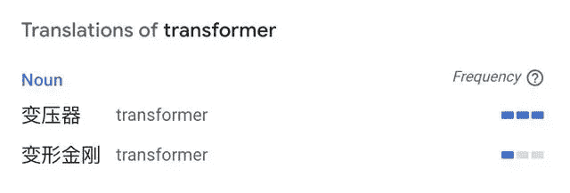

谷歌翻译上对“Transformer”的英译中翻译

再把“Transformer”放到“ Chat Generative Pre-trained Transformer”中看看，突然间变得奇怪了， 难道 ChatGPT 借鉴了变压器的技术？还是说 ChatGPT 是一个变形金刚？或者索性就翻译成通用的安全的叫法“转换器”？这让人百思不得其解。

光光从 G**PT 这三个字母的组合就能看出来**，“ Generative”与“Pre-trained”都是定语，而 “Transformer”才是 GPT 的主体，才是 GPT 的灵魂 所在。可以说，理解透了“Transformer”的真正含义，才能初步地理解 GPT。另一方面，“Transformer”这个词太重要了。它 在这几年的人工智能领域大放异彩，不仅仅局限于 NLP 自然语言处理领域，它还有着更广阔的发展空间。 “ Transformer”目前已经进入到了多模态领域，比如音频与视觉，甚至数学公式、代码编程等领域，著名的 Stable Diffusion 中也用到了“Transformer” 。可以说，所有生成式人工智能领域的大模型中目前都有了这个 “ Transformer”的身影。 既然如此重要，那就让我们深入地探究一下“Transformer”在人工智能领域最确切的最标准的含义到底是什么吧！

“**T**ransformer”最早是由 G oogle 的人工智能团队提出来的。在2017 年6月发表的论文 《Attention Is All You Need》中，他们首次提出了一种新的神经网络架构 Transformer 。Transformer 依赖于一个叫“自注意力机制”（ Self-Attention）的内部构件，可十分准确高效地对自然语言领域的问题进行处理，以完美地解决翻译、对话、论文协作甚至编程等复杂的问题。

顺藤摸瓜可以看出， **G**TP 的核心是 Transformer，而 Transformer 的核心则是“自注意力机制”（ Self-Attention） 。那么这个“自注意力机制”又是什东西呢？让我们用语言翻译领域的几个简单易懂的例子来讲解一下。

首先，看下面这两个短句：

+   句子I： The bank of the river.

+   句子II： Money in the bank.

在翻译成中文的过程中，机器算法是如何知道“句子I”中的“bank”指的是自然环境中的“岸边”，而“句子II”中的“bank”指的是金融体系中的“银行”呢？

作为人类的我们当然会觉得这是一个再简单不过的事情了，那是因为我们的语言技能从幼儿发展到成年人后，早已烂熟于心了。但即使烂熟于心，也并不意味着在我们的大脑中没有对应的计算过程。 实际上人工智能的翻译过程就是对我们人脑中的计算过程的模拟。 那么就让我们回想一下儿童时期学习语言时的情景吧，回想一下当时的我们是怎么知道一个多义词在某一句话中具体的含义的？

人类做这件事的方法是根据 **前后文的语义对照 **来确定结果，即看句子中其他相关联的单词是什么含义。在“句子I”中，“river”这个词指明了自然环境，而在“句子II”中，“money”这个词则指明了金融环境，所以两个句子中的多义词“bank”也就有了各自的定位。如果把这种方式总结成一种算法的话，这个算法就可以用于人工智能领域用于语言处理了。

但人工智能作为一种计算机算法，它只能处理冷冰冰的数字，并不知道何为“自然环境”，何为“金融环境”，它又是怎么去判断“river”和“money”各自的含义呢。实际上，机器算法并不知道“river”和“money”的具体含义。但是机器可以通过某种数字的方式来表达“river”和“money”，同时，通过数字的方式还表达了许许多多其他的词汇，其中必然会有一些词汇会与“river”和“money”有着很紧密的语义上的逻辑关系。通过判断“river”和“money”各与哪些词汇在语义上有紧密的逻辑关系，便可以知道这两个词各属于什么领域了。

（其实，不像人类会对某个领域有一个具体的名称来命名，在人工智能领域，机器最终也不知道这个领域**的统称到底叫什么名字，但它却知道这个领域中**都包括了哪些词、哪些概念和哪些逻辑。 机器不以单独名称来定义一个概念，它却可以用很多相关的概念与逻辑来圈定这一个概念！ 这可能就是老子说的：道可道非常道，名可名非常名吧。）

那么就让我们看看这种数字表达方式具体是什么样子吧。

假设这个世界上有100万个单词，每一个单词，我们都可以用一组 0 和 1 组成的向量（一组数字）来定义的话，那么每一个单词就可以被编码成100万个0或1组成的向量。如下图：

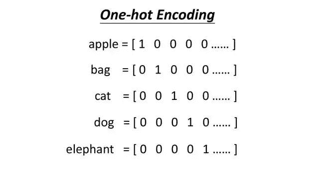

独热编码示意

这种单词编码方法叫 One-hot Encoding “独热编码”法。可是这样一维的编码方法将导致向量占用的空间过大，1个单词用100万个单元的向量表达，世界上一共有100万个单词，那么就需要 1万亿（100万*100万）的体积来把它们表达出来，很明显这种臃肿的结构不利于电脑计算。

但最大的问题还不在于这个体积问题，而是语义联系问题。独热编码使得单词与单词之间完全相互独立，从每个单词所编码成为的100万个单元的向量身上，根本看不出它与其他单词有何种语义内涵上的逻辑联系。比如，在这些数字中，我们无法知道 apple 和 bag 属于静物，区别于 cat 和 dog、elephant 属于动物且是哺乳动物，而 cat 和 dog 又属于小动物，且大多数为非野生，区别于 elephant 为大型的野生动物，等等等等，这些单词背后所蕴含的各种内在的逻辑联系和分类关系均无法从独热编码法中知晓。实际上独热编码是传统计算机数据库时代的产物，而在人工智能领域则采用另一种编码法。为了解决 独 热 编码的 问题，Word Embedding “词嵌入”编码法诞生了，如下图：

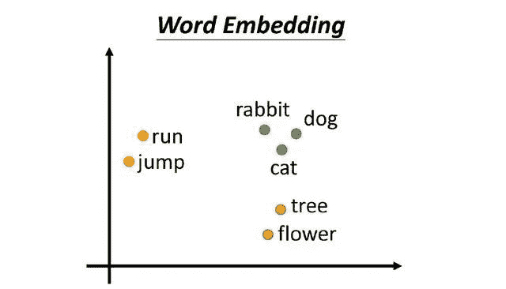

Word Embedding 词嵌入编码示意，及 Embedding 空间

Word Embedding “词嵌入”编码法将语义上相近的、有关联的词汇在 Embedding 空间中生成相近的位置**定位。**相对于“独热编码”法超长的一维数据，Embedding “词嵌入”编码法提升了数据的表达维度，它更像是在某一个“ 空间 ”中对词汇进行编码。

如上图（为了在此文章中表达方便，我们仅用二维空间来表达，实际上这个空间的维度很高，至少要在512维之上！一维二维三维的空间大家都可以在脑中想象出来对应的画面，但是四维以上以至于 512 维就难以图形化的想象了。），在 Embedding 的二维空间中 dog、cat、rabbit 三个向量的坐标点位排布，可以看到三个绿色的点距离很近，是因为他们三个相对于其他来说语义上更接近。tree 和 flower 则离它们较远，但是 cat 会因为在很多语言的文章中都会有“爬树”的词汇出现在同一句话中，所以导致 cat 会与 tree 离得较近一些。同时 dog、rabbit 与 tree 的关系就较远。

实际上，在 Embedding 空间中，词与词之间的关系还不仅仅限于语义上的分类所导致的定位远近这么简单。一个词所代表的事物与其他词所代表的事物之间能产生内在联系的往往有成百上千上万种之多。比如 man 和 woman，他们之间的关系还会映射出 king 和 queen 之间的关系。同时，语法也会带来一定的联系，比如在一个三维空间中由 walking 到 walked 的斜率竟然与 swimming 到 swam 的斜率一致，且距离几乎相等。因为这背后是两组动作单词的现在分词形式和过去分词形式的变化关系。我们可以尽情地想象，凡是事物或概念有逻辑联系的， 甚至是逻辑与逻辑之间的联系的， 在 Embedding 向量空间中都可以得到远近亲疏的空间表达。只不过这种“空间”要比我们能想象出的三维空间要高出很多维度。

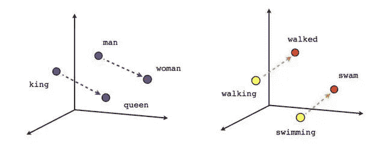

在 Embedding 空间中隐含的内在逻辑关系

Word Embedding 之所以能给每一个单词做这样有意义的向量空间的标注，是因为 AI 科学家们事先用了全球十多种主流语言的大量语料给它进行了训练。这些语料有小说、论文、学术期刊、网络文章、新闻报道、论坛对话记录等等等等，应有尽有，数以百亿到千亿计。可以说，这些海量的文字资料都是人类从古至今感受发现这个世界各个方面的文字总结和积累。现实世界中各种事物之间的逻辑关系都被人类用这些文字记录了下来，只是有的是用严谨的论文方式，有的是用写意的小说方式，有的使用类似维基百科这样的系统梳理，有的则是人们在网络论坛中的对话记录...等等等等。但不管是什么方式，都是人类试图用语言对这个世界的描述。

笔者7号床曾经问过 ChatGPT 一个问题：“人类最伟大的发明是什么”，ChatGPT的回答是：“语言！”。之后，ChatGPT 进一步回答，因为语言以及匹配语言的文字与符号，它们让人类把对世界的感受与理解记录下来，形成了知识宝库。方便全人类一代一代地不断完善这个宝库，并从中总结凝练、学习、创造、传承。语言是人类产生文明并开始与其他动物分道扬镳的分叉点。

很多人曾经十分疑惑，人工智能吹得那么先进，却从一个 ChatGPT 聊天功能开始火爆起来。难道每天不干正事专门闲聊就证明了人工智能的先进性吗？现在看来，这个问题的答案已经浮出水面了，OpenAI 的团队选择通过聊天软件 ChatGPT 作为 GPT 启程的第一步是经过深思熟虑的。

下面让我们回到正题。

ChatGPT 所说的这个知识宝库现在变得越来越庞大、越来越复杂了。这世界上并不存在任何一个肉身的人类有能力做到对宝库中所有信息进行消化整理，因为内容体量过于庞大、过于复杂。而一个人的阅览进度却又是十分有限，以至于在他的有生之年，哪怕完成其中的万分之一都比登天还难。于是，迫不得已，人类才喊出了“闻道有先后，术业有专攻”，每个人类个体才转而去研究具体某一领域。

另一方面，人类早期发明的纸张和印刷术，以至于后来的计算机芯片存储，倒是可以记录存储下来如此巨量的信息了，但却无法主动地、有机地分析汇总其中所有信息之间的内在逻辑。以至于计算机存储的这些数据越积越多，犹如汪洋大海。

这个知识宝库的结构就好比一棵万米高的巨大知识树，人类如同蚂蚁一样在树上摸索前行。人类只能将有限的肉身算力资源集中在主要的枝干，对于无数的细枝末节尚无暇顾及，但随着发现的主要枝干越来越多，细枝末节的信息量将呈爆炸的方式展现出来。而对于这棵知识巨树的展示能力，却因为计算机时代的到来而大大加速了进程。但当发现知识树越来越庞大时，人类也认识到了自身的渺小。

现在，这一探索知识树的任务落到了 AI 的身上，AI 的承载和运算能力超越了过往所有人类个体以及群体能力的总和。AI 通过事先的大量预训练，把这些海量文字用 Word Embedding 的方式抽象地汇总在了大模型之中。Word Embedding 词嵌入编码法，能让每一个单词之间产生应有的语义上的以及背后逻辑关系上的联系。这种联系越紧密，他们在 Embedding 空间中的位置距离越紧密，反之则越远。

想象一下，Google 用了至少千亿级的语料来训练单词在 Embedding 空间中的表达，其中包含了全世界几乎所有语言的词汇量。所以在回过头来考虑一下之前举例中的两句话时，就有了如下这样一副景象：

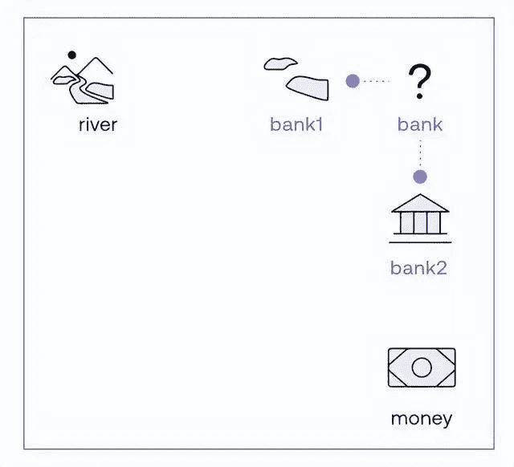

在 Word Embedding 向量空间中 “bank”、“river”和“money”的向量表达

如上图，我们用一个简单的位置关系图来展示一下“bank”、“river”和“money”这几个单词在 Embedding 空间中的位置关系（在实际 Embedding 空间中的关系要比这个图复杂数百倍，这里只是为了让大家更好地理解关键逻辑而做了简化）。

由于 “bank” 是一个多义词，所以它在 Embedding 空间中的定位本来是有多个“分身”，我们取其中的两个分身，即 “bank1”和“bank2” 。那么， 我们需要做的就是定位清晰“bank1”和“bank2”这两个单词在空间中到底各自离 “river”和“money”的 哪个单词更近一些。在图中很明显，“bank1”离“river”更近，而“bank2”离 “money” 更近，于是这两句话就变成了：

+   变形后的句子I： The bank1 of the river.

+   变形后的句子II： Money in the bank2.

如之前所说，虽然**此时机器算法压根也不知道“river”和“money”到底是何物，但它知道**在Embedding 空间中，“river”周边有很多和大自然有关的词汇，比如“water”、“tree”、“fish”等等。而“money”周边有许多与金融有关的词汇，比如“currency”, “cash”, “withdraw”等等。于是，机器算法知道了“bank1”代表的是与“river”有关的一个单词，与他们比较近的单词还有“water”、“tree”、“fish”等等，而“bank2”代表的是与“money”有关的一个单词，与他们比较接近的单词还有“currency”, “cash”, “withdraw”等等。这就是 “Attention 注意力机制”的工作原理，也就是 Attention 让一个单词在句子中找到与它产生强语义联系的其他单词，并组成一个新的“变体单词” ：“bank1”、“bank2”。

然后又有新的问题产生了，机器算法是如何知道一句话中只有“river”或“money”这两个词代表了上下文语义的强关联词汇，而不是“The”、“in”、“of”或其他单词呢？实际上这依旧是 Embedding 空间中每一个单词的空间定位相近程度的问题。（实际上，在 Embedding 空间中，不仅仅名词有各自的位置，动词、介词、形容词等等都有自己的位置，甚至一个词组、一句话也会有自己的位置。）

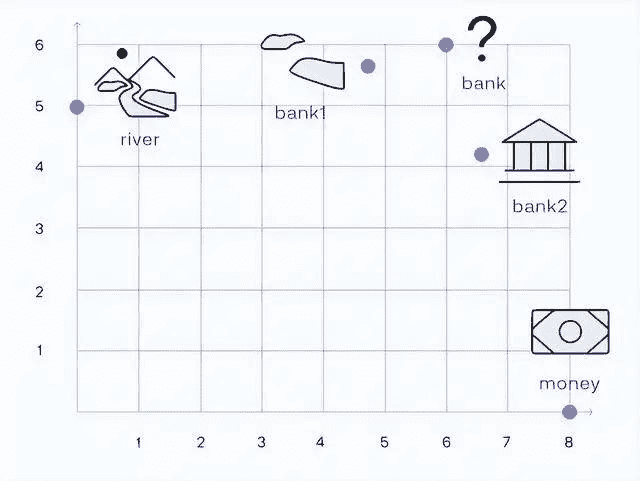

全句中的每一个单词在 Embedding 空间中定位的相近度是这样来计算的。机器算法会对每一个单词与全句中其他单词逐一地配对，做语义关联程度的计算和比较，最终汇总到表格中，颜色越深代表语义关联程度越高。

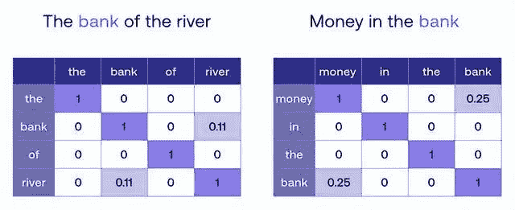

一个句子中所有单词都做一遍“Attention 注意力机制”

我们可以从表格中看出来：

+   每一个单词与自己的相似度为最高分“1”（一般用数值“1”来代表最大权重，这里的相似度用权重来表达）；

+   互不相关的单词之间的语义关联度为 0（其实可能是 0.001 之类的很小的数字，这里做了简化，即值太小，以至于低于某一个阈值而归零处理）；

+   “bank” 与 “river” 的相似度为 0.11；

+   “bank” 与 “money”的相似度为 0.25；

这样， **巡**遍全句中所有单词一一配对进行注意力机制的检查，得到的结果进行汇总比对的机制，就叫“Self-Attention 自注意力机制”了。 于是通过“自注意力机制”的语义关联比对后，我们便找出了“river”为“ 句子I ”全句中与“bank”关联度最大的词，“money”为“ 句子II ”全句中与“bank”关联度最大的单词，然后“ 句子I ”中的“bank”就被机器算法转换成了它的新变种“bank1”（“river-bank”），而在“ 句子2 ”中的“bank”则被机器算法转换成了它的新变种“bank2”（“money-bank”）。然后机器算法就可以继续往后进行翻译工作了。

Embedding 是一个全场景全维度的空间，它其中含有全世界的所有语言的单词。在这同一空间中，不仅仅有英文，也有中文、法文、德文...等等的 Embedding 词汇标注。那么基于 Embedding 空间表达的的翻译就变成了现实。比如，中文的“河流”和英文的“river”在 Embedding 空间中的位置基本是一样的，而“钱”和“money”的位置基本一样，“岸边”和“bank1”的位置一样，“银行”和“bank2”的位置一样。于是，把这些不同语言的定位一一找出来，就实现了十分正确的翻译结果了。

+   句子I： The bank1 of the river.

+   句子I翻译： 那个河流的岸边。

+   句子II： Money in the bank2.

+   句子II翻译： 银行中的钱。

+

至此，Transformer 和其中的核心部件 Self-Attention 对于语言翻译类信息处理的流程就被简要地讲清楚了。但像上面例子中“The bank of the river.”这样的句子太短太简单了，它甚至都无法称为一个完整的句子。在实际项目中，输入给 Transformer 的语句会更长更复杂，往往在一句话有可能出现三个以上的单词有语义关联的关系。比如这一句：“The animal did not cross the street because it was too tired. ”。很明显，在该句中和“it”有语义关系的词汇有两个，分别是“animal”和“street”。

对于这样的情况，处理机制和“The bank of the river.”的处理机制仍然是一样的。Self-Attention 一样会对全句中的所有单词都进行在 Embedding 空间中的距离比较，即语义关联权重的比较。

在“The animal did not cross the street because it was too tired.”中“it”与“animal”的语义关联权重比与“street”的语义关联权重要高。因此，Self-Attention 自注意力机制处理后的结果将以“animal”为主导来生成新的单词“ it1 ”，即“ it1” = “animal-it” 。此时就变成了“The animal did not cross the street because it1 was too tired. ” 。翻译成法语为：“L‘animal n’a pas traverse la rue parce il était trop fatigue.” 。翻译成中文则为：“这只动物没有过马路，因为 它 太累了。”。

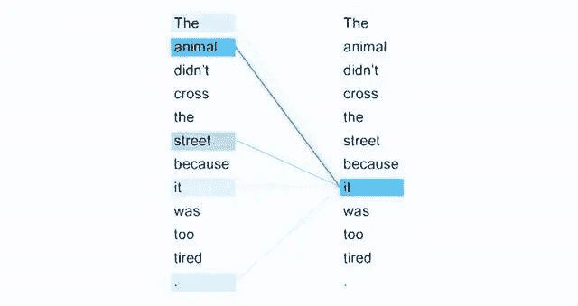

色块的深浅表明了与“it”语义关联权重的强弱。这里“it”与“animal”的语义关联权重最大

在另一句话中，“The animal did not cross the street because it was too wide.” ，只是一字之差，“tired”变成了“wide”，导致了全句的语义发生了很大的变化，尤其是“it”所指的对象由“animal”变成了“street”。此时 Self-Attention 同样按照以前的方法进行语义关联度匹配，结果是“animal”和“street”的权重在全句中都很高，但是“street”是最高的，所以最终的结果将以“street”主导来生成新的“ it2 ”，即“ it2” = “street-it” 。此时就变成了“The animal did not cross the street because it2 was too wide.” 。翻译成法语为：“L‘animal n’a pas traverse la rue parce elle était trop large. ”。 翻译成中文为：“这只动物没有过马路，因为 路 太宽了。” （注意：这里用的是“路”，而不是“它”，稍后会解释） 。

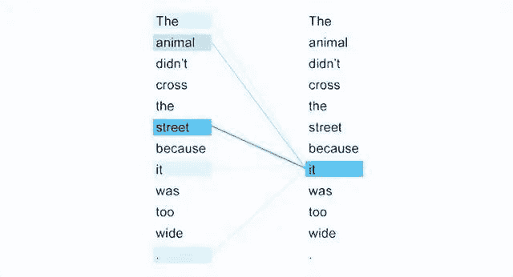

这里“it”与“street”的语义关联权重最大

之所以 Self-Attention 可以把 Word Embedding 中的权重比较做得如此细腻，不仅是因为 Google 用了千亿级的语料来训练 Word Embedding。同时更是因为 Transformer 模型本身的架构核心 Self-Attention 也有与之匹配的超级强大的处理能力，它在超长语句上的处理能力远远超过了早先的 RNN （循环神经网络）和 CNN （卷积神经网络）（这两个著名的人工神经网络我会在之后的文章中一一介绍），它不仅仅能对一句中所有单词做 Self-Attention 自注意力机制的审核，它还可以对一整段话，甚至全篇文章做审核。这就是我们通常说的要结合上下文来理解翻译。最新的 GPT-4 Turbo 一次可以处理大约 9.6 万个单词，比许多小说都长。此外，12.8万字（128K）的上下文长度可以导致更长的对话，而不会让人工智能在对话或翻译过程中迷失方向。

这一强大的能力，同样也来源于 Word Embedding 的能力。它不仅仅可以对单个词语进行定位，它甚至还可以做到对句子进行逻辑定位，如下图中所示。这种能力被称为“Sentence Embedding”。

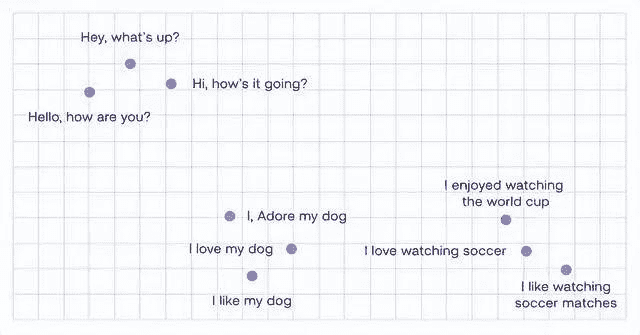

Sentence Embedding 可以表达句子与句子之间的关系

Word Embedding 和 Sentence Embedding 是大语言模型（Large Language Models，LLMs）的重要基础组**成部**分。它们将人类语言转化为了计算机能够读懂的底层数字表达方式，并且通过多维度的空间定位捕捉了各个单词、短语、句子在语义上的细微差别，以及它们之间的逻辑联系。 这种底层的数字表达已经跨越了不同的语系语言，成为了全人类共用的最底层语言逻辑，甚至成为了一种世界语——AI 世界语，这对于翻译、搜索和理解不同语言语种具有非常重要的作用。可以说，巴别塔的传说自此解决！！

既有“大力出奇迹”的训练内容，更有承载“大力出奇迹”的结构，最终导致 Transformer 必然产生了这样的“奇迹”，使它能够在机器翻译领域达到了人类翻译的“信达雅”的成就。

BLEU 英译德评分

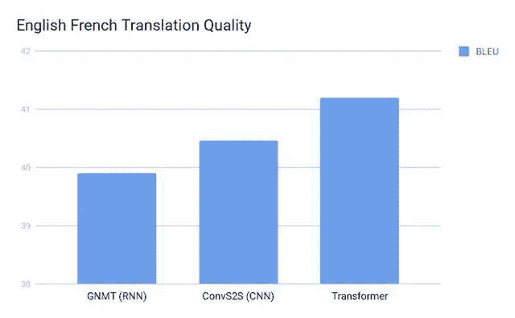

BLEU 英译法评分

上两幅图中，在 BLEU 的英德翻译与英法翻译领域 Transformer 得分最高。（ 注：BLEU，bilingual evaluation understudy，即：双语互译质量评估辅助工具。它是用来评估机器翻译质量的工具。BLEU的设计思想：机器翻译结果越接近专业人工翻译的结果则越好。）

通过一个小例子就能看出它的优越性，正好说说为什么是“路”而不是“它”，之前这两句的翻译结果如下：

+   The animal did not cross the street because it1 was too tired.

+   L'animal n'a pas traversé la rue car il était trop fatigué.

+   这只动物没有过马路，因为 它 太累了。

+   The animal did not cross the street because it2 was too wide.

+   L'animal n'a pas traversé la rue parce elle était trop large.

+   这只动物没有过马路，因为 路 太宽了。

在法语中 il 和 elle 是明显不同的， 因此他们可以在各自句子中指代出“it”的不同的翻译结果，不会引起语义模糊。这种在法语中明显的区别在翻译成中文时，就没有这么简单了。如果把两句话翻译成中文，“it”都可以被粗糙地翻译成“它”，则第二句的语义将被普遍地认为不够精准，因为翻译成“它”会产生一定的语义模糊。取而代之，用“路”则更能达到“信达雅”的效果。大家可以用不同的翻译软件测试一下这两句话的英译中翻译，就知道哪些软件用了 Transformer 的底层技术，而哪些没用了！（你懂的）

好了，绕了这么远，解释了这么多，终于可以说说这个“Transformer”到底是什么意思了！

# 人工智能领域 Transformer 的确切含义

**单词“X”转化为“X1”，“X”代表在 Transformer 处理之前一句话中的单词，而“X1”则代表了经过 Tran**sformer 的 Slef-Attention 处理之后，附加了句子中其他具有强语义关联关系的单词后的“变种单词”。 其实，句子还是原来那个句子，单词还是那个单词，本质并没有变，但表达形式却变了。就如同“bank”被转变成了“bank1”一样。“bank1”的灵魂还是那个“bank”，但是“bank1”展示出来了隐藏在“bank”身体中的另一面“river-bank”。

所以，用众所周知的“变形金刚 Transformer”来命名再贴切不过了~**！“bank”变形成了“bank1”， “bank”与“bank1”异体同身！** “大黄蜂”既是机器人，“大黄蜂”也是跑车。由车变形到机器人，再由机器人变形到车，万变不离其宗，都是“大黄蜂”，本质上并没有改变，但是，外观变了，用途也就变了！

在车的状态下，容易让人混淆（你本以为它是一辆车，但其实他是一个机器人，不变成人形，你还真认不出来）。就如同多义词一样，过往的翻译机制很难辨认出它在一句话中的确切含义，他们虽然也有上下文语义的兼顾理解能力，但是处理信息量还是太少，导致他们无法做到十分精准，经常造成单词虽然翻译对了，但放在句子里却容易产生含混不清甚至错误。但是通过 Transformer 的变形操作，“大黄蜂”的车状态就变形成了同样叫“大黄蜂”的机器人状态，再放回到句子中，则让它现了原型，于是一切水落石出！

“大黄蜂”既是机器人，“大黄蜂”也是跑车，本质上都是同一个家伙，只是在不同的场合有不同的用途。

Google 的技术团队就是用了“变形金刚 Transformer”这个梗。如此的诙谐幽默、简单直白，半开玩笑地就起了个技术名词。但也不得不承认“变形金刚 Transformer”这个词用在这里，用于这个技术名词的命名，也确实再贴切不过了，真正的名副其实！

所以，当下次有人问你“GPT”到底是什么、翻译成中文又是什么意思时，你就可以明确地对他说：“生成式预训练转换器”或者“生成式预训练变形金刚” （前者翻译得其实也很含糊，所以我建议后者，虽然对方可能会嘲笑你几分钟） 。懂的人自然懂，不懂的也不用去解释！

————————

***如果你对以上文章感觉还是十分晦涩难懂，这里还有一个更短小更有意思的比喻来解释 Transformer 和它的灵魂 Self-Attention 机制：

Transformer 中有一个核心灵魂组件叫 Self-Attention。搞明白这个 Self-Attention 也就搞明白了神秘又强大的 Transformer。然而我查遍了所有解释 Self-Attention 的文章，发现要想讲透 Self-Attention 就必须满篇的公式和晦涩难懂的专业术语，普通人压根无法看懂。为此，我特地从另一个角度，完全用比喻的方式针对 Self-Attention 给出了一个思想框架的解读，以方便大家理解。

如果把“Self-Attention 自注意力机制”映射到人间社会，突然就变得很容易理解了，而且绝对让你感同身受、一点就通。 “Self-Attention”在人间社会来说，就是每个人如何找准自己在社会中的定位的问题，无论是在一个公司、还是在一个团队、还是在一个家庭里。

比如你进入了一个大企业，成为了一个部门中团队的一员。毕竟公司是人与人之间、人与团队之间、团队与团队之间的合作。此时，“Attention 注意力机制”就是你刚进入这个团队后的最基本诉求，如何在一个少则三五人多则几十人的团队中，搞清楚别人的工作与自己的工作之间的关联关系，从而找准自己的定位。

为了让自己找准在团队中的定位并快速融入，此时你需要首先将注意力放在重要的人物以及对你有重要影响的人身上，比如团队中的领导、小组长以及和你工作岗位上下游衔接紧密的人，这就是 “Attention 注意力机制” ，即你需要把关注的重心放在与你关联度最紧密的人身上。

下面再进一步，看看自注意力机制。

“ Self-Attention 自注意力机制” 就是团队中的每一个人都像你一样与团队中其他人做一遍注意力机制的审查。这就是 Self-Attention 自注意力机制了。

自注意力机制的好处是什么呢？

自注意力机制可以使得团队中的每一个人都可以清晰地找准自己在团队中的定位。当每个人都可以找准定位之后，那么这个团队也就是一个十分优秀的团队了。

Transformer 最早不是用在 GPT 中的，而是在语言翻译领域。有了 Transformer 的赋能，使得翻译引擎达到了“信达雅”的翻译效果，以至于达到了一个人类翻译大师的水准。

如果同样用这个职场团队的比喻去解释 Transformer 的 Self-Attention 在语言翻译领域中所起的作用的话。我们就可以理解为一个快速扩张的餐饮连锁企业了。当一个成功的餐饮店铺的盈利模式确定好，并且经过实践的检验开始稳固盈利了之后，老板快速地在全国各个城市复制这个店铺成为连锁经营的企业。那么每一个店铺中的管理团队基本都是一样的，店长、店员、配菜...每个岗位的角色定位都十分清晰，各岗位间的运作流程都遵循着统一的规章制度。连锁店铺发展的关键点就在于可快速复制性，而高复制性则是由于全流程的标准化、规范化。

这种规范性已经达到了相当的程度，以至于突然间将 A店的人全部调离，而用 B店的人来一一代替，这个店仍然能良好地运行。这就像翻译一样，从一种语言翻译成了另一种语言。每个单词的灵魂没有改变，但却变成了另外一个语言里的单词。每家店铺就是不同的语言的句子，每一个员工就是组成这个语句的每个单词。虽然换了另外一个语言，但是每个员工的角色扮演十分到位，瞬间入位，句子切换成功。

所以，我们才会发现，原来发明这个 Transformer 的 Google 技术团队，是要用真正的“变形金刚”这个词来表达这个大模型的内在逻辑。

“大黄蜂”既是机器人，“大黄蜂”也是跑车，由车变形到机器人，再由机器人变形到车，都是“大黄蜂”，本质上并没有改变。但是，外观变了、用途变了！也就是说不管用中文、英语、德语、法语来变化都是一样的，那只是表面形式上的变换造型而已。因为每一个单词在不同语言中所代表的含义的实质，在人工智能的大模型中都是同一个。所以，大黄蜂的造型无论怎么切换，它的灵魂都只是一个，切换不同的造型就可以演化出不同“语言的句子”！这就是 Transformer 的由来。也是ChatGPT中，最后这个字母“T”的意思（ ChatGPT 的全称是 Chat Generative Pre-trained Transformer）。

“大黄蜂”既是机器人大黄蜂，也是跑车大黄蜂，本质上都是同一个家伙，只是各有各的用途。

自注意力机制在一个很小的团队中可以起到重要的作用，比如西天取经的师徒四人、一个三口之家、临时组成的五六个人的小团队，它在一个更大的系统中依旧会发挥作用，而且是更重要的作用。比如一个大家族、一个几十人的项目团队，或更大的团体、大企业、社会组织中都会起到十分重要的作用。而且从 Transformer 的模型特点来说，人越多，通过 Transformer 机制进行的“Self-Attention 自注意力机制”自我反观就越到位，每个人的自我认识越清晰，全体成员越协调。虽然，人数越多 Self-Attention 的难度也越大，但这才是大团队的价值所在啊~！否则，要那么多人干什么呢？

这从大语音模型的表现上已经看得一清二楚了。假设每一个单词就是团队中的一员，现在 GPT 已经可以做到一次处理几万字的文章信息了。也就是说 ChatGPT 一次的运算可以在几秒钟内给一本书的所有文字做逐一配对的自注意力计算，这当然能够挖掘出每个单词在全书中的定位了，即使它是有着七八个不同意思的多义词，最终也不会迷失自己。当 OpenAI 的团队拿出了千亿数量级的过往人类总结的各种知识的文本来训练 GPT 之后，ChatGPT 自然也可以回答出你问的任何问题了。

生活中，人与人相处的困惑很多时候的根源问题都来自于没有找准自己的定位，为人子、为人夫、为人妻、为人母、为人父、为人下属、为人领导、为人同事。。。该怎样找准自己的定位是摆在每个人面前的最基础问题，当然也是最难的问题， “Self-Attention”则给出了很好的答案！

为了让我们能够方便地理解，“公司团队”是极度简化后的模型比喻。但很明显，在现实世界中，这种模型将面临几十倍甚至成百上千倍的变数来干扰，导致这一模型无法如愿以偿地单纯地运行。但要知道，即使是变数本身也是可以找到规律的，如果你愿意去探究挖掘，并建立起数学模型和机器学习算法，把不同维度的变量输入给建立在更复杂场景之上的人工智能神经网络时，那最终结果都将会逐渐逼近于现实。就像尤瓦尔赫拉利在他的著作《人类简史》中所描述的，世间的一切皆是算法！这也是 Goolge 为什么在发布的 Transformer 的文章时用了这样一个标题的原因 《Attention Is All You Need》 （论文地址：https://arxiv.org/abs/1706.03762）。

7号床

2023年11月11日

+   实际上 Transformer 的 Self-Attention 还有“多头自注意力机制 Multi-head Self-Attention”作为进一步遍查语义关联关系的稳妥冗余。同时还有 QKV 等等等等更深入的技术解读，这里不一一讲解了，以后会在单独的文章中进行详细介绍。

+   Transformer 作为我的一系列文章的开篇之作，我将一直本着让非专业人士也能看懂的讲解，尽量以比喻和通俗易懂的图表等方式来描述技术术语的原则。这同样是本着 AI 将人类知识壁垒大幅度降低门槛好让更多的普通人都能够涉足专业领域的宗旨，不仅仅是语言领域的巴别塔的解决，更是更多领域的巴别塔的解决，比如 Stable Diffusion 模型让一个从没有学过 PS 却有着超强艺术细胞和创造力的广场舞大妈都能绘出顶级的 CG 作品，而他们却因为年轻时的某些原因错过了走入专业领域的机会，或许是出身、或许是经济条件、或许是其他的命运所致。随着 AI 的进一步发展，以后可能再没有“专业”这个词汇，除非...除非某些食物链条的关键节点刻意阻止或阉割这一进程。所以，用普通人、非专业人士都能看懂的方式来讲解是我的原则，也请专业人士给予一定理解。

+   查询资料、分析、组织、撰写…工作不易，请多多支持我。转载请注明出处，将万分感谢🙏。