# 一次性讲透AI大模型的核心概念

> 来源：[https://agijuejin.feishu.cn/docx/B6pxdAzffoq2kBxz4eRcjZYtntN](https://agijuejin.feishu.cn/docx/B6pxdAzffoq2kBxz4eRcjZYtntN)

> 作者：AI小智

> 原文：https://mp.weixin.qq.com/s/KGU3uekq585dTCel9y9_5w

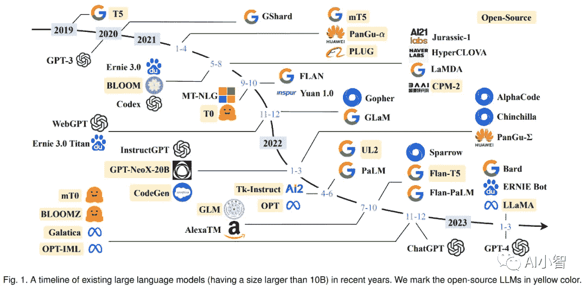

> 令牌，向量，嵌入，注意力，这些AI大模型名词是否一直让你感觉熟悉又陌生，如果答案肯定的话，那么朋友，今天这篇科普神文不容错过。我将结合大量示例及可视化的图形手段，为你由浅入深一次性讲透AI大模型的核心概念。

## ** ****引言**

随着科技公司及国际竞争的不断推进，AI大模型已经越来越多融入我们的生活。作为一个普通人或许不需要研究高深的AI算法，但想在这次AI浪潮中不被抛弃，必须对LLM原理有一个基本的理解。

理解LLM（即Large Language Model，大语言模型）如何生成文本也就意味着理解这些模型为什么是如此通用的认知引擎——以及它们还能帮助创造什么。

## 令牌化和向量化（Token&Vectorization）

首先，让我们从 **令牌化和向量化 **开**始，这一部分**内容将为大家解开AI大模型的第一层面纱-AI大模型时如何理解人类语言的。通过这一部分的讲解也将为大家构建AI大模型的 基础数学观 。

+   为了读懂人类提问和输出回答,LLM必须先将单词翻译成它们能理解的语言。

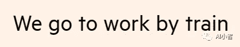

+   首先,一块文字被分割成 **令牌(tokens) **——可以编码的基本单位。令牌通常代表词的片段,但我们会将每个完整的词变成一个令牌。

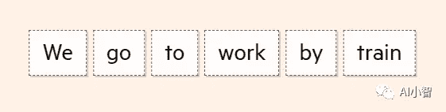

+   为了掌握一个词的意思,例如 **work **,LLM首先通过使用大量训练数据观察它的上下文,注意它的 邻近词 。这些数据集基于收集互联网上发表的文本,新LLM使用数十亿个词进行训练。

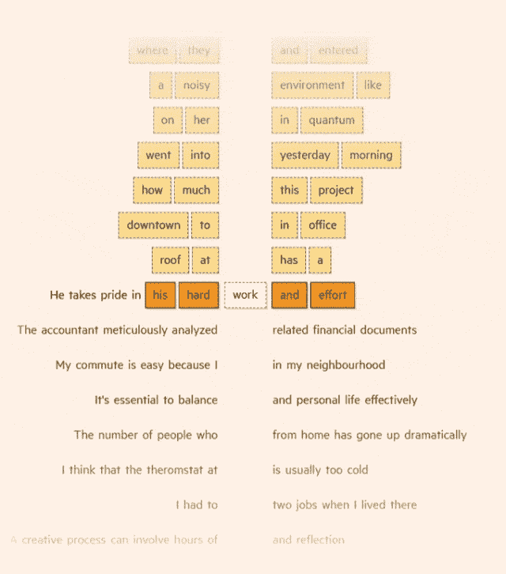

+   最终,我们得到一个巨大的与 **work **在训练数据中 一起出现的词集(E.g:roof) ,以及那些 没有(E.g:dove) 与它一起出现的词集。

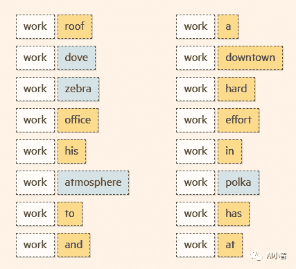

+   当模型 处理 这个词集时,它会产生一个向量——或**数值列表—**—并根据每个词在训练数据中与 work 的邻近程度来调整它。这个向量被称为 词嵌入(embedding) 。

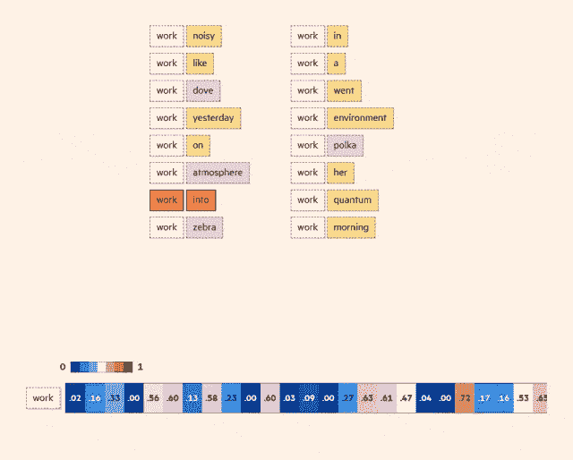

+   一个词嵌入可以包含数百个值,每个值表示一个词意义的不同方面。就像你可能会通过其特征来描述一座房子——类型、位置、卧室、浴室、楼层——嵌入中的值可以定量表示一个词的语言特征。

+   这些特征的派生方**式意味着**我们**不确切知道每**个值表示什么,但我们预期在可比较的方式中使用的词,其嵌入往往看起来相似。
比如一对词组如 sea 和 ocean ,它们可能不会在完全相同的上下文中使用(“all at ocean”不是“all at sea”的直接替代),但它们的意思很接近,并且嵌入允许我们量化这种接近程度。

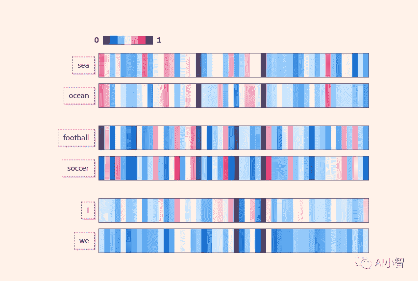

+   通过将每个嵌入表示的数百个值减少到只有两个,我们可以更清楚地看到这些词之间的距离。

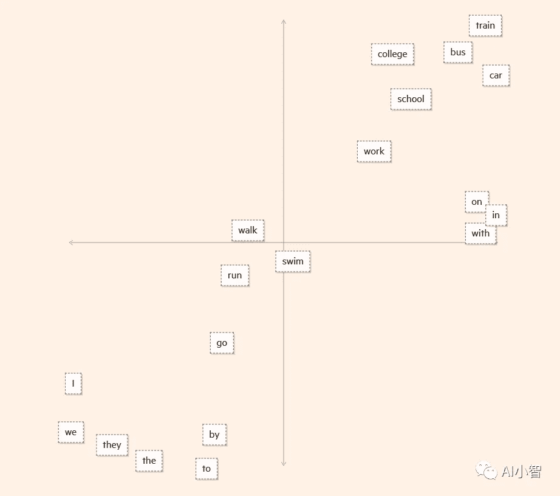

+   我们可能会发现 代词 的簇集,或 交通工具 的模式,能够定量表示词汇的方式是模型生成文本的第一步。

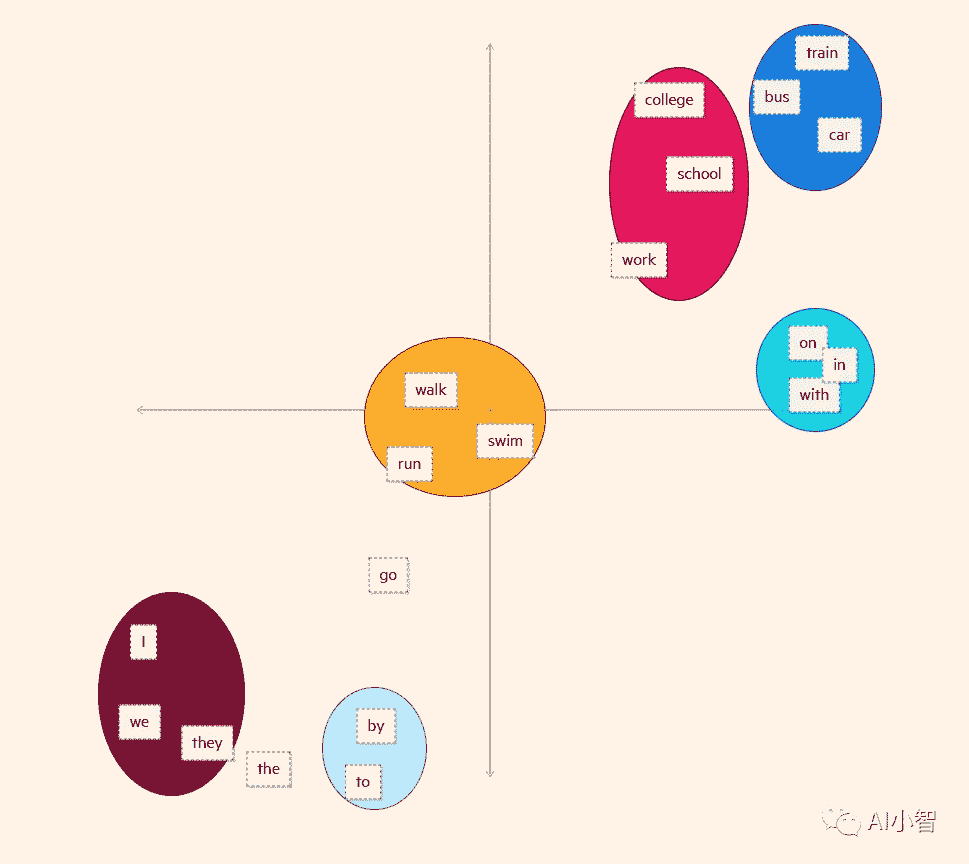

## **Transformer **

在搞**清楚了大模型是如何理解人**类语言之后，或许你会觉得不过如此，这与LLM表现出的强大功能似乎并不相符。没错仅仅靠令牌和向量化还不足以使LLM如此聪明，接下来我们将直抵AI大模型的心脏- Transformer ，正是依靠Transformer,LLM才能够像今天这样流畅地解析和书写,它从根本上加快并增强了计算机理解语言的方式。

阐述**transforme**r模型的研究首次由谷歌的8名AI研究人员在2017年6月发表，正是大家耳熟能详的《Attention is All You Need》开启了AI的新纪元， Attention 也将是下文着重讲解的核心概念，我将带领大家在上述数学模型的基础上构建对LLM的基础概念抽象。

+   Transformer体系结构的一个关键概念是自注意力(Attention)。这就是允许LLM理解词之间关系的原因。

+   自注意力查看文本中的每个 令牌(token) ,并决定哪些对理解其含义最重要。

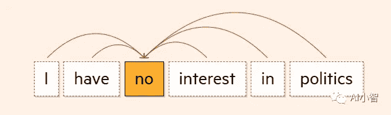

+   在transformer之前,最先进的AI翻译方法是循环神经网络(RNN),它逐字扫描句子并顺序处理。

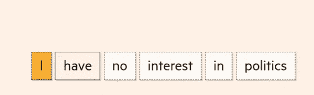

+   通过自注意力,transformer可以同时计算句子中的所有单词。捕捉这种上下文为LLM提供了更复杂的语言处理能力。

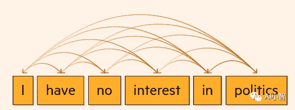

+   在这个例子中,同时评估整个句子意味着transformer能够理解 interest 在这里作为名词使用,以解释个人对政治的看法。

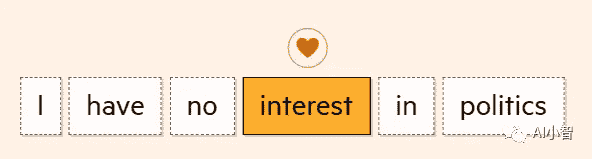

+   如果我们调整句子...

+   ...模型就会理解 interest 现在是在金融意义上使用。

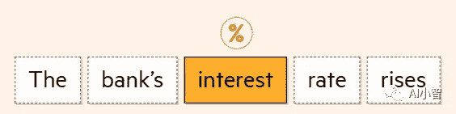

当我们组合这些句子时,模型仍然能够识别每个词的正确含义,这要归功于它对伴随文本的注意力。

+   第一次使用interest,它主要注意到 no 和 in 。

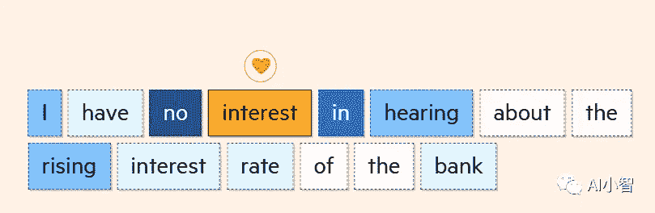

+   第二次,它主要注意到 rate 和 bank 。

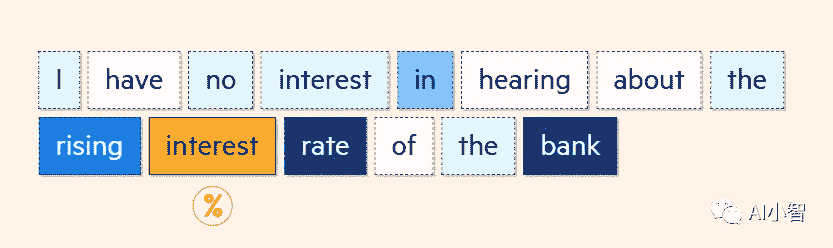

+   这种功能对于高级文本生成至关重要。没有它,在某些上下文中可以互换但在其他上下文中不可以的词可能会被错误使用。

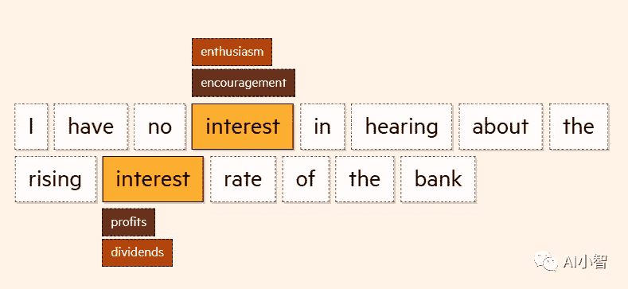

+   实际上,自注意力意味着如果这个句子的摘要被生成,您不会在讨论利率时使用 enthusiasm 这个词。

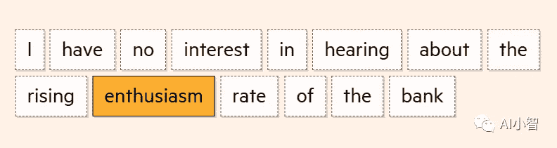

+   这种能力远远超越像interest这样有多个意思的词。

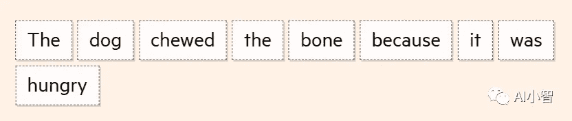

+   在下面的句子中,自注意力能够计算出 it 最有可能指代 dog 。

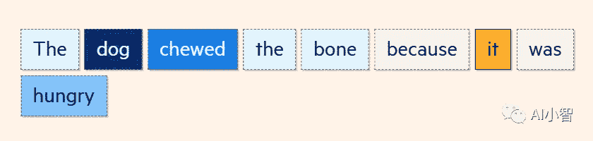

+   如果我们改变句子,将 hungry 替换为 delicious ,模型能够重新计算,现在 it 最有可能指代 bone 。

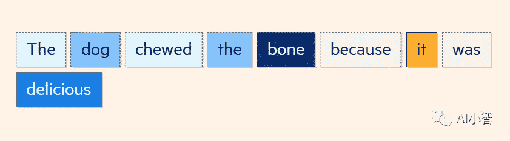

+   随着规模的扩大,自注意力对语言处理的好处也越**来越大。它允许LLM从句子**边界之外获取 上下文(context) ,让模型对一个词的使用方式有更深入的理解。

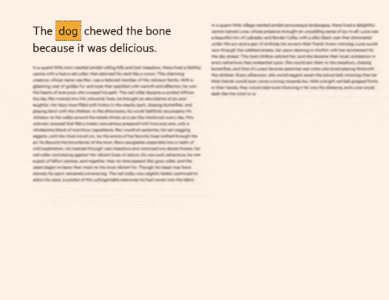

## **LLM **

理解了LLM基础数学原理和模型概念抽象后，大家是不是很兴奋，最后让我们看看目前世界上最先的大预言模型到底做了什么，构建了如此缤纷多彩的AI应用世界。

大模型之所以被称之为大，是因为其训练有我们整个互联网的基础语料库的支撑，从这巨大的语料库中,模型学会识别模式,最终预测下一个最佳选项。接下来我将带领大家直面大模型，为大家揭秘LLM是如何涌现智能，成为最像人的人工智能的。

+   基于上文的Transformer模型,对互联网语料库处理后，我们可以生成人类语言的数据模型,表示机器所理解的输入,包括词义、位置和词之间的关系。

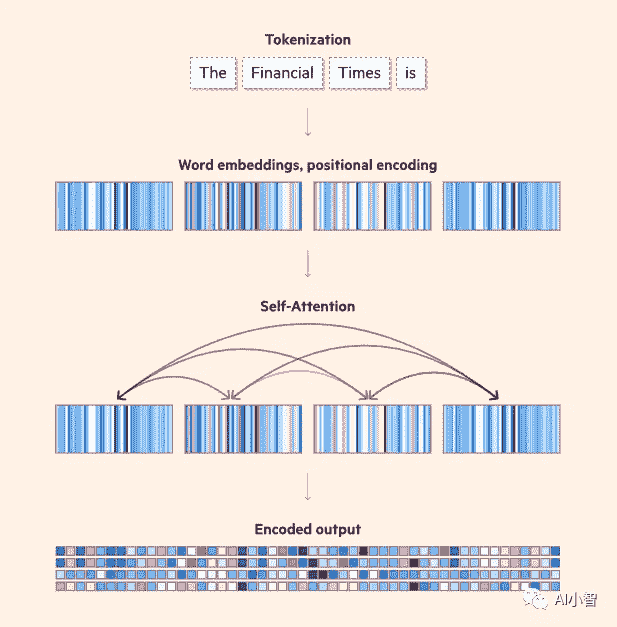

+   基于以上数学模型，求取最优解最简单的方式,就是将模型的目标设定为预测一个序列中的下一个词,并重复此过程直到输出完成。

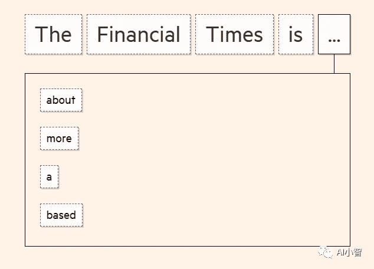

+   为此,模型给每个令牌一个 概率分数(probability score) ,表示它是序列中下一个词的可能性。

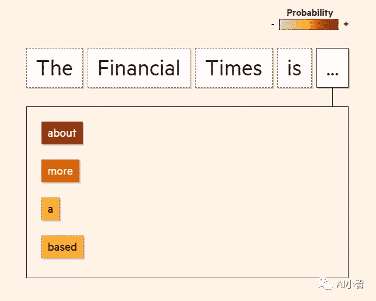

+   它将继续这样做,直到对所产生的文本感到满意。

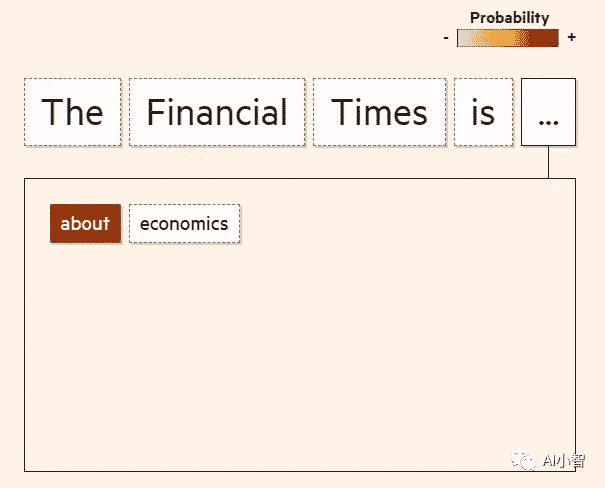

+   但是,这种隔离地预测下一个词的方法(称为“贪心搜索”)会引入问题。虽然每个令牌可能是下一个最佳选择,但整个短语可能不太相关。
并不一定总是错误,但可能也不是你所期望的。

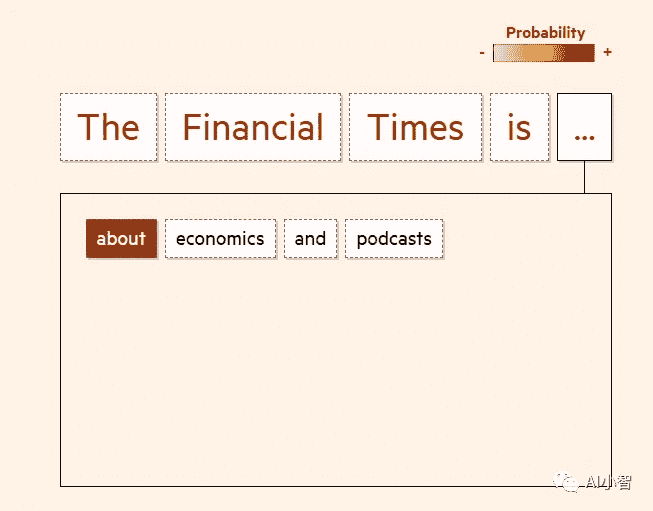

+   Transformer使用多种方法来解决这个问题并提高输出质量。一个例子叫束搜索。
它不仅关注序列中下一个词,而是考虑一组较大令牌集合的概率。

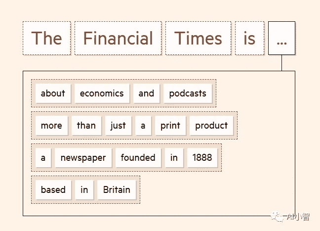

+   通过束搜索,模型能够考虑多种路径并找到最佳选项。

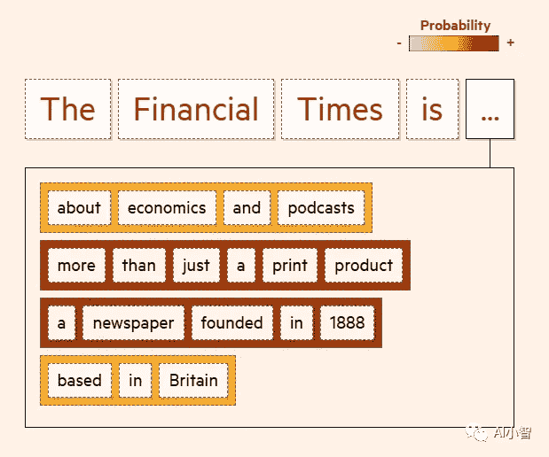

+   这会产生更好的结果,最终导致更连贯、更人性化的文本。

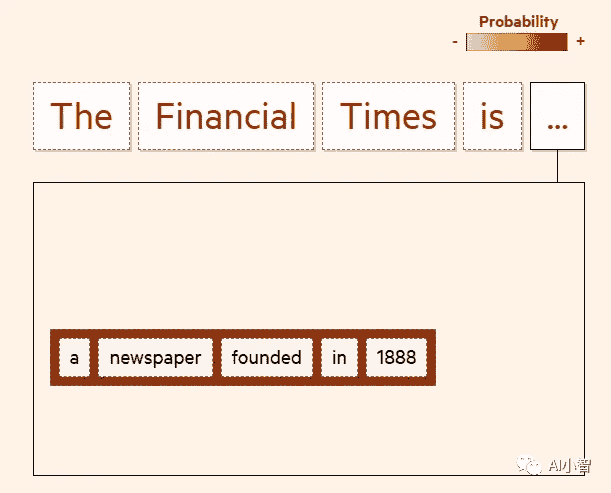

## ** ****总结**

Transformer已经引领了各种尖端的AI应用程序的创建。除了支持像Bard和ChatGPT这样的聊天机器人之外,它还驱动我们移动键盘上的自动完成功能和智能扬声器中的语音识别。

然而,它的真正威力在语言之外。它的发明者发现,transformer模型可以识别和预测任何重复的主题或模式。从图片中的像素,使用Dall-E、Midjourney和Stable Diffusion等工具,到计算机代码使用GitHub Copilot等生成器。它甚至可以预测音乐中的音符和蛋白质中的DNA来帮助设计药物分子。

数十年来,研究人员构建了专门的模型来总结、翻译、搜索和检索。transformer统一了那些动作到一个单一的结构中,使其能够执行大量各种各样的任务。

通过一个统一的语言模型，实现了从图像，音乐，视频多模态的应用，并且强于以往所有的AI应用，这就是这个故事神奇的地方。

参考链接：[1]https://ig.ft.com/generative-ai/

**PS ： **A**I小智 **技 术交流群（技术交流、摸鱼、白嫖课程为主）又不定时开放了，感兴趣的朋友，可以在下方公号内回复： 666 ，即可进入。